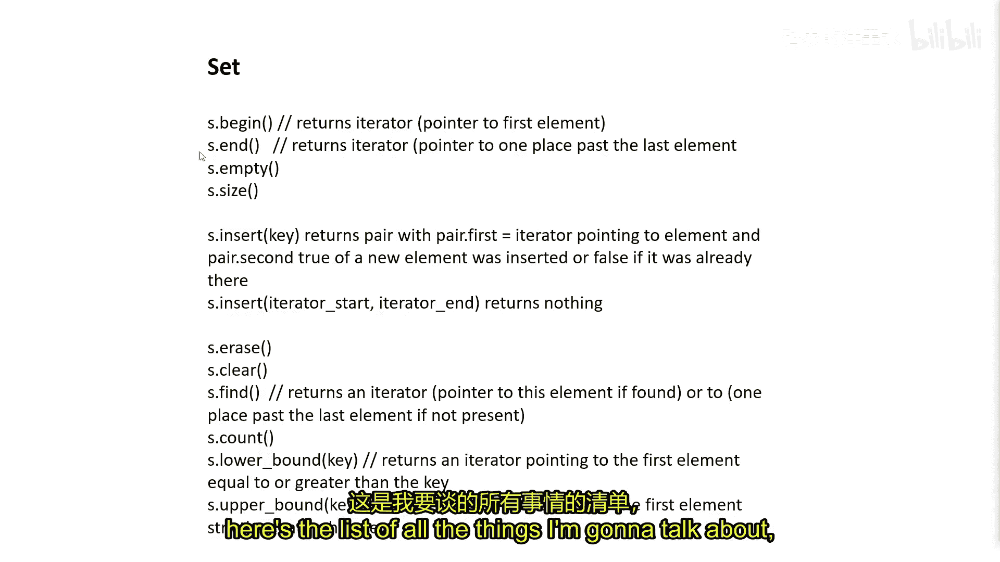
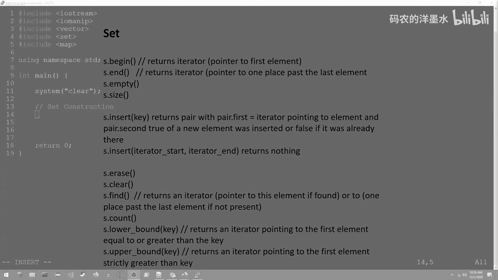
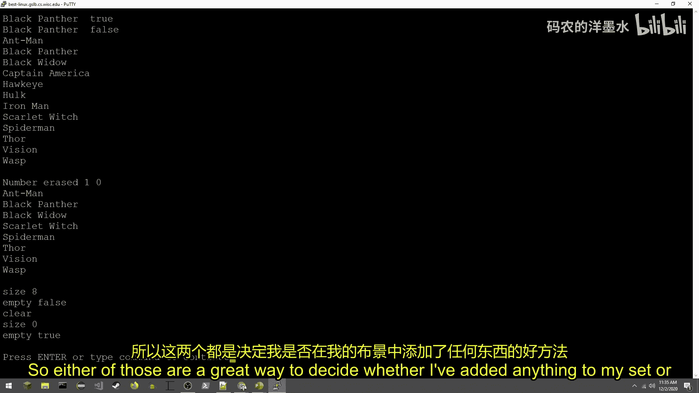
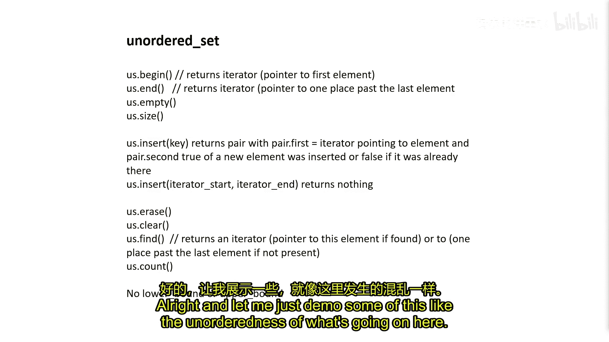
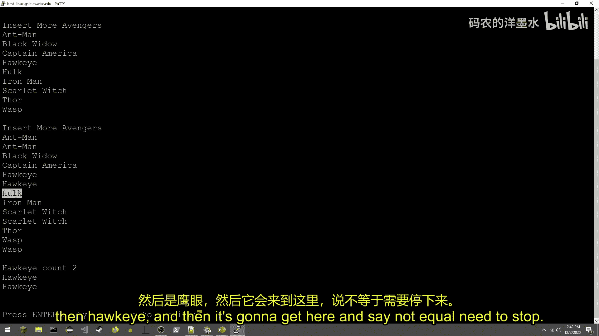
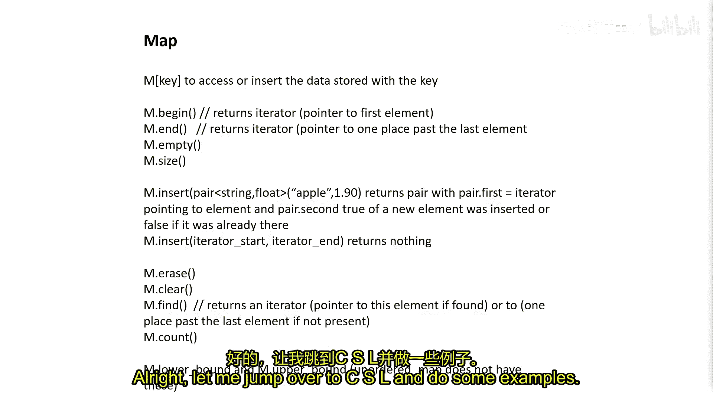
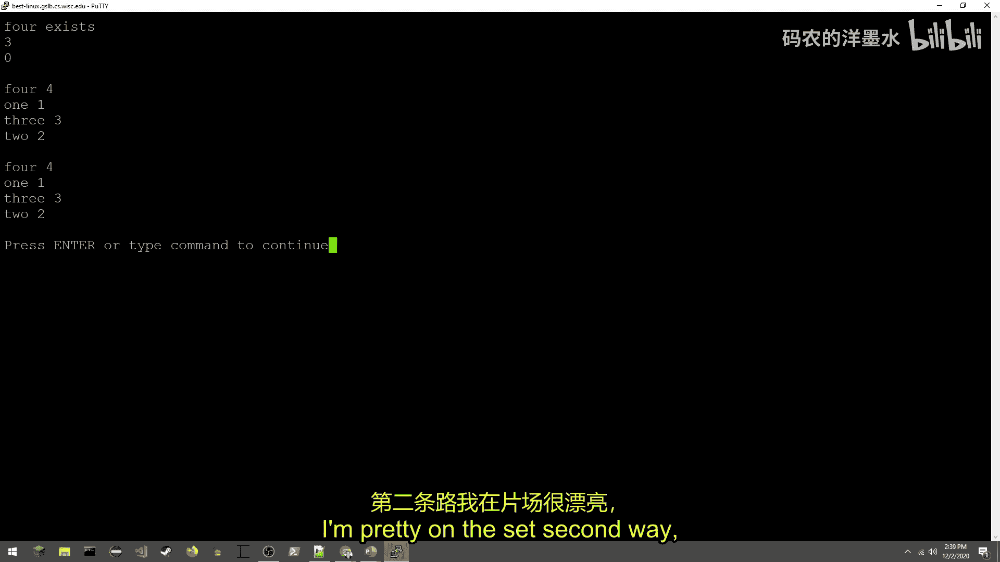
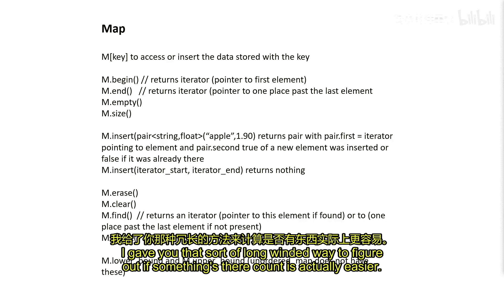
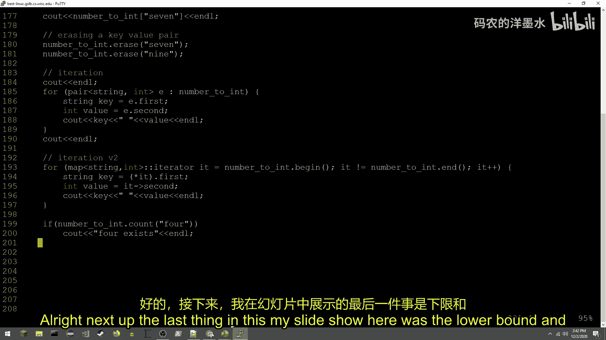
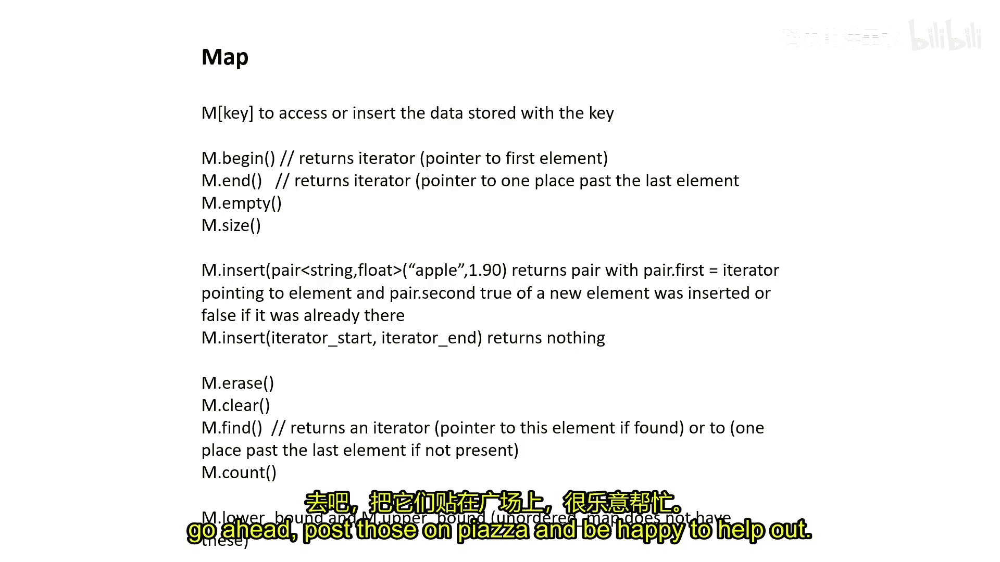

# 【全集】威斯康星大学 聚焦系统级编程 面向Java程序员的C++ CS368C 中英字幕 1080P p08 Lecture 8 - 关联容器 -BV1o72QBREfu_p8-

Hello， everyone。 welcomele back to C plus+ for Java programmers。 As we get started today。 first。

 I just want to once again thank everyone for their patience while I recovered from my heart problems。

 I know this is far less than ideal to have a lot of lecture content come out during the last week。

 I'm going to do my absolute best to finish recording these things and get them to you。

 With that in mind， I also know that you guys are taking other classes。 This is a credit， no credit。

 one credit course。 And I don't want this to be the major stress or for you guys in the end。

 We are going to have one more official real assignment about sets and maps。 It's going to be graded。

 It's coming out as soon as I finish preparing the lecture that goes along with sets and maps。

 Following this。 I'm going to do a series of lectures on classes on operator overloading on inheritance templates。

 I'm going to create one more assignment that goes along with classes and operator overloading。

 and it's going to be optional。😊，If you everybody here is taking this class because they want to learn some C++ it doesn't count for anything。

 it's not a requirement for any major， that's what I mean。

So if you guys want to like tackle that assignment， give it a try。

 get some practice and even turn it in， you know， next summer， I'll take a look at it。

 I'll run it through my grading script and let you know， give you some feedback on it。

But that one's going to be completely optional， essentially the way it's going to work and my grade book is I'll be dropping the lowest assignment。

Because that's built into canvas for me。 so I'm going to go ahead and take advantage of that feature and you do it that way。

 So if you do that one and and some other assignment went very poorly for you。

 that's totally fine I'm not going to stress about that there。Too many students to figure that out。

So my goal far as lecture production is to do one lecture per day for this course up through next Friday。

 I understand the official last day of class is Wednesday， know Thursday。I forget。

 but Friday is supposed to be the study day。 I'm probably going to need until Friday to get these done。

If everything goes just awesome， it might be sooner， I might be on time。

 but the way my whole life has been going， it has not been awesome。

I don't know if you guys can hear that， but that's my son stomping up and down。

 I just kicked him out of the office。 He's supposed to be doing virtual school today and was playing computer games in the background。

 It was horribly distracting。 So I kicked him out。 And now he's upstairs stomping。

 which is also distracting。 I know we all have that same situation。 We're at home。

 trying to get stuff done while our siblings or children are making our lives。Extra challenging。

All right， let's get into this sets and maps。So let's start off with a quick review of the different containers and maybe compare sequence versus associative containers。

So this is my list of all the containers today we're going to be talking about sets。

And maps primarily。 So we're going to begin。 the first half of the lecture is going to be a deep dive into the set。

And then just a brief comparison to the multiet which adds the ability to have more than one so sets have unique data。

 multisets will let you put in the second copy of that data and then the unordered set is just a it's a different implementation that's designed for performance but it changes the options a little bit soll spend a little bit of time there and as you may guess the unordered multiet combines the multiet with the unordered and gives us performance that lets us have duplicates。

Okay， so sequence containers are going to be great。 They require an ordered list of elements。

 We're going to be indexing those with a numerical index， just like an array or a vector。

 we can say I want the third element of the vector。 and this is great for a lot of things。 However。

 it's not great for every kind of data we want to store。

 So C plus plus provides us with associative containers。

 Also this kind of thing makes track if we makes a lot of sense we want to keep track of data like whether an item is a member of a set。

 that might be more important than the order。 for example。

 the example in the the reading was inventory for a store。 It might be make more sense to decide。

 you know， how many items you know， particular type I have if I want to map the name of the item to how many I've got an inventory。

 rather than。😊，Trying to decide if， you know， if I want to search for， you know。

 crescent ranrenches or something on my hardware store。

 if I've got to look through the entire list by index0 index 1 index 2 to figure it out。

And then I've got a second array with the number of things。

That could be like a lot of extra work and so at least as far as like a programmer is prone to errorss。

 C++ is going to provide me with a map where I can just have a map that says crescent wrenches and then it can look up the number easily。

Alright， so I'm gonna start my deep dive into the set at this point。

 So a set is a that's part of the standard template library。

 It's just going to be a container that represents an unordered collection of elements。

 It's a lot like a mathematical set and that it doesn't permit duplicates like the official like legal math definition of set Loly we're going to see it's a collection of unique values that supports efficient insertion and removal of elements as well as checking membership of the set So those are the three things that's going to try and do fast insert。

 delete and find It's going to be parameterized or templated That means we need to tell C+ plus what kind of data that I'll be putting into my set It's dynamically allocated so it can grow or shrink things are going to be ordered essentially this is implemented as a balanced to binary search tree or balanced binary tree。

In order to make that insertion deletion and finding really quick that's how they do it on the inside if you haven't taken a data structures class yet you can just ignore the but please know that this means that we must be able to order the elements we need to be able to sort things so we have to have the less than operator available because that's how C++ is going to decide what order to put these in and we need that for fast finding。

We're also going to find that the elements of this set are unique。Alright， and actually。

 I think I'm going to jump over to a CSL machine and just go through a lot of the。

Heres I've got my creation。 We'll be using superheroes as our example today。

 But I'll just go through if you guys have the PowerPoint open while you're watching the lecture。

 here's the list of all the things I'm going to talk about。

 But I'm gonna go do this by example for these guys。

Alright， so I've got my basic empty template right here。

 Please note that all of the different containers， we need to include them separately。

 So here I'm including vector set and map。 Later on， I'm going to go ahead and add multimap。

 multi set， unordered map， unordered set。 but this is what we need to get started。Alright。

 let's go ahead。 I've got my set construction right here to create just the most basic empty set。

 It's pretty straightforward。 I just need the keyword set。

 I also need the angle brackets where I need to put in the type of data that I'm going to be storing in the set。

 So if I'm creating a set of integers。 Ill call this one S1。 That's all there is to it。

 I don't need the empty parentheses。That's actually declaring a function。

 but this is enough to create an empty set。That's the most common way that I would use sets in like a real programming application for teaching。

 it's very convenient to just use the list initialization。Oops。Change the focus there for second set。

Set string， we'll call this Avengers。And then I can use the curly braces。

To just put in a bunch of data。 So we'll have Thor。Hullk， all right。

 I'm gonna pause and put the rest of these in。 So we have a set one sec。 Alright， There we go。

 I've got Thor， Huullk， Captain America， Iron Man and black widow， all in my set of Avengers。

' next up， I want to just print these out to make sure this is really working。

 So I'm gonna use a for loop for auto E in。Avengers。We'll just go list see out the element。

 So E stands for element。 When I do this。 It's an element of a set to my shortcut very commonly used。

Now， we'll just print out each of the Avengers， and then。At the end of my loop。

 we'll just add a new blank line。See out。And line， okay， that's looking good。I'm going to write that。

 I'm going to compile it。And then。We're on the code。 Allright， so we can see as it goes through。

 it's gone ahead and alphabetized all of the Avengers。

That's because it's going to be storing all of the data in that binary search tree so it's easy to find it uses that less than operator to decide where it goes in the set。

Yeah， let's go ahead and add some more Avengers。 Let's talk about the insert operator。

Adding more data to aAT can be done in a number of ways。Yeah， a number of ways。

 but they all use the insert operator so。I need my type of my data， insert。

And then we'll go ahead and add one more。Llad vision。And then I'm going to go ahead and。

I'm going to move this up here。Al， I got that all straightened out。

 So Im going to do my insertion before I printed it out。

 and I added some comments so we can see the code easily。 Alright， so I'll compile。And run the code。

Okay， so now I can see that it's added vision vision appeared at the end。

 if I'd added an Avenger in the middle somewhere， then it would have actually inserted a。

 let me do that real quick。All right， so I've added one more line here by the cursor。

 I'm inserting Spiderman now， and we'll see that Spiderman appears alphabetically in the list when we run this code。

31 hedging compiled， and。Got that command all ready to go while I was had the recording cost。

 But here we go， Spiderman appears alphabetically in the list。 That's the point I was trying to make。

Alright， next up， I just want to go over some other options for inserting more data and constructing sets using iterators and then talk a little bit about iterators。

 So I'm going to create a vector。Also of strings。Fector string， and we'll call it more。Avengers。

Alright， And please remember that a vector is gonna to be a sequential container。

 We'll be indexing these with the brackets and like0， more Avengers，0， more Avengers of one。

 that sort of thing。 Let me just go ahead and add some more avengers。All right， there we go， W Paman。

 Hawkeye and Scarlet Witch。 I'm going to go ahead and insert these Avengers into this list using the iterator version。

So that's going to be whoops， Avengers。Insert， so insert actually has a number of different modes here。

 I'm just inserting a single entry of the right type with each of the value insertion method。

 This is the iterator insertion method。 And I need to give it any of the containers that can be accessed with an iterator。

 So in this case。Moreves， and I need the beginning element。An iterator pointing to the beginning。

And we also need。The and。It could be， I wouldn't even need to use at the beginning or the end I could to actually say skip wasp and throw in a plus one right here。

Okay， because iterators。Take advantage of pointer arithmetic also。So anyway。

 this is gonna think about iterators like the way a child reads a book。 Okay， so you put your finger。

 put it right on wasp and ask the child， okay， what is this word， And they sound out wasp。

And then you move your finger over。 The iterator is your finger。 It's not the reading the value。

 That's the kid。 So move the finger over。 My mom's pointer is now at antman。

 The kid sounds out Auntt man。 I move it over。So this is just going say start at the begin location for more Avengers and go all the way until we are one past。

 So the end is going to be one past。 And when we get there， we we stop。 And remember that。Oops。

 not doing part I'm like， this is going be inclusive， begin。And exclusive end， whoops。

 this is the square bracket， isn't it？The will拉 to be。There we go。

 something like that for the begin and end usage Every time we see an iterator。

 that's what it's going to be like。 We include the begin and do not include the end because the end is going to be one past the end of the vector。

 and I can I can use this insert for any kind of thing here I'm using a vector。

 I could also do this with a set or a queue anything that I can access with an iterator。All right。

 one sec， let me go ahead and compile and run this and I'll show you the results。Al right。

 here we go。 Here's the list that it printed out。 I've gone ahead added antman， Wasp。

 Scarlet witch and Hawkeye。 They appear in alphabetical order。 So that's the iterator insertion。

Nothingic。Alright， next up， I want to talk about constructing sets using the iterator version。

 There's a couple ways we can create sets up here。 I've just used the empty set here。

 I'm using the list initialization。 I'm going to be doing the copy constructor in a moment and the fourth one is the iterator version。

 So in this case， I'm going to be creating a set。Of type string。 I'm just going to call this S 2。

 for my example， I've got S1 here。 I've got Avengers。 I've got more Avengers as the vector。

 This is going to be a parameterized constructor。 So I do need to give it arguments。And in this case。

 I'm going to go ahead and use more Avengers。Go ahead and grab the begin。And then， more。

Avengers dot end。 So that's going go through the entire list of Avengers wasp Aman Hawkeye Slet。

 which and add them to the vector S 2。 In fact， just to show you the power of these iterators。

 I'm going to go ahead and skip Wasp by moving my begin vector。Oh， and we'll start that antman。

 So we'll do anman and Hawkeye， Scarlet witch。 And it should print them out in that order because they're already alphabetized。

 All Let me go ahead and add a print statement。Here we go。 So I've got my original print。

 I'm printing out Avengers still。 So so that'll be the full list that we've created before。

 Here's what it's doing for the S 21。 I've got a couple of blank lines。

 and then it's just going go through all the elements in that set and print them out。 Allright。

 let me go ahead and compile this and run it。All right， here we go， compiled and running。

 And just like I predicted， we've got a couple blank lines。

 Aunt man Hawkeye Slet witch in that order。 Maybe they're not the best example because they are already alphabetized。

 but that's how it turned out。Well， I should also note real quick that this plus one。

 the iterator arithmetic， like we could do with pointers。

 is only going to work for the sequential containers because of the way C plus plus is going to store the data for a set as that binary search tree。

 If I want to choose a different starting location。 I'll need to use the find command。

 And I'm going be demoing that in just a minute。 All right， one sec。 Well pull my next example。

All right， this is just going to be an example demonstrating the copy construct。 In this case。

 I'll create a set。Again， I'm using strings for all of these examples， we'll call this one S3。

 and all I'm going to be doing is making an exact copy of S2。

Let me go ahead and run let's put print out。 Yeah， let me add some statements to print this out and I'll be right back to run it。

All right， here we go， just added a couple more lines。

 copying and pasteed this one so it should print out everything now。I got this written compiled。

Go ahead and run this。 And now what we should see is that here's my original Avengers list。

 Here's my copy using the iterator version。 And then here is the copy using the copy constructor。

 I need to demo this is actually a copy， and it's not changing both lists。

 It's not just creating a reference。 So to do that。

 let's go ahead right here after I've copied my set。 Let's go ahead and do S 3 dot。

We'll just go ahead and add one more Avenger How about Doctor Strange？One of my favorites。Right。

Compile。And run it。 So here we see the original version created by copying from the vector here we've added Doctor Strange and again。

 they're going to be an alphabetical order。 So if they were referring to the same object。

 we would actually see Doctor Strange up here。 They are not。 It's an exact copy。New space and memory。

 where we duplicated all the data and when I've added to this one。

 it's gone ahead and taken care of that for me and not changed the A S2 version。Alright， next up。

 let's call this。I don't know， advanced insertion isn't really quite the right title for this budget。

When we call the insertion method to add more data to the list， it actually has a return value。

 If we're inserting just one value。 If we're using the iterator version。

 it just returns an iterator pointing to the beginning of the newly inserted stuff。

 let me check that， I might have that wrong。 I hope that's wrong。

 If we're using the iterator version and returns nothing， I for that， Miss speaking， Okay， now。

 what gets returned when I use the， like， for example， this line right here。

If we grab that line and paste it here。There we go。Let me go ahead and we've already got Spider Man。

Who else is a black Panther？There we go。 So when I will add black Panther。

 And what this is going to do with the return type here is actually a pair。 So pair。

I'll need to go and include that in a second， I believe I'm going to try it without for a sec。

And it's going to have two types。 It's going to be an iterator。 And this is going to be of type。

Let's see， set。Or I need the string set。String iterator。A Ra。

 And then the second part of the pair is bo。And I'm just going to call this return。

And then we'll assign that to value when we insert it。Okay， so a pair has。

 I'm going to be going into pairs。As soon as I finish sets when we talk about maps in detail。

 but data I just have two pieces of data， the first， and it's actually called first and second。

 So the first one in this case will be an iterator pointing to the newly inserted value。

 and a bo that tells me whether or not something was actually inserted because the membership of a set is unique。

 if I try and insert something that's already there。 It doesn't actually insert anything new。

 So this will tell me if the。Item I'm trying to insert is already present or not。 Okay。

 so let me just print these things out。All right， I got that cleaned up， so I just went over。

The insertion of black Panther， here's what I'm doing now to verify that that worked and talk about the two pieces that it returns。

 First， the return value， the first part。 And this is exactly how you grab the first piece。

 This is going to be an iterator。Right there。And so return value first。

 I need to de referenceence that in order to print it out。 So this is going to print black Panther。

 This is actually going to be the very top line of everything that's printed because the rest of my print statements are here。

 I'm also going to grab bo alpha to actually print out true or false because this is going to tell me whether I've inserted something successfully or not。

 So and again to grab that from repair pair。 It's just turned out second。And this is not an iterator。

 So I don't need to dereence it。 like I would a pointer。 it's just a straight up to a false value。

 So let me go ahead and run this code。 And I can see here the black Panther wasn' inserted in the Avengers list。

 It's giving me true back。 There is。All right， next up， I want to do this one more time。

 I'm going to try and insert somebody who's already there。

So we'll just grab another copy of those two lines。

 and I'm going to insert black Panther a second time and then print this out because he's already there。

 This return do second should give me a false。So。Ohoops。Time out， I've redeclared something。Oh yeah。

 right here。So the second time through I don't need to declareance of that type。

 I just need to use it。There we go， All right， so true and false because he's already there。

That can be extremely useful if time trying to keep track of newly added elements to your list。

Alright， next up， I want to talk about the find command。 So when we are indexing into just a vector。

 we could give it just brackets with a number， and that would go look up the index。

 If I want to find something inside a set。 The command is actually fine。

Weends that fine and we'll take a look for Captain Merco。Okay。

 now this is actually going to return an iterator to an element of a set so。This is going to be set。

String。Iterator， that's the type。 And we'll just call this it one equals。 we'll find Captain America。

 Now， for my example， I'm going to go ahead and create a second one。Iterator， iterator 2。

 and we'll go ahead and find。A different aor。Spider man。

And then we'll go ahead and I'll use a loop for。I don't need my iterator because I've already got it one。

So we'll leave that blank。And then。Iterator  one。While it's not equal to iterator 2。

We will continue going and we'll iterate one plus plus。To us， there we go。And now in。No。

We'll just print this out。D reference iterator 1。等 that。And print it out。That looks good to me。 Okay。

 let me see whattypos I mean。Yeah， so I was cleaning up and removing some of the end lines so that everything fits on the screen and I misspelled thevengs right there。

 so hopefully。This should work。There we go。We'll go ahead and run this。 Now here's what we've done。

 is I've found Captain America。And I found Spiderman。

And then my loop just prints out everything from Captain America。Beginning with Captainmer。

 including him， but not including Spiderman because that for loop stops was soon as my iterator1 is equal to iterator 2。

Let me go back and show you that in the code。 So here it is。 I've grabbed iterator 1。

 It finds Captain America。 This is essentially a pointer to the Captain America in the set。

 Iterator 2 was a pointer to Spider man in the set。And so I've already created my iterator。

 normally I would do this right here in the loop， but I wanted to break this out for you guys。

So and then it's while iterator 1 is not equals iterator 2。

 So itsll go through the list and as soon as we actually get there。

 it's going to stop If I were to switch these around， it would break。

 it would just keep going because the iterator  one will never actually get to iterator 2。

 it'll be already greater than so that would be bad。um。We're incrementing this way。

 so I'm taking advantage of the fact that things are already alphabetized when I'm doing this。

Perhaps a better way to do this is using the lower bound and upper bound。

 Let me go ahead I'm just going to go ahead and type up an example and then we'll walk through it to shorten the video up a little bit。

Alright， guys， I' just put together an example demonstrating the lower bound upper bound。

 Let me go and talk about these lower bound right here。 and again， I mash this all into one for loop。

 this probably like bad practice for being instructive。

 But this is how you're going to see it in real code。 People are just going to do it like this。

Avengers do lower bound。 So lower bound is going to go through the list until it finds the first item that is not less than whatever I put in here。

So the first thing in our list that's not less than C is going to be where this points to。Okay。

 and I'll go to the list and talk about that again。 And then this is going to continue。

 Upper bound is going to find the first thing that is greater than whatever this is。

 I believe that's Spiderman in this list。 No Slet witch。

 Well take a look at the list when it's alphabetized。

 And so it's going create an iterator that begins with the first thing that's not less than this。

 So greater than or equal to the letter C。It's going to continue。

 I'm going to increment this in my loop。 so it'll go through the iterators like the kid pointing at the list。

 reading the words。 So iterators is the finger。And we're going to be dereencing that。

 printing it out。 That's all we're doing here。Printing it out。

 And it's going to continue until we get to wherever， you know。

 as long as it's not equal to whatever we find here， it's going to print it out。

 I also commented out some of the stuff so that all of my output fits on the screen。

 I'm keeping the print the original list。 I'm keeping the print， my find version of things。

 And the last couple lines will be the lower bound upper bound example。 Okay， let me run this。Okay。

 so it's gonna go through。 Here's the start of the list right here with antman。 Again。

 I took out some new lines to make sure it all fits on the screen。 So it's gonna go through。

 This is the child pointing an antman。 Black Panther black widow。 Captain America。

 So this is the first thing that is not less than C。 Black widow is less than the capital letter C。

 So it's going continue。 This was not。 So this is where the first iterator points to。 Allright。

 it's gonna to go along and keep going until it finds the first thing。

 So upper bound is going be the first thing that is actually greater than the letter S。

 So it's going to point to right here。And my loop is going to print out Captain America， Hawkeye。

 Huullk， Iron Man， and not this one。Okay， and that's exactly what I see here when I did it this way。

Alright， put together one more example using a race。

 This is how we're going to delete elements from the set。

 So the command is actually just a function call based on the data。 So I've got Aves。

 This is the name of my set。 I'm calling a race on it。

 First thing I'm to do is I'm going to racese Captain America。 All right， This returns of value。

 It's the number of things erased。 So that's either going to be0 or one because elements in a set are unique。

 If I try and add the same thing twice， it doesn't actually work。Um。

 and I'm just going to go ahead and print that out right here。

Then I'm going to try and erase somebody who's not actually in the set。

 somebody war machine we never added him， so we'll find out that he is not erased。

 this doesn't cause an error trying to erase something that's not there。

 just return zero because he's not there。All right， let me go ahead。Run this code。

And show you guys that number erased one for Captain America's zero for war machine。

 Captain America is in the original list， So I'm printing the original list and he's missing from the second list。

Allright。 And again， War machine was never there to begin with。

 And next thing I want to do is also demonstrate that we can delete using this the iterator version。

 I'm going to give it beginning iterator and ending iterator。

 and it's going to go ahead and delete everything that is not。

 So it's going to start with the first element that is not less than letter C。

 which was Captain American the list。 And then it's going to stop when it gets to the first element greater than S。

 and this is an inclusive bound。 This one is exclusive。 So it's not going to delete this one。

So we should still see all the characters being used layer S。So they write this new version。

We'll compile and we'll run this。And now we've eraed a whole bunch more。 So everybody with。

Beginning with the C through S is gone， yet we retain the scarlet witch。

And we remove Captain America。Alright， I just want to wrap up this part about just the basic sets with stuff that works for all containers and just show you guys that this stuff really does work。

 So first up， I'm gonna be。Yep， first up with grabbing the size。 That's just the size method。

 So I'm going to call it right here。 I'm going to ask if it's empty。

 This should return true or false or 0 or1， depending on whether the alpha alpha bo。

Iio manipulator set。Then I'm going to clear it。 That doesn't print anything out。

 There is no return there。 So I'm just gonna to call that function right there。

 Then we'll do size and empty again and we'll see that it's gone from size over my hour left after I deleted a whole bunch here。

 lets them。R this and see what we got。 So here's the original list。I erased a bunch。

And now I'm calling these functions。 So size says 8，1，2，3，4，5，6，7，8。 No， looks' good。 Is it empty。

 No， it's not。 it's， that's false。 Then I clear the vector。 No， set， clear the set。

 And as the size again， size is now 0 and empty is true。

So either of those are a great way to decide whether。

I've added anything to my site or not。Al right， guys， I'm back and just grab some lunch。 Next up。

 I want to talk about unaudered sets。 So we did a deep dive into sets。

 This should just be a brief overview。 A lot of this stuff is going work the same from our point of view as a programmer。

 All right， The idea here， it's still an associative set。

 We're going to be accessing things by a key just to check and see if something as a member of the set。

 But on the inside， what we're going to see is that C plus plus is going to use a different type of data structure。

 Instead of that balanced binary tree， It's going to be using a hash table。

 This is going to give us extremely fast access。 If we're checking membership。😊。

But it's going to mean that we don't have a number of features available to us like the itering over a range。

 It also means that we require that a hash function be available。 All right。

 And what this means is it's going to take whatever value I'm sticking into my set。 You know。

 if it's a name like Thor。 It's going to hash that。

 And what that means it's going to turn it into a numerical value， an integer。

 So it's got some sort of function that's going to take the letters in the name Thor and turn it into an integer。

And then it's going to take the modulus of that。So basically divide by something and get the remainder and use that as an index in a vector。

And that's how it's going to store this data All right， I'm not going to go into more details。

 it's totally possible that more than one name might map to the same integer and C plus+ is just going to take care of those details。

 take data structures if you want to learn more。What this means is that hash function must be available。

 I no longer need to worry about the less than I just need a function that can turn my data into an integer。

Alright， let's see here。So we're going to get faster access to check and see if something's a member。

 but much slower iterating over a range。 we're still going to see that the sets can be dynamically allocated。

 They grower shrink as we need it。 One of the consequences of that is if you're iterating over a set。

 That means you can't actually add to it or delete from it。

 because it's going to potentially change the set。 if C plus plus needs more space as we add things to a set。

 It may completely relocate the seted memory to a much bigger like zone。

 And then my iterators are basically pointers to those memory they're not going to be valid anymore。

 They're going to point in you know old stale data。 That may be overwritten。 It might still be there。

 It's not going C plus plus is not going to take the time to clean that up。

 It'll just reuse it later。 still templated， So we're going to need to tell it's a set of strings or a set of integers。

Again， not ordered anymore。 It's still going to maintain unique elements。Alright， let's go to， yeah。

 these are the functions I'm going be talking about begin and they're going to work exactly the same。

 It's going to be point to a first element， but again， they're not going to be sorted。

 demo this If we're still going to be able to check if it's empty。

 we'll still be able to check if the unordered set， the size of it。

 insert is going to work exactly the same way。 insert with the iterator version works exactly in the same way。

 era clear fine。 They all work the same way。 The only real difference is we're going to see that there's no lower bound or upper bound available anymore。

All right， and let me just demo some of this， like the unorderedness of what's going on here。

So I just jumped over to the code。 I've added a couple things here。

 This is my divider from up here as sets down here， unordered sets。

 First thing I'm doing is just calling system clear to clear the screen that way I could leave all of this stuff up here and I'll just take this out when I want to run and you know when you guys get home。

And from lecture， you want to try this on your own。Well。

 that sounded like I was in a real classroom there for a second。 Okay。

 so what I've done here is I'm recreating the original eventventers set。 remember up here。

 I cleared it。Not that that matters anymore me put that back。So。

 I'm adding the original members from that very first line at the top of my code。

 And then I'm going to print that out。 This is going to print original Avengers。

 It's going to go through all the elements in that。 It's going to print them out。

 And then after the entire list is done， it's going to add a blank line of space。

Next thing I'm going to do is I'm going to create an unordered set to do this。

 I had to go back up and include unordered set。 I'll show you that in a second。um。

I'm calling it you Avengers for unordered。 I'm creating this by using that iterator version of the constructors。

 So I've got begin and end， and I'm just going to be copying all of these values into the new unordered set。

 and then we'll print it out。 Okay， let me jump up to the top real quick。

 And you can see that I have included unordered set right there。And now。We'll run the code。

 and here's what we get。 The original Avenger set is going to be alphabetical because it's using that balanced binary tree。

 which uses lesson operated to make sure that we know where things are， gives us really good。

 like deficient range access。The unordered version again， is not ordered。

 So first thing I put in the set was black widow， and she ended up at positionency 0，1，2，3。

4 in my list。 and again。C plus list may be using a table or a vector with many more entries in this and might have like 20 entries。

 Black widow might be at index 18， but it's also going to keep track of which entries are used and which ones are not so。

So internally， it does things a little different。Second thing we added was Captain America。

 He's going to appear 0，1，2，3。 Thor was the last thing we added。 He appears first。 Again。

 the ordering is designed based on that hash function。 We turn all these names into numbers。

 take the remainder after dividing by something and use that as the index。 So it's。

 it's going to essentially appear random。Okay， one sec， let me pull back up the code。

And add another example。 All right， I've gone ahead and extended my example a little bit。

 I'm gonna to be inserting more Avengers。 So I had that more Avengers list with four more Avengers。

 We'll be going ahead and adding them。 I'm just gonna to print those avengers out right here。

 And then this is gonna to be based on this one was a vector。

 And then we're going to be inserting the more Avengers。 So insert works exactly the same。

 I'm just going to use an iterator from begin。 and I can use iterators from any of the containers。

 So this， in this case， I'm using a vector up here。 I was using a set。

 I'm sticking them into an unordered set。 It's all good。 And then after inserting them。

 we're just gonna print these out again。😊，All right， let me go ahead。Run that。 Alright。

 the original set， blackwiidow， Captain Hulk， Iron Man Thoror， and the original unordered set。

 Then I added these guys and。After doing that， you take this out。 So what I want to do， I now have。

All these guys are in here。 Wasp is there somewhere。 Aunt man， they're there。 Hawkeye right there。

 Scarlet witch。Right there okay， is compared the unordered set。

To the one after I've insertd in more elements。 So what we're going to find just。

Is that C plus plus only reserved a couple spaces for the unordered set。

 It' got enough for this many， but then when I wanted to add more。

 it needed to expand the size of that vector that it was using to store them internally。All right。

 when it did that， it had to go back and add all of these ds to the new unordered set。嗯。The new。

 larger one。 And so it redid all of the hashing， turned Hawkeye into a number and then put him in the new list。

 probably in a different location， because we can see the order is messed up。

 So Thor was the very first element。 Now， Thor is the very last one。Ironman came second。

 Iron Man second here。 So it looks like it's essentially， is it reversed entirely。

 Not quite because we've got Slet witch。In between Captain and black widow。 So that hashing function。

 when I used the modulus to get a different value， relocated everything。

 So the order is not guaranteed。 It's not even guaranteed to maintain the same order。

 they're going to be different after I do some inserting or racing， those are not guaranteed。

All right， but that was the point I wanted to make Next up。

 I'm going to go grab a multi set example one sec while I prepare that for us。All right， I'm back。

 Got the next example set up。 So I'm looking at multi sets at this point。

 A multi set is a lot like a set。 It's gonna to be an associative container where we're gonna be storing things。

 It's going to sort them as a binary a balanced binary tree。 but it's gonna permit duplicate entries。

 It's not like a regular set is just like a mathematical set and that it's every entry is unique。

 The multiet lets us put the same thing in more than once。 So here's my example。

 I'm creating a multiet right here。 It's again， templated。 So I need to tell it its strings。

 I'm calling this M Avengers for multiet of Avengers。

 And then I'm going to just go ahead and copy the Avengers begin and end。

 So all of the ones in the original Avengers set from up here。 That's still present。

 So this is gonna have Thorhulk Captain Ironman and black widow in it。

And then I'm just going to print that out。All right， cool。

 The next thing I'm to do is I'm going to go ahead and insert the more Avengers。

 That's the vector that had Hawkeye and。😊，好。I don't remember。Anyway。

 I'm going to print it out with the more Avengers in it。And then I'm going to insert them yet again。

And then we'll just go and print this out。 So I'm inserting them twice。

 and we should see there's a whole bunch of duplicates in the list。 unless I've made it as Di。

 let's find out。So we'll run this code。 All right。 here's the original Cap Huullk。

 Iron Man and Thorpe。 again， now alphabetized。 We inserted more。 Okay， yeah。

 Iron Man and wasp and Hawkeye and Slet which were the ones we added。

 So now we see those four of men added。 Again， it's still an alphabetical order。

 It's a balanced binary tree。And then I inserted more Avengers again。I'll update that。

 We'll the word again right there。 And now I can see I've got duplicate values for the an man for Hawkeye。

 Slet witch and Wasp。All right， let me do one more quick thing。Alright。

 take a look right here at this line。 here， I'm demonstrating the use of count。

 If you use count on a regular set， you're either going to get 0 or 1。

 It's a great way to check for membership。 And essentially how the just to see if something is there。

 because 0，1，1 translate directly to true and false in C plus plus All right， In this case。

 I'm just going get the count of how many times the Hawkeye appears in the list。

 He's in that more Avengers list。 So he's been added twice。 we should see too here。

And the second thing I'm doing is I'm creating an iterator with a lower bound  Hawkeye。

 So this is going to find and create a return an iterator or a pointer to the first entry that is not less than Hawkeye。

 So basically it's going to point to  Hawkeye for the very first one。

 And then it's going to continue to the upper bound。

 So this is a way if I've got a set or particularly with multi maps at the very and last topic for today。

 We can go through all of the entries in and process them individually if they have the same in a map they're called keys here。

 they're just entries。 Allright， so this is going to print out Hawkeye twice。 All。

 let me go ahead and save this。Compile this。And run it。Okay。

 so the here's the piece we've added Hawkey count is two and again in the list he is there twice。

And the lower bound is going to point right here to Hawkeye。

The upper bound is the first entry that is not。Less than that。 So it'll point a hullk。

 And so as we iterate through and print things out， it'll print Hawkeye， then  Hawkey。

 and then it's going to get here and say not equal。You need didnt stop。

Alright guys next up I want to talk about maps and under order maps multimaps so we'll do a deep dive into map and then just a quick overview of the other two so these are also associative data types in this case map is going to take a value a key and a value and associate them with each other and keep track of that relationship。

 for example， you might have all of your friends names as keys and their email addresses as values then I can just look up the email address just using the value or the key the name。

Value would be email key would be the name。 just like if we had an array。

 I can look up a value in an array using the index， the 0，1，2， you know。

 letting me know the position in the array。 In this case。

 it's kind of similar in that I am still looking stuff up， but I get to define my own keys。

And I'll see some examples of this so you can see it。

This is going to be dynamically allocated storage also。

 so the C plus plus is going to take care of growing and shrinking the data structure for however many elements we have。

 It's also templated。 something to note here， it's templated over two things。

 So the first is the the key， the type of the key and we can use pretty much anything here。

 as long as it has the less and upper here。 it works exactly the same way as a set。

 it's going keep a balanced binary tree with the key value pairs and I'll attach together。

 and then the second type is going to be the value， the type of the value。

 when I name things when I name my maps， I pretty much always follow this convention fruit。

 and then two right So key to value and it lets me know what I'm mapping to what。

 and by putting the two in the middle， that's just the mental reminder to me that this is a map。

 I always do it this way。 a lot of people use per Also they aggregating。Excuse me。

 aggregating some sort of values or grouping them。So that's another way that I've seen it used。 Okay。

 again， this is ordered and when other maps are obviously not ordered。

 It works just like the set with keys and everything is going to be unique。Alright， next up。

 I'm going to be going through all of these functions。

 Here's just a quick summary of them so you can come back and use this as reference。

 You can just download the slides and get this open and not have to like search through the video to find the right spot。

All right， let me jump over to CSL and do some examples。

Alright， so first up， the types of data in a map are essentially pairs。 So I did a quick example。

 I don't think I did a great job earlier about pairs。 So let me do a little bit deeper version here。

 First， a pair is a data structure that holds exactly two values。 It's going to be templated。

 So I need to tell it the type of each values。 I'll have type 1。And then type 2。

And then I can just name this my pair， whatever it is。 Okay。

 so this is now created a pair with type 1 and type 2。

 Obviously I'm just using these as sort of generic references。

 I'm going to leave this as a comment and then do a real example。 So if I have a pair of， say。

 a string。To an in。And I can call this something like glass。To number。BR or something like that。

 and then I've got two things here。The first one is actually called first。

And it gives me a little hint here in Vim。And so I'm going to say first is equal to C plus plus。

Cause that's the string。 And then oops，' got the semi cone and then。The other one is called second。

And I'm going to give that an integer。 Alright， That's really all there is to it。

 I've got some other options for creating these things。So let me see here。

I'm go ahead and type in some examples and then I'll come back and I'm just show you what they are。

 Allright， so I just have two more versions here。 we look at line 144。

 This is calling the default constructor it's gonna be mapping a string to an integer and again the name of a class the other class I'm teaching right now is data programming one that's CS 220 So I'm creating it with this constructor and the third version is using function make pair This is useful because it allows us to just automatically determine the type of this so this is of type string and it recognizes that from the make pair function because it just figures it out this is a type integer and then it's going to cast those two string and in here so those have to match and create the class to number3 This is real useful in like internally inside of the like the code that we're going to write to add entries to maps to just use this and then have it automatically。

Demine the type that way I don't have to worry about typing， you know。

 string and in over and over again with all the extra angle brackets。

 So this is just for convenience。 a little helper function。

 And then I'm just gonna be printing all these out。 So let me go ahead and run this。

showhow you that it works。 Allright， Z plus was 3，68， data programming 1，220 and so on。 Allright。

 so that's introduction to pairs。Next up， introduction maps。Alright， so got a new section here。

 we're clearing the screen and then we're going to be， let's see here constructing。Some maps。Yeah。

 I think that's right。 Okay， so first keyword is map， I need to give it the types。

 So if I have string to an integer。And then the name of whatever it is， so something like。

Classes to numbers。And get on one of these plural， if it's a map indicating that's holding lots of data about many different classes。

 And this is the well I need to create an empty map。

 And then I'll go ahead and add things to it with inserter coming up in a second。 I can also。

Create maps using the list initialization。 And again， I think this is useful。 So if we have number。

To int as my example， I'm going to be mapping names of numbers to their values as integers。

I can use the list。 So let me go ahead and get a list here。 And then these need to be pairs。

 I need to put in pairs。 So I'll have M。Pair that will automatically deduce the type for me。

 So I don't need to go ahead and put in pair int or string int every single time。

 But I could do that。 So I'll demo with both of those here。

 So in and one well get those added using make pair。Next thing I do is pair。

And then this will be string in。 And again， I'm typing a lot of extra stuff here。

 but then we'll have two。And2。Close that up。 Make sure I get on my parentes。 I need a semi colon。

 So this will create a map using the two different ways make pair and the pair constructor。

Now let me go ahead and write some code to print these out one second。Allright。

 I got that put together。 So here I'm gonna to be using auto extensively because I don't have to remember the types of all these things。

 And some of them get quite long to type in。 So it's just gonna to be for auto。

 and auto will automatically determine the type of the elements of this list。

 So I'm using number to int。 Allright All right， hold on。 If I wanted to the type is pair string in。

 Let me go ahead and just we'll do this one。So we put that in here， and then we'll insert。

 So that's gonna be the type of this value。 So the， the data stored in maps are always pairs。

 So that's gonna grab E number to int。And then the next thing I'm going to do。

 I'm going to break this into pieces， and I wouldn't normally do this。

 but I want to be instructive here。 and I'm going to just type edot first when I'm printing stuff out auto here。

 the type of the key is going to be string。 So let's upgrade this。

String and the value of the or the type of the value will be end。So there we go。

 that' should compile now。See what typos I've made。And when I run this。

 then it'll go through the list and print out the names and the values， name value or key value。

 key value。Just like that。Sort of my generic loop to print stuff out。

 I'm going to go ahead and keep doing。More examples， and we'll keep printing it at the end。

So the next thing I want to talk about is inserting data into the map。

Let's actually just insert as the name。 So let's call and there's two different ways that we can insert data。

Let's go ahead and do the first one， I think is a lot simpler。And less prone to airs。Number to int。

 And this is just with the bracket accessors。 So let me see here， just going to use square brackets。

 And here I'm going to give it the name of the key that I want to add。 So I've got one，2。

 we'll add 3 and say that is equal to the value 3， and that'll get inserted into the list。嗯。

let's go ahead and run this。There we go。 Now， check this out。

 Please notice that it's keeping the keys alphabetically。 So three comes before two alphabetically。

 So that's why the order is weird。 but it's a balanced binary tree again that makes finding stuff quick。

All right， so the next thing I want to just suppose I made a typo here。

Let me go ahead and update this。 Suppose I have a typo。We'll copy and we'll paste this again。

 and then we'll get this fixed。So in this case， this is inserting。啊。The the value。

 And in this example right here。I'm what's the word updating？

So this these are actually very different operations， this one it doesn't exist in the map yet。

 and this one it already exists and I'm just changing it。Alright， so I'm going to write that。Compile。

And run it。 And they， it's still working。 I suppose I should actually run it for you guys I showing you what the for in there as you can see that it changes。

Yeah， we'll do that， We'll do that。So we'll just print it out twice。So there we go。

 I've got my print loop， duplicated it。YouDid't do right， yep， okay。There we go。1，3，2。

 sure to put it onlineline here and then  one，3，2 with the updated version。 All right。

 so just showing you that it works。Alright， the al right， I'm going to change this back。

 I don't feel like I want to keep this extra code here。Just do it like that。 Alright。

 The next thing I want to do is inserting new pairs with the actual insert command。

So I can have number to end insert。And this works just like it does for sets with keys。

 except now I need to insert a pair。 So I'm just going to do it with the main pair。Make。Hereer。

 this is the minimum typing version。 Let's see you got onto3。 we're up to 4。And4。

And that should be good， all right。我れた。Pile。I'm missing a parenthey。All right， there we go。

 now added  four。 it's going to be alphabetically first of all these。Enter to continue。 Now。

 I want to do that same example where I made the typo before。

 So I'm going to copy from this line to that line looks like about8 lines。Go down to bottom here。

 print these out again。 And now if I have a typo here， if instead of 4， I actually type like。Oops。

 oops， oops， what do we go？Good lord。Accidentally got 240。 so we got 44 here。

 and then I'm going to go ahead and use insert again。 This is not going to behave the way we expect。

So。Let me compile this。And run it。 So here's the first version 4，44。 That's the one of the typo。

 I tried to fix it by inserting a new pair right there， but it didn't actually update it。All right。

 so if you remember back to this set， when I used insert， that had a return value。

 It returned a pair。 The first part of the pair was an iterator pointing to the new value。

Or if it already existed， an iterator pointing to the existing value。

And the second one was a Boolean value that told me did I insert anything or not？

So when I call insert， this is a little different than with just using the brackets up here。

 inserts is going to say it's going to do this in two steps。 First。

 it's going to figure out do we already have a four。As one of my keys， If we do。

 then it's going to return the iterator pointing to that value and the。

The false saying we didn't insert anything。嗯。If it's not there， it goes ahead and inserts this value。

 which is why this line inserted it。 But this one never the insert doesn't update things that are already there with new values。

Let you think I'm just going to make a note of that here。Alright， and then I think I'm going to。

Alright， so for the final version that's going up on the web page， here's what I changed this to。

 So I'm inserting the correct value。I took out that extra printing stuff。

 and then I'm going to try and change it to the incorrect value。

 And just I left my note here that says it's not going to get updated because I want the list to actually have the correct numbers the map to the correct names at the end。

All right， next up。Check to see if the value exists。How about the key exists。Now to do this。

 I'm going to go ahead and use find。 It's a little more lengthy code than。

You would expect the find is actually going to return an iterator to the value if it finds it or it returns an iterator to end if it doesn't find it。

 So I can just， let's say if I want to look and see a4 is present in my map， I can do。

Number to in that find。 And I can look for for。嗯。And if that。Is。Not equal to。Number 2 end。Dot end。

 And again， all these containers are gonna have beginning， begin an end to。

Figure out whether something is there or not。 So I am going to put this in if statement。Here。Then。

If it's not equal to the end， that means we found it， we'll type about four exists。

I'll go ahead and compile this and run it。There it is four exists。And here's all my numbers。So again。

 this is a little bit lengthy way to check。 I want to make sure that if I'm just checking to see if something exists。

 I don't accidentally add it。 So if I want to like change the value of something if it's not you know ignore it if it's not there。

 but change it if it is there， I need to do something like this。

 I guess it's a full if statement to check and see if it's there。

There may be an updated version of that in the newer versions of C++， but I got a bit。

 I didn't go back to look and see if there is an easy way to do that。All right， next up。

 just getting the value associated with the key。Pretty simple。

 I'm just going to use the brackets to do that， so it're all printed out。Y。Number2。

 I picked a really long name for this numberumb to int， and then we'll use brackets。

 and we'll go ahead and see give。3。Compile。And doubt， there it is。

 that's the three that I was getting。All right， pizzaa cake。And again。

But try this if it doesn't exist。See how number three。

 I'm going to go ahead and check and see if7 is there。And piles just fine。ha， check it out。

 It has gone ahead and added a 0 by just me checking to see if it existed。 It It knows it didn't。

 So it went ahead and assumed that I wanted me to add it and put the default value。

 the default type for an int。 This is one of those cases where C plus boss will actually fill in。

What's it called the default value for us。So that was undesirableably， we don't want to do that。

 That's the reason why we want to do something like this to guard against adding things that。

 you know， basically incorrect data。So let me put a comment in。

 I'm going to go ahead and leave that in my code one second。Alright， there we go。 Gu。

 my comment added。Next up， how to erase the key value pair。 This is also very simple。

 It's just going to be the name of my map。Number two int dot。The name of the method is a race。

 And here I'm going to give it just the value of the key that I want to racese。

Iant to get rid of that7。 that was incorrect。 and then this will print it out。

 and I can see that the seven was removed。Alright， so there we go。

7 is now gone from the map as we printed out。 If we try and erase something that doesn't exist。

Let's try erasing。9ine。Nothing happens， there's no error， it just completely ignores what's going on。

Alright， next up， I want to do a little bit more。With the iteration over these data structures。

So this is the first way I'm using the iterator style for loop here。

 that's just grabbing each element， break it apart into the two pieces。

 and then I'm printing them out。 Okay， this is the， I guess range iterator is what that one's called。

 So now I'm going to just use regular for loop so。Iteration V2。

4 and now regular for loop has those three parts。 I'm going to have iterator equals something。

 in this case， it's going to be。Number2 hint thatt begin that'll give me an iterator。

Point to the very first。That's not my type in here。The very first。Element in the map。

 Then I want to know while iterator is not equal to the last value。To。In dot end。

 Im going to keep going and I plus plus。Here， I'm going to do essentially the same thing。

 I want to get， oh， I didn't finish yet。 I don't have a type or iterator here I'm declaring a brand new variable。

 The type of this iterator is going to be， let me think here， it's map。String。And。空空。Iterator。

And again， that's a lot to type。 a lot to remember。

 I almost always use auto unless there's some reason I want to remind myself the exact type。

Ifully I didn't have any typos there。 Okay， now to actually go ahead and get these pieces of data out。

 I'm going do， I'm gonna break it into some pieces。 I'm going have string。

 The key is equal to the iterate。 Whoops， string key equals equals。I T。

 and because this is an iterator， I need to dereence it。And then I also want to get first。All right。

 just like that。I'm thinking， I probably。Need some parentheses。Right here。

Because the first is a very high precedence。 the the dot operator is high precedence。

 I want to actually go ahead and get the pair and then extract the first。 let's test that。

this should not compile or should give us garbage if we try and print it out， let's see here。

I'm just going to grab this line。Pase right there。Yep， okay。This iterator has no member first。

 And that's because it's an iterator。 It has not yet de referenced it and gone back to get the data。

 So two ways to do that。 The first one is to just say it's a precedence issue。D reference first。

 then go get。The first value。Okay， now this should be fine。I missed a didn compile。 There we go。

 while，ooh， value was not declaredlaring the scope。 What did I do wrong。Oh。Alright。

 I'm printing value， but I didn't actually go get it。 So next up。That's not I want。

 It want to grab value int。Value equals。 And then the other way I can de referenceence this is to use the arrow operator。

This is going to do exactly the same thing as this much。 It's going to dereence first。

 then go get it。 So this is just a shortcut that they've added to C plus+ to make this easy to do。

Ma I add my others。Make it look good， there we go。So right， compile。

The you is not declared in this scope。 did I type it wrong， Okay， all I did was forgot to write it。

 I compiled the old version twice， even though I fixed the the mistake。 Okay， so next up。

Let's go ahead and run this。And。We can see that it's printed out the first way that was with my range loop。

 and I'm printed out the second way using iterators and iterating through the map。

Alright， so I was just checking my notes。 trying to remember if I was completed everything I wanted to。

 again， that all these iterators have a couple of things begin and empty size。

Here's how to insert again， I can use iterators to insert also these iterators must point to data that's got pairs of things。

 so the type must match I didn't demo this You guys can go experiment with that。

 try it on your own make a vector of pairs and then try iterating over the vector of pairs and inserting them。

U。I did ase。 I did clear is available to all containers。 It's just going to remove everything。

 There's an empty also， that's going to be true or false。 If it's empty。

 I did find when I was doing fine， I gave you that sort of long winded way to figure out if something's there。

 Count is actually easier。 Let me go ahead and demo that really quick。

So to do this， I can say if。Number。To。And。Dot count。put in 4。 That's the name of the key。

 This is either going to be 0 or one because the value， the keys are unique。

Which is kind of why we had this problem with the insertion。 It found the key， it's unique。

 it can't be there more than once。So if that's true， we'll see out。For。Exist。Compile that。

 make sure it didn't make typos。And then we'll run that。 And here we go。

 This is the new four exit line。 I using count instead of this instead of the find。

 which gave me that iterator， so。There's the find version。Here's the count version， much。

 much shorter to type。 Okay， and count。 again， it's going to either return 0 or 1。

 I'm putting this in if statement if it's 0， it's going to evaluate that as false。 If it's there。

 itll return one。 that can be only one。 and that it will evaluate to true。

 And so it's going to print out four exists。All right， next up。

 the last thing in this my slideshow here was the lower bound and upper bound。

嗯。These work exactly the same way as the set。 So I'm not going to take time and demo them here in the lecture。

 but I would encourage you guys to experiment， try and print out， you know。

 a range of numbers using the lower bound， upper bound。

 This is also going to be very useful when we have multi maps。 I'm not going to demo that either。

 I did multiet。 They They work exactly the same way as the set。

 Basically a map is a set where everything is a pair。

 And it's got some some extra functionality here。 It's got this ability to access with a key。A。

And again， the unordered map has the same performance benefits for like locating something very quickly。

 if it's a set， just like an un ordered set does， because it's using the hash table version。

And again， lower bound and upper bound are only for things that are actually sorted using that less than operator。

Alright， I feel like this is all I want to do here。 I'm gonna go get this edited， put up on YouTube。

 and then I'll send everyone an email when it's ready。 After that。

 I'm going to go ahead and prepare the assignment。 Hopefully that will be out shortly afterwards and。

😊，If you guys have any questions on this， I'll definitely come to office hours。

 If you've tried some experiments and things look weird。

 go ahead post those on piazza and be happy to help out。 Alright， Have a great day， everyone。😊。

