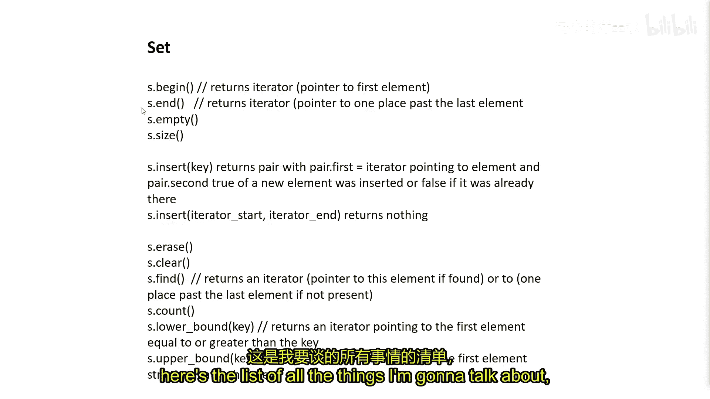
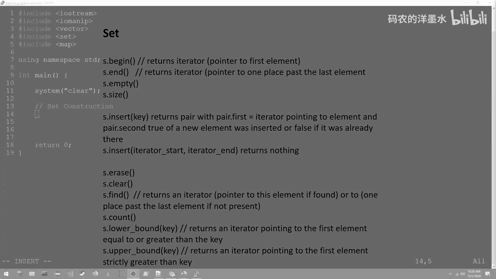
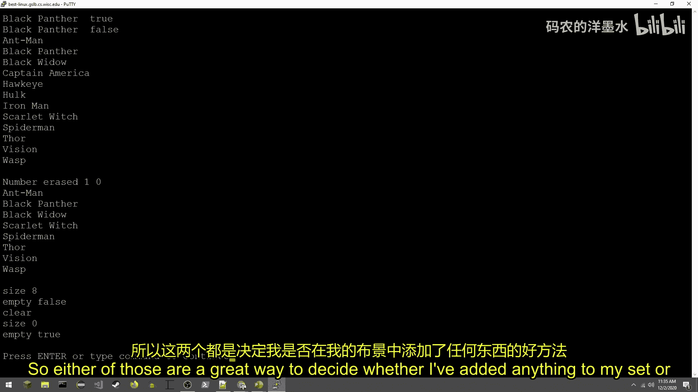
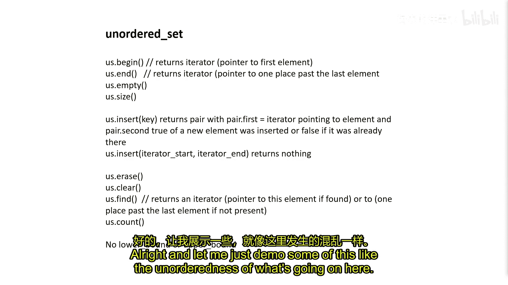
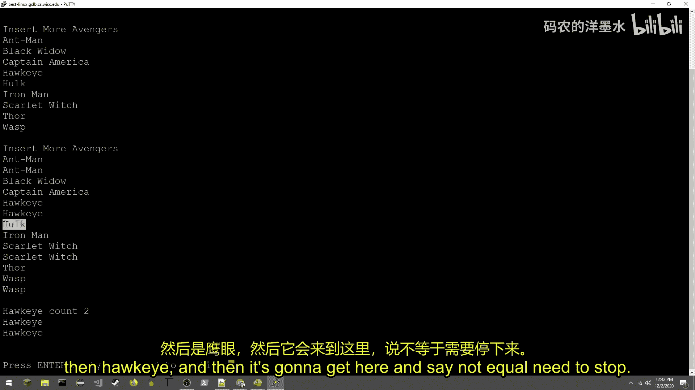
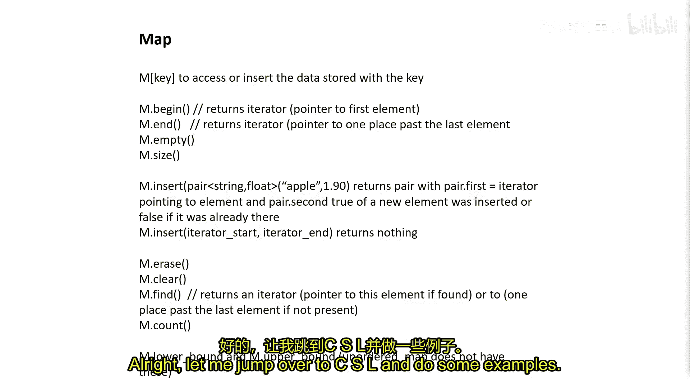
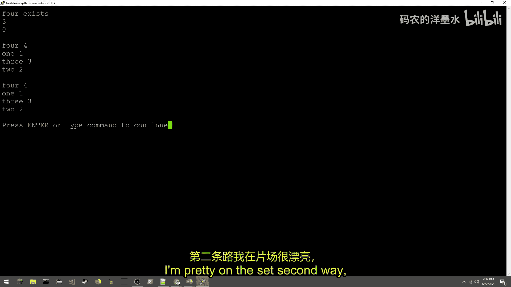
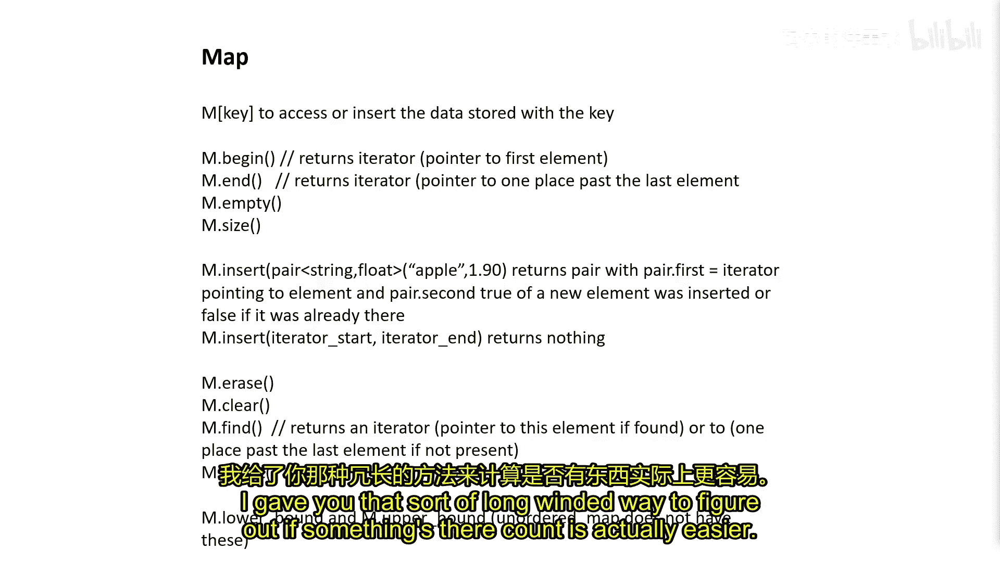
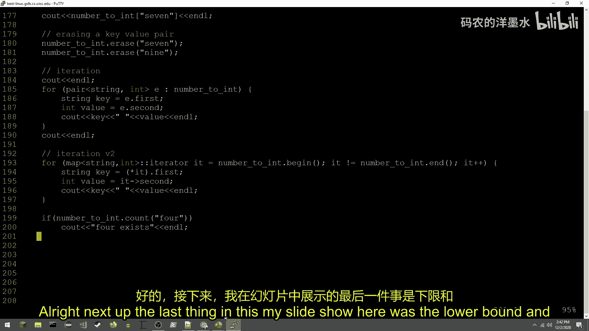
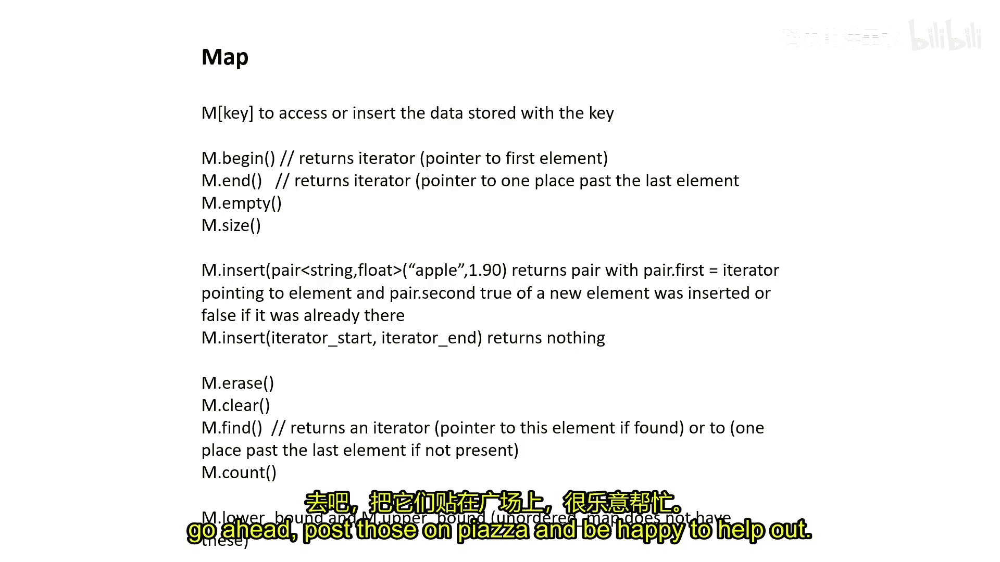

# C++面向Java程序员：第8讲：关联容器 🗂️

在本节课中，我们将要学习C++标准模板库（STL）中的关联容器，特别是`set`和`map`。关联容器允许我们根据键（key）来高效地存储和访问数据，这与我们之前学习的序列容器（如`vector`）有很大不同。我们将从`set`开始深入探讨，然后了解其变体，最后学习功能更强大的`map`。

## 关联容器概述

上一节我们介绍了序列容器，它们适用于需要按顺序索引元素的情况。然而，并非所有数据都适合用数字索引来组织。

本节中我们来看看关联容器。关联容器根据键来存储数据，这使得检查成员资格（例如，某个物品是否在库存中）或建立映射关系（例如，将商品名称映射到库存数量）变得非常高效。C++提供了几种关联容器，本节课我们将重点学习`set`和`map`。

## 深入理解 Set 🧮

`set`是STL的一部分，它是一个表示**无序**（就插入顺序而言）元素集合的容器，类似于数学中的集合，**不允许重复元素**。它的核心功能是支持高效的插入、删除和查找（检查成员资格）。





在内部，`set`通常实现为**平衡二叉搜索树**（例如红黑树），以实现这些操作的效率。这意味着存入`set`的元素必须能够进行比较排序，因此类型需要定义**小于运算符（`<`）**。

### 创建与初始化 Set

要使用`set`，首先需要包含头文件。创建`set`时，必须通过模板参数指定其存储元素的类型。

```cpp
#include <iostream>
#include <set>
#include <vector>
using namespace std;

int main() {
    // 1. 创建一个空的整数set
    set<int> s1;

    // 2. 使用初始化列表创建并初始化一个字符串set
    set<string> avengers {"Thor", "Hulk", "Captain America", "Iron Man", "Black Widow"};

    // 打印set中的元素（将按字母顺序输出）
    for (auto hero : avengers) {
        cout << hero << " ";
    }
    cout << endl;
    // 输出: Black Widow Captain America Hulk Iron Man Thor
    return 0;
}
```

### 向 Set 中插入元素

可以使用`insert`成员函数向`set`中添加新元素。`insert`操作会维护集合的唯一性。

```cpp
avengers.insert("Vision");
avengers.insert("Spider-Man"); // 插入后，遍历时会按字母顺序出现

// 也可以使用迭代器范围进行插入
vector<string> more_heroes {"Wasp", "Ant-Man", "Hawkeye", "Scarlet Witch"};
avengers.insert(more_heroes.begin(), more_heroes.end());
```

`insert`操作会返回一个`pair<iterator, bool>`，其中`first`是指向被插入元素（或已存在元素）的迭代器，`second`是一个布尔值，表示插入是否成功（即元素是否为新加入的）。

```cpp
auto result = avengers.insert("Black Panther");
cout << "Inserted " << *(result.first) << "? " << boolalpha << result.second << endl;
// 输出: Inserted Black Panther? true

result = avengers.insert("Black Panther"); // 再次尝试插入相同元素
cout << "Inserted again? " << result.second << endl;
// 输出: Inserted again? false
```

### 查找与遍历元素

在`set`中查找元素使用`find`函数，它返回一个指向该元素的迭代器，如果未找到则返回`end()`迭代器。

```cpp
// 查找元素
auto it_cap = avengers.find("Captain America");
auto it_spidey = avengers.find("Spider-Man");

// 使用迭代器遍历一个范围（从Captain America到Spider-Man之前）
for (auto it = it_cap; it != it_spidey; ++it) {
    cout << *it << " ";
}
cout << endl;
```

对于有序容器（如`set`），还可以使用`lower_bound`和`upper_bound`进行范围查询。
*   `lower_bound(key)`: 返回指向**第一个不小于** `key` 的元素的迭代器。
*   `upper_bound(key)`: 返回指向**第一个大于** `key` 的元素的迭代器。

```cpp
// 打印所有首字母在 ‘C‘ 和 ‘S‘ (不包括S) 之间的英雄
auto low = avengers.lower_bound("C"); // 第一个 >= "C" 的元素，如 "Captain America"
auto up = avengers.upper_bound("S");  // 第一个 > "S" 的元素，如 "Scarlet Witch"
for (auto it = low; it != up; ++it) {
    cout << *it << " ";
}
```

### 删除元素与容器信息

使用`erase`函数可以删除元素，可以按键值删除，也可以按迭代器范围删除。

```cpp
// 按键值删除，返回删除的元素数量（0或1）
size_t num_erased = avengers.erase("Captain America");
cout << "Erased " << num_erased << " element." << endl;

// 按迭代器范围删除 [low, up)
avengers.erase(low, up);



// 其他通用操作
cout << "Size: " << avengers.size() << endl;
cout << "Empty? " << avengers.empty() << endl;

avengers.clear(); // 清空所有元素
cout << "Size after clear: " << avengers.size() << endl;
```

## Set 的变体 🔄



`set`有几个重要的变体，它们修改了`set`的某些特性以适应不同需求。

### 无序集合 (unordered_set)

`unordered_set`同样存储唯一元素，但其内部使用**哈希表**实现，因此**不保证元素的任何顺序**。它的优点是查找、插入和删除的平均时间复杂度接近**O(1)**，但代价是失去了基于顺序的范围查询能力（如`lower_bound`）。使用它要求元素类型必须有可用的**哈希函数**。

```cpp
#include <unordered_set>

unordered_set<string> u_avengers(avengers.begin(), avengers.end());
for (const auto& hero : u_avengers) {
    cout << hero << " "; // 输出顺序不确定，且可能随容器扩容而改变
}
```

### 多重集合 (multiset)

`multiset`允许存储**重复的元素**。其接口与`set`类似，但`insert`总是成功，且`count(key)`和`erase(key)`的行为会针对重复元素进行调整。

```cpp
#include <set> // multiset也在<set>头文件中

multiset<string> m_avengers;
m_avengers.insert("Hawkeye");
m_avengers.insert("Hawkeye"); // 允许重复



cout << "Count of Hawkeye: " << m_avengers.count("Hawkeye") << endl; // 输出: 2

// 删除所有"Hawkeye"
m_avengers.erase("Hawkeye");
```



对应的还有`unordered_multiset`，它结合了哈希表和允许重复的特性。

## 深入理解 Map 🗺️

`map`是关联容器的核心，它存储的是**键值对（key-value pairs）**。每个键在`map`中是唯一的，并关联一个值。你可以将其理解为一种将键映射到值的字典。

`map`的模板参数有两个：`map<KeyType, ValueType>`。内部通常也实现为平衡二叉搜索树，因此键类型必须支持小于比较。

### 键值对 (pair)

`map`中存储的元素类型是`std::pair<const KeyType, ValueType>`。`pair`是一个模板类，用于将两个值组合成一个单元。

```cpp
#include <utility> // 包含pair，但通常由其他容器头文件间接引入

// 创建pair的几种方式
pair<string, int> p1("C++", 3); // 构造函数
auto p2 = make_pair("Data Programming", 220); // 使用make_pair辅助函数，自动推导类型
pair<string, int> p3 = {"Systems Programming", 368};

// 访问pair的成员
cout << p1.first << ": " << p1.second << endl; // 输出: C++: 3
```

### 创建与使用 Map

以下是`map`的基本操作：

```cpp
#include <iostream>
#include <map>
using namespace std;

int main() {
    // 1. 创建一个空的map，将字符串映射到整数
    map<string, int> course_to_number;

    // 2. 使用初始化列表创建map
    map<string, int> numbers {
        {"one", 1},
        make_pair("two", 2), // 也可以混用make_pair
        pair<string, int>("three", 3)
    };

    // 3. 插入元素：使用下标运算符（如果键不存在则插入，存在则修改值）
    course_to_number["C++"] = 368;
    course_to_number["Data Programming"] = 220;

    // 使用insert插入（如果键已存在，则不会修改值）
    auto ret = course_to_number.insert(make_pair("C++", 999));
    // ret.second 为 false，因为"C++"已存在，值保持为368

    // 4. 访问元素：使用下标运算符（注意：如果键不存在，会插入一个具有默认值的键值对！）
    int val = course_to_number["C++"]; // val = 368
    // int val2 = course_to_number["Java"]; // 危险！会插入 {"Java", 0}

    // 安全的查找：使用find或count
    auto it = course_to_number.find("Java");
    if (it != course_to_number.end()) {
        cout << "Found: " << it->first << " -> " << it->second << endl;
    } else {
        cout << "Key not found." << endl;
    }
    // 或者使用count（对于map，结果为0或1）
    if (course_to_number.count("C++")) {
        cout << "C++ exists in the map." << endl;
    }

    // 5. 删除元素
    course_to_number.erase("Data Programming");

    // 6. 遍历map
    // 方法1：基于范围的for循环（推荐）
    for (const auto& entry : course_to_number) {
        cout << entry.first << ": " << entry.second << endl;
    }
    // 方法2：使用迭代器
    for (auto it = course_to_number.begin(); it != course_to_number.end(); ++it) {
        // it->first 是键， it->second 是值
        cout << it->first << " -> " << it->second << endl;
    }

    return 0;
}
```

### Map 的变体

与`set`类似，`map`也有对应的变体：
*   `multimap`: 允许**重复的键**。不能使用下标运算符`[]`进行访问，因为同一个键可能对应多个值。需要使用`equal_range(key)`、`lower_bound(key)`/`upper_bound(key)`或`find`来获取特定键对应的所有值。
*   `unordered_map`: 基于哈希表实现，提供平均O(1)的查找性能，但**不保证元素顺序**。

## 总结 📚

本节课中我们一起学习了C++中强大的关联容器。



我们首先深入探讨了`set`，它是一个存储唯一元素的有序集合，支持高效的成员检查、插入和删除。我们学习了其创建、初始化、插入（`insert`）、查找（`find`、`lower_bound`、`upper_bound`）、删除（`erase`）以及遍历操作。



接着，我们了解了`set`的变体：允许重复元素的`multiset`和基于哈希表实现、提供更快访问但无序的`unordered_set`及其多重版本。



然后，我们将重点转向`map`，它存储键值对，是将一个键唯一映射到一个值的理想数据结构。我们学习了键值对`pair`的用法，以及`map`的插入（使用`[]`或`insert`）、访问（使用`[]`或安全的`find`/`count`）、删除和遍历。最后，我们简要提及了允许重复键的`multimap`和基于哈希的`unordered_map`。



理解这些关联容器及其适用场景，对于在C++中高效地组织和管理数据至关重要。在接下来的实践中，请尝试使用它们来解决具体问题，例如统计词频或管理库存。