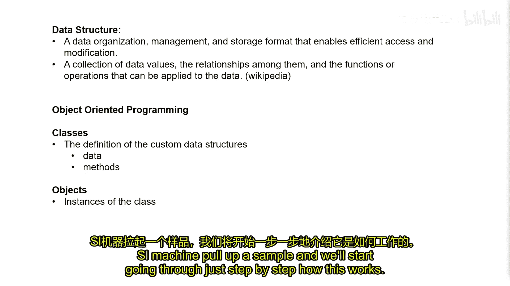
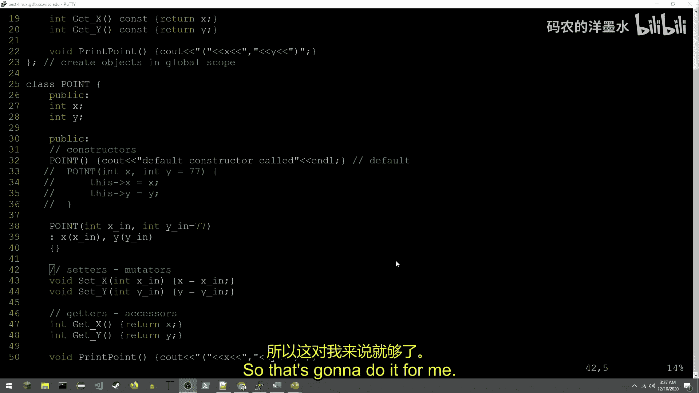

# 【全集】威斯康星大学 聚焦系统级编程 面向Java程序员的C++ CS368C 中英字幕 1080P p09 Lecture 9 - 类 -BV1o72QBREfu_p9-

Alright， hello， everyone。 Welcom back to C plus plus for Java programmers。

 It's about two in the morning for me。 I just started to feel good and figured I'd better strike while the iron is hot and。

😊，Gets more work done， time get caught up a little bit。

 so I get everything done before the end of the semester。

Which me a luck guys All right so today we're going to be talking about classes and mostly introduction to object oriented programming in C+ plus so today we'll be going over classes the next lecture as soon as that one's ready。

 we'll be talking about constructor destructor copy constructor and assignment operator So let's take a look when we when we think about object oriented programming and classes we're going to be creating basically data structures that have。

Data associated with them as well as methods that can manipulate that data。

Now this was the definition I had for data structure that I put up when we started talking about vector and set and map。

 just collectioning of data values， how they're related to each other and methods that let us either access them or modify it change it somehow。

 Now the key feature for object or into programming here and at least the part that matters for what I want to do today is that we're going to be defining our own custom data structures that's going to be the class when I say class that's the definition of the data structure it's going to have the data in it you know actually it'll have the list of variables that we're going to be filling in with data for each of the objects。

 it'll have the methods that go along and manipulate those data and then the other half of that is we will use this definition to create objects you know multiple objects and these are going to be instances of the class and each of these objects are going to get their own copy of all of the different data pieces and they're going to share the methods Now there's a lot of details that go in we'll talk about inheritance and polymorph。

and all that other stuff later， but right now， I just want to focus on the basics。

 how do we create classes， And so I'm going to jump over to the CSL machine， pull up a sample。

 and we'll start going through just。Step by step how this works。

Alright， So I jumped over to a CSL machine。 I've got my basic template。

 I've got them including I stream to print stuff out。 name space standard。 As always。

 I'm going clear the screen every time I run this。 So it's easy to like follow along and identify the new stuff。

 testing it to make sure I didn't screw up and then returning 0。 Allright， So pretty standard。

 I already ran this to test it's up and running。 It works。😊。

So all right on to classes So the keyword to get us started if I'm creating a class is just class and then I need to give my class a name I always put the names of classes and capital letters。

 follow your own convention， do whatever your boss wants。 This is just how I'm going to do it。

 It helps me remember that this the class is the like thing that's going to define objects。嗯。

And then so I'll use this to create instances of classes， you know， objects。

 So I use this capital letters， lowercase for all my variables。 So anyway。

 that's just a convention not required。 Alright， so the key feature here is that this is it。

 This is the minimum。 I need the keyword class。 I need the name of my class。

 I need curly braces and it must end in a semi colon。 That's all I need。 Let me compile this。

Make sure I'm not making dumb mistakes。 Yeah， it's looking good。 there is a really common mistake。

 And that's to leave off that semicolon because you don't need one after the ends of these functions。

 But class definitions do require one。 And it has kind of a cryptic error message associated with it。

 So let's pull that up。And by cryptic， I mean， expected semicolon after class definition。

 that's not cryptic at all， I read that some and thought， I better demo that and identify it。

 but yeah， missing a semicolon。It's kind of embarrassing。

 I should test this before I like start recording。All right， so let's go ahead and put that back。

Right there like that。 I also want to just mention a couple of things aboutstructs in in C plus plus a struct。

And a class。Are almost， almost identical。 Okay， the only difference is in a class the data members are gonna gonna to be they'll begin as private。

And an astruct they'll begin as public and I'll go into what those access modifiers mean later。

 actually very very soon， butstruct is sort of a relic left over from C it's basically in C it's a data structure where we're allowed to have data members。

 however， we do not have any methods， C is not an object oriented programming language And so when we took all of the stuff that we wanted to work from C and we wanted any C program to run in C++ they retained that。

 but they added to it basicallystructs in classes in C++ almost identical it's that one really minor difference。

 but what you'll see is that because of that history when people write code if they just have an object that's going to have data only without any methods basically a data structure。

 some sort of container they're putting their information and though you struck to indicate that it's sort of just a holder of data。

Not like an object， like official full blown object with methods that are going to be able to manipulate it's just a container and that's again just a convention。

 I see it both ways where people use classes as data containers andstructs just like classes creating objects with methods associated with them。

Al right， I'm going to come back to this idea with the access modifiers and just revisit that in a second。

So here's the idea if I have a class point that's going to have。

 so this is just going to be two dimensional， I'm going to have in X。And in why as my data members。

 now， initially， these two data members are going to be private。 And so what that means。Is that。

Only methods that are written for this class can access。

 And if I create an instance of a point object， I won't actually be able to get to X and Y directly without using a method that has access。

 I need something to be public。 And to do that。I just need the keyword public here。

 and that switches。 So when C+ plus compiles the code， it's going to read this line by line by line。

 Okay， when it gets to this public， it says， okay， everything following that is now going to be public until I hit the keyword private。

哦。And。Typically， I like to put the。More like that。As farar as like structure。

 But F is going automatically move these tabs over for me。 Yeah， So then it hits private。

 And now it says， okay， now name is gonna be private。 And these are just like switches。 So I can。

 I can have many publics and many privates in here and just， you know。

 put whatever I want this next block of。The data or functions。Will then be public or private。

 So it's a little different from Java， where I believe you have to indicate for each method。

 whether it's public or private。 There's a third option protected。

 And I'm going to come back to that one when we start talking about inheritance。

 It's got to do with whether。A subclass thather that inherits from。

 my base class can access the data or not。For now I'm just going to go with public and private and again。

 so with thestruct thingstructs are exactly the same thing as classes。

 except all of the data members， if I don't put any of these in。

 start out as public in a class they all start out as private and so if I want to be able to access them I need to use the keyword public right here okay。

Let me shorten this up a little bit。And then we'll go ahead and create an instance of this class。

 I'm going to leave the clear there。I'm done with the test。

And just to make sure this is actually working， sure I' going to do， I'm going to create。

A point object we'll call that P。Just like that， it's all there is to it。

 And now I can access those public data members。 P of x is equal to 3。 P of y is equal to 6。

And now we can let's print those out， just make sure it's working。See out。Pta X。Equals。You got x。

And line， okay， that should be good enough to verify that it's working， so let's compile。

And run this should now print E do x equals 3。 Okay， excellent。 It's looking good。

I was just thinking， why don't I go ahead and demo？

The fact that all of the data starts out is private。 What's going to do。

 This is going to generate an error message when I try and access the X data member of my point object and assign it 3。

 because these are private by default。 So let me just go ahead and that's going to give us an error message when it compiles to see what that error message is。

Y， and point X is private within this context。 Remember。

 we want to start with the very first error message。

And then the rest of these tell me more information and then move on to the next error。All right。

 so it's private。Big。That's my message。 I need to go make sure that's public。 And again。

 it's going to be private by default。Go put that back in right there， all right。Al right。

 we're up to bullet。5 on my notes list。 The first one is how to create a class with point with the word class。

 Second one was public versus private access modifiers 3 was adding data。

 and then using the data with the dot notation。 So next up， I want to mention too。

 I'm not sure what the best order to do this is in。

 but I can also declare objects in global scope right here。

By just putting in the name of the object I want to create。 So this is just like， if I wanted。

To create something in global scope。 So outside of Maine， I can have int X just like that。

This part right here is the type。Okay， for this one， for this part， the entire thing is the type。

Okay so it works the same way。 It's just I'm creating my own custom type with that class and then the definition。

 And here I'm just creating instances of those objects exactly the same light way I did right here。

Let me put a comment in。Al right， that looks good。 I'm going to skip ahead a little bit。

 I want to be able to print out points without having to do all this work and thinking about it like this。

 So I'm going to go ahead and create a method and just add that to the fun to the class that's going to print out the points。

 so。It's going to be a function print point。 It's not going to take anything。

 It's going to use these pieces of member data， though and just print out let'll see what should this look like。

C out。We'll put some parentheses in， and we'll print out the X data member。A comma， put Y and。

Closing parentheses， just like that。啊。You let me test that to make sure it works。

 So here I've got my point。 I'm printing out C just the X。 So we'll call P dot print point。

Let's see where all my typos are。No typos， that's excellent。All right， there it is。

 It's printing out 0。36。So looks good。 Okay， next up， Now that I've got a way to print things out。

 The next bullet point on my list is to demonstrate that each point gets its own actual data。

 So I've。Upshold on。Going a little spastic here。 So I've got points P2 and P3 up here。

 So I can say P2 to x is equal to， I don't know1。And P2 dot y is equal to 2。

 And then I can print out both of them。 So P2 dot。Print point。

And I'm pretty sure that I didn't put an end line in here。

 So they should just be printed right next to each other on the same line。 So we'll get the 3。

6 in parentheses， and then the。1，2。All right， let me go ahead and write this。Compilile it。Run it。

There it is。 So clear the screen。 it's printing P X equals 3。 There's my two points。

 just to show you guys that the class， each instance of the object gets their own data when I not say you something special to it's the。

Create static data that's associated with the class。 Come back to that in a few minutes。Alright。

 so the next thing I want to do is talk about how。I can use these classes even as data members of other classes so that I can essentially nest things。

So I'm going to create a second class in just a quick review。

 I'm going to use capital letters for the name of my class。

 It requires two curly braces and a semi colonlon。 So there's the minimum。

 That's sort of my template。 When I write classes， I always。I'll put all that in。

 and then I go ahead and add some space and fill it in just for me。

 it's a way to remember what's going on。And again， all the data is going to start out as private。

 I want to be able to access it， so I'm going to make it public。And then， I'm going to create。

My box with two corners， so we'll have a min corner。And。A max corner。

So this is going to be using my point data object， my point class as members of the the box。

All right， let me go ahead and just create a box down here。So box， we'll just call that B。

 There it is。 It's all I need to do。 And now I can access， let's say B dot。Mean corner。

We get me to this data object right here， which is a point。And now， points have。

X and Y up there so I can say dot x。It's equal to， I don't know。 but I think I used three already。

 We use four。And B dot min corner。Dot y is equal to5。B dot max corner。Dt x equals 6。And。

Max corner do y is equal to7。And then I can do stuff like。And just put a blank line in。

 then we'll print out B dot min。Corner dot。Pd point。B thatt mean。Corner dot。And I don't want pin。

 I want max。why。All right， so I'm creating a box。IG myself a blank line So it itll this will be on the bottom line。

 And I'm just gonna print out both points。 I just want to make sure that I don't have any typo Im yet to。

Semicoant at the end of the line。I get a good feeling， but I think it looks good。So save this。ile。

And we'll run this。There it is。 Okay， oh， I must be printing this all out before I did the rest of this stuff。

 It's out of order。 Hol on a second。Y， okay。So let me grab， let's see about nine lines。

Paste those here。There we go，4，5，6，7。 So there's my box。 So the point here。

 what I was trying to demonstrate is that I can chain together as many things as I want。

 and I can nest classes inside of other classes。 So here I'm just declaring point as a data member of my box class。

 When I create objects of the box class。 Each of these points is going to have these data members。

 I can call these methods。Alright， I just want to write one more function real quick to make this box class a little easier to use throughout the rest of the lecture。

 I'm going to write a function called Z corners。This is going to take two parameters。

 they going to be points。AndWe'll have point P1。Point P2。Here's the function definition。

 All this is going to do is say that Min corner。Dot x is equal to p1。x。

And then I'm gonna fill this in here our back。 There we got， got the rest of these men corner。

 X and y， max corner， X and y， P1 and X and y， P2， X and y。

 So it's just gonna to set the data based on this being given some points。

 So instead of doing something like this， let's actually let's create another box。 So a box B2。

 And then I can say B2 dot set corners。And let's see， I've already got some points here， I can use P。

And P2， which already have data。 And then let me write a function real quick that'll just print out the box corners once that。

 I just go ahead and do that and then come back。Okay， allll set。 So print box。

 all it's going to do is call the print point function on each of the points。 so to print out。

The main corner， followed by the max corner。 And here I'm creating a box B to you。

 I'm going to set the corners and then print it out。 And I'm also going to do one more thing。

T on a blank line。So let's see if I made any typos。No typo excellent。

 So now I've created a new point using my P。N my P2。I should probably call that P1， but I didn't。

 so three，6 and one， two。All right， so again， demonstrating sort of this idea that I can nest things。

 this is an actual class， it's an instance of a class。

Instance of a class so I can call the methods associated with that and access the data in those objects of those classes。

All right， cool。All right， next up on my list。When I've created functions inside of the class。

 like set Corns， for example， I've got the entire definition of the function right here。

 And just like we've been doing where we write all of our functions in main where I had the prototype at the top or a function declaration。

 And then I can put the definition anywhere else I want it frequentlyequ。

 I would put them at the very end of the file know below main and sort of separate the declaration。

 So C needs C plus plus needs to know when a function is called what the arguments are。

 So it can check it。 And when the compiler runs， it's going to read each line of code one line at a time and just sort of jot things down。

 And if I use a function before I've declared it。 C plus is going to throw it error。

 it's the compiler is going to complain because it doesn't understand what that function is。

 Even if I've defined it later。 It needs to have that prototype before we ever use it。 In this case。

 we can also put the prototypes in the classes。 and define the functions elsewhere。

 So let me go ahead and add one more function。😊，Al right。

 I've just added one more function real quick。 And this is going to just compute the length of the edges of the box。

 So I've got a lower left hand corner in an upper right or min corner in a max corner。

 edge length is going to declare a variable of type pair。 So this is going to have two integers。

 It's going to have the first and second data members。 I'm calling an edge length with the lowercase。

 even though it's the same name as the function just because that's what I'm computing。

The first is going to be the x value of the max corner。 subtract the x value of the min corner。

 So that's the length of the like the width of the box。 then max corner Y subtract oops min corner。

Corner Y is going to be the height of the box， and then I'm just going to return this pair。

So this is how I define it if I were going to do it in line all of these things when I'm defining them in a class like this are going to be actually made in line。

 which means that when。Yeah， so inlining means that when I compile the code and I call these functions。

 it's actually going to copy and paste the text of these functions right there in the code。

 and so if I call set corners many times， this code gets duplicated every time that the compiler is producing like the machine code rather than actually reusing it and it's the choice of the compiler to do that。

 it's a suggestion not guaranteed。I got to check that。 I could be wrong there。All right， hold on。

 let me see if I can say this a little more clearly。

 So an inline function is one where so every time I call a function。

 I'm going to incur some cost of like creating a new space on the stack。

 trying to remember the return address where I'm going to come back to creating some space for return variable whereas we' something like this all I'm doing is taking some data and setting some values are just printing something out that really doesn't require like the full overhead of a function call。

 I could do this a lot more simply if I just copy and paste those two lines right in the code and that's what the inlining idea is going to be So functions that are declared inside of a class are going to be automatically in line it's going to take the actual code and when it's used down here if I call printpoint。

 it's going just take the this is print box it's going to copy and paste that code directly into the machine code。

 And so if I do it a bunch of times， I'll get longer assembly code or longer machine。

codeode out of it， but it'll execute more quickly because it avoids the overhead of actually calling a function and trying to remember where to return to。

Alright， so that's if I declare the functions inside of the class。 Allright。

 so what I want to do now is， and that's pretty typical for things that are very short。

 something like a function that only has two lines or something that's just setting some things。

 they would be declared in the class， typically。 Now。

 I can also put these definitions outside of the class。 So for my length functions。

I still need the prototype。I absolutelyute must have。

The fact that it's going to be returning a pair of integers。I need the name of the function。

 I need to know that it takes no parameters。 And then the semicolon。

 that's all I need for the function prototype or the function declaration。 Okay。

 so now I'm going to move the rest of this outside of the function。

 potentially even to a completely different file。 So let's see here， we will cut that。

Move it outside， paste it again。Okay， there。 I've got the function moved。 Now。

 as the compiler is going through， it's getting the， So I've got the definition of point up there。

 Here's my definition of the box class and gets to edge length。

 And it doesn't know that this edge length declaration right here needs to match up with this definition。

 So this is the declaration。 This is the definition。 in order to do that。

 I need to tell it that this function right here actually is a member of the box class。

 So to do that， let's see insert mode。I just need to type the name of the class and then two colons okay。

 those two colons that is the scope resolution operator。

 so scope is in it goes in the scope of the box class。

And so edge like this is my definition for this function。 This is how I tell it to match those up。

 just like that。And now this function is going to be compiled separately。

 It'll actually be used as a function call。 I'll add some space to the stack。

 I'll remember the return value where I need to go back to in the code。

 it does all that extra work if I don't。Well， if I want to recommend the compiler that they actually make this in inline function。

 it's very easy to do。 I just need the keyword。In line right there。

 Let me compile this make sure I didn't actually make any mistakes。Okay， found the mistake。

 I just misspelled lengths right here。 I switched the two letters around。 So get that fixed。

 I'm also， alright， now that I've demonstrated。How to do this， Oh。

 I didn't actually show you guys that it's a compiling。Right。Compile it， there it works。Run it again。

 So everything is still the same。 I didn't actually print this out yet。

 So let me go ahead and write a little piece of code that prints out to my edge links once I。Okay。

 here we go。 I just put together a quick print function so that we can actually see that this is working entirely so print edge length right here on line 35 calls edge lengths to get those edge lengths returns a pair。

 So pair In I've abbreviated edge length says E for my variable and then this is just going print out the first number and the second number with some parentheses and a comma in between them。

Alright， then down at the bottom， I've gone ahead and added two more lines here。

 The first one just prints out edge lengths equal， so I know what I'm doing because I'm starting to get a bunch of stuff printed out and I want to keep it straight。

And then from box B2， I'm going to just call print E links。 and it should print those out。

LetWe change focus back。Write it。Pilot。There we go。

It looks like it could have benefited from an end line right there。 But okay。

 so my edge length are -2 and -4。 So my minimum point is 3， max point is 1，2。 So 1 takeaway 3 is -2。

2 takeaway 6 is -4 It looks like it's doing the right thing。 There's no absolutely no error checking。

 I've actually got my minimum corner with greater coordinates than my max corner， so。

Maybe we'll go back and put that in at the end of lecture if there's time。 Probably not。

 So there's no error checking。 I didn't bother to look for that。

 So that's why I'm getting negative numbers here。Okay。

 the next topic in my list is getters and setters， also known as accessors because they can access the data and mutators because they can change the data。

 there's gonna be one little trick with things that are constant for the accessor functions。

 So I'm going spend a few minutes and just demonstrate the really common error that comes up。

 hopefully you guys are all familiar with getters and setters here let me just I'll go ahead and write one。

 So。So setter will have void。 It's not going to print out anything。

 It's not going to return anything。 We will get， oops， setter set We'll do one for X。

 Thatll take an x in。For the data that's going in and then in the function。

 we will just say x is equal to x in。That's all it is to it。

 I'm going to go ahead and write the others。 I'll be right back。All right， here we go。

 I've got them all written。 So set X and set Y。 we'll take an integer input and just go ahead and set the corresponding variable to whatever we give it as input。

 The gets are gonna be returning the variables X and Y。 and these do not change anything。

 So they're just accessors。 They don't change anything。 There's no mutating。 They just get things。

 These have the power to change So they're mutators。

 And the reason we would care to do this is ultimately， I want to have as much data as possible。

 be considered private。 so that I can't just do things like maincor dot X。

 This is gonna to let me have a lot more control。 Let me protect the data and ultimately let the compiler find bugs in my code where I'm misusing things or changing things that I don't intend to I want to be able to say。

 go through set X where I have control over how things are being set。

 I can do air checking right here。 to make sure that you know， like I have this。

 my edge length turned out negative because I didn't do。Any checking at all about my points？

So that's sort those sort of things。 that's why I would want to do this。

 if I go ahead and take this code right here。To make my data private。

 I still want my functions to be public。Soll put that。 I would need to do something like this。

 This is gonna to break a whole lot of stuff in the code I've just written if I make X and Y private。

 In fact， it's going to crash right down here as soon as I do this Min cornerner dot X。

 because it's no longer public。 it's going to be private here。 Let me just demonstrate that。

 It should be a lot of error messages。Lots of them， yep。Can only be accessed by a get point。

 Allright， is private within this context can only be accessed is private within this context。 Okay。

 so all kinds of errors like that。 So let me go ahead and I'm going to leave this public。Ys， zips，ss。

But what I'm going to do instead is make a copy of this so I can demonstrate that real quick problem with。

The constant functions and constant access one sec。Alright， so I've made a copy。 I renamed the。

 the copy。 So here's the original point。 renamed that private point where the data members are now private。

 So that way， this should all still work。 I'm not breaking anything。

 but I've got a version where my data is private。 So this is the version that I would prefer that I want to write from my like。

Published final version of my code。 have leaving a public is okay for testing。

 but it does lead to all those like， you know when I when I make the switch。

I took a lot of shortcuts like this。And didn't use the getter and Cter methods that I just wrote。

 Note， these are public here。 Al right， So let me go ahead and well leave all that stuff。

Go down to the end of main。 and we'll just add some new material here。

 So I'm going to create a private point。And we'll call this。皮皮。And then I can go ahead and say PP。

 set。X， and we'll accept one。Let me finish these up。All right， I'm back。

 I just cleaned up a little bit， Okay， so I've got my point my private point class right here。

I went ahead and added a declaration of or I created a private point object right here。

 PP Z X set Y and then I'm just going to print this out just to make sure that it's all still working。

So， right。好吧。Get a little lag there。Payle。Then we'll run this to make sure it's still good。 Yep。

 it's printing out one2。 just a note， I added my system clear line right here to clear the screen so that it's not got all that extra box junk。

Cluttering the the view。 Okay， so what I want to do next is I'm going to write a function that goes through an array of private points。

And just tries to see if any of the x values are0。 One second one， go put that together。Actually。

 probably not bad to watch me do this。 So I'm going to create a function。

 It's going to return a Boolean value to tell me whether any of them are0 or not。 So here's the idea。

Let's see。 Let's call this。Any。Zeros。Okay， any zeros。 And then this will just take。

 what I want to do is be able to pass this a vector。Of private points。So vector private point。

 And we'll call that the vector V。 Now， I don't want to actually make a。Like a copy of that。

 just to be testing。 So what I want to do instead is just use a constant reference。

 I don't want to change anything。 I just want to report if any of these are0 or not。

 So and want to use a constant reference to that。So that's most efficient。

 It's just going to pass in the address。 this am percent takes care of all those details for me about not having to worry about pointers。

 and I don't want to change it。 I want to guarantee that my function doesn't change things。Okay。

 so here's the idea。 We're just gonna to go for element in。We not。你。V。And then we'll say if。

E dot get。X。0。I need some parenthees， I've been writing too much Python recently。

Then will return true。As soon as it finds one otherwise。We' return false。Okay， that's all we need。

 I do need a prototype for this somewhere up the top。 So let me go ahead and。Stick this in here。

I'm about right in front of me。Thereever go。So Andrew prototype need a semicolon。 Okay。

 let me see if this works。That's not。 it's not finished yet。But at least that much compiles。 Okay。

 so what I want to do now is create。A vector。I'm just going to call it V。Need to tell what type。

Dctor V， and then we'll just give it。Three copies of P P。

This should return false at the end because none of these values are0。 Is just。Print out right here。

Will be equals。Any zeros？And then we'll give it。vectorctor V right there。See out。Let's see。

Let me just finish this up but we are back。I got this cleaned up a little bit more to my liking。

 I made one more change。 So here really good practice when I'm writing functions that are going to go through a vector and I don't need to make a copy of it。

 I'm going to use a reference to the vector if I don't want my code to change it and I want to communicate to other programmers who might just read the prototype that it's not going to change it。

 I'm going to put in a constant vector Okay so that way I can't change it。

So then when I go through the other change I made was to use a reference here。

 So these point data structures， I mean， it's just an integer that I'm looking at。 so not a big deal。

 well a pair of integers in a class， not a big deal to just make a copy of that right here。

 But I went ahead and put in the ampersant。 So it's actually using a reference。嗯。

Good programming practice。 The next thing， when I use my get X。

C++ doesn't actually check to go see if another the getX function has the power to change。嗯。

The data at all， in fact， what it's recorded as it's going through the compilation process is just just the prototype。

 So it doesn't even know what's in that data x function。

 All it knows is it's calling get X on this object right here。

 And if this does have the power to change the data， I've just told it it's constant。

 I can't change it。And it doesn't know that。 So it's going to give us a compiler error。

 which is actually kind of cryptics。 Let me write this。Compil it。 we'll take a look at this。

In function bo any zeros with that prototype。Passing private point as this object discards qualifiers。

 So what they mean when they say discards qualifiers is I've messed up somewhere and not put the right number of cons things in there。

Okay， and it's this get x where we're discarding the qualifier。 Yep， right here， get x。Okay。

 so I've got two solutions right here。 The first one is not the great 1。

 I can just remove this constant。 Okay， now this any zeros function has the power to change it。

And that error message should go away。I got to need to change a prototype2， so I changed it here。

But I also have my prototype up here。There we go。 Now a compile is just fine， this code will run。

And tell us there are no zeros in， you know，1，2， and then 1，2 and 1，2，3 points that are identical。

 Okay， now the better way to fix this， I'm going to put that back because this is good。

This is good here。I want to keep that。 What I need to do is make sure that the prototype tells C plus+ that getx is actually an accessor and will not change the data And to do that。

 let's see where is it。 It was at the very top private point， getters， here's get X。

 All I need to do is add to the prototype that this is a constant function and does not change the data。

Go let me make sure I'm not messing up。 There it is that compiles also。When we run it。

 we get the same thing。 N zeros equals falses。 So， all right， in summary。

 because I want to be able to take advantage of these like very protective features of C plus plus to。

 you know， protect my data to make sure that I'm not screwing things up as a programmer。

 This is going to help me find bugs in the long run by， you know。

 making sure that things are constant where they need to be。

I need to go ahead and make sure that all of my accessors have this cons keyword in them。

 And it goes after the parentheses where I put in my arguments or parameters and before the actual function body。

Typically， the so I streamline this a little bit。 So it looks good。 These are very short functions。

 I put them all on one line。 Typically， you would have the。Function body。

Bread out a little more like that。 I didn't do that。

 So it would look like this if you use an I D that auto format things for you。

I'm to put back so it all fits on one line。 It looks good。 It's not long。

 that he's still easy to read。Alright， next up， I want to start talking about constructors a little bit。

 A constructor is just a special function that's run every single time we create a new object。

 So right here I'm creating a brand new object P4 of type point。 So I'm going back to my point class。

 Its shorter。😊，And that special function， the constructor is automatically run。

 C plus plus comes with a default constructor， and all that does is it goes through all the different data members and runs the default constructor or the constructor for each of those items。

 So right now， I'm just creating P 4 I printing it out to see what it does。Let me go back up。

Here's point。 So it's got these data members X and Y。

 So the default constructor just calls the constructors for an integer x and an integer Y。

 which basically does nothing。 It just is going to reserve some space for them。

 And so when I run this code here， I'm clearing it。 And then we're just printing the point。

 There should only be one thing printed right this。Compile it。Run it。

 so I can see that there's just garbage gibberish in the memory where I'm。

Sttoring that that class that object with x and Y。 So it doesn't default 0。

 It doesn't take care of any of those nice details like Java would do for us。

 It's up to us to set things。 Now， the next thing I want to do， wouldn't it be really nice。

If I could just say P5 and then give it some coordinates like 00。

So that's what I want to talk about next is how to make this code actually work。

 We're going to have to write our own constructor for that。 So let me go back up to point。

And we'll add a new section here。It's probably good that the constructors are public so that they can be called from outside of the class。

Let's see here。To write a constructor。So constructors have no return type。

 it's just the name of the class is the name of the function that's called。

And then I can give it some parameters if I want， I don't have to。

 the default constructor in C plus+ is going to look just like this。

 It's just going to be no parent or no， no no parameters。And no actual code。

 So it's just going to initialize these data members initializes the wrong word。

 just reserve some space and memory for them and not clearing them out If these were other classes that did have default constructors that did something。

 it would call those constructors like if point had another object in it。Okay。

 and I'll demo that later。Al right， so right now， what I want to do is create a constructor。

 So this is what the default one looks like。 I'm just going to go ahead and leave this。

And that's provided by C plus plus4。 It's just automatically there。 I don't need to do anything。

 And if I do want to add to it， I can override that and override it by adding my own。Code right here。

Something like that。 So we'll just print out default constructor called。

To see that when that happens， let me throw an end line on that， too。There we go。 Okay。

 so what I really want now is to cool。Stop messing up。 Stop messing up。

I'm going to create a new constructor that's going to take two parameters in x in。And。Why in。

And then go ahead and say that x is equal to x in。G services。So I' not calling and y is equal to y n。

Okay。So now when I use this constructor， it's going to go ahead and just set my data values。

Through the construction process。 Let me go ahead and run this and just make sure that it's actually working。

 So right。On that， I think I。Didn't print it out。Yeah， all right。 so sorry for the scrolling fast。

 So P5 dot print point。And throw on some end lines， too。Okay， so we're going to print out that point。

 it should give me 00。So right。Compile。Was that an error message？I wasn't hear message。

 What did I do wrong？Expected， let me oh right there。 I've got a colon instead of a semi colon。

It's a great table步。There we go。Again， okay， no errors。And run it。 Okay， so there we go。 So 1。

0 and 0。 So this was the garbage that was already in memory when in that place where I declared P 4。

 And I believe it's called P 5。 I set that one to 00。So just like that。

And just wanted to mention too， that it did print out default constructor called for me。

We can also give constructors default values。 So in this case。

 I'm going to say my default value here for y in is going to be 77 just something that'll easily be recognized when I printed out。

And then I'm going to go ahead and only give this one parameter。 And then C plus plus will just say。

 oh， I need the other one。 I'm going to use the default value。

 So it's going to use the positional version first。 You know。

 it's going fill in first parameter matches to this one。 Second parameter matches to this one。

 The second one is missing。 then it uses that value。 If it's there。 Then it's just fine。

 So let me go back down here where I was printing stuff out。 So this one，0，0 should be just fine。

I'm going grab。Lines paste these down and we'll do p6。And this one will just give it about。

And so it's 60。6， and the other one was 77。 So when we print out this point。Oops， oops， oops。P6。

 tweet， tweet。There we go。It'll use that default parameter。Yep， compile， no errors。In running。

 there we go 66， and the default parameter 77 was used right there。Yeah。

 get some crazy big numbers if you don't initialize them。All right。

That's why it's really important to print out all kinds of stuff as your development code so you can see what's really going wrong。

All right， so next， I guess two topics， I want to talk about what happens。

 some shortcuts that people will frequently take。So right now I have a function here。

 It's a constructor that's taking a parameter X in and y N。

 I'm using different names to be clear down here， because this X。

He's going to refer to that part right there。Now， a lot of times what you'll see is people will。

Just put in X and Y。 for their parameters。 And they're the same names is up here。

 So I want to sign those values。 Now， I'm saying x equals x and y equals y。

 It doesn't know which ones to use。 So when I want to declare or when I want to refer to the variables that are members of the class。

 I can say I can use a special member。This with the arrow。To say this is the X that goes right here。

 and the other ones are going to be the parameters。 So if I don't do that， if I have a variable。

 the parameter is going to be the one that's in scope， and it's going to see that one。

 So I also need another this here for the Y。So just to shortcut。

 this is going to let me use the names over again。 Very confusing。 If I'm using the names。

 they're referring to the parameters that's going to be the one that's at most。

 most visible to get the access to the data members。

 I need to use this that refers to this object and access those parameters。 All right。

 allll there is to it。So， this should。Still compile errorss and still run just fine， Okay， perfect。

With that in mind。When we， when we use a function like this as a constructor。

 So I'm going to write another version of this now。

 where I'm putting all of the code that does the assignment of my parameters to the data members inside the body of the function。

 It's actually doing extra work。 So the very first thing that happens is it goes through。

 And it's going to call the default constructor for all of the variables up here。

 All of the data members have their default constructor called。 All right， for an integer， obviously。

 there's nothing to it。 It doesn't do anything。 It just sort of reserves that space and memory for the integer and leaves whatever garbage was there。

 But if we had a more complicated object， just be aware that。This part right here。

Calls the default constructor or the constructor for each of these pieces。

 And then it goes ahead and reassigns the value to it。

So that would be first run the default constructor， second， run the assignment operator。I'm sorry。

 the。Copy constructor。 Wait a second。 Which one is it Time on， Let me look that up。No。

 it's the assignment one assignment operator right there。

 So that that's going to call the assign assignment operator。

 And we'll talk about how to write those for each of our。Classes in the next lecture。 Alright。

 so next up， I want to talk about using an initializer list as a way to avoid that。

 If I've got a really complicated， you know， suppose I've got a class that's storing genome data。

 and I've got， it's going to reserve a certain amount of space for the sequence of DNA。

 And then I can call it。And give it some actual DNA。

 like a string with all of the letters could be gigabytes of data。

 If this first runs and reserves a bunch of space。And then。Goes ahead and does this assignment。

 finds out it's not enough space and has to redo that。 So This could really be a lot of extra work。

 So this is where something like an initializer list version is going to be more efficient。

 And in general， far more preferred。 This is the way you would see it in Java a lot of the time。

 So I wanted to start with this one。 And this totally works in C plus plus also， so。Here's the idea。

To do the same thing， I'm just going to write a second version of this。Intax。Ink y equals 77。

I'm going to have my function body here， but I'm going to leave that empty。

 So the next thing I'm going to do is put in the initializer list。 And to do that。

 I need a colon to indicate that this is the beginning of my initializer list。

And then I'm going to have x is the first variable that's going to be called with this。

 So in this case， I'm using the copy constructor。 So it's a constructor。 See I've got x。

And followed by the parenthees， I'm giving it the data here。 so this。

Maybe this would be a great place to go back and put in the X in。

Rather than doing the shortcut the first time through。In equals 77。In this case。

Bear with me for a second。Y Okay， so this is calling the copy constructor。

 which is basically going to reserve the space and put the number in all in one step and not do it in two steps。

Alright， so that's the idea。 And then I can just leave the body of the function completely empty。

 So let me go ahead。 We'll comment this one out。There we go。

 and we'll just show you that this version still works or find my typo if I made any。There no typo。

Run it should get exactly the same thing again。Al right， so like I was saying。

 this is the preferred version for efficiency。 If you need to do anything complicated。

 definitely put in the body of the function。 if you want to do any error checking as you go through definitely put that in the body of the function。

 Don't feel like you have to do it this way just because it's a nanosecond faster And for integers。

 that's really all it is。但。Not， not fast enough that we you would ever notice a difference only in special circumstances that probably wasn't true in the you know early 70s today。

 definitely fast enough。 this won't be an issue。All right。

 I think that's going to do it for me right here。 I'm going move the rest of the like。

So the next lecture is about the big four constructs， which I just started introducing right here。

 the Dstruct， which is when we're done with an object。

 we need to like free up that memory again if we've done any like special not use the new operator at any point or created an array or a pointer。

The assignment operator and the copy constructor。 So we're gonna go over those four in the next lecture。

 So I I'm just splitting this in two pieces。 So that's going to do it for me。 Have a great day。

 everybody， and I'll see you soon。

