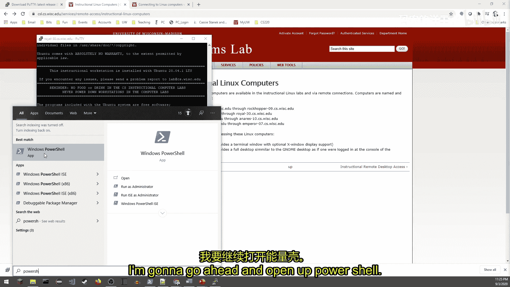
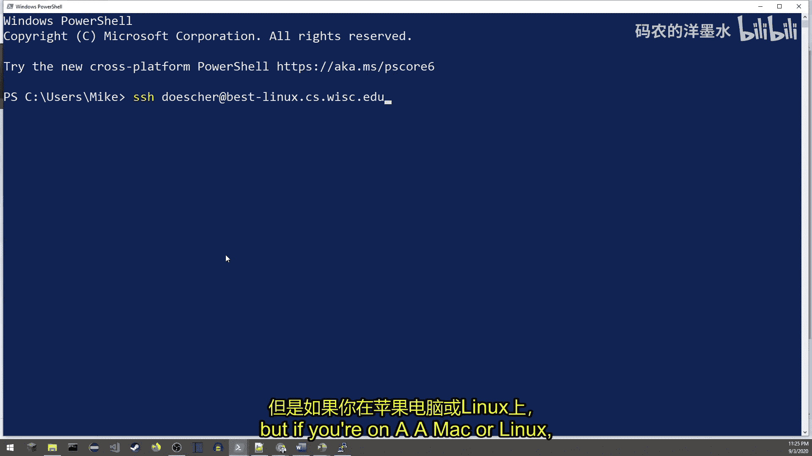
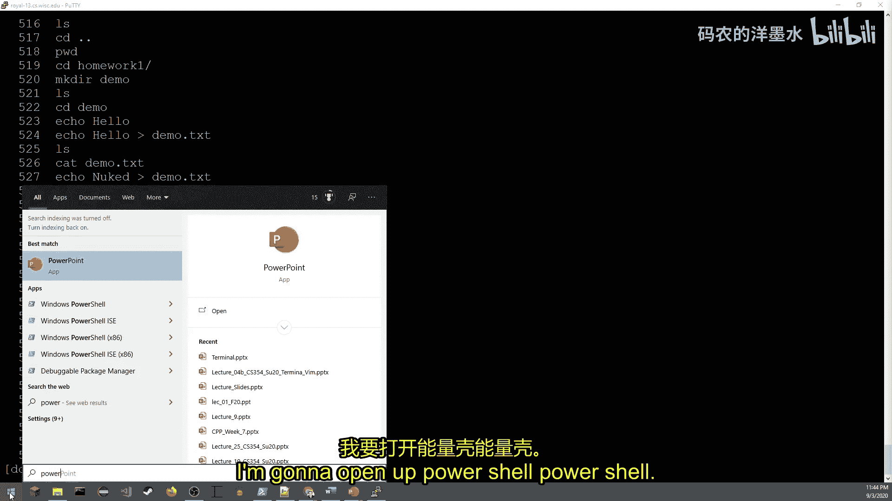
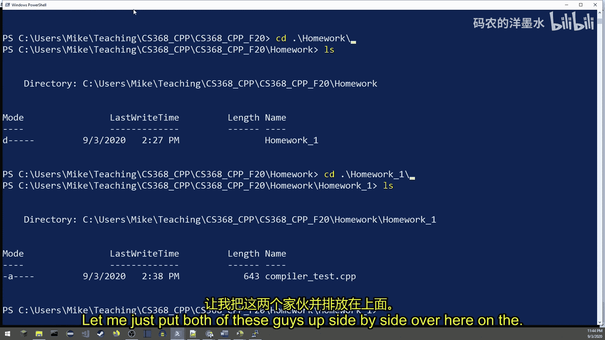
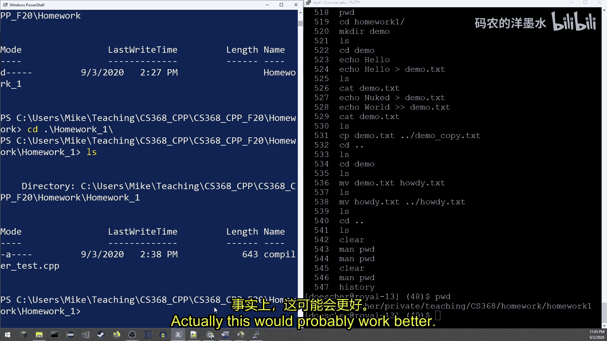
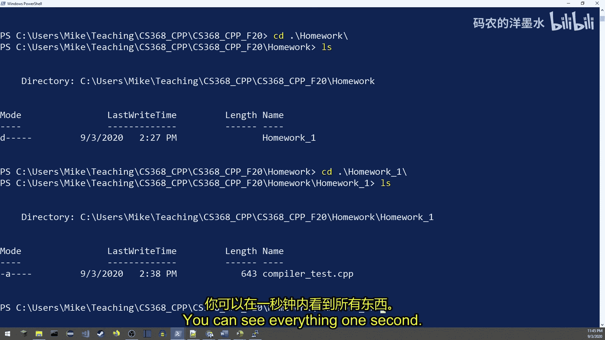
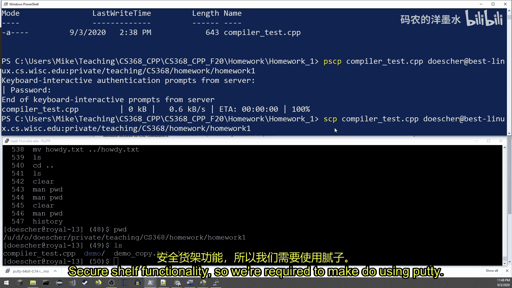
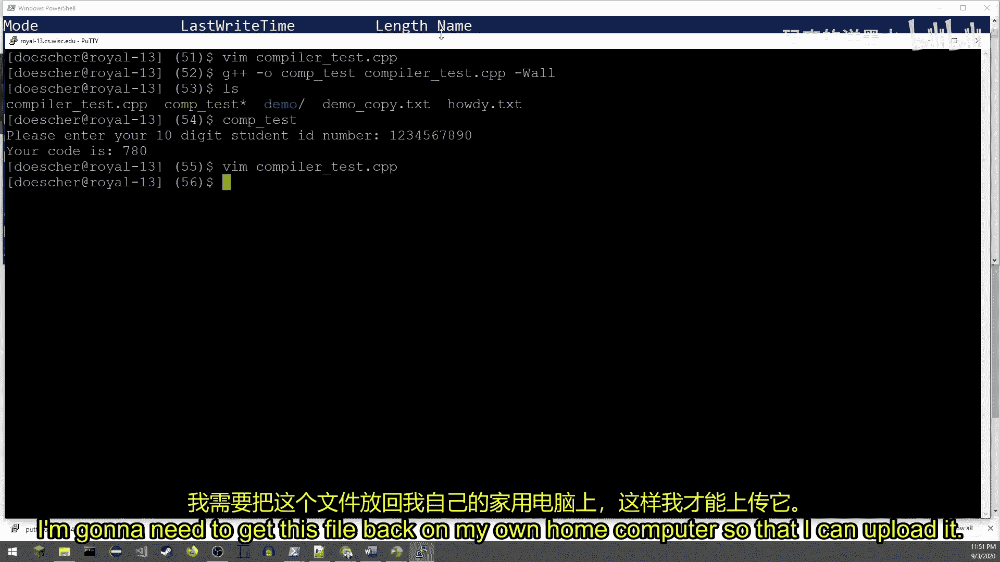
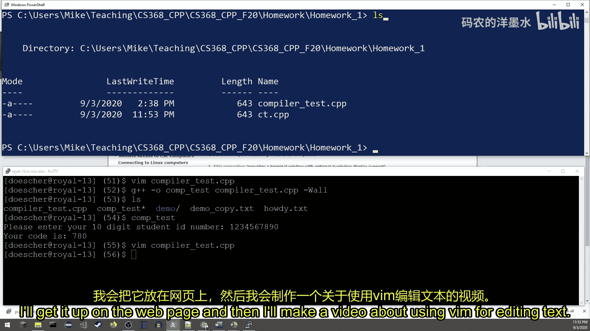

# 【全集】威斯康星大学 聚焦系统级编程 面向Java程序员的C++ CS368C 中英字幕 1080P p10 作业 1 终端与 CSL 机器 -BV1o72QBREfu_p10-

Hello， everyone， I just wanted to give you guys a brief introduction to using the terminal。

 I suspect at this point， most of you guys are at least a little bit familiar with terminals。

 but hopefully you'll be able to pick up a few tips and become just a little bit more efficient at using your computer。

 I'll try and keep this as short as possible。So a little bit of history to start off a long time ago。

 People wouldn't actually own their own computer， and they were very expensive。

 A department would buy a mainframe to be used by everyone and maybe spend a million dollars on it。

 And then to share that with everyone in their organization。

 They would go ahead and buy dumb terminals。 They're just text based boxes with little more than a screen and a keyboard。

 And they would connect to the mainframe。So today， we don't have terminals and mainframes that we connect to like that。

 We have far more powerful local personal computers right here on our desks。

 So what we use instead are known as terminal emulators。

 Why would we ever want to use a terminal emulator。 Well， they can be much faster than using a mouse。

 They're very good for navigating your file system。 for example。

 It can be much more quick much quicker to type the names of the directories you want to move through than hunting for them in a list of files and clicking on them with a mouse。

😊，So I have two pieces of advice。 I'd like to share at this point with you guys。

 First is to find good tools and invest the time to become really good at using those tools。

 This investment is going to be really important and it will keep you from having to work extra hard to figure out and struggle with tools that are clunky or things that you're not familiar with。

And， second。Master the tools of let you work from anywhere。 This is particularly important。

 Should you find yourself needing to work from home， For example， if there's a global pandemic。

 or if you want to work from someplace a lot more enjoyable， like the beach， for example。😊。

In three weeks， I'm heading to Las Vegas。 I can totally do my job from there。 I can still connect。

 I can still upload videos。You guys will never even know that I've left。

 and I'm not sitting in my basement right now， recording videos when I'm gone。

 when we run a terminal emulator on our computer， for example， like Power shellll on Windows。

 or it's actually called terminal on a Maclin。 That is a program that's going to run another program called a shell。

And now， a shell is。Very， very simple。 It really only does two things。

 It lets me move through the folders or directories on my system and look at all the files。

 and it lets me run programs。 It just asks， what should I do， And I type it a command。 Then it asks。

 what should I do now， And I type another command。So we have actually quite a few options when it comes to different shells that we will be running within our terminal emulator。

 Here's just an example of some of them。 CMD over here is the default Windows shell。Let's see。

 PowersShell is the one I'll be using。 The Windows version CMD doesn't generally accept a lot of Linux style commands they've got their own list of commands they use。

 And the developers of Windows recognized there are a lot of Linux and Mac users out there who want to use the commands they're familiar with。

 So PowerShell will accept those。 And then there's a whole bunch of other ones out there。

 they all end in S H。 you know for shellll。 The one that you'll get to when you use the CSL machines is the bash。

 That's the B again shellll。 little history there。 the B shellll was developed by Stephen Bourne back in 1979。

 They made some improvements and it became the B again shellll abbreviated bash。

 That'll be the default one you see when you log into the CSL machines。

 if you take no action to change what you're get out of it。All right， quick demo time。

I'd like to new my demonstration on the CSL machines。 That's what we're going to be doing our work。

 It's what we'll be grading your homework。 And because I'm using a Windows computer。

 I need to download an SSH client。 The one I'm going to be using is calledPty。

 I've got the link in the description。 Otherwise it's just putty do org。

If you're using Mac or Linux machine， you can just go straight into terminal。

 it's got a built in SSH client right there in your terminal。

 so you can just go to finder use terminal。 I don't have a Mac otherwise I would demo that to apologize。

So the version I want is actually I've the Windows installer and I've got a choice。

 the 32 bit or 64 bit。 The 32 bit works in all cases。

 the 64 bit will be faster but it requires that you have a 64 bit processor and you're using a 64 bit version of Windows。

 If you're not go with 32 bit and if you're willing to be a little more patient and you're not sure go with the 32 bit I'm using a 64 bit myself。

 okay， so you'll just download that installer click it it should download you'll double click it and install it。

 I've already done that So I'm just gonna move on。Alright。

 so now we're looking at the computer system labs， the CSL for UW Madison and these are the available Linux machines。

 I've got the link for this in the description also。

 and this is actually the instructions for making an SSH connection。

 This is what they recommend right here you see they recommend using putty and that's what we'll be using They've got some other options here as well that you're welcome to read about I'll put the link to this page in the description also。

Alright， so to make that connection， I'm going to go to my start menu。

 and I'm just going to type putty。Because it's installed that'll bring up the app for me。

 can click that。 and now the host name that I want to connect to is my username from the CSL。

Doher at and then the computer that I want to connect to is best。Best Linux。 CSs。w。At E D。

 I hope that's large enough for you guys to see it's your username。

 Whatever the CS SF assigned you when you activated your C S account at bestlin do cs。twik Eduu。

 Okay， and that will just look at these labs of computers。 These are the。

 they've got four different labs。 Rockho， Royal snares and Emperor with。 So， you know。

 this one has 7 computers。 that one is 10。 This one has 30。 It'll find the best one。

 The one that's at least used right now and connect you with that one。 All right。

 when you put in this and you get it working， you can actually save this profile。

 I've got mine down here under best Linux。 so that I never have to type this again。😊。

I'm going to click open and that will take me to the CSL。 This is the putty。Terminal emulator。

 And this is the bash shell to log in， I just need to do type in my password。

 This is the C S login password。And this will take me to。The CSL computer。 Okay。

 now this is really tiny。 So I'm going to go take a second and make this bigger。And。Oh quick。

 before I do that。 I suppose you guys are on。A Mac or something like that。都传完。

I'm going to go ahead and open up Powerhell。 It's the closest I can get to the terminal。

 you'll find on your computer。 go to finder， open up terminal。 And if you want to to connect to。

The same computer， you're just going to use the command SS H for secure shell。 And then thats。就是哎。

Best dash。C， S。At EduU， okay， but this isn't going to work because Powerhell doesn't have SSH built in。

 but if you're on a Mac or Linux， this is how you do it。

All right， so as soon as I've logged in， there's all this stuff about the Linux computer that I've connected to。

 I can see down in the lower left hand corner that I am using the bash shell。嗯。

This is my prompt right here。 It's telling me that I'm logged in as Doher。

 I'm using computer Royal 13。 This is， I believe， line 1 and the dollar sign ends the prompt。

 So all of this stuff here is the prompt。 That's where the。The shell is asking me， what should I do。

 What should I do， What should I do， So right now， there's a lot of garbage on the screen that makes this hard to see and a little confusing。

So I'm going to type clear to make that all go away。

Next thing I want to show you guys is how do you figure out where you are if。

 if it doesn't tell you Power Shell uses the directory path as the prompt unless you change it。So。

 but the command to figure out exactly where you are is PwD。 This is my home directory。

 and you can see that on the CSL machines， it's got a whole bunch of dash U is for users slash D because my last name begins with a D second letter。

 my last name is an O。 they have。I have no idea， maybe 100，000 people on their system。

 so they've got all the users divided up like this。So this is my home directory。

 if I just have a look here， I can see what files I've got by typing LS。

And you guys can see here all the stuff I did when I was a graduate student here。

 all the files and stuff that I've accumulated that never went back to clean out。

If I move into one of these directories like。Private。And I do an LS here。

 I can see even more stuff that I've accumulated than I never got rid of。Anyway。

 to go back to the home directory， I can use CD D Tilde。

 and that'll take me back to the home directory。 So there I am UD O Dosher。Alright。

 so the next thing I want to do， let me actually。Go to a private。

I've got a teaching directory here I have。368， move there。And then， let's do。Actually。

 I'm going to put this in with homework one。What did I call it， yeah。Homework 1。

 if I push tab that will automatically complete things。 So all I need to do is get started here。

 I just push H When I tab， it'll finish writing the entire word for me。

 It makes navigation very quick。 Allright， And I don't think there's yep， this is an empty directory。

 I don't have any any content here yet at all。All right， so。I talked about moving。

 if I want to go down just one directory， I can do C dot dot， that'll take me back one directory。

And now I can see that I'm in UDO Doher private teaching， CS 368 homework， not where I want to be。

 I want to be in homework one。So put in homework one。Okay， to make a directory。

 supposeupp I want to make a directory for this demo。

 I can use make direct but I move the focus over， yep。Make directory is MKDIR， make M。

 and let's go this demo。So now I should see that I have a。directoriy here called demo。

 so we'll do C to change directory into this demo directory。Now。

 the next thing I want to talk about is， well， making files and printing stuff out to the screen。

 So echo command is just going to。Take whatever argument follows it and just print it to the screen。

 just like that。 Echo， hello， Prince， hello right there on the screen。 Next line out。

 not super useful。 But what I can do is use input redirection。

And I can take the text following word echo the right angle bracket is going to。

 let me put store this into a file。 So let's call this demo dot tag。Okay。

 now to read the contents of that file， I can use the command cat。 Okay。

 let me just verify that it's actually there。 Yep， demo dot text is there。 So I use L S to list that。

Next， cat will actually read the contents of the file。So I can read demo。tex。Okay。

 and it print out hello again。Alright， the next thing I want to show you guys， if I echo。

A different word to demo dot text。 in this case， I'm going to put in nuked。It's kinda， oh。

 it gives me an error here。 It cannot overwrite existing file。 So Power show will let you do this。

 I Maybe I'll go back and demo that in Power showll in a second。So I thought it's awesome。

 I didn't know that， okay， cool。That gives me an error。 if I do want to add to。The file。

 I can use the double right angle bracket。Demo的。Text， and that will just depend to the end of it。

 So now if I can。Demo doc text。It's got two words there。 I'd like to point out， too。

 that every time I put in some text， it automatically added a new line。

 so I don't have hellello world jammed together as one word。 It put in a new line here。

 and then it put another new line there。 That's very common。 Even Vim will do that。

 Emax will do that。 Just the input redirection does that。

There's also the other version of input redirection if I had some program I wanted to write。To run。

 I suppose I've got my C plus plus。Program， I can use this arrow and。

This isn't going to work because there's no C plus plus program here。 That's fake。

 I just wanted to demo the syntax。 But what this will do is every time you have like prompt the user and ask them for some information。

 it'll go to this file and get it instead of the keyboard。

 So this demo do tech file now is going to replace the keyboard。

 we're gonna be using this a lot for like just all of the test scripts that I give you guys for the homework。

 So this will be something you want to know。 And I'll remind you in the next homework description when we actually need that。

Hos， forgot to mute the systems out。Sorry about that， okay， next up。

's talkal about moving and copying files。 So if I Ls or list that gives me the contents of the directory。

 So if I want to， I can copy this to a different location or I can use the copy command to rename it。

 So C， if I want to just make a copy of this in the directory that's up from here。

I can copy demo that text to the previous level of direct restructure。 and I'm going to call it demo。

咖皮。Text。Okay， that， and then if I go abu directory and LS， there it is， I made a copy。ok。

Made a horrible blunder。 needed to edit that out。 Hopefully I didn't screw up too much。 So anyway。

 I just left off。 I'd listed。 I've got a minute directory with demo dot text。

 If I want to rename something or move the file， I can use M V。 and then demo dot text。

 This can either take。A new location for the file， or if it's the same directory I can just。

Rename it。 And because this file says hello world， let's just call it。How do you dot text？

And then when I do my list， the directory， I see that demo dot text is gone and I have howdy dot text。

 So that's a way to rename things。 I can also use this to just move stuff around so I can move。

How do you dot text to the previous directory？Ill call it how do that text。

 and now I see that it's gone， but if I back up， if I change trajectory one level higher and there it is。

 it's right there。Okay， next I want to talk about getting help。

So I'm going to clear the screen we're on the next topic。

 the command to get help on different Linux commands and a lot of C or C++ functions also is just man。

 it's short for manual like the instruction manual So if I want to grab instructions for PwD。

 which was print working directory。Allright， so here we go。

 We've got the manual page pulled up for PwD up here tells me that PwD stands for print name of current working directory and it takes options and the square brackets means they are optional。

 Here's some of the ones we can put in Let's see here。 I can get help about using PwD。

 I can get the version by typing dash dash version。I can avoid Sim links。Or I can use logical。

 and that will give me everything even if it contains S length。 All right。

 I can push H for help on navigating this。And put the focus back。But arrow keys work just fine。

 Page down works just fine。 page up。 So I don't really need that help。

 So I'm just going to push cu to quit at this point。All right， now just a couple things about speed。

Instead of typing up command over again， if I know that I want to do something a second time。

 I can use the up arrow and it'll just scroll back through all the commands that I have recently used。

So there we go。 We can see some of the things I've done。 So that's uparrow。 There's another version。

 the history。So I can just type history and that's going to give me a list of all the commands I've typed going back a long time so I can see what's here。

And then， you know， if I need a refresher I want to remember something， I can also use control R。

 So there's control R。 And this is the search。 And so at this point。

 all I need to do is start typing something。 Let's see， what have I done recently， I did clear。

 So all I need to do is type C。 And it brought up the most recent thing that begins with a C。

If I continue typing like D， the most recent command beginning with CD is right there。From there。

 I can go up arrow and start scrolling from that point。So Im like right there a C demo。Alright。

 so that's control R and using the history。 I use it all the time。

 particularly when I have a command to compile something and it's got a lot of options and I don't want to have to type it again。

Okay， I'm going to just go a little bit into transferring files next。

 So the thing the next thing I'm going to do， Im going to open up Power show。

Power I want this one right here without ISE or X 86， just the normal one from here。

 let me think where did I save that file？

提成。C S 368。I forget what's here。Oh，That's right。There's 68 tab one will give me the first one。

 tab  two will give me fall 20。Then homework。work yep。Homework1， there it is。 Okay。

 this is the compiler test that you guys will download from the canvas site。 Stick it somewhere。

 go to this directory。 And now here's what I'm gonna do。

 Let me just put both of these guys up side by side。

Over here on the。CSL Linux machine。I'm going to grab print workinging directory。And then over here。

 the command to copy a file， actually， this would probably work better。

Let me arrange these windows so you can see everything once sec。

Alright， hopefully this is a little better。 My prompt here on Powerhell。

 P S stands for Powerhell is very long because it contains the complete path。 All。

 Now here's what I really want to do。 If I'm on Windows， then I need to use a putty， secure copy。

Yeah， PCP is the command。 And so let me just go ahead and do this。

 I'm going to be copying this file compiler。Test CPP。To the CSL machine。 Now。

 the command for that is going to be the whatever you use to log in with。Doture at。Nowpoops。Breast。

Linux。cs。w。VV。 All right， so that's my login information。

 The next thing I need is I'm gonna I need to type the colon。

 And now I can specify the direct row where I want this to go。 All right。

 if you remember this slash slash D slash O Doher is my home directory。

 So what I really want is everything after that much because it's if I just leave it like this。

 it'll just go to the home directory and I can navigate to the home directory。

 move it from there if I want。 it's why I have a lot of junk in my home directory because I don't bother to do that。

 But I've learned I get lots of junk and I can't find stuff。 So instead。I need to type private。

teachingeaching CS 368。Homework， whoops。Work。One one。 Okay。

 and now that should copy the file to that directory。 Let me just make sure this works。

That's going to be asked for my password。Type that in。 Yes。 And now if it works。

 it tells me that I copy this file。 It's tiny。 It it didn't take very long and it got 100% finished。

 So if I go here now。When I type LS， I can now see that I have the compiler test at TPP file right here in my homework one directory。

Alright， so if you're on a Linux or Mac computer the you do not want to use the putty secure copy。

 putty is for Windows。 Instead， what you want is just secure copy SCP。

 That's the only difference between what we're going to do for Linux and。

Mac and Windows is Windows doesn't have this built in shell。Secure shelf。Functionality。

 so we're required to make do using putty。

All right， next up what I want to do is just show you guys a little bit more about。

What's going on with the the file we just copied， how to do the the homework。

 So I'm going to open up a text editor called Vim。And the file I want to look at is compiler test TppP。

 If you just click on it in canvas you can see what's in there。 When you guys do this homework。

 I'll fill out this header， your name， your Wisconsin W I D， your CSs login。

 your 10 digit student ID number And then when we run this code， it just。All does it right here。

 see out。Prompts you for your I D number。See and we'll read in that ID number， whatever you type。

 then it does the math。And prints out a number。All I want you guys to do is run this code。

 compile it， run it， and then write whatever number it prints out right there。So on。

 let me just quit this and demo this。 Allright to compile something。

 It's going to be G plus plus whoops， missed。Is the command to compile something dash O。

Is going to give me the option to。Provide a name for this。 So I'm just gonna call this comp test。

Yeah， it doesn't need an extension。 We'll go with that。

 And then the file that I'm going to be compiling。Is compiler test at CPP？I can do。W A L L。

 capital W to turn on all the warnings， always valuable when you're working with your own code。

And that's good。 Let's call it just run this like this。 Alright， there were no warnings， no errors。

 It didn't print anything。 It only prints bad stuff。So if I have a mistake。

 it'll print it out and let me know When I do LS， I can now see that I've created the executable。

 It's got the little star and it's green。Compt。 So let me go ahead and just run this for you。

There we go enter your student ID number。 All right， please don't share my ID number with anybody。

 I'm not sure it's that valuable， but just seems like that's a silly thing to like let everyone else see。

All right， anyway。And enter that。 And it gives me a code，7，80。 So help me remember 7，80 guys。

 I'm going go back。 I'm use up arrow to get back to them。 I'm going go over here。

And write the number 780。Go ahead and fill the rest of this in。Mike。That's my email I。That one。

 all right， and I'm done to and there's a separate video about how to use Vim to make all of these additions。

After you're all done here， let me just go ahead and quit。

I'm going to need to get this file back on my own home computer so that I can upload it。

 So let me just scroll down right here。

And I'm going to do that again， from Powerch and Windows， or。

Any kind of your terminal on macro Linux and the command is it exact same command。

 I'm still going to be using secure copy。But now I'm going to be copying from。

 So it's always from and to。 So this is Dosher at。Bestlinux。cs。Whiissk， EduU， colon。

 and now I need that directory。Let me think， what was it。Oh， it's right there on the screen。Alright。

 and at this point， I also need to add the name of the file before I was just where I wanted it to go。

 So that was。Hler。Test that CPP in now space， the second argument is where I want it to go when I copy it back。

I'm going to use dot slash。 I'm going to give it a new name because I don't want to rewrite over。

 right over the file that I'm using for generating homework assignments。 So let's call this。CT的。

CD stored for a compiler test do CPP。All right。There it is。 It did successfully copy。

 It gives you an error message。 Otherwise， it just tells you how long it takes。 And now， if I do L S。

 I can see that I have both files here， compiler test and C T dot C P， P。

So that's pretty much all there is to this lab let me put this together。

 I'll get it up on the web page and then I'll make a video about using Vm for editing text。

Alright， I'll see you guys in a little bit。