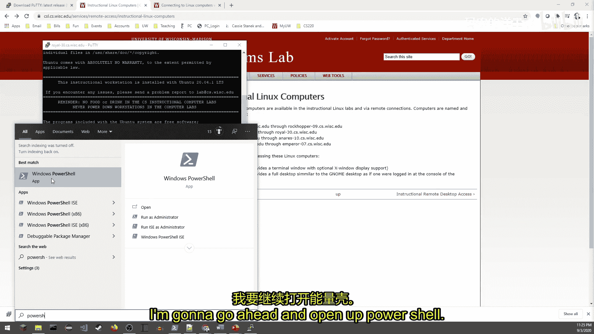
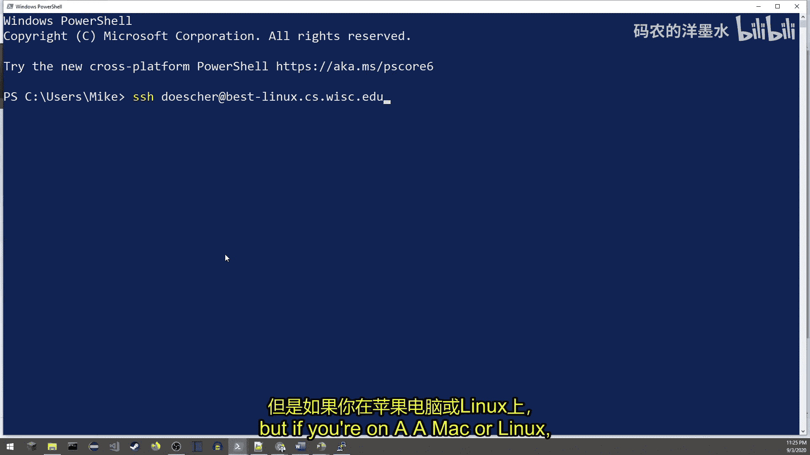
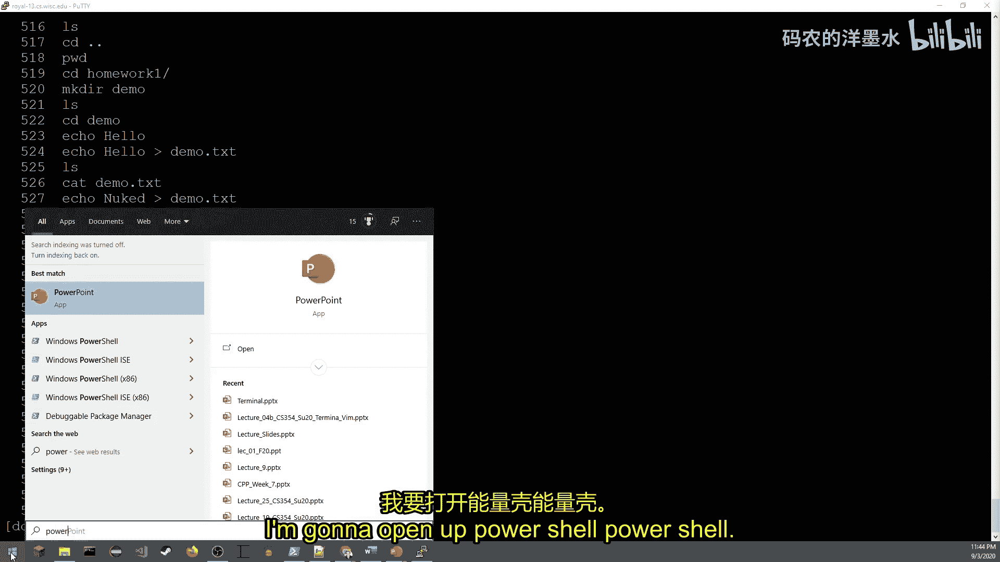
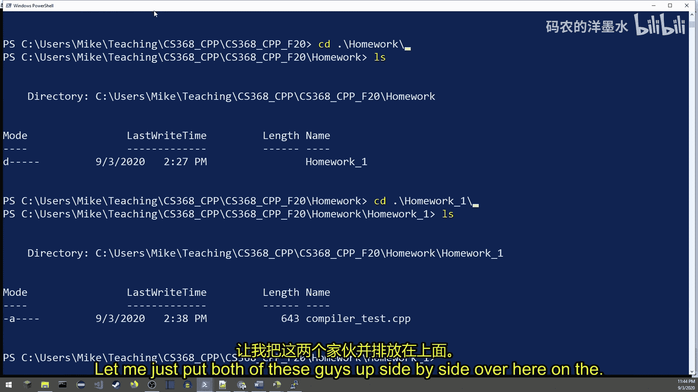
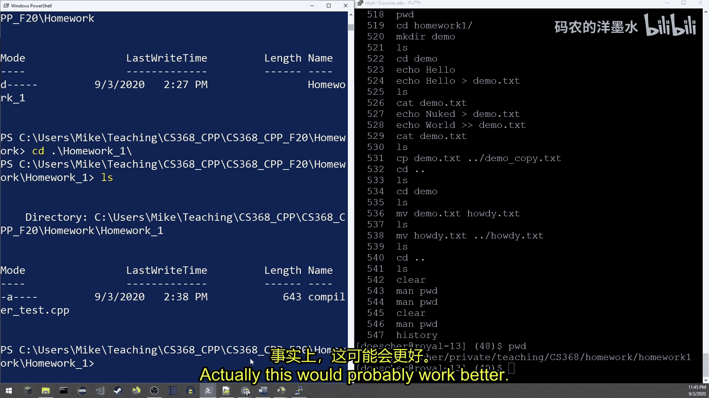
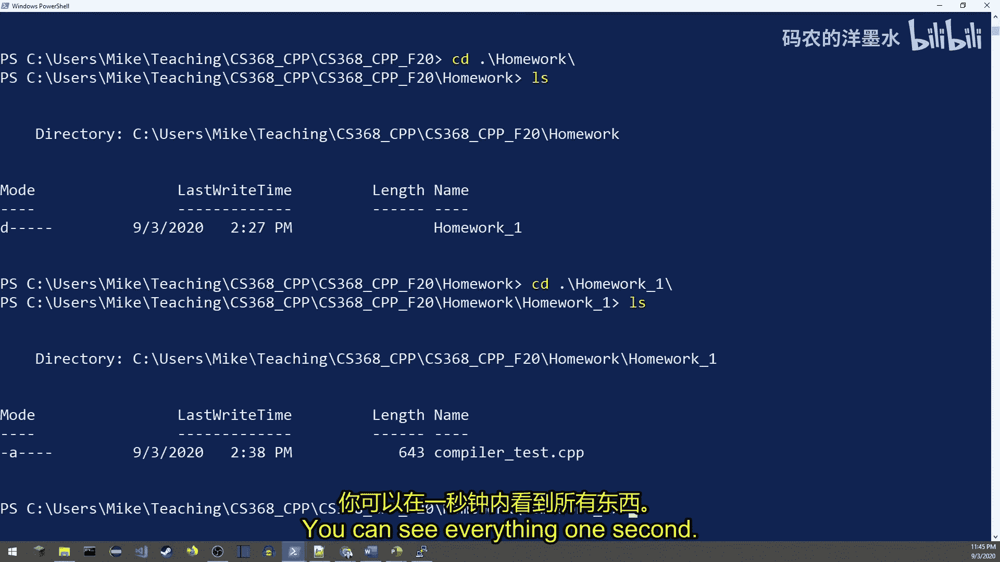
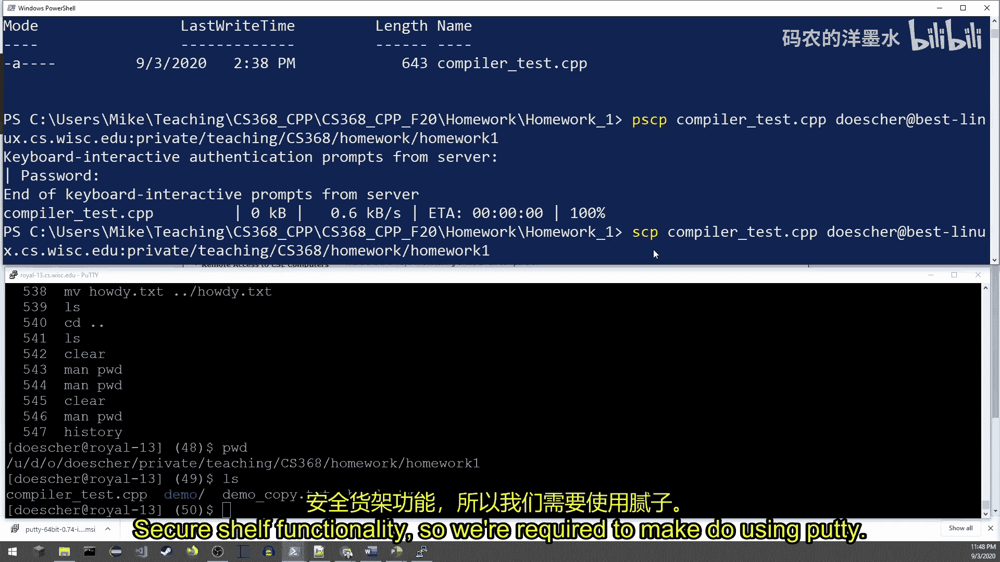
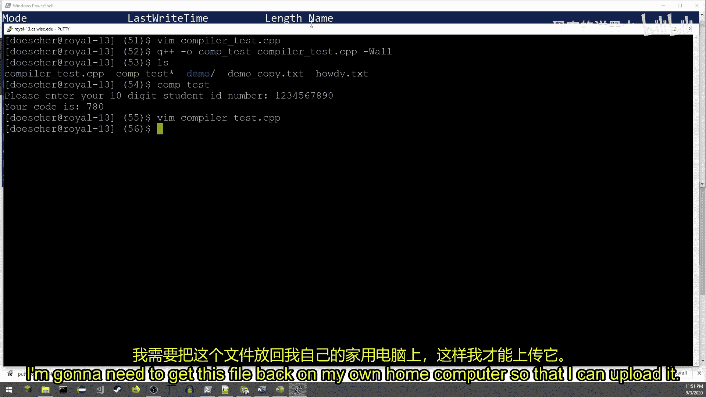
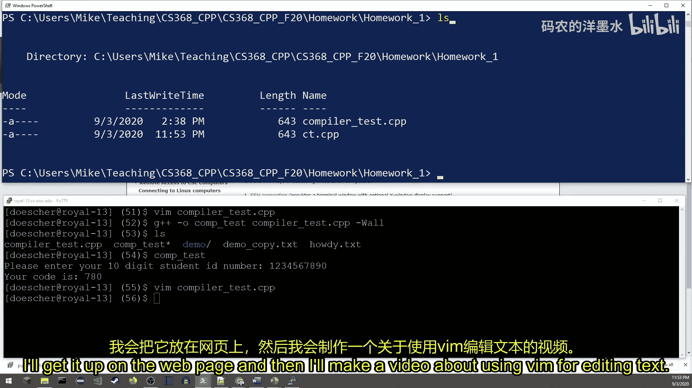

# 系统级编程：第1章：终端与CSL机器入门指南 🖥️

在本节课中，我们将学习如何使用终端，并连接到威斯康星大学的CSL（计算机系统实验室）Linux机器来完成编程作业。课程内容涵盖终端的基本概念、常用命令、文件操作以及如何在本地计算机和远程服务器之间传输文件。

## 概述

终端是程序员与计算机系统交互的重要工具。本节将介绍终端的历史、基本操作，并演示如何连接到远程的CSL Linux服务器进行开发工作。

## 终端简介

很久以前，人们并不拥有个人计算机。部门会购买昂贵的大型机供所有人使用。为了共享资源，他们会购买“哑终端”——这些只是带有屏幕和键盘的文本界面盒子，用于连接到大型机。

如今，我们不再使用那种终端和大型机。我们拥有更强大的本地个人计算机。因此，我们使用的是“终端模拟器”。

## 为何使用终端模拟器

使用终端模拟器可能比使用鼠标操作更快。它在浏览文件系统时非常高效。例如，通过键入目录名称来切换路径，通常比在文件列表中寻找并点击鼠标要快得多。

以下是两条建议：
1.  寻找优秀的工具，并投入时间精通它们。这项投资非常重要，能避免你因使用笨拙或不熟悉的工具而付出额外努力。
2.  掌握能让你在任何地方工作的工具。这一点尤为重要。例如，当需要在家工作（如全球疫情期间），或者想在更舒适的地方（如海滩）工作时。

## Shell 的作用

当我们在计算机上运行终端模拟器（如Windows的PowerShell或Mac的Terminal）时，该程序会运行另一个名为“Shell”的程序。

Shell非常简单，主要做两件事：
*   允许用户在系统的文件夹（目录）中移动并查看所有文件。
*   允许用户运行程序。

它的工作流程是：询问“我应该做什么？”，用户输入一个命令；然后再次询问“现在我应该做什么？”，用户输入另一个命令。

## 常见的 Shell 类型

在终端模拟器中，我们可以运行多种不同的Shell。以下是一些例子：
*   **CMD**：Windows的默认Shell。
*   **PowerShell**：我将使用的Shell。Windows版本的CMD通常不接受很多Linux风格的命令，而PowerShell则接受这些命令，方便熟悉Linux/Mac的用户。
*   **Bash (Bourne Again Shell)**：这是你登录CSL机器时默认看到的Shell。它由Stephen Bourne在1979年开发，后经改进成为Bash。

## 连接到 CSL 机器

现在，我将演示如何连接到CSL机器。这是我们完成作业和提交作业的环境。

由于我使用的是Windows计算机，需要下载一个SSH客户端。我将使用 **PuTTY**。你可以在描述中找到链接，或者直接访问 putty.org。

如果你使用Mac或Linux机器，可以直接使用终端，因为它内置了SSH客户端。

### Windows 用户步骤 (使用 PuTTY)

1.  下载PuTTY安装程序（32位或64位）。如果不确定，选择32位版本。
2.  运行安装程序并完成安装。
3.  打开PuTTY。
4.  在“主机名”字段中输入你的CSL用户名，格式为：`你的用户名@bestlinux.cs.wisc.edu`。
5.  点击“打开”进行连接。
6.  输入你的CSL登录密码。

### Mac/Linux 用户步骤

1.  打开终端（Terminal）。
2.  使用 `ssh` 命令连接，格式为：`ssh 你的用户名@bestlinux.cs.wisc.edu`。
3.  输入你的CSL登录密码。



连接成功后，你将看到命令行提示符，例如 `doher@royal13:~$`。其中 `doher` 是用户名，`royal13` 是计算机名，`~` 表示当前在用户的主目录，`$` 是提示符结束标志。



## 基本终端命令

成功登录后，让我们学习一些基本的终端命令来导航和操作文件。

### 清理屏幕与查看当前位置

屏幕可能有很多信息。使用 `clear` 命令可以清屏。

要查看当前所在目录的完整路径，使用 `pwd` (Print Working Directory) 命令。

```bash
pwd
```

在CSL机器上，你的主目录路径可能类似于 `/u/d/o/doher`，这是系统按用户名首字母组织用户的方式。

### 列出文件与切换目录

要查看当前目录下的文件和文件夹，使用 `ls` (List) 命令。

```bash
ls
```

要切换目录，使用 `cd` (Change Directory) 命令。
*   `cd 目录名`：进入指定目录。
*   `cd ..`：返回上一级目录。
*   `cd ~` 或 `cd`：直接返回用户主目录。

**小技巧**：输入目录或文件名时，可以按 `Tab` 键自动补全，提高效率。

### 创建目录与文件

要创建一个新目录，使用 `mkdir` (Make Directory) 命令。

```bash
mkdir demo
```

要创建一个简单的文本文件，可以使用 `echo` 命令配合输出重定向 `>`。

```bash
echo "Hello" > demo.txt
```

这条命令将“Hello”写入（或覆盖）到 `demo.txt` 文件中。如果要将内容追加到文件末尾，使用 `>>`。

```bash
echo "World" >> demo.txt
```

### 查看、复制、移动与重命名文件

要查看文件内容，使用 `cat` (Concatenate) 命令。

```bash
cat demo.txt
```

要复制文件，使用 `cp` (Copy) 命令。

```bash
cp demo.txt ../demo_copy.txt # 复制到上一级目录并重命名
```

要移动或重命名文件，使用 `mv` (Move) 命令。在同一个目录下使用 `mv` 就是重命名。

```bash
mv demo.txt howdy.txt # 重命名
mv howdy.txt .. # 移动到上一级目录
```

### 获取命令帮助

如果不熟悉某个命令的用法，可以使用 `man` (Manual) 命令查看手册。

```bash
man pwd
```

在手册页面中，可以使用方向键、Page Up/Page Down 浏览，按 `q` 键退出。

### 提高效率的技巧



*   **上箭头键**：快速调出之前执行过的命令。
*   **`history` 命令**：列出所有最近使用过的命令。
*   **`Ctrl + R`**：进入反向搜索模式，输入关键词可以查找历史命令。

## 文件传输





完成作业后，你需要将文件在本地计算机和CSL机器之间相互传输。



### 从 Windows 上传文件到 CSL (使用 PSCP)

PuTTY 提供了 `pscp` 命令用于安全拷贝。在 Windows 的 PowerShell 或命令提示符中使用。

```bash
pscp compilerTest.cpp doher@bestlinux.cs.wisc.edu:/u/d/o/doher/private/teaching/cs368/homework1/
```
*   `compilerTest.cpp`：本地要上传的文件。
*   `doher@...`：你的CSL登录信息。
*   `:/path/to/destination/`：CSL机器上的目标路径。

### 从 CSL 下载文件到 Windows (使用 PSCP)

```bash
pscp doher@bestlinux.cs.wisc.edu:/u/d/o/doher/private/teaching/cs368/homework1/compilerTest.cpp .\CT.cpp
```
*   第一部分指定了远程服务器上的文件路径。
*   `.\CT.cpp` 是下载到本地后保存的文件名和路径（`.` 代表当前目录）。

### Mac/Linux 用户文件传输



Mac 和 Linux 用户使用内置的 `scp` (Secure Copy) 命令，语法与 `pscp` 类似，但命令名不同。

上传：
```bash
scp compilerTest.cpp doher@bestlinux.cs.wisc.edu:/path/to/destination/
```

下载：
```bash
scp doher@bestlinux.cs.wisc.edu:/path/to/source/file.cpp ./
```

## 编译与运行 C++ 程序

连接到CSL并准备好源代码后，你需要编译和运行它。CSL机器通常使用 `g++` 编译器。

以下是一个编译示例：
```bash
g++ -Wall -o compTest compilerTest.cpp
```
*   `-Wall`：启用所有警告，有助于发现代码问题。
*   `-o compTest`：指定生成的可执行文件名为 `compTest`。
*   `compilerTest.cpp`：要编译的源代码文件。

如果编译成功（没有错误和警告），不会有输出。使用 `ls` 命令可以看到新生成的绿色可执行文件 `compTest`。

运行程序：
```bash
./compTest
```
程序会提示你输入学号，然后进行计算并输出一个结果代码。你需要将这个代码填写到作业文件的指定位置。

## 使用文本编辑器 (Vim)



在CSL机器上编辑文件，你需要使用命令行文本编辑器，如 **Vim** 或 **Emacs**。本节简要提及，会有单独视频详细介绍 Vim。

打开文件进行编辑：
```bash
vim compilerTest.cpp
```

在 Vim 中，你需要进入插入模式（按 `i`）才能输入文字。编辑完成后，按 `Esc` 退出插入模式，然后输入 `:wq` 保存并退出。

## 总结



本节课我们一起学习了终端和CSL机器的基本使用。我们了解了终端的历史与作用，掌握了如何通过 PuTTY (Windows) 或 SSH (Mac/Linux) 连接到远程的 CSL Linux 服务器。我们学习了一系列基本的终端命令，包括导航目录 (`cd`, `pwd`, `ls`)、操作文件 (`mkdir`, `cp`, `mv`, `cat`)、以及获取帮助 (`man`)。我们还演示了如何在本地和远程服务器之间传输文件 (`pscp`/`scp`)，并完成了在CSL上编译和运行一个简单C++程序的完整流程 (`g++`, `./program`)。掌握这些技能是进行后续系统级编程作业的基础。