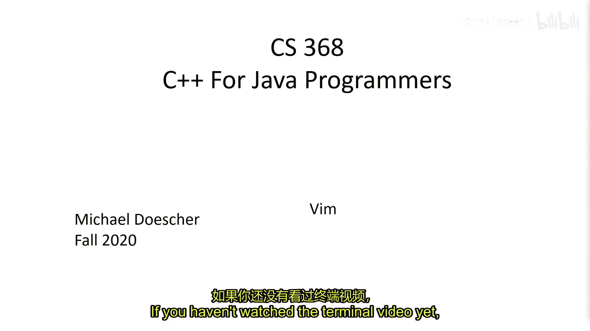
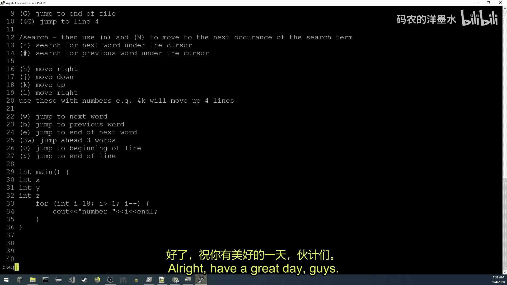

# 【全集】威斯康星大学 聚焦系统级编程 面向Java程序员的C++ CS368C 中英字幕 1080P p11 作业 2 Vim -BV1o72QBREfu_p11-

Hello， everyone。 welcomelcom back for a quick tutorial on using Vim。

 I'm going to jump right into this right away and head over to a CSL machine。

 If you haven't watched the terminal video yet， go ahead do that and then you can follow along with me。

All right， so I've jumpeded over onto a CS SL machine。 I've got Vim open。

 put the focus back over here。 It had been on my recording software， so。

Now that the green box is there， we can see that I'm in Vim。 Vim is a it's a mode based text editor。

 It's got， we're going to talk about three of the modes today。

 The first one is known as navigation mode or command mode。 The second one is insert mode。

 where we're actually going be inserting text。 And the third one is the visual or block mode。

Al right， so first thing you'll notice here is that if you start just typing。

 you're going to be entering commands here。 We actually have to push the letter I to enter insert mode。

Let me see if I'm in the right please。Yep， there we go。 Oh， I just typed an eye。

 and it tells me I'm in insert mode。 So what I'd like to do is just add a little text right here to start writing some text。

 push I to。Enter。Insert。Okay， to get out of insert mode back into command mode I to push escape。

Alright， I'm actually a couple times。 I'm back in command mode。 If I type now the comeds。

 please do not。 whoops such type to 9 I'm back in insert mode escape to get out of that。

 Do not do what I think they're not just gonna to enter text like it would in irreular like。

 like word document or something。 Okay， so to navigate a Vm is designed to be very efficient。

 You shouldn't have to use the mouse。 That's the idea。 And in fact。

 computers a long time ago did not have mouse mice， mice。

So they would use the keyboard for all of their navigation。

 So if you put your hands at the home row H， you're all going to do this all with your right hand。

 H will move to the left。L will move to the right， which always gets me because I'm moving to the right with the L key that just feels backwards。

 But that's how it is。 It's those four keys right in a row。 H moves left。 L moves right。J moves down。

 K moves up J down K up just four keys in a row。So there's a bunch of other ways that we can get into insert mode also。

 So right here， I'm on line 1 in the middle of the line。 If I just type the letter O。

 when I'm in command mode or navigation mode， it's going to。Switch to insert mode。

 create a new line on the line below， and enter insert mode。So。And turns into one of the line below。

 Okay， cool。 And then if I go on back in navigation mode by pushing escape。

 if I go down a line with J。Capital O will bring up insert mode， but and on the line above。T不口。

On the line above。 Okay， now when I'm back in command mode by pushing escape。

 I have one final option。 So there's four choices。 I for insert O for line below insert。

 capital O for line above。 And finally， a。Will enter insert mode。But。It's on the spaceover。 So here。

 if I'm on the period right there， If I push high， I'm on insert mode right there on the period。

 and I start typing， it moves the period over。If I'm in command mode。

 I push a while I'm on the period。 it's going to move it over for me。

 This is really useful if you're at the end of a line and you want to just continue typing without messing up what you're doing。

So let me real quick make a note about that。Okay， great。 Now we have that little note there。

 That'll be useful。 Alright， some more navigation stuff。 I'm gonna go back to navigation mode。

 lowercase G G， will jump to the very beginning of the file。

 Capital G will jump to the bottom line of the file at the beginning of the line。

 So G G to get to the top， capital G E to get。😊，To the end of the file。

 I can type the number for the like the line number， So2， and then capital G。

4 capital G 5 capital G will jump to any particular line。If I want to do some searching the slash。

 once I' I'm in command mode， just double check with the escape key slash forward slash will be what I need to do for searching。

 So let's just search for the word mode a bit that appears in here。 I'm going type mode。

 I'm push enter。 and it's going to highlight all of them。 and I was on line 5。

 It's going to go down and move the cursor to the first occurrence of the word mode。

 Now I'm in search mode right now。 because this is I'll highlight。

 I've got the cursor on that word mode to cycle through and like traverse the file and jump to all of these。

 the letter N will take me to the next occurrence of the word mode。 and again， it。

Notified me that it hit the bottom and continued at the top。 And again。

 we'll just keep going down through all the different occurrences of the board mode。

 Capital N will go the other way。 so it goes up。So I just added some notes about how the T G capital G the jumping works。

 and that 4G jumped to line 4 reminded me that there's I can use numbers with a lot of these other commands as well。

 So let me get back into navigation mode。 Remember a second go I telling you that K will move up。

 J will move down。 If I want to move up by， let's say five lines。 I can do5。Okay。

 and then move up five lines， but I want to move up three more。Okay， I answer 3 K。

 if I want to move to the left。While I'm already in the left。

 if I want to move like 10 characters to the right， I can type 10 L。If I want to move4 down4 J。

 So I can use numbers as I use the navigation commands can be useful for doing like moving full pages at a time。

And along those same lines， there is word based navigation also。

 So W will take me to the beginning of the next word。W， even if I'm like in the middle of word。

 it goes to the beginning of the next words。 So I'm just typing the letter W here if I want to go to the previous word。

The beginning of the previous word is B。 So W。AndB。W B and E actually moves to the end of the word。

 And the cursor is on the end of the word。 it moves to the end of the next word。

 So this is much like W。 So check it out。 This is E。 Let me back up a little bit with some B。

And this is W。So W goes to the beginning the word， E will go to the end of the word。

 If it's at the end of the word， it moves to the end of the next word。

Let me make a note about that real quick。 Allright， So I just jotted on some some quick notes there。

 W moves the next word B to the previous word E to the end of the next word。

 And these can also be used with numbers。 He Let me just go up a little bit。

Here's some text with a bunch of words。 So I can say move forward wordss to the right。

 or I can move back 3 with 3 B。 Here's4 W。I missed， I missed3。That was a。4 W。

 most forward words over to the right。Alright， also。

 I've got0 and the dollar sign moves 0 will move from the beginning of the line。

 dollar sign will move to the end of the line。Next up。Let me check my notes。Yeah， okay。

 searching without。Yeah， if I already， if I'm， if my cursor is already over a particular search word。

 but some just go to the beginning of this line， I'll move one word over。

 and then I'm on the the word will。 if I just type the pound sign。

That's going to highlight everything， and it's going to cycle up。 So basically。

 it's the combination of search。 And next， all in one。Keystroke。 So that's pound sign。

 The star does the same thing， but it searches in the opposite direction。

 So it'll find the next occurrence of that。So that was pound sign sir。

 let me pause the video and make a note about that。AndI hope that was clear。It actually。

 it's taking the word under the cursor。 so right now the search is the word under the cursor。

 So if I type pound， it's going to move up one line to that next word search。Pound again。

 we' move that way to the next occurrence of the word search。 And next。

 if I've got a bunch of stuff that's been highlighted because I've been using these things。

 and I want to get rid of the highlighting， easiest way to do that is to just to search for something that's definitely not in there。

 Some garbage。 And then it'll clear all that highlighting。

 and to get rid of that giant red bar at the bottom， you can just go to insert mode。😊。

And type something。Okay， just made a quick note there about jumping to the beginning and end of of lines。

 And then I added some code。 I wanted to talk about jumping to matching braces。

 So I'm in command mode。 I'm going to navigate down and move over to a brace。

Helello a bunch of times hovering over brace。 I have my Vm set up。

 There's a VmRC file dot VmRC that you can use to like。Set up how Vm works。

 I've got mindset with the matching brace coloring turned on。

 So my cursor is green and the matching brace is blue。 if you don't have that setup up。

It willll talk about V RRC at the end of this。 All right， so。

 but the percent key shift 5 will actually jump to a imagine brace。

 So there I am jumping back and forth。 Note that the green cursor is moving。

If I move down a line and then left a couple of characters， that can be over that race， parentheses。

 it works with parenthees also， it also works with block comments。

 it'll jump to the matching block block comment。Alright。

 let's talk about deleting something real quick。 So， for example， if suppose I want to。

Let's make this not go all the way to 10。 So I'm just going to navigate over。 I'm going to push D。

Wait， no， It's not D。 It's X X to delete the character under the cursor。

So extes the character under the cursor like that。Ext to delete the character in the cursor。

 Let's put those back。 If I'm in command mode， you。Will undo things。 So that undid the first change。

 that undid the second change。 If I want to redo changes， its control R。

 so that'll delete the character again。 That'll delete it。 undo undo。X to delete you'd undo。

 All right， cool。Okay， the number R， wait， the letter R will replace the text under the cursor Sa and type R。

 And then I can trans this to a 14。 Now， this little loop will count down from 14。

 I then actually compile it or check it see if I've got typos or not。Let's pretend it works。

So that was our。18 R 8。Al right， so let's talk about deleting with the deaking。

So D will put us in sort of a delete mode。 And then it requires navigation commands。

 just like the rest of things。 So if I want to delete four characters to the left。

 I can push D and then 4 L， and it'll take out four characters。 I'm going put those back。

 Let me move down the line。 if I want to So demo that again。 If I want to take out the U M B。

 So I'm going to do D 3。To the left。Okay， that takes out the character under the cursor and two more because I was using three characters。

 put that back。 If I want to， I can delete the end to the end of the line with D star。

Or I can delete to the beginning of the line with D0。 So notice the curs is over the U right now。

 it keeps the U and just deletes everything to the left of that。All right。

 so that works with all of the sort of navigation keys， if I I'm to jump up over here。Do you。

I can delete two words with D2 W。With those back， I and I want to mess up my like guide。

 I'm going to post this on the course page so you guys can see and follow along。So that's deleting。

 Let's talk about。 it's technically like a cut from Microsoft Word。 So if I were to take。

 for example。This， the word beginning。 Let's see if I get to the beginning of that， we'll delete。

1 word。 And now it's actually stored on the clipboard so I can go up from here。

 type K and the commander pasted is just P。 So there's the word pasted。

Put that back so I don't mess things up。 If I want to copy without actually deleting something。

 that command is y and stands for yank so I can do y word。And then I can paste that with P okay。

DD will delete an entire line。Just like that。Put the blank blind bag。Okay。

 two things left that I want to talk about。 First up， the visual mode。 So so far。

 we've seen command mode or navigation mode。 They're the same thing。

 We've seen insert mode where I can actually type text。 Visual mode is the last one。

 And there's three different kinds of visual mode。 first one。

You can think of it kind of as like a highlight mode。 So I just type V from command mode。

 It gets into visual mode。 And then I can use the。Navigation keys to just highlight a block of text from there。

 I can use delete or why to yank。 So let's do that。

 Let's make a copy of jump to beginning using why that takes me back to command mode。

 And now I can easily just navigate to a good spot to paste this。 P will then paste that。

If I want to paste this a bunch of times， I can just keep pushing P if I want to paste it 10 more times。

that's 20。 I missed past it 20 times。So let's go ahead and delete that row。That looks good。

Let's see what else。 Okay， so that was just highlight vote。 That's just regular V。

 We have a visual line mode with capital V。 And now that's going be selecting entire lines at a time。

 And again， I can get more than one by using the navigation keys to just move up a couple lines。

 I can yank that。 We can go down to the end of the file with capital G。 We can paste that。

And we see that we get all what I get， five or six five lines。I don't need two copies of that。

 I' undo that。So that's lowercase V， highlight mode。Capital V highlight lines。And now my favorite。

 this is the one you're actually going to spend a lot of time using if you get good at Vm。

 So I'm inserting here。 Let's go with。Yeah， I'll just start right at the end the beginning of this line。

 Let's make some variables。 Let's go with X， Y， and Z。 Oh， but in C plus plus。

 we always need to give everything a type。 So here's what I'm to do。

 I'm going to use control V to get into block mode。I'm use J to select a block。

And then if I want to insert some text here， I need to go back to insert mode。 And this is shift I。

 It's capital I when we're in visual mode。 So it's a little difference， not just the lowercase I。

But now I can type some text。 So I'm going to make all of these int。

 It only shows the text on the first line while I'm typing and when I push escape that will exit this visual mode and like put the text in everywhere。

I can do the same thing with copying text。 I'm going to control V again。 I'm going to move it over。

 I'm just gonna grab that much text。 let's grab the space， too。It will yank that with Y。

 And now let's go back down to the bottom of the file。Makeake some space。

 and we'll paste that right there。There we go。 All three of those ints have now been copied and go to the end of the line with dollar sign and insert a。

B E， there we go。 Now I've declared some more variables。I can do the same thing with deleting。

 Supp I don't want A B， and C right there。 I can do control V to get to visual block mode。J J。

 to do the selection。D will delete them。 or X could replace them。

 I've got all kinds of choices for how to use that block mode。 And in fact。

 if I want to do something like really weird， I can do。Ctrol V。 I'll grab those。 I'll delete them。

 I'm gonna just scroll up over to right here in the middle and paste those in。

 And it's just added int int in right in the middle of my text， making this well garbage。

 Let me undo that real quick with you。Let's see。 All right。 Next last topic。 How to save your work。

 This is probably the most important thing I probably should have started with this。

When you're in command mode， you type the colon and W to write the file。

 And now I've just saved this as Vim tutorial dot text。To quit， I just do colon Q。

 If I have not saved my work， it won't let me quit。 It'll give me the choice to either。

 Oh well it doesn't give me a choice。 It just tells me I haven't saved yet and tells me that if I want to quit without saving the command is Q。

Exclamation point。什么。Just straight up Q will get me here back up。

Vm Ven tutorial gets me back into my file。 So if I make a change。

And then I try and quit and let me just demo what whoops。Like that。 No rights and fast change。

 add exclamation marked override。 That's what That's what I was trying to say。

 It would have been easier。 Just download that。 So'll get rid of that。 So basically。

 and if you want to just write and quit all in the same line， Col W。

 Q gets it all done in one fell sop。 I'll use this a bunch。 as I go through the course。

 I'll probably bring in a number of other features and explain them under certain circumstances Why this is a good choice for how to use the editor。

Hopefully， you guys， if you're following along using Vim will gain some experience using this tool。

 which。A lot of people are extremely fast coding， people who are good at Vim are way faster than I ever will be using Microsoft Viual Studio or QT or like a real editor that relies heavily on the mouse。

 Im huge train of those also again， I'm going to stress。

 figure out what tool you're going to use tools and get good at using them。All right。

 have a great day， guys。

