# 【全集】威斯康星大学 聚焦系统级编程 面向Java程序员的C++ CS368C 中英字幕 1080P p12 作业 3 文件 -BV1o72QBREfu_p12-

嗯。Hello， today we'll be demonstrating file input and output in S+。

I'm going to be referencing this document on spl。com， it is a tutorial on files。

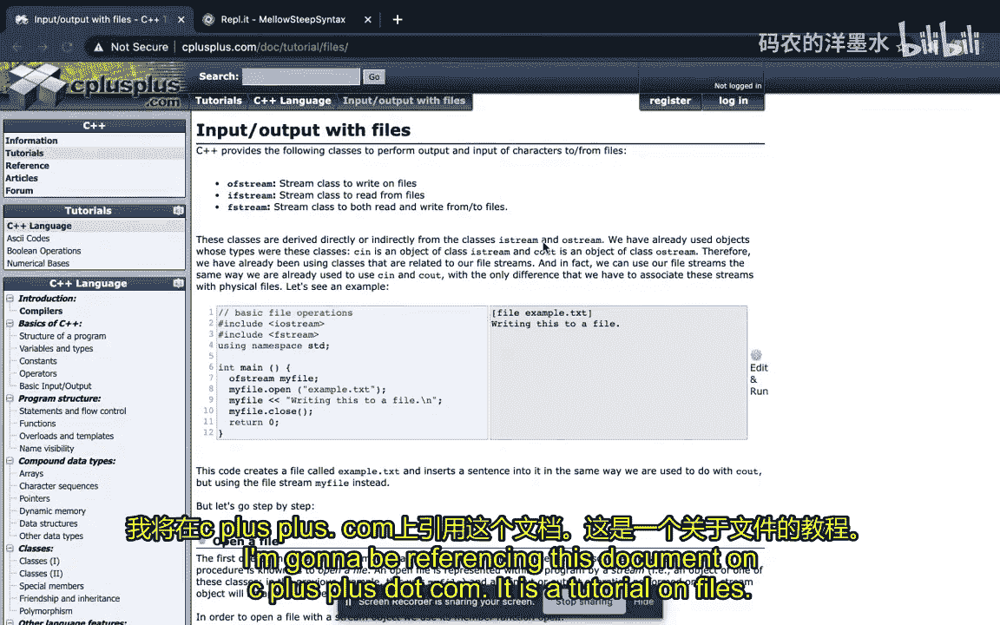

I have set up a repple where I'm going to take this program I scfold it out。

And compile it and run it go here。So I have coupled out these functions for writing a file and reading a file。

And I will use them in my main here。So first things first。I'm going to write to a file。

I wait to name it example that text。

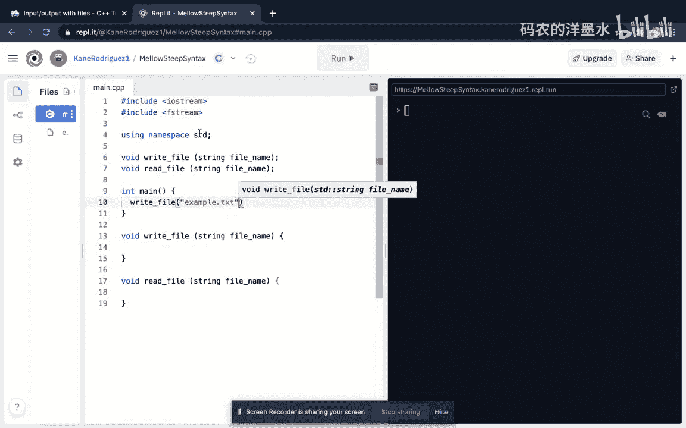

Now， Schfi the documentation。Says。You're going to first want to import。

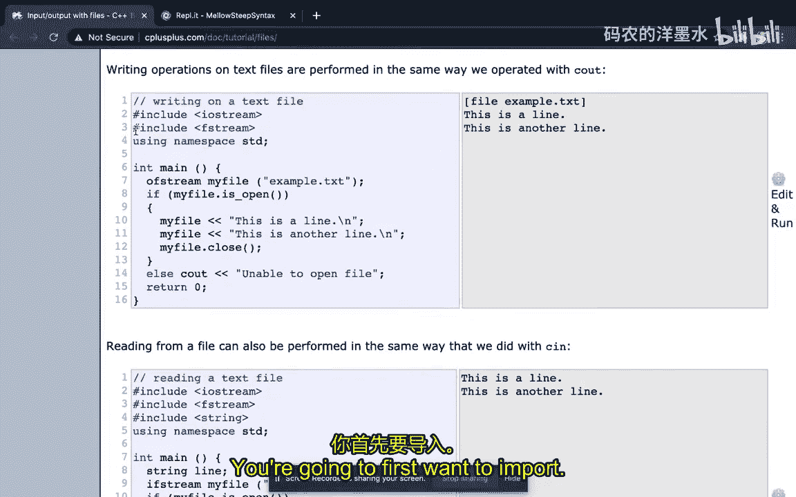

This Fstream library。Which I believe is already imported here。

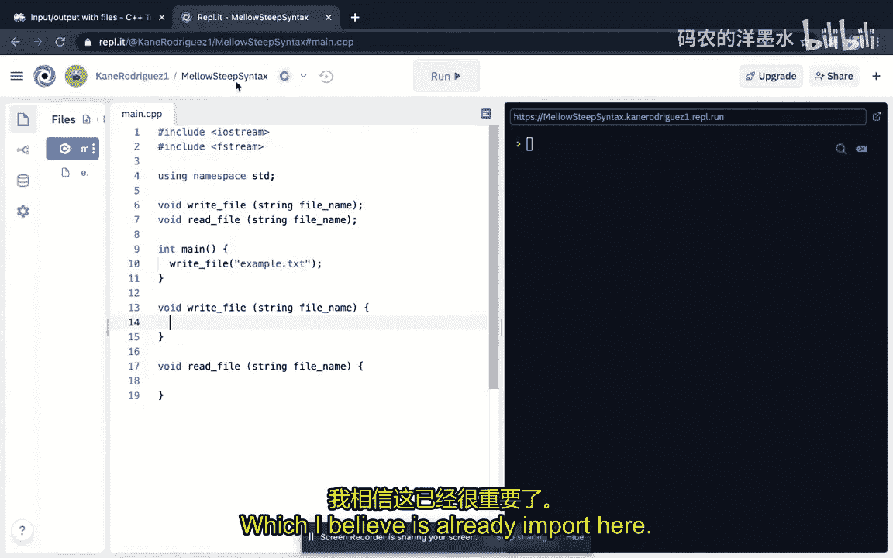

And if lives easier， we're going to use namespace standard， which we are here。

We are going to use an output file stream。So。

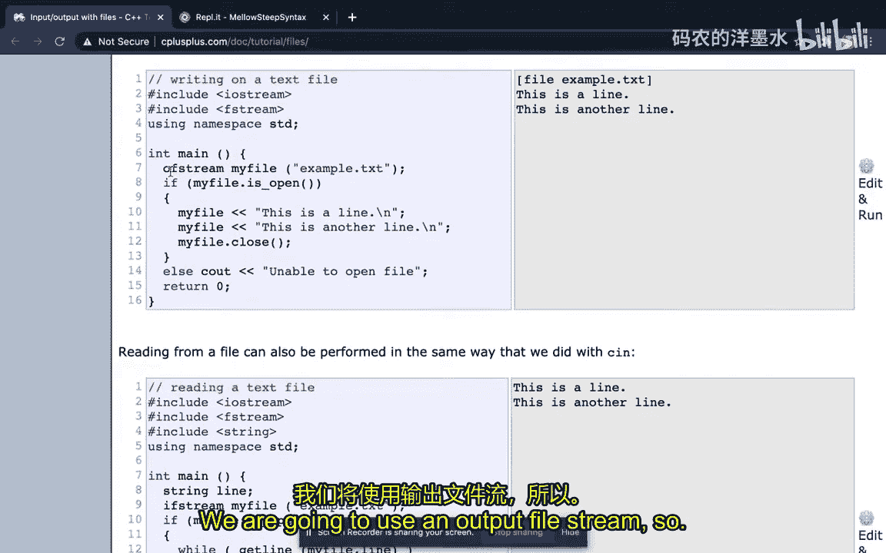

We're going to take this。And replace it with the variable length function which is the file name itself。

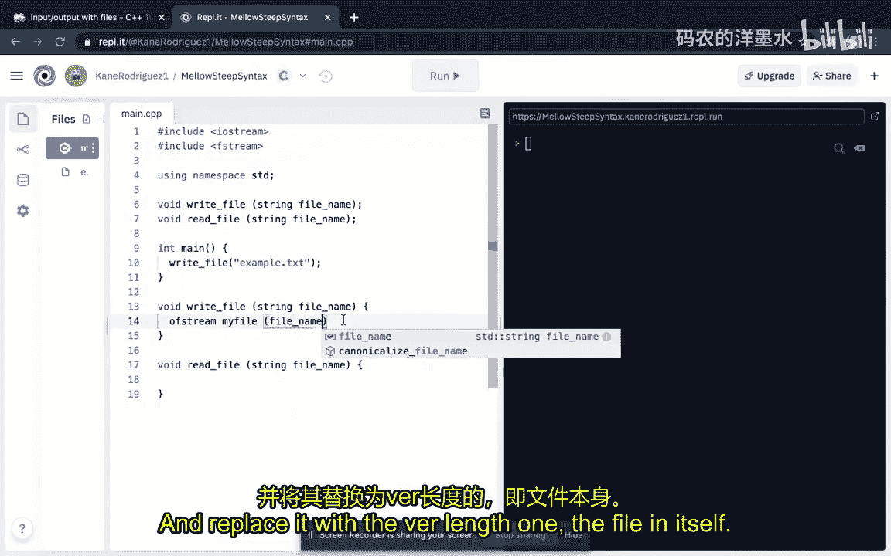

Great， so now we have that。And we want to check if our file is open。And if it's open。

 we're going to go ahead and redirect some input into our file。上爱件事。We're gonna。Input this。

 or output'll it rather into a file。So I'm actually going to take all this。

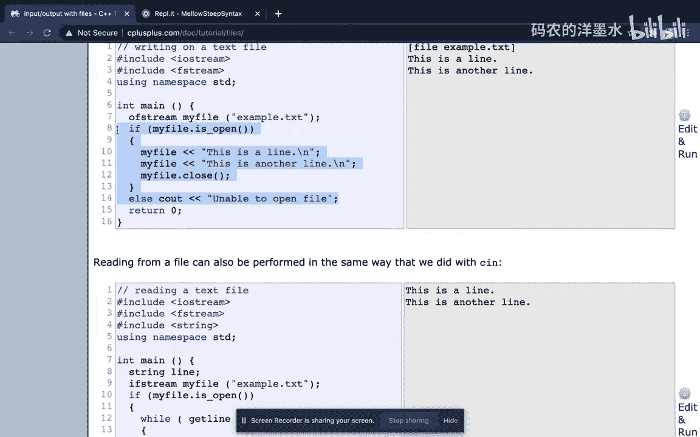

So what's going to happen is either my file is going to open。Or if we get some type of error。

With the file opening， then we're going to pronounce this line here。

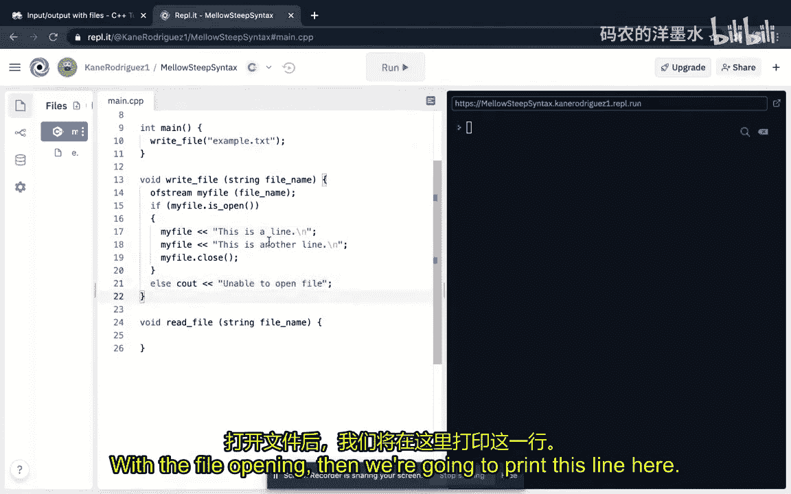

再次。This is from the previous demonstration， we delete that。

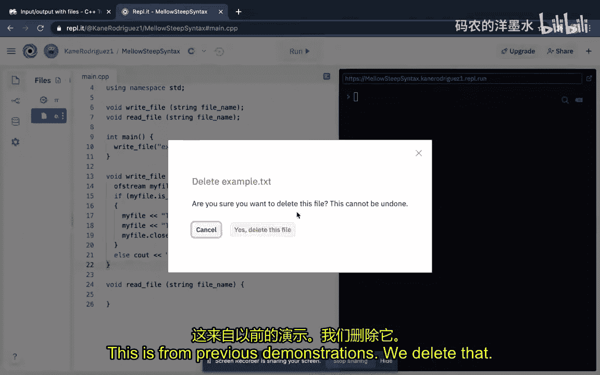

Currently existing example text。So I'm going to run this main。

So I ran it and you can see that my example the text。As the text that I。Redirected into it。

And just to demonstrate。I'm going to write the file again。

And then I'll overwrite what was there before。So， as you can see， I have。Pass it into the file。

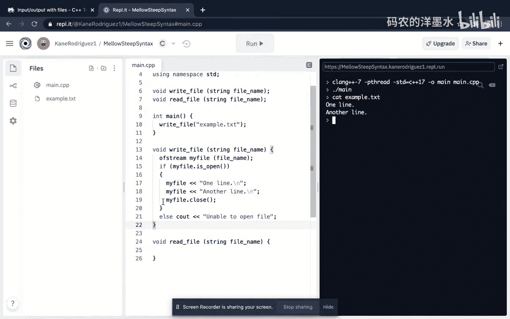

So now for reading a file。We're going to follow much of the same process。

 except at this time you see we have an Istream。I put fall stream， rather。

And we're going to have a string。Line， which is our target variable for where we're going to。嗯。

Place the text we read into from our file into this variable。So again， we didn' seen before。

 we check if the file is open。Then we iterate through the file。Using a getline function。

Passing in the file that we're reading from。And then the string that this current line the file is going to be。

run into。And then we're going to print that out。And then eventually when we're done looping。

 when we recently then a file and getline returns a value that will make this while loop stop。

We're going to close。诶，几住你。So to show that， I'm going to take this code。

Which has the same library we included before。 And now， it includes a。

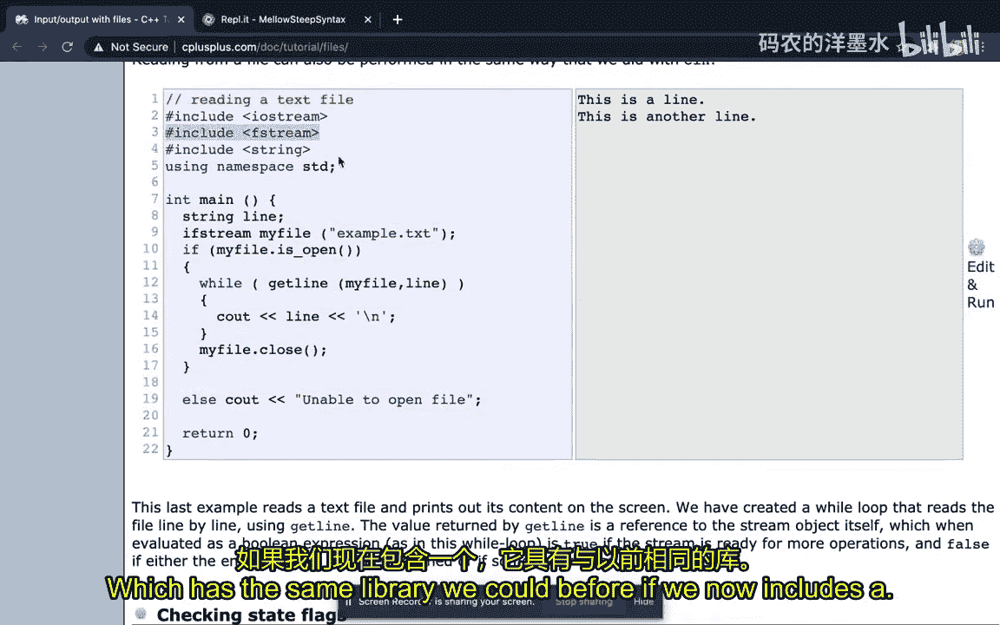

Include string。Which I did not include up here， but。いこトで。

You're going to take that code we just took and leave it right here。Of course。

 I'm going to change this。嗯ん翻来。So I wrote my file。 Nowm going to read my file。嗯不起。Oh。Yep。

 so as you can see， it prints out the lines that were in the file。 And just to further demonstrate。

 I' would like to show。To me it a little more。Currentent， what's occurring here。

 I'm writing this into my file， and then。嗯。Right afterwards， I'm reading the file， line by line。

As you can see。

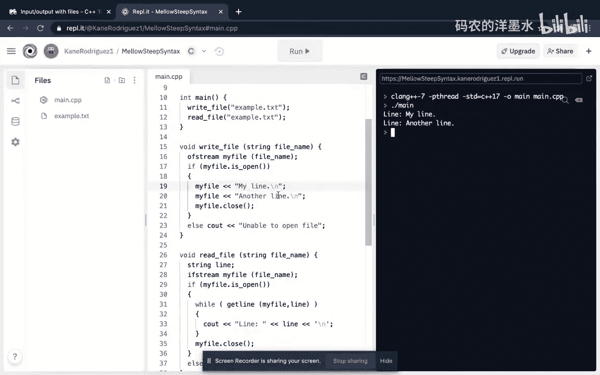

And that is file input and output in Z+。

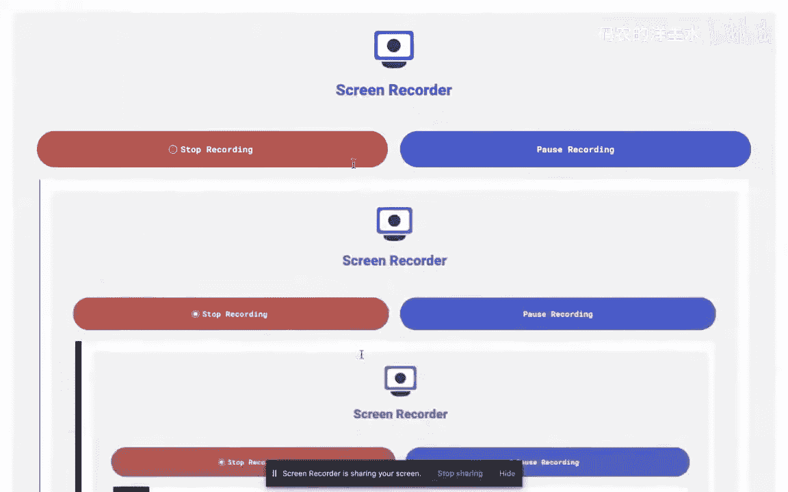