# C++ 文件操作教程：第3章：文件读写实践 📄

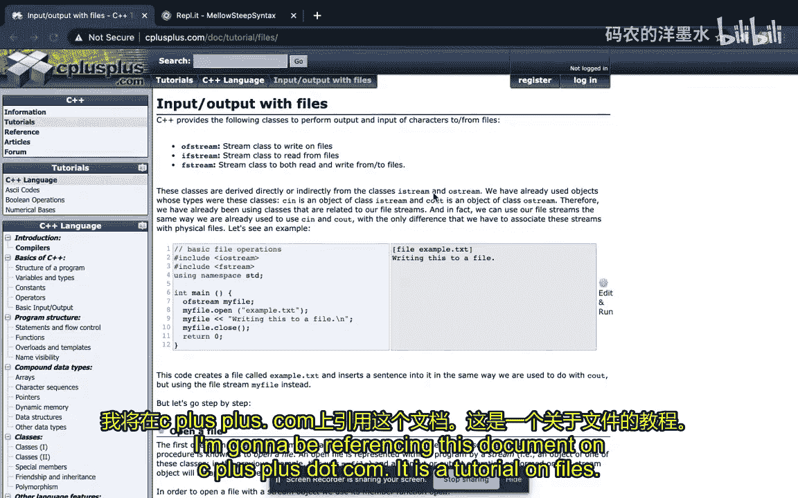

在本节课中，我们将学习如何在C++中进行文件的写入和读取操作。我们将通过一个简单的示例程序，逐步演示如何创建文件、向文件写入数据，以及如何从文件中读取数据。

## 概述

文件输入输出是编程中常见的任务，它允许程序将数据持久化存储到磁盘，或从磁盘读取数据。C++标准库提供了`fstream`库来简化文件操作。本节将介绍使用`ofstream`写入文件和`ifstream`读取文件的基本方法。

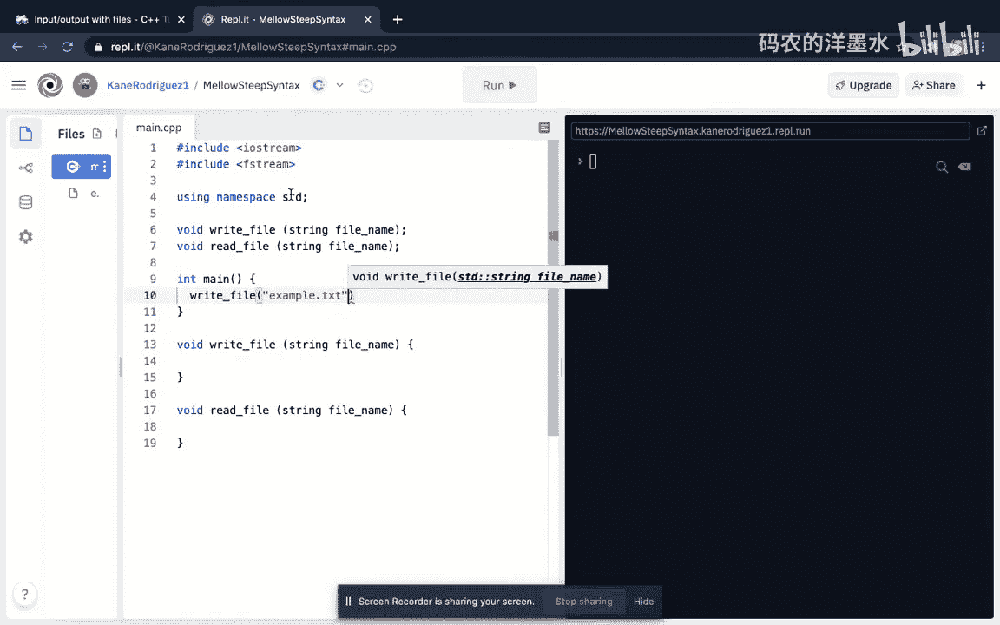

## 写入文件

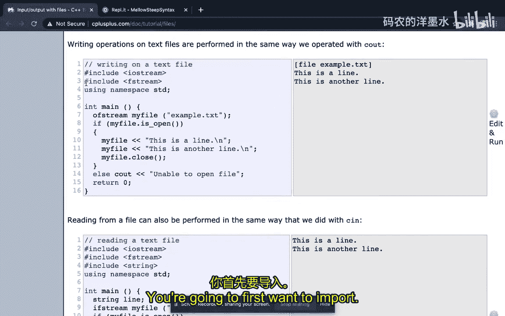

上一节我们介绍了文件操作的基本概念，本节中我们来看看如何具体实现文件的写入。

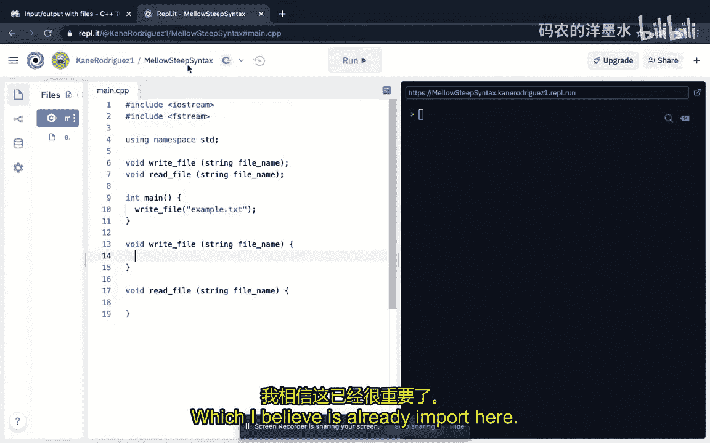

首先，进行文件写入需要包含`<fstream>`头文件，并使用`std::ofstream`类。以下步骤详细说明了写入文件的过程：

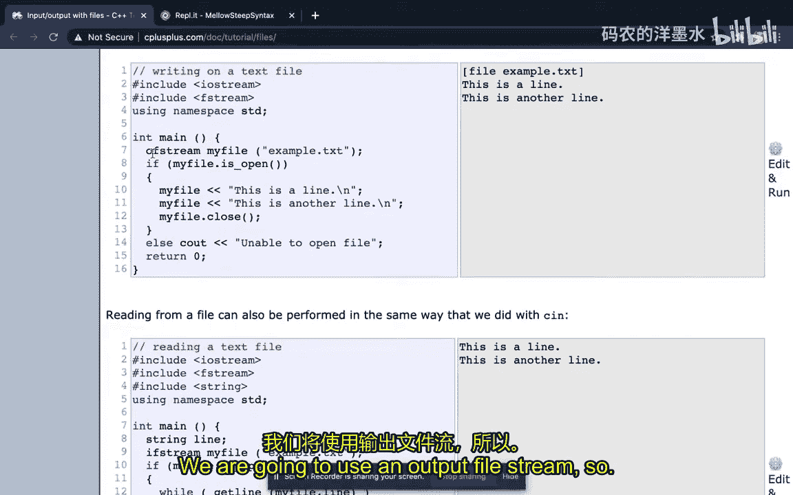

1.  **包含必要的头文件**：首先需要包含`<fstream>`库。
    ```cpp
    #include <fstream>
    ```

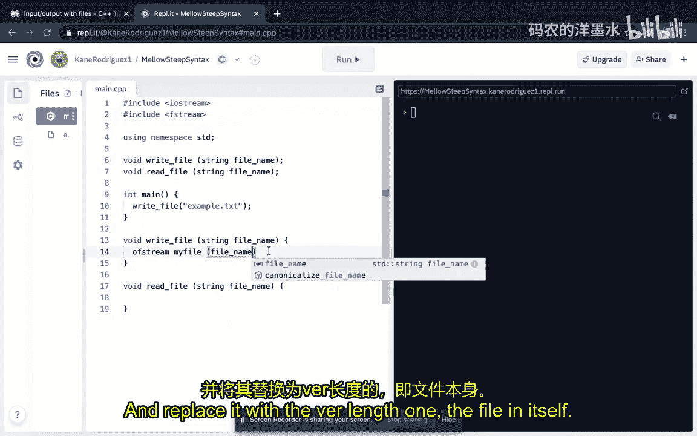

2.  **创建输出文件流对象**：声明一个`ofstream`对象，并指定要打开的文件名。
    ```cpp
    std::ofstream outFile("example.txt");
    ```

3.  **检查文件是否成功打开**：在写入之前，应检查文件流是否成功打开。
    ```cpp
    if (outFile.is_open()) {
        // 文件打开成功，可以写入
    } else {
        // 文件打开失败，处理错误
    }
    ```

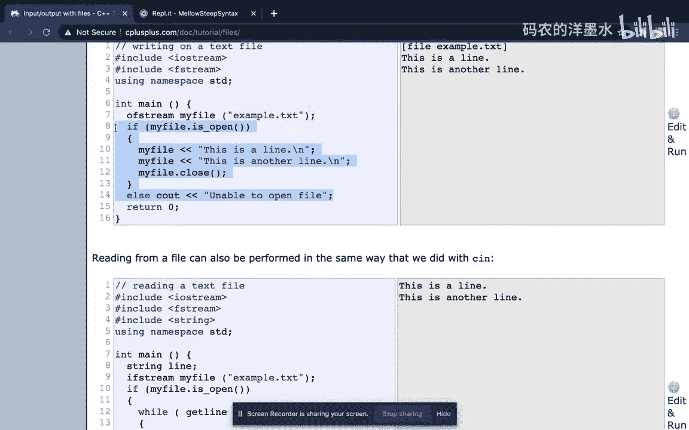

4.  **向文件写入数据**：使用插入运算符`<<`将数据写入文件，就像使用`cout`向屏幕输出一样。
    ```cpp
    outFile << "这是要写入文件的第一行文本。\n";
    outFile << "这是第二行。";
    ```

5.  **关闭文件**：完成写入操作后，应关闭文件流以释放资源。
    ```cpp
    outFile.close();
    ```

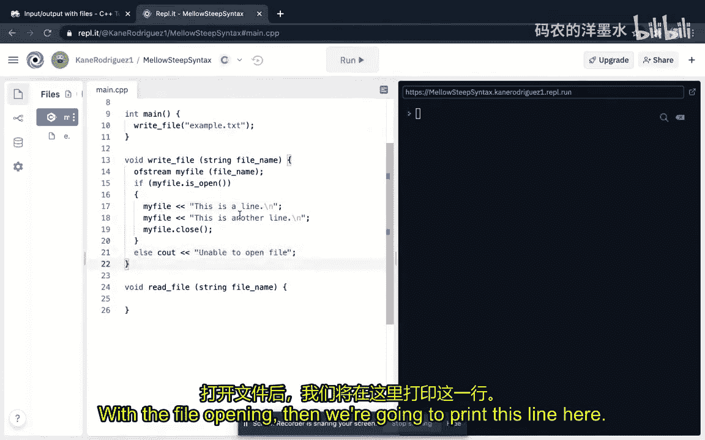

**核心代码示例**：以下是一个完整的写入文件的函数：
```cpp
void writeToFile(const std::string& filename) {
    std::ofstream outFile(filename);
    if (outFile.is_open()) {
        outFile << "第一行内容\n";
        outFile << "第二行内容\n";
        outFile << "第三行内容\n";
        outFile.close();
        std::cout << "文件写入成功。\n";
    } else {
        std::cout << "无法打开文件进行写入。\n";
    }
}
```
运行此函数后，会在程序同级目录下创建一个名为`example.txt`的文件，并包含三行文本。

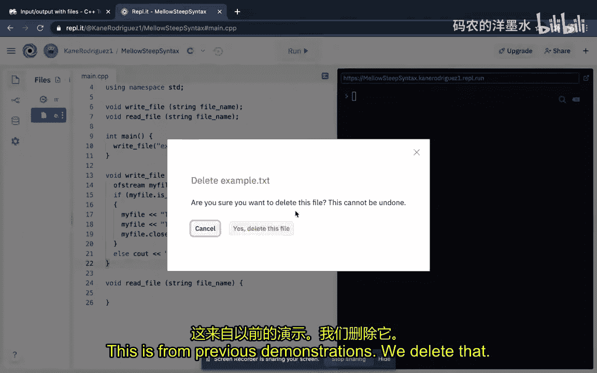

## 读取文件

在学会了如何写入文件之后，接下来我们学习如何从文件中读取数据。

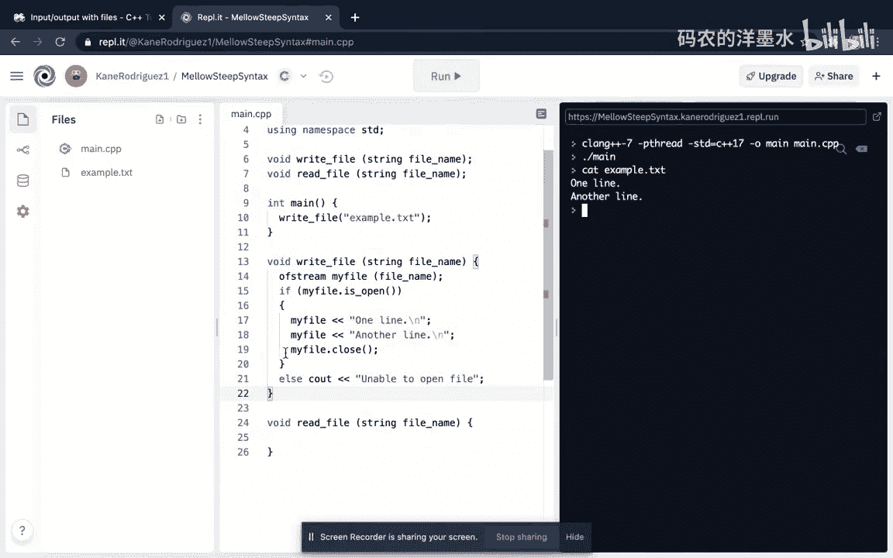

读取文件需要使用`std::ifstream`类。基本流程与写入类似，但使用的是输入操作。以下是读取文件的步骤：

1.  **创建输入文件流对象**：声明一个`ifstream`对象。
    ```cpp
    std::ifstream inFile("example.txt");
    ```

2.  **检查文件是否成功打开**。
    ```cpp
    if (!inFile.is_open()) {
        std::cout << "无法打开文件进行读取。\n";
        return;
    }
    ```

3.  **从文件中读取数据**：常用的方法是使用`std::getline`函数逐行读取。
    ```cpp
    std::string line;
    while (std::getline(inFile, line)) {
        std::cout << line << std::endl;
    }
    ```
    在这个`while`循环中，`getline`会一直读取，直到文件末尾。每次读取一行内容到`line`字符串中，然后将其打印到控制台。

4.  **关闭文件**。
    ```cpp
    inFile.close();
    ```

**核心代码示例**：以下是一个完整的读取文件的函数：
```cpp
void readFromFile(const std::string& filename) {
    std::ifstream inFile(filename);
    std::string line;

    if (inFile.is_open()) {
        while (std::getline(inFile, line)) {
            std::cout << line << std::endl;
        }
        inFile.close();
    } else {
        std::cout << "无法打开文件: " << filename << std::endl;
    }
}
```
调用此函数读取之前创建的`example.txt`文件，会将文件中的三行内容依次打印在控制台上。

## 完整程序演示

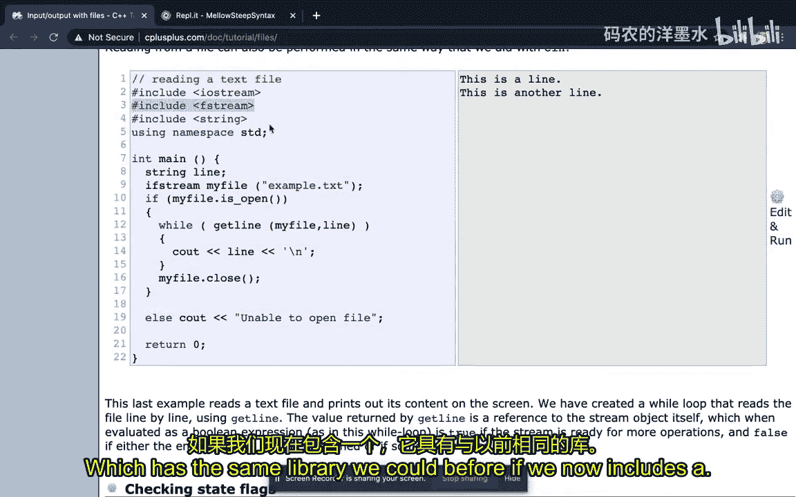

为了更清晰地展示整个流程，我们可以将写入和读取操作放在`main`函数中依次执行。

```cpp
#include <iostream>
#include <fstream>
#include <string>

int main() {
    const std::string filename = "example.txt";

    // 1. 写入文件
    std::ofstream outFile(filename);
    if (outFile.is_open()) {
        outFile << "这是新写入的第一行。\n";
        outFile << "这是新写入的第二行。\n";
        outFile.close();
        std::cout << "--- 文件写入完成 ---\n";
    }

    // 2. 读取文件
    std::cout << "\n--- 开始读取文件内容 ---\n";
    std::ifstream inFile(filename);
    std::string line;
    if (inFile.is_open()) {
        while (std::getline(inFile, line)) {
            std::cout << line << std::endl;
        }
        inFile.close();
    }
    std::cout << "--- 文件读取结束 ---\n";

    return 0;
}
```
运行此程序，会先创建（或覆盖）`example.txt`文件并写入两行文本，随后立即读取该文件并将内容打印到控制台。

## 总结

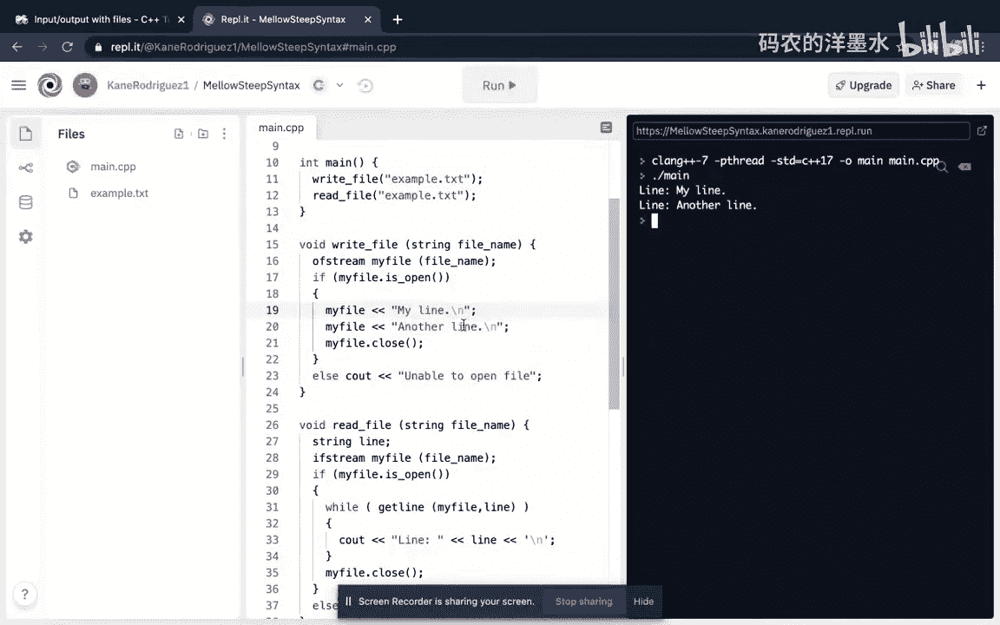

本节课中我们一起学习了C++文件输入输出的基础操作。我们掌握了：
*   使用`std::ofstream`和`<<`操作符向文件写入数据。
*   使用`std::ifstream`和`std::getline`函数从文件逐行读取数据。
*   在操作文件前后，使用`is_open()`检查状态以及使用`close()`关闭文件流的重要性。

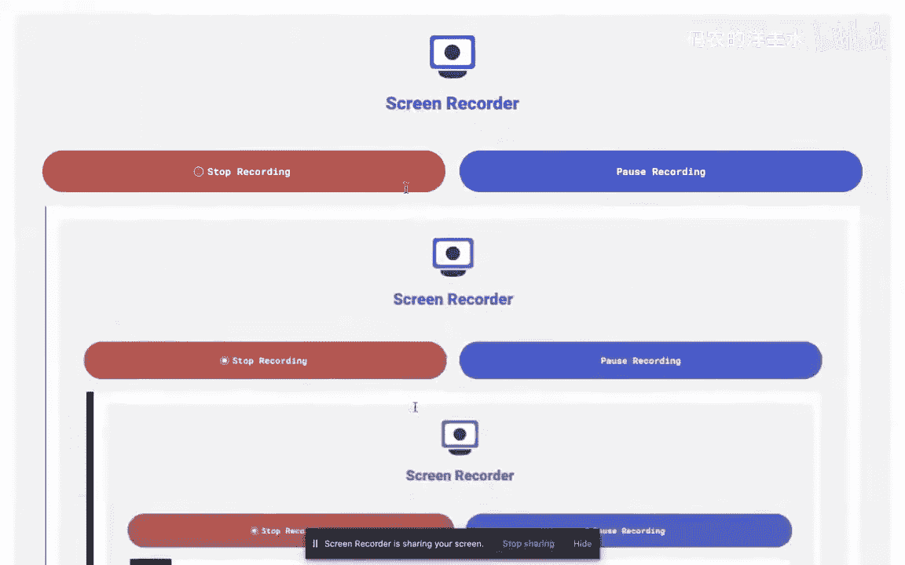

这些是处理文本文件最基本且最常用的方法，是后续学习更复杂文件操作（如二进制文件、随机存取等）的坚实基础。