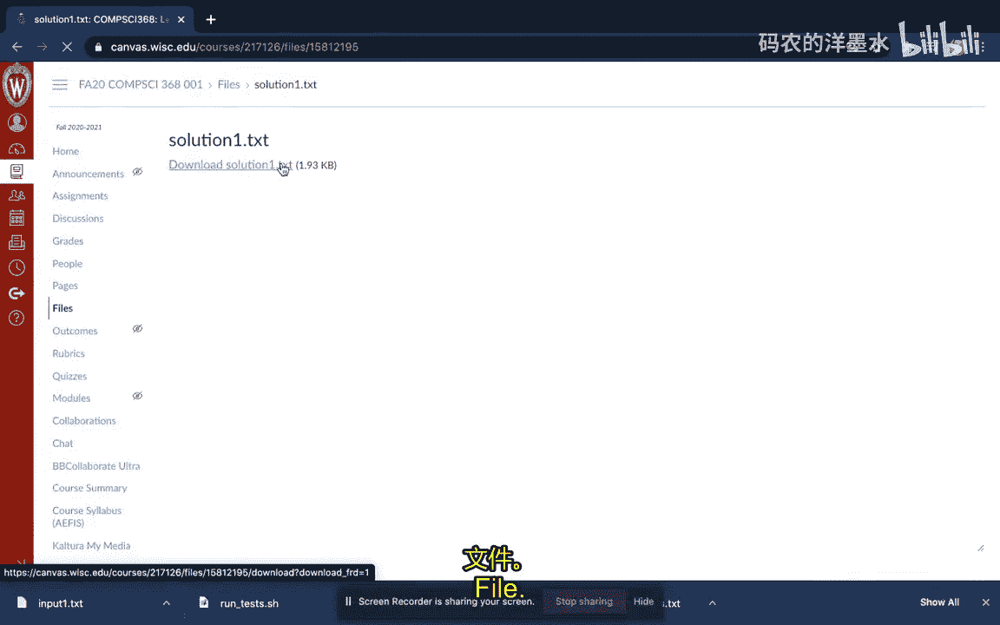
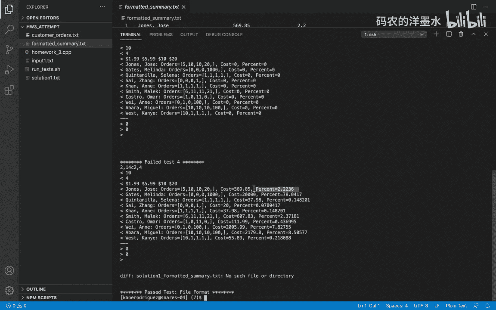

# 【全集】威斯康星大学 聚焦系统级编程 面向Java程序员的C++ CS368C 中英字幕 1080P p13 作业 4 运行测试 -BV1o72QBREfu_p13-

Hello， today I'll be demonstrating how to download the resources for Ar 3 from Canvas。

How to upload them to CSL machines？And then how to run the testing script on the homework to get feedback on your program as you develop。

So first things first， I'm going to download all of the resources for this homework 3。

I just downloaded the template file。Now I'm downloading the file that has the customer amadata that we'll be analyzing。

I'm downloading the formatted summary。However。The end result of we want to turn our metada into。

And the test script。As well as the input。File and its corresponding solution。File。

Now that I have all of my resources downloaded to my local machine。

 I'm going to put them into a folder that I have here locally。So from my download folderer。

Here I going my text files。ReP file。And not only， last but not least， the shell scripts。

I had the moment of the machine。I'm going to move all these over to the CSL machine。

 so I have a folder called homework 3 and square 10。I'm going to remove。' all there。

Now I'm going to shell into the C machine。Great， and I'm going to change that directory that I just uploaded。

对。Now， as you can see。I have a。All the resources upload here。And let's say if I wanted to run。

The testing script。I'm not going to be permitted to do so until I run the CHM command on it to get it up。

Res to。And thanks people。point you啊。Run the run test that is age script。And as you can see。

Using the files provided on resources page of Canvas upload them a CSL machine。

 you should be able to see that your file did compile， that's what the first test is。

But we did not match。What was expected for each component of this assignment。

 So for homework two for。Test 2， we expected the data just be read in and the expectation isn't for this cost of percents to be done yet。

 And as you keep going through the test， you add in more and more。Changes。

 so here we saw that we formatted。The names。And then further on， we compute the cost and the percent。

For each customer。