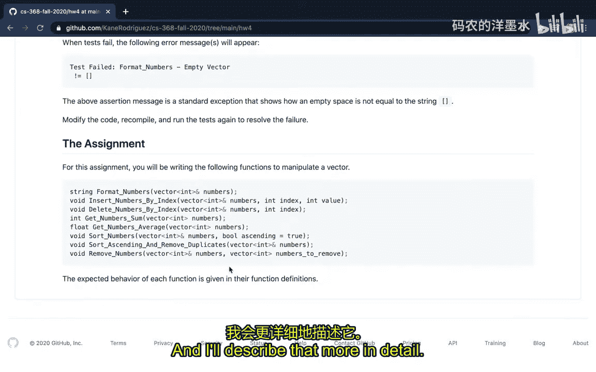
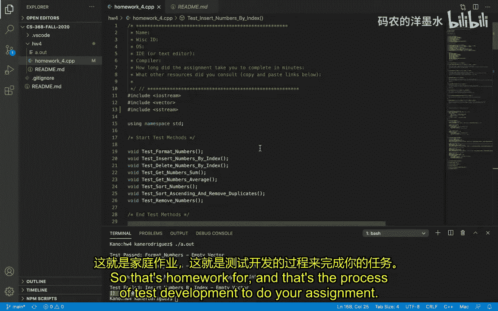

# 【全集】威斯康星大学 聚焦系统级编程 面向Java程序员的C++ CS368C 中英字幕 1080P p14 作业 5 总结 -BV1o72QBREfu_p14-

Hello， for this video， I'll give you an overview of homework 4。There are several different steps。

 the first is compiling the program like so。For running the tests。

 the tests are actually included as part of this assignment， so to run them。

 you simply need to compile and then run the excecutable。Now for debugging the tests。

 the tests have descriptive error messages， so whenever tests fails。

 you'll know what method was being tested and a little description on what the test was trying to do。

So in this case。Our method returns an empty string。

But we had expected an opening bracket closed bracket。I'll get more in depth on this later。

 but the goal is you would。See the air， modify your code， save recompile。Rerun。

Hopefully I't this error anymore。For the assignment itself。We will be manipulating a vector。So first。

 you'll be writing a method that will。Take this vector of numbers and generate some formatted string that shows each element and the index that each element is in。

 and I'll show more on that later。Then we'll write summer methods。For manipulating the vector。

 one is insert numbers by index and the rules for out of bounds or other edge cases will be described in the code。

descriptions of the functions in the code。Same for delete numbers by index。

 there's some methods for computing some statistics on the numbers vector。

 so the sum of the numbers in the vector or the average of the numbers in the vector。

There are also some sorting。And removing functions。

 so sorting the numbers by a fault ascending and then also sorting descending。

And then a method for sorting。The numbers asc and removing any duplicate values that we find。

And last one not least， a method to take any instance instances of a number for numbers to remove in numbers and removing them。

And I'll describe that more detail later。

So here's the homework assignment。A previous video I uploaded would show how to。Clessstream machine。

So for this， I'm going to run。You must plus to compile this file。And then I'm going to run。

Be executable。As you see， I've already written the solution for format numbers。

And the tests passed for each of those test cases。But when testing the insert numbers by index。

I came across a failure。So I would have to。Implement that code。Recoile， run again。

So now over this file itself。We have some test methods that。She probably leave alone。

We have the methods you're going to implement， and we have a main which calls all of our test methods。

The code that you need to modify。Are each of these。Methods here。

They each have a description describing exactly what we expect。This function。

 the behavior dysfunction function to be。Now for the test cases themselves。

 it's a lot of test codes at the bottom of the file。And let's say here。

 insert numbers by index empty vector， I would not recommend modifying these test caseses at all。嗯。

But you can see Instagram by index。Empty vector， we fill this test case。

 so when calling our method with these arguments， we did not get what was expected。

So that's homework for， and that's the process of using case drive development to do your assignment。

