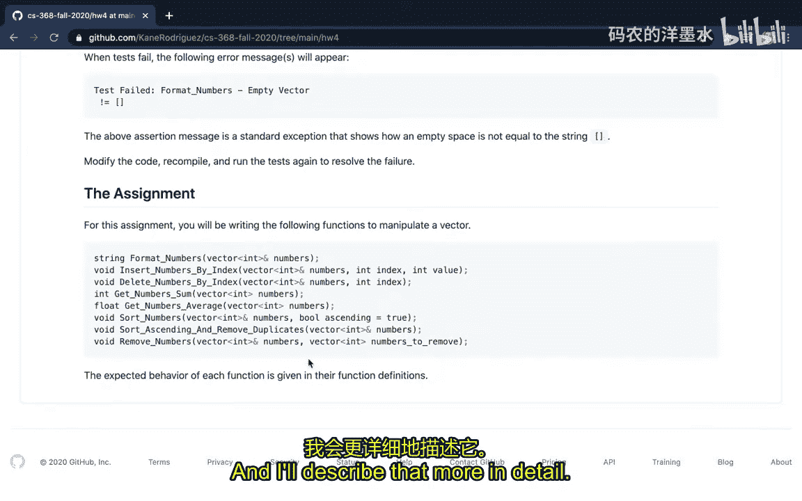
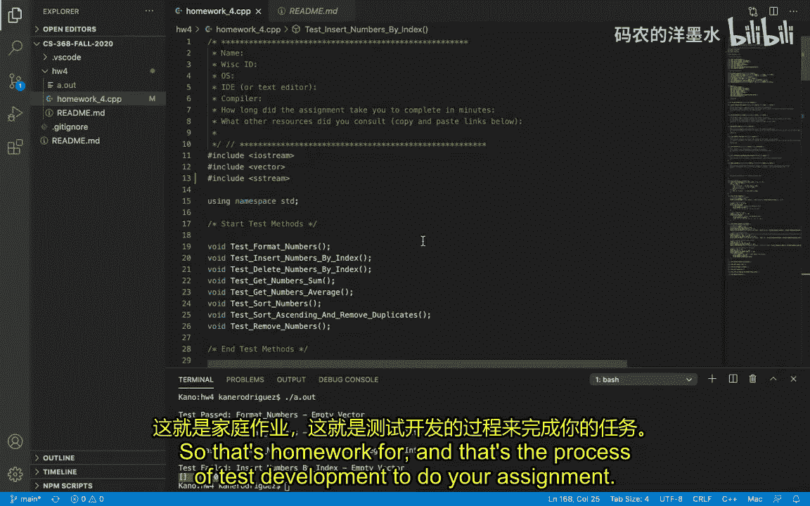

# C++编程入门：作业5：向量操作与测试驱动开发 📚

在本教程中，我们将学习如何完成一个C++编程作业。该作业的核心是操作一个数字向量（`std::vector<int>`），并实践测试驱动开发（TDD）的工作流程。我们将编写多个函数来实现格式化输出、插入、删除、计算统计信息以及排序和去重等功能。

## 作业概述与流程 🔄

上一节我们介绍了本课程的目标，本节中我们来看看完成本次作业的具体步骤。

整个作业流程可以分为以下几个关键步骤：

1.  **编译程序**：首先，你需要编译源代码文件以生成可执行文件。
2.  **运行测试**：作业中已包含测试代码。编译后，直接运行生成的可执行文件即可执行所有测试。
3.  **调试与修改**：当测试失败时，测试框架会提供清晰的错误信息，指出哪个函数测试失败以及期望的结果是什么。你需要根据这些信息修改你的代码。
4.  **迭代**：修改代码后，重新编译并运行测试，直到所有测试通过。

以下是完成作业的详细步骤列表：
*   **编译**：使用C++编译器（如g++）编译包含作业代码的源文件。
*   **测试**：运行编译后的可执行程序，自动执行所有预设的单元测试。
*   **调试**：阅读测试失败时输出的描述性错误信息，定位问题。
*   **修改**：根据错误信息，修正对应函数的实现逻辑。
*   **验证**：保存修改，重新编译并运行测试，确认问题已解决。

## 核心任务：向量操作函数 ✨

上一节我们了解了作业的工作流程，本节中我们来看看需要实现的具体函数。你的主要任务是实现一系列操作整数向量的函数。

需要实现的函数包括：

1.  **格式化输出**：`formatNumbers`
    *   **功能**：接收一个整数向量，生成一个格式化的字符串，显示每个元素及其在向量中的索引。
    *   **示例**：向量 `[10, 20, 30]` 可能被格式化为 `“[0:10, 1:20, 2:30]”`。

2.  **插入与删除**：
    *   `insertNumberAtIndex`：在向量的指定索引处插入一个数字。需要处理索引越界等边界情况。
    *   `deleteNumberAtIndex`：删除向量中指定索引处的数字。同样需要处理边界情况。

3.  **统计计算**：
    *   `computeSum`：计算向量中所有数字的总和。
        *   **公式**：`sum = numbers[0] + numbers[1] + ... + numbers[n-1]`
    *   `computeAverage`：计算向量中所有数字的平均值。
        *   **公式**：`average = sum(numbers) / count(numbers)`

4.  **排序与去重**：
    *   `sortAscending`：将向量中的数字按默认升序排列。
    *   `sortDescending`：将向量中的数字按降序排列。
    *   `sortAscendingAndRemoveDuplicates`：将向量按升序排序，并移除所有重复的值。
    *   `removeAllInstances`：从向量中移除所有与指定数字相等的元素。

每个函数在代码中都附有详细的描述，说明了其预期的行为、参数和返回值，请仔细阅读。

## 代码结构与开发实践 💻

上一节我们列出了所有需要实现的函数，本节中我们来看看代码的组织形式和推荐的开发方法。

作业的源代码文件结构如下：
*   **测试函数**：文件底部包含了大量的测试用例（例如 `testInsertNumberAtIndexEmptyVector`）。**不建议修改这部分代码**。
*   **待实现函数**：文件中部是等待你填充代码的函数框架（如 `formatNumbers`, `insertNumberAtIndex` 等）。
*   **主函数**：`main` 函数负责调用所有测试方法。

开发过程中，你将遵循测试驱动开发模式：
1.  初始运行测试时，许多测试会因函数未实现而失败。
2.  例如，测试 `insertNumberAtIndex` 时，失败信息会明确告知你，对于空向量的插入操作，实际返回结果与期望结果（如 `“[]”`）不符。
3.  你根据此信息去实现 `insertNumberAtIndex` 函数，处理空向量的情况。
4.  实现后，重新编译并运行测试，观察该测试是否通过，并继续解决下一个失败测试。

这就是完成作业五的整个过程，它结合了具体的向量操作编程任务和测试驱动开发的实践方法。

## 总结 📝

本节课中，我们一起学习了如何完成一个C++编程作业。我们详细介绍了作业的完整流程：从编译程序、运行测试，到根据测试反馈进行调试和代码修改。我们明确了需要实现的核心功能，包括对`std::vector<int>`的格式化、增删、统计计算、排序及去重操作。最后，我们分析了代码结构，并实践了测试驱动开发的基本迭代步骤：运行测试、查看失败信息、修改代码、重新验证，直至所有功能符合预期。