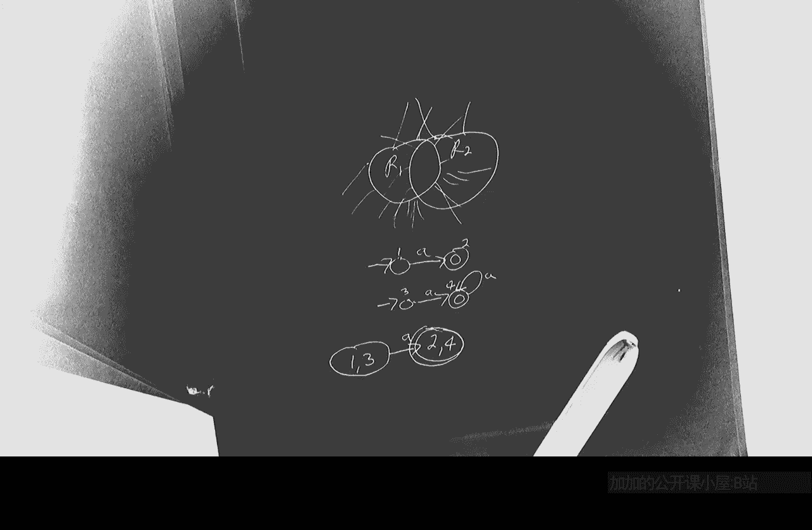
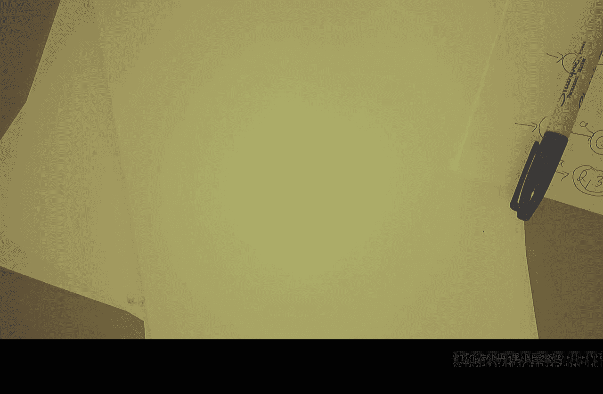
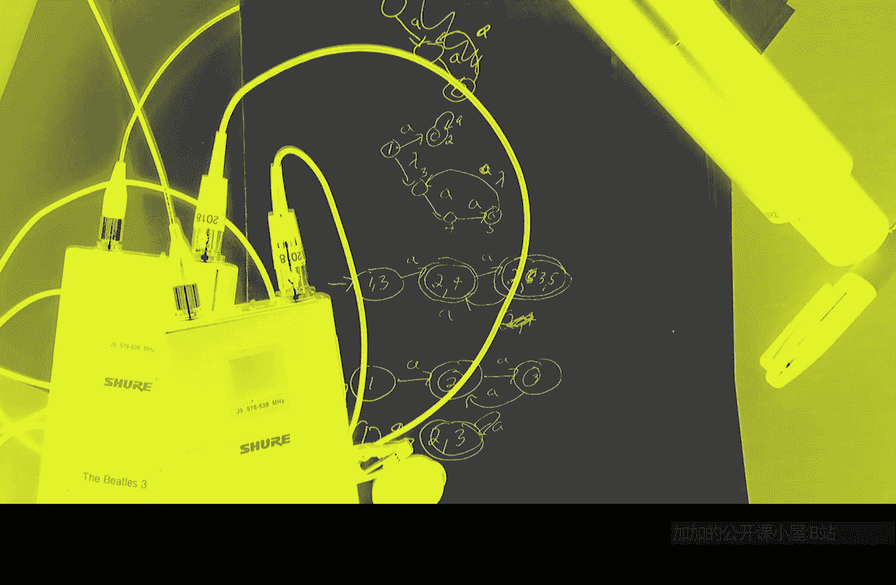
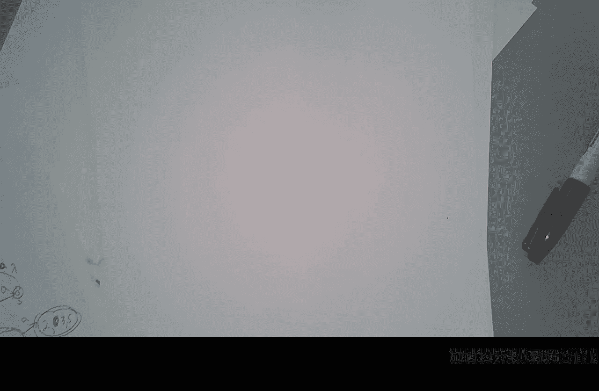
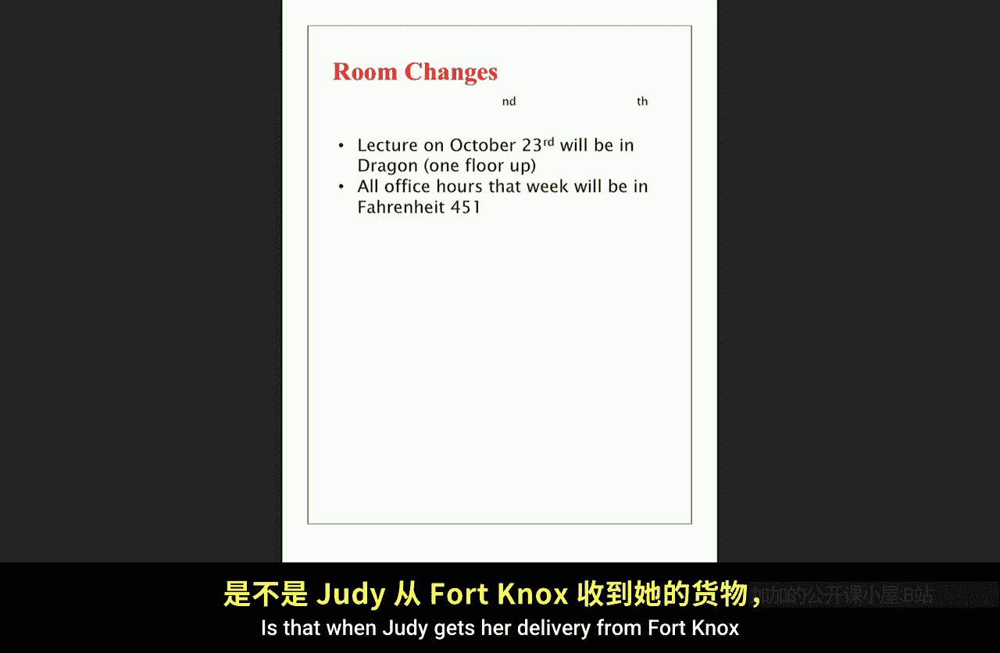

# 006：课程公告与工具设置 🎬

在本节课中，我们将处理课程相关的公告，并完成录制工具的初始设置，确保后续课程能顺利进行。

## 课程公告 📢

首先，有一项关于教室变更的公告需要通知大家。由于下周本教室有特殊活动安排，我们的课程地点需要临时调整。具体的新教室信息，请留意后续的官方通知。

## 工具设置与调试 🛠️

上一节我们介绍了课程安排，本节中我们来看看录制工具的设置过程。为了找到最佳的视觉效果，我们对视频的显示模式进行了测试和调整。

以下是测试不同显示模式的过程：
*   我们首先尝试了“反色”模式，这种模式模拟了黑板（深色背景，浅色文字）的效果。
*   随后，我们切换回了常规的“白底黑字”模式进行对比。
*   经过比较，常规模式被认为具有更好的可读性，因此我们决定采用此设置。

在确认显示模式后，我们还需要确保音频等所有录制功能正常工作。一切就绪后，我们将正式切换到主讲画面，开始课程内容的讲解。

## 总结 📝

本节课中我们一起学习了临时的教室变更信息，并完成了课程录制工具的基本设置与调试，包括选择可读性更佳的常规显示模式。这些准备工作将为后续深入的技术内容讲解奠定基础。