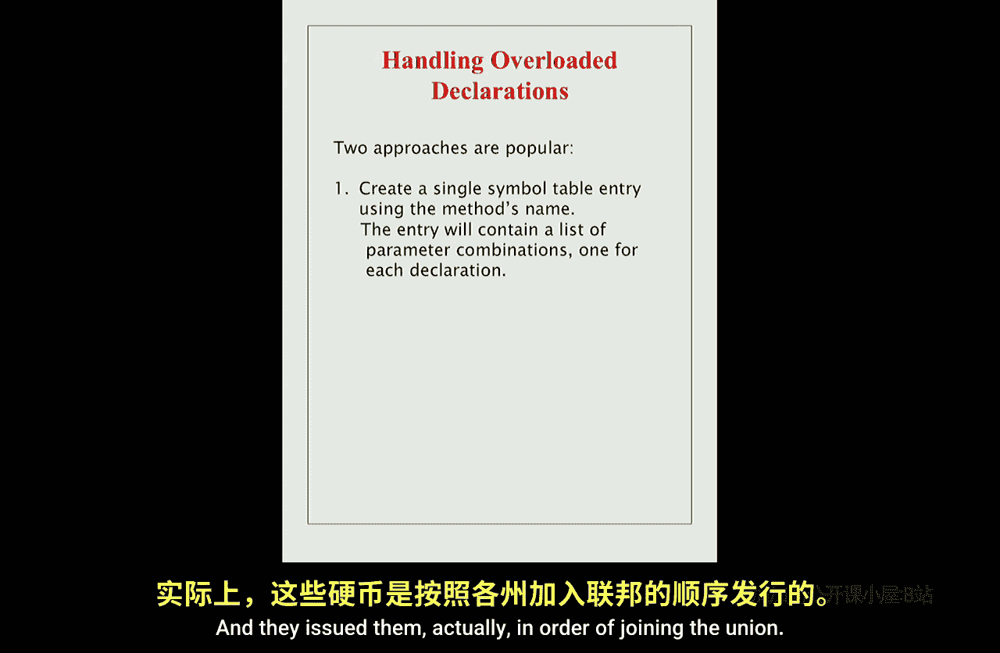

# 威斯康星大学【中英⚡编程语言与编译器导论｜CS536 2018 Introduction to Programming Languages and Compil p11 P11 -BV1iwMpzfEDc_p11-

That I can share with you and you have， yeah， So I have one， and I'll bring the answer key next week。

 and we'll have the second exam graded then， too。So and。So the stats are。

G down the basis 100 of course。 So several people got in the 90s。

 the media in the midway point was 87。 The minimum was 48， which isnt all that grade a grade。

And here's the distribution。 We had a total of 12 people。 Most people decided to take the later exam。

So in this case people did in the 90s and 80s， you're fine 70s and so， so and 60 and below。

 it didn't do as well as I would have hoped， but of course there's the final and the homework and the projects to balance it out。

 so no one component this determines the final grade。

And I have one here that should have been great and it wasn't and I apologize for that。

 I'll do that over the break。So we's see John Stmeer。Sophie Oel Ben。John Gordon。Ma East。

Was't her honey A TV show called Honey West， though。you put those two together， I guess。

 before your time， I think。Zin you， why you。Ryan Patton。And。Shiva Kumar Ramakrhnan。Oh wait a minute。

 now that you did exam too。This， that's the thing I was alluding to。 I got mixed in。

 Sorry about that。 It's not graded yet。And Mr。 Wang， I apologize， yours and。 I got it。

 put in a separate envelope in and didn't do it at time。 So these would be handled。Well，Later。

So again， I also have an answer， he Zum we're here。 So in a break。

 if you're really keen on seeing what you should have answered， you can take a peek at that and。

 I'll have a hard copy for you next time。Well I'm pleased to see as many， yeah。Yeah， you did。

 And let me。And I remember seeing your name on the list。

I don't know， damn。come during the break and I'll check and verify， I'm pretty sure I have on list。

I don't know。They're not in the right envelope， but。Come back the wife guy。So let me switch over to。

And what I want to finish talking about right now is type checking。 and then we're going to get into。

The final。Section of the course。Assuming I can find thee。There we are。K。Come guy。And okay。

 we got that all set。So let me get these out of the way so I don't lose anymore。

So what I want to continue talking about right now is something I started at the end of last lecture。

 and that's one of the harder aspects of type checking， namely overloading and how to handle them。

As I mentioned in passing and I'll get more detail today。

 the issue is you're going to have what looks like multiple declarations in terms of the possibility of having several methods with the same name that are differentiated by the number or type or some combination of parameters。

So the two choices are to have one symbol table entry for all the possible overloadings and have a list of declarations chained together off that name。

Example I use within an dictionary。 you oftentimes have a single word that has many different definitions。

 And you look， is it this guy or that guy or that。And in terms of words you figure out which it is by context and a similar thing for type checking。

 if we have two different methods as I'll show in a moment that are differentiated by the number of type of parameters。

 you look at the parameters and say， oh yeah， it's this name and this parameter combination says it must be this method rather than something with the same name but a different combination of parameters。

So this is what I'm talking about， we have a single symbol table entry and that is just for the name。

 for example， Maine， and then we'll have Alysa says yeaho。

 there's a combination that perhaps has no parameters， another one that has as a dozen Java。

 an array of strings as a parameter， and even possibly others。

So the advantage of this is that you have all the definitions together。

 that this advantage is that there's really a two step process saying， yes。

 I do have an entry named Maine， but I have multiple definitions， so which of these apply？

And I imagine if you're someone who's for example， first learning a language and you go to a dictionary and there's several different definitions and it's not clear which of those from the context is the one you really mean。

 then it's troublesome and in this particular case you're going to have to say yes， I found it。

 but then I need extra information。So what this boils down to and I think many of you will recognize this。

 if not I'll warn you now， is that when you go ahead and create a symbol table entry for a method you have。

 of course its type， the return type and it's kind which is method but what you'll want to have is also an auxiliary piece of data that talks about the number and type of parameters it has even if there's no overloading you'll have to have a list of parameter type and kind so for example it might take a scalar integer and a Boolean array as two parameters and you have to have those so that when you're checking you say yeah I have a definition for this method but now I need to check your parameters at point of call with the parameters defined to make sure they match。

If they don't match， the call doesn't work， so you have to have that auxiliary information。

Something else that's not as complex but that has bothered people is when you have an array an array declaration。

 we have sort of an old fashionashed sort of array declaration where the size has to be a literal value known in advance。

But that's sort of a warning to that when you say， here's the declaration of A。

 which is always what an array is called， and its type is integer。

So it's kind as array and its type is integer。You also want to store somewhere the size of the array。

 which is available at the declaration because of nothing else when you do array assignments。

 you're going to have to say， here's one array， here's another， yes， they both have type integer。

 but to be assigned that they must have the same size。Now that's a little different than Java。

 remember， Java allows the size of the array to be a part of its value。

 which means I can assign an array of size 10 integers into an array of size，100 integers。

it's not always clear whether that's a good thing or a bad thing。

 because it might be the case the size is， in fact。

 fixed and not something you want the use or to change。

So if I had an array representing the 50 states and the sort of situation they have on jeopardy。

 where what's the capital of this state or that， and you'd have an array of those。

In terms of ordering， the very first state was what was Delaware， I think。

 was the very first state that was joined the union。And the question is how do I know that， well。

 you may have recognized that the United States went through a period where they issued 50 different 25 cent coins。

 one for each state， and then later they added the territories too。

 and they issued them actually in order of joining the Union and the very first one got the most attention and I think that was Delaware。

