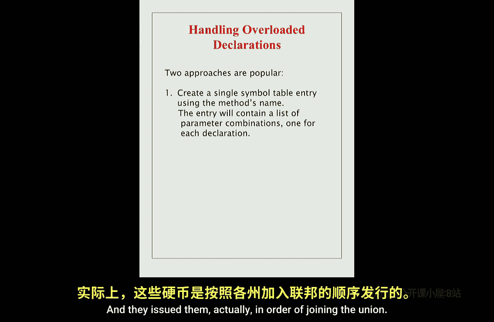

# 编程语言与编译器导论：P11：类型检查与重载处理

在本节课中，我们将要学习类型检查中一个较为复杂的方面：如何处理重载。我们将探讨如何在符号表中管理具有相同名称但参数不同的方法，并理解相关的辅助信息存储需求。

上一节我们介绍了符号表的基本概念，本节中我们来看看如何处理方法重载这一特殊情况。

## 重载的处理方法

当程序中存在多个名称相同但参数列表不同的方法时，编译器需要一种机制来区分它们。这类似于字典中一个单词有多个释义，需要根据上下文来确定具体含义。

以下是处理重载的两种主要思路：

*   **单一符号表条目链式存储**：为方法名创建一个符号表条目，然后将所有重载版本的方法声明以链表形式链接到该条目下。当遇到一个方法调用时，首先找到方法名对应的条目，然后根据调用时提供的参数数量和类型，遍历链表以匹配正确的声明。
*   **存储辅助参数信息**：无论是否存在重载，在符号表中为每个方法存储其参数的类型和数量信息都是必要的。这使得在类型检查阶段，可以验证方法调用处的参数是否与声明的参数列表匹配。

## 符号表中的辅助信息

除了处理重载，符号表还需要存储其他关键信息以确保程序语义正确。

以下是两种需要额外存储信息的情况：

*   **方法声明**：对于每个方法，符号表条目不仅需要记录其返回类型和种类（如“方法”），还必须存储其参数的类型和数量列表。这用于在调用点进行参数匹配检查。
*   **数组声明**：对于数组声明，符号表条目需要存储数组的大小（如果语言要求在编译时已知）。例如，声明一个整数数组时，除了类型和种类（“数组”），还需记录其大小。这在后续进行数组赋值操作时，用于检查两个数组是否具有相同的大小（如果语言有此要求）。

## 课程总结

本节课中我们一起学习了类型检查中处理重载的方法。我们了解到，可以通过在符号表中为方法名建立单一条目并链式存储不同重载版本来管理重载。同时，为了进行有效的类型检查，符号表必须为方法和数组等结构存储必要的辅助信息，如参数列表和数组大小。这些机制共同确保了程序在编译时能够被正确地分析和验证。