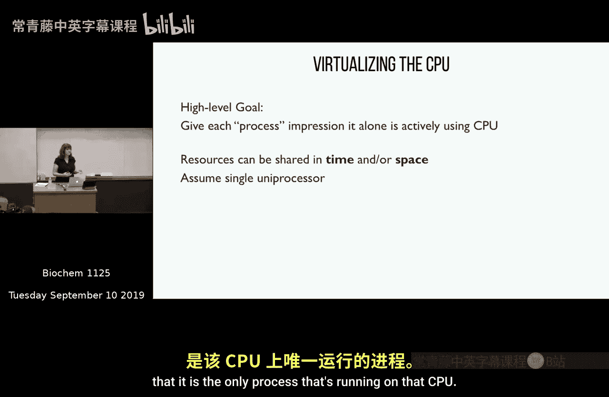
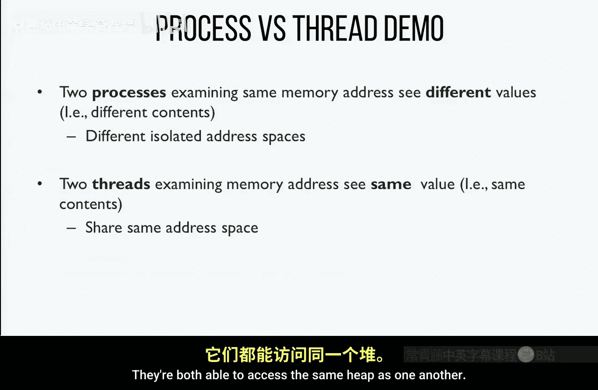
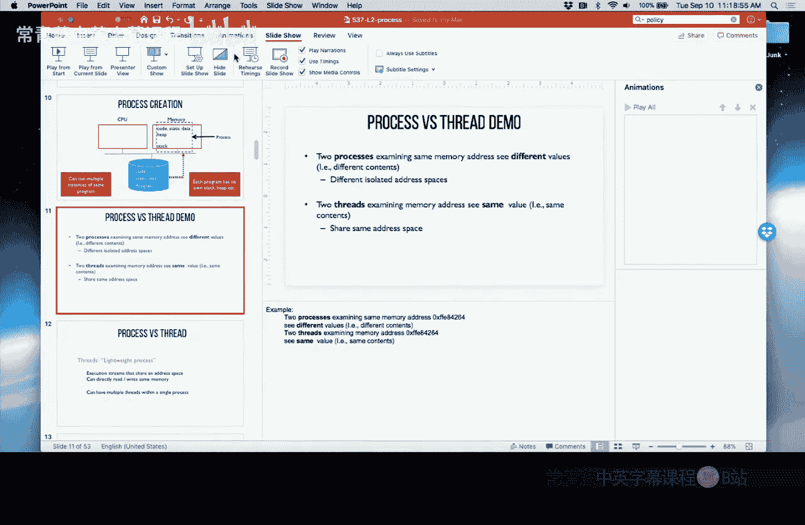
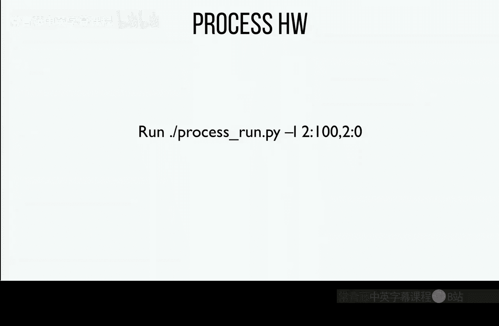
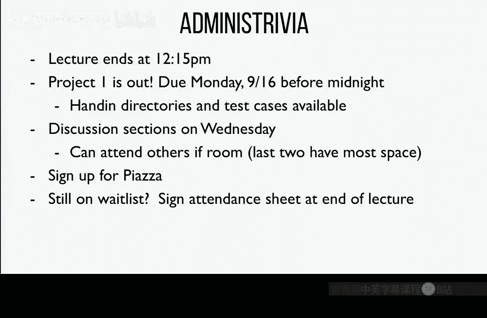

# 002：进程与CPU虚拟化

在本节课中，我们将学习操作系统如何虚拟化CPU，为应用程序提供易于使用的抽象。我们将深入探讨进程的概念、其生命周期，以及操作系统调度进程、处理系统调用和执行上下文切换的机制。

---

## 进程是什么？

上一节我们介绍了操作系统作为资源管理者的角色，本节中我们来看看它如何抽象CPU。这个抽象就是**进程**。



一个**程序**是存储在磁盘上的静态代码和数据。当你运行这个程序时，它就变成了一个**进程**。进程是正在执行的程序实例，它包含了代码执行流以及所有相关的动态上下文信息。

进程的上下文包括：
*   **寄存器内容**：如通用寄存器、程序计数器（PC/指令指针）、栈指针（SP）。
*   **内存状态**：指向其地址空间中代码、堆、栈等区域的指针。
*   **其他系统状态**：如打开的文件描述符、网络连接等。

一个程序可以对应多个进程（例如，同时打开多个终端窗口运行同一个程序）。每个进程都拥有自己独立的上下文和地址空间。



---


## 进程与线程

进程默认包含一个执行线程。**线程**（有时称为轻量级进程）是进程内的一个独立执行流。

以下是进程与线程的关键区别：
*   **地址空间**：同一进程内的多个线程**共享**相同的地址空间（堆、全局变量）。不同进程拥有**独立**的地址空间。
*   **上下文**：每个线程拥有自己独立的栈和寄存器状态（如程序计数器、栈指针），但共享进程的其他资源。

为了更直观地理解，请看以下代码示例对比：




**示例1：两个独立进程**
```c
// 进程A设置 value = 11
// 进程B设置 value = 12
// 两个进程中的 `value` 变量互不影响，初始值都是10，修改后各自独立。
```

**示例2：同一进程内的两个线程**
```c
// 线程1设置 shared_value = 13
// 线程2随后读取 shared_value，看到的是13，然后将其改为14
// 两个线程操作的是同一个全局变量 `shared_value`。
```

---




## 进程状态与调度

由于CPU核心数量有限，操作系统需要通过**时间分片**在多个进程间共享CPU。这是通过快速地在进程间进行**上下文切换**实现的。

一个进程在其生命周期中会经历几种基本状态：
*   **运行**：正在CPU上执行指令。
*   **就绪**：已准备好运行，正在等待被调度器选中。
*   **阻塞**：因等待I/O等事件而暂停，即使CPU空闲也无法运行。

操作系统维护一个**就绪队列**，存放所有处于就绪状态的进程。调度器（属于OS）负责决定何时停止当前运行进程（使其进入就绪状态），并选择另一个就绪进程来运行（使其进入运行状态）。我们今天关注运行态和就绪态之间的转换机制。

---

## 受限直接执行与系统调用

最有效的虚拟化方式是让进程直接在CPU上运行，即**直接执行**。但这带来两个问题：
1.  进程如何执行特权操作（如I/O）？
2.  如何防止恶意或错误进程独占CPU？

解决方案是**受限直接执行**。大多数时间让进程直接运行，但通过硬件和操作系统协作，在必要时获得控制权。

**问题1的解决：系统调用**
硬件提供至少两种运行模式：
*   **用户模式**：权限受限，无法执行特权指令。
*   **内核模式**：操作系统代码运行于此，可以执行任何指令。

当用户进程需要执行特权操作（如读写文件）时，它必须通过**系统调用**请求操作系统代为执行。

系统调用流程如下：
1.  进程执行一条特殊的**陷阱指令**（如 `int 0x64`），并事先在约定寄存器中放入系统调用编号（如 `read` 对应编号6）和参数。
2.  硬件响应此陷阱：切换到内核模式，跳转到预设的**陷阱处理程序**。
3.  陷阱处理程序检查系统调用编号，在**系统调用表**中找到对应的内核函数（如 `sys_read`）并执行。
4.  内核函数完成工作后，执行**从陷阱返回**指令，切换回用户模式，恢复用户进程执行。

**关键公式**：用户程序 -> `trap` -> 内核模式 -> 查找处理程序 -> 执行系统调用 -> `return-from-trap` -> 用户模式。

---

## 上下文切换机制

**问题2的解决：抢占式调度**
为了从非协作进程（如陷入无限循环）手中夺回CPU控制权，操作系统依赖**定时器中断**。

定时器中断流程与上下文切换：
1.  **中断发生**：硬件定时器定期（如每1毫秒）触发中断。
2.  **保存用户状态**：硬件自动将当前运行进程的用户级寄存器保存到该进程的**内核栈**中（每个进程有独立的内核栈），然后切换到内核模式，跳转到**定时器中断处理程序**。
3.  **执行OS调度策略**：中断处理程序运行操作系统代码。此时，调度器**策略**决定是否进行上下文切换。
4.  **切换上下文（机制）**：
    *   如果决定切换，OS首先将当前进程A的**内核级寄存器状态**保存到其**进程控制块**中。
    *   然后，OS恢复目标进程B之前保存的寄存器状态（从其PCB），并切换到进程B的**内核栈**。
    *   最后，OS执行 **`return-from-trap`** 指令。硬件从B的内核栈中恢复B的**用户级寄存器**，切换回用户模式，并跳转到B的用户程序继续执行。

**关键点**：上下文切换需要保存/恢复两套状态——用户级状态（由硬件自动处理）和内核级状态（由OS代码处理）。`return-from-trap` 指令的返回地址决定了接下来执行哪个进程。

---

## 机制与策略的分离

这是一个重要的设计原则：
*   **机制**：**如何**实现一个功能。例如，上下文切换的具体步骤、处理陷阱的硬件和软件例程。机制追求高效、低开销。
*   **策略**：**何时**以及**选择哪个**进程运行。例如，调度算法（先来先服务、轮转、优先级等）。策略根据不同的优化目标（吞吐量、响应时间、公平性）制定。

操作系统提供上下文切换的机制，而上层的调度策略则利用这个机制来实现更智能的决策。这种分离使系统更灵活、更易于维护。

---



本节课中我们一起学习了CPU虚拟化的核心概念。我们明确了**进程**作为CPU抽象的定义，区分了进程与**线程**。我们探讨了操作系统通过**时间分片**和**上下文切换**来共享CPU，并深入分析了实现这一目标的两种关键机制：通过**系统调用**执行特权操作，以及利用**定时器中断**实现**抢占式调度**，从而从用户进程手中夺回控制权。最后，我们理解了**机制与策略分离**的设计哲学。在接下来的课程中，我们将重点讨论调度策略，即操作系统如何决定运行哪个进程。