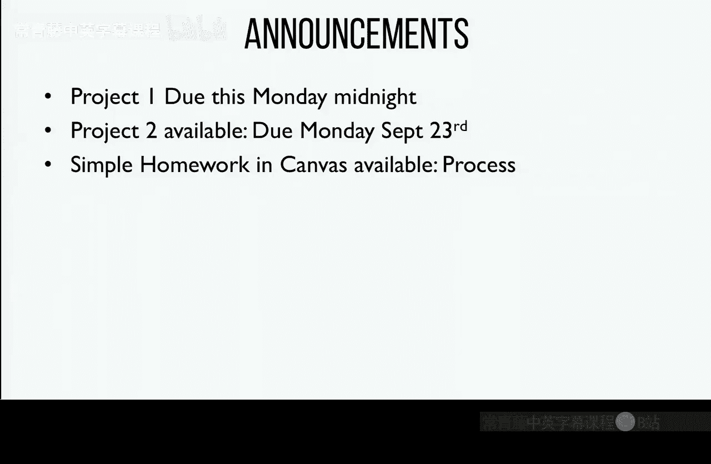

# 003：CPU调度 🧠

在本节课中，我们将要学习操作系统如何决定哪个进程在CPU上运行，即CPU调度策略。我们将探讨不同的调度指标，如周转时间和响应时间，并学习多种调度算法，从简单的先来先服务到现代操作系统使用的多级反馈队列。

---

## 课程公告

以下是本周的一些重要通知。

*   **项目1** 将于周一晚上截止。请尽早开始，避免在截止前匆忙完成。
*   **Piazza答疑**：为鼓励大家提前解决问题，助教和同伴导师将不会在周一下午回答任何新问题。你仍然可以查看历史问题和回答其他同学的问题。
*   **项目2** 现已发布。它比项目1更具挑战性，涉及修改Xv6内核代码。请在下次讨论课之前查看项目说明，以便提出有针对性的问题。
*   **课程作业**：我们发布了一个包含四个问题的简单测验，旨在帮助你练习考试题型。你可以多次尝试，系统会显示正确答案。
*   **期中考试日期更正**：考试原定于10月9日（周三），但当天是假期。现更正为**10月10日（周四）**。如有冲突，可申请参加备用考试。

---

## 回顾：进程与状态

在上一讲中，我们介绍了进程的概念，它是操作系统虚拟化CPU的抽象。每个进程都以为自己独占CPU。

我们了解到，操作系统通过时间分片在竞争进程之间进行上下文切换。每个进程可以处于三种状态之一：
*   **运行**：正在使用CPU。
*   **就绪**：已准备好运行，但调度器尚未选择它。
*   **阻塞/等待**：正在等待I/O操作（如磁盘读取或网络数据包）完成，此时无法进行有用的工作。

状态之间的转换由机制控制。例如，当一个运行中的进程发起I/O请求时，它会转入阻塞状态；当I/O完成时，它又回到就绪队列。

本节中，我们将重点关注调度策略：如何从就绪队列中选择下一个要运行的进程。

---

## 调度基础：工作负载与指标

在深入具体策略之前，我们需要定义一些基本概念。我们将进程的每个CPU执行片段称为一个“作业”。

一个工作负载由多个作业组成，每个作业可以用两个关键属性来描述：
*   **到达时间**：作业进入系统并准备运行的时间。
*   **运行时间**：作业完成当前CPU片段所需的时间（不包括I/O时间）。

调度器的任务就是决定就绪队列中哪个作业可以进入运行状态。

不同的系统优化目标不同，因此我们使用不同的指标来衡量调度器的好坏。本节课我们主要关注两个指标：

1.  **周转时间**：作业完成时间减去其到达时间。公式为：`T_周转 = T_完成 - T_到达`。它衡量了作业从提交到完成的总体延迟。系统通常希望最小化平均周转时间。
2.  **响应时间**：作业首次被调度的时间减去其到达时间。公式为：`T_响应 = T_首次调度 - T_到达`。它衡量了系统对交互式请求的反应速度。对于需要快速反馈的交互式作业（如编辑器、命令行），最小化响应时间至关重要。

其他可能关注的指标还包括吞吐量（单位时间完成的作业数）、CPU利用率、上下文切换开销和公平性。

---

## 调度策略（一）：理想化假设下的算法

为了循序渐进，我们首先在几个简单（但不现实）的假设下分析调度策略，然后逐步放宽假设，使模型更贴近现实。

初始假设如下：
1.  所有作业运行时间相同。
2.  所有作业同时到达。
3.  所有作业只使用CPU（无I/O）。
4.  调度器预先知道每个作业需要运行多长时间（完美知识）。

### 先来先服务

最简单的策略是**先来先服务**。就像现实生活中的排队一样，先到达的作业先运行。

假设有三个作业A、B、C几乎同时到达（A略早于B，B略早于C），每个都需要运行10秒。FCFS的调度顺序是A -> B -> C。

计算平均周转时间：
*   作业A：完成于10，周转时间 = 10 - 0 = 10
*   作业B：完成于20，周转时间 = 20 - 0 = 20
*   作业C：完成于30，周转时间 = 30 - 0 = 30
*   平均周转时间 = (10 + 20 + 30) / 3 = 20

**问题**：当作业运行时间差异很大时，FCFS表现很差。如果一个长作业最先到达，它会阻塞后面所有短作业，导致平均周转时间变得很长。

### 最短作业优先

为了解决FCFS的问题，我们引入**最短作业优先**策略。调度器总是选择预计运行时间最短的作业先运行。

假设作业A需要100秒，B和C各需10秒。SJF的调度顺序是B -> C -> A。

计算平均周转时间：
*   作业B：完成于10，周转时间 = 10
*   作业C：完成于20，周转时间 = 20
*   作业A：完成于120，周转时间 = 120
*   平均周转时间 = (10 + 20 + 120) / 3 = 50

相比FCFS的平均110秒，SJF显著改善了周转时间。理论上可以证明，在非抢占式且追求最小平均周转时间的目标下，SJF是最优的。

**新问题：饥饿**。如果不断有短作业到达，长作业可能永远得不到调度。

---

## 调度策略（二）：放宽“同时到达”假设

现在，我们放宽第二个假设，允许作业在不同时间到达。考虑以下工作负载：
*   作业A：在时间0到达，需要运行100秒。
*   作业B：在时间10到达，需要运行10秒。
*   作业C：在时间10到达，需要运行10秒。

如果我们使用**非抢占式**的SJF，在时间0，只有A在就绪队列中，所以A开始运行。即使在时间10有更短的B和C到达，调度器也不能中断A，必须等A在时间100运行结束后，才能从B和C中选择最短的。这导致了很差的性能。

计算平均周转时间：
*   作业A：完成于100，周转时间 = 100 - 0 = 100
*   作业B：完成于110，周转时间 = 110 - 10 = 100
*   作业C：完成于120，周转时间 = 120 - 10 = 110
*   平均周转时间 ≈ 103.3

显然，当作业不同时到达时，我们需要**抢占**的能力。

### 最短完成时间优先

**最短完成时间优先**（又称最短剩余时间优先）是SJF的抢占式版本。调度器总是调度剩余运行时间最短的作业。

对于上面的工作负载：
1.  时间0：只有A，调度A。
2.  时间10：B和C到达。此时A剩余90秒，B和C剩余10秒。调度器会抢占A，选择B或C运行。
3.  假设先运行B（10秒），然后运行C（10秒）。
4.  时间30：B和C都已完成，再次调度A（剩余90秒）。

计算平均周转时间：
*   作业B：完成于20，周转时间 = 20 - 10 = 10
*   作业C：完成于30，周转时间 = 30 - 10 = 20
*   作业A：完成于120，周转时间 = 120 - 0 = 120
*   平均周转时间 = (10 + 20 + 120) / 3 = 50

STCF在作业不同时到达的情况下，依然能取得很好的平均周转时间。

**关键点**：STCF需要知道作业的剩余运行时间。目前我们仍假设这是已知的（完美知识）。

---

## 调度策略（三）：处理I/O

现实中的进程并非一直使用CPU，它们会在CPU计算和I/O操作（如读写磁盘、等待网络）之间交替。我们将进程的每次连续CPU使用期称为一个“CPU片段”或“作业”。

一个好的调度器应该能在进程进行I/O等待时，将CPU让给其他就绪的进程。STCF策略能自然地处理这一点：当一个交互式进程（CPU片段很短）结束CPU使用并发起I/O时，它会进入阻塞状态。调度器随后会选择就绪队列中剩余时间最短的作业（可能是另一个交互式进程，也可能是一个计算密集型的长作业）来运行。当I/O完成时，该进程带着新的短CPU片段回到就绪队列，由于其剩余时间短，它通常会抢占当前运行的长作业。

这样，系统既能保证交互式进程的快速响应，又能让计算密集型作业在后台持续运行。

---

## 调度策略（四）：放弃“完美知识”假设

到目前为止，我们假设调度器预先知道每个作业的运行时间。这在实际中是不可能的。现在，我们放弃这个假设。

### 时间片轮转调度

当我们不知道作业长短时，一个简单而有效的方法是**时间片轮转**调度。它为每个就绪作业分配一个小的、固定的CPU时间单元（称为时间片），并以循环的方式依次运行它们。

例如，假设时间片为1秒，有三个作业A(5秒)、B(2秒)、C(2秒)同时到达。RR的调度顺序可能是：A(1秒) -> B(1秒) -> C(1秒) -> A(1秒) -> B(1秒) -> C(1秒) -> A(剩余3秒)...

计算平均周转时间：
*   作业B：完成于5，周转时间 = 5
*   作业C：完成于6，周转时间 = 6
*   作业A：完成于14，周转时间 = 14
*   平均周转时间 = (5 + 6 + 14) / 3 ≈ 8.33

相比FCFS的12，RR有所改善。但RR并非总是更好：如果所有作业长度相同，RR会让所有作业几乎同时结束，导致平均周转时间变差，而FCFS则能让先到的作业尽早结束。

**RR的优势在于响应时间**。在RR下，每个作业最多等待`(n-1)*时间片`就能获得CPU，因此响应时间很短，非常适合交互式作业。

**时间片长度的权衡**：
*   时间片太短：上下文切换开销过大，缓存效率低。
*   时间片太长：退化为FCFS，响应时间变差。
现代系统中，时间片通常在10毫秒到200毫秒之间。

---

## 现代调度器：多级反馈队列

在实际的通用操作系统中（如Linux、Windows），作业是混合的：既有需要低延迟的交互式短作业，也有需要高吞吐量的计算密集型长作业。没有单一策略能完美兼顾所有指标。因此，现代系统普遍采用**多级反馈队列**（或多级优先级队列）调度器。

MLFQ的核心思想是：
1.  **设立多个优先级队列**，从高到低排列（例如Q0最高，Q7最低）。
2.  **高优先级队列中的作业可以抢占低优先级队列中的作业**。
3.  **同一优先级队列内的作业采用RR调度**。
4.  **根据作业的过去行为（反馈）动态调整其优先级**。

MLFQ通过一组启发式规则来实现“反馈”：

*   **规则1**：如果A的优先级 > B的优先级，则运行A。
*   **规则2**：如果A的优先级 = B的优先级，则以RR方式运行A和B。
*   **规则3**：新作业进入系统时，置于最高优先级队列（给予优待）。
*   **规则4a**：如果作业在时间片用完前主动放弃CPU（如进行I/O），则其优先级保持不变（鼓励I/O密集型交互作业）。
*   **规则4b**：如果作业用完了整个时间片（CPU密集型），则降低其优先级（移入低一级队列）。低优先级队列通常有更长的时间片。
*   **规则5**：经过一段时间后，将所有作业的优先级提升至最高（或较高）级别，以防止饥饿。

**工作流程示例**：
1.  一个计算密集型长作业开始于最高优先级，用完时间片后被逐级降到底层队列，在那里获得长时间片安静运行。
2.  一个交互式短作业进入系统，位于最高优先级。它很快用完短时间片并发起I/O，由于是主动放弃CPU，它保持在最高优先级。I/O结束后，它回到最高优先级队列，能很快再次被调度。
3.  当底层长作业长时间未获得CPU时（可能因为高优先级作业不断到达），防饥饿规则会将其优先级提升，让它有机会运行。

MLFQ通过这种机制，无需预先知道作业性质，就能自动将交互式作业“筛选”到高优先级队列（获得快速响应），将计算密集型作业“沉降”到低优先级队列（获得高吞吐量），并利用防饥饿规则保证公平性。

---

## 其他调度策略：比例份额调度

除了MLFQ，还有其他适用于特定场景的调度思想。例如，在云计算环境中，我们可能希望按照用户支付的费用比例来分配CPU资源。这就是**比例份额调度**。

一个有趣的比例份额调度算法是**彩票调度**：
*   每个作业根据其重要性获得一定数量的“彩票”。
*   调度器定期（如每个时间片开始前）举行一次“抽奖”，随机选中一张彩票。
*   持有中奖彩票的作业获得下一个时间片的运行权。
*   拥有彩票越多（付费越多）的作业，中奖概率越大，从而获得更多的CPU时间。

彩票调度的优点是实现简单、难以被恶意程序预测和利用、易于实现权限转让。其缺点是分配具有随机性。一种确定性的变体是**步长调度**，它能精确地按彩票比例分配CPU时间。

---

## 总结与回顾

本节课我们一起学习了CPU调度的核心概念与策略。

*   我们首先明确了**调度指标**，特别是**周转时间**和**响应时间**，它们分别针对批处理作业和交互式作业。
*   在理想化假设下，我们学习了**先来先服务**、**最短作业优先**及其抢占式版本**最短完成时间优先**。SJF/STCF在最小化平均周转时间方面是最优的，但需要预知作业运行时间且可能导致饥饿。
*   当放弃“完美知识”假设后，**时间片轮转**调度通过公平分配时间片，获得了优异的响应时间，但可能损害周转时间。
*   现实中的通用操作系统使用**多级反馈队列**调度器。它通过动态调整作业优先级，巧妙地结合了RR和STCF的优点，既能快速响应交互式请求，又能高效处理后台计算任务，并通过防饥饿机制保证公平性。
*   我们还简要了解了适用于资源比例分配的**彩票调度**思想。

最后记住，**没有一种调度算法是万能的**。最好的策略取决于你的工作负载特征和优化目标。现代操作系统的调度器（如Linux的CFS）都是非常复杂和精妙的工程实现，其核心思想大多源于我们今天讨论的这些基础算法。

请务必关注项目截止日期，并提前开始项目2的探索。我们下周再见！