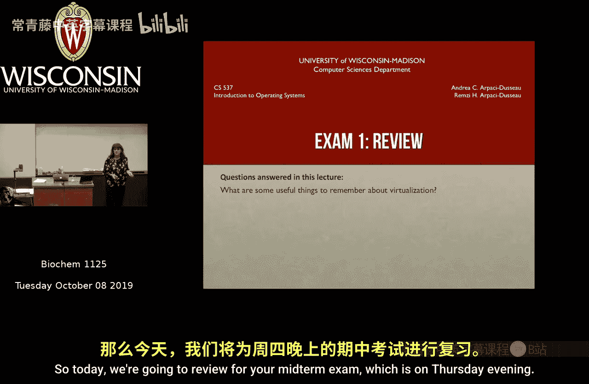
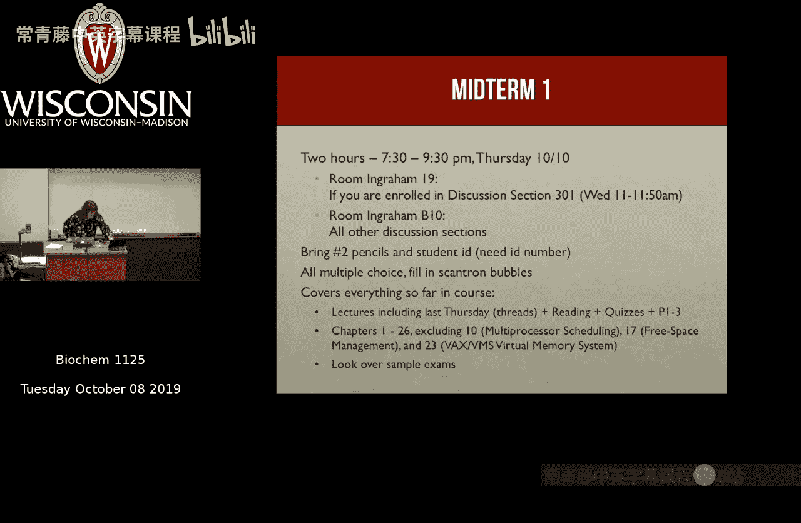
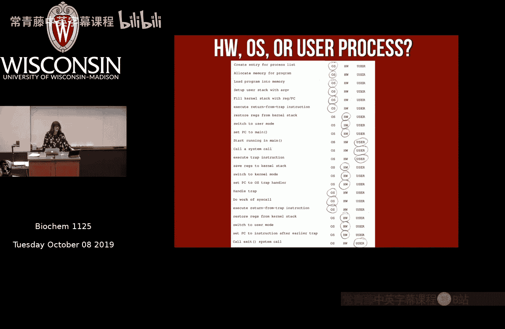
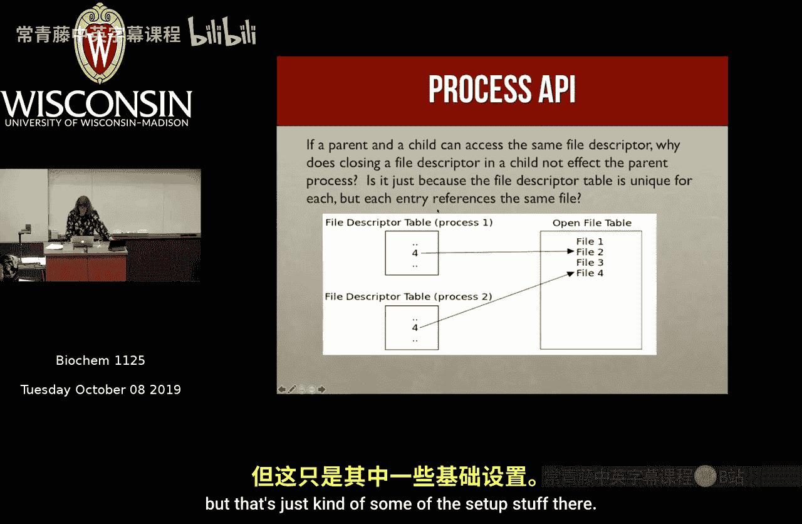
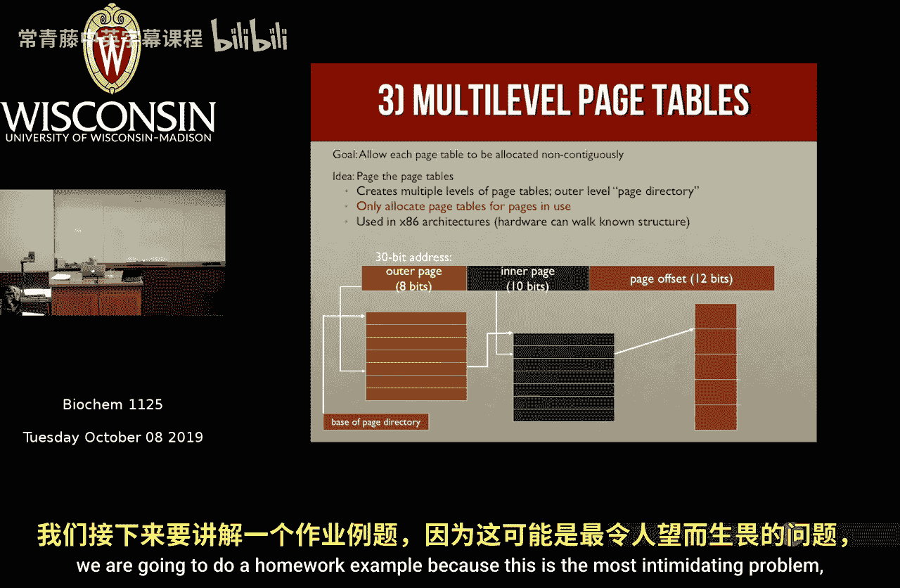
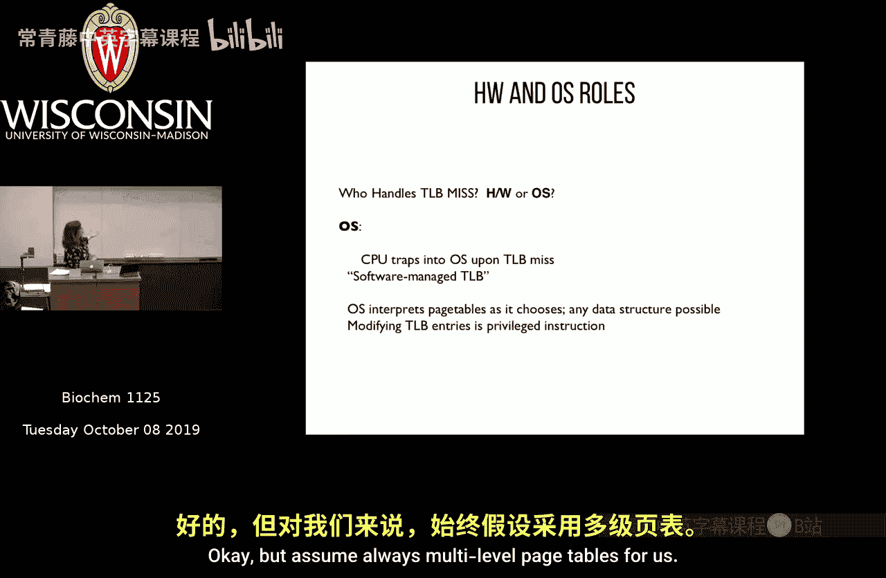
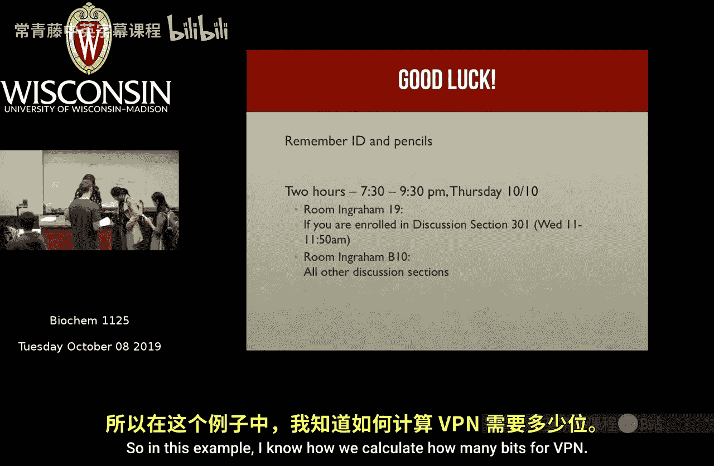

# 009：P9 期中考试复习 🧠



在本节课中，我们将回顾期中考试所涵盖的核心概念，包括进程管理、内存虚拟化（特别是分页机制）以及相关的硬件支持。我们将通过解答常见问题、分析示例和回顾关键机制来帮助你准备考试。

---

## 课程公告与项目更新

上一节我们介绍了课程的整体结构，本节中我们来看看近期的项目安排和考试须知。

首先，关于项目进度：
*   P2 已评分，成绩可在 Canvas 和提交目录中查看。如有重大评分问题，请与助教沟通。
*   P3 已提交。请注意，教学服务器偶尔会在截止时间附近遭遇拒绝服务攻击，导致提交困难。建议不要等到最后一刻才提交作业。使用 `scp -P` 命令可以保留文件的时间戳，有助于在出现问题时验证你的工作。
*   P4 已发布。你将在 Xv6 操作系统中实现一个支持不同时间片长度和优先级的调度器。该项目工作量较大，**强烈建议**与项目伙伴合作完成。如果你没有伙伴，可以通过今天发布的表单进行匹配。

关于期中考试：
*   考试时间为周四晚上，时长两小时，在不同教室进行（根据讨论课分区）。
*   考试形式为机读答题卡。请务必携带 **2B 铅笔**和**学生证**（或牢记学号）。
*   正确填写答题卡至关重要：需要填写姓名并涂写对应圆圈，以及填写并涂写学号。考试可能包含版本代码，也需按要求涂写。




考试范围涵盖截至上周四讲座的所有材料，包括教科书内容、测验和项目。项目相关的问题将是高层次的概念性问题，例如理解 Shell 或 Fork/Exec 的工作原理。


---

## 核心概念回顾：虚拟化

在操作系统课程中，我们核心学习了**虚拟化**——操作系统如何为用户进程提供它们独占整个机器的抽象。这主要涉及两个方面：

1.  **CPU 虚拟化**：通过**进程**抽象，让每个执行实体感觉自己在独占CPU。
2.  **内存虚拟化**：通过**地址空间**抽象，让每个进程感觉自己在独占物理内存。

对于每种抽象，我们都讨论了**机制**和**策略**：
*   **机制**是实现抽象的低级“如何做”，例如上下文切换（保存/恢复寄存器状态）。
*   **策略**是在机制之上做出的智能决策，例如选择接下来调度哪个进程。


在内存虚拟化方面，我们探讨了多种实现方式，从简单的静态重定位（无硬件支持），到动态重定位（**基址-界限寄存器**），再到更复杂的**分段**和**分页**机制。

---

## 进程启动流程剖析



以下是启动一个用户进程时涉及的关键步骤。请思考每个步骤主要由**硬件**、**操作系统**还是**用户进程**自身负责：

1.  创建进程控制块并将其加入进程列表。
2.  为进程分配内存。
3.  将程序加载到内存中。
4.  设置用户栈。
5.  填充内核栈。
6.  执行“从陷阱返回”指令。
7.  从内核栈恢复寄存器。
8.  从内核模式切换到用户模式。
9.  跳转到 `main` 函数。
10. 用户进程在 `main` 中运行。
11. 调用系统调用库包装函数。
12. 执行陷阱指令。
13. 硬件处理陷阱，切换到内核模式。
14. 操作系统处理陷阱（系统调用）。
15. 操作系统调用“从陷阱返回”。
16. 硬件切换回用户模式。
17. 用户进程继续执行。
18. 最终调用 `exit`。

**答案分析**：
*   步骤 1-5、14-15：由**操作系统**负责。OS 管理进程元数据、资源分配和初始化。
*   步骤 6-8、12-13、16：由**硬件**负责。硬件执行特权指令、处理模式切换和陷阱。
*   步骤 9-11、17-18：由**用户进程**负责。这是进程自身的代码执行流程。

---



## 进程控制与同步问题

以下是关于进程控制（`fork`, `exec`, `wait`）的一些常见问题：

**问题**：能否在不使用 `wait` 的情况下，确保子进程先打印“hello”，父进程后打印“goodbye”？
*   使用 `wait` 可以轻松实现：子进程打印后退出，父进程调用 `wait` 等待子进程结束，然后打印。
*   不使用 `wait`，仅凭目前所学很难可靠实现。可以尝试 `sleep`，但这会引入竞态条件。后续课程中将学习的信号量、条件变量等同步原语可以解决此类问题。

**问题**：子进程可以等待父进程吗？
*   不可以。等待关系是单向的，总是**父进程等待子进程**。

**问题**：父进程调用 `exec` 而非子进程，这有意义吗？（就像 Shell 所做的那样）
*   这没有意义。父进程通常拥有更多关于子进程的信息（如 PID），而父子关系的设计就是父进程管理子进程。

**关于文件描述符**：调用 `fork` 后，子进程会获得父进程文件描述符表的副本，两者最初指向操作系统内相同的打开文件表。如果子进程关闭了一个文件描述符，这**不会影响**父进程对同一文件的访问，因为它们是独立的描述符表项。

---

## 地址转换基础

从程序（用户进程）视角看到的所有地址都是**虚拟地址**。这些地址由编译器在编译时决定，用于布局代码、静态数据和堆栈。

**示例**：给定一段汇编代码，首先需要确定它生成的**虚拟地址**访问序列，然后才能进一步转换为物理地址。
假设汇编指令如下：
```
10: load (BP+8)
13: add ...
19: store (BP+8)
```
假设基址指针 `BP` 的虚拟地址为 200。
1.  取指地址 10 的指令（1次内存访问）。
2.  执行 `load` 指令，从虚拟地址 `200 + 8 = 208` 加载数据（第2次访问）。
3.  取指地址 13 的指令（第3次访问，该指令不访问内存）。
4.  取指地址 19 的指令（第4次访问）。
5.  执行 `store` 指令，存储到虚拟地址 208（第5次访问）。
因此，总共生成 5 次虚拟内存访问，访问的虚拟地址为：10, 208, 13, 19, 208。

---

## 内存虚拟化方案比较

我们学习了多种内存虚拟化方案：

1.  **分时共享**：一次只将一个进程的完整内存装入 RAM。
2.  **静态重定位**：在加载时重写程序代码中的地址。
3.  **动态重定位（基址寄存器）**：硬件将虚拟地址加上一个进程专用的基址。
4.  **界限检查**：硬件验证地址是否在有效范围内。
5.  **分段**：每个进程有多对基址-界限寄存器，对应不同段（代码、堆、栈）。

**问题**：哪些方案需要硬件支持？
*   方案 1 和 2 可以在没有专用硬件支持（MMU）的软件中实现，尽管效率低下。
*   方案 3、4、5 都需要**内存管理单元**硬件支持，以高效地进行地址转换和越界检查。

在基址-界限模型中，MMU 负责转换。当 CPU 处于**用户模式**时，MMU 会对生成的虚拟地址进行界限检查并加上基址。当处于**内核模式**时（OS 在运行），MMU 通常不进行转换，允许 OS 访问所有物理内存。

---

## 分页机制深入

分页是现代操作系统管理内存的核心机制。我们首先分析了简单的**线性页表**。

**关键计算**：给定系统参数，计算页表大小。
*   **已知**：32 位虚拟地址空间，4KB 页大小，页表项（PTE）大小为 4 字节。
*   **计算**：
    1.  页内偏移位数：4KB = 2^12 B -> **12 位**。
    2.  虚拟页号位数：32 - 12 = **20 位**。
    3.  虚拟页数量：2^20 个。
    4.  页表大小：2^20 * 4 字节 = **4 MB**。

线性页表可能非常大（如本例中的 4MB），为了节省空间，我们引入了**多级页表**。其核心思想是让每一级页表的大小恰好能放入一个物理页帧中，并且只为实际使用的地址空间部分分配页表。



**多级页表示例**（常见于 32 位系统，4KB页，4字节PTE）：
*   页内偏移：12 位。
*   每页可容纳 PTE 数：4KB / 4B = 1024 = 2^10。因此，第一级页表（页目录）使用 10 位索引。
*   虚拟地址剩余部分：32 - 12 - 10 = 10 位，这 10 位用作第二级页表的索引。如果地址空间更大，可以继续增加级数。
*   优点：如果地址空间中间大部分未使用，对应的外层页目录项可标记为无效，从而**根本不分配**内层页表，节省大量空间。

**上下文切换**：在分页系统中，上下文切换时，除了保存/恢复寄存器状态，还必须切换 MMU 中的**页表基址寄存器**（指向新进程的页目录），以便硬件能正确进行地址转换。

---

## 综合练习：多级页表地址转换

让我们通过一个简化示例（类似作业题）来演练多级页表下的地址转换全过程。这是考试中可能出现的较难题型。

**已知系统参数**：
*   页大小：32 字节 -> 页内偏移 **5 位** (2^5=32)。
*   虚拟地址空间：1000 页 -> 虚拟页号 **10 位** (2^10=1024 > 1000)。虚拟地址共 15 位。
*   物理内存：128 页 -> 物理页号 **7 位** (2^7=128)。物理地址共 12 位 (5+7)。
*   页表项大小：1 字节。其中最高位为有效位，低 7 位为物理页号。
*   采用二级页表。外层是页目录。

**问题**：转换虚拟地址 `0x611C` 的内容。
1.  **分析虚拟地址格式**：15 位虚拟地址。低 5 位是偏移，中间 5 位是内层页表索引，高 5 位是页目录索引。
    *   `0x611C` 的二进制：`0110 0001 0001 1100`。
    *   页目录索引（高5位）：`01100` = 十进制 **12**。
    *   内层页表索引（中5位）：`00010` = 十进制 **2**。
    *   页内偏移（低5位）：`11100` = 十进制 **28**。
2.  **查找页目录**：已知该进程的页目录位于物理页 108。
    *   找到页目录第 12 项的内容。假设其值为 `0xA1` (二进制 `1010 0001`)。
    *   最高位 `1` 表示有效。低 7 位 `010 0001` = 十进制 **33**。这意味着该页表位于物理页 33。
3.  **查找内层页表**：
    *   前往物理页 33，找到其第 2 项（索引为2）。假设其值为 `0xB5` (二进制 `1011 0101`)。
    *   最高位 `1` 表示有效。低 7 位 `011 0101` = 十进制 **53**。这意味着目标虚拟页映射到物理页 53。
4.  **访问数据**：
    *   前往物理页 53，找到该页内偏移为 28 的字节。假设该字节值为 `0x08`。
    *   因此，加载虚拟地址 `0x611C` 得到的结果是 **8**。

此过程涉及三次内存访问（读页目录项、读页表项、读数据）。硬件中的 **TLB** 正是为了缓存 `VPN -> PPN` 的映射，避免每次都要进行这种耗时的多级查找。

---



## TLB 与页故障处理

*   **TLB 命中**：完全由**硬件**处理，速度极快。
*   **TLB 未命中**：可由硬件或软件处理。
    *   **硬件处理**：硬件 MMU 知道页表格式和基址，能自动遍历多级页表，找到转换并填充 TLB。
    *   **软件处理**（较少见）：操作系统可以定义更灵活的数据结构，由 OS 陷阱处理程序负责查找转换并更新 TLB。

**页表项中的标志位**：
*   **有效位**：表示该虚拟页是否已分配给进程（例如，通过 `sbrk` 系统调用）。访问无效页会导致**段错误**。
*   **存在位**：表示该页当前是否在物理内存中。
    *   如果为 1，页在内存，可正常访问。
    *   如果为 0，页已被**换出**到磁盘。访问会导致**页故障**。操作系统会处理此陷阱：从磁盘读入该页，可能需换出其他页，然后更新页表项并重试指令。

**页替换策略异常**：我们讨论了如 OPT（最优）、LRU（最近最少使用）、FIFO（先进先出）等页替换算法。通常，增加物理页帧数会减少缺页次数。但 **FIFO 算法存在 Belady 异常**：在某些特定的页面访问序列下，增加可用页帧数反而会导致**更多的缺页**。这是一个需要理解的反直觉现象。

---

## 总结

本节课中我们一起回顾了期中考试的核心内容：
1.  **进程管理**：理解了进程启动的完整流程、`fork/exec/wait` 的语义与同步问题。
2.  **地址转换基础**：学会了分析汇编指令生成的虚拟地址访问序列。
3.  **内存虚拟化演进**：比较了从基址-界限到分段再到分页的各种方案及其硬件需求。
4.  **分页机制核心**：掌握了虚拟地址格式分析、线性/多级页表大小计算、以及多级页表下的地址转换演练。
5.  **相关概念**：明确了 TLB 的作用、页故障与段错误的区别、以及页替换策略的异常情况。



请务必熟悉这些概念和计算过程，它们将是考试的重点。祝你复习顺利，考试成功！