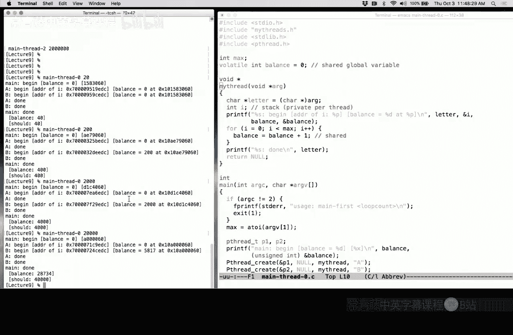
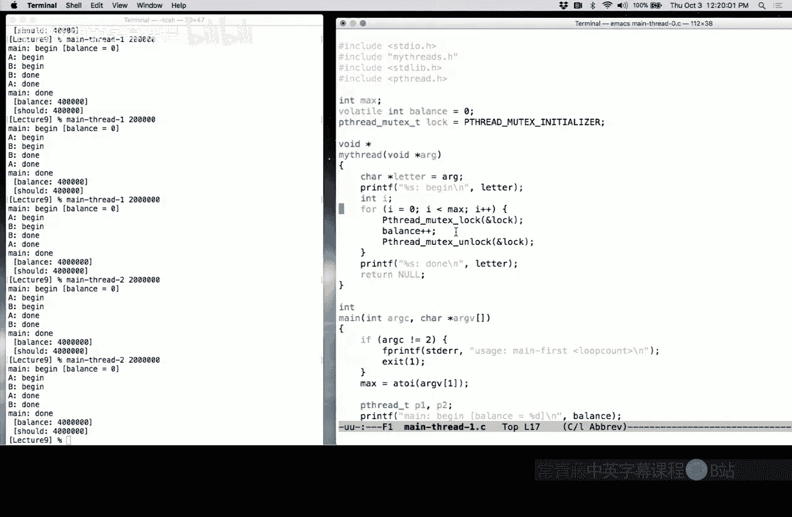

# 010：并发编程入门

在本节课中，我们将完成对虚拟内存的讨论，并开始学习一个全新的重要主题：并发编程。我们将了解为什么需要并发，线程是什么，以及编写多线程程序时可能遇到的典型问题。

## 虚拟内存回顾

上一节我们介绍了交换技术。交换或换页到磁盘的基本思想是，我们需要支持总地址空间大于机器物理内存量的情况。操作系统为应用程序提供一种假象，让它们认为自己独占整个机器，拥有所有可用内存。虽然由于共享，它们的性能可能略有下降，但其正确性和行为应与作为机器上唯一进程运行时相同。

本质上，我们将使用磁盘或其他持久存储，将进程地址空间的部分内容换出到磁盘。如果我们策略得当，能够确定哪些页面应该换入换出，最终可以获得与拥有更大内存、整个地址空间始终驻留物理内存时相同的性能。

### 地址转换流程回顾

当需要将虚拟地址转换为物理地址时，具体会发生什么？以下是步骤：
1.  首先在TLB中查找，看虚拟页号是否匹配。如果匹配，即TLB命中，则转换完成。你将知道物理页号，无需进一步查找，只需将虚拟页的偏移量附加到物理页上即可。这是快速且常见的情况。
2.  如果虚拟页号不在TLB中，即TLB未命中，则可能由硬件或操作系统负责遍历页表，以确定该虚拟页在物理内存中的位置。当然，该页可能实际上并不在物理内存中，这取决于页表中对应页面的“存在位”是否被设置。
3.  如果页面存在，处理相对简单。
4.  如果页面不存在，即“存在位”未设置，则会发生**缺页中断**。处理缺页中断非常耗时，需要毫秒级时间，因为我们必须从磁盘获取该页。

我们为每个页表项引入了一些新的标志位：
*   **使用位**：显示特定页面最近是否被使用，例如在时钟算法或LRU算法中，会查看使用位以选择保留在内存中或换出到磁盘的最佳页面。
*   **脏位**：显示自页面从磁盘加载后是否被修改过。如果两个副本不匹配，当需要从内存中逐出该页时，我们必须将其内容写回磁盘以保持同步。

记住，发生缺页中断时，处理需要很长时间。在此期间，导致中断的进程将被阻塞，不会被调度，因为它没有有用的工作可做。我们会调度另一个已就绪、有工作可做的进程，同时I/O系统处理缺页中断并从磁盘读取数据。最后，当页面从磁盘读回后，我们将更新页表以显示其所在的物理页，并设置存在位，以便未来访问时知道该页已在内存中。最后一步是标记该进程已就绪，然后调度器可能会选择该进程作为下一个运行的进程，但也可能继续运行其他进程，这取决于调度策略。

### 性能考量与颠簸

上次讲座结束时留下的问题是：思考一个工作负载的性能，其中进程在I/O和CPU之间交替运行，并且可能具有相当大的内存占用或工作集，需要访问大量内存才能完成有用的工作。

随着运行进程数量的增加，吞吐量（例如每秒完成的工作量或CPU利用率）会如何变化？以CPU利用率为指标，当进程数为零时，利用率为零。添加一个进程时，利用率取决于其计算时间与I/O时间的比例。随着添加更多进程，利用率会上升，直到达到某个最大值。然而，在某个临界点之后，性能会急剧下降。这是因为此时，所有运行进程所需的工作集总和超过了机器的物理内存量。于是，系统开始将所有时间花在“颠簸”上，即不断处理缺页中断。这些缺页中断并非有用工作，不会增加机器的CPU利用率。因此，性能会急剧下降。如果你看到系统性能像这样断崖式下跌，通常是因为内存不足，导致所有时间都花在处理缺页中断上。

### 软件模拟脏位

这是一个思考题：如果机器架构没有在页面被写入时自动设置脏位，能否在软件中模拟？假设我们有一台硬件填充TLB的机器，发生TLB未命中时，硬件理解页表格式并完成所有遍历，操作系统不参与地址转换。但操作系统需要跟踪某个页面刚被写入。

一个巧妙的方法是：操作系统何时能从硬件获得控制权？是在进程没有权限写入或访问特定页面时。因此，如果操作系统想模拟脏位，它可以修改硬件正在遍历的页表，使其看起来像是进程没有该页的写入权限。这样，硬件会产生段错误，操作系统得以处理。操作系统维护一个秘密的数据结构，记录该进程实际上确实有写入权限，它只是在尝试模拟脏位。然后操作系统获得控制权，可以设置其内部的脏位，进行所需的记账操作，并恢复进程执行。它会修改页表，显示进程现在确实拥有该页的写入权限，这样未来的访问就不会再次触发陷阱。这只在需要首次设置脏位时发生，因此对性能影响不大。

## 虚拟内存总结

至此，我们完成了对虚拟内存的讨论。我们探讨了如何让每个进程产生独占所有物理内存的假象。我们讨论了如何在地址空间中放置代码段、堆段和栈段。我们研究了几种不同的地址转换方法，重点在于那些允许动态重定位的方法：从简单的基址寄存器，到基址-界限寄存器，再到分段，最后是分页以及分页与分段的结合。分页在现代系统中能工作的关键在于TLB，它使得大多数转换可以非常快速地完成。另一个复杂但有趣的部分是如何让页表本身也适合放在页面中，这就是我们使用多级页表的原因。

上一讲主要解决了当虚拟内存地址空间总和超过物理内存时如何处理的问题。虚拟内存是理解操作系统如何工作的基础。

## 并发编程导论

接下来，我们进入一个全新的主题：并发。

### 为什么需要并发？

这张图显示了自1978年某台机器以来，处理器速度性能的相对增长。在80年代和90年代，性能呈指数级增长。然而，由于晶体管的缩放特性达到物理极限，性能增长开始急剧放缓。现在，每年的增长非常小。因此，如果我们无法让单个CPU变得更快，要获得更高的性能，就必须开始使用更多的CPU并行处理任务。这就是并发的动机。即使在单台机器内，我们也会有多个核心。

### 如何利用多核？

一种方法就像教学实验室那样，让许多不同的用户使用机器，运行许多不同的进程或应用程序。它们之间并不协作，但当你有更多CPU时，可以投入更多作业。但这不会加速单个应用程序。因此，我们真正需要关注的是如何编写能够自行利用多个CPU的高性能、复杂的应用程序。

**选项一：多进程**
我们已经了解如何使用进程。你可以将应用程序拆分为多个进程，让它们协作完成工作。例如，Web浏览器通常为每个标签页使用不同的进程，这样可以隔离不同的请求，互不干扰，并带来一些安全优势。但是，如果这些进程需要相互通信，就必须使用相对缓慢的方式，如共享消息或管道。此外，跨进程的上下文切换开销很大，因为需要完全切换地址空间，这意味着刷新TLB并承受缓存性能损失。

**选项二：多线程（我们将重点学习）**
这里的想法是，我们有一个单一的进程，其中包含多个可以并发执行的线程。这些线程可以在同一个CPU上运行，或者调度器可以将每个线程调度到不同的核心上运行，从而实现我们期望的并行性。线程就像进程一样，是一串运行的指令流，但同一进程内的所有线程共享相同的地址空间。因此，在切换线程时无需刷新TLB，它们都可以访问相同的代码、堆以及通过`malloc`动态分配的数据或全局变量。这使得访问相同的内存变得非常容易。

我们将学习如何将想要加速的任务拆分到协作的线程中。关键点在于这些是协作线程。在多进程方法中，我们不能假设不同进程是协作的，必须确保它们之间的隔离。而在这里，我们明确假设同一进程内的线程是协作的，这会使某些事情更容易实现。

### 多线程应用模式

编写多线程应用程序时，会看到几种常见的风格模式：

*   **生产者-消费者模式**：一些线程生产工作（例如，对数据进行初步处理或总结），并将其放入共享队列。下一阶段的工作线程（消费者）从队列中取出工作并进行进一步处理。我们将在本课程中详细讨论如何实现生产者与消费者之间的同步。
*   **流水线模式**：程序中有多个工作阶段，每个阶段都类似。例如，在使用Unix管道时，一个命令的输出作为下一个命令的输入，理论上，只要有待处理的工作，所有这些组件都可以并行运行。每个组件可以看作一个线程，等待工作、执行任务并为流水线中的下一个任务产生更多工作。
*   **前台/后台工作模式**：有些关键工作需要立即完成，而有些后台工作不那么紧急，可以推迟到CPU空闲时或积累了一批工作后一次性完成。例如，在虚拟内存的交换机制中，将寻找空闲页（牺牲页）的工作放到后台线程进行，可以提前准备好空闲页，当缺页中断发生时就不必立即执行这项耗时的工作。

### 线程共享与独享的状态

我们需要明确同一进程内的线程共享哪些状态，不共享哪些状态。

**共享状态**：
*   **页目录**：因为它们共享相同的地址空间，所以必须有相同的地址转换映射。
*   **地址空间**：代码、堆、全局变量。
*   **进程ID**、打开的文件描述符、环境变量（如当前工作目录）、用户/组权限、进程限制等。

**独享状态（每个线程私有）**：
*   **线程ID**。
*   **寄存器组**：包括程序计数器、栈指针以及其他通用寄存器。上下文切换时需要保存和恢复这些寄存器，但无需切换与地址空间相关的寄存器（如页目录基址寄存器）。
*   **栈**：每个线程有自己的调用栈，用于存储局部变量和函数调用帧。虽然从地址空间角度看栈在同一个空间内，但协作线程应遵守约定，不互相干扰对方的栈。

### 线程库与基本操作


有许多用于创建和管理线程的库，本课程将假设使用POSIX线程。最基本的必要操作包括：
*   **创建线程** (`pthread_create`)。
*   **线程退出** (`pthread_exit`)：线程可以自行终止而不导致整个进程退出。只有当所有线程都退出后，进程才会退出。
*   **等待线程** (`pthread_join`)：一个线程可以等待另一个线程结束。这类似于进程中的`wait`函数。

### 用户级线程与内核级线程

线程的概念由来已久，但最初操作系统并不直接支持。在没有OS支持的时代，可以在用户级完全实现一个线程库。即，一个进程只有一个内核线程，用户级库负责将用户认为的多个线程映射到这唯一的内核线程上，并在用户级完成所有上下文切换代码。

**用户级线程的优点**：
1.  无需操作系统支持。
2.  可以实现更专门的调度策略，可能获得更好的性能（例如，减少缓存失效）。
3.  上下文切换和同步无需陷入内核，速度更快。

**用户级线程的缺点**：
1.  无法利用多处理器（多核）。
2.  操作系统不知道用户级线程的存在。如果一个用户级线程阻塞（例如，在I/O或页错误上），操作系统会阻塞整个进程，即使其他用户级线程有工作可做。




现代系统通常提供**内核级线程**支持，由内核进行线程的上下文切换和调度。其优缺点与用户级线程相反：可以利用多处理器，当一个线程阻塞时操作系统可以调度其他线程，但同步和上下文切换需要陷入内核，开销稍大。

### 一个简单的多线程程序示例

让我们看一个简单的多线程C程序示例（`main-thread-version0.c`）。该程序创建两个工作线程，每个线程都循环递增一个全局共享变量`balance`。

```c
#include <stdio.h>
#include <stdlib.h>
#include <pthread.h>

volatile int balance = 0; // 全局共享变量

void* my_thread(void* arg) {
    char* letter = (char*) arg;
    int i;
    for (i = 0; i < 1000000; i++) {
        balance++; // 关键操作：递增共享变量
    }
    return NULL;
}

int main(int argc, char* argv[]) {
    pthread_t t1, t2;
    pthread_create(&t1, NULL, my_thread, "A");
    pthread_create(&t2, NULL, my_thread, "B");
    pthread_join(t1, NULL);
    pthread_join(t2, NULL);
    printf("balance = %d\n", balance);
    return 0;
}
```

`volatile`关键字告诉编译器，该变量可能被多个线程修改，不能将其长时间保存在寄存器中，必须每次都从内存读取/写入。

如果程序正确，两个线程各递增100万次，最终`balance`应为200万。然而，运行程序后，我们可能得到诸如1,287,234之类的错误结果。这是因为`balance++`这个C语句在汇编层面并非原子操作，它通常对应三条指令：
1.  将`balance`的值从内存加载到寄存器（如`EAX`）。
2.  将寄存器中的值加1。
3.  将结果存回`balance`所在的内存地址。

如果在这三条指令执行期间发生线程切换（上下文切换），另一个线程可能读取到旧的`balance`值，从而导致更新丢失。这种因执行顺序不确定而导致结果错误的情况称为**竞态条件**。

### 竞态条件与临界区

我们通过分析不同指令交错执行的时序，可以看到有时能得到正确结果，有时则不能。问题的关键在于`balance++`对应的三条指令需要作为一个不可分割的单元连续执行。我们称这样的代码段为**临界区**。更一般地说，我们需要为临界区提供**互斥**访问。这意味着在执行临界区代码时，不能切换到另一个也要操作同一共享变量（如`balance`）的线程，但切换到执行无关代码的线程是可以的。

### 解决方案：锁

为了解决竞态条件，我们需要一种机制来保护临界区，确保互斥访问。最基本的同步原语就是**锁**。

在POSIX线程中，锁的基本用法如下：
```c
pthread_mutex_t lock; // 声明一个锁
pthread_mutex_init(&lock, NULL); // 初始化锁

pthread_mutex_lock(&lock);   // 获取锁（进入临界区前）
// ... 临界区代码 ...
pthread_mutex_unlock(&lock); // 释放锁（离开临界区后）
```

我们将锁应用于之前的程序（`main-thread-version1.c`）：
```c
pthread_mutex_t lock = PTHREAD_MUTEX_INITIALIZER;
volatile int balance = 0;

void* my_thread(void* arg) {
    char* letter = (char*) arg;
    int i;
    for (i = 0; i < 2000000; i++) {
        pthread_mutex_lock(&lock);
        balance++;
        pthread_mutex_unlock(&lock);
    }
    return NULL;
}
```
现在，当一个线程持有锁并执行`balance++`时，如果发生上下文切换，另一个线程尝试获取锁会被阻塞，直到第一个线程释放锁。这保证了临界区代码的原子性，程序总能得到正确结果（4,000,000）。

**性能考虑**：将锁放在循环内部（细粒度锁）保证了并发性，但锁操作开销很大。另一种方法是将锁放在循环外部（粗粒度锁），这样整个循环成为临界区，虽然失去了并发性，但大大减少了锁操作次数，可能整体更快。在实际编程中，我们需要在正确性和性能之间权衡，尽量减小临界区范围以提高并发度，同时避免过多的锁开销。

## 总结

本节课中，我们一起学习了以下内容：
1.  回顾了虚拟内存的核心机制，包括地址转换、TLB、缺页中断和页面置换策略，并讨论了内存不足导致的性能颠簸问题。
2.  开启了并发编程的新篇章，理解了在多核时代利用并发提高性能的必要性。
3.  学习了线程的概念，比较了多进程与多线程模型的优劣，明确了线程间共享与私有的状态。
4.  通过一个简单的计数器程序，直观地认识了多线程编程中的**竞态条件**问题，其根源在于对共享数据的非原子操作。
5.  引入了**临界区**和**互斥**的概念，并介绍了使用**锁**这一基本同步原语来保护临界区、确保程序正确性的方法。




在接下来的课程中，我们将深入探讨如何实现锁以及其他更高级的同步机制（如条件变量、信号量），并学习如何正确、高效地构建并发程序。