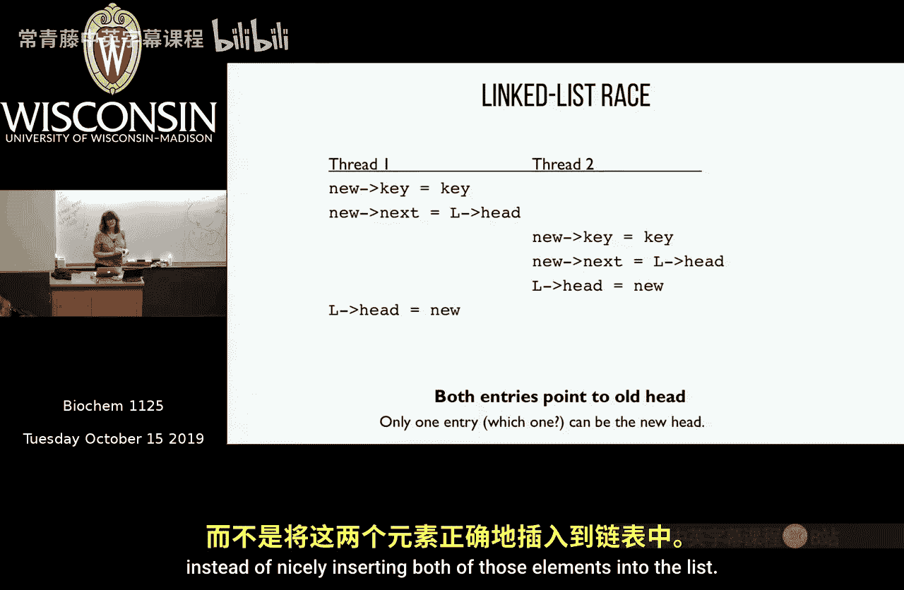
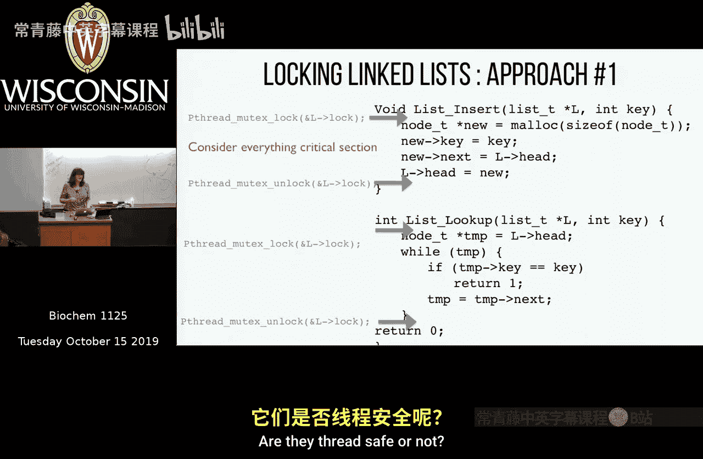
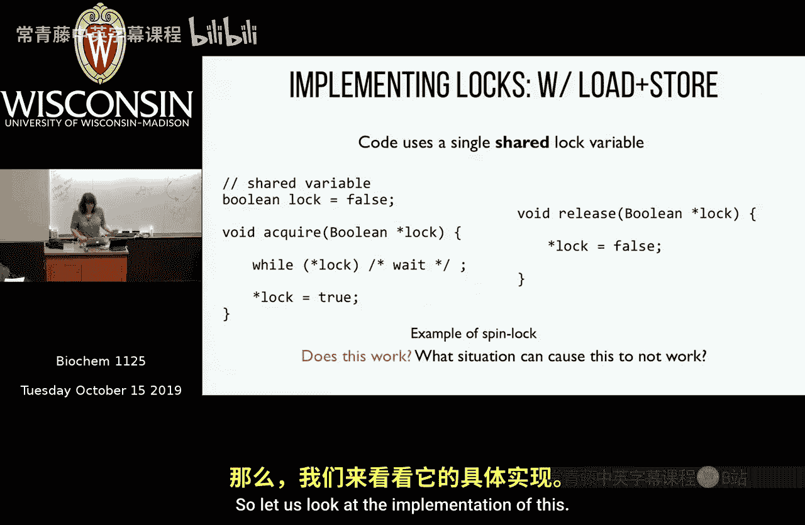
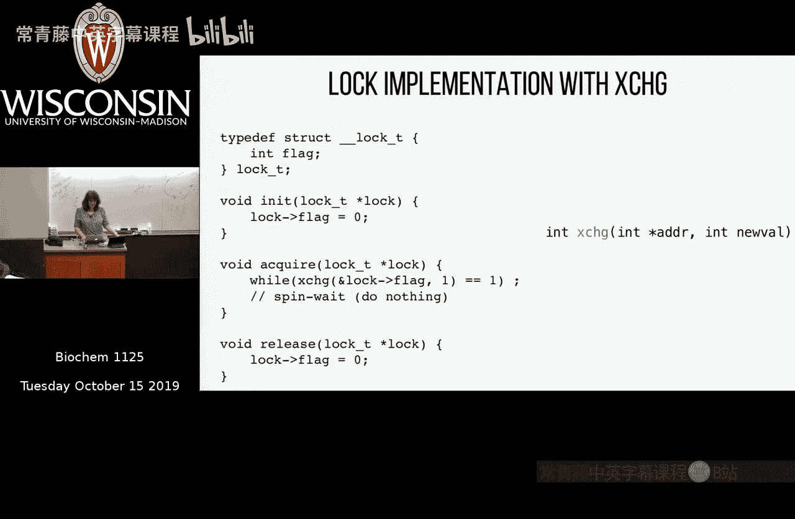
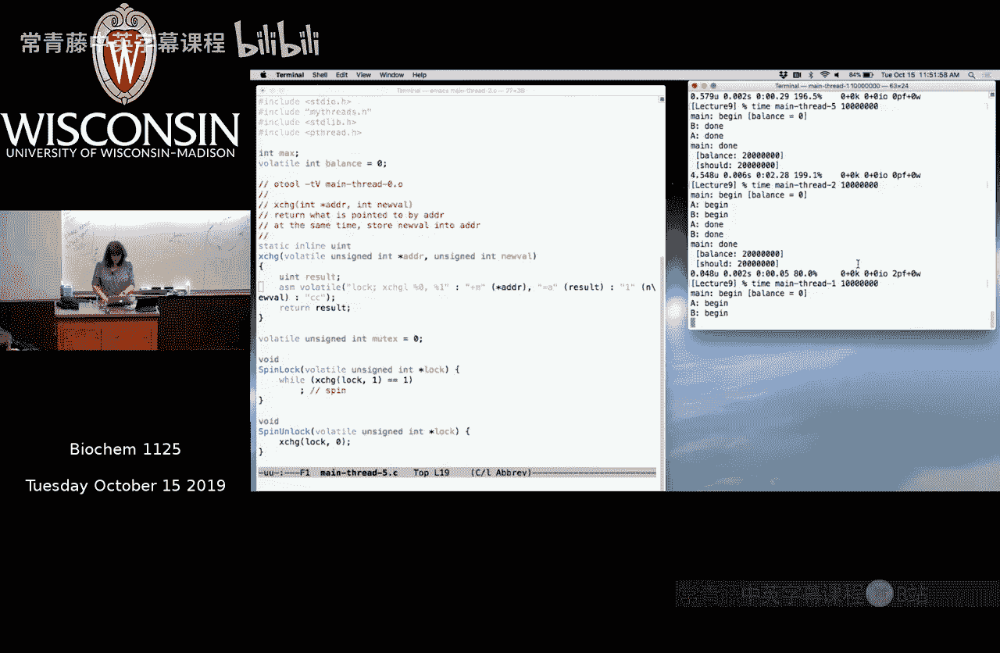
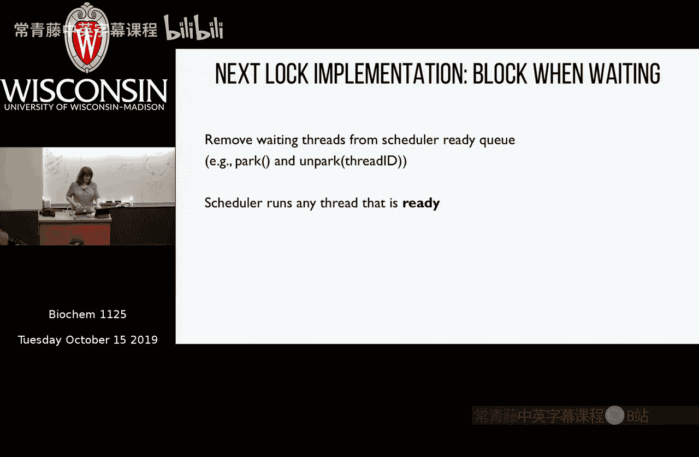

# 011：并发与锁 🔒

在本节课中，我们将继续学习并发编程的核心概念，特别是如何通过锁（Locks）来实现线程间的互斥访问，从而避免数据竞争和不一致的结果。我们将从为什么需要锁开始，探讨几种实现锁的方法，并分析它们的优缺点。

---

## 为什么需要锁？ 🤔

上一讲我们介绍了并发的基本概念，看到了当多个线程同时访问和修改共享变量（如一个全局的`balance`）时，由于指令交错执行，可能导致非确定性的错误结果。这是因为像`balance++`这样的操作在底层对应多条汇编指令（加载、计算、存储），而这些指令的执行可能被操作系统的调度器在任意时刻打断。

**核心问题**：我们需要确保一段代码（称为**临界区**）能够**原子地**执行，即在其执行过程中不被其他线程中断。这被称为**互斥**。

---

## 锁的基本接口 🔑

锁（或互斥锁，Mutex）是操作系统或线程库提供的一种同步原语，用于实现互斥。其基本操作非常简单：

*   **`lock()` 或 `acquire()`**：尝试获取锁。如果锁已被其他线程持有，则调用线程会等待（阻塞或自旋），直到锁被释放。
*   **`unlock()` 或 `release()`**：释放锁，允许其他等待的线程获取它。

以下是一个使用Pthreads锁保护共享变量的示例代码框架：

```c
pthread_mutex_t lock = PTHREAD_MUTEX_INITIALIZER; // 初始化锁
int balance = 0; // 共享变量

void* thread_function(void* arg) {
    for (int i = 0; i < 10000; i++) {
        pthread_mutex_lock(&lock);   // 进入临界区前加锁
        balance++;                   // 临界区代码
        pthread_mutex_unlock(&lock); // 离开临界区后解锁
    }
    return NULL;
}
```

通过使用锁，我们保证了`balance++`这个操作是原子的，从而得到正确的结果。

---

## 一个更复杂的例子：并发链表操作 📝

为了更深入地理解锁的必要性，我们来看一个并发操作链表的例子。假设我们有一个简单的链表，支持插入和查找操作。

```c
typedef struct __node_t {
    int key;
    struct __node_t *next;
} node_t;

typedef struct __list_t {
    node_t *head;
    pthread_mutex_t lock; // 为每个链表关联一个锁
} list_t;

void List_Init(list_t *L) {
    L->head = NULL;
    pthread_mutex_init(&L->lock, NULL);
}


void List_Insert(list_t *L, int key) {
    node_t *new = malloc(sizeof(node_t));
    if (new == NULL) {
        perror("malloc");
        return;
    }
    new->key = key;

    // 只有修改链表结构（next指针和head）时需要互斥
    pthread_mutex_lock(&L->lock);
    new->next = L->head;
    L->head = new;
    pthread_mutex_unlock(&L->lock);
}

int List_Lookup(list_t *L, int key) {
    pthread_mutex_lock(&L->lock);
    node_t *curr = L->head;
    while (curr) {
        if (curr->key == key) {
            pthread_mutex_unlock(&L->lock);
            return 1; // 找到
        }
        curr = curr->next;
    }
    pthread_mutex_unlock(&L->lock);
    return 0; // 未找到
}
```

**关键点**：
1.  **锁的粒度**：我们为每个链表分配一个锁，而不是使用全局锁。这样，对不同链表的操作可以并发进行。
2.  **临界区最小化**：在`List_Insert`中，只有真正修改链表结构的几步（设置`new->next`和`L->head`）需要放在锁内。内存分配（`malloc`）和设置节点`key`可以放在锁外，因为`malloc`本身是线程安全的，且`key`在插入前是私有数据。
3.  **查找操作**：在这个简化模型中（仅插入和查找，无删除），查找操作理论上可以不加锁，因为它总是看到一个“某一时刻”的正确链表快照。然而，在实际包含删除操作的复杂数据结构中，查找通常也需要加锁以保证安全。这里为了安全起见，我们给查找也加上了锁。



---


## 如何实现锁？ ⚙️

理解了锁的用途后，我们来看看如何从零开始实现一个锁。一个正确的锁实现需要满足几个目标：
1.  **互斥**：基本要求。
2.  **进展（无死锁）**：如果一个锁被释放，那么至少有一个等待的线程能获得它。
3.  **有限等待**：等待锁的线程最终都能获得它，避免“饿死”。
4.  **性能**：加锁、解锁操作本身开销要小，尤其是在无竞争的情况下。




我们将探讨三种实现思路。

### 方法一：关闭中断（仅限单处理器）❌

**思路**：在进入临界区前关闭中断，离开时再打开。这样，时钟中断不会发生，操作系统就不会进行线程切换。

**问题**：
*   **多处理器无效**：其他CPU上的线程不受影响。
*   **恶意线程**：一个线程获得锁后关闭中断，可能永远不释放CPU。
*   **影响系统**：线程无法进行I/O或处理页错误等需要内核介入的操作。
*   **权限问题**：用户态程序通常无权关闭中断。

**结论**：这不是一个通用、可行的方案。

### 方法二：仅用Loads/Stores实现（软件方法）🤯

**思路**：尝试只用普通的加载和存储指令来实现一个“测试并设置”的逻辑。例如，用一个布尔变量`flag`表示锁是否被持有。

```c
typedef struct __lock_t {
    int flag;
} lock_t;

void init(lock_t *lock) {
    lock->flag = 0; // 0表示锁空闲
}

void acquire(lock_t *lock) {
    while (lock->flag == 1) // 测试：锁被持有吗？
        ; // 自旋等待
    lock->flag = 1; // 设置：现在锁被我持有了
}

void release(lock_t *lock) {
    lock->flag = 0;
}
```

**问题**：`acquire`中的“测试”和“设置”是**两个独立的操作**，不是原子的。考虑以下交错执行：
1.  线程A测试`flag`为0（锁空闲）。
2.  操作系统切换至线程B。
3.  线程B也测试`flag`为0。
4.  线程B设置`flag=1`，进入临界区。
5.  切换回线程A，线程A（基于旧的判断）也设置`flag=1`，进入临界区。
6.  **互斥被破坏！**

**结论**：仅用非原子指令无法正确实现锁。存在一些复杂的软件算法（如Peterson算法、Dekker算法），它们通过巧妙的变量组合可以在两个线程间实现互斥，但这些算法在现代多处理器架构上可能因内存序问题而失效，且难以扩展到多个线程，因此不实用。

### 方法三：利用硬件原子指令 ✅

现代处理器提供了特殊的**原子硬件指令**，它们能不可分割地完成“读-改-写”操作。这是构建所有现代同步原语的基础。




#### 1. 测试并设置 (Test-and-Set) / 原子交换 (Atomic Exchange)

这条指令原子地完成以下操作：返回指定内存地址的旧值，同时将该地址设置为新值。

**伪代码描述**：
```c
int TestAndSet(int *old_ptr, int new) {
    int old = *old_ptr; // 获取旧值
    *old_ptr = new;     // 写入新值
    return old;         // 返回旧值
}
// 注意：以上三步是原子执行的，不可中断。
```

**用Test-and-Set实现自旋锁**：
```c
typedef struct __lock_t {
    int flag;
} lock_t;

void init(lock_t *lock) {
    lock->flag = 0;
}

void acquire(lock_t *lock) {
    while (TestAndSet(&lock->flag, 1) == 1) // 原子地“测试并设置”
        ; // 自旋等待
    // 当TestAndSet返回0时，表示我们成功获得了锁
}

void release(lock_t *lock) {
    lock->flag = 0;
}
```
**工作原理**：
*   初始时`flag=0`。
*   第一个线程调用`acquire`：`TestAndSet(&flag, 1)`原子地返回0（旧值），并将`flag`设为1。循环条件不成立，线程获得锁。
*   第二个线程调用`acquire`：此时`flag`已是1，`TestAndSet`原子地返回1，并将`flag`保持为1。因此线程在`while`循环中自旋。
*   第一个线程调用`release`：将`flag`设为0。
*   第二个线程的`TestAndSet`现在可能返回0，从而退出循环，获得锁。

#### 2. 比较并交换 (Compare-and-Swap, CAS)

另一条常用的原子指令。它原子地完成：如果指定内存地址的值等于期望值，则将其设置为新值。无论是否交换，都返回该内存地址的旧值。

**伪代码描述**：
```c
int CompareAndSwap(int *ptr, int expected, int new) {
    int actual = *ptr;
    if (actual == expected)
        *ptr = new;
    return actual;
}
```

**用CAS实现自旋锁**：
```c
void acquire(lock_t *lock) {
    while (CompareAndSwap(&lock->flag, 0, 1) == 1)
        ; // 自旋等待
}
```
其逻辑与Test-and-Set类似。



#### 3. 获取并增加 (Fetch-and-Add)


这条指令原子地返回一个变量的旧值，并增加该变量。




**伪代码描述**：
```c
int FetchAndAdd(int *ptr) {
    int old = *ptr;
    *ptr = old + 1;
    return old;
}
```

**用Fetch-and-Add实现票号锁 (Ticket Lock)**：
票号锁解决了简单自旋锁的公平性问题，它像银行或熟食店一样，给每个请求锁的线程发一个号，按号服务。

```c
typedef struct __lock_t {
    int ticket; // 当前发放的票号
    int turn;   // 当前允许进入的票号
} lock_t;

void init(lock_t *lock) {
    lock->ticket = 0;
    lock->turn = 0;
}

void acquire(lock_t *lock) {
    int myturn = FetchAndAdd(&lock->ticket); // 原子地取号
    while (lock->turn != myturn) // 等待叫号
        ; // 自旋
}

void release(lock_t *lock) {
    lock->turn = lock->turn + 1; // 叫下一个号
}
```
**优点**：保证了**先到先得**的公平性，避免了线程饿死。

---

## 自旋锁的性能与优化 🚀

我们目前实现的锁都是**自旋锁**：当一个线程无法获得锁时，它会在一个循环中不断检查锁的状态（忙等待）。

**自旋锁的优缺点**：
*   **优点**：在锁被持有时间非常短，或线程在专属CPU上等待时（多处理器系统），自旋等待避免了上下文切换的开销，可能效率更高。
*   **缺点**：
    1.  **单处理器上浪费CPU**：如果锁被另一个线程持有，而该线程正处于不运行状态（例如，被调度出去了），那么自旋的线程将浪费整个时间片，因为锁持有者根本无法运行来释放锁。
    2.  **不公平**：简单的自旋锁（非票号锁）不能保证等待时间长的线程先获得锁。
    3.  **缓存一致性流量**：多个核心频繁地读取同一个锁变量，会产生大量的缓存一致性通信，影响性能。

**初步优化：主动让出CPU**
在自旋等待中，如果发现锁被持有，线程可以主动调用`yield()`系统调用，自愿放弃CPU，让调度器去运行其他线程（很可能就是锁的持有者）。

```c
void acquire(lock_t *lock) {
    while (TestAndSet(&lock->flag, 1) == 1) {
        yield(); // 放弃CPU
    }
}
```
这比纯自旋要好得多，特别是在单处理器或高竞争场景下。它减少了无用的CPU时间浪费，从浪费`O(线程数 * 时间片)`降低到大约`O(上下文切换开销)`。

然而，`yield()`并不是终极方案。线程被再次调度时，可能锁仍然未被释放，它又会调用`yield()`，导致多次不必要的上下文切换。更理想的机制是：**让操作系统知道我们在等待什么**，当锁可用时再唤醒我们。这就需要锁的实现与调度器进行更深入的协作，涉及到**队列**和**让线程休眠**的机制，这将是下一讲关于**条件变量**和**信号量**的主要内容。

---

## 总结 📚

本节课我们一起深入探讨了并发编程中的核心同步机制——锁。

1.  **为什么需要锁**：为了防止多个线程同时进入临界区导致的数据竞争和不一致，我们需要互斥。
2.  **锁的接口**：通过`acquire()`和`release()`来保护临界区。
3.  **锁的实现挑战**：关键在于实现“测试并设置”的原子性。
4.  **错误的实现**：关闭中断（不通用）和纯软件Loads/Stores（无法保证原子性）都不可行。
5.  **正确的实现基础**：必须依赖硬件提供的**原子指令**，如**Test-and-Set**、**Compare-and-Swap**、**Fetch-and-Add**。
6.  **自旋锁**：基于原子指令实现，在等待时忙等待。我们实现了简单自旋锁和更公平的**票号锁**。
7.  **性能考量**：自旋锁在锁持有时间短、多处理器环境下可能高效，但在单处理器或高竞争下会浪费CPU。通过调用`yield()`可以初步优化。




在下一讲中，我们将学习如何实现让线程在无法获得锁时**主动阻塞**，从而彻底避免CPU浪费的锁机制，并引入更强大的同步原语：**条件变量**和**信号量**。