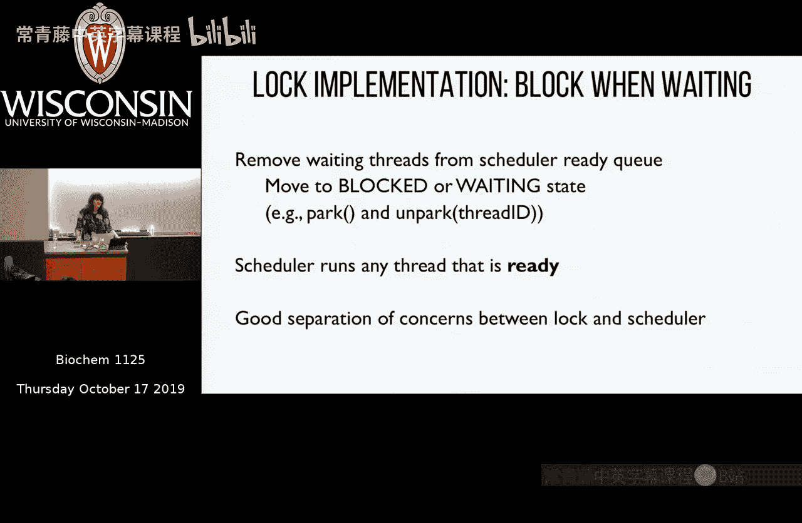
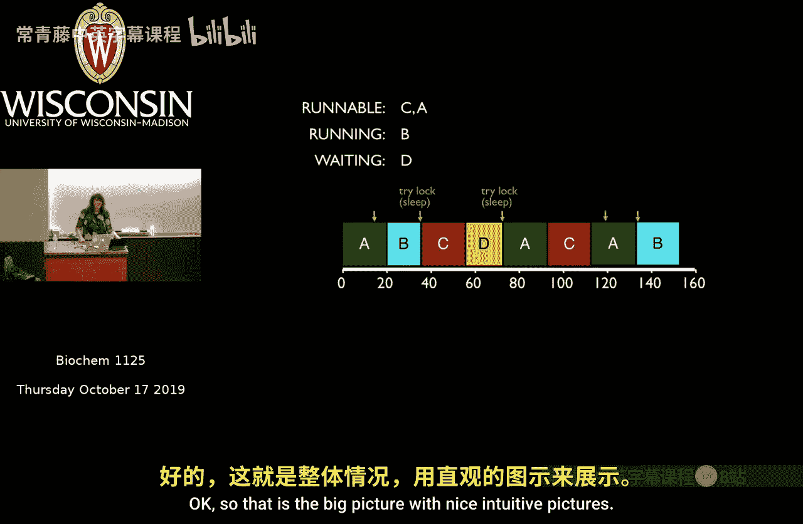
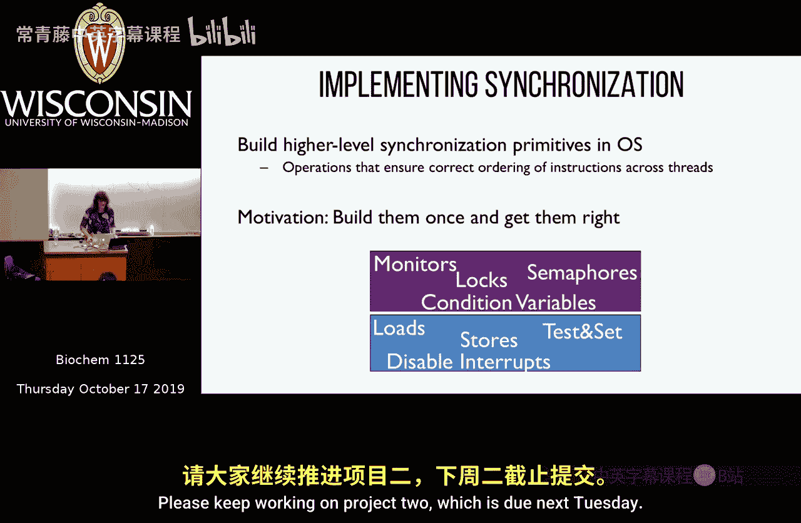

# 012：并发、队列锁与条件变量

在本节课中，我们将学习并发编程中的两个核心概念：**队列锁**和**条件变量**。我们将探讨如何更高效地实现锁，避免CPU空转，并学习如何使用条件变量来控制线程间的执行顺序。

---

## 锁的回顾与问题

上一节我们讨论了如何实现锁来为协作线程提供互斥访问。但我们之前的方法效率不高，因为线程在等待锁时会进行**忙等待**，这会浪费CPU时间片。

一个正确的锁实现需要满足三个要求：
1.  **互斥**：一次只能有一个线程获取锁。
2.  **进展**：系统必须是无死锁的。如果有线程想获取锁，系统必须允许至少一个线程成功获取。
3.  **无饥饿**：理想情况下，任何线程都不应无限期等待锁。

我们之前看过的**票据锁**是一种公平的实现，它通过`ticket`和`turn`两个变量，严格按照线程请求的顺序分配锁。其核心代码如下：

```c
// 票据锁结构
typedef struct __lock_t {
    int ticket;
    int turn;
} lock_t;

void lock(lock_t *lock) {
    int myturn = FetchAndAdd(&lock->ticket); // 原子操作，获取票据号
    while (lock->turn != myturn) // 等待叫号
        yield(); // 让出CPU，比忙等待好
}



void unlock(lock_t *lock) {
    lock->turn = lock->turn + 1; // 叫下一个号
}
```

虽然票据锁通过`yield()`优化了忙等待，但线程在等待时仍然处于**可运行**状态，调度器仍可能选择它，导致不必要的上下文切换开销。



---

## 队列锁：通过阻塞实现高效等待

本节中，我们来看看一种更高效的锁实现方式：**队列锁**。其核心思想是，当线程无法获取锁时，不是忙等待，而是将自己**阻塞**并放入一个与该锁关联的队列中。这样，调度器就只运行那些真正可以执行的线程。

以下是队列锁的基本逻辑（初始版本，尚不完整）：

```c
typedef struct __lock_t {
    int flag; // 锁是否被持有
    queue_t q; // 等待该锁的线程队列
} lock_t;

void lock(lock_t *m) {
    if (m->flag == 1) { // 锁被持有
        add self to m->q; // 将自己加入队列
        park(); // 阻塞自己，让出CPU
    } else {
        m->flag = 1; // 获取锁
    }
}

void unlock(lock_t *m) {
    if (!empty(m->q)) { // 队列中有等待线程
        remove thread from m->q;
        unpark(thread); // 唤醒该线程，使其变为可运行
    } else {
        m->flag = 0; // 没有等待者，释放锁
    }
}
```

**直觉理解**：线程在`lock`中如果发现锁被持有，就排队并阻塞自己。当持有锁的线程在`unlock`中释放锁时，它会检查队列。如果队列不为空，则唤醒队首的线程，该线程将直接获得锁的所有权。

---

### 队列锁的正确性挑战与修复

上述简单实现存在**竞态条件**。主要问题在于，测试锁状态（`flag`）和后续操作（加入队列/阻塞）必须是原子的。否则，一个线程可能在加入队列后、阻塞前被切换出去，而另一个线程可能在此期间释放锁并尝试唤醒它，导致信号丢失。

为了解决这个问题，我们引入一个**保护锁内部操作的自旋锁** `guard`：

```c
typedef struct __lock_t {
    int flag;
    queue_t q;
    int guard; // 保护flag和队列操作的自旋锁
} lock_t;

void lock(lock_t *m) {
    while (TestAndSet(&m->guard, 1) == 1) // 获取guard锁（自旋）
        ; // 空循环，但临界区极短，可以接受
    if (m->flag == 1) {
        add self to m->q;
        m->guard = 0; // 必须先释放guard，才能阻塞
        park(); // 可能在此处永久阻塞（竞态条件！）
    } else {
        m->flag = 1;
        m->guard = 0;
    }
}

void unlock(lock_t *m) {
    while (TestAndSet(&m->guard, 1) == 1)
        ;
    if (!empty(m->q)) {
        remove thread from m->q;
        unpark(thread);
        // 注意：这里没有设置 m->flag = 0！
        // 锁被直接“传递”给了被唤醒的线程。
    } else {
        m->flag = 0; // 没有等待者，才释放锁
    }
    m->guard = 0;
}
```

**关键点解析**：
1.  **为什么可以自旋等待`guard`？** 因为`guard`保护的临界区非常短（只有几行代码），线程持有它的时间极短，因此自旋的代价很小。
2.  **为什么在`unlock`的`else`分支才设置`flag=0`？** 如果队列中有等待线程，锁的所有权被直接“传递”给下一个线程。如果此时将`flag`设为0，另一个新来的线程可能趁机获取锁，导致两个线程同时进入临界区。
3.  **仍然存在的竞态条件**：在`lock`中，线程释放`guard`后、调用`park()`前，如果恰好被切换，并且另一个线程调用了`unlock`和`unpark`，那么信号会丢失。当原线程恢复执行并调用`park()`时，将永远阻塞。
4.  **最终修复**：操作系统提供了`setpark()`系统调用。线程可以在持有`guard`时调用`setpark()`，表明“我打算去公园（阻塞）了”。如果之后在调用`park()`之前收到了`unpark()`，那么`park()`会直接返回而不阻塞。这消除了上述竞态条件。

---

## 自旋与阻塞的权衡

何时使用自旋锁，何时使用阻塞锁？这取决于**临界区的长度**和**上下文切换的成本(C)**。
*   **单处理器**：总是使用阻塞锁。因为持有锁的线程不可能在另一个CPU上运行，忙等待毫无意义。
*   **多处理器**：需要权衡。
    *   如果**锁持有时间(T) < 上下文切换成本(C)**，自旋等待更高效。
    *   如果**T > C**，则阻塞更高效。

由于我们无法预知未来，实践中常用**两阶段等待**策略：先自旋一段时间，如果还没获得锁，再阻塞。理论分析表明，这种策略在最坏情况下的性能不会超过最优策略（能预知未来）的两倍，是**2-竞争**的。

---

## 条件变量：控制线程执行顺序

除了互斥，我们还需要协调线程的执行顺序。**条件变量**就是用于此目的的同步原语。它允许一个线程等待某个条件成立，而另一个线程在条件成立时发出通知。

条件变量本身只是一个**等待队列**，没有内部状态。它总是与一个**互斥锁**配合使用。

核心操作：
*   `wait(cond, mutex)`：调用前必须持有`mutex`。该操作会**释放`mutex`**并将线程阻塞在`cond`的队列上。当被唤醒时，在返回前会**重新获取`mutex`**。
*   `signal(cond)`：唤醒一个在`cond`上等待的线程（如果有）。
*   `broadcast(cond)`：唤醒所有在`cond`上等待的线程。

---

### 条件变量使用模式：以线程连接(join)为例

以下是使用条件变量实现`thread_join`的**正确模式**：

```c
int done = 0; // 共享状态：子线程是否完成
pthread_mutex_t m = PTHREAD_MUTEX_INITIALIZER;
pthread_cond_t c = PTHREAD_COND_INITIALIZER;

void thread_exit() {
    pthread_mutex_lock(&m);
    done = 1;          // 1. 修改状态
    pthread_cond_signal(&c); // 2. 发送信号
    pthread_mutex_unlock(&m);
}

void thread_join() {
    pthread_mutex_lock(&m);
    while (done == 0) // 必须用while循环检查
        pthread_cond_wait(&c, &m); // 释放锁，阻塞，被唤醒时重新获得锁
    pthread_mutex_unlock(&m);
}
```

**使用条件变量的关键规则**：
1.  **总是与共享状态关联**：条件变量本身无状态，必须有一个共享变量（如`done`）来表示条件。
2.  **修改状态和发信号时必须持有锁**：确保检查状态、进入等待、修改状态和发送信号这些操作是原子的。
3.  **等待时必须使用`while`循环**：当线程从`wait`返回时，**条件可能不再成立**（例如，被`broadcast`唤醒，或遇到虚假唤醒）。必须重新检查条件。

---

### 生产者-消费者问题

这是条件变量的经典应用场景。我们有一个有限大小的缓冲区。生产者向缓冲区放入数据，消费者从中取出数据。

**初始错误尝试（单条件变量）**：
生产者等待条件“缓冲区非满”，消费者等待条件“缓冲区非空”。如果只用一个条件变量，唤醒的可能是错误类型的线程（例如，生产者唤醒了另一个生产者）。

**正确解决方案**：使用**两个条件变量**，分别对应不同的等待条件。

```c
int buffer[MAX];
int fill = 0, use = 0, count = 0; // 计数：缓冲区中数据项数

pthread_cond_t empty, full; // 两个条件变量
pthread_mutex_t mutex;

void put(int value) {
    buffer[fill] = value;
    fill = (fill + 1) % MAX;
    count++;
}

int get() {
    int tmp = buffer[use];
    use = (use + 1) % MAX;
    count--;
    return tmp;
}

// 生产者
void *producer(void *arg) {
    for (int i = 0; i < loops; i++) {
        pthread_mutex_lock(&mutex);
        while (count == MAX)           // 用while，不是if
            pthread_cond_wait(&empty, &mutex); // 等待“缓冲区非满”
        put(i);
        pthread_cond_signal(&full);    // 通知消费者“缓冲区非空”
        pthread_mutex_unlock(&mutex);
    }
}

// 消费者
void *consumer(void *arg) {
    for (int i = 0; i < loops; i++) {
        pthread_mutex_lock(&mutex);
        while (count == 0)             // 用while，不是if
            pthread_cond_wait(&full, &mutex); // 等待“缓冲区非空”
        int tmp = get();
        pthread_cond_signal(&empty);   // 通知生产者“缓冲区非满”
        pthread_mutex_unlock(&mutex);
        printf("%d\n", tmp);
    }
}
```

**为什么必须用`while`？**
假设消费者C1等待，生产者P放入数据后唤醒C1。但在C1重新获得锁之前，另一个消费者C2抢先获得锁并消费了数据。当C1最终获得锁并从`wait`返回时，缓冲区已经为空。如果用`if`，C1会错误地执行`get`。用`while`会让C1重新检查`count == 0`，发现条件不满足，于是继续等待。

---

## 总结

本节课中我们一起学习了：
1.  **队列锁**：通过将等待线程放入队列并阻塞，避免了忙等待的CPU浪费，实现了更高效的锁。其实现需要小心处理竞态条件，通常用一个自旋锁保护内部数据结构。
2.  **自旋与阻塞的权衡**：锁持有时间与上下文切换成本的比较决定了最佳策略。两阶段等待是一种实用的折中方案。
3.  **条件变量**：用于线程间顺序同步的核心原语。必须与互斥锁及共享状态变量结合使用，并且等待端必须使用`while`循环来重新检查条件。
4.  **生产者-消费者模式**：展示了条件变量的典型应用，强调了使用多个条件变量和`while`循环的重要性。



**管程**本质上是语言层面将互斥锁和条件变量封装在一起的机制，提供了更高级别的同步抽象。下一讲我们将学习另一个强大的同步原语：**信号量**。