# 013：并发控制之信号量 🚦

在本节课中，我们将学习并发控制的另一个核心概念：**信号量**。我们将探讨信号量的定义、基本操作，并将其与之前学过的锁和条件变量进行对比。通过一系列经典同步问题的实例，我们将掌握如何使用信号量来实现互斥、同步以及更复杂的协调逻辑。


---

## 课程公告与回顾 📢

大家好，新的一周开始了。有几个事项需要通知。


项目4的提交截止时间是今天下午5点。如果网络或计算机在夜间出现问题，官方截止时间是5点。但非正式地，只要一切正常，你可以在第二天早上7点前提交。那是我起床并关闭AFS提交目录权限的时间。当然，我们更希望你尽早完成。

项目5将在明天早上发布。它同样是关于XV6操作系统的，主题是内存系统，涉及物理内存分配以及进程页表的操作。

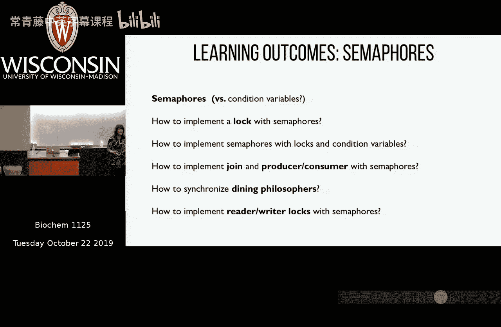

我强烈建议你为项目5找一个项目伙伴，即使你过去从未合作过。这个项目的工作量比之前的要大得多。

期中考试2将在两周后的明天举行。考试内容将主要集中在并发控制，并包含少量关于课程前半部分抽象概念的回顾。

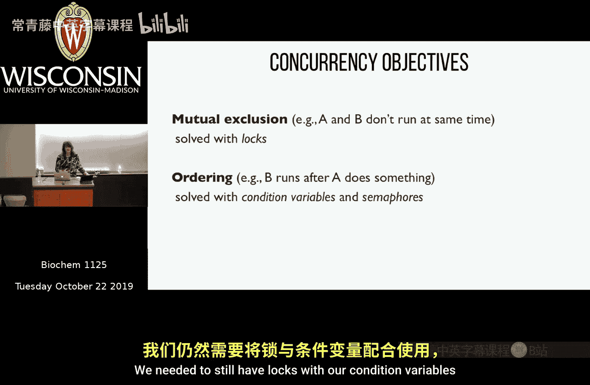

我的办公时间今天比平时稍晚一些。关于行政事务有任何问题吗？

所有考试的总分占你最终成绩的50%。加上作业的5%加分，三次考试的权重大致相等。

---

## 并发控制基础回顾 🔄

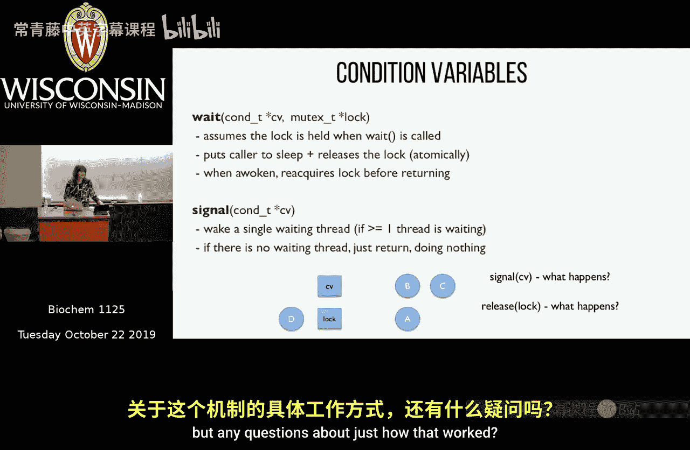

上一节我们介绍了条件变量，本节中我们来看看信号量。首先，让我们回顾一下已学的并发控制知识。

我们讨论了多线程环境。线程共享一些状态和变量，我们需要协调它们对这些共享状态的访问。

我们有两种基本的并发原语：
1.  **提供互斥的原语**：例如**锁**。它确保一次只有一个线程能获取锁并执行临界区代码。
2.  **提供顺序的原语**：例如**条件变量**。它规定一个线程必须完成某些工作后，另一个线程才能继续。这提供了线程或进程间的同步、调度或顺序控制。

条件变量本身不提供互斥。我们仍然需要将锁与条件变量结合使用，以便在保证顺序的同时也实现互斥。

---

## 条件变量操作详解 ⚙️

条件变量的操作接口很简单。初始化一个条件变量只是创建一个空队列。

线程可以在持有特定互斥锁（mutex）的情况下，对一个条件变量调用 `wait`。`wait` 的工作方式是：调用时持有锁，然后在该调用中等待，直到其他线程调用 `signal` 并且本线程重新获取到锁后才会返回。

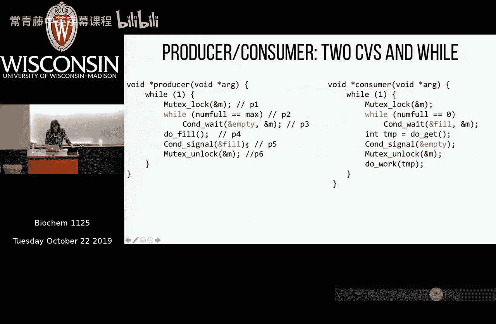

`signal` 会唤醒一个在该条件变量上等待的线程。如果没有线程在等待，则什么都不做。

理解条件变量的实现很重要。想象有线程在条件变量队列上等待。当某个线程调用 `signal` 时，会唤醒队列中的一个线程。但被唤醒的线程不会立即从 `wait` 返回，它必须等待重新获取关联的锁。因此，在它获取锁之前，其他线程可能抢先获取锁并改变状态。这就是为什么我们在使用条件变量时，通常需要在 `wait` 返回后用一个 **`while`循环** 重新检查条件，而不是用 `if` 语句。

---

## 条件变量应用实例 📝


以下是使用条件变量的两个关键示例：

### 线程等待（Join）

我们需要父线程等待子线程调用 `exit` 后再从 `join` 返回。这需要的是顺序，而非互斥。

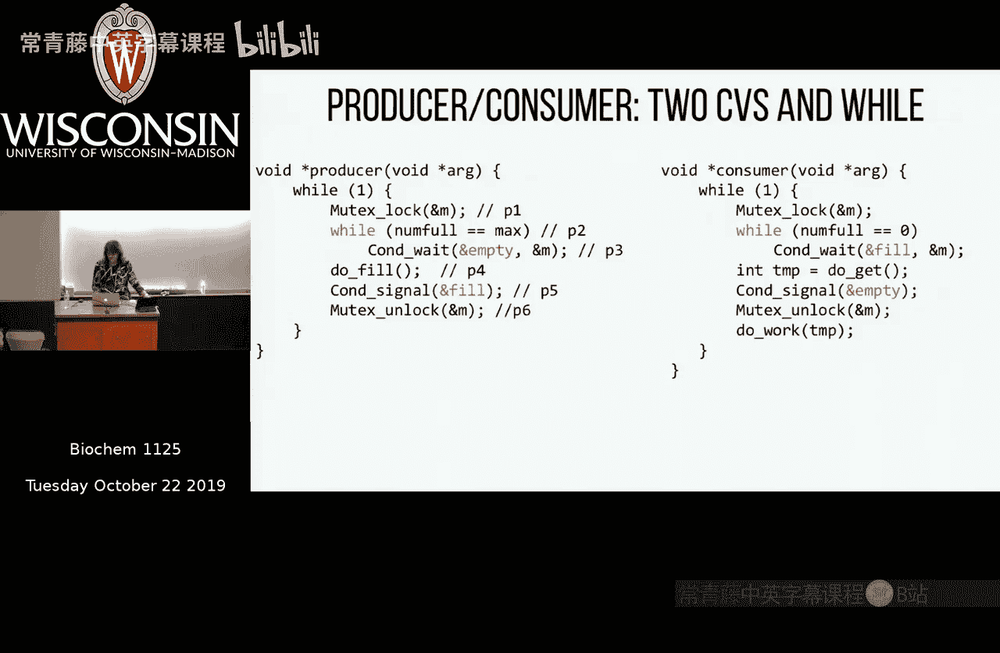

我们使用了一个额外的状态变量 `done` 来记录子线程是否已完成。父线程在检查 `done` 和调用 `wait` 时必须持有锁，形成一个临界区。同样，子线程在设置 `done` 和调用 `signal` 时也必须持有同一个锁。这防止了在检查和等待之间发生上下文切换导致的竞态条件。

### 生产者-消费者（单缓冲）

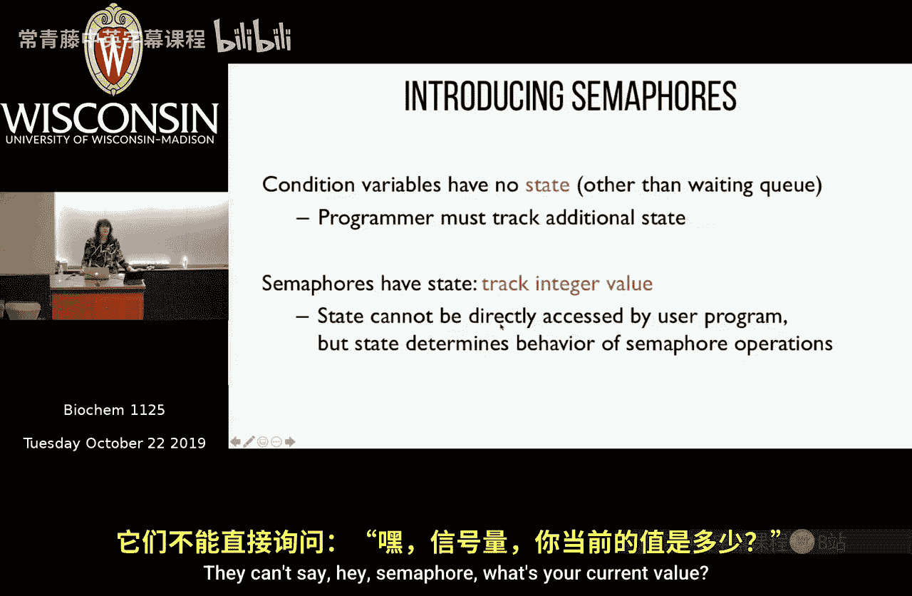

生产者和消费者共享一个缓冲区。生产者需要等待缓冲区为空，消费者需要等待缓冲区为满。


我们使用了两个单独的条件变量（`cond_empty` 和 `cond_full`）以及一个互斥锁。关键点在于：
*   检查和等待操作必须在持有锁的临界区内进行。
*   等待返回后必须用 `while` 循环重新检查条件，因为被唤醒后、获取锁之前，状态可能已被其他线程改变。

---

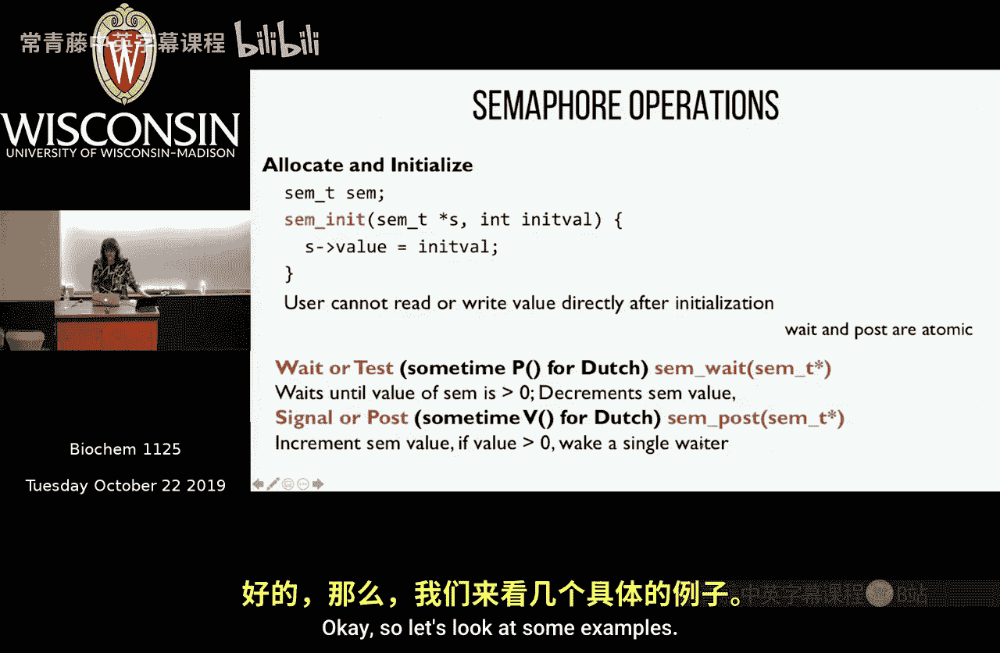

## 条件变量使用准则 ✅

根据以上例子，我们总结出使用条件变量的经验法则：
1.  总是需要维护额外的状态变量来跟踪程序状态，不能盲目地 `wait` 或 `signal`。
2.  调用 `wait` 和 `signal` 时必须持有相关联的互斥锁。
3.  从 `wait` 唤醒后，通常需要用 `while` 循环重新检查条件，以防状态被其他线程改变。

条件变量和锁是紧密协作的。在 `pthreads` 等接口中，调用 `condition_wait` 时需要传入关联的互斥锁。该实现会在等待时释放锁，并在收到信号后、返回前重新获取锁。

---

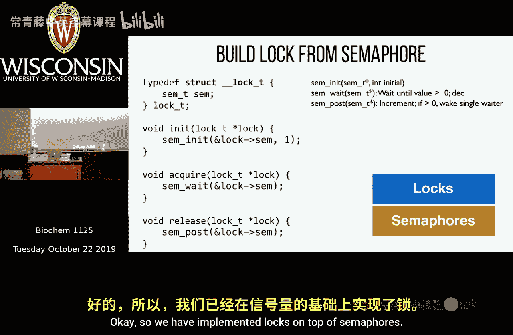


## 信号量介绍 🆕

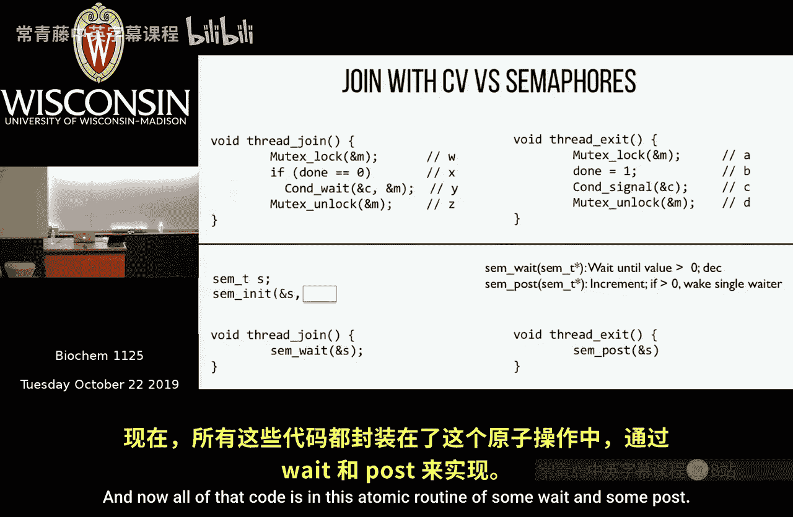

条件变量本身没有状态（除了等待队列），应用程序总是需要额外的状态变量。信号量则将状态嵌入到了自身内部。

一个**信号量**是一个具有整数值的对象，用户程序不能直接访问这个值，只能通过定义良好的原语来操作它。

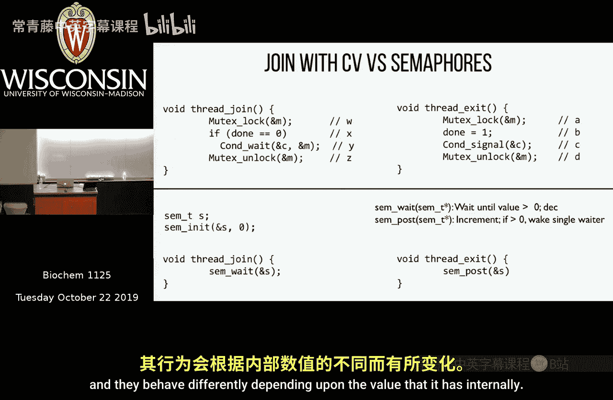

有趣的是，**信号量与（锁 + 条件变量）在功能上是完全等价的**。选择使用哪一种很大程度上是个人偏好问题，某些问题用其中一种表达可能稍显简洁。

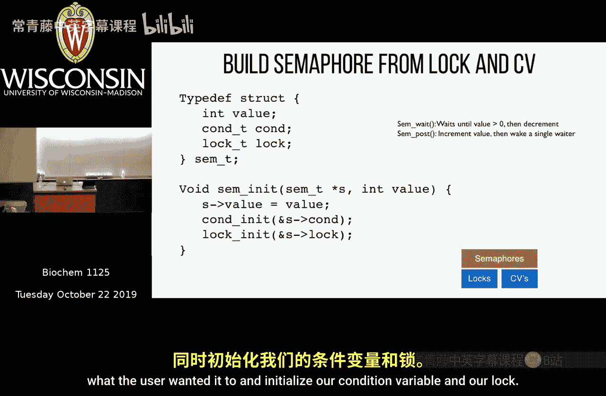

---

## 信号量基本操作 🎯

信号量需要用一个初始值进行初始化。

之后有两个基本操作：
*   **`sem_wait` (或 P 操作)**：等待，直到信号量的值大于0。一旦大于0，就将其值减1。如果值不大于0，调用线程通常会阻塞。
*   **`sem_post` (或 V 操作)**：将信号量的值加1。如果有线程正在该信号量上等待，则会唤醒其中一个。

---

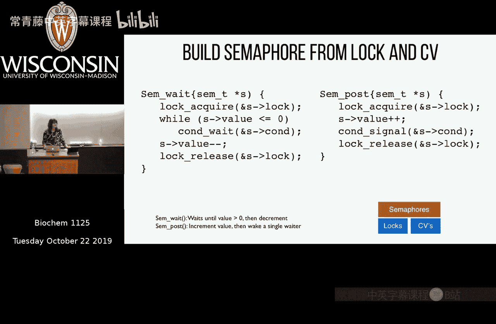

## 用信号量实现锁 🔐

我们可以用信号量来实现锁。

思路是：锁的 `acquire` 对应 `sem_wait`，锁的 `release` 对应 `sem_post`。关键在于初始化信号量的值。

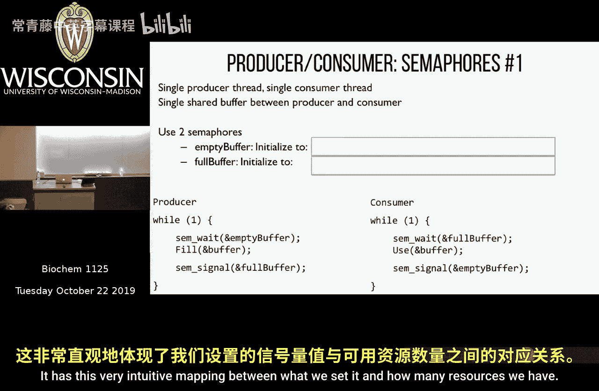

如果将信号量初始化为 **1**，那么第一个调用 `sem_wait` 的线程会发现值大于0，将其减为0并继续执行（即获取锁）。此时第二个线程调用 `sem_wait` 会发现值为0，于是阻塞等待。当第一个线程调用 `sem_post` 将值加回1时，会唤醒等待的线程，使其得以继续并获取锁。这完美模拟了互斥锁的行为。

---

## 用信号量实现线程同步（Join） 🤝

现在，我们用信号量来实现线程 `join` 的同步（顺序控制）。

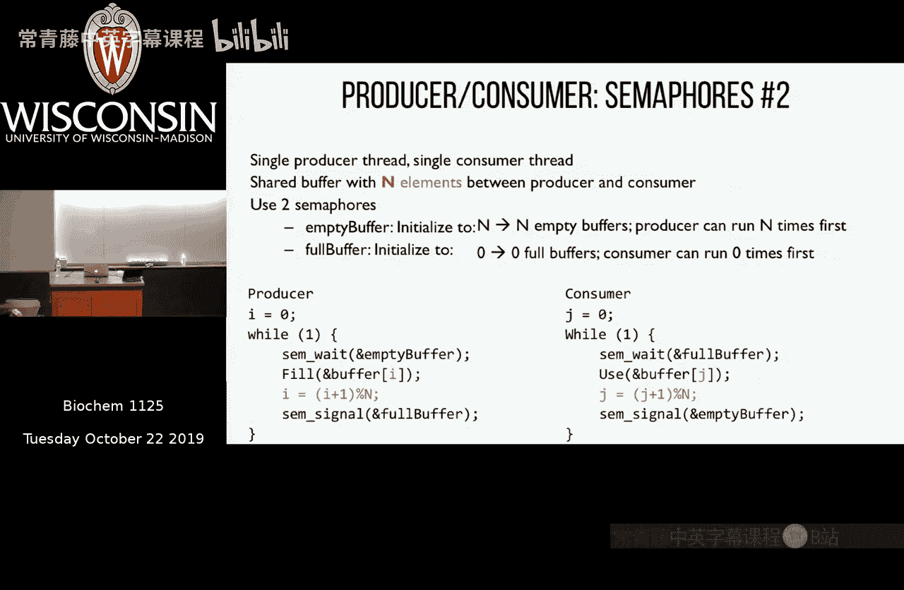

在 `join` 中，父线程需要等待子线程执行完毕。使用信号量后，代码变得非常简洁，不再需要单独的锁和状态变量 `done`。

关键还是初始化。我们需要父线程在子线程调用 `post` 之前，在 `wait` 处阻塞。

因此，我们将信号量初始化为 **0**。如果父线程先调用 `join` 中的 `sem_wait`，会看到值为0而阻塞。当子线程调用 `exit` 中的 `sem_post` 将值加到1时，会唤醒父线程，使其继续执行。这实现了所需的同步顺序。

---

## 用锁和条件变量实现信号量 🧱

为了证明信号量与（锁+条件变量）的等价性，我们现在用锁和条件变量来实现一个信号量。

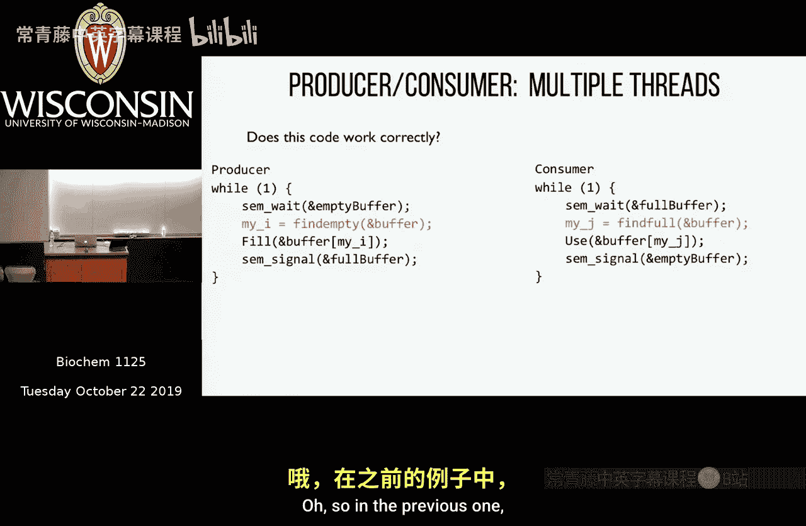

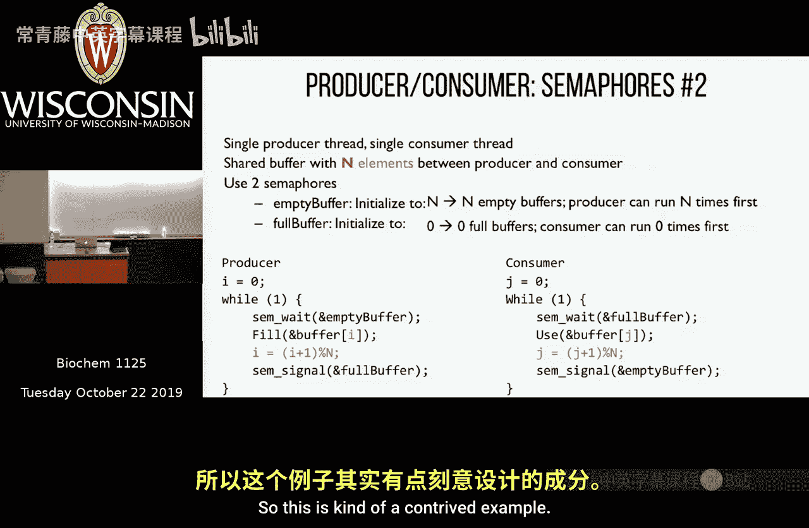

信号量内部需要维护：
*   一个整数值 `value`。
*   一个互斥锁 `lock`，用于保护对 `value` 的访问。
*   一个条件变量 `cond`，用于管理等待该信号量的线程队列。


初始化时，设置 `value` 为用户指定的初始值，并初始化锁和条件变量。

`sem_wait` 的实现：
```c
void sem_wait(sem_t *s) {
    lock_acquire(&s->lock);
    while (s->value <= 0) {
        condition_wait(&s->cond, &s->lock); // 等待时会释放锁
    }
    s->value--;
    lock_release(&s->lock);
}
```
`sem_post` 的实现：
```c
void sem_post(sem_t *s) {
    lock_acquire(&s->lock);
    s->value++;
    condition_signal(&s->cond); // 唤醒一个等待者
    lock_release(&s->lock);
}
```
在这个实现中，锁提供了对内部值 `value` 进行原子修改所需的互斥，而条件变量提供了线程等待和通知的机制。这清晰地展示了信号量如何结合了互斥和同步两种功能。

---

## 生产者-消费者问题（信号量版） 🏭➡️🛒

现在，我们用信号量来解决经典的生产者-消费者问题。

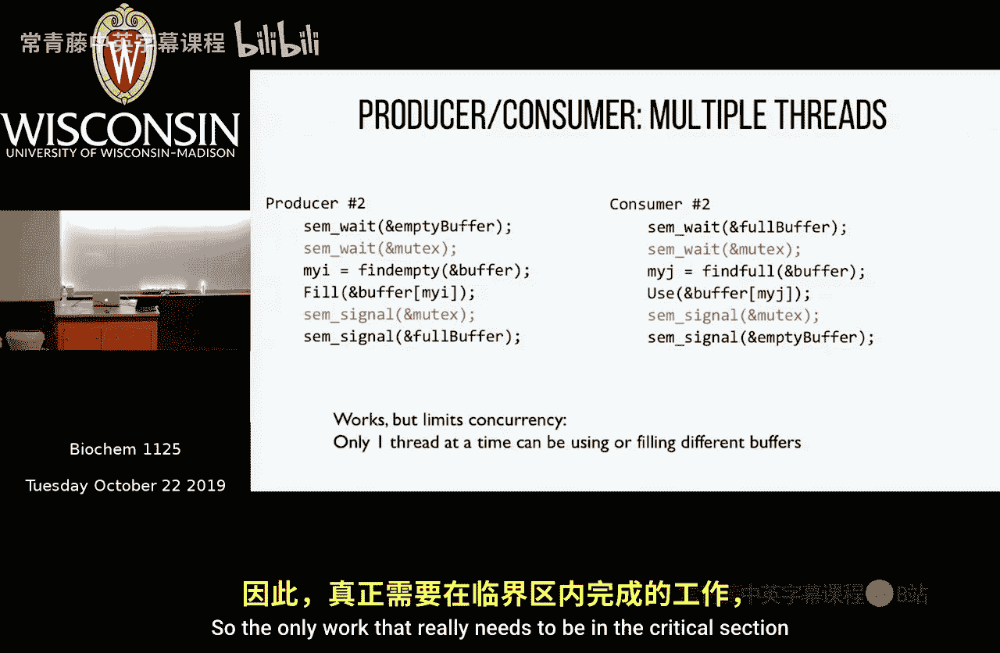

### 单缓冲情况

假设只有一个生产者和一个消费者，共享一个缓冲区。

生产者需要等待缓冲区为空，消费者需要等待缓冲区为满。我们使用两个信号量：
*   `empty_buffers`：表示空缓冲区的数量。
*   `full_buffers`：表示满缓冲区的数量。

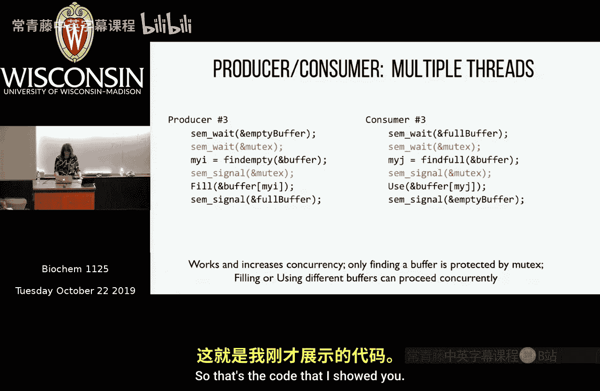

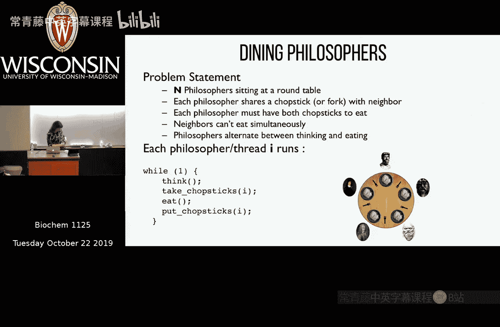

初始化是关键：
*   `empty_buffers` 初始化为 **1**（因为一开始有1个空缓冲区）。
*   `full_buffers` 初始化为 **0**（因为一开始没有满缓冲区）。

这样，生产者可以先运行一次填充缓冲区，然后消费者才能运行取出缓冲区。


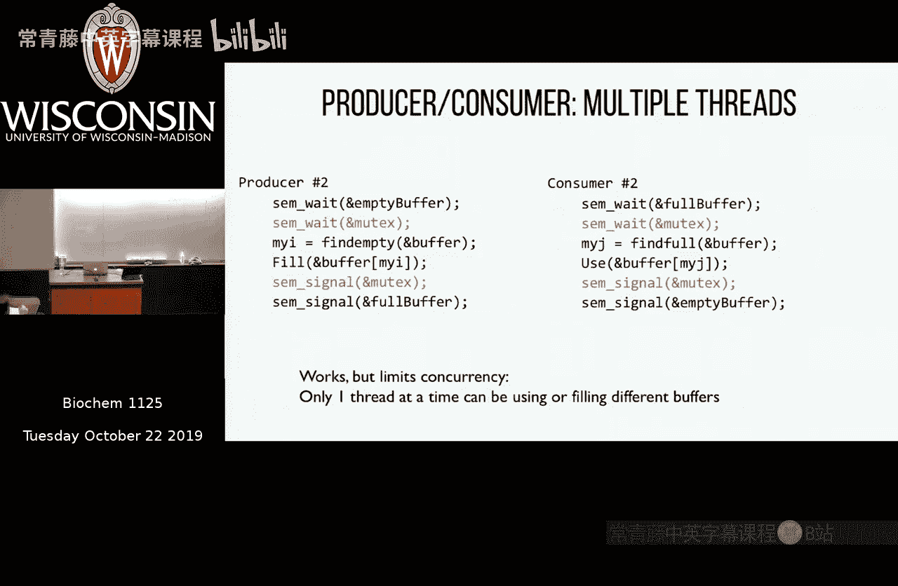

### 多缓冲（N个元素）情况

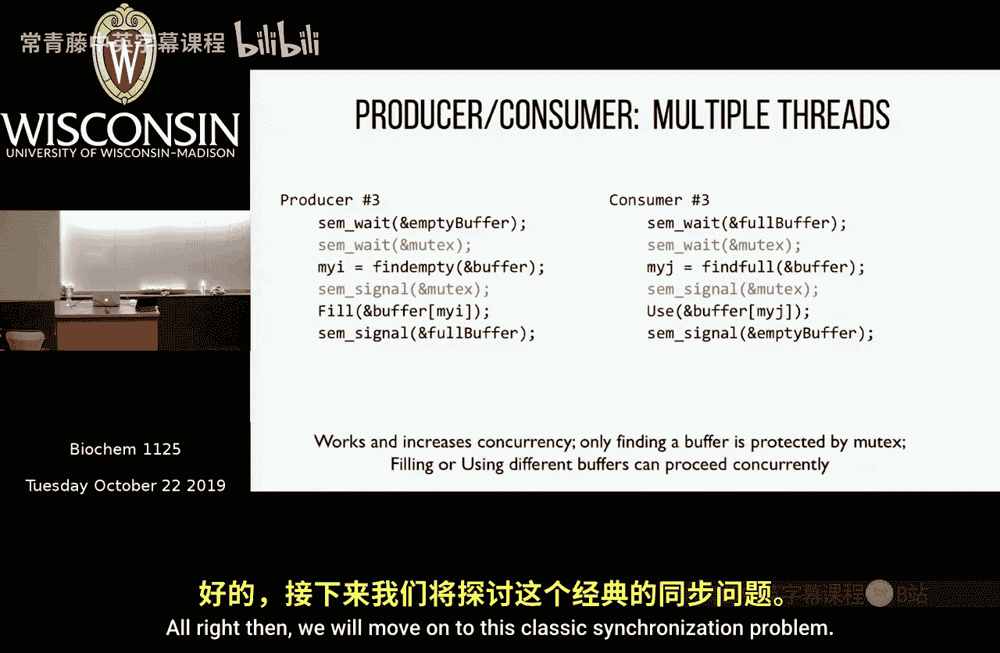

现在假设缓冲区有N个槽位，但仍然是单生产者和单消费者。

初始化变为：
*   `empty_buffers` 初始化为 **N**。
*   `full_buffers` 初始化为 **0**。

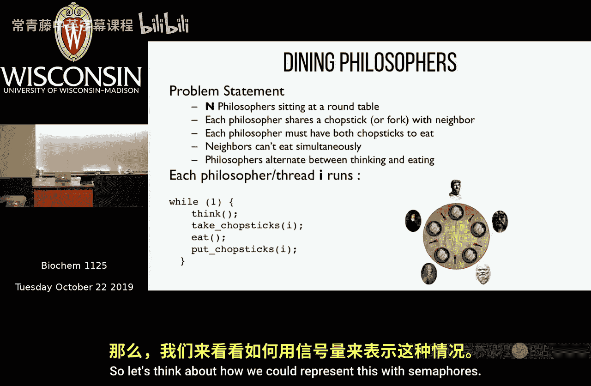

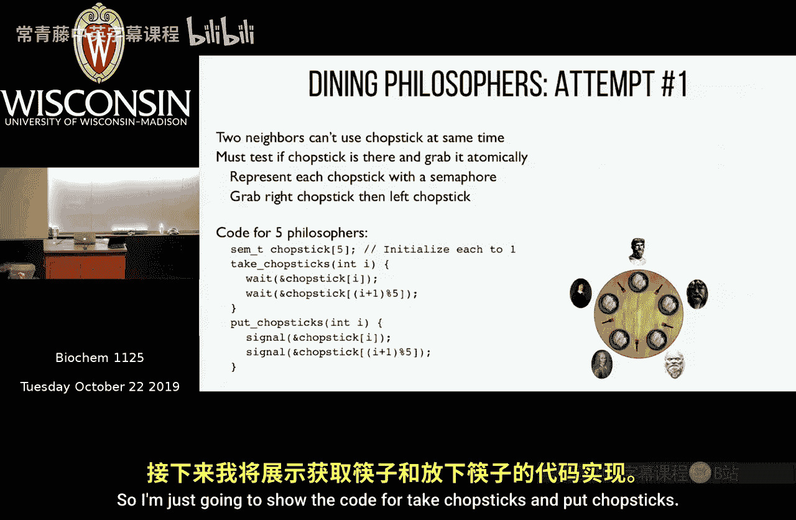

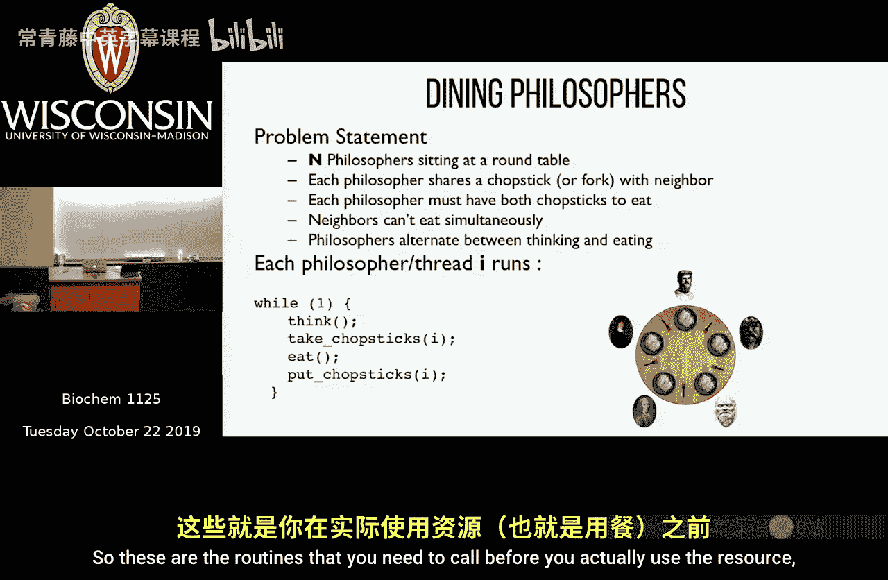

生产者可以连续运行N次填满所有缓冲区，然后消费者才能开始消费。当然，调度可以是交错的，生产者生产一些，消费者消费一些，只要不超过缓冲区容量即可。

### 多生产者/多消费者情况

这才是更现实的情况：多个生产者线程和多个消费者线程共享一个大小为N的缓冲区。

我们最初的直觉代码可能如下：
```c
// 生产者
void producer() {
    while(1) {
        sem_wait(&empty_buffers); // 等空位
        int my_i = find_empty_buffer(); // 找一个空缓冲区索引
        fill_buffer(my_i); // 填充
        sem_post(&full_buffers); // 通知有满缓冲区
    }
}
// 消费者类似
```
这段代码有问题。`find_empty_buffer` 函数不是原子的。两个生产者可能同时找到同一个“空”缓冲区索引 `my_i`，导致数据被覆盖。我们需要**互斥**来保护查找并标记缓冲区的过程。

然而，简单地用锁包裹整个 `find_empty_buffer` 和 `fill_buffer` 会限制并发性（同一时间只能有一个生产者操作缓冲区）。更好的做法是让临界区尽可能小，只保护查找和标记缓冲区状态的操作，而将实际的填充（`fill_buffer`）和消费（`use_buffer`）操作放在临界区外，因为这些操作可能比较耗时，且操作的是不同的缓冲区元素，可以并行。


因此，正确的结构需要结合信号量（用于资源计数）和互斥锁（用于保护缓冲区状态数组的查找和更新）。

---

## 哲学家就餐问题 🍽️


这是一个经典的同步问题，用于阐释如何避免死锁。问题描述：N个哲学家围坐圆桌，每个哲学家需要左右两把叉子才能吃饭，每把叉子被两个邻居共享。


### 简单（但有死锁）的方案

为每把叉子创建一个初始值为1的信号量。哲学家 `i` 的代码：
```c
void philosopher(int i) {
    while(1) {
        think();
        sem_wait(&chopstick[i]); // 拿左边叉子
        sem_wait(&chopstick[(i+1)%N]); // 拿右边叉子
        eat();
        sem_post(&chopstick[i]); // 放左边叉子
        sem_post(&chopstick[(i+1)%N]); // 放右边叉子
    }
}
```
这个方案会导致死锁：如果所有哲学家同时拿起左边的叉子，那么每个人都会永远等待右边的叉子，形成循环等待。

### 避免死锁的方案

打破循环等待。例如，让大多数哲学家先拿左边叉子，再拿右边叉子，但让其中一个哲学家（比如编号最大的）以相反顺序拿取（先右后左）。这样可以避免全局性的循环依赖，但会限制并发性（同一时间可能只有少数哲学家能吃饭）。

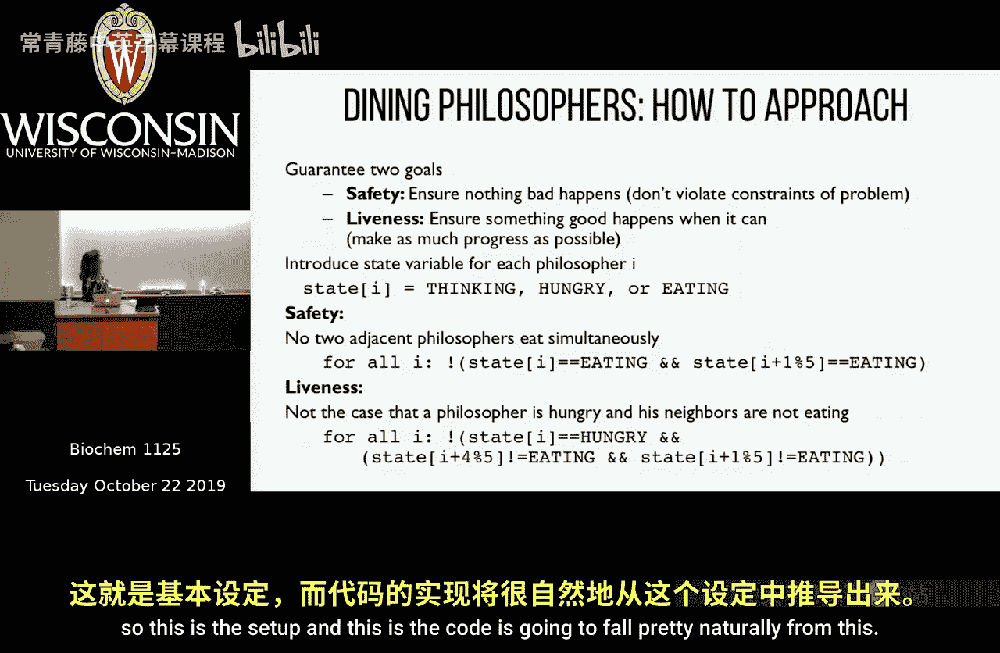

### 最大化并发的方案（基于状态）

为了同时保证安全（无冲突）和活跃（最大化并发），我们为每个哲学家引入状态：`THINKING`, `HUNGRY`, `EATING`。

安全要求：没有两个相邻的哲学家同时处于 `EATING` 状态。
活跃要求：如果一个哲学家是 `HUNGRY`，并且他的两个邻居都不在 `EATING` 状态，那么他应该能够进入 `EATING` 状态。

实现使用一个互斥锁 `mutex` 保护所有状态变量，并为每个哲学家设置一个信号量 `may_eat[i]`，初始化为0。

当哲学家 `i` 想吃饭时：
1.  持有 `mutex`，设置自己的状态为 `HUNGRY`。
2.  检查是否可以吃饭（即自己为 `HUNGRY` 且左右邻居都不在 `EATING` 状态）。
3.  如果可以，设置自己的状态为 `EATING`，并调用 `sem_post(&may_eat[i])` 将自己的信号量加1。
4.  释放 `mutex`。
5.  调用 `sem_wait(&may_eat[i])`。由于第3步已经加了1，所以会立即通过，开始吃饭。

当哲学家 `i` 放下叉子时：
1.  持有 `mutex`，设置自己的状态为 `THINKING`。
2.  检查左右邻居的活跃性：对于每个邻居，如果他处于 `HUNGRY` 状态且他的两个邻居都不在 `EATING` 状态，则将该邻居的状态设为 `EATING`，并调用 `sem_post(&may_eat[邻居])` 唤醒他。
3.  释放 `mutex`。

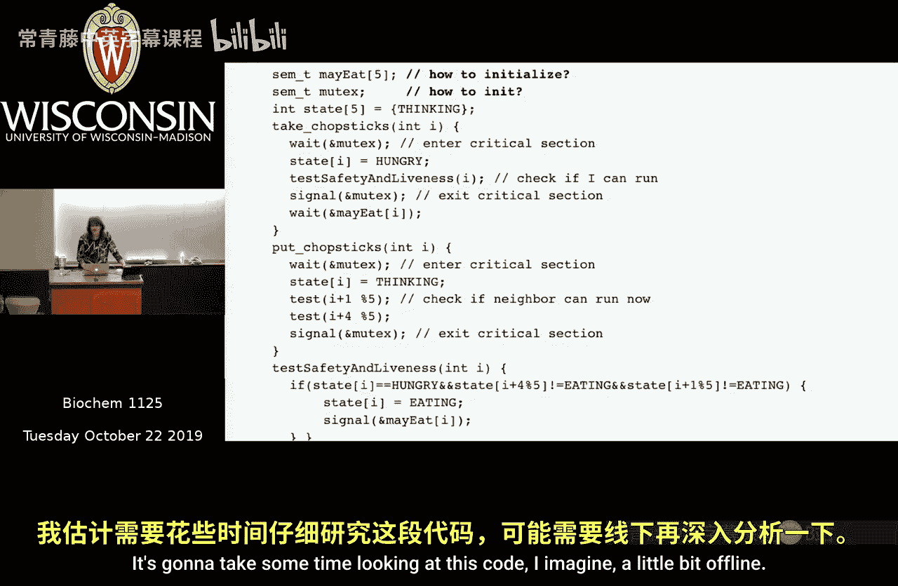

这个方案通过集中管理状态，优雅地实现了安全性和最大程度的活跃性。

---

## 读者-写者锁 📖✍️

最后，我们简要介绍读者-写者锁。它与普通锁不同，允许多个读者同时持有锁（因为读操作不冲突），但只允许一个写者持有锁，并且写者持有锁时，不能有任何读者或其他写者。

实现读者-写者锁有多种策略，主要区别在于优先级：
*   **读者优先**：只要还有读者在读，新来的读者可以直接加入，写者可能被饿死。
*   **写者优先**：一旦有写者在等待，新来的读者必须等待，优先保证写者执行。

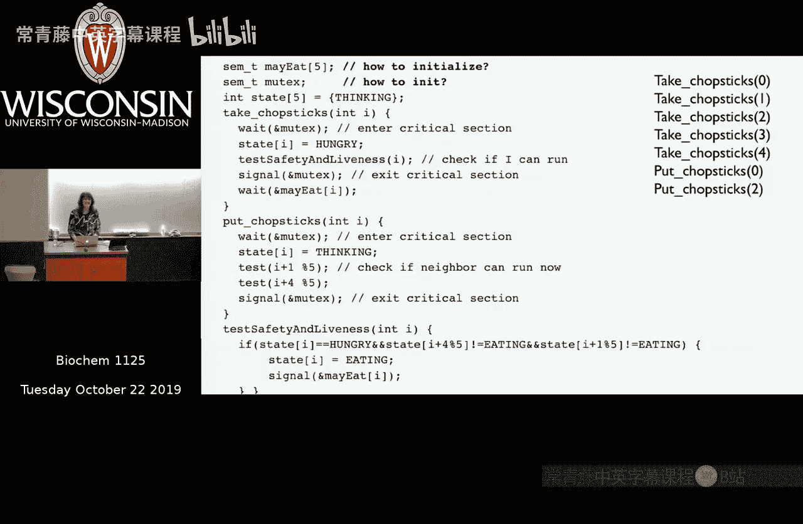

其实现思路与哲学家就餐问题有相似之处，需要跟踪读者和写者的数量，并使用信号量或条件变量进行协调。我们将在下一讲详细讨论。

---

## 总结 📚

本节课中，我们一起学习了：
1.  **信号量**的概念及其 `wait` (P) 和 `post` (V) 操作。
2.  信号量与**锁+条件变量**的功能等价性，并相互实现了对方。
3.  使用信号量解决**线程同步**（Join）和**生产者-消费者**问题。
4.  深入探讨了**哲学家就餐**这一经典同步问题，分析了死锁成因，并学习了基于状态、能最大化并发性的解决方案。
5.  简要介绍了**读者-写者锁**的概念及其优先级问题。

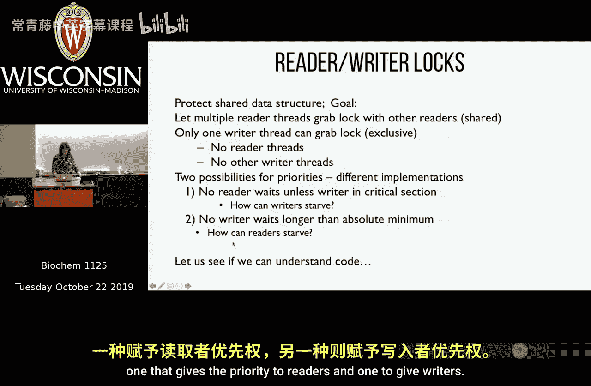

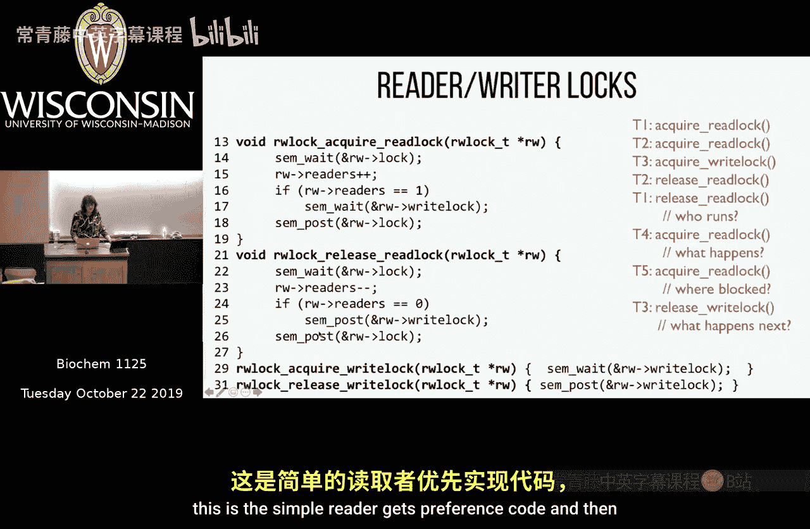


信号量提供了一种将资源计数与线程等待/唤醒机制结合在一起的优雅抽象，是并发编程中的重要工具。理解其原理和等价性，有助于我们根据具体问题选择合适的同步原语。