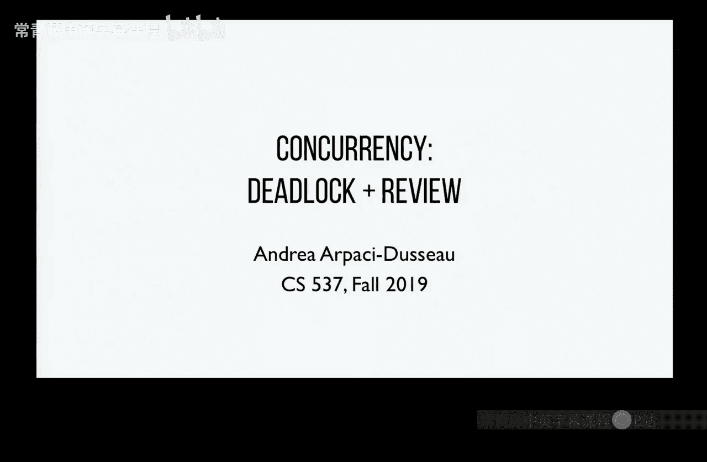
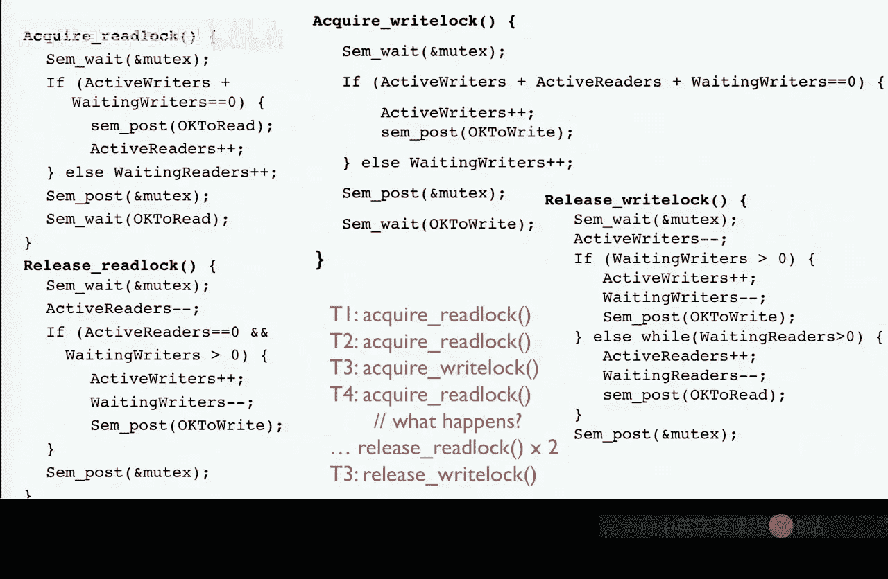

# 015：并发、死锁与复习 🧠




在本节课中，我们将完成对并发主题的讨论，重点探讨死锁问题，并为下周的期中考试进行复习。我们将学习如何避免死锁，并回顾课程前半部分的核心概念。

## 项目与考试安排 📅

项目5现已发布，截止日期为下周一。该项目分为三个难度级别，旨在确保每位同学都能有所收获。期中考试将于下周三举行，考试内容主要涵盖并发和虚拟化，但也会包含部分与第一次期中考试相似的题目，以检验对前期知识的掌握。

## 并发同步原语回顾 🔄

上一节我们介绍了并发编程中的核心问题。本节中，我们来看看用于解决这些问题的两种主要同步原语。

### 互斥与排序

并发编程需要提供两种基本保障：
1.  **互斥**：确保两个进程不会同时访问同一临界区。这可以通过**锁**或**信号量**来实现。
2.  **排序**：确保一个线程执行某些操作（如生成数据）后，另一个线程才能执行后续操作。这可以通过**条件变量**和**信号量**来实现。

### 条件变量详解

条件变量用于线程间的等待与通知。使用条件变量时，必须持有一个相关联的互斥锁。

*   `wait(cond, mutex)`: 调用此函数时，线程会释放互斥锁并进入睡眠状态，直到另一个线程对同一条件变量调用 `signal`。
*   `signal(cond)`: 唤醒一个正在等待该条件变量的线程。如果没有线程在等待，此调用不会产生任何效果，也不会被“记住”。

需要注意的是，从 `wait` 返回并重新获取锁的过程不是原子的。线程被唤醒后，可能因为锁被其他线程持有而需要等待。因此，通常需要在 `wait` 调用外使用一个 `while` 循环来重新检查条件是否真正满足，因为在线程被唤醒到重新获得锁的这段时间里，共享状态可能已经改变。

### 监视器

监视器是一种语言级别的同步机制，它封装了锁和条件变量，旨在减少程序员因显式调用锁操作而犯的错误。在支持监视器的语言中，使用 `synchronized` 关键字标记的方法会自动关联一个隐式锁，在方法开始时获取，在方法结束时释放。虽然监视器简化了编程，但死锁和排序等问题依然存在。

### 信号量

与条件变量不同，信号量本身具有状态（一个整数值）。其行为取决于初始值：

*   初始值为 **1**：用作**互斥锁**。
*   初始值为 **0**：用作**排序**原语。第一个调用 `wait` 的线程将阻塞，直到另一个线程调用 `post` 将值增为 1。
*   初始值为 **N**：用作**计数信号量**，可以跟踪资源数量（例如，生产者-消费者问题中空缓冲区或满缓冲区的数量）。

信号量的 `wait` 和 `post` 操作内部处理了锁的获取与释放。

## 并发错误与死锁 🚫

在复杂的多线程应用中，即使经过充分测试，也常出现并发错误。我们已讨论了竞态条件（缺乏互斥）和违反顺序的错误。现在，我们重点来看死锁。

死锁发生在多个线程互相等待对方持有的资源时，导致所有线程都无法继续执行。产生死锁需要同时满足四个必要条件：

1.  **互斥**：资源一次只能被一个线程占用。
2.  **持有并等待**：线程在持有一个资源的同时，等待获取另一个资源。
3.  **不可抢占**：资源不能被强制从持有它的线程中夺走。
4.  **循环等待**：存在一个线程资源的循环等待链。

只要破坏其中任何一个条件，即可预防死锁。以下是几种策略：

### 1. 破坏互斥条件：无锁数据结构

通过避免使用锁来消除互斥。这通常借助硬件提供的原子指令（如 `compare-and-swap`）来实现。

`compare-and-swap` 指令的伪代码描述如下：
```c
int compare_and_swap(int *address, int expected, int new) {
    if (*address == expected) {
        *address = new;
        return 1; // 成功
    }
    return 0; // 失败
}
```

以下是一个无锁递增的例子：
```c
void atomic_increment(int *value, int amount) {
    int old;
    do {
        old = *value; // 读取当前值
    } while (compare_and_swap(value, old, old + amount) == 0);
}
```
其工作原理是：不断尝试将 `value` 的值从读取到的 `old` 原子地更新为 `old + amount`。如果在此期间值被其他线程修改（即 `*value != old`），则 `compare_and-swap` 失败，循环重试。

无锁算法同样可以用于复杂数据结构的操作，例如在链表头部插入节点：
```c
void insert(int value) {
    node_t *n = malloc(sizeof(node_t));
    n->value = value;
    do {
        n->next = head; // 记录当前头节点
    } while (compare_and_swap(&head, n->next, n) == 0); // 尝试将头指针指向新节点
}
```
其核心思想是：确保在将 `head` 指向新节点 `n` 时，`head` 的值仍然等于之前记录的 `n->next`。如果不相等，说明有其他线程修改了链表，操作需要重试。

### 2. 破坏持有并等待条件：全局锁（元锁）

要求线程在获取所有需要的资源之前，必须先获取一个全局的“元锁”。这样，同一时刻只有一个线程在尝试获取资源，从而避免了持有一个资源等待另一个资源的情况。缺点是严重限制了并发性。

### 3. 破坏不可抢占条件：尝试锁与回退

当线程无法立即获取所需的所有锁时，它主动释放已经持有的所有锁，等待一段时间后再重试。这可以避免死锁，但可能导致**活锁**——线程不断重复“获取-释放”的过程，看似在运行，实则没有进展。常见的解决方法是采用指数退避策略，逐渐增加重试前的等待时间。

### 4. 破坏循环等待条件：锁排序

为系统中所有的锁定义一个全局的、严格的获取顺序。线程必须按照这个顺序来申请锁。例如，在文件系统中，规定必须先获取目录锁，再获取文件inode锁，最后获取数据块锁。这是实践中最常用且有效的方法。

**总结**：对于死锁，初期的正确性比性能更重要。可以从使用粗粒度锁（如一个全局锁）开始，随着对系统理解的深入，再细化为更精细的锁策略。在复杂系统中，明确采用一种死锁预防策略（如无锁编程、锁排序）是至关重要的。

## 期中考试复习要点 📚

以下是需要重点复习的内容概览：

### 虚拟化部分
*   **CPU虚拟化**：进程抽象、上下文切换机制、调度策略（如轮转、多级反馈队列）。
*   **内存虚拟化**：地址空间抽象、动态重定位（基址-界限）、分段、分页、多级页表、TLB、交换。

### 并发部分
*   **线程与进程**：理解堆共享、栈和局部变量私有等区别。
*   **同步原语**：
    *   互斥：锁、信号量、监视器。
    *   排序：条件变量、信号量。
*   **锁的实现**：自旋锁（基于原子指令）、阻塞锁（将线程放入队列）。
    *   选择策略：短临界区适合自旋，长临界区适合阻塞。
*   **经典同步问题**：
    *   生产者-消费者问题。
    *   读者-写者问题（读者优先 vs 写者优先实现）。
    *   哲学家就餐问题（简单防死锁版 vs 保证安全与活跃性的并发版）。
*   **死锁**：四个必要条件及预防策略。

### 实践与代码分析
*   能够分析涉及 `fork` 的进程创建代码，判断输出和变量值。
*   能够分析多线程代码，区分共享变量（堆、全局变量）和私有变量（栈），并推理可能的执行结果和竞态条件。
*   掌握基于“时间片”的代码执行模型，能够分析给定调度序列下，涉及锁、条件变量、信号量的代码执行路径和状态。



**本节课中我们一起学习了**死锁的原理与四种预防策略，并系统回顾了操作系统在虚拟化和并发方面的核心概念与机制，为应对期中考试做好了准备。