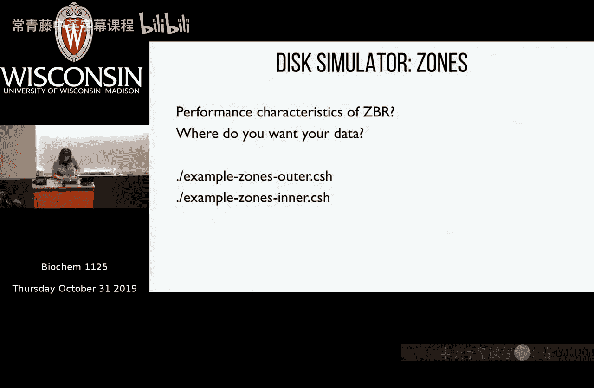
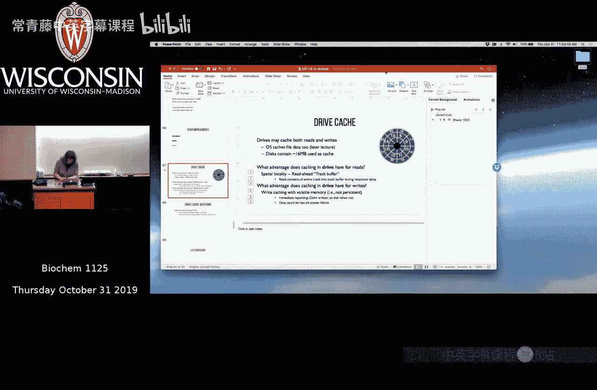
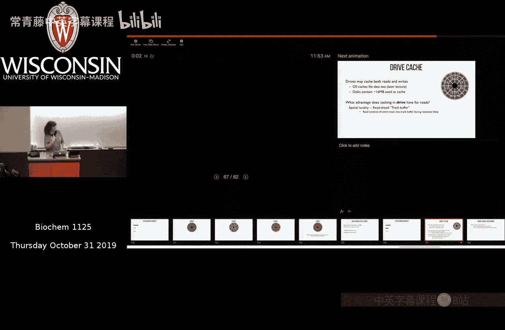
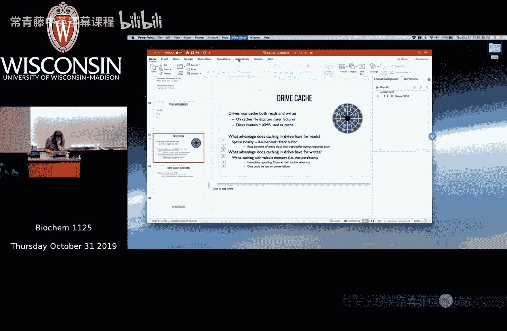
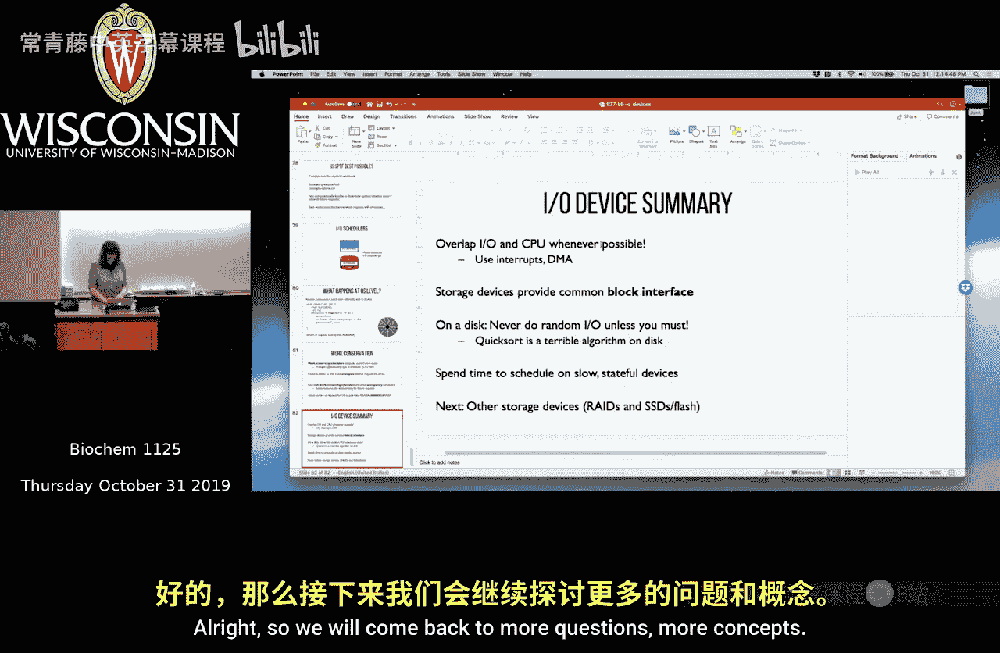

# 016：持久性 - I/O设备 🖥️💾

在本节课中，我们将要学习操作系统如何与I/O设备交互以实现数据持久性。我们将从I/O设备的基本交互协议开始，逐步探讨性能优化方法，并深入了解硬盘驱动器的工作原理及其性能特性。最后，我们将介绍几种磁盘调度算法，以优化I/O请求的处理顺序。

---

## 课程概述与公告 📢

首先是一些课程公告。项目三的成绩已公布在Canvas上，如有问题请联系助教。关于项目五的测试脚本，我们正在努力尽快发布，请关注后续通知。此外，期中考试将在周三晚上举行，主要考察并发性，复习材料已提供。

---

## 持久性简介与I/O的重要性 🔄

上一节我们介绍了虚拟化和并发性，本节中我们来看看课程的第三部分——持久性。持久性的核心问题是确保系统重启后数据依然可用。这涉及到操作系统如何与I/O设备交互，以及如何优化这些交互。

I/O至关重要。一个没有输入的程序每次只能执行相同的计算，而没有输出的程序则无法展示其结果。我们通常需要记录应用程序的状态，以便后续使用。

---

## I/O设备交互基础 🛠️

操作系统需要与各种I/O设备通信，但又不希望为每种设备编写特定代码。因此，我们通过一组标准化的寄存器与设备交互。

以下是设备交互的基本概念：
*   **状态寄存器**：用于读取设备当前状态（如忙碌或空闲）。
*   **命令寄存器**：用于向设备写入要执行的操作命令（如读/写磁盘块）。
*   **数据区域**：用于传输要读取或写入的实际数据。

设备内部有自己的硬件（如专用CPU和RAM）来执行具体功能。

---

## 基本I/O协议与优化 🔄

最初的I/O协议效率低下。当一个进程想进行I/O操作时，它需要循环读取状态寄存器（忙等待），直到设备空闲，然后写入数据和命令，接着再次忙等待操作完成。这期间CPU被完全占用，无法执行其他任务。

为了改进，我们引入了**中断机制**。进程在发起I/O请求后可以阻塞自身，让出CPU给其他进程运行。当设备完成操作后，会触发一个中断，操作系统随后唤醒等待的进程。这避免了CPU在等待期间的浪费。

然而，中断并非总是最佳选择。对于非常快速的设备，轮询（忙等待）可能更高效，因为上下文切换的开销可能超过等待时间。此外，中断洪流可能导致活锁，因此在处理中断时通常会暂时禁用其他中断。批处理中断请求也能提高效率。

---

## 直接内存访问 🚀

在基本协议中，CPU需要亲自将数据从内存复制到设备的寄存器，这称为**编程式I/O**。对于大数据传输（如网络或磁盘操作），这非常低效。

**直接内存访问** 解决了这个问题。使用DMA时，CPU只需告诉设备数据在内存中的位置（指针），专门的DMA引擎会负责在内存和设备之间传输数据，从而释放CPU去执行其他任务。

DMA涉及一些复杂问题，例如需要固定内存页面，以及地址是虚拟地址还是物理地址。

---

## 设备寻址方式与驱动程序 🔌

操作系统如何向设备的命令寄存器写入数据？主要有两种方式：
1.  **特殊指令**：架构提供专门的`in`/`out`指令来访问特定端口。
2.  **内存映射I/O**：将设备寄存器映射到进程的地址空间中。对特定内存地址的读写实际上是对设备寄存器的操作。页表条目中会有特殊标志位来标识这些区域不应被缓存。

由于设备协议各异，操作系统通过**设备驱动程序**来抽象底层细节。设备制造商负责提供驱动程序，这样操作系统核心就无需为每个新设备修改代码。

---

## 操作系统I/O栈 📚

应用程序通过系统调用与I/O子系统交互。整个I/O栈从上到下包括：
1.  **应用程序**：在用户层运行。
2.  **文件系统**：提供文件和目录等抽象。应用程序也可以通过原始设备接口直接访问存储块。
3.  **通用块层**：为上层文件系统提供统一的线性块数组视图，并负责请求调度与合并。
4.  **设备驱动**：包含与特定硬件设备交互的低级代码。

本节课我们将重点讨论栈底层的设备特性。

---

## 硬盘驱动器详解 💽

硬盘驱动器是机械设备，速度远慢于CPU和内存。访问磁盘需要毫秒级时间，而CPU在此期间可以执行数百万条指令。

磁盘将存储空间组织为线性扇区数组（通常每个扇区512字节），文件系统在此基础上构建文件和目录等抽象。

以下是硬盘的关键术语：
*   **盘片**：存储数据的圆形碟片，双面都有记录介质。
*   **主轴**：盘片围绕其旋转。
*   **磁道**：盘片表面的同心圆环。
*   **柱面**：所有盘片上相同半径的磁道组成的集合。
*   **扇区**：磁道上可寻址的最小单元。
*   **磁盘臂/磁头**：每个盘面有一个磁头，所有磁头安装在同一个磁盘臂上。

---

## 磁盘访问时间计算 ⏱️

一次磁盘读/写操作的时间由三部分组成：
1.  **寻道时间**：将磁头移动到正确磁道所需的时间。
2.  **旋转时间**：等待所需扇区旋转到磁头下方所需的时间。
3.  **传输时间**：实际读取或写入数据所需的时间。

对于随机工作负载，平均寻道距离约为最大寻道距离的1/3。平均旋转时间是磁盘旋转半圈所需的时间。传输时间通常很短，可以忽略。

**顺序工作负载**（连续访问大块数据）性能很高，因为只需支付一次寻道和旋转开销，后续传输很快。
**随机工作负载**（访问分散的小数据块）性能很差，因为每次访问都要支付寻道和旋转开销。

通过计算可以量化这种差异。例如，一个磁盘顺序吞吐量可能达到100 MB/s，而随机吞吐量可能只有2.5 MB/s。

---

## 磁盘内部优化 🧠

现代磁盘采用了一些优化技术：
*   **磁道偏斜**：相邻磁道的扇区起始位置会错开，以便磁头在切换磁道后，目标扇区不会“错过”，从而避免等待整整一圈旋转。
*   **分区记录**：为了保持恒定的记录密度，外圈磁道会比内圈磁道容纳更多的扇区。因此，将顺序文件分配在外圈可以获得更高吞吐量。
*   **磁盘缓存**：
    *   **磁道缓冲区**：磁盘读取整个磁道数据到内部缓冲区，后续对同一磁道的请求可以直接从缓冲区读取，速度更快。
    *   **写缓冲**：写入操作可能先确认完成，但数据实际还留在磁盘缓存中，稍后才写入介质。这提高了速度，但在系统崩溃时可能导致数据丢失。对数据一致性要求高的应用需要禁用此功能。

---

## I/O调度算法 🚦

当有多个I/O请求排队时，调度器决定其服务顺序，目标是最小化寻道和旋转时间。这与CPU调度不同，后者主要关注作业长度，而I/O调度关注请求的“空间”位置。

以下是几种调度算法：

**先来先服务**
*   描述：按照请求到达的顺序服务。
*   优点：公平。
*   缺点：性能可能很差，完全取决于工作负载。

**最短寻道时间优先**
*   描述：总是服务离当前磁头位置最近的请求（按磁道号）。
*   优点：减少了寻道时间。
*   缺点：可能导致**饥饿**，远离磁头的请求可能永远得不到服务。

**最短定位时间优先**
*   描述：同时考虑寻道时间和旋转延迟，选择总定位时间最短的请求。
*   优点：比SSTF更优。
*   缺点：操作系统通常无法精确知道旋转状态，因此该算法主要由磁盘内部实现。同样存在饥饿问题。

**电梯算法**
*   描述：磁头像电梯一样单向移动（如从外圈到内圈），服务沿途的所有请求，到达一端后反向移动。
*   优点：避免了饥饿。
*   缺点：对中间区域的请求响应较快，但对两端区域的请求公平性稍差。

**循环扫描算法**
*   描述：磁头从一端移动到另一端并服务请求，到达另一端后立即快速返回起始端（不服务请求），然后开始新的扫描。
*   优点：比普通电梯算法更公平，所有请求的等待时间上限更一致。

**有限窗口调度**
*   描述：将请求分批（如每128个一批），在每批内部使用SSTF或SPTF等算法，但必须处理完当前批的所有请求后才能处理下一批。
*   优点：通过调整窗口大小，可以在性能和公平性之间取得平衡。

**最优调度**
*   描述：考虑所有请求的组合，找出总服务时间最短的顺序。
*   现实：这是NP难问题，计算开销巨大，且无法预知未来请求，因此不实用。

贪婪算法（如SSTF、SPTF）并非最优，因为它们只关注下一步最短，可能留下一些代价高昂的请求最后处理。

---

## 总结 📝

本节课中我们一起学习了操作系统持久性中关于I/O设备的核心内容。我们了解了操作系统与设备交互的基本协议、如何通过中断和DMA进行优化，以及设备驱动程序和I/O栈的作用。我们深入探讨了硬盘驱动器的工作原理、性能特性及其访问时间的计算，认识到顺序访问与随机访问的巨大性能差异。最后，我们介绍了几种重要的磁盘调度算法，分析了它们在减少寻道时间、旋转延迟以及避免饥饿等方面的权衡。

在下一讲中，我们将继续探讨操作系统的I/O调度，并开始介绍其他类型的存储设备，如RAID或固态硬盘。