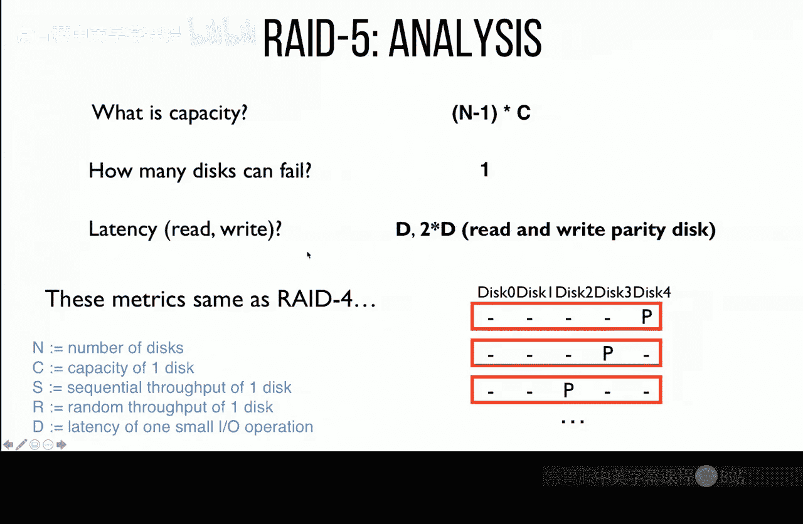
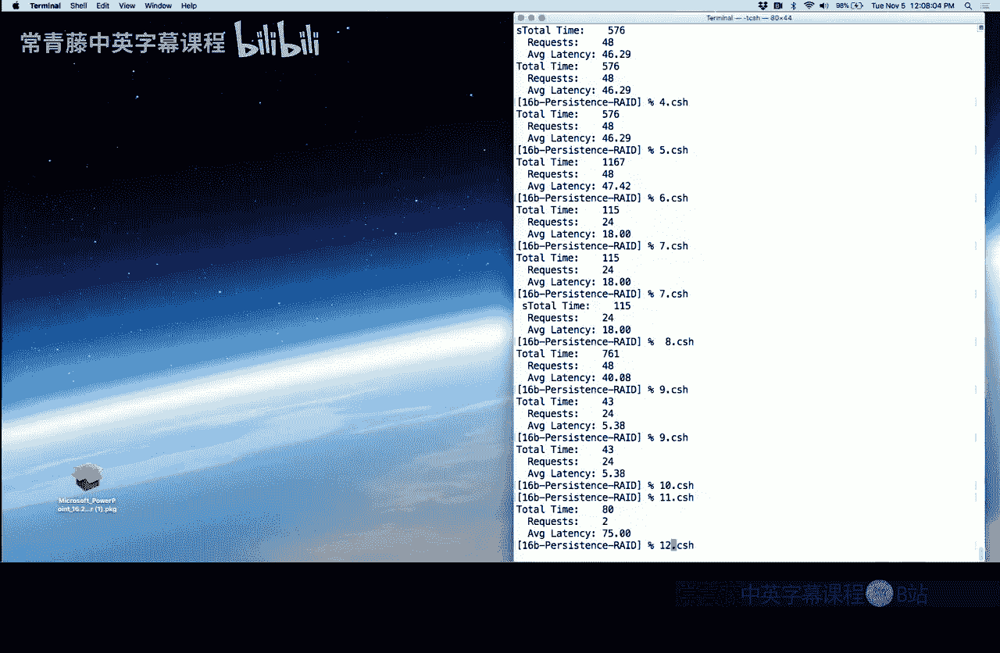
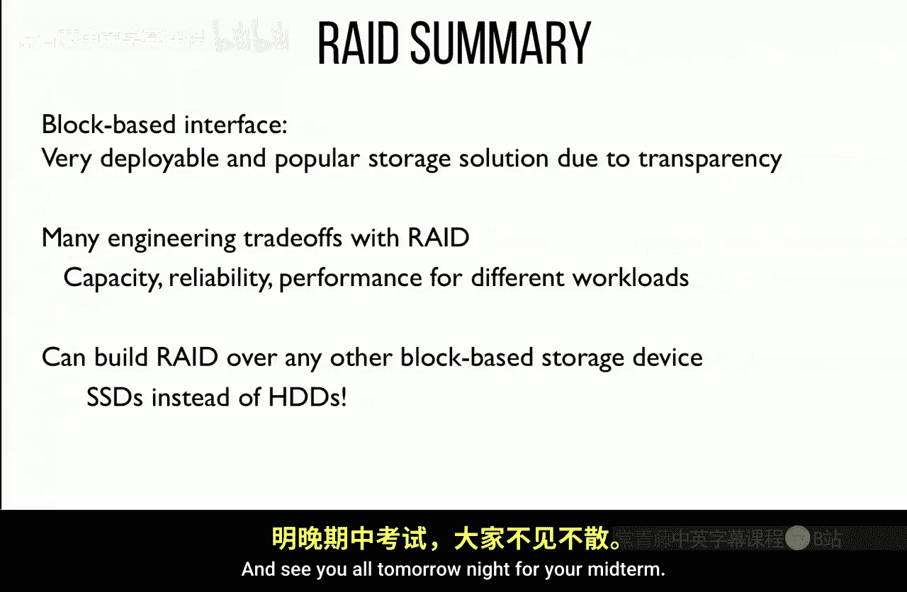

# 017：持久化 - RAID

在本节课中，我们将学习持久化存储的一个重要概念：RAID（独立磁盘冗余阵列）。我们将探讨为什么需要使用多个磁盘，RAID的不同级别（0、1、4、5），以及它们如何在可靠性、容量和性能等不同指标上表现各异。

---

## 课程概述

上一讲我们介绍了持久化的基础，并开始讨论实际的存储设备硬件。我们主要讨论了硬盘。本节中，我们将继续深入，探讨RAID技术。我们将了解使用多个磁盘的动机，以及如何通过不同的RAID级别来平衡可靠性、容量和性能。

---

## RAID简介

RAID代表“独立磁盘冗余阵列”。其核心思想是，文件系统将看到一个单一的大型逻辑磁盘（一个线性块数组），而实际上数据被映射和分布在多个物理磁盘上。这种方式对上层文件系统完全透明，易于部署。

使用廉价磁盘而非单一昂贵磁盘的原因在于规模经济。大量生产的廉价组件成本更低。通过使用多个廉价磁盘并协同工作，我们可以获得更高的容量、更好的性能，并通过冗余提高可靠性。

RAID设备看起来像一个线性块数组，就像单个磁盘一样。然后，通过一个映射将逻辑块地址转换为物理磁盘上的块地址。与虚拟内存的动态映射不同，RAID使用静态映射，通常通过简单的算术计算来完成。

除了映射，RAID还引入了冗余。拥有更多磁盘意味着单个磁盘故障的概率增加。因此，在不同物理磁盘上保存数据的多个副本变得很重要。副本数量会影响可靠性、性能和空间效率。

---

## RAID级别与评估指标

在本讲中，我们将讨论四个RAID级别：0、1、4和5。我们将通过不同的工作负载（顺序与随机、读与写）和指标（容量、可靠性、性能）来评估它们。

以下是评估时使用的通用变量：
*   **N**: 磁盘数量
*   **C**: 单个磁盘的容量
*   **S**: 单个磁盘的顺序吞吐量
*   **R**: 单个磁盘的随机吞吐量
*   **D**: 单个磁盘的延迟

---

## RAID 0：条带化

RAID 0，也称为条带化，是最简单的方法，它没有冗余。文件系统看到的逻辑块被轮流（轮询）放置在所有磁盘上。

**映射公式**：
*   磁盘号 = 逻辑块地址 % N
*   磁盘内偏移 = 逻辑块地址 / N

**性能分析**：
*   **容量**: `N * C`
*   **可容忍的磁盘故障数**: 0
*   **延迟**: `D`
*   **顺序吞吐量**: `N * S`
*   **随机吞吐量**: `N * R`

RAID 0在容量和性能（吞吐量）方面表现出色，但没有任何容错能力。任何一个磁盘故障都会导致数据丢失。

---

## RAID 1：镜像

RAID 1通过镜像提供冗余。每个逻辑块在多个磁盘上保存完整的副本。通常，镜像会与条带化结合使用（例如RAID 10）。

我们假设磁盘是“故障即停”的：它们完全停止工作，不会返回错误数据。

**性能分析**：
*   **容量**: `(N * C) / 2` （假设两两镜像）
*   **可容忍的磁盘故障数**: 至少1个（取决于故障发生在哪组镜像上）
*   **延迟**: `D`
*   **随机读吞吐量**: `N * R` （所有磁盘都可服务读请求）
*   **随机写吞吐量**: `(N * R) / 2` （需要更新所有副本）
*   **顺序读/写吞吐量**: 通常为 `(N * S) / 2`，但如果有很多并发的顺序请求，也可能达到 `N * S`

RAID 1提供了良好的可靠性，但以牺牲一半容量为代价。随机读性能优秀，但随机写性能会下降。

**一致性问题**：在写入过程中发生崩溃可能导致镜像对之间的数据不一致。昂贵的硬件RAID控制器使用非易失性RAM来记录操作（日志），以便在崩溃后恢复一致性。

---

## RAID 4：专用奇偶校验磁盘

RAID 4引入了一种更空间高效的冗余方式：奇偶校验。它使用一个专用磁盘来存储奇偶校验信息，该信息是同一“条带”内其他所有数据块的异或（XOR）结果。

**奇偶校验计算**：`P = D0 XOR D1 XOR D2 ... XOR Dk`
如果一个数据磁盘故障，可以通过读取其他所有数据盘和奇偶校验盘，并重新计算XOR来恢复丢失的数据。

**写入放大问题**：更新一个数据块需要更新对应的奇偶校验块。最直接的方法是读取所有其他数据块来计算新奇偶校验，这成本很高。优化方法是：读取旧数据、读取旧奇偶校验，计算数据的变化量，然后相应地更新奇偶校验。这导致一次逻辑写操作需要 **两次读（旧数据、旧奇偶校验）和两次写（新数据、新奇偶校验）**。

**性能分析**：
*   **容量**: `(N - 1) * C`
*   **可容忍的磁盘故障数**: 1
*   **延迟**: 读为 `D`，写更高（涉及更多操作）
*   **顺序读/写吞吐量**: `(N - 1) * S` （数据盘可并行工作，奇偶校验盘能跟上）
*   **随机读吞吐量**: `(N - 1) * R`
*   **随机写吞吐量**: 约 `R / 2` （奇偶校验盘成为瓶颈，需处理两倍I/O）

RAID 4的主要问题是专用奇偶校验盘在随机写工作负载下成为严重瓶颈，性能甚至可能差于单个磁盘。

---

## RAID 5：分布式奇偶校验

RAID 5解决了RAID 4的瓶颈问题，方法是将奇偶校验块循环分布到所有磁盘上，而不是固定在一个磁盘上。

**布局策略**：采用“左对称”布局，确保在进行大块顺序访问时，所有磁盘都能均匀参与，从而获得最大带宽。

**性能分析**：
*   **容量**: `(N - 1) * C`
*   **可容忍的磁盘故障数**: 1
*   **延迟**: 与RAID 4类似
*   **顺序读/写吞吐量**: `(N - 1) * S`
*   **随机读吞吐量**: `(N - 1) * R` （所有磁盘都包含数据，可服务请求）
*   **随机写吞吐量**: `(N * R) / 4` （每次逻辑写仍放大为4次物理I/O，但负载均匀分布，吞吐量随N增长）

RAID 5在可靠性、容量和性能（尤其是随机写）之间取得了很好的平衡，因此非常流行。

---

## 总结与对比

本节课中我们一起学习了四种RAID级别。关键结论是：**没有一种RAID级别在所有方面都是最好的**，选择取决于具体的工作负载和需求优先级。

*   **只追求最大容量和性能，不关心可靠性**：选择 **RAID 0**。
*   **追求最高可靠性和优秀读性能，能承受容量损失**：选择 **RAID 1**（镜像）。
*   **寻求成本、可靠性和性能的良好平衡，适用于混合工作负载**：选择 **RAID 5**。
*   **RAID 4** 由于专用奇偶校验盘的瓶颈问题，通常不被采用。

RAID之所以有效，是因为它向上层文件系统提供了一个标准的块设备接口，使其无法察觉底层是单个磁盘还是磁盘阵列。这种透明性使得部署非常方便。值得注意的是，RAID可以构建在任何提供块接口的存储设备（如硬盘或下一讲将介绍的固态硬盘）之上。