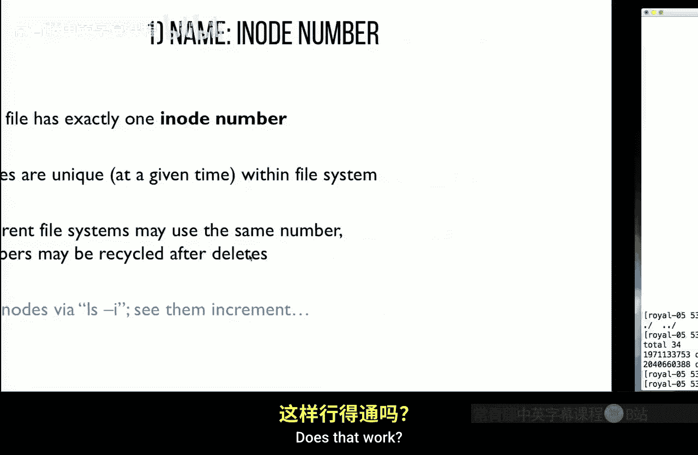
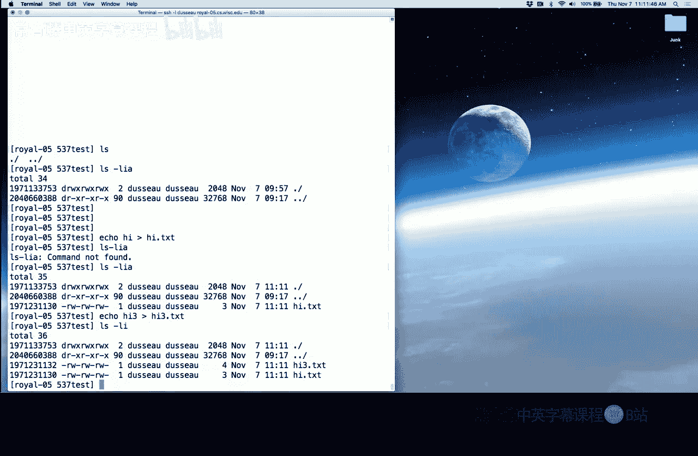
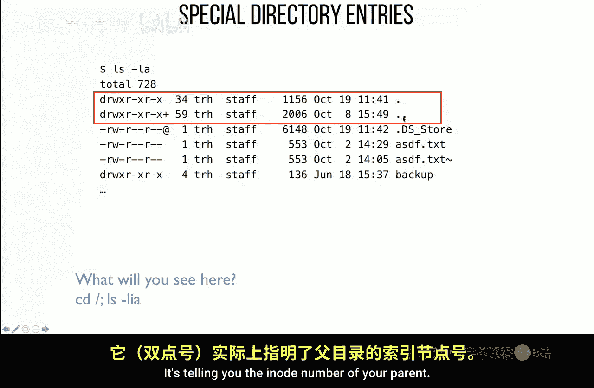
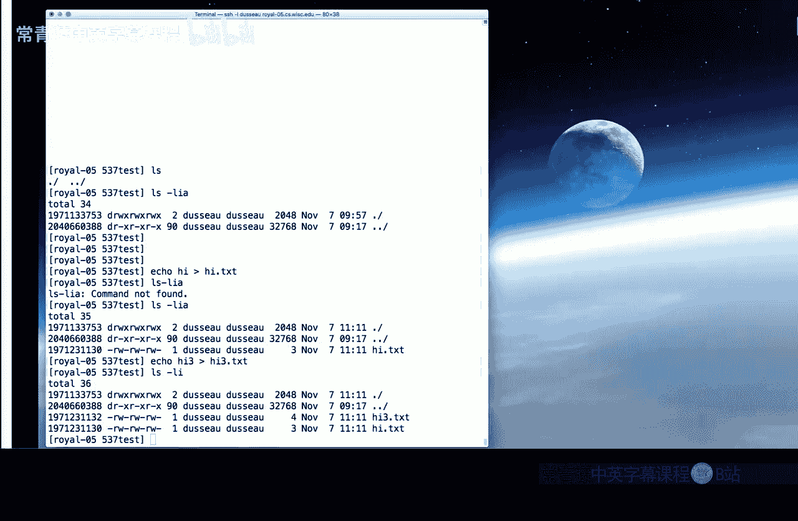
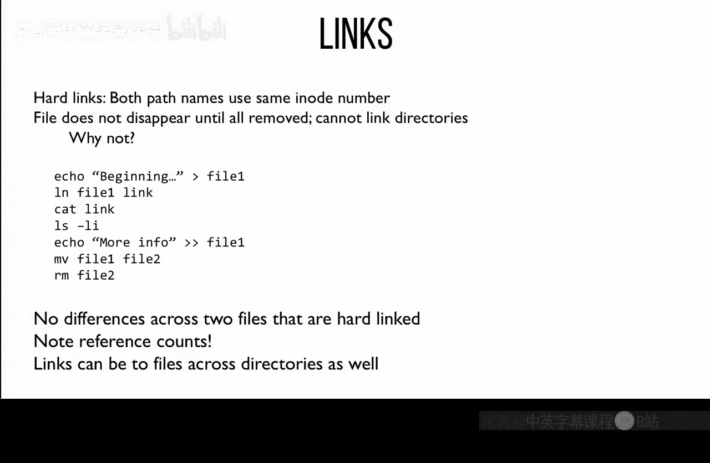
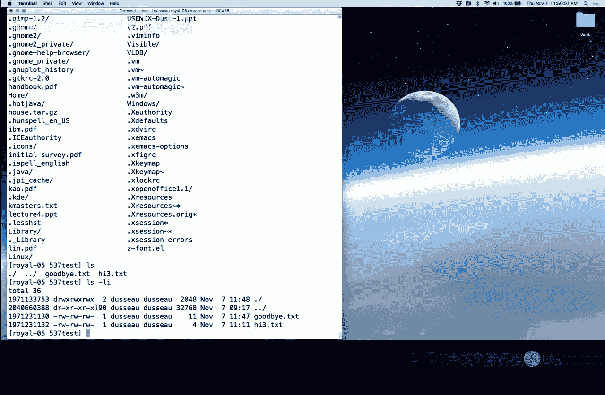
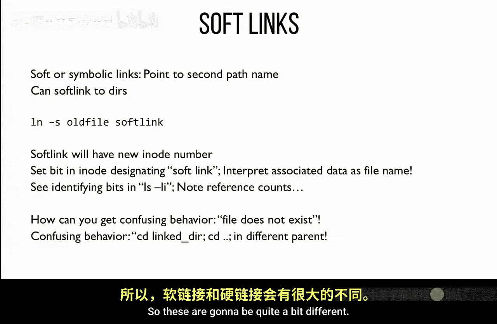
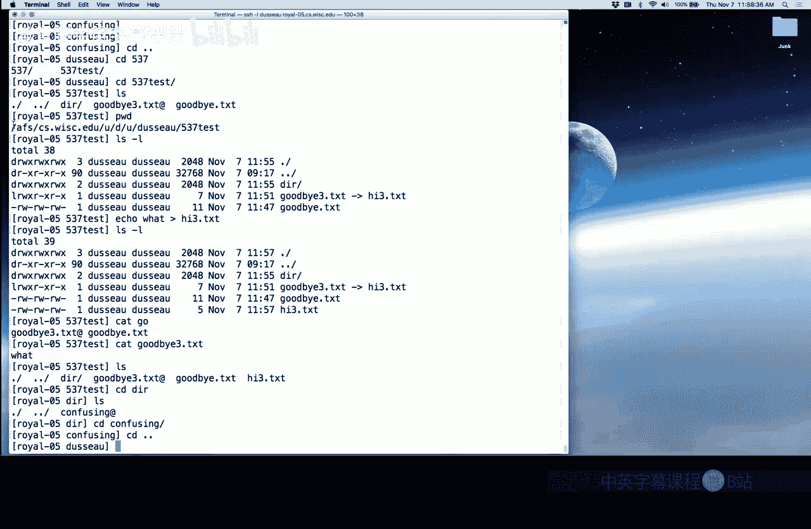
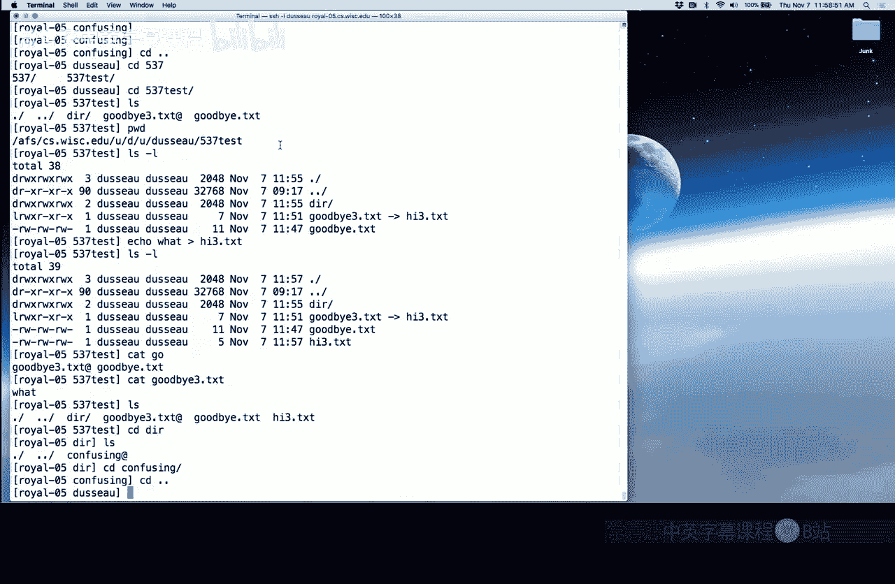
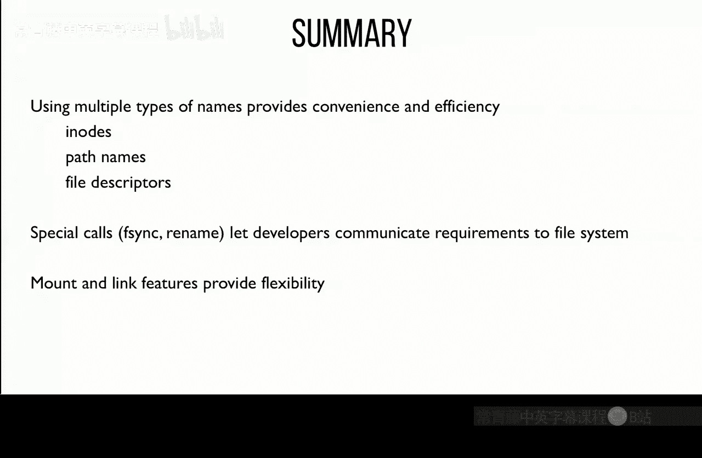

# 018：持久化 - 文件系统API 🗂️

在本节课中，我们将继续学习文件系统的持久化部分，重点关注用户进程如何与文件系统交互。我们将学习文件系统API，包括文件的命名方式、目录的表示、硬链接与软链接的区别，以及如何确保数据真正写入磁盘。

---

## RAID回顾

上一节我们介绍了RAID（独立磁盘冗余阵列）的不同级别。本节中，我们快速回顾一下核心概念，以便更好地理解存储性能。

RAID通过组合多个磁盘来提高性能、可靠性和容量。以下是几种常见RAID级别的关键特性：

*   **RAID 0 (条带化)**：数据被分割并交替存储在多个磁盘上。它提供了最高的读写带宽，但没有冗余，任何磁盘故障都会导致数据丢失。
    *   **性能公式**：随机读/写带宽 = N * 单盘带宽；顺序读/写带宽 = N * 单盘带宽。
*   **RAID 1 (镜像)**：数据被完整地复制到两个或多个磁盘上。它提供了良好的读取性能和容错能力，但写入性能较低，因为每次写入都需要更新所有副本。
    *   **性能公式**：随机读带宽 = N * 单盘带宽；顺序读带宽 ≈ (N/2) * 单盘带宽；随机/顺序写带宽 = (N/2) * 单盘带宽。
*   **RAID 5 (带分布式奇偶校验的条带化)**：数据和奇偶校验信息分布在所有磁盘上。它比RAID 1更有效地利用存储空间，并能容忍单个磁盘故障。然而，随机写入性能较差，因为每次写入都需要更新数据和奇偶校验块。
    *   **性能公式**：随机读带宽 = (N-1) * 单盘带宽；顺序读带宽 = (N-1) * 单盘带宽；随机写带宽 ≈ (N/4) * 单盘带宽；顺序写带宽 = (N-1) * 单盘带宽。

理解这些性能差异有助于我们根据应用需求选择合适的存储方案。

---

## 文件系统API基础

现在，我们来看看用户进程如何与文件系统交互。文件系统为用户提供了一个抽象层，使得我们可以通过名称来组织和管理数据，而无需关心底层磁盘的细节。





### 什么是文件？

文件是文件系统的基本构建块。它是一个命名的字节序列，操作系统通过文件系统来管理这些文件的存储、检索和访问控制。现代系统（如数据库、键值存储）通常构建在文件抽象之上。

文件系统这个词有两种常见用法：
1.  指代存储在磁盘上的文件和目录的静态集合（例如，“我的文件系统”）。
2.  指代操作系统中负责管理文件和目录的软件组件。

本节课我们主要讨论本地文件系统，如Linux上的ext2、ext4等。尽管底层实现不同，但它们向用户提供的文件抽象是相似的。

---

## 文件的命名方式

用户需要通过名称来访问文件。文件系统内部使用一种称为**inode号**的标识符来唯一标识每个文件。我们将探讨三种命名文件的方式，最终的文件描述符方法结合了前两者的优点。

### 方式一：通过Inode号

每个文件在文件系统中都有一个唯一的inode号。Inode是存储文件元数据（如大小、权限、数据块位置等）的数据结构。你可以通过`ls -i`命令查看文件的inode号。

```bash
$ ls -i
1234567 hello.txt
```

**为什么这不是一个好接口？**
*   人类不擅长记忆数字。
*   缺乏组织性，无法通过有意义的名称来管理文件。
*   需要处理多个进程或线程访问同一文件时的偏移量问题。

尽管用户不直接使用inode号，但它是文件系统内部的核心构建块。

### 方式二：通过路径名

我们更习惯使用有意义的路径名来访问文件。文件系统通过**目录**来实现从路径名到inode号的映射。





**目录是什么？**
目录本质上是一个特殊的文件，其内容是一系列映射条目，将文件名关联到对应的inode号。例如，一个目录条目可能包含 `("hello.txt", 1234567)`。

**路径名解析过程**
当用户请求打开文件 `/etc/bashrc` 时，文件系统需要执行路径名遍历：
1.  从根目录（通常inode号为2）开始，读取其inode和目录数据。
2.  在根目录数据中查找 `etc`，找到其inode号。
3.  读取 `etc` 目录的inode和数据。
4.  在 `etc` 目录数据中查找 `bashrc`，找到其inode号。
5.  读取 `bashrc` 文件的inode和数据。

这个过程可能需要多次磁盘I/O，效率较低。每个路径分量（目录）都需要两次读取（inode和数据）。

**目录的特殊条目**
每个目录都包含两个特殊条目：
*   `.` （点）：指向当前目录本身。
*   `..` （点点）：指向父目录。

这使得在目录树中导航变得简单。

### 方式三：通过文件描述符（推荐方式）

为了优化性能，我们只在首次访问文件时执行昂贵的路径名解析。操作系统提供了**文件描述符**抽象。

**工作流程**
1.  用户调用 `open("/path/to/file", ...)`。
2.  操作系统执行路径名遍历，找到文件的inode。
3.  操作系统在进程的**打开文件表**中创建一个条目（称为文件描述符对象），记录inode指针和当前读写偏移量（初始为0）。
4.  操作系统返回一个整数（文件描述符），作为该条目在进程文件描述符数组中的索引。
5.  后续的 `read`, `write`, `lseek` 操作都使用这个文件描述符，无需再次解析路径。

**文件描述符的共享**
*   **同一进程内多次打开同一文件**：每次 `open` 都会创建一个新的文件描述符对象，拥有独立的偏移量。
*   **使用 `dup` 复制文件描述符**：`dup` 创建的新文件描述符指向**同一个**文件描述符对象，因此共享偏移量。
*   **`fork` 创建子进程**：子进程继承父进程的所有文件描述符，它们指向相同的文件描述符对象，因此共享偏移量。

**文件偏移量与 `lseek`**
`lseek` 系统调用用于移动文件的当前读写位置。
```c
off_t lseek(int fd, off_t offset, int whence);
```
*   `whence` 参数：
    *   `SEEK_SET`：将偏移量设置为 `offset`。
    *   `SEEK_CUR`：将偏移量设置为当前位置加上 `offset`。
    *   `SEEK_END`：将偏移量设置为文件末尾加上 `offset`。

---

## 链接：硬链接与软链接

链接允许一个文件有多个名称。有两种类型的链接：硬链接和软链接（符号链接）。

### 硬链接

硬链接是目录中指向同一inode的多个条目。创建硬链接会增加inode的**引用计数**。

**创建硬链接**
```bash
$ echo "Hello" > hello.txt
$ ln hello.txt goodbye.txt  # 创建硬链接
$ ls -i hello.txt goodbye.txt
1234567 hello.txt
1234567 goodbye.txt  # 相同的inode号
$ cat goodbye.txt
Hello
$ echo "World" >> goodbye.txt
$ cat hello.txt
Hello
World
```

**删除文件**
删除一个文件名（使用 `unlink` 系统调用或 `rm` 命令）只会减少inode的引用计数。只有当引用计数降为0时，文件的数据块才会被真正释放。

**限制**：不能创建指向目录的硬链接，因为这可能导致目录树中出现循环，使得遍历工具陷入无限循环。



### 软链接（符号链接）

软链接是一个特殊的文件，其内容是要链接到的目标文件的**路径名**。它有自己的inode，其中设置了一个特殊标志位表明它是符号链接。

**创建软链接**
```bash
$ echo "Hello" > hello.txt
$ ln -s hello.txt link_to_hello  # 创建软链接
$ ls -l link_to_hello
lrwxrwxrwx ... link_to_hello -> hello.txt
$ cat link_to_hello
Hello
```



**与硬链接的关键区别**
1.  **基于名称**：软链接存储的是路径名。如果目标文件被移动或重命名，软链接就会“断裂”（成为悬空链接）。
2.  **可以链接到目录**：因为文件系统能识别符号链接的特殊性，并在遍历时进行特殊处理，通常工具可以选择不跟随符号链接以避免循环。
3.  **不影响引用计数**：创建或删除软链接不会影响目标文件的inode引用计数。

**软链接断裂示例**
```bash
$ rm hello.txt
$ cat link_to_hello
cat: link_to_hello: No such file or directory
```



---

## 数据持久化：缓冲区缓存与 `fsync`

为了提高性能，操作系统使用**缓冲区缓存**在内存中缓存最近读写过的磁盘块。

*   **读取**：如果数据在缓存中，则直接从内存返回，无需访问磁盘。
*   **写入**：当进程调用 `write` 时，数据通常只被写入缓冲区缓存，函数就返回了。操作系统会在后台某个时间点将脏数据写回磁盘。

这种延迟写入策略带来了性能提升，但也意味着数据可能不会立即持久化到磁盘上。



**`fsync` 系统调用**
如果你的应用程序需要确保数据已经物理写入磁盘（例如，数据库事务），你必须显式调用 `fsync`。
```c
int fsync(int fd); // 确保文件描述符fd关联的所有数据写入磁盘
```
*   `close` 一个文件描述符**不会**自动触发 `fsync`。数据可能仍在缓冲区缓存中。
*   即使调用了 `fsync`，数据也可能停留在磁盘自身的缓存中。要确保数据写入物理介质，可能需要额外的磁盘配置。




**原子重命名 `rename`**
`rename` 系统调用用于原子地更改文件名。它在许多应用程序中用于实现原子更新：
1.  将新数据写入一个临时文件（如 `file.txt.tmp`）。
2.  调用 `fsync` 确保临时文件数据落盘。
3.  调用 `rename("file.txt.tmp", "file.txt")` 原子地将临时文件替换为原文件。

这样，其他进程读取 `file.txt` 时，要么看到完整的旧版本，要么看到完整的新版本，永远不会看到处于不一致中间状态的文件。

---

## 其他重要概念

### 权限与访问控制

文件inode中存储了权限位，控制谁可以读、写或执行该文件。权限分为三组：文件所有者、所属组和其他用户。

更复杂的分布式文件系统（如AFS）使用**访问控制列表**，可以提供更精细的权限控制。

### 挂载文件系统

Linux等系统允许将不同的存储设备或网络文件系统透明地集成到单一的目录树中，这通过 `mount` 操作实现。例如，你的家目录（`/home/yourname`）可能位于网络文件系统（AFS）上，而临时目录（`/tmp`）则位于本地磁盘上。用户无需关心数据实际存储在哪里。

---

## 总结

本节课我们一起学习了文件系统API的核心内容：

1.  **文件命名**：理解了inode作为文件系统内部标识符的作用，以及用户如何通过路径名和文件描述符来访问文件。
2.  **目录与遍历**：目录是将文件名映射到inode号的特殊文件。路径名解析可能涉及多次磁盘I/O。
3.  **文件描述符**：这是高效访问文件的关键。`open` 返回文件描述符，后续操作使用它，避免了重复的路径解析。我们学习了文件描述符的创建、复制（`dup`）、继承（`fork`）以及偏移量管理（`lseek`）。
4.  **链接**：区分了**硬链接**（多个目录条目指向同一inode，增加引用计数）和**软链接**（存储目标路径名的特殊文件）。硬链接不能用于目录，而软链接可以。
5.  **数据持久化**：了解了**缓冲区缓存**如何提升性能，以及为什么需要调用 **`fsync`** 来确保数据真正写入磁盘。还学习了如何使用 **`rename`** 实现原子文件更新。
6.  **其他概念**：简要介绍了文件权限和文件系统挂载。



这些知识是进行系统级编程的基础。下一讲，我们将深入文件系统内部，探讨inode的详细结构、数据块分配策略以及文件系统如何在磁盘上组织这些元数据。