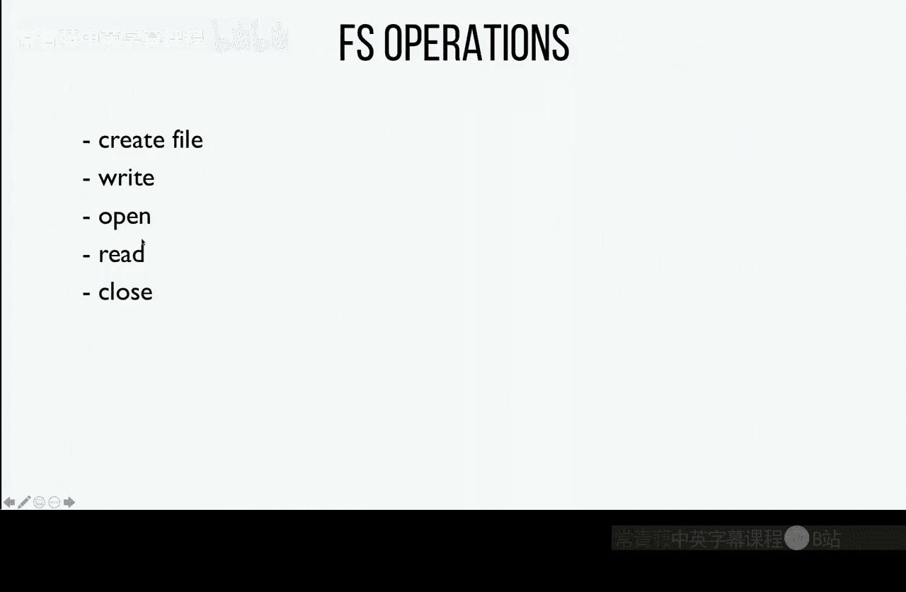
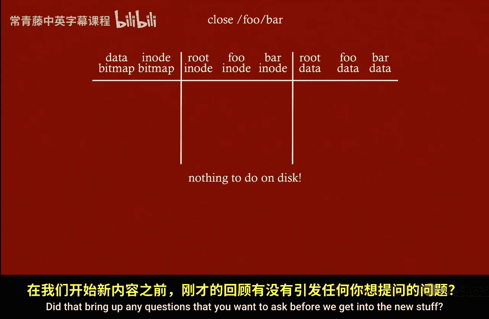
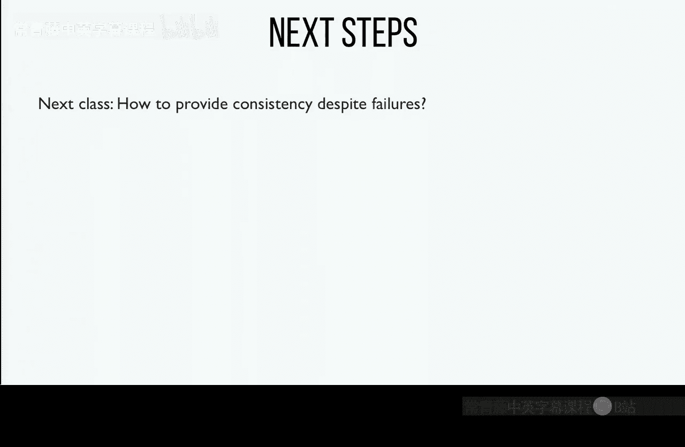

# 020：持久化 - 伯克利快速文件系统 (FFS) 🚀

在本节课中，我们将学习伯克利快速文件系统（FFS）。我们将探讨如何通过测量现有系统、识别问题并进行优化来改进一个复杂的系统。课程将涵盖FFS如何解决旧版Unix文件系统的性能瓶颈，包括块大小选择、内部碎片处理以及数据块和索引节点的分配策略。

---

## 操作系统：第20讲：文件系统结构回顾 📚

上一节我们介绍了文件系统的基本概念，本节中我们来回顾一下文件系统的核心数据结构，为理解FFS的优化奠定基础。

一个典型的文件系统镜像包含以下部分：
*   **超级块**：描述整个文件系统的元数据，例如块大小、索引节点总数及其位置。
*   **位图**：一种高效的数据结构，用于追踪哪些索引节点或数据块是空闲的。每个位对应一个资源（索引节点或数据块），`0`表示空闲，`1`表示已分配。
*   **索引节点表**：存储所有索引节点的区域。
*   **数据块**：存储文件实际内容、目录条目以及间接指针块。

大多数磁盘空间都分配给了数据块。数据块可以存储三种内容：
1.  用户文件数据。
2.  目录数据（即文件名到索引节点号的映射）。
3.  间接指针块（包含指向其他数据块的指针）。

---

## 操作系统：第20讲：索引节点与目录结构 🔍

理解了整体布局后，我们来看看描述单个文件的索引节点结构。

一个索引节点存储了文件的元数据，如类型、所有者、大小等。最关键的部分是指向文件数据块的指针。其结构通常包括：
*   **直接指针**：直接指向数据块的指针，数量固定（例如12个）。
*   **间接指针**：指向一个特殊的“间接块”，该块本身存储了更多指向数据块的指针。这允许文件超越直接指针的数量限制。
*   **双重间接指针**：指向一个“双重间接块”，该块包含指向多个间接块的指针，从而支持更大的文件。
*   **三重间接指针**（某些系统）：进一步扩展文件大小。

这种分层结构非常高效：小文件可以通过直接指针快速访问，而大文件则可以通过间接指针扩展，无需为小文件浪费过多元数据。

索引节点通常小于磁盘块，因此一个磁盘块可能包含多个索引节点。这意味着修改一个索引节点时，需要读取整个块，在内存中修改目标索引节点，然后将整个块写回磁盘。

接下来，我们看看目录是如何组织的。

目录本质上是一种特殊文件，其数据块中存储的是**目录条目**。每个目录条目包含一个**文件名**到**索引节点号**的映射。当你在目录中查找文件时，系统会遍历这些条目以找到匹配的文件名，然后使用对应的索引节点号来访问文件的实际数据和元数据。

当删除一个文件（`unlink`操作）时，系统会从目录中移除对应的条目，并减少该索引节点的**引用计数**。如果引用计数降为0，表示没有其他名称指向该文件，系统便会释放该索引节点及其所有数据块。

---

## 操作系统：第20讲：文件系统操作流程回顾 ⚙️

在深入FFS的优化之前，让我们通过几个核心操作来巩固对文件系统工作流程的理解。以下是执行常见操作所需的磁盘I/O步骤：

**创建新文件（例如 `/foo/bar`）**
1.  **路径遍历**：读取根目录的索引节点和数据块，找到`foo`的索引节点号。读取`foo`的索引节点和数据块。
2.  **分配索引节点**：读取索引节点位图，找到一个空闲位，将其标记为已分配，然后写回位图。
3.  **初始化索引节点**：读取包含新索引节点（`bar`）的磁盘块，初始化元数据（大小、引用计数等），然后写回该块。
4.  **更新父目录**：将新条目（`bar` -> 索引节点号）写入`foo`目录的数据块。
5.  **更新父目录元数据**：更新`foo`索引节点中的目录大小信息。

**打开现有文件（例如 `/foo/bar`）**
1.  **路径遍历**：与创建文件的第一步相同，目的是获取文件`bar`的索引节点号。
2.  获取索引节点后，即可在内存中创建文件对象，后续的读写操作都直接通过该索引节点进行，无需再次遍历路径。

**向文件写入数据（追加写入）**
1.  **检查空间**：根据文件当前大小和待写入数据量，判断是否需要分配新数据块。
2.  **分配数据块（如需）**：读取数据块位图，找到空闲块，标记后写回位图。
3.  **写入数据**：将数据写入新分配的数据块。
4.  **更新索引节点**：更新索引节点中的文件大小，并（如果分配了新块）添加指向新数据块的指针。

如果写入的数据能放入文件的最后一个数据块（未写满的部分），则无需分配新块，但可能需要读取旧数据块、合并数据后再写回，并更新索引节点中的文件大小。

**读取文件**
1.  通过索引节点找到数据块指针。
2.  从磁盘读取相应的数据块。

**关闭文件**
*   关闭操作通常只释放内存中的数据结构，不涉及磁盘I/O。

---

## 操作系统：第20讲：旧版Unix文件系统的问题与FFS的诞生 🐌

上一节我们回顾了基础操作，本节中我们来看看FFS要解决的具体问题。FFS的开发过程是系统构建的典范：测量现有系统，识别瓶颈，然后进行改进。

当时使用的旧版Unix文件系统（有时称为“系统V文件系统”）存在严重性能问题。在完全顺序读写的工作负载下，其带宽仅能达到磁盘峰值带宽的**2%**。主要原因有三点：

1.  **老化与碎片化**：系统使用**空闲链表**来管理空闲块。初始时链表有序，能分配连续块。但随着文件不断创建和删除，释放的块被简单地加到链表头部，导致链表变得杂乱无章。后续分配时，一个连续文件的数据块可能散布在磁盘各处，造成大量随机寻道，性能急剧下降。
2.  **块大小过小**：数据块大小仅为512字节（一个扇区）。虽然小尺寸减少了内部碎片（未使用的块内空间），但意味着读写任何数据都需要更多的I/O操作和寻道。
3.  **布局不佳**：索引节点表集中在磁盘开头，数据块在之后。访问文件时，需要在索引节点区域和数据块区域之间进行长距离寻道。

FFS的目标就是创建一个“磁盘感知”的文件系统，其设计充分考虑磁盘的机械特性（寻道时间长，顺序访问快）。

---

## 操作系统：第20讲：FFS的核心优化：位图与柱面组 🗺️

针对旧系统的问题，FFS引入了几项关键创新。

首先，FFS用**位图**取代了空闲链表。位图可以快速查找连续的空闲块，并且更新（分配或释放）效率很高。读取一个4KB的位图块就能掌握32768个块的状态，便于在内存中快速搜索。

其次，也是最重要的创新，是引入了**柱面组**（现代文件系统中常称为“块组”）的概念。FFS将整个磁盘划分为多个柱面组，每个组都像一个完整的迷你文件系统，拥有自己的超级块副本、索引节点位图、数据块位图、索引节点表和一部分数据块。

**超级块复制**：每个组都保存一份超级块副本，这提高了文件系统的可靠性，防止因单个超级块损坏导致整个磁盘无法访问。

这种设计的核心思想是**将相关的数据放在一起**，以减少寻道时间：
*   将文件的索引节点与其数据块放在同一个组内。
*   将同一目录下的所有文件的索引节点放在同一个组内（便于`ls -l`等操作）。

---

## 操作系统：第20讲：FFS的智能分配策略 🧠

有了柱面组的结构，接下来需要制定具体的分配策略来决定将新数据放在哪个组、哪个块。

**文件创建策略**：
*   新文件的索引节点应与其父目录的索引节点放在**同一个柱面组**中。
*   新文件的数据块应尽可能**靠近其索引节点**分配，并尽量保持连续性。

**目录创建策略**：
*   当在一个目录下创建**新的子目录**时，该子目录的索引节点应放入一个**新的、较空的柱面组**。这样做的目的是将不同的目录树分支分散开，避免单个组被塞满。选择新组时，会优先选择空闲索引节点较多的组。

**大文件处理策略**：
*   对于非常大的文件，如果将其所有数据块都放在一个组里，会挤占该组空间，影响同目录下其他小文件的性能。
*   因此，FFS规定，当文件需要分配**间接块**时（即文件大小超过了直接指针能寻址的范围），就将后续的数据块分配到一个**新的柱面组**中。选择新组时，会优先选择空闲数据块较多的组。
*   这样，大文件的数据被分段存储在不同的组里。虽然段与段之间需要寻道，但每一段内部是连续读取的，能够很好地分摊寻道开销。这比让许多小文件被迫去其他组访问数据要高效。

---

## 操作系统：第20讲：FFS的其他特性与总结 🏁

除了核心的组结构和分配策略，FFS还引入了其他重要特性：

**片段**：为了解决大块（如4KB）导致小文件内部碎片严重的问题，FFS允许将块进一步划分为更小的**片段**（如1KB）。文件末尾不足一个块的部分可以只占用一个片段，并与其他文件的片段共享同一个物理块。这需要在位图中追踪片段的分配状态。

**现代影响**：FFS的设计思想（位图、块组、智能分配）深刻影响了后来的文件系统，如Linux的Ext2/Ext3/Ext4系列。

**性能考量**：FFS的设计体现了“基于底层特性进行设计”的原则。对于机械硬盘，它优化了顺序访问，减少了寻道。当我们为其他存储介质（如下一讲会提到的闪存）设计文件系统时，就需要根据其不同的性能特征（快速随机读、擦除块限制等）采取不同的优化策略。

---

本节课中我们一起学习了伯克利快速文件系统的设计精髓。我们回顾了基础文件系统结构，分析了旧系统性能低下的原因，并详细探讨了FFS如何通过引入位图、柱面组和智能分配策略来解决这些问题，从而构建了一个真正磁盘感知的高性能文件系统。理解这些原理是学习更高级主题（如下一讲的文件系统一致性）的重要基础。