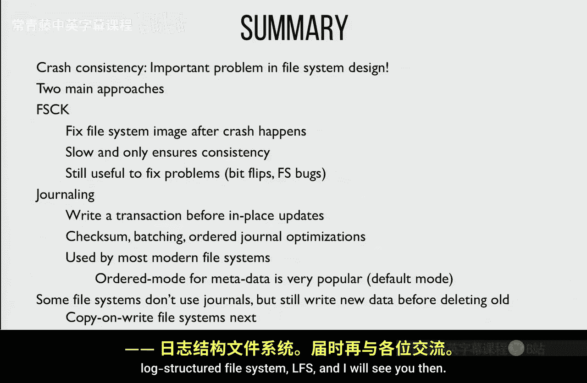
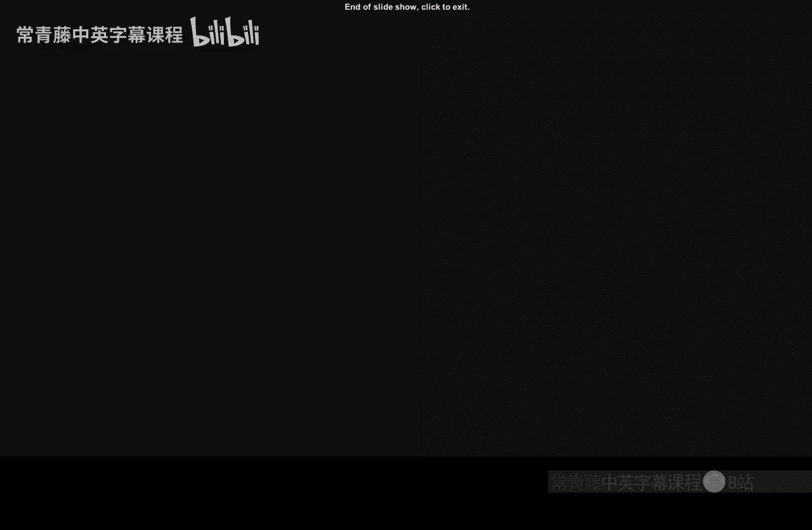

# 021：崩溃一致性 💥

在本节课中，我们将要学习操作系统文件系统中的一个核心挑战：**崩溃一致性**。当系统在更新文件系统数据结构的中间阶段意外崩溃（如断电、内核恐慌）时，如何确保磁盘上的文件系统状态仍然保持一致，而不是处于一个损坏或矛盾的中间状态。我们将探讨两种主要方法：离线文件系统检查器（FSCK）和日志记录（Journaling），并理解它们如何工作以及各自的优缺点。

---

## 课程安排与项目更新 📅

上一讲我们讨论了文件系统的基本操作，但忽略了操作的顺序问题。本节中，我们来看看如何通过特定的协议来保证这些操作的原子性，从而确保崩溃一致性。

以下是近期的课程安排：
*   **项目6**：正在进行中，将于本周五截止。
*   **项目7**：最后一个项目，将基于XV6文件系统，可能涉及实现更多现代文件系统功能或文件系统检查器，预计在课程最后一天截止。
*   **补考测验**：针对项目4得分较低的同学开放。
*   **内容测验**：现有关于文件系统操作的测验，有助于准备考试。

---

## 崩溃一致性的动机 🤔

为什么保证崩溃一致性如此复杂？因为文件系统包含许多相互关联的数据结构，如**inode**、**位图**、**目录块**。一个操作（例如向文件追加数据）可能需要更新多个结构，但磁盘只保证单个512字节扇区的写入是原子的。如果崩溃发生在多个扇区写入之间，文件系统就可能处于不一致状态。

考虑向文件 `foo/bar` 追加数据的例子，需要三个写入步骤：
1.  **更新数据块位图**：分配一个新的数据块。
2.  **更新inode**：将新数据块的指针加入inode。
3.  **写入数据**：将实际数据写入新分配的数据块。

如果崩溃导致只完成了部分写入，就会产生问题。以下是所有可能的不完整写入组合及其后果：

| 写入完成的部分 | 后果分析 |
| :--- | :--- |
| **仅数据块** | 文件系统结构完好，但用户数据丢失。 |
| **仅inode** | inode指向垃圾数据，且因位图未更新，该数据块可能被其他文件重用，导致**隐私泄露**和数据混淆。 |
| **仅位图** | 数据块被标记为已用但未被引用，造成**空间泄露**。 |
| **inode + 位图** | 结构一致，但inode指向未写入的垃圾数据。 |
| **inode + 数据块** | inode指向新数据，但位图显示该块空闲，导致数据块被其他文件共享，造成**数据混淆**。 |
| **位图 + 数据块** | 数据已写入但无法被访问（空间泄露），且丢失了此次追加操作。 |

显然，我们需要一种机制来确保这三个更新要么**全部完成**，要么**全部不发生**。

---

## 方法一：文件系统检查器 (FSCK) 🔍

第一种方法是事后修复。系统启动时，运行一个离线工具 `fsck`，扫描整个磁盘，检测不一致性并尝试修复。其核心思想是：利用文件系统数据结构中固有的**冗余**信息进行交叉验证。

例如，超级块记录了文件系统的总块数 `N`，那么所有inode中的数据块指针值都应在 `0` 到 `N-1` 的范围内。如果发现指针值超出此范围，即可判定为不一致。

`fsck` 会执行一系列检查，以下是一些典型的修复场景：

*   **场景1：位图与inode不一致**
    *   **问题**：一个数据块被inode引用，但位图中标记为空闲。
    *   **修复**：将位图中对应的位设置为1（已分配）。
*   **场景2：链接计数不一致**
    *   **问题**：两个目录项指向同一个inode编号，但该inode的链接计数为1。
    *   **修复**：将inode的链接计数修正为2。
*   **场景3：孤儿inode**
    *   **问题**：存在一个有效的inode，但没有任何目录项指向它（链接计数可能为0或1）。
    *   **修复**：在 `lost+found` 目录下为其创建一个新的目录项，从而“找回”该文件。
*   **场景4：重复数据块**
    *   **问题**：两个不同的inode指向同一个数据块。
    *   **修复**：为其中一个inode分配新的数据块，复制原数据，让两个文件各自拥有数据副本。
*   **场景5：非法指针**
    *   **问题**：inode包含指向磁盘范围之外的块指针。
    *   **修复**：清除该非法指针。

**FSCK的局限性**：
1.  **结果可能非预期**：`fsck` 的目标是达到**某个**一致状态，而不一定是**正确**的状态。它可能无法准确推断崩溃前的操作意图。
2.  **速度极慢**：需要扫描整个磁盘的元数据，对于大磁盘耗时很长（例如，600GB磁盘约需70分钟）。

因此，`fsck` 通常仅作为最后手段，在检测到严重错误时运行。

---

## 方法二：日志记录 (Journaling) 📝

更现代、高效的方法是**日志记录**（又称预写日志，Write-Ahead Logging）。其核心思想借鉴了数据库事务：在真正修改磁盘上的元数据之前，先将所有打算进行的更改描述（日志）顺序地写入磁盘上一个特定的区域——**日志区**。

### 基本概念与流程

1.  **日志写入 (Journal Write)**：将本次操作要修改的所有**元数据块**（甚至包括数据块）及其新内容，作为一个**事务**，顺序写入日志区域。事务以**描述符块**开始，以**提交块**结束。
2.  **提交 (Commit)**：当提交块成功写入磁盘后，意味着事务已持久化，可以保证被恢复。
3.  **检查点 (Checkpoint)**：将日志事务中的内容，真正更新到文件系统在磁盘上的实际位置（即inode表、位图等）。
4.  **释放 (Free)**：当事务中的所有更新都已检查点化后，就可以在日志中标记该事务空间为可重用。

### 崩溃恢复策略

*   **崩溃发生在提交前**：日志中的事务不完整（无提交块）。恢复时忽略该事务，相当于操作从未发生。
*   **崩溃发生在提交后、检查点前**：日志中有完整且已提交的事务。恢复时**重放**该事务，将更改应用到实际位置，从而完成被中断的操作。

这种方法确保了操作的**原子性**：要么事务全部生效（通过重放），要么全部不生效。

### 性能优化

基本的日志记录性能不佳，因为涉及大量等待磁盘确认的**屏障**操作。以下是关键优化：

1.  **校验和替代顺序屏障**：
    *   **问题**：必须确保事务数据块（描述符块、元数据）在提交块之前写入。
    *   **优化**：计算事务数据块的校验和，并将其写入提交块。恢复时，重新计算校验和进行比对。这样，所有数据块和提交块可以**一次性**发出，无需等待屏障，提升了并发性。
    *   **公式**：`提交块.checksum = CRC(事务中所有数据块的内容)`
2.  **批量处理与分组提交**：
    *   不是每个操作都立即写日志，而是将一段时间（如5秒）内的多个操作缓冲在内存中，合并成一个大的**事务组**一起提交。这减少了日志写入次数，并摊销了开销。
3.  **元数据日志与有序模式**：
    *   **数据日志**：将用户数据也写入日志，一致性最强，但性能差（数据写两次）。
    *   **元数据日志（有序模式）**：**只将元数据写入日志**，这是最常见的方式。为了保持一致性，它强制一个顺序：**必须先确保用户数据写入其最终磁盘位置，然后才能提交包含指向该数据的元数据的日志事务**。
    *   这样，恢复后元数据要么指向旧数据（一致），要么指向已成功写入的新数据（一致）。虽然用户可能看到新旧数据混合，但文件系统结构总是自洽的。
4.  **逻辑日志 vs 物理日志**：
    *   **物理日志**：在日志中存储待修改块的完整新映像。
    *   **逻辑日志**：在日志中只存储修改操作的逻辑描述（如“在inode X的字段Y写入值Z”）。当实际修改很小时，逻辑日志更高效。

---

## 总结 🎯

本节课中我们一起学习了确保文件系统崩溃一致性的两种主要技术：

1.  **FSCK (文件系统检查器)**：一种**离线、事后**修复方法。通过扫描整个磁盘，利用数据结构的冗余信息检测并修复不一致性。其优点是实现相对直接，但缺点是速度慢且修复结果可能不符合用户预期。
2.  **日志记录 (Journaling)**：一种**在线、预防性**的方法。通过**预写日志**机制，将更改先记录到日志区，再应用到实际位置，从而保证操作的原子性。现代文件系统普遍采用**有序元数据日志**模式，在保证一致性和性能之间取得了良好平衡。关键优化包括使用**校验和**、**分组提交**和**逻辑日志**。

需要强调的是，即使使用了日志，现代文件系统通常仍会保留 `fsck` 工具，以处理日志本身无法解决的磁盘介质错误或软件缺陷导致的损坏。

下一讲，我们将探讨另一种保证一致性的设计哲学：**写时复制**，并以**日志结构文件系统**为例进行深入分析。