# 023：固态硬盘的“潜规则” 🚀

在本节课中，我们将要学习固态硬盘的工作原理，以及操作系统和应用程序应如何与这种新型存储设备交互，以获得最佳性能和可靠性。我们将从闪存的基本单元开始，逐步深入到SSD内部的复杂管理机制，并总结出高效使用SSD的五条核心规则。

---

## 固态硬盘概述

固态硬盘是一种基于闪存技术的存储设备，没有机械运动部件。与传统的机械硬盘相比，SSD在读写速度和延迟方面具有显著优势。然而，其内部工作机制更为复杂，涉及页面、块、通道等概念，以及一个关键的**闪存转换层**来管理逻辑地址到物理地址的映射。

## 闪存基础：单元、页面与块

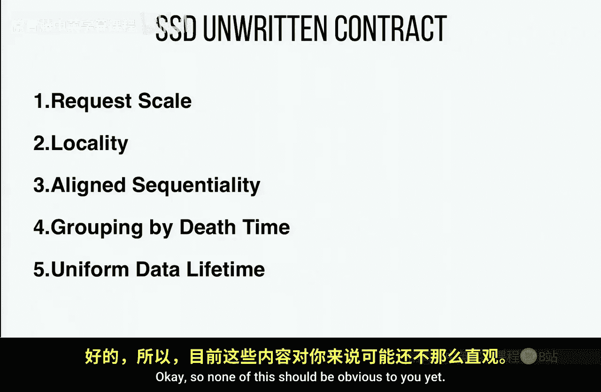

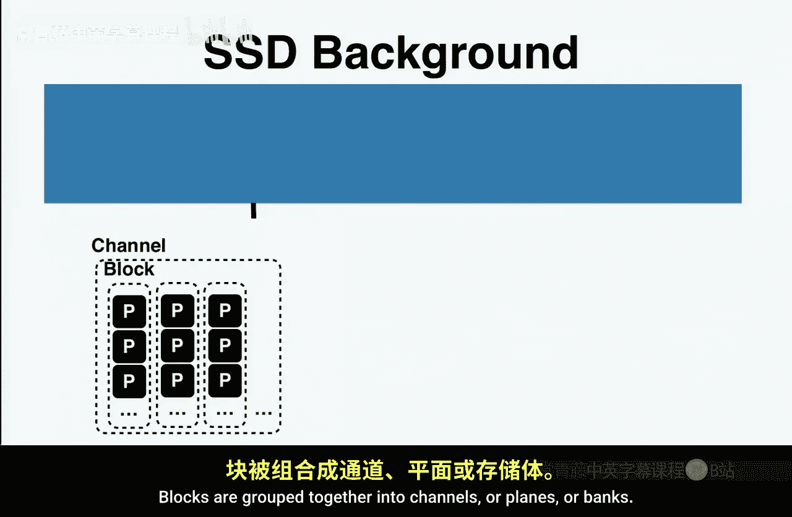

要理解SSD，首先需要了解其构建基础——闪存。

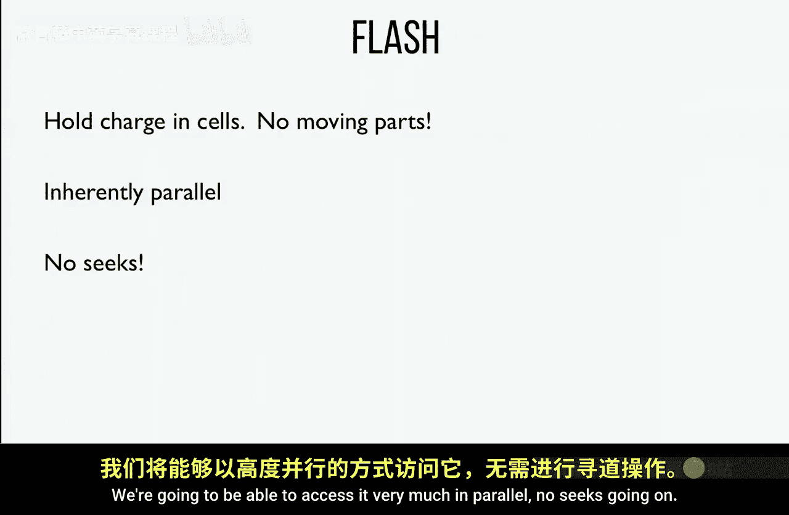

*   **单元**：存储数据的基本单位。一个单元可以存储一个比特（单层单元，SLC）或多个比特（多层单元，MLC）。SLC更昂贵、更耐用，而MLC容量更大但耐用性稍差。
*   **页面**：读写操作的最小单位。一个页面通常包含多个单元。
*   **块**：擦除操作的最小单位。一个块由多个页面组成。**关键限制是：要重写一个页面，必须先擦除其所在的整个块**。

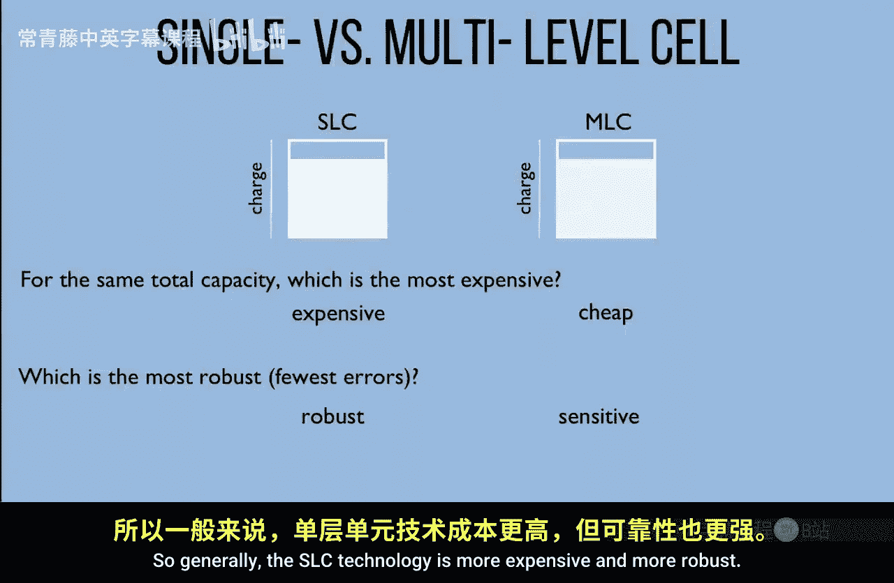

闪存的读写接口与硬盘不同：
*   **读取**：可以读取单个页面。
*   **编程/写入**：可以将已擦除块（内容全为1）中的特定页面从1改为0。
*   **擦除**：将整个块的内容重置为全1，这是一个相对昂贵且耗时的操作。

这种特性导致了**写入放大**问题：为了修改一小部分数据，可能需要读取、修改、擦除并重写整个块。

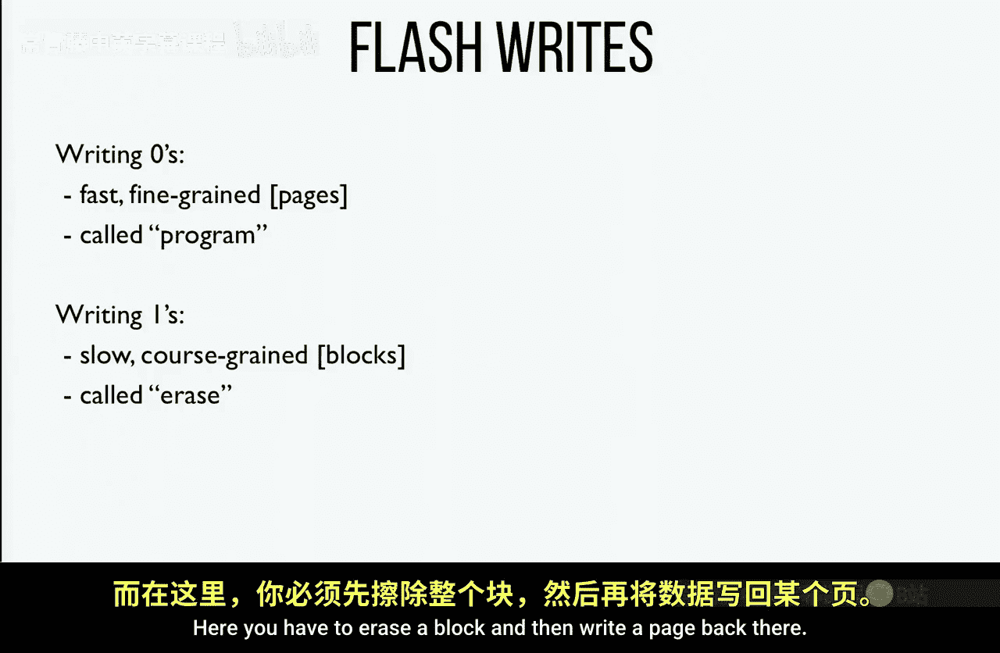

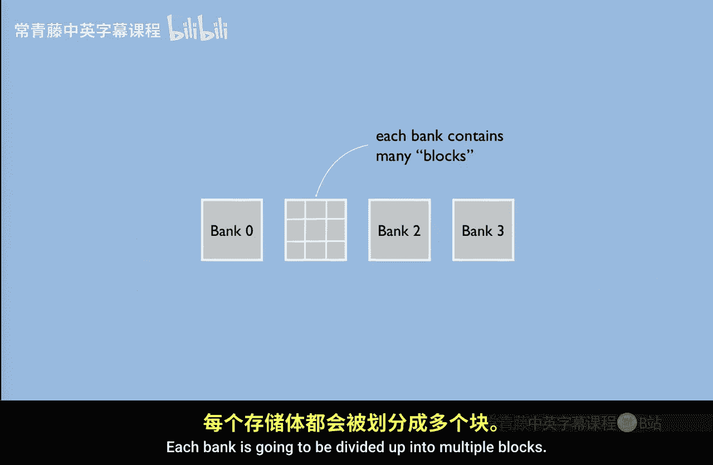

## 闪存转换层：SSD的智能核心

直接在闪存上运行未修改的文件系统（如FFS）效率很低，因为其细碎的写入模式会触发大量昂贵的擦除和块重写操作。

因此，现代SSD内部集成了一个**闪存转换层**。FTL为上层（如文件系统）提供了一个简单的**逻辑块地址**空间抽象，就像传统的硬盘接口一样。FTL的核心职责是：
1.  **动态地址映射**：维护一个映射表，将文件系统看到的逻辑块/页面地址，动态映射到闪存上的实际物理位置。
2.  **写入优化**：采用**写时复制**策略。当需要更新一个逻辑页面时，FTL会找到一个空闲的物理页面进行写入，然后更新映射表，将旧的物理页面标记为**无效**。这避免了原地更新带来的昂贵擦除操作。
3.  **垃圾回收**：定期回收那些包含大量无效页面的块。这个过程涉及将块中仍有效的页面复制到新位置，然后擦除整个旧块，使其变为**空闲**状态。
4.  **磨损均衡**：通过FTL的智能映射，将写入操作均匀分布到所有闪存块上，防止某些块因过度写入而过早失效，从而延长SSD的整体寿命。

FTL的映射策略对性能至关重要。纯粹的页级映射表会占用大量内存，而纯粹的块级映射则在处理部分页面更新时效率低下。因此，许多SSD采用**混合映射**策略，结合了两种方式的优点。

## 高效使用SSD的五条“潜规则”

基于SSD的内部工作原理，我们可以总结出以下规则，以帮助文件系统和应用程序获得最佳性能和可靠性。

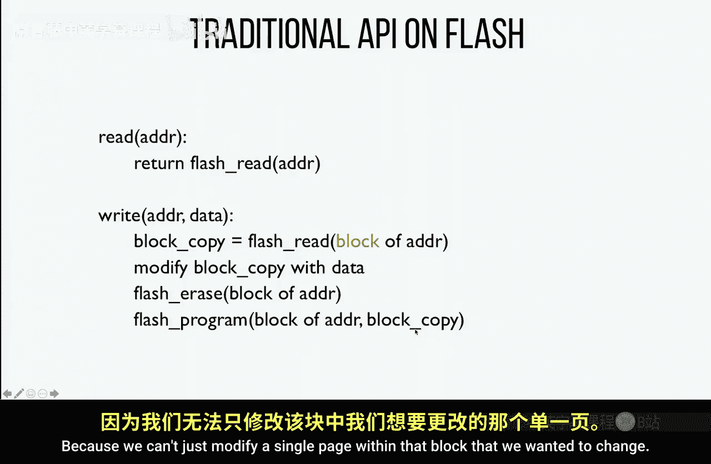

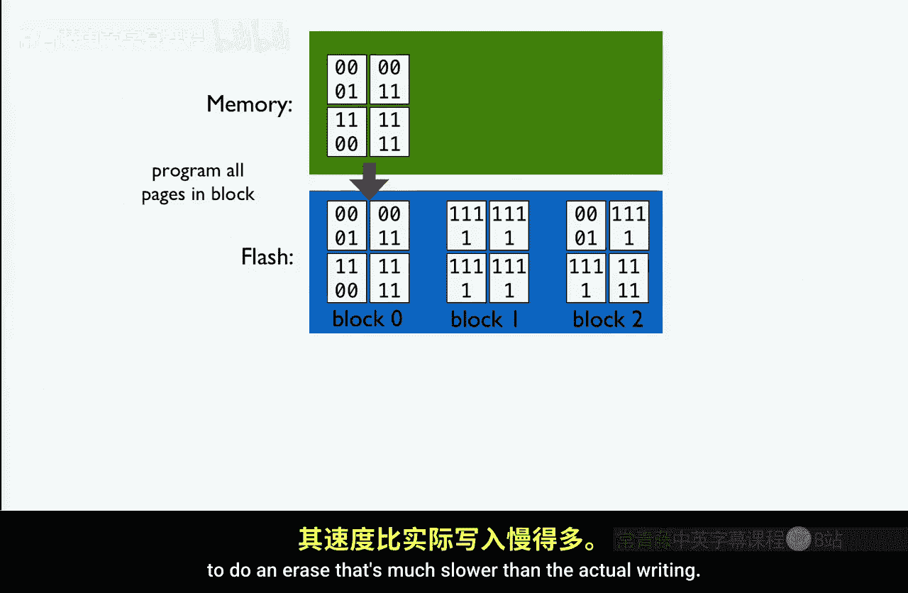

上一节我们介绍了SSD内部FTL的复杂工作，本节中我们来看看如何与它高效协作。

### 规则一：发送大量或大型请求 📨

SSD内部有多个可以并行工作的通道（或称为平面、存储体）。为了充分利用所有通道的带宽，你应该同时向SSD发送多个I/O请求，或者发送一个跨越多个通道的大型连续请求。

**核心原理**：`总带宽 ≈ 单个通道带宽 × 活跃通道数`。如果请求只涉及少数通道，就无法达到峰值吞吐量。

### 规则二：保持访问的局部性 🎯

FTL的映射表可能无法全部缓存在SSD的RAM中。频繁访问相同的逻辑块，有助于相关的地址映射信息保留在FTL的缓存中，从而加快地址转换速度。

**核心原理**：访问映射表的缓存命中率直接影响读取延迟。局部性访问能提高缓存命中率。

### 规则三：进行对齐的顺序写入 🔢

这个规则与SSD的混合映射和垃圾回收机制密切相关。以下是三种常见的合并操作，其效率由写入模式决定：

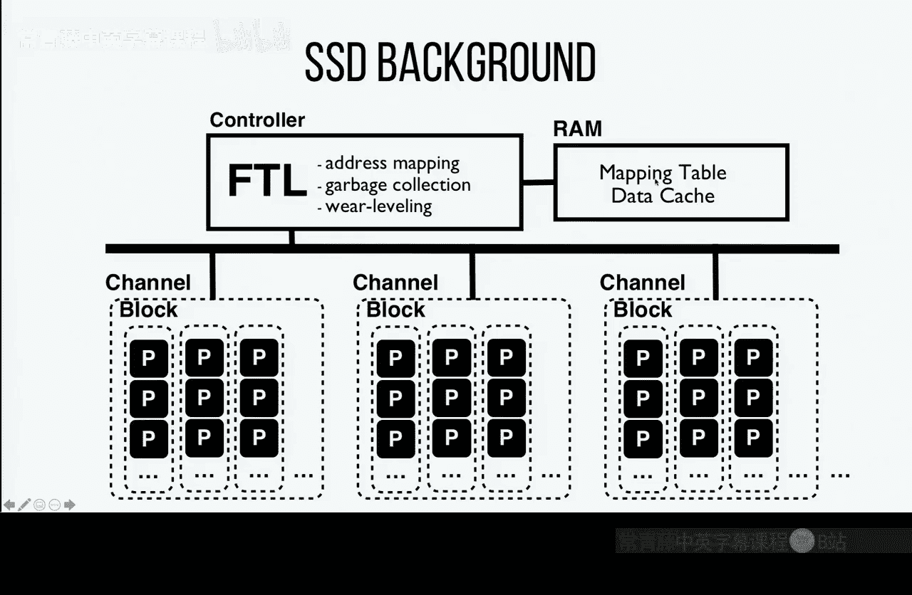

*   **完全合并**：当随机更新一个块内的少数页面时，FTL需要将新旧数据合并到一个新块，涉及大量数据拷贝，性能最差。
*   **部分合并**：稍好一些，但仍需拷贝部分数据。
*   **切换合并**：**最佳情况**。当你按顺序、从头开始完整地写入一个块的所有页面时，FTL可以简单地将整个逻辑块的映射指向这个新物理块，无需任何数据拷贝。

**核心原理**：`顺序且对齐的写入 → 触发切换合并 → 最小化内部数据搬运 → 最高写入性能`。

### 规则四：将生命周期相近的数据分组写入 ⏳

数据的“生命周期”指的是它被逻辑覆盖或删除的时间。如果同一个物理块内的所有页面都在大致相同的时间变为无效（即“同时死亡”），那么垃圾回收过程会非常简单：直接擦除整个块即可，无需搬迁任何有效数据。

反之，如果一个块内混合了“长寿”数据和“短命”数据，垃圾回收时就必须搬迁那些仍然有效的“长寿”数据，产生额外的写入开销，并可能导致性能波动。

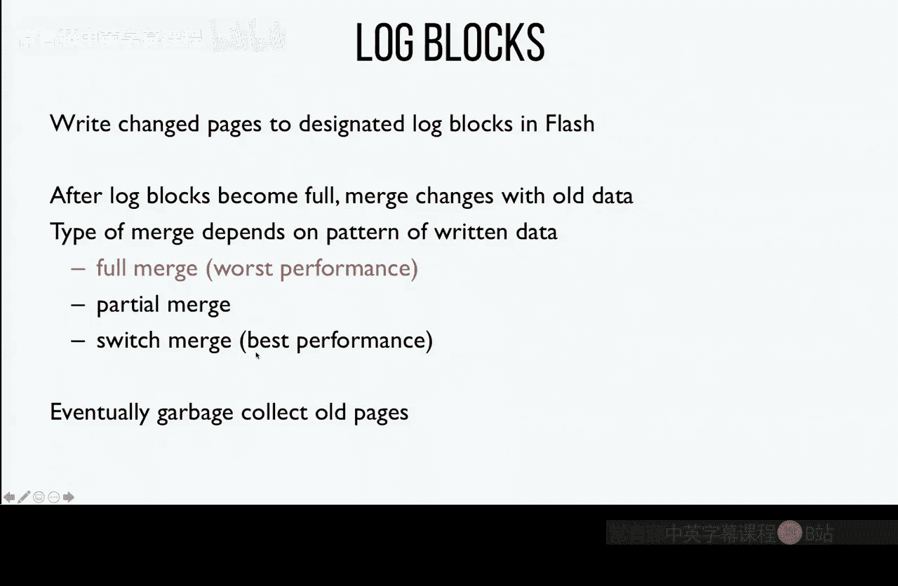

### 规则五：确保数据具有均匀的写入寿命 ♻️

这条规则关注的是**磨损均衡**。如果某些数据（如日志文件）被频繁重写，而另一些数据（如存档照片）几乎从不更新，那么存储频繁重写数据的闪存块会更快磨损。

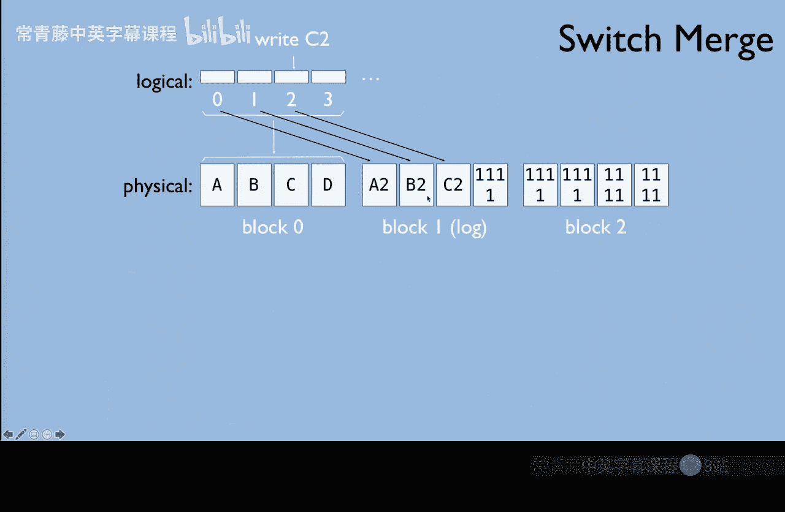

理想的状况是所有数据都具有相似的重写频率。这样，磨损会自然均匀分布。否则，FTL必须主动进行磨损均衡操作，在后台移动那些“冷”数据，这也会消耗资源和带宽，可能影响前台性能。

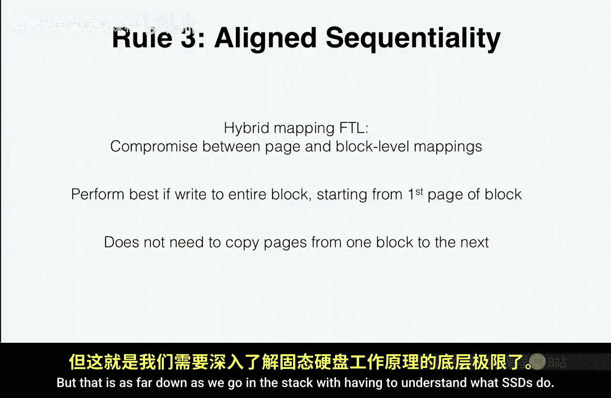

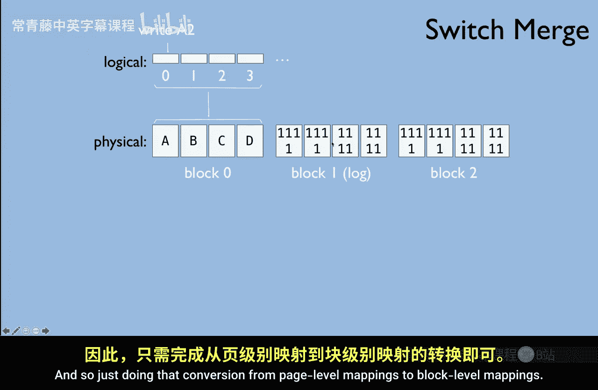

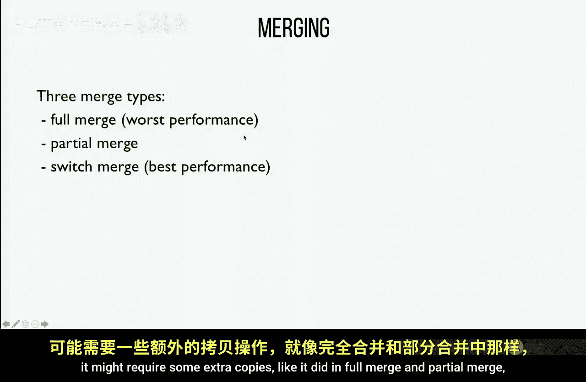

**核心原理**：`均匀的写入负载 → 自然的磨损均衡 → 更高的设备可靠性和更稳定的性能`。

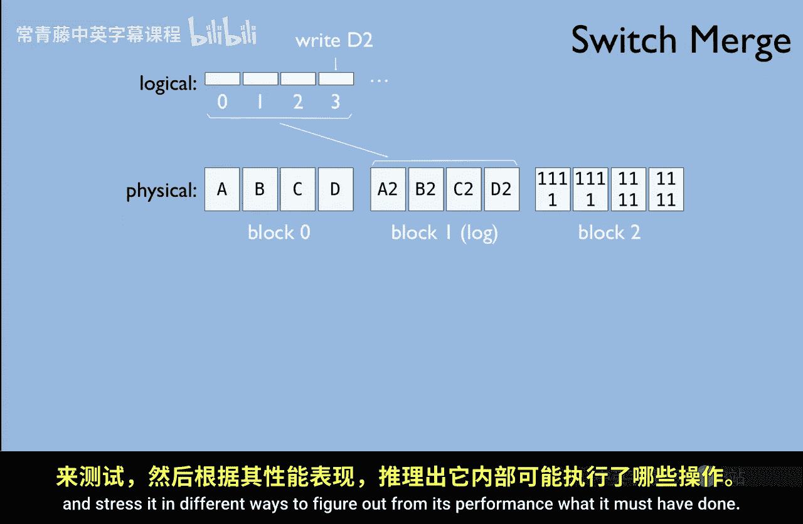

---

## 总结

本节课中我们一起学习了固态硬盘的核心知识。我们了解到SSD并非简单的“更快硬盘”，其基于闪存的特性带来了独特的接口（擦除-编程）和挑战（写入放大、磨损）。SSD内部的**闪存转换层**通过动态地址映射、写时复制、垃圾回收和磨损均衡等复杂机制，向上层提供了简单的块设备接口。

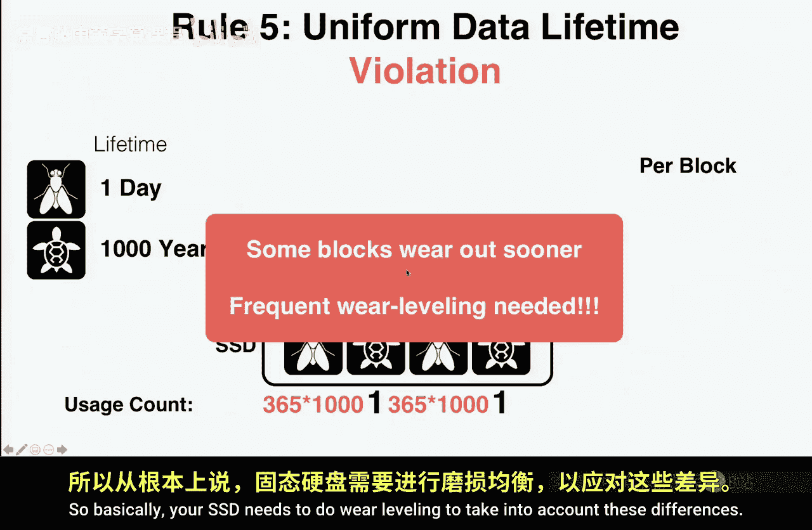

最重要的是，我们总结了高效使用SSD的**五条规则**：
1.  利用并行性：发送**大量或大型请求**。
2.  利用缓存：保持**访问局部性**。
3.  优化内部操作：进行**对齐的顺序写入**以触发切换合并。
4.  简化垃圾回收：将**生命周期相近的数据分组**。
5.  促进磨损均衡：尽量让数据具有**均匀的写入寿命**。

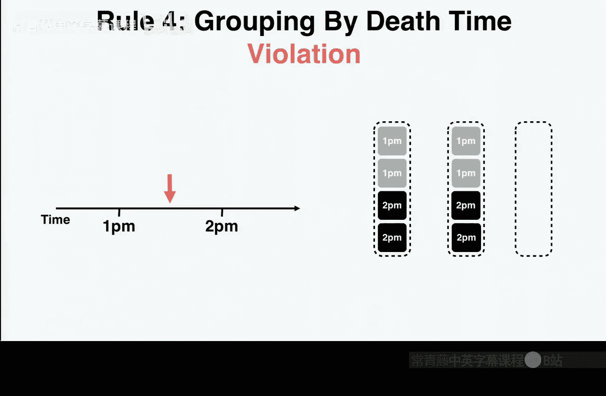

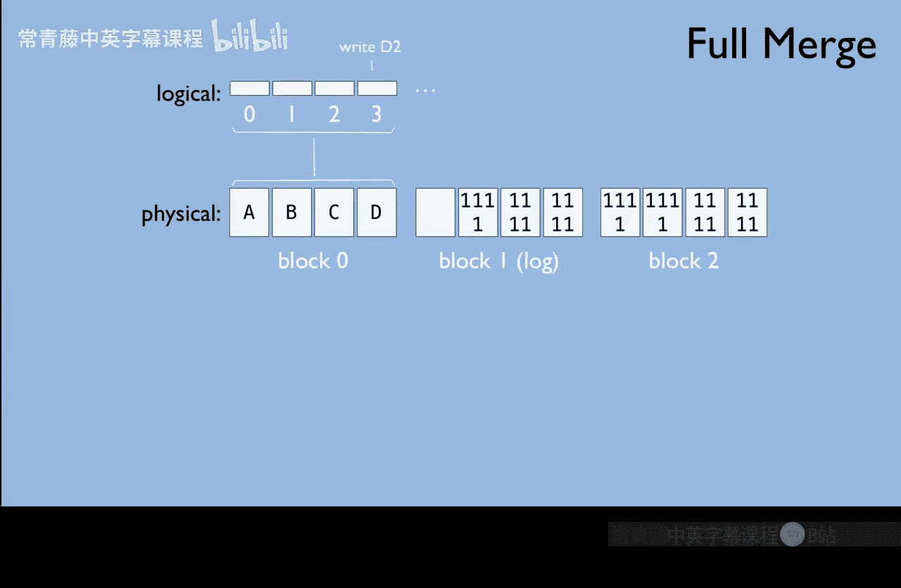

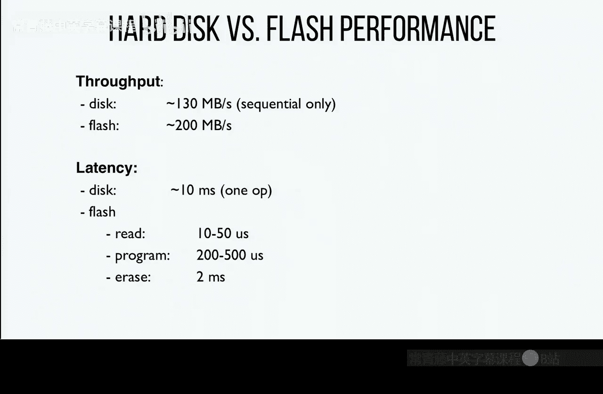

对于文件系统开发者（如LFS这类日志结构文件系统就与SSD非常契合）和应用程序员（如数据库设计）而言，遵循这些“潜规则”是释放SSD全部潜力的关键。