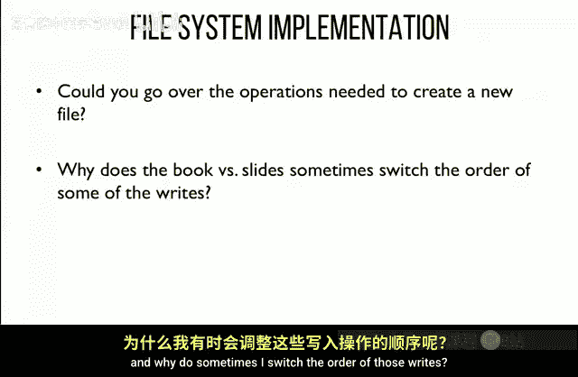
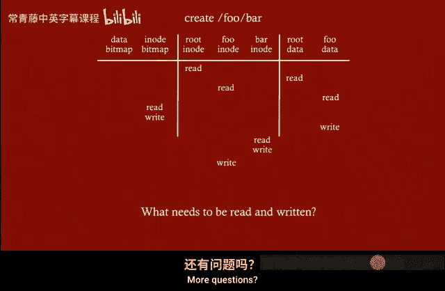
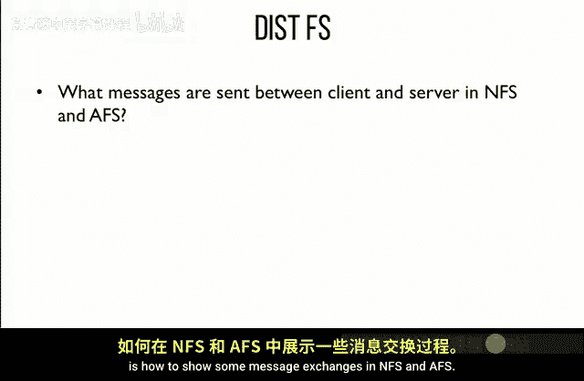

# 025：持久性复习

## 概述
在本节课中，我们将回顾本学期关于操作系统持久性部分的核心概念，涵盖从I/O设备到分布式文件系统的关键知识点。我们将通过解答常见问题来巩固理解。

## 课程内容回顾

### 虚拟化与并发
上一节我们介绍了操作系统的三大角色。首先，操作系统提供虚拟化，为每个应用程序提供独占CPU和内存资源的假象。CPU的抽象是进程或线程，内存的抽象是地址空间。关键机制包括**受限直接执行**、CPU调度策略（如最短作业优先、轮转调度）、地址转换（分段、分页、TLB）以及页面置换策略（如LRU）。

其次，操作系统管理并发，确保并行运行的线程或进程能有序访问共享状态。我们学习了**锁**、**信号量**和**条件变量**，以及如何基于**测试并设置**等原子硬件指令实现它们，并用其解决哲学家就餐或读者-写者锁等问题。

### 持久性核心目标
本节中我们来看看持久性。操作系统的核心目标是确保数据在重启、断电或不同应用程序间能够长期存在。这带来了处理崩溃和保证文件系统数据结构一致性的挑战，同时还需考虑底层设备的性能与可靠性特性。

### I/O设备与磁盘
以下是关于I/O设备和磁盘的关键点：
*   **设备交互协议**：操作系统通过状态寄存器轮询设备，先写入数据，再写入命令。顺序不能颠倒。
*   **性能优化**：引入**中断**和**DMA**可以避免CPU空转，提升性能。
*   **磁盘结构**：磁盘由盘片、磁头、磁道、扇区和柱面组成。双面盘片每面都有一个读写头。
*   **访问时间**：磁盘访问时间 = **寻道时间** + **旋转时间** + **传输时间**。顺序访问性能远优于随机访问。
*   **磁盘调度**：调度算法（如**SCAN（电梯算法）**、**C-SCAN**）旨在减少寻道时间。**工作守恒**调度器在有工作时绝不空闲，而**预见性调度**等非工作守恒调度器可能为了更好的整体性能而暂时等待。

### RAID（独立磁盘冗余阵列）
以下是关于RAID的关键点：
*   **核心指标**：**吞吐量**（每秒数据量）、**延迟**（单次操作时间）、容量和可靠性。
*   **RAID级别**：
    *   **RAID 0**：条带化，无冗余。
    *   **RAID 1**：镜像，提供冗余。
    *   **RAID 4**：专用奇偶校验盘，写操作存在瓶颈。
    *   **RAID 5**：分布式奇偶校验（**左对称布局**），通过异或运算实现冗余，能承受单块磁盘故障，随机写性能约为单盘的1/4。

### 文件系统实现
以下是关于文件系统实现的关键点：
*   **分配方式**：**链接分配**（如FAT表）将指针存入数据块或专用表，利于缓存但随机访问性能差。
*   **关键结构**：**i节点**存储文件元数据和数据块指针。**间接块**包含指向数据块的指针。**目录**是包含（文件名，i节点号）映射的特殊文件。
*   **更新粒度**：由于i节点小于磁盘块，修改i节点需要**读-改-写**整个块。
*   **文件大小计算**：根据i节点中直接指针、间接指针、双重间接指针的数量和块大小，可以计算文件系统支持的最大文件大小。
*   **文件创建流程**：创建文件涉及读取目录i节点和数据块、分配i节点（更新位图）、初始化新文件i节点、更新目录数据块和目录i节点等多个步骤。

### FFS（快速文件系统）
FFS通过**柱面组**将i节点与其数据块就近存放，以提升性能。策略包括：为新目录选择i节点空闲较多的组，为大文件（使用间接块时）选择数据块空闲较多的组。此外，由于早期系统延迟，FFS采用**扇区交错**放置以获取一半的峰值带宽。

### 日志与一致性
文件系统需确保元数据在崩溃后保持一致。**日志**（如ext3）通过以下步骤实现：
1.  **日志写入**：将事务（包含描述块、元数据/数据、提交块）顺序写入日志区域。
2.  **提交**：写入提交块，标志事务日志已安全落盘。
3.  **检查点**：将日志中的内容写回文件系统的实际位置（检查点区域）。

恢复时，若找到完整提交的事务则重做（redo），否则丢弃。**仅元数据日志**是常见优化，其中**有序模式**确保用户数据先于元数据写入日志，防止指向无效数据。

### LFS（日志结构文件系统）与闪存
LFS采用**写时复制**，将所有更新（包括数据和新i节点）顺序写入日志结构的段中。它非常适合**闪存**设备，因为闪存需要先擦除大块再编程页，随机写会导致严重的**写放大**。顺序写的LFS能减少擦除次数，提升闪存寿命和性能。闪存内部的**FTL（闪存转换层）** 负责磨损均衡等管理。

### 分布式文件系统：NFS与AFS
以下是关于NFS和AFS协议的关键点：
*   **NFS（无状态）**：
    *   **打开**：客户端通过`lookup`从服务器获取文件句柄。
    *   **读取**：客户端缓存数据块，并通过`getattr`定期检查服务器上文件的修改时间（属性）以验证缓存有效性（如3秒内无需检查）。
    *   **写入/关闭**：保证在`close`时将脏数据写回服务器。
    *   **一致性**：基于属性轮询的弱一致性模型。
*   **AFS（有状态）**：
    *   **打开**：服务器执行路径遍历，将整个文件发送给客户端，并建立**回调**承诺，若其他客户端修改文件将通知该客户端。
    *   **一致性**：基于回调的更强一致性模型，可扩展性更好，但更复杂。

## 总结
本节课中我们一起回顾了操作系统持久性部分的核心内容。我们从I/O设备和磁盘的基本原理出发，探讨了RAID如何提供冗余和性能，深入分析了文件系统的实现细节（如i节点、目录、FFS策略），学习了如何通过日志机制保证崩溃一致性，比较了LFS与传统文件系统在闪存上的优劣，最后剖析了NFS和AFS这两种分布式文件系统在设计哲学和一致性模型上的根本区别。理解这些概念对于构建可靠、高效的数据存储系统至关重要。