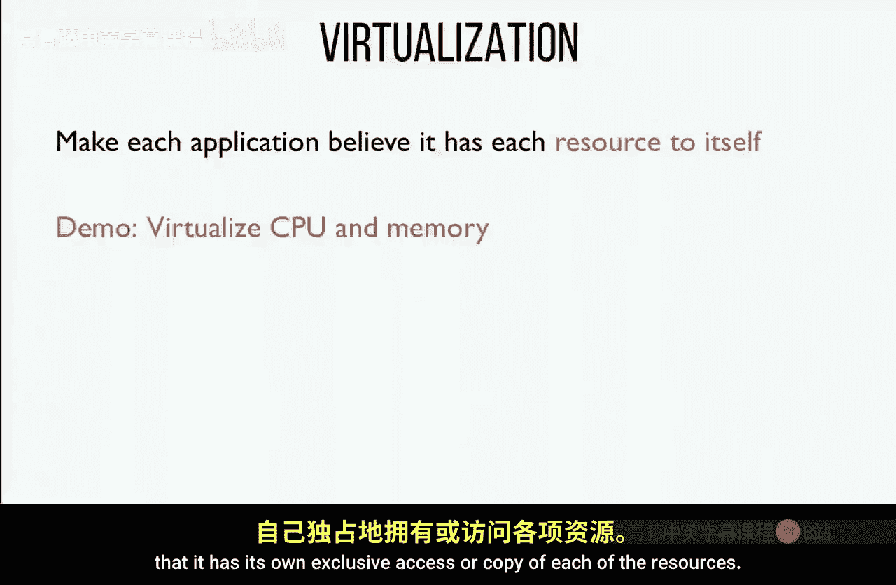
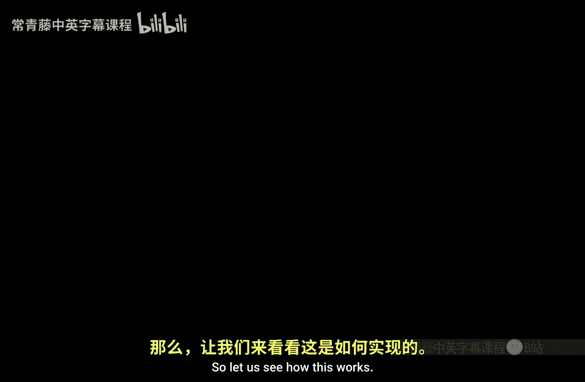
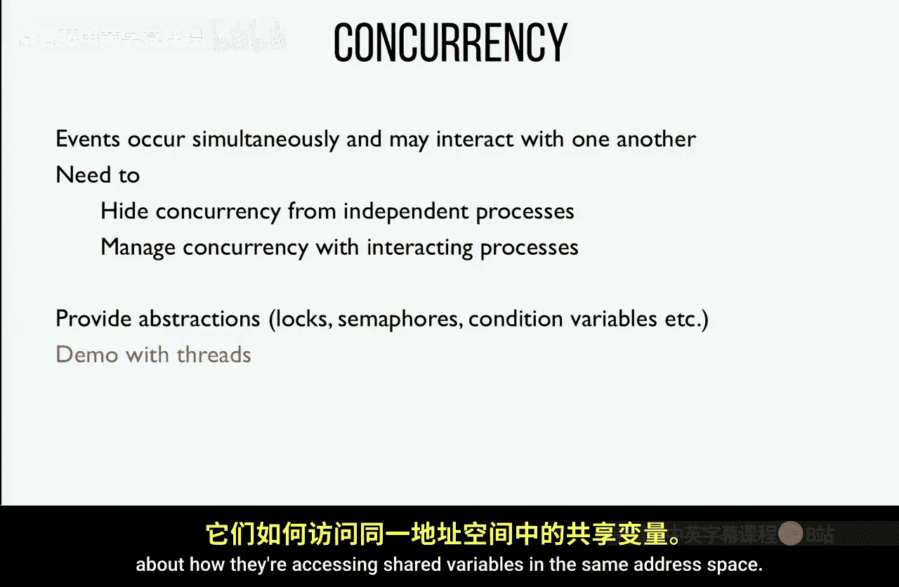
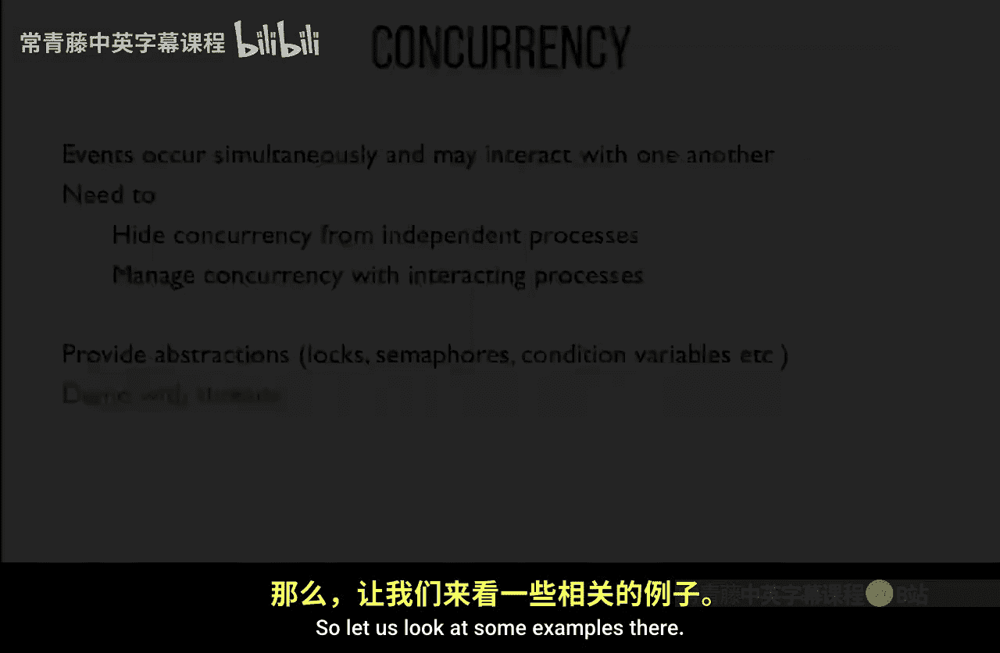
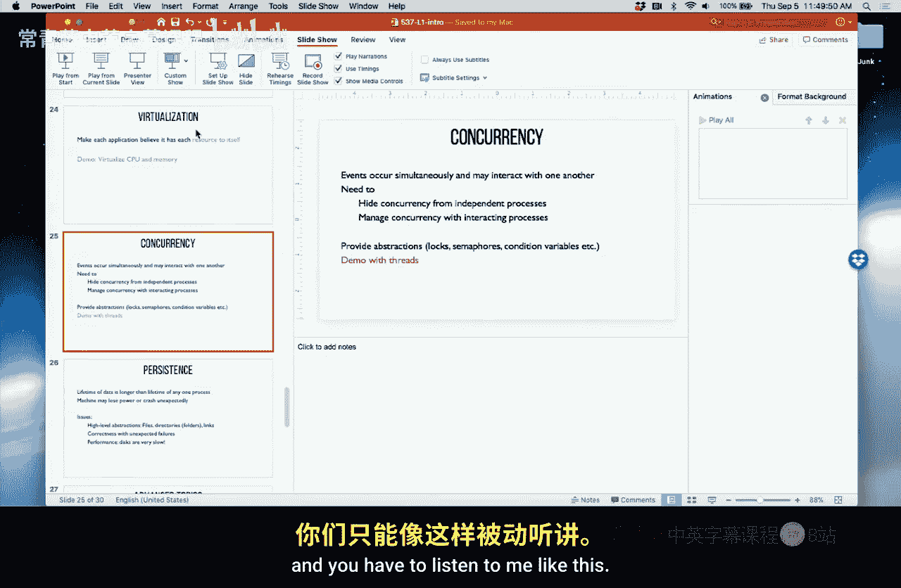
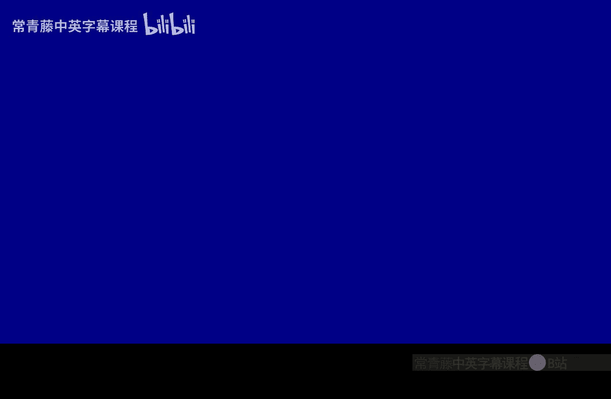
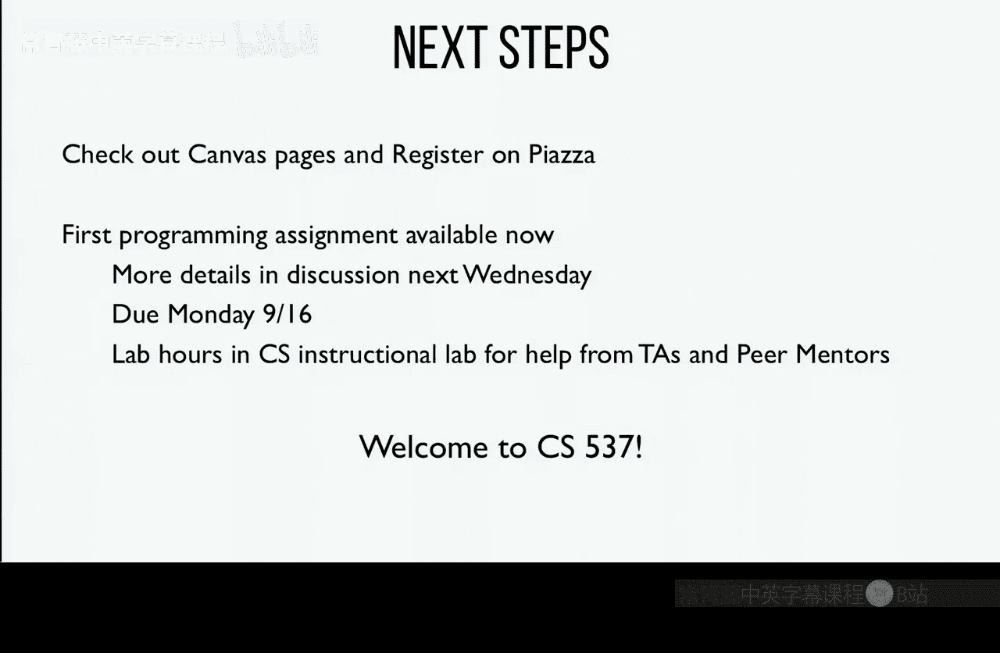

# 威斯康星大学【中英⚡操作系统｜CS 537 Fall19, Introduction to Operating Systems】 p01 P1 Introduction To Operating Systems _ University of Wisconsin-Mad -BV1wUzSB3Ecf_p1-

All right。Hello， everyone。Okay， so welcome， everyone to CS S 537。

 It is totally awesome to see such a lively class。 You all look so happy today to see one another and to be here。

 I really hope that that enthusiasm carries through the entire semester。

 So I think this is a great class。 It's certainly my favorite class to teach for 500 level undergrads。

 I guess it's the only one I teach， but I do think it really is the best。

 you're going to learn a lot。 you're going to do a lot of projects。

 but you're really going to understand how the whole computer system works when you're done with his class。

 So today I thought I would start by introducing myself a little bit。

 My name is Andrea Arpache do so。 I got my PhD quite a while ago from UC Berkeley。

 I did work at that time on implicit coordinated scheduling a parallel job。

 So I did a lot of work with scheduling back then。 I then had a very brief postdoc at Stanford while I was waiting for my husband to finish his PhD。

 So I had to wait a little bit for that。 And when I was there I actually taught。😊。

O course there to try things out on those Stanford students before I perfected it so that I could do a better job for you all。

While here at Wisconsin， I mostly teach CS S 5，37。 I also teach 7，36。

 which is the graduate advanced operating systems。 And then sometimes the graduate distributed operating systems。

 Another fun class that I created that I sometimes teach is this C 402。

 which you may have heard about， it's the service learning course where we teach you how to teach fourth and fifth graders about programming and computer science。

 So if you have some free time in your schedule and you want to change a pace。

 It's a very different course from this one。 But I encourage you to look into CS 402 at some time in your time here。

😊，I spent a lot of time on research。 I advise many masters and PhD students。 My colleague。

 Remszi and I have co-advised about 25 PhD students at this point。

 They're mostly in file and storage System research。

 So I'm pretty active in the operating systems research community。 I was the cochair of O SDI。

 our premier O S conference last year。 And then last year， Remsey， my colleague and husband。

 And I won this Saps Mark Weiser Award for our work in storage systems。

 And that's the top award for people on systems。 So I guess I'm doing pretty well right now。

 and it's going to be all down you from here。😊，Okay so what should you call me。

 I still really do like that title of Profes it just makes me really happy。

 so if you call me Professor Andrea， I like that if you call me Professor do so that would work。

 Professor Apaache do so isn't unique， but Professor do so that will identify me since I was do so before we hyphenated to our Apache do so。

 but if you don't like using those terms just call me Andrea。

 don't call me Ms or misses or anything like that it's either professorfe or my first name。Okay。

 so what are we going to do today， I'm going to start with the very practical stuff。 all of the。

 what exactly are you going to do， And then I'll get more into the motivation for what is an operating system。

 What are its roles and why do you want to take this course。Okay， so the nitty gritty details。

So what are you going to know by the time you're done with this class。

 So you'll know what an operating system is and the role that it plays in systems。

 you'll understand how the O S virtualizes all of these different physical resources。

 like memory and CPU and disk and the abstractions that it provides for those resources to user level applications。

 And you'll understand how to implement those abstraction， given today's architectures。

 given their hardware。We're going to do a lot of work with multi threaded applications。

 You'll learn how to write them correctly using these different synchronization primitives like locks and conditioned variables in sehores。

Youll learn how we make information persistent through the file system。

 even though we might have crashes or power failures at arbitrary bad points in time。

You're gonna to be doing a lot of programming projects in C。

 These might be more openended than you're used to in the past。 I mean。

 they have a well-defined spec。 There's something that you definitely have to get exactly right and have the exact output。

 but we might not be guiding you through that process as much as you're used to from other classes。

 And some of those projects you'll work on your own and some of the project partner。And then finally。

 a lot of your projects are either going to be using existing system calls in existing operating systems。

 or there's this。X V6， which is this small kernel that we emulate that you get to modify that kernel operating system and see what that infrastructure looks like。

So lots and lots of things you are going to do in this class。 It is not an easy class。

 It's not one that you should be taking when you have a really heavy load。

 you should be able to put a lot of time into this class。 Okay。

 so I think I hope you all know that coming into this。 This is not an easy class。

 If you have a difficult semester。 There's a lot of people on the waiting list。

 they would love it if you drop the course。 You know， the sooner you drop the course。

 The happier everybody is。 They'll get a seat， you'll be relieved。

 You can take this course another semester。 but it's always a lot of work。

 no matter what semester you take it。 It's going to be a lot of work。😊，Okay。

 so what are we really do in here。 So your grade is going to be based on two things。

 You can view it as lecture content and then these projects。

 So lecture content will have two midterm exams in a final。

 I like having two midterms instead of just one because I think it like lowers the pressure and the stakes on each of those exams。

 So if you do poorly on one， it doesn't matter quite as much to your overall grade and it keeps you motivated and focused on the material at asteadier pace than if there's just fewer exams there。

Yeah， yeah， yeah。 So we had to run these huge， multiple choice exams now because there' are so many of you。

 but we've gotten pretty good at making those multiple choice exams。

Those exams will just cover the concepts that we talk about in class。

 We might have a few homeworks that would be part of that 50%。 I've never figured out how to do that。

 I always think maybe we'll start having homeworks this semester。 And it hasn't happened yet。

 but maybe it will。 But the thing I do want to start this semester to encourage you all to have study groups。

 So for some reason， I've always encouraged grad students and the grad classes to form study groups so that they would talk through material and get to know more people。

 But I had never dawned on me that maybe undergrads could benefit from this too。

 And I talk to some undergrads and they said， yeah， we'd like to talk with our peers about material。

 So I'm going to encourage everyone to form a study group with about five other people。

 And it's not like it'll be a big part of your grade。 maybe it's just some bonus points。

 But you are having some people that you're talking about the lecture content with。

Because I think it's easy to just obsess about the projects。 but really， you know。

 the projects are worth 50% of your grade， but the lecture content is the other 50。

 So don't forget that lecture content。Okay projects。

 So we have eight programming projects in this course。 that's the same as every semester。

 though sometimes in the past， for some reason， we called it 5。

 And then we would say there was like a1 A and1 B and a2 A and 2 B。 we had this very weird numbering。

 So now well， be honest， there's exactly 8 projects。

The idea here is that you'll learn how to modify the O S。

 You'll learn how to use the O S and have a lot of fun with those projects。O。

 so you're all in lecture。 So you know what time lecture is held at and where it's here that I'll be giving these rather formal slides。

 though certainly I will love it when you all ask questions。

 I'll ask some questions to you all that are usually pretty basic。

 just to make sure that you're understanding。 and then you know， you know， they have quantitative。

 concrete answers just to make sure that you're following what's going on。😊。

So you'll have reading that matches each of these lectures will show where that is in the textbook。

 blah， blah， blah。Then the other part of this class， as you know。

 is that you're all signed up for a discussion section。

 The idea of those discussion sections is for you all to have a smaller group where you can talk about the projects and have some like handson experience of looking at the code。

 So the idea is that those will be T A La and that you should usually bring your laptop to the discussion sections and they'll either go through the projects and let you answer questions and kind of go through that stuff。

 or maybe we'll have a review session in there before the midterms。

 So those will be more flexible and well kind of see what happens in those discussion sections。

 my goal originally was it wouldn't be great if we could have like 20 students in a discussion section。

 But there's 70 of you in each discussion section。 So they're not really a small classroom environment that I originally helped for there。

😊，Okay， we have a ton of people to help you in this class。 All right。

 so look at how many people are there。 We have seven teaching assistants。

 Those are all graduate students in the Cs department。 Most of them are interested in systems。

 they like this type of stuff。 they'll be very able to help you。 The peer mentors。

 They are students like you who took 5，37 last semester。

 and they did really well and they want to do this。

 And so they are all going to have a lot of lab hours where they're in the instructional lab。

 And if you have questions， they will help you with your code and kind of figuring out the projects。

😊，So some groups of them will be helping with all the discussion sections。

 but it's mostly that they'll be answering your questions on Piazza and then having all these lab hours that you can go to and work through your code with them。

So I'm gonna encourage you to think about being a peer mentor next semester。

 If you're a student that ends up really liking this。

 you will be the future peer mentors for the next group， right。

 And maybe some of you recognized some names on that list。 They are your classmates。

 A lot of them or some of them were peer mentors for 3，54 last semester。

 and they liked being peer mentors。 So they wanted to continue doing that。😊，Okay， allright。

 so let's start looking at some。Links， let's look at Candace。Great， that's showing。Okay。Alright。

 so in canvas， this is what the web page looks like。 I haven't used Can for this course before。

 I'm not a great canvas webp page designer。 So it looks very， very boring。 We have lots of outlines。

 The materials there， but it's not。Too awesome looking。 Okay。

 so what can you find here if you haven't looked yet。Overview and prerequisites。

 That's pretty straightforward。Our schedule。You'll see what we're going to talk about each week。

 there's the readings in this textbook I'll be talking about that covers our content。

 and then after class I'll post the slides that we go over there。Materials。

You should look at this page for some basics on needing to review and see。

 There's a good review lecture discussion section going over C and what you might want to do there。

 So these recorded。Videos for discussion sections end up being particularly useful because when the person is walking through code。

 that's when it's really most useful to have a video that you can stop。

 that you can kind of go through the code until that point。

 and then continue on when they've caught up with you。

 So I'm a big advocate for videos for looking at code。

 but not a big fan of using videos to replace lecture。 But we will talk about that later。😊，Okay。

 so this tells you about the C stuff， and it also tells you about the book that we use here。

So this is a book that closely matches our class that Remsi and I put this together。 though。

 when you read it， you'll note that it's mostly in his voice that he's a very humorous person。

 And and I'm a very like， here's the five things we need to know。 So I give it some structure。

 And then he made it fun to read of that。 So if you find the book funny， it's because of him。

 if you find it well organized。 Then you can say， maybe I had something to do with that。 But。😊，Maybe。

嗯。So you can get all the individual Pds totally free。

 But if you'd like a printed copy of the book or you want a Pf that has all the chapters together。

 then you can get it for a small fee。O， but that book is required in some form。

 You better do that reading if you're hoping to understand what's going on here。O。

 we have a ton of T As and peer mentors。 As I said， you can look at all of their nice pictures here。

 if you'd like。 so you can figure out who's who。If you want to go to the lab office hours。

 So we'll have them most every day， basically from 10 in the morning to 10 at night。

 I think it's not 100% consistent。 But we try to have a lot of that。

 And the way that it works is you're sitting in the lab。

 you fill out this form and you say what machine you're sitting at and what your general problem is。

 and someone in the lab should come over and talk to you。So that is what we were hoping will happen。

 And then our lab hours will make available on this calendar。

 So you'll see we have some lab hours starting today。

 They won't have a ton of peer mentors and Tas there because I don't think you're gonna to have a whole lot of questions。

 I am going to make the first project available。 if you're feeling rusty and C and worried about C。

 please get started as soon as you can because I think this project should be just like it's checking your prior knowledge。

 it's extremely straightforward。 So if you're struggling with this at all。

 you're really going to need to put in some background time covering that stuff。

 So the lab hours at the beginning are going to be very empty。

 The Ts will be happy and thrilled to talk to you and go over pointers and memory allocation。

 if you're asking those questions at the last minute， you're not going to have as happy of Ts。

 So do that stuff earlier。 if you think you're going to need more time。😊，Okay。

 what am I looking at now。What else is here， Oh projects， All right， I love projects。Okay。

 so our projects， those are all in C and they will be posted here。

 The first one is available already as I said in our next discussion section， next Wednesday。

 the Ts will go over the details of this but if you think it's going to be difficult for you you know definitely look at this before Wednesday and then itll be due the Monday after that。

 and then projects will be due about one week every week after that point with a little bit of slack around midterms And so sometimes we'll have two projects available to you so that you can look at them because some of them are going to be much harder。

 then you can get done in a few days。 Okay， so this first project is basically just doing a lot of file IO kind of at the user level。

 pretty straightforward see stuff。😊，Okay， other stuff on here。

You'll see our policy for academic integrity。 I'll go over that later。 exams， as I said。

 we'll have two midterms in a final。 I'm pretty particular about exam conflicts since it's a large class。

 There's this very regimented thing you need to do if you're going to have a conflict show me your schedule。

 show me all this official stuff so that we can get another room for you。But that is very boring。

 So I think we are done with looking at canvas。Great。

So the other thing you should all be aware of is we are using piazza this semester。So please。

So please register whatever you need to do to access that piazza site。

 What's really awesome is we have so many Ts and peer mentors。 like someone posted a question。

 And I thought， oh， I'm happy to answer the first question。

 And like two peer mentors had already answered it。

 So I think that we're gonna have a very good staff。

 that's going to be able to help you out and be pretty responsive to questions that you have there。

 one thing， there's a very brief interval where I had two piazza pages associated with 5。

37 because I was experimenting。 And I didn't know that the system automatically created one。

 So I saw that like9 people had registered and found the wrong one。

 So I turned that one to be inactive。 So if you find that the page you were looking at becomes inactive。

 That's what happened。 Look for the real one。😊，Alright， that's our textbook。 Okay。

 academic integrity。 So there's a lot of programming that you do in here。

 And students often get pretty stressed， and deadlines come and people get unhappy and they get desperate。

 So it is not unusual in many C S classes for students to borrow code from other students or to look online and find solutions from previous years。

So we definitely see that a lot， especially because projects theyre related to previous semesters。

 They're not exactly the same， but they're similar。So we do run。

 and I am particularly a fan of doing this。 We do run these automated tools that look for similarities between your code and all of the other students code in the class。

 And I can look at that code compared to other students previous semesters as well。

 though that takes more time。 Just more computation time somewhere off there。

 And those tools are pretty sophisticated with looking at the internal structure of things。 You know。

 it totally ignores exactly how you。Structure certain things and names that you used。

 so we're pretty good at finding similar code。 We will do that quickly and you will get no credit for anything that looks like it's copied。

 So by all means， do not copy code， we will figure it out that you've done that and you will be very。

 very unhappy that you did that okay。All right。 okay， so I think that's all of the。嗯。

Mechanics of things。So I'm going to completely switch gears now and say why this is a fun topic and why we all want to do this。

 So this is the content for today。 What is an operating system。😊。

So I think we all have kind of a intuitive feel for what an operating system is because we've used lots of different operating systems。

 You could define an operating system as just whatever it is that these things do。

 These are certainly kind of general purpose operating systems。

 O Ss that would work on laptops or desktop based machines。

 That's mostly what we're going to be talking about in here。

 We're not going to be talking about O Ss for mobile devices or realtime embedded things。

 stuff like that。Okay。So another way we can define an O S is to look at a stack。

 And so we know what the other things are in this stack。 Certainly， we all know what users are。

 Those are human beings。 I'm not going to talk about human beings very much in this class。

 but they are the entities at the top of our stack。 Use use applications。

 We all know what applications are。 Theyre the things that users care about really in the end。

 whether it's their web browser or a game or whatever。

And then we know the stuff that's at the bottom of the stack， the hardware。

 the resources that the O S is going to manage our memory， our CPUs， our storage devices。

And so the O S is really the software that's in the middle of those two things。

 We can say it's a software that converts hardware into something that's more useful to the applications。

 because certainly in the old days， we could run applications directly on hardware。

 But there's lots and lots of advantages to having this shared layer in between them。

So it's software that converts hardware into something that's more useful for those applications。

So there's really like two key rules of what the O S needs to do。

 So its first role is that it's going to provide a standard library。

 So it's providing an abstraction for those hardware resources that's easier to use than the。

Inter that the hardware provided to start with。So what is a resource。

 It's anything valuable as all of the hardware in the system。

And so it's the O S's responsibility to come up with an abstraction for each of those resources。

 So for the CPU， the abstraction that the O S provides is going to be a process or a thread。

 We're going to talk a lot about these things。 So right now， I'm just throwing out terms。 And later。

 we will make all of this stuff very concrete。The abstraction that the O S provides for memory is an address space。

 and then the abstraction for disk or any type of persistent media that we have， is usually files。

But you could have a key value store or a database also as the abstraction。If you really wanted to。

 Okay， so those are pretty typical。 So why is it good for the O S to be the one that's providing this standard library？

 So it's really just ease of use。 We don't want every application to have to rewrite the same functionality。

 We don't want every application to have to write its own memory allocator， for example。

We want to make all the different devices look the same。

 There's usually a lot of low level gki programming that you have to do in assembly to deal with different devices and different device drivers。

 We want to abstract that all away so that applications don't have to deal with that。

And then we can usually provide higher level functionality than the low level device。

 So like the low level device of a disk just provides blocks that can be read or written。

 And the O S is going to raise that level abstraction and give to applications the notion of a whole file or directories。

 So it provides all this extra functionality on top of the low level devices。😊，Okay。

 so there's going to be a bunch of challenges and interesting things to talk about there。

 We have to figure out really， what are the right abstractions to give。And then like。

 how much of the power of the hardware should we expose。

 So you could imagine some new hardware comes out。 It has some new， nifty feature。You know。

 maybe some way to use that hardware so that it runs faster。 And the problem is。

 is if the O S exposes that to applications， then you have to like always expose that。

 And how do you worry about backwards compatibility and future devices。

 maybe not having the exact same functionality。 So you have to have something that's going to be pretty consistent across generations of technology。

O。Second role of the O S。 This is really the more interesting one in what we'll really spend most of our time on。

 So it's having to actually do resource management。

 So not only does it have to just provide this interface。

 it actually has to virtualize those resources and that different applications share that resource in a fair and efficient manner。

 So the O S has to provide protection。 It has to make sure that different processes can't keep other processes from running。

 We don't want processes to be able to read each other's data， It's the O S's job to do all of that。

 The O S also has to make sure that all the sharing is done fairly。

 We don't want one process to get to use all of the CPU and another processes to have to wait for that other one to complete。

 So it's going to be the O S that does all that stuff。😊，Great。

 and I think I talked about this already。 We do protection。 We do fair access。

 It has to be done at the O S。 If you left it up to applications to decide when they get to run。

 you would have to trust them to relinquish the CPU when they thought they had used a fair share and not many applications are are going to do that if they're competing with others。

 So it has to really be the O S that says now you get to run now in different process gesture。Okay。

 so this is going to be difficult to do， Of course。

 there's going to be lots of mechanisms that we'll have to understand。 So like。

 how do we actually do a context switch across competing processes so that we can build a policy on top of that that shares the CPU fairly。

 So we'll often use that distinction that there's a mechanism that's the what the how。

 how do you make something happen？ And then there's the policy that uses that mechanism that kind of says。

 when does a process get to be scheduled or how much memory does it get to use or how much of the disk does it get to use？

 And so policy work assumes that this mechanism has provided a clean interface that it can build on top of。

Right， okay， so we'll be seeing in this course that operating systems really have two main roles。

 The one is to do this standard library or abstract resources。

 And the second is to be this resource manager or really virtualize resources so that every application thinks it has its own copy of a CPU。

 its own copy of memory and its own access to the disk with no conflict or problems there。

And it really makes a lot of sense for it to be the O S。

 That's the layer that's doing that because it's running underneath all the applications。

 and it can do it。 But it's going to be really， really tricky。

 We're going to have lots of fun challenges to solve in this layer。All right。

It's a little early for a break， but I'm going try to do this in every lecture since we have an hour and 15。

 I really view it as。One of the goals of this class is for you to get to know your peers。

 You're going to be working with one another。 You're all part of the same cohort。

 You're all people who are learning yet about operating systems at the same point in time。

You really do need to get to know the other people around here。 So please。

 we'll spend five minutes introduceuce yourself to at least two people around you。

Hopefully people you don't know and talk about those questions。All right。All right。

 so we'll get started again。All right， everyone。Attention。340 people， please change your focus。

You're quieting down。Get here。All right， it's time to begin again。Awesome， okay。

 I now have seen the curve of what it takes to get the whole class back on focus。

 It is really amazing how much noise you all make what button we were able to hear up here。

 So that is really neat。 Okay， I have never taught this course to 340 people before。

 I've taught it to a couple hundred， but it never went above 3 hundred before。

 So this is an interesting new experience。😊，Okay。So the structure of this course is that we are going to talk about operating systems in three different parts。

 three easy pieces is what we sometimes call this。 So the first concept is going to be virtualization how can we provide abstractions for each of the different components of the system。

 And so by doing this， we're going to get kind of a quick overview of how everything works that turns out to be pretty convenient way to structure things。

 Then we're going to delve more deeply into concurrency。

 So how do we get multiple threads that are part of the same process that are sharing the same address space that have access to the same variables。

 How can they coordinate those accesses to the shared variables such that there are no race conditions that everything works correctly And then our third component will be persistence。

 How do we get。Processes to be able to read the same data that another process wrote sometime in the past and maybe there was a crash at a bad opportunity point in time。

 there was a failure at some point。 And we have to make sure that that persistent data really is reliable and consistent。

 even if a crash occurred at the worst possible time。

 So persistent data structures are a lot different than what we're used to when dealing with memory。

 know often you have a bug in your program and you just let it crash and you just reboot it or you just run it again。

 and we assume that it's coming up from a clean slate。 you have a good， clean address space again。

 everythings good and you can run it again and try again。

 But if you mess up your file system or your persistent data structures， what are you going back to。

 So this is going to be an interesting problem。Okay。

 so we're going to do some demos now to kind of show what virtualization is。

 so the idea with virtualization is that each application should think that it has its own exclusive access or copy of each of their resources。

So let us see how this works。

I need to put on my glasses。And switch to my code screen and switch to my CPU code。Okay， great。😊，So。

You can all sort of see that or should I make it bigger？A little bigger。O。

Som I'm running on my Mac here， but most of these same things would behave exactly the same on the instructional machines running Linux。

 So I'm going to run top。 So this is a great system debugging tool if you're not familiar with it。

 It's just showing all of the processes that are currently running on this machine。

 And I've ordered it to sort the processes by the amount of CPU that they're using because we're doing a CPU test right now。

 So it shows a bunch of interesting facts。 So how many processes would you think are running on my machine。

 You know， I am not doing much right now。 I'm running my PowerPoint slides。

 but I always have some Chrome running Dropbox running。

 And so all of those processes are doing some amount of work all the time for me。

 there's 340 of them in the system。 but only two of them are actively running。

 Most of them are sleeping， They're blocked waiting for IO or for something interesting to happen。

 So most of them are sleeping。 And some of those processes have multiple threads。

 they've been written in this multithreaded fashion to take it。

Fage of the fact that we have multiple core on modern laptops。

 It gives me some statistics about the load average。

 So this is showing over different intervals of time。

 How many processes we're in the run queue or waiting to get some work done。

 And then it gives me a percentage of how utilized is the CPU。 It's only about 5% utilized right now。

 showing these slides is not doing a lot of computation， As you all know。

 It's dividing that into user time system time。 and then idle time。 So mostly my system is idle here。

 It gives a whole bunch of memory stas， which we are not going to look at at all。

 And then we're going to get down into these different process in this list。

 It gives the P Id of each process that's running the process identifier that's going to be unique。

 You'll see that process Id 0， is a kernel task。 It was created when the system booted up。

 and it's doing some。Management tasks for the whole system here。

And it shows how much cumulative CPU time this process has had since boot up。

 how many threads it has and so forth。 Okay， so that we're just going to keep that running in the background while we do some different tests here。

And I'm going to run this incredibly simple program over here called cpu。c。And what does it do。

 It takes one argument。 It's just going to be a string that gets printed out so that I can see which instance of this program I'm running。

 And all it does is then keep printing that and it spins for a second。 So I can show you that。嗯。是。

Common dot H。I have some really boring routines written。 So what does spin do。

 It really is just this busy spin loop。 It's repeatedly calling get time so that I do some work there so that the compiler won't optimize this out But really it's just busy waitings doing nothing there。

 Okay， so what is going to happen when I run。This program。

 and I'm just going give it the string A so that I can see。 Yes， it's running。

And then we can look over in top and see that now， yes， indeed， we have one process running。

 It's getting 100% of the CPU and our load counts are going to go up。

 and our CPU usage up here is going to go up as well。 So the system is still pretty idle。 And so。

 of course， we can run another one。We'll see that one show up。

 We'll see that our system is now about 50% idle because we're running two processes。

 So that kind of tells us that we must have about four virtual cores of some type on this architecture。

Run a third。This is really Excel， that's not the right one。CPUC。Run a third one。

 It's still getting about 100% of the CPU。 Some of these other ones are taking up a little bit of it。

 Run a fourth。They still get all about 100% of the CPU。 And then， of course。

 and we're getting down to about 0% idle time。 We're using all the CPUs with our busy looping。

 And then I'll finally run a last one。嗯。CPU E。The fifth one starts running。

 and now the OS has a more interesting scheduling job to do that it has to figure out how to multiplex or schedule or allocate those five processes to four different virtual CPUs or core there。

 and so of course， the percentage of CPU that each of those gets is no longer the 100% that it got when it had basically a whole CPU to itself。

 now it's sharing it and with five processes on four CPUs are each going to get about 80%。

 And now we have this 0% idle time because we're really using all of the CPU resources as well as we can。

Okay， so the point of that is just to show what you already know， right。

 the CPU is virtualized to processes。 We can run many more processes than there are actually cores or CPUs in the system。

 And the O S is doing the job of hiding that from applications。 And from doing。

 and it does some useful scheduling there to give them all good response， time and stuff。😊，Okay。

So let's kill top， let's kill all of these。CPU。Jobs and now lets look at mem。c。

So medat C also just takes single argument。 It's a value that it is going to use to initialize a。

Variable that has been allocated on the heap。 So you'll see here that we have a。

Vue that has been allocated as a global variable。 So it's been put on the heap for this process right And then on the stack as a local variable。

 I've allocated in star P。 So p is a pointer to an integer。 It's the address of an integer。

 And I'm going to initialize this by saying that p is equal to the address of value so that p points to value or P contains the address of value。

So that's the setup。And then what I'm going to do is I'm going to print out the P I D。

 the process I D of this particular process。 And I'm going to show the。

Address that's stored in our pointer。 So that's where， you know， value， its values address， right。

 the value that we're keeping in P。So the point of this is I want to show that processes each have their own address space。

 They have a virtual address space。 So if two different processes have a variable at the same virtual address。

 it's just completely separate。 You don't have any conflicts there。

 each of them can have different variables at the same virtual addresses。

So I'd like to make this demo really easy。 But unfortunately， in modern systems， I can't。

 So what I'm going to do。Is show you kind of what happens on modern system。So I ran。Hello that。

So my point is。I wanted this。Value to be put at the same virtual address in both processes。

 You might print that out。 And you see that they're not the same virtual address。

 And the reason that is， is because modern compilers do this this randomization of virtual addresses so that you can't do different attacks because you don't know where pages are going to be where variables are going to be allocated。

 So to turn that off， I have to either use special compile flags or use the debugger。

 So I am going to run this through the debugger， which will turn that off。

So LLDB is the debugger like GDPB， but on my Mac。And I tell it what process I want it to use。

 and I say run and I give it the argument。And now I'm very happy because now they've both been given the same address。

 the same virtual address across these two processes， which is what I would have gotten。

 if I would have done this demo 15 years ago。 I wouldn't have had to do this weird thing with running the debugger。

 So anyways， assume that each of them has the same virtual address。😊，And so， my point here。

Is that even though they both have the same virtual address they each have their own copy of that。

 obviously each process has its own address space， just because they have the same virtual address that they're accessing。

 those end up being mapped to different pages and physical memory。

 they're going to contain completely different values from one another。

 So pretty quickly in the course， we'll be talking about virtual memory and how we map virtual addresses to physical addresses in the O and in hardware and how all of these abstractions are done。

 So every process will have its own address space and those are completely independent of one another。

Okay， so。Some level， you're going to understand this to different degrees。

 and you will understand it completely in a few weeks。

 But this is just to give you a general sense of what we're going to be doing。Okay。

So let's go back to some slides。So that was the first part of the course。

 How do we virtualize different resources like the CPU and memory to give abstractions to applications。

Then the second thing that we're going to talk about in this course a lot is concurrency。

 so modern applications are written to be multithreaded so that they can use all of the different cores that are available。

 but when you have all of these threads that are running simultaneously。

 we need to be really careful about how they're accessing shared variables in the same address space otherwise we'll get incorrect results。

 so let us look at some examples there。

So let us look at threads do v0。 C。Okay， so what does this one do？

A lot of this isn't going to make sense yet。 So we're just going to get it at a high level。

 Mainine takes one argument。 It's going to be the number of loops that each of these threads iterates over。

 We're going to create two threads using this standard interface。

 So we're going to have like two flows of control within this process。

 Each of those threads is doing work， but they share the same address space。

 So the whole idea of having threads is that they will share the same value of counter and share the same value of loops because they're in the same address space。

And I use this keyword volatile for the compiler so that the compiler knows that this is a variable that's shared across different threads。

 And so it won't just keep that variable in a register。

 It has to allocate actual space on the heap and keep moving the value from registers back into that shared space so that the different threads will see the same value。

Okay， so we create these two threads and then join basically waits for them to complete。

 And so what's really interesting is the work that those two threads are doing。

 So when I created those two threads， I told them when they start。

 they should start by calling this worker function。😊，So you'll get some experience doing this later。

 And each of those workers is doing very little。 It's just incrementing the counter by loops many times。

 And it's the same counter that's shared across the two of them。Okay， so。

What do we want to have happen？Okay， so let's run run threads。V 0。 And let's run it 10 times。

 So what is the result that we would like to see when the main thread shows us what's in the counter。

So who thinks it's 10。 Raise your hand。Who thinks it's 20？ Raise your hand。

Who thinks it's something else？ I don't know what else would be reasonable。 All right。

 So if we run it with each thread going through the loop 10 times， we have two threads。

 So they each increment the value of counter by 10。 So there's two of them。 So it will go up to 20。

 okay。So that's when it's working beautifully。 And you've written your program。

 You test it on a simple test case。 and you're like， yeah， my code works。

 And you run some more test cases。 Let's go up to 100。 Oh， look， it still works。 Let's go up to 1000。

 still works。 This must be a great program。 sorry， get up to 10000， and it's not working anymore。😊。

Running even more。 And it's just， it's just not working at all。 So for very small problem sizes。

 if the program runs for a very brief moment in time， it's going to work correctly。

 But as we stress it more and make it run longer， it's going to stress all these race conditions that exist in this program。

 So the problem is， is that each each thread is assuming that it has like exclusive access to this counter。

 that it can increment that and that that operation will happen atomically so that it will really increment the way we think increment should work。

The problem is this C instruction that looks like it's just like one instruction。

 The compiler is going to turn that into three assembly instructions。

 and we might get really unlucky and the scheduler is going to switch between the different threads。

 different points across those assembly instructions。 and we won't get the right result。

 So let me show you a tiny bit of that。 So there's lots of different tools that you can use on different systems to disassemble executables。

On the Mac， it's this O tool thing。 I tell it my executable， and it dumps out。

Very nicely formatted assembly。So that we don't want to get into the details here。

 I just want to kind of show you the main idea。 So I'm scrolling through all of this code。

 and I'm looking for。My worker routine。There's worker。 great。 Okay， so nicely， it has a label for me。

 thank goodness。 This is the worker routine and the assembly instructions that are associated with it。

And what I can see is I want to look for the main part of this loop where we're incrementing the counter variable。

 and nicely， it has that label for me。 But what I can see it's doing here is it's taking that value。

 the counter that's in memory， it's moving it into a register。

 it's adding one to the value in the register。 And then it's moving that newly incremented value back out to memory。

 So usually those three instructions run altogether。 But if the scheduler decides to。

Do a switch between these two。 They end up getting messed up。

 We're going to go into goity detail on exactly what gets messed up and what's going to happen and how to fix that later。

 But that's basically something that we're going to have to fix。

So I don't expect you to get all of that now， or I'm not sure why you want to take this course。

 but we are going to fix that problem so the way that we fix it let's look at threads V2。c。

A we use these beautiful synchronization primitives that are very standardized。

 so we need to have exclusive access to that counter。 We need to make this an atomic instruction。

 We have to make sure that no other threads get scheduled in the middle of incrementing that counter。

 So one way to do that is to use this lock and unlock。

 And there's basically only one thread can acquire the lock。

 So only one thread can be in that atomic this section， this critical section at a time。

So now when we run our program。Let's see。Let's run V2。Of course， it runs on a small number。

 It runs on a big number。And it all works pretty well。Now。

There's tons and tons of issues of figuring out how to use locks correctly。

 So one thing you might notice is that this version runs a lot more slowly。

 So if I time how long it takes on this version。It took about half a second。

 If I do the version that didn't use locks。It ran in， you know，001 seconds。

 So there's a huge amount of overhead associated with grabbing locks。

 That's why this is an interesting problem because you have to figure out how to implement locks efficiently。

 And the user application has to figure out how to use them efficiently。

 So there's tons and tons of issues。 It gets more interesting when you have multiprocessors and there's like cache lines that are being shared across them and how to get that all the work。

 So we'll touch on some of those things。 But it's going to be at a pretty high level in here。

 It's mostly going to be correctness， making sure that it just works and that it performs reasonably well。

 But that's a fascinating topic figuring out how to use locks well。Okay。So in the next lecture。

 I'll let you all ask more questions。 I figure today I'm just dumping information on you。

 but I do not expect future lectures to be so much me just talking at you and you have to listen to me like this。

 okay。

All right。

So that was the concurrency demo。The third thing we're going to look at will be persistence。

 I don't have a demo for this because I don't have some interesting way。

 I guess of crashing the machine and showing that it works。

 We will get into this in a lot more detail later。 But basically， again。

 how do you update these different blocks on disk， such that even after you update one。

 but you're not able to update the second that your file system metadata。

 your ways of describing the file system or your directory hierarchy doesn't get corrupted and it still make sense。

 even when crashes happen at bad points in time。And persistence is a really interesting issue because performance shows up so much。

 So disks are really slow compared to CPUs and memory。

 And so we'll spend a lot of time making sure we really optimize how we access these devices。

 So certainly solid state drives are a lot faster than the old hard drives。 But they're still much。

 much slower than memory or accessing registers。 So you have to kind of be smart with how you design your file system。

😊，Okay， and then at the end of the semester， as we have time and energy。

 we'll look into some advanced topics， I usually talk about solid state drives at that point how flash works and a bit about distributed file systems or networked file systems since it's neat to know like how does Google structure its file system such that you can have thousands of machines all accessing data in a scalable way。

 but that's a bit advanced。Okay， so why are you all in this course？

 So maybe some of you here know you're going to be operating system developers and you're really going need to know all of this。

 You need to know how to configure your O and all of that。

 I imagine that's a pretty small fraction of people here that are actually going to be O S developers。

 But if you want to be that， that's awesome。 happy to work with you。

 I think the reason that most people want to take this course。

 is that once you understand how the O S works， it really does help you with all other layers of the system。

 It gives you a good picture of how your whole machine operates that it's going to enable you if you're an application writer or you're programming language person who's writing compilers。

 you need to know what the O S is doing so that you can understand the performance of your applications。

 so that you can run top and see， hey， my process isn't getting scheduled， why could that be。

 who am I competing with It just really helps you understand what's going on in the system。😊。

I also think it's really interesting like if you're an architect。

 if that's the field that interests you， you certainly want to understand how the OS is using the abstractions that you're providing。

 how is someone going to write in OS for your new multico system with hyperthreading and all of these different features。

 it's good to understand how the features you add to your architecture are going to interact with OS。

And then finally， I think it's just like fun because it's really hard。

 right that you're going be given a big amount of code that you have not written。

 It's going to be a mix of C and assembly。 And you have to figure out what parts of that code you need to understand and what parts you can completely ignore。

 It's concurrent。 You have multiple threads running。

 and you have to be able to comprehend all the different timing interactions。

 So I like it because I think it's a little bit harder than just understanding how an application behaves。

 I like things that seem kind of difficult。😊，Okay， so I think that's a lot of my content。

 there are a bunch of people on the waitlist， but this room is not full。

 so my nightmares have not come to fruition here if you're on the wait list。

 I have some sheets up here for you to sign your name if you are in this course and you no longer think you want to take this course because of how this lecture went by all means。

 please drop the class and let some other people into the class as soon as possible。So wait a second。

 just let me go over next steps with you all。You still have plenty of time。

So what should you do before we meet on Tuesday？Please look at Cans。

 please look at the first programming project。You have discussion section next week and a project that's due。

All right， I'm not going to talk over you all， so goodbye。

