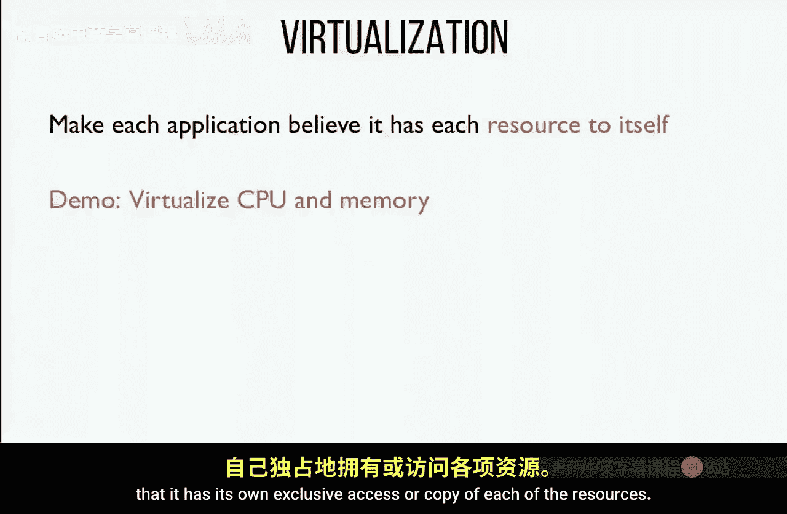
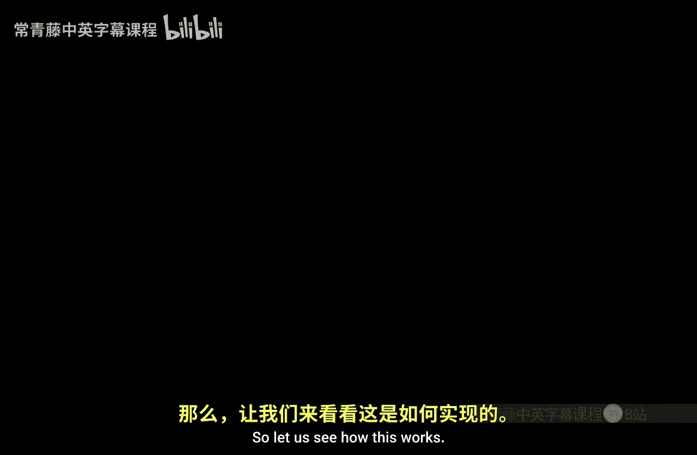
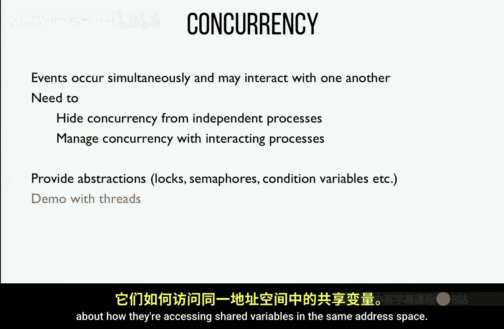
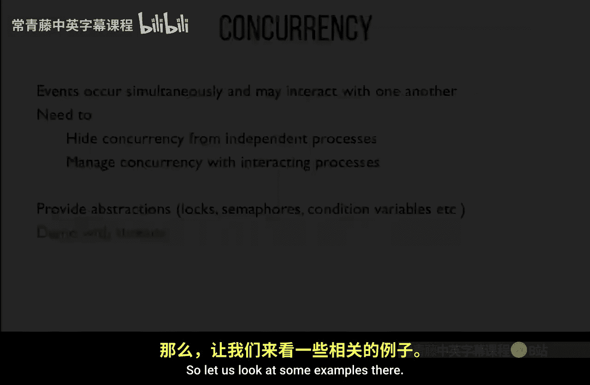
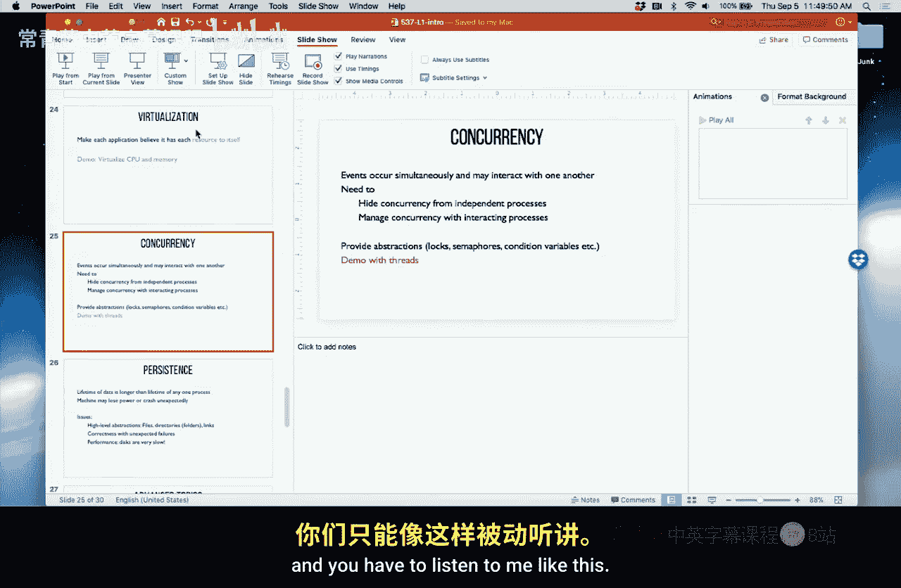
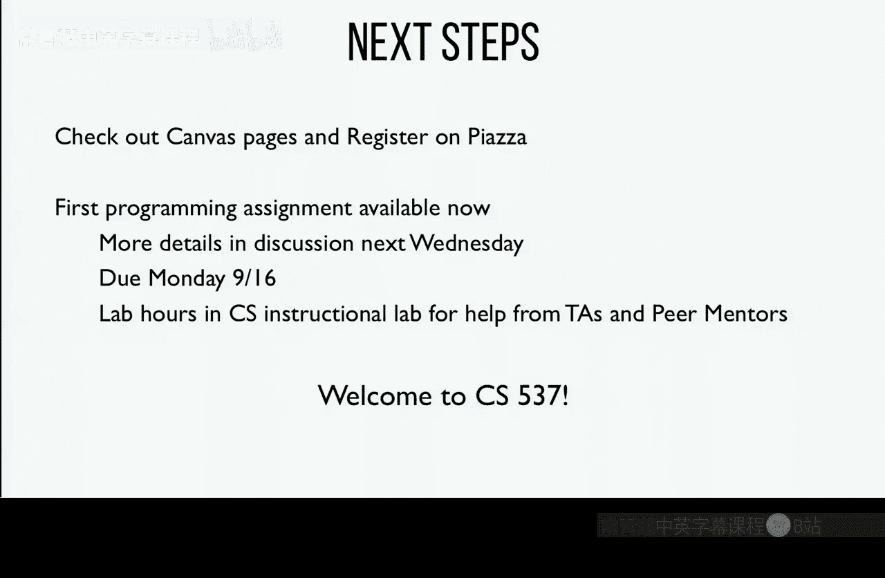

# 操作系统导论：P1：操作系统简介 🖥️

在本节课中，我们将学习操作系统的基本概念、课程结构以及操作系统在现代计算中的核心作用。我们将从课程介绍开始，逐步深入到操作系统的定义、主要职责以及它如何管理计算机资源。

## 课程概述与介绍

欢迎来到CS 537操作系统导论课程。本课程旨在帮助你深入理解计算机系统如何作为一个整体协同工作。你将通过一系列项目和理论学习，掌握操作系统的核心原理。

本课程内容充实，包含大量实践项目。完成本课程后，你将深刻理解整个计算机系统的工作原理。

### 讲师介绍

我的名字是Andrea Arpaci-Dusseau。我于多年前在加州大学伯克利分校获得博士学位，研究方向是并行作业的隐式协调调度。之后，我在斯坦福大学进行了短暂的博士后研究。在威斯康星大学麦迪逊分校，我主要教授CS 537（操作系统导论）和CS 736（高级操作系统）。我还创建并偶尔教授CS 402课程，这是一门服务学习课程，教授如何向四五年级学生传授编程和计算机科学知识。

我的研究主要集中在文件和存储系统领域，与我的同事兼丈夫Remzi共同指导了许多博士生。我们在存储系统方面的工作曾获得SIGOPS Mark Weiser奖。

在课堂上，你可以称呼我为Andrea教授或直接叫我Andrea。

### 课程目标与内容

在本课程结束时，你将掌握以下知识和技能：
*   **理解操作系统**：了解操作系统是什么及其在系统中的角色。
*   **掌握虚拟化**：理解操作系统如何虚拟化物理资源（如内存、CPU、磁盘），并为用户级应用程序提供抽象。
*   **实现抽象**：了解如何在现代硬件架构上实现这些抽象。
*   **并发编程**：学习如何正确编写多线程应用程序，使用锁、条件变量和信号量等同步原语。
*   **持久化**：理解文件系统如何使信息持久化，即使在任意时间点发生崩溃或断电。
*   **C语言项目**：完成多个C语言编程项目，其中一些需要独立完成，一些需要与伙伴合作。这些项目可能比你过去接触过的更具开放性。
*   **系统调用与内核**：项目将涉及使用现有操作系统的系统调用，或修改一个名为XV6的小型模拟内核。

这是一门具有挑战性的课程，需要投入大量时间。如果你的学期课程负担很重，可能需要考虑在其他学期选修。

### 评分与考核

你的成绩将基于两部分：课堂内容和项目，各占50%。

**课堂内容（50%）**：
这部分包括两次期中考试和一次期末考试。设置两次期中考试是为了降低每次考试的压力和风险。考试主要涵盖课堂上讨论的概念。我们可能会布置一些作业作为这50%的一部分，但目前尚未确定。本学期，我鼓励大家组建约5人的学习小组，共同讨论课程内容。

**项目（50%）**：
本课程共有八个编程项目。通过这些项目，你将学习如何修改和使用操作系统。

### 课程形式

课程形式包括讲座和讨论课。

**讲座**：
在讲座中，我将使用幻灯片进行较为正式的讲解。我非常欢迎大家提问，我也会向你们提出一些基础问题，以确保大家跟上进度。

**讨论课**：
你们都已注册了一个讨论课部分。讨论课的目的是让你们在较小的群体中讨论项目，并获得查看代码的实践经验。助教将主导讨论课，你们通常需要携带笔记本电脑。讨论课内容可能包括项目讲解、答疑或考试前的复习。

### 教学团队与支持

本课程拥有强大的教学团队来帮助你们：
*   **七名助教**：他们都是计算机科学系的研究生，对系统领域感兴趣，能够提供很大帮助。
*   **同伴导师**：他们是上学期选修CS 537并取得优异成绩的学生。他们将在教学实验室提供大量的答疑时间，帮助你们解决代码和项目问题。

我鼓励喜欢本课程的同学考虑在下学期担任同伴导师。

### 课程资源与学术诚信

**课程资源**：
我们将使用Canvas作为课程网页，上面会发布大纲、阅读材料、幻灯片和项目说明。课程使用的教材是我和Remzi合著的一本书，它与课程内容紧密结合。你们可以免费获取独立的PDF章节，也可以付费获取印刷版或完整PDF。

**学术诚信**：
本课程有大量的编程作业。严禁抄袭其他学生的代码或在线查找往年解决方案。我们会使用自动化工具检测代码相似性，包括与本届其他学生以及往届学生代码的对比。一旦发现抄袭行为，相关作业将不予计分。

## 什么是操作系统？🤔

现在，让我们切换话题，探讨为什么操作系统是一个有趣且重要的主题。

我们可能对操作系统有一个直观的感受，因为我们使用过许多不同的操作系统。我们可以将操作系统定义为运行在笔记本电脑或台式机上的通用软件。

另一种定义方式是通过层次结构来看。我们知道这个结构中的其他部分：顶层的用户（人类），用户使用的应用程序（如网页浏览器、游戏），以及底层的硬件资源（内存、CPU、存储设备）。

操作系统是位于这两者之间的软件。**它是将硬件转化为对应用程序更有用的东西的软件**。在早期，应用程序可以直接在硬件上运行，但在这之间增加一个共享层（即操作系统）带来了许多优势。

### 操作系统的两大核心角色

操作系统主要扮演两个关键角色。

**1. 标准库（抽象资源）**：
操作系统为硬件资源提供抽象，使其比硬件本身提供的原始接口更易于使用。

*   **资源**：指系统中所有有价值的硬件。
*   **抽象示例**：
    *   **CPU** -> **进程**或**线程**
    *   **内存** -> **地址空间**
    *   **磁盘** -> **文件**（也可以是键值存储或数据库）

为什么由操作系统提供这个标准库是好事？
*   **易于使用**：避免每个应用程序重复编写相同功能（如内存分配器）。
*   **设备抽象**：抽象底层设备细节，应用程序无需处理不同的设备驱动和汇编编程。
*   **提供高级功能**：在低级设备（如按块读写的磁盘）之上提供更高级的概念（如文件和目录）。

这方面的挑战在于确定正确的抽象，以及应该向应用程序暴露多少硬件能力。

**2. 资源管理器（虚拟化资源）**：
这是更有趣且我们将重点讨论的角色。操作系统不仅提供接口，还必须实际**虚拟化**这些资源，以便不同的应用程序能够以公平高效的方式共享资源。

*   **提供保护**：确保进程不能阻止其他进程运行，也不能读取彼此的数据。
*   **确保公平**：防止一个进程独占CPU，而其他进程必须等待。
*   **机制与策略**：
    *   **机制**：如何实现某事（例如，如何在竞争进程之间进行上下文切换）。
    *   **策略**：使用该机制来决定何时发生某事（例如，何时调度一个进程，分配多少内存）。

由操作系统执行资源管理是合理的，因为它运行在所有应用程序之下，并且能够做到这一点。但这将非常复杂，我们会面临许多有趣的挑战。

总结来说，操作系统有两个主要角色：一是作为标准库抽象资源；二是作为资源管理器虚拟化资源，让每个应用程序都以为自己独占CPU、内存和磁盘。

## 课程结构概览 📚

本课程将围绕三个核心部分来讨论操作系统，我们有时称之为“三个简单的部分”。

**1. 虚拟化**：
我们将探讨如何为系统的不同组件（CPU、内存）提供抽象。这能让我们快速了解一切是如何工作的。

**2. 并发**：
我们将深入研究多线程。当同一进程内的多个线程共享相同的地址空间和变量时，如何协调它们对共享变量的访问，以避免竞态条件并确保一切正确运行。

**3. 持久化**：
我们将学习如何让进程能够读取另一个进程在过去写入的数据，即使在最糟糕的时间点发生了崩溃或故障。我们必须确保持久化数据是可靠和一致的。持久化数据结构与我们在内存中处理的数据结构有很大不同。

接下来，我们将通过演示来展示虚拟化的概念。

### 虚拟化演示

虚拟化的理念是，每个应用程序都应该认为自己拥有对每种资源的独占访问权或副本。

**CPU虚拟化演示**：
我们使用 `top` 命令查看系统进程。可以看到系统中有许多进程，但只有少数在活跃运行。大多数进程处于睡眠状态。`top` 显示了CPU利用率、负载平均值等信息。

然后，我们运行一个简单的 `cpu.c` 程序，它执行一个忙循环。当我们运行一个实例时，它几乎占用100%的CPU。运行第二个实例时，CPU在两个进程间共享。当运行的进程数超过虚拟核心数（例如4个核心上运行5个进程）时，操作系统需要进行调度，每个进程获得的CPU时间比例会下降（例如各占约80%）。这演示了CPU如何被虚拟化给进程，操作系统隐藏了核心数量有限的细节。

**内存虚拟化演示**：
我们运行 `mem.c` 程序。该程序分配一个堆变量和一个指向该变量的栈指针，然后打印进程ID和指针地址（即变量的虚拟地址）。

关键点在于：即使两个不同的进程有一个变量位于相同的虚拟地址，它们也是完全独立的。每个进程都有自己的地址空间。相同的虚拟地址会被映射到物理内存中的不同页，并包含完全不同的值。这就是内存虚拟化。

### 并发演示

现代应用程序被编写成多线程的，以利用所有可用的核心。但当多个线程同时运行时，我们需要非常小心它们如何访问同一地址空间中的共享变量，否则会得到错误的结果。

我们查看 `threads-v0.c` 程序。它创建两个线程，共享一个计数器变量。每个线程循环多次递增该计数器。

**预期结果**：如果每个线程循环N次，两个线程总共应递增计数器 2*N 次。
**实际结果**：对于较小的N值（如10, 100），程序可能输出正确结果（20, 200）。但随着N增大（如10000），结果开始出错，且运行次数越多，错误越明显。

**问题根源**：C语言中的 `counter++` 看似是一条指令，但会被编译成三条汇编指令（从内存加载到寄存器、寄存器加1、存回内存）。如果调度器在这些指令之间切换线程，就会导致更新丢失。

**解决方案**：使用同步原语，如锁。我们查看 `threads-v2.c`，它在递增计数器前加锁，递增后解锁。这确保了临界区（递增操作）的原子性。现在，即使对于很大的N值，程序也能输出正确结果。

**新挑战**：使用锁会引入性能开销。无锁版本可能运行很快（如0.001秒），而有锁版本则慢得多（如0.5秒）。因此，如何高效地实现和使用锁是一个重要且有趣的问题。

### 持久化简介

持久化部分我们将稍后详细讨论。核心问题是如何更新磁盘上的块，使得即使在更新了部分数据但未完成全部更新时发生崩溃，文件系统元数据和目录结构也不会损坏，仍然保持一致。

持久化是一个特别有趣的问题，因为性能因素非常突出。磁盘（即使是固态硬盘）的速度远慢于CPU和内存。因此，我们需要精心设计文件系统以优化设备访问。

### 学习操作系统的意义

你可能想知道为什么要学习这门课程：
*   **成为操作系统开发者**：虽然这可能只是少数人的目标，但如果你有志于此，本课程至关重要。
*   **理解整个系统**：理解操作系统如何工作，有助于你理解系统的所有其他层面。无论你是应用程序开发者、编程语言或编译器设计者，了解操作系统都能帮助你理解应用程序的性能表现，并调试系统问题（例如，使用 `top` 查看进程为何未被调度）。
*   **与体系结构交互**：如果你对计算机体系结构感兴趣，你需要理解操作系统将如何使用你提供的抽象功能。
*   **挑战与乐趣**：操作系统代码庞大、混合了C和汇编、涉及并发，理解其行为比理解单个应用程序更具挑战性，但也更有趣。

## 总结与下一步 🚀

本节课我们一起学习了操作系统的定义及其两大核心角色：作为硬件的抽象层（标准库）和作为资源的虚拟化管理者。我们还预览了本课程的三大部分：虚拟化、并发和持久化，并通过演示初步感受了前两部分的概念。

**下一步行动**：
在下次课之前，请务必查看Canvas课程页面，仔细阅读第一个编程项目的说明。你们下周有讨论课，并且第一个项目即将截止。

如果你在等待名单上，并且确定不想选修本课程，请尽快退课，以便其他同学加入。

期待下次与大家见面！