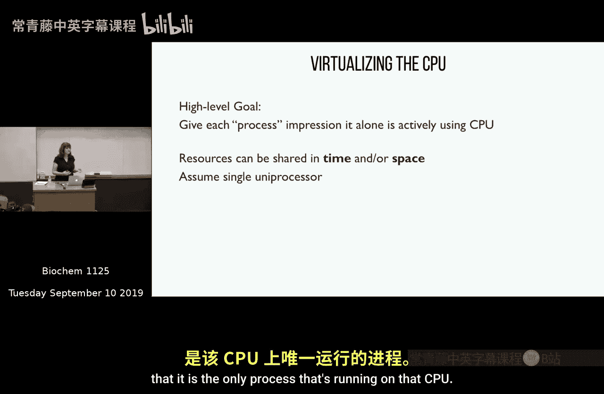
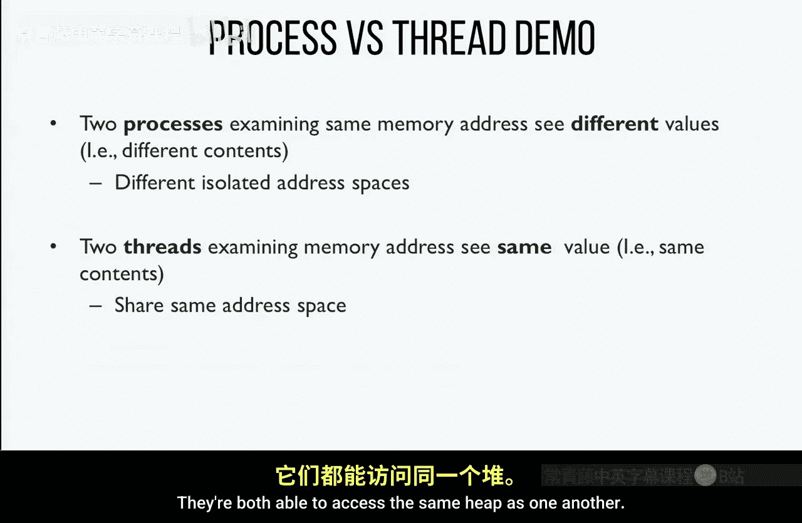
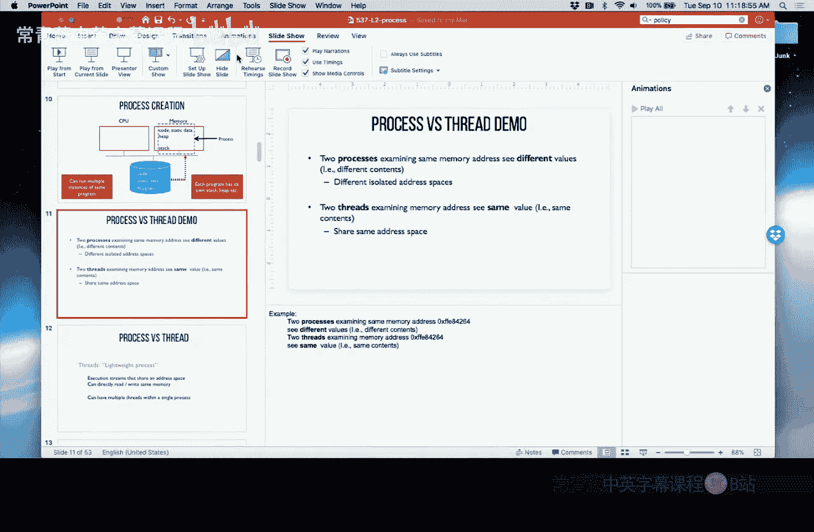
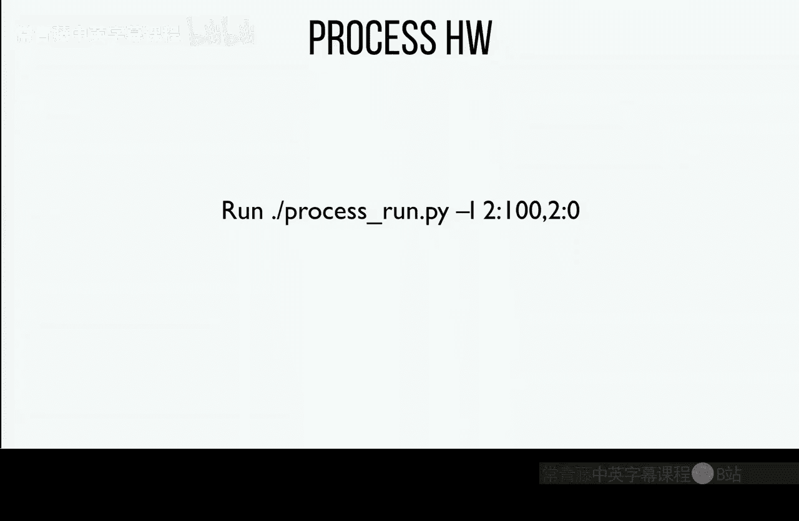
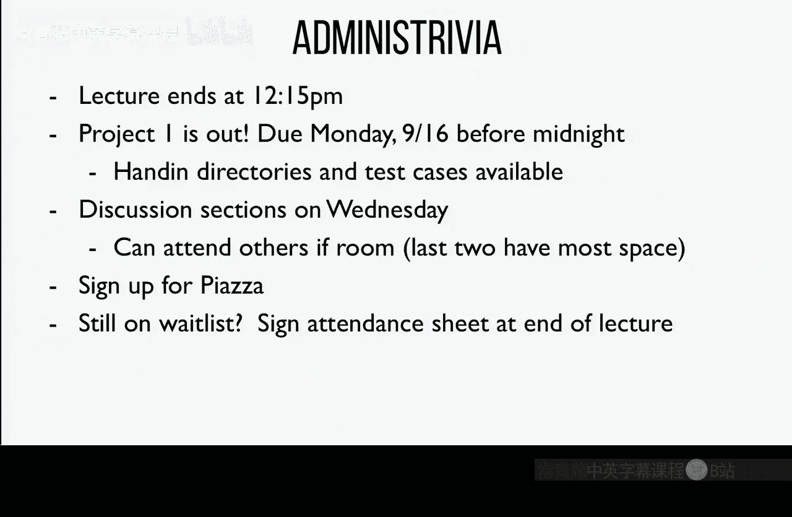

# 威斯康星大学【中英⚡操作系统｜CS 537 Fall19, Introduction to Operating Systems】 p02 P2 Processes _ University of Wisconsin-Madison -BV1wUzSB3Ecf_p2-

嗯。So we're going to post what topics we're going to be covering in each discussion section in case there might be some differences sometimes across the discussion sections。

 what's going be covered。 But this first week tomorrow， all the Ts will be covering Project 1。

 how to get started with that， maybe how to run the test scripts， how to run the debugger， GDP。

 what make files look like， what Lint and Valelgri look like。

 which are these static and dynamic analysis tools to see if you have kind of obvious problems in your code or in your memory allocation。

 And so you can look at the web page for more details about what will be gone over in discussion section。

Everyone should sign up for piazza。 There are tons and tons of questions already asked and answered out there。

 Last time I looked maybe about 200 of you were signed up for that， but there's still many。

 many more of you who have not signed up， which I hope that happens soon。 okay lecture recordings。

 okay so a lot of people like the idea of having lectures recorded and in some ideal world you go back to them and you review or all of that。

 Now what we have uniformly found many， many times across many classes is that everyone has the best of intentions and you think。

 oh， I'll skip class and I'll watch that lecture recording later。

 And what ends up happening is if you do watch it， you still don't understand it as well as if you had been sitting here live with other people。

 and what often happens is you just think well， those lectures are available for me。

 I'll watch them later。 and you just never end up watching them at all。

 I mean I've talked to so many people who thought they are going to do it and they really do not watch those lectures。

So an attendance was pretty poor last semester when they recorded all of the lectures。

 and I had never done that before。 It wasn't me teaching it。

 but attendance has always been fine in the past。 So what I'm going to try is an experiment is I'll make the lecture。

 recordings available for one week。 So if you genuinely miss a lecture。

 You can watch it promptly after class and stay in sync with everybody else。

 But the point is you're supposed to get back and sync and come to the next lecture that you can。

 And then I'll probably make them available again a couple days before a midterm or final so that you can review。

 But not so that you can believe and trick yourself into thinking you can watch all of those lectures in the last day before the midterm and catch up on all the material。

 So this is an experiment。 I will try it。 and hopefully this is a good compromise。

 it works for everybody。All right， waitlist， I think we're making good progress through the waitlist。

 but if you're still in the wait list， come and see me after class and sign the sheet。O。

 lecture ends at 1215。 Why do I say that， Okay， so I promise that I will always end lecture promptly by 1215 so you can get to your next classes。

 Sometimes I might end at 1212 or a little bit before 1215， but I won't go past。

But what I would like is for all of you to wait until Im actually done with lecture before you start packing up and going on to your next class with such a large class。

 When some of you start to pack up， it really gets very loud and makes it impossible for the other people who want to hear my final grand concluding statements。

 actually hear those statements。 Okay， so 1215， then that is when we are done。😊，And then finally。

 the microphone， I'm using a microphone。 If it is not working at some point。

 raise your hand and let me know。 And， of course， raise your hand and ask questions about other material as well in the class。

 Oh，'ll see it just picked up differently。 But okay。So any questions about all of that？Set up stuff。

Alright。 So today we're going to be talking about virtualization or how we make an abstraction of the CPU so that users can use the CPU more easily and effectively。

 So by the end of today， you'll know what a process is and what its general lifecycle is。

 And then you'll know about these mechanisms for how the O S gets a process scheduled and running。

 How does a process interact with the O S through system calls and then how do we do that context switch。

😊，Alright， so in last week's lecture， we briefly talked about what is an operating system。

 So this will just be a rhetorical question for now。 But can you remember in your mind。

 How would you define an operating system if you had to。

So I would say that it's software that converts hardware into some useful form for applications。

 Maybe also that it's a standard library and that it's a resource manager。

So what abstraction does the O S provide for the CPU， That's what we're talking about today。

 It's a process or a thread。 What's the abstraction that the O S provides for memory。

Virtual address space or just address space。 And then notice some of the advantages for the O S providing resource management。

 We're going to need that to provide protection or isolation across competing applications that are sharing the same resources。

 And it's going to enable us to do more fair sharing and probably get better efficiency and better performance with how what our policies are in the operating system here。

Okay， so let's get into lots of details， so。Switch this round。

So what is our high-leve goal of virtualizing the CPU。

 We want to give each process the impression that it is the only process that's running on that CPU。

 It's completely isolated from everybody else。 And so the way that we're generally going to do this for all of our resources is that we can share one resource。

 we can multiplex a resource， either in time or space， right， like if this room。

 we can switch it off and another class can come in here。 we're sharing this space， this room。

 this resource over time。 other classrooms is you could view that as different space and different classes are going on in different classrooms at the same time with different space。

 So certainly this can be applied to any resource， not just to computer systems。

So we are going to share the CPU over time where in this class we're going to assume we just have a single unitprocessor or a single core。

 it does get really， really interesting when you have multiprocessors and you're doing space sharing processes or threads across those cores in a space sharing way as well。

 but you can learn about that in a follow on course today just single core。Okay。

So how would we multiplex or share memory？We usually will do that over space that you have a lot of memory。

Different applications can have different pages in memory， and we'll talk about that a lot later。

 And then disk will also be spacesha。 Discs are huge。 We have a lot of blocks。

 We can give different blocks to different processes and share that over space as well。 But the CPU。

 it's time sharing。Okay， so that was all high level stuff。

Let's start talking about what's actually going on in a process， What is a process。

 So I think sometimes you might have used this term not very precisely。

 So we want to be very precise about a process in this course。

So you generally talk about that you write programs。

 You would want to think of a program as being the static code that you wrote and that you saved。

 It's not the running version of that program。 The program is just the static thing that you wrote and that you can even compile it。

 you can have an executable。 The executable is still just a program。

But when you actually run that thing， that's when it becomes a process。 So for a single program。

 you could have multiple processes， right， You could start that program multiple times and have them all running concurrently or at the same time。

So what exactly is a process， We say that it's a stream of executing instructions。

 that code that you wrote running in sequential order until you run into a branch or a jump or something like that。

Along with all of its context that's associated with its address space or its memory。

 So what is context， that's the dynamic stuff that's changing as we run this program。

 So it's the contents of every register， It's all of the addresses that you might have in registers。

 It's your program counter or your instruction pointer showing you where are you running right now in your static code。

 It's a pointer to your stack showing exactly you know which procedures have you called in which arguments have you pushed onto that stack so that you can return back from them。

 It's recording exactly where you are in the running stream of instructions right now。

And there might be other state that we'll get to later， like open file descriptors。

 things that this process has done to communicate with other processes like over sockets or with files。

So any questions about what a process is。O， I will have questions for you all later。

 because at some point， we will need to talk a little bit。

 but I am not going to really do that to you today。 so what happens when you create a process。

 you have that static program that lived on disk or some persistent storage。

 it had everything that was statically associated with it， the program code and the static data。

 things like you know you had some global variables and you initialize them to some known static value that would be the static part of the program and then a process is forked or it is created。

 and then we need to make it go live and so then we need a copy of that stuff in memory that's associated with this new unique process and so getting that initial state is pretty easy。

 you can basically just load those things from persistent storage， make a copy of them in memory。

 you'll have the code you'll start off with a pointer。

 the instruction pointer to the first instruction， you initialize the registers to some known state you initialize all of the static data to what it was said in that program file you start off with a tiny heap that will grow as the process calls。

Mck， and you'll start off with a stack that really doesn't have anything on it and a stack pointer that points to it。

 And then as that process runs， you're going to change those registers。

 you'll change the stack pointer。So every process that's running is going to have its own copy of that stuff and memory。

Okay。So this is pretty straightforward。 You're like。

 am I getting any new information here at this point， you are not sure。All right。

 so this might be new。 So what is the difference between a process and a thread。

 So you can think of a process by default as having just one thread in it。

So if you have two processes and they access the same address within their address space。

 they'll see different values， whereas if you had two threads in the same process。

 they're sharing the same address space so they'd actually see the same values。

 they're both able to access the same heap as one another。

So let's do a demo of this。

This is a little similar to the demo that I did on。In lecture on Thursday。

But I tried to simplify it a little bit。And I'm meant to bring my reading glasses， you will see。No。

 okay。So I am blind up here。Believe it or not。Okay。So this is process。 C， it's very， very simple。

 it has this value that we are going to allocate on the heap， and we take one argument。

 it's supposed to be the value that we are going to store in that variable。

And so I think it's pretty obvious what will happen when we run this。

We run process and let's say we give it the value of 11。 What should it print。

 It'll say the initial value of。For this process， it was 10， and then I copy it there。

 and then forever it's going to say that it's 11 after that， right？10， and then forever after that。

 it's 11。And then if I have another one。And I start up and I say。

 I want this one to have a value of 12。 It's going to be completely independent of the other process that's running。

 right There's no sharing going on。 They're name the same， but that doesn't really matter。

 It also saw an initial value of 10。 And then at the same time as the other process is running。

 It's seeing 12 and that variable wire is the other one seeing 11， right。

So this makes sense to everybody。 This is your day to day life on how you've written programs and head processes running all the time。

Any questions about that？Okay， so let's look at a version with threads instead， threads dot V。

0 dot C。Okay， so the details of how you start up threads we'll talk about that later。 For now。

 I just want to focus on that value that's being shared across these two threads that are part of the same process。

Okay， so now I have a shared variable that's located on the global heap。

 I've told the compiler that it's volatile because I know both threads are going to be accessing it。

 and I want to make sure that that value is therefore kept in memory and not in registers。

 What main is doing is it's starting up to threads calling this worker function and it's passing into the first worker。

 the first argument into the second worker， the second argument because I want them to each set that variable to a different value。

So。I just run this once now。On threads do v0， let's give it 13 and 14 is the arguments。

 So what are we expecting to happen When the first thread runs。

 it's going to print out the initial value of value， which will be 10。

 Then it's going to print out what it's setting it to， which will be 13。

 and it'll keep spinning and not resetting it。Then meanwhile， that other thread gets started up。

 I made it sleep before it does that。 So the other one had a chance to get going。

 and we don't have any race conditions because we don't know how to do locks and syncchrontization yet。

 So we're just making them not content so much。 The second thread gets started up。

 And it's going to be accessing the same。Memory that the first worker thread was accessing it as well。

 So its initial value will be the value that the previous one set it to。 And then when it sets， its。

When it sets value， they'll both see that change。 Okay， so let's see this happen。

And I just called it threat。Great。So they're both going to see that the value is 14。

 So the first thread saw that the initial value was 10。 It then set it to 13。

 The second thread then saw that value of 13 because that's shared。

 It's the same variable across them。 Both it' set it equal to 14。 and then they both see 14。

 since there's one， just one variable， okay。That makes sense。 So threads。

 you could think of processes usually as just having one thread， one thread of control。

 But you can have multiple threads in the same process， and they share the same variable。O。

 it's gonna be a little bit more subtle with what you do with the stack versus the heap threads will have their own stacks。

 but we'll get to that later。呀。They were both printing。Great。

 because theyre both running this worker code and theyre both， they both get control。

 even though they're in a while loop。 both the schedule are switching back and forth between it。

 two of them。 Yeah， so that's actually what we're doing today in class。

 right We're seeing how in the world can you switch between these two threads。

 when we only have one CPU。 though this machine， of course， has more than one CPU。😊，Yeah。😊，Yeah。

You total。There's actually three。 So that was a great question because I have this parent thread that I've just been ignoring here。

 And my parent thread isn't doing anything interesting because it's just waiting or joining with the two worker threads that I started up。

 But they're never going finish。 So this one's never going to complete。 But yeah。

 this one has three since I created too。 There was the parent。 A。😊，Other questions about threads。

Don't worry， we're gonna talk about threads from weeks and weeks。Okay。

Okay， so another term for threads is sometimes a lightweight process or an LWP。

 And it's just that thread of running control， the execution stream。

 It's going to share the address space with other threads that are part of that same process。

 And so they'll see the same memory as other threads there。Okay。Alright， so why do we need processes？

 So processes are going to be our abstraction for the CPU。 It's how we abstract the CPU。

 So how do we basically share the CPU between multiple processes。

 We have three processes we'd like to run in this example， They can't all be running on one CPU。

 We have to multiplex that over time or do some time sharing。

 So what we're doing in this example is the first process。

 we've loaded its context from memory onto the actual CPU hardware into the registers into the PC。

 the stack pointer and so forth。 And the other two processes。

 They are just going to be effectively paused。 Theyre not using the CPU。

 They have no access to the CPU's registers at that point。And then at some point。

 the OS will make a decision to pause the running process and switch to another one and unpause it。

 and load it stayed onto the CPU。So how in the world are we going to do all of this。

 we basically have to keep the processes context or at state when it's not running in memory someplace。

 and it has to be memory that the OS has access to。

 but the user processes don't since we don't want them to mess with it。

 So this is the job of the OS scheduler again， it saves the context。

 when the process is paused and then it restores that context when you run it again。

 That's why we'll call that a context switch or just switching context。Alright。

 so these are the states that a process will go through。 It's a little bit simplified， but basically。

 one process at a time in a unit processor system could be in the running state。

And then at some point， the O S can make a decision and deschedule it and say。

 now this process is ready And it places that on this ready queuee of processes that could run if the O S decided to run them。

 but you might have many ready processes。 And that at some point that O S is going to decide it wants to schedule one of those ready processes。

 And so it will schedule it and the other one had to be descheduled。So today。

 we're going to be talking a bit about how we do that transition。 In later lectures。

 we'll look a little bit more at the other policies that should take place when a running process does some IO when it's like writing out to disk。

 That's very， very slow。 You're not using the CPU when you're writing out to disk because maybe that's going to take a millisecond for that right to complete。

 And so we block that process。 we put it on a separate queue where we're not going to run that process until the IO is done。

 when the IO is done， that process becomes ready to run again。

 and maybe the OS schedule will pick it up。But today， we're focusing on。

The transition between running and ready processes。Allright。Okay， so if you would like。

 I might make these kind of extra bonus points， or maybe they'll just be for your fun and enjoyment。

 But the Ostep book has a lot of homework that's associated with the reading in these lectures。

 they're mostly these little simulators that have been written in Python that just exercise different components and let you play around with mostly policy decisions to see that youre understanding everything。

 So if strongly recommend you take a look at these homeworks。 And if you do that。

 the first one that you'll see is what's called process run。 and let's。😊。

Very briefly。 look at what this does。

So I untard this thing。On G Zped it。 I have a few things in this file。

 There's always a read me that gives you a ton of details on how the thing works。

 We are not going to go through all of that。 Instead， I'm going to run this for you。

With some pretty basic。Can you see that stuff？Okay， so I ran it with two arguments， basically。

 This is saying start up two processes。 Each process will run three instructions。

 and there's a 50% probability that this instruction will be CPU And it's a 40% probability or the other way around。

 I don't know。 there's some probability that it's either CPU or I O。

 I don't remember which way it's defined。 But then it just generated this trace for us that we can then do some exercises with。

 So we're supposed to figure out what would be scheduled。

 If process 0 wants to do two IO operations followed by one CPU instruction whereas process  one wanted to do one CPU instruction followed by two IO operations。

 So you have to know a whole bunch of assumptions about the schedule and what's happening。 here。

 we're just going to assume that a process gets to use the CPU for as long as it once。

 We're not going to take the CPU away from a process or until it does some I O。

 And we'll assume that I O takes five cycles or instruction。To complete。

 and I O first does require that you get the CPU for a cycle so that you can initiate that I O。

 It doesn't just happen magically。 You have to run some code to get the I O going。

So the magic flag for checking results。So the idea would be you try to think through the timeline of what would happen。

 and then you add dash C and you see if you got your answers right。

So this shows what would actually happen for that trace。

 And so what you'll see is process 0 got to run first。

 The first thing it did was this I O instruction。 So then it has to wait for four more before it will be ready to run。

 So at that point， it would transition to ready。😊，But it wouldn't necessarily interrupt the other process if it had been running。

 process  one started off in the ready state because only one process can be using the CPU at any point in time。

 But then once process 0 went into the blocked or the waiting state。

 then it could be scheduled and it could run。 So then it gets to do its one instruction of CPU。

 and then it does its one instruction of I O， and it has to wait for five before it can go。

And be ready again。So you can do some tests like this with this homework， if you would like。

Any questions about that， yes。I think it was。Saying like。

 it's making the assumption that this waiting， that it took five units of time for that I O to complete。

 And it was just kind of pointing out that that was the decision that was being made here。

 If we change this so that the I O actually takes 10 instructions。

 this transition would be the one that's different。

There's lots of information buried in these things once you get into it。

 if you really care about all the details， but we'll keep it pretty high level。Alright。

 so take a look at homework， if you'd like。ちち。All right。So in this context。

 we're going to talk a lot about the difference between mechanism and policy。

 So the mechanism is the thing that makes it happen。 that does the low levelvel work。

 So in this case， the mechanism is just being able to run a process to do a context switch。

 So we will have goals for our mechanisms。 It's usually about like efficiency， high performance。

 We don't want to be adding a lot of overhead by doing really expensive context switches。

Policy is going to be like the higher level decision making about what process to run when So the policy uses the mechanism to implement something smarter。

 And so really what the policy is trying to do is pick the best process to run at some instant of time。

 And so you could have a lot of different metrics here。 It could be your metric is throughput。

 you have a lot of computation that needs to get done。

 and you just want to make sure you get a lot of CPU cycles per second。

 or maybe your metric could be latency that you care about response time。

 And so you will end up coming up with a different policy if you want to optimize for a different metric。

And we will get into that later。 But today， we are just focusing on mechanism。

 How do we do context switches。O。So we need to make context switches efficient or at least run our virtualized processes efficiently。

So probably the most efficient way to do this would be to just run the darn process。

 just do direct execution， and let the thing run on the CPU。So when you create a process。

 the OS would just jump to Ma and let it go until it calls exit。

 and then the OS would get controlled again。That might have worked if you have a very cooperative system。

 if you have like a real-time system where every process can trust one another。

 it's not practical in today's environments。 So we're gonna to have to deal with two challenges。

 One is how are we going to deal with the fact that a process might want to do something restricted。

 It's going to want to access like IO devices， we can't let user levelvel processes access IO devices directly because they might cause problems they might read other processes data。

 And we're also going to have to worry about the fact of what if a process runs forever。

 What if it has a while one in it， the programmer didn't even mean to do that。

 but it has a bug and it's never going to exit call exit。

 so we have to have a way of getting control back to all us。

So instead of just doing direct execution， we're going to do what's called limited direct execution。

 where most of the time we do just run the process and its instructions。

 but we have some ways of getting O S control when we want。All right。O。

 so how are we going fix that first problem of when the user process wants to execute some restricted operations。

So the solution to this is we need some help from the hardware。

 Every modern architecture is going to have at least two levels of privilege。

 a lower level of privilege for user level processes。

 and then a higher level of privilege for the O S。 Moern architectures have many more levels of this because it's useful for virtual machines to be able to have even more distinction there。

 But we're just going to assume we have two level user level and kernel level。

 So the idea is when you are running in kernel level mode。

The hardware can execute any instruction that it wants without causing any traps or exceptions。

 you know， to access certain registers， whereas if the user process tried to do that。

 you would get an exception and trap into the O S。Okay， so the question now is。

 if the user level process can't access a device， how are we going to let them access devices？

 And so the solution to this is to add system calls。

 And I'm sure you've all called system calls before。

 but you probably haven't seen how they're actually implemented。

So a system column is basically just a function that's being implemented by the O S。

 So let's look at that in detail。Okay， so this is a picture of memory。啊。Address space of a process。

 plus the contents of the operating system。So process P or user level process would like to make the system call and call C B。

That cis read function lives someplace in the operating systems address space。

 But P can't just directly call cisread because if you could just jump arbitrarily from a process。

 any place into the O S， then you could do arbitrary weird functions and have all types of security flaws。

 So we're going to have to restrict the entry points into the O S and just make it that you can jump into very specific places。

So in general， processes cannot see what is in memory for the O S there。

 that's not part of its visible address space。 And so if P wants to call read。

 it's going to have to come up with another way to do this。

 And the way we do that is with system calls。 And so maybe you've seen this in 354。 maybe not。So。

The idea is， when you want to make a system call， the exact instructions are a little different across every architecture we're using kind of。

X 86 style architecture here。 This is what will look very much like when you do your projects in our X V 6 and United environment。

But the idea is， there's this special instruction interrupt。

 and you pass it a different number for different interrupts。

 and 64 corresponds to a system called interrupt。So before we do that interrupt， though。

 this process moves a special value into a special register that the OS will know how to interpret。

 that this is just a convention that's being set up exactly which system calls correspond to which numbers。

 exactly what register we put everything in， but that's the convention here is that read system call is going to correspond to the number six。

 and we know to look for that in this particular register。Okay。So what happens when we call Inter 64。

 So certainly Col just move into a certain register。 That's just a normal instruction。

 Then the process calls this special instruction Inter 64。

 The hardware knows that what it should do at that point is it transfers over into kernel mode。

It sets this magic bit in the processor telling us what mode we're currently in。

 and it switches from user to kernel。 And then it knows that it needs to look up in this trap table for entry number or index number 64。

 And what's going to be in there is there will be a function pointer to the system call code。 Okay。

 because there's other traps in here， like for divide by 0 or memory faults。

 And all of those have different function pointers associated with them。 But 64 is the system column。

😊，O。And I think I went over all that。So we have another table that's the system call table。

 and it will be entry 6 in there that we're going to care about。Okay， so when we call this interrupt。

 we then jump into the kernel mode and we get the 64th entry there， which is a function pointer。

 And we start executing at that function， which is the cis call code。 And the cis call code。

 basically handle system calls。 And it looks to see what， you know。

 this is just operating system code that you will be looking at in detail and project  too。

 You can looking to see what value is in that register。

 You then use that value to index into your system call table。

 And you follow that pointer to invoke that function。 Since there's a function pointer there。

 Allright。😊，So。You are going to be looking at these functions in Project2。

 kind of making a new system call。 So adding to this table， kind of looking at how all of that works。

So any questions about this， yeah。Great。Yeah， I think I。

 I think this slide will kind of answer your question。 So when you called Re。

 you had a buffer that buffer lives in user space。 The kernel has to be really careful about trusting that it has to do some checks to make sure that youre not getting it a bad pointer。

 But once it's past those checks。 and the cis read does its work。

 It can then there's a couple of different ways you could do。

 You can imagine the Sisread works by reading from advice and using some O S memory。😊。

Temporarily and then doing a copy at the end back to your user level buffer。

 That's the most straightforward way of doing it。 Some people are able to do some fancy things where they'll call it like0 copy read or 0 copy network operations。

 And in that case。😊，You can directly read into buffers。

 but we'll assume we're doing a copy in most cases。

 from some buffer that you were storing here back to the user。So did that answer the question enough？

Great。Yeah。No，Well， so think of this as it's still like the。Process P's thread is running。

 And now it is in the O S doing this work on behalf of process P。

 We're later going to look at how will we do a context switch with a very similar mechanism here。

 But but in this case， we are not switching to another thread。

 We are going to technically be using a different stack that's associated with process P。

 because the stack that you use in the。user level has to be different than the one you use in the kernel because we can't always trust that user level one。

 So we are going to switch stacks， but it's going to be a stack that's still associated with this particular process。

And certainly that process can once you're in the OS， you can see any process address based。

Great other questions。Okay， so in summary， we basically have to have these two modes。

 user level and kernel。 you can execute any instruction when you're in kernel mode。

 And the key to transferring over into kernel mode is to do this system call to do that special interrupt instruction And when you do that。

 at the end of that， there's also this special instruction return from trap that switches you back to user mode and puts you back using your own own stack and so forth。

Okay。So we are at break time all right， so again， I think it's important for you all to get to know new people you're going to need new project partners。

 so please talk with at least two people， talk about courses at this point in the semester。

 what's your favorite course so far， why did you like it。

 what courses have you liked outside us yes please talk to two people。All right。All right。

 so let's get started again。So can I hear about some good courses outside of CS。

 so anybody have a course outside of CS that's really good that you'd recommend to other people in here？

I keep imagining I see hands， but then I look。No one has their hand。Some good course outside of CS。

Yes， thank you。Awesome， what are you doing there。😊，You read plays， oh that sounds delightful， yes。

 any other class that you would recommend to people？As makeupica。Yes。Psychology 532。

 it sounded like other people have taken that。 What is this one？Oh。All right， they're all positive。

 right， It's all beneficial， everything that we're doing in computer science， of course， awesome。😊。

Okay so we're going to continue to talk about context switches。

 so we already solved the problem of how do we get a user process to be able to do system calls。

 to do these privileged instructions that are inside of the OS and the next challenge that we're going to solve is how do we take away the CPU from a process that doesn't want to call exit or is malicious or just buggy？

Okay， so how are we going to do this， So again， there's two parts to this。

 There's policy deciding when you want to take the CPU away from a process。

 We'll talk about that in our next couple of lectures Today。

 It's just the mechanism of how do you physically tear away that CPU from a process that still wants to use it。

 It's still in the running ready state。So we're often going to see that this separation between policy and mechanism is an important theme。

 that it helps just keep things a lot cleaner to not have those two things intermingled。

 that the mechanism is really just something low level that the policy can call and rely upon and that that works well。

Okay， so mechanisms again， we're looking at the dispatch mechanism。

 How do we actually context switch across different processes。

 So the O S has what's called the dispatch loop that basically， whenever it is running。

 it is switching from one process to another。 that you can think of it as there's a process that's running。

 Of course， when it's actually running the O S isn't。 So this is just kind of abstract。

 The process that's running gets to run for what we call a time slice some amount of time like 100 milliseconds。

 that would be pretty standard。 Then at some point， the O S is going to get control。

 and we'll see how this is done。 The O S gets control， and it stops process A。

 and it saves its context， All of its registers and so forth。 And then it loads the context。

Of that other process onto the architecture。 O， so how are we going to actually get control inside the O S。

 And then exactly what context do we need to save and restore。Okay， so 50 years ago， many years ago。

 people would do what's called cooperative multitasking。 So like Moss would do this。

 The idea here is that you don't necessarily have a way of tearing away the CPU from a running process。

 You wait for that process to relinquish it voluntarily so it can relinquish it through a system call like we saw before。

 you could imagine you call into the O S。 And instead of just doing a system call for you。

 it decides to switch to somebody else。 We're in the O S， we can do whatever we want。

Or maybe that process accesses a page that's not currently in main memory。

 The O S will see gets control at that point so that it can page that memory and from disk into main memory。

 The O S could do other things at that point as well， like switching to another process。

 Or anytime you do something invalid。 If you do divide by0。 That's a trap into the O S。

 the O S can do whatever it wants。All right， so that doesn't turn out to be enough points of control。

 So these cooperative multitasking environments。Include this other system call。

 which our systems do as well， called yield yield does nothing other than go into the O S and let the O S decide if it wants to schedule another process or not。

 So it's just like a no op or null system call in many ways。 And it's just a hint。

 the O S doesn't have to switch to another process if it doesn't want to。

 So you could imagine the way that this works is P1 does the yield system call。

 It looks just like what we saw before， except what happens is that the O S is going to return back into process too。

 It's going to look like it's just returned from that system call。

 but it's going to be returned back into another process because process too。

 probably called yield sometime in the past。 And it was just waiting on its yield。

And so when P2 then calls yield again， itll go back into the L S。

 and it will return back from that yield call into process  one that it had made before。So。

 it's kind of just like a function call， but you end up switching around stacks and address spaces when you return from those function calls。

Okay， so let us look at this in more detail。 Clearly。

 you can't just have cooperative multitasking because we're not guaranteed that we'll actually ever call yield or that we'll have page faults or make system calls。

 So we need to have a mechanism that ensures that the OS gets control at periodic intervals。

 And so the way that we do that， we just have a timer go off periodically like every millisecond。

 This is going to be something that's done in hardware。

 it might be a timer chip that's separate from the main CPU or it's just part of the main CPU。

 You have some way of generating and interrupt every one millisecond or some fixed duration there。

 And so when that timer interrupt goes off。 It's just like that previous code path that we looked at for handling interrupts。

 we switch over to kernel mode， we go into that interrupt handler。

 we look to see which interrupt are we handling。 It's going to be the timer one and we do the work that's associated with that。

Okay and of course， there's lots of details there like the user can't mask timer interrupts。

 sometimes interrupts are maskable， which means that they won't actually cause an interrupt。

 it would not work if users could mask thatlon。Okay。

 so let's look at the details of how this is going to work。

So we have a non cooperative process that's running。

 It is not doing any system calls or calling yields。 It's running in user land。

 doing whatever it feels like doing。Then at some point， this timer interrupt goes off。

 That's generated by the hardware。 And so the hardware does a bunch of stuff that's associated with that timer interrupt。

 It's going to save the registers of a to the kernel stack。

 So you can think of this as a bit like what happens when you enter any procedure or function。

 You have to save the state of what was running before so that we can return back to it and know what the registers were and stuff。

 And we can't just push those registers on the user stack of a because the user stack might not be in a known state at this point。

 It might be have some problems with it。 you just don't want to。Trust the user stack。

 So we're going to have a kernel stack that's associated with every process and willll save the state onto our kernel stack here。

 So it's just like a stack。 You push things on。 You track where you are。

 where you have free memory there。😊，And then we switch over to kernel mode。

 This is what I was talking about before。 Remember， we have user mode and kernel mode。

 We're transitioning into kernel mode。 and then we jump into the trap handler that's associated with this timer。

 So that's just like the picture before， where we look to see which interrupt number is the timer interrupt。

 We get that function pointer。 And we call that timer interrupt handler。😊，So that makes sense so far。

 That was all just this hardware event happened。 And we transition over into the O S when that timer interrupted。

So now we're getting to run the O S code that's associated with the trap handler for handling the timer interrupt。

And it's going to have some policy here。 It's going to determine。

 does it want to keep a still running or which ready process should it schedule。

 So there's going be a whole bunch of policy code that。

Is associated with that statement there that we'll look at later。 But at some point， it might decide。

 yes， it does want to switch to another process， process B。

 And so this is where we get into the dispatcher， the mechanism that's going to do the low level work after the policy has made the decision about what process we should switch to。

So。Let me stand in someplace different so I can look at this better with all of you。Okay。

 so now we need to save the registers of A again。So note how we save the registers of a one time already onto the kernelel stack。

 These are the registers that were being active when we were executing this user level process。 Now。

 we've modified those registers a bit， right as we've gone through this kernel code and done some policy work and done some things。

So we need to save the registers of this。Processed as it's been running through the O S someplace。

And we're going save that to memory。 This is going to be。

 it's called a process structure or a process control block or a PCB are different terms that you might hear there。

 So every process is going to have a process structure， A PCB that's associated with it。

 It's some memory in some data structures that the O S wants to manage to look through， for policy。

 perhaps。 So we save our registers to that memory。 that was the registers that we've been changing here。

 And then here's the one of the tricky points。 Now we've chosen we want to run B。

 So we need to restore into our current registers， the values from for B。

 whatever was stored in its process structure。So we're basically going to unravel and go into B。

And then we'll switch to the kernelel stack for B。 And then we call this special instruction returnturn from Tra。

 which is now going to return into B， because we're now using the kernelel stack for B。

 and we have their registers for B。😊，So when we do that special instruction。

 what's the hardware that's associated with the return from trap instruction， What does it do。

It knows what the kernel what the current kernel stack is。

 It's going to restore what was ever on the stack that's being pointed to into the registers。

 which will be bes registers that are associated back with the user level process。

 It'll switch back to user mode， and itll jump to bes instruction pointer or PC。

 because that's part of what was saved on the kernel stack。And then when we do that。

 we're just back in process B。So。What is tricky about this， Lots of things are tricky。

 It's a little non intuitive。 You know， we were already seeing a little bit before。

The path when process age just did a system call and had an interrupt associated with it。

 it was kind of doing these same things when we just did a straightforward system call or would save our registers to the kernelel stack。

 We just went to a different trap hammer when we were doing system calls and you go in the O。

So it's a little confusing sometimes like why you were saving the registers twice。

So think of it here as we're saving the registers that are associated with the user level process。

 And again， here， we're saving the registers that are associated with what process A was doing in the O S when we're doing this switch。

So the challenging question for you is when we restore their registers from， from B。

What was it probably doing， where is it returning at that point？That basically。

 what B had been doing when it called into the O S was it had also just called switch。

 So B had just done this statement。 And now we're。Telling it to restore the registers that are associated with what it had been doing the last time it had been on in the O S on its behalf。

So that's kind of this invariant that's being set up is that the state that you're always returning to is right where you were doing this switch here。

So that's why you can restore B back to what it had been doing the last time it was in the O S。

 Re back its kernelel stack Re from that。And it'll get back to。It's。

What had it had been doing back at user level。So unfortunately。

 this is like one of the more confusing topics， I think of the whole semester right on the first day of content。

 but it will probably motivate you to try to remember a bit about registers and program counters and stacks and things like that that you learned in 354。

😊，The actual details of this， we are going to be looking at this again。

 This is going to get more concrete later in the semester， again， when you do a project in XV6。

You'll look at some of the dispatch code because you're going to need to implement a new scheduling policy。

 So you're not going to have to muck probably with this mechanism dispatch code。

 but you'll look at the policy code that uses that。So because if you get this stuff wrong。

 it's like painful， painful to debug。 So that's why also like it often has to be like the hardware that saves these registers to the kernel stack。

 If you don't have hardware support for that and you have to write you know。

 instructions to save registers to stack。 it's really hard to do that work without modifying any of the registers yourself and your code。

 So the hardware just takes care of doing all of that。 that copy for you。Okay。

So this is described in similar detail in the textbook。

 and so I strongly encourage you to read this part of the chapter if this was not clear yet。

 I think it usually takes a couple of readings to make that part clear。All right。

 so I ended a lot faster than I meant to today， but so I will go over the summary a little bit so today we've been learning about how to virtualize the CPU。

 our abstraction is a process， there are processes and then there are threads we're going to be using time sharinghar to share the processor across multiple processes a key part of this is being able to do system calls that that allows us to access devices with specialized instructions inside of the kernel and then this context switch is the mechanism that allows us to switch between different processes。

😊，Okay， so the policy is what we're going to talk about in the next class。 Policy is much。

 much easier to understand。 We just get to make high level decisions。 It's not 1215 yet。

Policy is going to be much， much easier because we just get to make high level decisions about which process we want to run。

Let me wrap up with details。Thank you。 because it's very early。 All right。

 So remember lecture ends of 1215， our project one is available。

 Please come to discussion section answer to get all your questions answered。

 The Ts and peer mentors are having tons of lab hours at this point to help you in the lab。😊。

Definitely sign up for piazza。 And if you're still on the waiting list。

 come see me and we will get you into the class。 All right。

 I will see you all on Thursday talking about policy。穿的傻。

