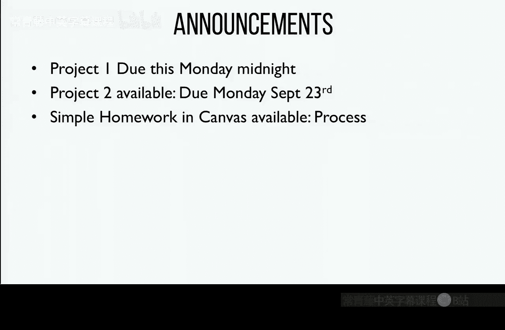

# 威斯康星大学【中英⚡操作系统｜CS 537 Fall19, Introduction to Operating Systems】 p03 P3 CPU Scheduling _ University of Wisconsin-Madison -BV1wUzSB3Ecf_p3-

All right， good morning everybody， Is a microphone picking up my voice， yes。

All right。So thumbs up if you can hear me。Thank you。 All right。

 So today we're going to be talking about CP scheduling。

 You're going to find it's a much different topic than what we were talking about just on Tuesday。

 That's a common theme in this class。 the different resources or policy versus mechanism。

 it has a much different feel to it。 So if you don't like one part of the course， it's very possible。

 you will like parts that follow after that。 that can be encouraging。 And another thing is， yes。😊。

What。I will turn up the microphone volume。Is this better？Okay， great， great。

 So if I'm going to quickly， please raise your hand and say， could you repeat that， stuff like that。

 or hopefully you'll all start to ask more questions as we go。

So we'll start with a bunch of announcements。This is good news for all of you who have a lot of announcements。

 right， Okay， so you all know Project 1。 It's do Monday evening。 We have Piazza going。

 I think everyone has been doing a great job of answering your questions。

 There's just so many answers out there。 I answered so quickly。 It's amazing。😊。

We don't want you all to be too reliant on our answering your questions at the last minute。

 you need to start looking at these things a little earlier。

 So to encourage that we will not answer any of your questions on piazza afternoon on Monday。

 Of course， Piazza is still there。 You can look at old questions。

 Maybe you could answer other students questions， but the Ts and peer mentors are not going to answer anything。

 Monday afternoon。 And then we do have tons and tons of lab hours。 If you look at that lab schedule。

 you'll see we have lab hours almost every day from 10 in the morning till 10 at night。

 So we do stop that 10 at night， your project is due at midnight。

 You're going to have a few hours without any peer mentors。 So please。

 by all means start these projects early。In the discussion sections yesterday。

 the Ts told me that it seemed like a lot of people had not started the projects yet。

 So you have some people that are completely done that are worrying about all the odd test cases and other people that didn't seem to have looked at the spec yet。

 So we strongly encourage you to look at the spec before discussion sections so that you can ask better questions in those discussion section。

O， because you know what， Project 2 is now available。Yes， yes， so in the past。

 we would have called this project 1 A and 1 B。 and it would just all be available。

 This time we're trying to be a little clearer with Project 1 Project 2。

 and we want to give you enough time to work on project 2 So yes， it is available。

 and it will be due the Monday after Project1 is due。 So you we can have to work on that one。 So yes。

 finish up Project1 and start looking at Project 2 right away。

 Project 2 is going to be more challenging by quite a bit。

 It's using this XP6 kernel environment and emulated kernel that you have to understand a well you don't have to understand the whole code base。

 but there's going be a lot of code。 You have to figure out what parts are relevant and you have to modify it slightly and get it work。

😊，So please take a look at the spec for that so that you actually start it before discussion section next Wednesday so that in discussion section。

 you can ask some good questions of the Ts about how to do Project 2。All right， more good news。

 I decided you could use some homework in this class。

 So the idea of the homework is I want to make sure that you are understanding the lecture content before you hit the exam So this is really just a test of can I set up a quiz in canvas that is really。

 really easy。 So the point of this is really to get you some practice with sample exam questions。

 I set the quiz up so that you can take it as many times as you want。

 And we even show you the correct answers when you're done with a quiz。

 So just take it again if you got anything wrong。 And there's only four questions。

 So it really is just let's see if we can get this。😊，Thing going here with that。Okay。

 so one week for that。All right。 And then final thing， I made a mistake when I scheduled the midterm。

 I signed it that it would be on October 9， Wednesday。 Unfortunately， that's a holiday。

 So we are switching that to October 10 at Thursday。

 So please let me know if October 10 has problems。 then we'll do the alternate exams for you just like we would have otherwise。

😊，But we will talk about exams more later。Okay， that is it for announcements。

 Any questions about announcements。All right， let us get into some topics。So today。

 we're talking about the policy of how does the O S figure out which process to schedule when on the CPU In our last lecture。

 we figured out the mechanism of how to actually do a context switch。 Today。

 we're figuring out the policies。 So we'll learn how the O S decides which process to run。

 We'll talk about these different metrics that the O S might want to optimize like throughput or turnaround time or response time。

 You'll learn about a whole bunch of different scheduling policies that exist。

 We'll learn about how real schedulers handle a mix of interactive and batch processes。

 And then what do you do in these realistic situations where the O S doesn't have perfect information and some theoretical sense about what jobs are going to do。

Okay， so what did we talk about on Tuesday， We introduced the notion of a process that's just the abstraction that we provide to users so that we can virtualize the CPU and every process can think that they have exclusive ownership of the CPU。

 And we saw that we're going to use time sharing in the operating system to context switch between those competing processes。

 right。And so we briefly talked about the fact that each process could be in one of three states when you're using the CPU you're running。

 then you might get descheduled， but you still have useful work to do。

 You're going to be put on a ready queue at that point， you want to use the CPU。

 but the scheduler is not letting you use the CPU。 at some point， you'll get scheduled again。

 you'll be running again， maybe then you'll initiate some IO， when you initiate IO。

 you're then in the blocked state or you can't do any useful work。

 there's no reason to put you on the CPU because you're waiting for the read to come back from the disk or you're waiting for a packet to come over the network or you're waiting for a user to type something at the keyboard。

 You're waiting for something in that state。 So then when you get that information back when the read completes。

 you'll go back to the ready queue and maybe you'll get scheduled by the by the O。

So how you do all of those transitions。 That was a mechanism today。

 we're talking about which process to pick from the ready queue and put into the running state。 Okay。

 so easy question， Think about how many processes could be simultaneously in each of those states。

 assuming a unitprosor system。So there will be just one process at most running， right？

 We only have one core is what we're assuming to keep things easy here。

 How many processes could be ready。Yeah。Any number。 Yes， every other process that wants to run。

 So many of them could be ready。 And then the thing that some people don't know is how many processes could be blocked。

 it's。You could have tons and tons of processes that are all doing I O。

 that are all waiting for some I O to complete。Okay。Yes。Yes， absolutely。

 And we're just not going to talk about that。 There's so many。

Interesting policies that you could get into with， how do you decide which process to run where now instead of just when。

The fundamentals start from this， and then they just build on top of that。But， yes， multiple cores。

 You would have multiple running processes。 We are assuming one core。Alright。

 so we learned about limited direct execution to get the best performance。

 We basically just want to let user processes run and do all of their arithmetic instructions or whatever they need to do。

 And only when those processes need to do something special when they need to access a device that has special privileges。

 That's the point where we'll switch into the O S via a system call and the O S will do all the checks that it needs to do。

 make sure that this process has the correct permissions to access a file， for example。😊。

And do that in the curl。 And then the other thing that we need to add is we need to have these timer interrupt so that periodically。

 we can grab control away from a process and force it to switch to someone else。Okay。

 so this is new stuff for today。 We're going to have a bunch of terminology。

 We're going to have a workload， just like you all have a workload of courses that you're trying to balance。

 We have a workload of jobs that we're trying to get the best performance for。😊。

The way that we're going to characterize a job in a workload is that there's some arrival time。

 and then there's some amount of CPU that it needs to use。

 What's the run time in this current burst of CPU。Then we're not going to use the terminology processes。

 We're going to talk about jobs。 So because scheduling is more abstract concept than that。

 because we've been doing scheduling of jobs， you know。

 in manufacturing and in many other fields other than just operating systems。

 So use a terminology job。 But you should basically think of a job as just the next CPU burst of a process as processes move between ready and waiting or blocked。

 you're going to split the process up into jobs that are just doing the CPU burst。

 So we're not counting the IO time in that。Okay， and then we're gonna。

 we're gonna look at a bunch of different scheduling policies。 They。

 the scheduler just gets to choose amongst all the ready jobs。

 which one it should move into the run state。And then we're going to have a whole bunch of different metrics。

 So depending upon our workload， depending upon is this desktop machine， Is this a cloud provider。

 I this an embedded system， you might have different metrics that you're trying to optimize for。

 in which case， you would come up with a different scheduler。O。

So these are all of these are not all of them。 These are some of the metrics that an operating system could be concerned with。

 And today， we're only going to talk about the two in red。

So a common metric to be concerned about is the turnaround time of a job that you want to minimize this。

 that this is how long does it take for that job to complete minus the time that it arrived。

 So when you schedule the job， it's making progress， itll eventually complete。

 We want to minimize that time。 And so you probably take the average of the turnaround times of all the jobs in your workload。

 and that would be your metric。Response time is a similar metric。

 but now you just look at when did we start to schedule this job subtracting off the arrival time。

 so the idea here is， well， the scheduler doesn't have any control over how much work that job needed to do if it needed to run for a minute。

 it's a little weird to count that part as part of our scheduling metric。

So response time takes out the time to actually do the work of that job。

 and the intuition here is that the scheduler wants to minimize response time because like an interactive job。

 you need to get it scheduled right away so that it can send the next prompt to the user to get the user to do some work or it can quickly initiate that IO and get the IO system working on its behalf so you just want to get things scheduled quickly so that they can do their little bits of work and not be a bottleneck in the system。

All right， other metrics that you might be concerned about。

 lots of systems try to maximize throughput， that's just like how much work can you get done per second。

 how many jobs are completing in some unit of time。

Maybe you're going to be worried about resource utilization。

 You can imagine you are a cloud provider。 You have these CPUs。

 You want to get the most money you can out of them from the people that purchase them。

 So you want to keep those devices busy all the time。 because when the device is busy。

 that's when you're charging your customers。 So a cloud provider might be trying to maximize resource utilization with what it does for scheduling。

If you're really worried about overhead， you might want to make sure you reduce the number of context switches。

 so you're not getting any useful done， any useful work done for any process when you're doing those context switches。

 right， That's this overhead that the operating system is adding in and we saw what work was involved with doing a context switch in the last lecture。

 you have to save some registers。Jump around， save the stack， things like that。

 But what's really the important feature about context switches is that it hurts the cash locality of the processes that are running。

 So you were running a process。 You got its cache。 stayed all nice and loaded。

 And then if you switch to another process， that next process has to load up the cache for its working set。

 So if you do a lot of context switches， you're going to have more overhead。😊。

So that might be something that you're worried about， or you might be worried about fairness。

 that we want all processes to be treated fairly and equally。

 You want to minimize the variation of how much CPU you give to every process and just be fair。

But we're not going to look at any of those metrics to keep things simple in this class。

 but you would certainly see that if you continued to look into scheduling in any more depth。Okay。

 so what we're going to do today is we're going to start off with a bunch of assumptions about our workload。

 We'll start with really easy assumptions。 We'll look at the best scheduling policy for those assumptions。

 We'll look at a metric， and then we'll slowly remove assumptions and see how we need to change our scheduling policy to do a better job with those new assumptions。

 Look at some new metrics。😊，Okay， so these are our assumptions incrediblycr unrealistic to begin with。

 and we'll slowly remove these and make it more realistic。

 So we'll begin by assuming that each job runs for the exact same amount of time。 That sounds easy。

 We'll assume that all the jobs arrive at the exact same instance in time。

 We'll assume all the jobs only use CPU。 We are not going to worry about I O at first。

 And then we're going assume that we know before the job runs exactly how much CPU it needs before it completes。

 So obviously， that's really unrealistic。 We do this a lot in computer science where we assume we have perfect knowledge。

 we assume we have some oracle that can tell us the perfect answer。

 And then we see how good of an algorithm we can come up with with that perfect knowledge。

 And we can compare our system in practice to what how it would have done if it had perfect knowledge。

 So we'll start off with that perfect knowledge and then remove it。😊，Okay。Al right。

 so our first metric， as I said before， is going to be turnaround time。

 Turnaround time is just when did that job complete and you subtract off when it actually arrived。

So we should be able to calculate this very， very simply。 Okay， so process A arrives at time 20。

 and it finishes at time 30。 What will its turnaround time be。

 Just kind of mumble it as a group for me。20。Thank you。

 And if process B arrives at time 10 and finishes at time 50。

 what is its turnaround time going to be。40， thank you very much。50-10 is 40。

 And then the average of those two for our workload will be 30。 Thank you。 Allright。

 so that's how you calculate turnaround time。 This is pretty straightforward so far。😊。

So we're going to start looking at scheduling policies that will optimize turnaround time。

 And so our first， the simplest policy possible is FiIO or first come first serve。

 So we do this all the time in real life， right， the first person to arrive at the counter get service and then the person behind them gets service after that。

 So we get a lot of inspiration and operating systems from what people do in the real world。

 and we just try to borrow all of that stuff and make it work。

 So this is going to be our first simplest possible policy。

And this is a very simple workload with all of these assumptions I told you we're going to make All the jobs arrive at the same time。

 approximately， when they look like they arrive at about the same time。

 I want you to assume that job A actually arrived a tiny bit before B and B arrived a tiny bit before C。

 okay， and then each using the exact same amount of CPU and their burst。 Okay， so let us calculate。

Turnaround time for this workload using first come first surf。

So what we are always going to draw are these gt charts。

 So these are the most intuitive things you could imagine。

 You just show which job is being scheduled at what instant in time。 It's just a timeline。 But。

 everyone calls them gt charts。Okay so now we know what a Gantt chart is， job A arrived first。

 so it gets scheduled first， it runs from time zero to time 10 because that's how much CPU it needed to use。

 B gets scheduled next from 10 to 20， C gets scheduled third， it runs from 30 to 40。

So what is the average turnaround time for this most simple workload。We'll add up。

Turn around time of 10 plus the turnaround time of 20 for B。 Turnaround time of 30 for C。

 The average of that is going be 20 seconds。All right。

 so any questions about calculating average turnaround time or what first come first serve is going to do for this really simple workload。

All right。It will get more interesting Okay， so my first question for you all that you should talk with your neighbor about is let's remove the first assumption。

 let's say that jobs use different amounts of CPU。 What workload is going to do really poorly with PIO or first come first serve So come up with some workload that you can characterize by having different amounts of runtime So change this column here and then what workload will have a bad average turnaround time。

So take two minutes， talk with the people around you， talk with as many neighbors as you want。

All right。Okay， so who came up with a workload that would not perform well with PIFO。Yeah。😊。

Yeah if the first job that arrives has a longer run time， this is going to look really， really bad。

 So now job A runs for 100 seconds。 it gets to run first。 Now we calculate our average runtime。

 The run time for a， sorry， not run time。 The turnaround time for a is 100。

 B didn't get scheduled until 100。 So its turnaround time is when it finished minus its arrival time。

 which is way back there。 And so its turnaround time was 110。 And C also had to wait so long。

 And so its turnaround is 120。 divideide all of that by3。

 We get a very long turnaround time for this。For this schedule here。 So first come。

 first serve can be horrendous。 just it's the luck of the draw on who arrives when。

So I think this gives pretty good intuition for what a better scheduling policy would be。

 right intuitivetuly， we would have done a lot better if we would have gotten those short jobs scheduled before that long job。

 So we see this in real life a lot as well。 So certainly you could kind of think of theres a very slow job。

 a car that's controlling this race that no one is allowed to go ahead of。

 when you're driving down the highway on the single lane road and there's that really slow vehicle that's driving you crazy。

 They're making you go slow as well。 So certainly anytime you go to a the store and you just see that someone has a huge amount of stuff in their cart and you just have a tiny little purchase。

 you really want to be able to go to the head of that line and get served first。😊。

So it happens all the time， not just in computer systems。Okay。

 so what we want to do is we don't want this short job is to have to wait for the long jobs。

 so that gives us the name of our next scheduler， it's called very intuitively shortest job first or SJF and we'll just choose the job that has a smallest run time。

 but again， this is assuming this crazy thing that we have perfect information which will remove that assumption later okay but for now we know how long the job needs to run。

And so when we draw our Gantt chart， now B and C get to go first， A goes third。

 when we calculate average runtime for FIFO， it was 110， but now for this new schedule。

 it will be turnaround time for B was 10。 turnaround time for C is 20。 Turnaround time for a is 120。

 but you divide that by3， and you get just 50 seconds as an average turnaround time for this workload with shortest job first。

So。If you like theory， there's a few cases where theory and operating systems mix。

 this is one small example that you can prove that short's job first is optimal。

 if you make the assumption that you are minimizing average turnaround time that that's the metric that you care about。

 you can't prove these properties for different metrics， and you are assuming no preemption。

 So we're assuming that as jobs arrive， you can't just switch over to another job。

 we will look at changing that assumption later。So we will not prove that because I think the intuition is pretty straightforward that the idea is if you move a shorter job before a longer job in our schedule。

 that's going to improve the turnaround time of that short job that we moved in front more than it hurts the turnaround time of the long job that we're moving after that short job。

 So on balance， we're helping the one more than we're hurting the other。

 So it's just always optimal to push the short jobs first。 yeah。Great。

 so one of the problems with S JF is that you can have starvation where that long job just keeps getting put off because short jobs keep arriving。

 so。When we do things in practice， we can't allow starvation to be something that occurs。

 People want their jobs to eventually get run。 And so when we look at realistic schedulers at the end。

 there'll be a starvation mechanism to make sure that doesn't happen。 But yep。

 that's one of the problems with these optimal things。Alright。 so that's。

 did that starvation problem make sense to everybody。Great。😊，O。

 so let us now remove the second assumption。 Let's assume now jobs can arrive at different times。

So this might be what our workload looks like。 And could you please spend a minute and draw the Gant chart in the average turnaround time for this workload with shortest job first。

So just make sure you look at the fact that they're arriving at different times。

And what will the Gantt chart be and what will your turnaround time be？Spend two minutes talking。

 please。All right。So I think you all see。That the main question is， well。

 what do you do at time 10 when jobs B and C arrive？Well。

 the problem with shortest job first is it's a non-preemptive scheduler。

 it just has to run that job A until it completes until it voluntarily relinquishs the CPU by doing either IO or by just calling exit。

 that the scheduler with shortest job first， it can't do anything。

 it can't go back in time when B and C arrive and make a different decision。

 it's stuck scheduling A until a relinquishs the processor at time 100 and then it can make decisions for shortest job first with the jobs that are now in the ready queue when that job finishes。

This did not do a very good job。If we calculate our average turnaround time。

 the turnaround time for a is 100， B， it arrived at time 10。

 so this is a common mistake that people make， don't assume the turnaround time is 110。

 it's not the same as the completion time， you have to remember to subtract off when it arrived。

So don't make that small mistake and the same thing for C， it finished at 120。

 but it arrived at time 10， so its turnaround time was 110。Take the average of that。

 we get a pretty horrible number。 Allright， so this is not optimal once you can have preemption in your system。

 so that's what we want to add now。 So first come first serve shortest job first。

 those were non preemptive schedulers。 the only choices they were able to do was when a running process left the system or initiated IO。

 it could then go to that ready queue and look at all the processes that were there and pick the best job or the shortest job to schedule at that point。

It did not have the option of taking a running job and forcing it to be descheduled。

 It's not allowed to preempt a running job and pick another ready job in favor of that one。Okay。

 so we're going to now look at some preemptive schedulers that are able to take a running job and forcibly deschedule it and just put it in the RaDIQ and so the preemptive version of shortest job first is going to be called shortest time to completion first。

 because that's the metric we want to look at how much longer does this job have before it completes。

Not the total time for that job because maybe it was running in the past。

 it got descheduled and now it's coming back and we want to look at how much time does it have to completion now。

嗯。And so it's always going to run yikes。해서。Okay。It's always going to run the job that will complete the quickest。

😊，So let us。三以嗯。Is the microphone in the mode where either I'm screaming or you can't hear me。

 or can you usually hear me， okay。Okay， well， you'll start complaining if you can't hear me。

 Allright， so this is our gantt chart for shortest time to completion first。

 Sometimes we also call this as CT TF just shortest completion time first。

 I don't care how you abbreviate this， this algorithm。 Okay， so with this workload。

What we'll do now is we start to schedule A at time  zero since it's the only job that's ready at that point。

 then at time 10， when B and C arrive， we can look at those two。

 we'll compare the completion time remaining for A， which is 90。

 You have to remember to subtract off the work that A has done。

 but my example is too simple for that to be an issue。

 but you really do need to look at how much time does A have left when you decide should you schedule B or C instead。

 And so in this case， it didn't matter which one we schedule B and C complete。

 and then we go back to A since it's the only job that we have remaining。

So now when we compute the average turnaround time， what will this be？

So the turnaround time for B is 10。 It's 20 minus arrival time for C。 It's 30-10 for 20， and for a。

 it's the full 120 is when it finished。 So that's its turnaround time。

Any questions about shortest time to completion first， yes。

So your question was how is the CPU or the OS going to know how much time there is remaining for this process so right now we're just assuming we magically know this。

 that we have some oracle， some perfect way of knowing this for these kind of theoretical algorithms and then we'll figure out how we can approximate this knowledge and kind of learn。

Yes。We are not yet looking at the response time metric。 We will look at that very soon。Yes。

But I assume that。这样。Right。这个CPU的。Yeah， exactly。 So at this point here。

 when B and C arrive in the system， there's going to be some way that we can look and see how much remaining time does a have。

 It's 90。 That's greater than the 10 for B And C。 So we will preempt A。It's the remaining time。

 That's the important thing here。 It's completion time or the remaining time of that job。

 So you can come up with more interesting workloads where that actually matters。

 And you really do want to see you want to get the last little bit of that job scheduled。

Rather than looking at， well， how long is the full job， If it only has a tiny bit of work left。

 you definitely want to get that job scheduled to get that tiny bit of work done。

 So that's what you want to look at， how much remaining time is to。The remains。Yeah。

 so that would be a good example。 So what runtime should weve looked at here。

 Let's make that this was 15。So if this had been 15， we would have scheduled A first。

 but then at this point， it would only have five remaining。

 So it would keep A scheduled instead of switching to B or C。So that's a good counter example。

 Think of this as 15 and see how that would change things。

More questions about shortest completion time first。

Our shortest remaining time first is a good other name for this。Okay。All right。

 so now we are going to remove that they only use the CPU。O。

 so we haven't been really thinking about the CPU。 One way that you could have been visualizing this。

 which is not what I want you to do。 is think of this as one big job。It was process A。

 It was alternating between using the CPU and the disk。

 And so if you viewed all of this as the CPU burst of A。Things just don't work very well， right。

 that we're holding on to the CPU while we're blocked on the disk。

 what we would like to have happen is we would like B to get to run in these little intervals here where A is blocked and it's using the disk instead。

So we want to get B scheduled in those intervals there。

So that's going to naturally fall out of what we've been talking about as long as we just treat A as each of these are just individual little job bursts。

 So think of this as A1， A2，A3， A 4， A 5， and each of them has their own arrival time。Okay。

 so if you think of this as being aware of what's going on with IO now we have B。

 which is this really long CPU bound job。 and we have a1。 and when we look at that。

 it has a tiny CPU burst So we'll schedule that one first with shortest job first or shortest completion time first because it has a short CPU burst。

 So naturally that is what we will pick first it will use the CPU and then it will go off and initiate this disk request at which point A will be in the blocked state right It cannot be scheduled。

 It has no work to do until that IO completes。So now A has left the system。

 It's not in the ready queuee。 It's on the blocked queue。

 The O S can pick another process to schedule instead。

 B is the only thing that's there in our example。 So it will schedule B。

For some amount of time now when A finishes at time 20 with its disc。

 you can think of another job A2 is arriving in the system that also has a really short CPU burst。

 and since that CPU burst of A is shorter than B， which is a very longrunning job。

 if we just do that natural STCF algorithm， then A should get to preempt B， right。

So that's what we'll do。 And then A won't use the CPU very long again because it's this I O bound or interactive job。

 It goes and sends some work off to the disk。 again。 There's nothing running on the CPU。 So we run B。

 and we do that forever and ever。Okay， so it just naturally。

 as long as you view processes as being composed of multiple bursts where they use the CPU and then they go off and use the disk and we just schedule each little burst。

Using like shortest time to completion first， you'll get the results that you want for using the CPU and the disk very efficiently。

So any questions about this？对。Not in how we're talking about it today。 Like in those charts。

 when I would say run time。あ is错。Yeah， this is like the CPU burst time。 It's。

 it's the same thing as that there， the CPU burst of this thing。This is like CPU burst here。

So certainly， if we were talking about processes instead of jobs then the runtime。

 like if you did top or you looked at some statistics for a process in Linux。

 it would tell you the total runtime， not like just the runtime of an individual job or CPU burst。

Yeah。Yeah， exactly。 so you have to do some amount of setup on the CPU。

 but then you're going to have you know a diskcontroller or a network card that's doing the work for that。

 and you don't have to be running on the CPU for that IO to be completing。

 So that's why we want to get just enough work done on that CPU to move that work to another resource and get that other resource。

Doing something for us， exactly。So that is very important。

And then we're going to always assume that you could have multiple processes that are all using the disk simultaneously。

 That'll always be our assumption。 All of these things could be waiting for IO。

 and they're all making some progress。 and we're not really going to model how much slower the disk goes when you have five processes that are waiting for IO versus just one。

Okay。Alright， so now the most fun assumption， let us start removing the knowledge of exactly how long a job is going to take。

O。So let's say we don't actually know how long this job is going to take。

 Let's think back to how our algorithms were doing。 If all of the jobs had the same length。

 then FIFO was fine in terms of average turnaround time。 There was no difference。

 So you might as well have done PIFO。 It was when the jobs were had much different lengths that you needed to get the short jobs first。

 In which case， shortest job first was much better。

But now we want to assume that we don't know which are the short jobs and which are the long jobs。

So what we're going to do is we're going just kind of keep trying each job。 And naturally。

 the short jobs will finish， and then we'll be done with them。

 So we're just going give a little bit of CPU time to each。

 And then the short jobs will end up finish。So that's the notion behind a round robin scheduler or just RR that we have a bunch of ready jobs and we're just going to alternate or around Robin which one of those gets to run will give each of them a fixed time slice like 200 milliseconds is a common pretty long time slice on modern systems that you let the job run for that amount of time and then you switch to some other job。

 whether it won and two or not。 So the intuition here is that the short jobs they're going to finish with fewer time slices than the long jobs so you did kind of get those short jobs moved to the front of the queue。

Alright， so let's look at some examples here。Okay， so we have three jobs with different lengths。

 This is what happened with FiIO。 It didn't do very well。 Our average turnaround time was。

10 plus 12 plus 14， divided by 3 for average of 12。Now。

 let's do this roundrobin approach where we run A for a second in this example， then B for a second。

 then C for a second。 Then we go back to A， B and C。 C is now done， as is B。

 because they only need two seconds of CPU。 So then we just run a exclusively until it finishes。

 So roundrobin is preemptive， even if that job still has work to do the scheduler。

 takes it off of the CPU and puts it into the ready queue。Okay。

 so the average turnaround time for round Robin。Calculate this one for me。

So what's the turnaround time for B。Can you tell in my diagram that's very， very clear。

 that one finishes at time 5， and it arrived at 0。 So it's turnaround time is 5。

 The turnaround time for job C is 6， and the turnaround time for job A is 14。

 And then you have to do some math。 And that's what you end up getting there。 Allright。

 So it did much， much better than FiIFO did， but it is not going to do as well as that optimal shortest job first。

 Well。 but it gets you somewhere closer to that。😊，So if you don't know the runtime。

 round Robbin can do a pretty good job when the job linkss are so different。

But can you think of an example where Ro Robin is going to be horrifically horrible。

In terms of turnaround time unit， yeah。Great， so if you have three equally long jobs。

 round Robin is going to be the worst possible thing that you could possibly do because now they all finish at the same time。

 which is way at the end。 So if all of our jobs have about the same length。

 first come first serve would have made a choice， then definitive。

 made some decisions and gotten at least a to be happy and to finish pretty quickly。But round Robin。

 iss like trying everybody out， seeing， how are you going to finish， Are you going be fast or slow？

 And it finds out at the end that all of them were slow that they all took the same amount of time。

 So average turnaround time with first come first serve would have been just 10。

 Whereas if they're all the same lengths。 We're going to average together 13。

14 and 15 for an average turnaround time of 14。So round Robbin does great when you have jobs of varying run lengths。

 but it's ridiculously horrible when they all are the same。Yeah。

So you want to be viewing these schedulers as working on the jobs that are ready。

 whoever is not doing IO and who'sever in the readyy queue。

 Those are the jobs that we get to pick between。 If a job does IO。

 it moves itself into the block state and the scheduler can't even consider it。

 it's just off doing some other work。 And when that IO completes。

 that job will be placed back in the Ready queue and the scheduler can think about it again。Great。

Yes。Yeah。は。When the job comes back， we're going try to speak very calmly so that the microphone won't get angry at me。

 When the job comes back， we'll consider that to be a new CPU burst。

 a new job and do the algorithms accordingly。 So it's still the same process。

 But that's why we're not using the term process here。 We're just scheduling these little jobs。

 which are CPU bursts of a process。So does that answer your question， I lost where you were。O。Yes。Oh。

 great， great。 So I think that's kind of what we're gonna to talk。 I don't know。

 It's not on the next slide。 So， yes， the scheduler needs to pick how long that time slice should be。

 And there's a lot of different factors there to keep in mind。

 So certainly if it was ridiculously long， then it's going to degenerate to being just the same thing as first come first serve。

 If a job could finish in the time slice， you weren't doing any round robining。😊。

But if it's too short， then you're gonna to have a lot of extra overhead for doing all those context switches。

 You're going to pollute the cache state by making jobs switch back and forth。

 So if you had a fixed time slice， people kind of look at， well。

 we want to amortize the cost of warming up the cache。 And so people will choose in modern systems。

 time slices between maybe 10 milliseconds and 200 milliseconds。

 But then what we're going to do later today is we're going to dynamically change the length of the time slice so that short jobs will get shorter time slices and。

Big compute bound jobs will get longer time slices。 Great question。Yeah， more questions。O。Alright。

 so now we're going to start looking at metric 2 response time。 So as we said before。

 response time is how long does it take you to get a job scheduled？ So in this picture here。

 B arrives at time 10， It's turnaround time is going to be the completion time 30 minus the arrival time to get 20。

 but the response time is how long does it take to actually just schedule that job and that will be 10。

So we're starting to look at response time。O， because roundro and schedulers do a great job with response time。

 which I think you all had intuition about。 So if we look at response time for first come。

 first serve。😊，It was the response time for A was 0。 It got scheduled right away。

 B had to wait 5 seconds， and C had to wait 10 seconds。

Now let's look at the response time for around Robin's schedule。 it's going to be great。

A had to wait 0。 B had to wait one second， and C had to wait two seconds。

And so the response time is going to be really good。

 So if this is an interactive job or an I O bound job。

Round Robin is going to be great because it's going to get those I O requests made as quickly as possible for each of them。

So it does matter that jobs， What are their realistic properties。

 They tend to have these bursts that they go through of using the CPU and then doing I O。

 They're not just theoretical using the CPU for 10 seconds at a time。

Most workloads alternate between CPU and IO。All right。

So round Robbin works pretty well in some cases， but we're going to have to figure out what that time slice should be as we were talking about before。

So I think we're at a good point for you all to have a five minute break。

 So maybe talk with your neighbor about what you all did this summer， What was your best summer day。

 What was your worst summer day。Think back to summer so， so long ago at this point。

Please meet some new people。All right。All right， everyone。

We're going to talk about the best unit processor scheduler now。

So this is the best we know how to do in terms of single processor schedulers。

 It's what most schedulers are based on these days。 It's going to be pretty realistic。 I mean。

 it has to be completely realistic because it's what people do。

 So it's going to be called a multilevel feedback Q or MLFQ。

And this is basically how it's going to work， so this will work well for a general purpose operating system where you have a mix of jobs so you have some interactive jobs that are shortlived that you need to get good response time for。

 and then you have some of these batch jobs or what we call them， they're very compute bounds。

 they're compute heavy， they use the CPU for a large amount of time and we have to get a good mix of response time for those interactive jobs and throughput for the batch jobs。

So we're going to have multiple levels of priority。

 We're going to do round ro across jobs that are in the same priority level。

 If you're at a higher a higher priority level， you'll be able to preempt the lower level。

 And so let's look at this。Okay， so how many priority levels should we have Different systems have different numbers。

 We'll just use 8 as an example， You could certainly have 32 priorities that wouldn't be crazy to have more distinction between them。

 another thing you have to decide is how you're going to number。

 which are the high priority levels versus the lower priority。 Amly。

 there is no common accepted convention in this and different systems。 some people， to me。

 it seems intuitive to say like higher numbers are obviously higher priority。

 But then you think about how we usually number things。 like well， first class， second class。

 then it priority is the lower numbers。 if you kind of rank them and order them。 So no known way。

 you always just have to ask which is high priority。 So for us， Q8 is the highest priority jobs。

 You'll have multiple jobs there。 perhaps some cues could be empty， so forth。

So let's first just look at multiple level Q without any feedback。

 How would that basically work if one job has a higher priority than the other。

 we're just always going to run A in preference to C。 We will never run C if A is ready。So again。

 this is just over ready jobs。 If a job is blocked， we don't have it in these queues。

 It's in a separate queue。 If that job is waiting for I O to complete。

 But then if we have two jobs that are at the same priority。

 then we'll do round robin between them because they seem pretty similar。So。

Then the next question is， well how do we set the priority of jobs in some systems。

 you could have just a purely static approach， So like in a realtime system。

 if you knew that A was something really important and needed to really run and D with some background task。

 you can maybe statically set those priorities and the system would work pretty well because you have complete control over everything that's running But in a general purpose system when we don't know what jobs are going to arrive and we have to keep everybody happy。

 we're going to do something dynamic where we move jobs across priority levels and kind of see where they naturally fit because the idea is we want to get those interactive jobs to percolate up to the top。

 we want to get the CPU bound jobs to go down and we want to have longer time slices down here and shorter time slices up there。

Okay。Question。Yeah， so we will get into all of the details of how we're going to do some feedback here。

So the common thing that we do in operating systems。

 at least is we use past behavior of a process to predict the future。

 so we don't know how the thing is going to behave in the future。

 So let's just assume it's going to do exactly what it did in the past。

 So you can imagine maybe you could gain things if you know that that's what's going on。

 but it's the best that we know how to do。 So we'll see this again when we look at memory systems that we assume that the memory accesses of a process are similar to those in the past。

 So maybe you took an architecture course where we look at know why is caching work well。

 It's because the past behavior of what memory addresses a process access match closely what it's going to do in the future。

 So this is pretty common to do。Okay， so we're gonna guess that it acts the same as it did in the past。

So we can come up with some pretty simple rules to get processes to get to the right priority level。

 So we'll add a new one where we just say， well， we'll be optimistic。

 We'll give the benefit the doubt to this process。 We'll start it at Q 8。

 we'll assume it's going to be interactive。 And when it shows us that it's not。

 we'll demote it and move it down。So the way a job gets demoted is if it uses its whole time slice up。

 So let's say it was a 1 millisecond time slice here。

 If it gets to the one millisecond and it still wants to use the CPU。

 it hasn't moved to the block state， we say， hey， you're using the CPU too much。

 You don't deserve to be at this highest priority level。

 We're going to demote you down to the next one。 This one will have a slightly longer time slice。

 If it uses that whole time slice。 it gets demoted down further。Okay。

 so the jobs are going to be moving downwards through the system with this until it finds like the time slice that matches its CPU burst。

 So here's a really bad picture of that。 So if only three priority levels。

 This is kind of what would happen。 Our job starts up here。 This is a CPU intensive job。

 It's still using a CPU when the time slice expires。 So the scheduler says， hey。

 you don't belong here。 moves it down here。 I think this should have a longer time slice So the picture would be clear。

 It uses that whole time slice up， and then it gets demoted down to the bottom。

So this is how one process works。Not too interesting。

 How does this combine with an interactive process， So we have this low priority job that's running。

 It's just using the CPU。 So the idea is now any new job that enters the system。

 it will enter it at a higher priority， It will get to preempt or interrupt that job。

 it will get to use the CPU and find out if that process is interactive or is it also going to move down to Q0。

So if both jobs moved down to Q0， what would happen？Round Robin， right。

 We would just round Robbin between those two with some pretty long time slice。

 So we're getting good throughput for those jobs。 since that's what it seems to care about。Alright。

 so let's look at some more examples。 So in this example。

 we have our CPU bound job that got downgraded to cube 0。 And then this is supposed to be 2。

Interactive jobs that are using just a tiny bit of their time slice。

 And then they're going off and doing I O。 And then this is another job that's acting the same way。

 And so each of them are staying at the highest priority， and each of them gets to run。

So the question is， does this look like a good idea。Who's going to be unhappy。

So there was a question about this earlier with the starvation thing。

 So here we are clearly starving。This low priority job。

 because our rule says if you're in a higher queue， you always get to run over the lower level queue。

 There's no round robin across queues。 So we're doing a good job of round robbing between these two。

 But the lower prior jobs are getting starved out。 So certainly， as you have more jobs in the system。

 it's going to be more and more likely that those low priority jobs would get starved。

So we need to fix this problem。 So there's a bunch of different ways you can fix it。

One way that we can fix it。Is。So this is what's called starvation。

 that's the technical term that we use in operating systems for when you're not giving any resources to a process。

 that process is getting starved。So what we want to have happen is。At this point。

 something goes off in the system after this amount of time。 And we say， hey。

 Q 0 hasn't been scheduled for， you know， I don't know if it's like 50。

But none of these times make any sense， but you will have some periodic timer that's going off maybe every second。

 every two seconds， and it scans over all the jobs and says， hey。

 which ones have not been scheduled at all in that interval。

 And if they haven't been scheduled at all in that interval。

 this starvation mechanism kicks in and we boost the priority of that。Process。

 and it gets another shot at things。All right。 So someone else drew this diagram， and I borrowed it。

 and then I looked at it。 And the diagram doesn't make any sense。 So what's wrong with this diagram。

Some， someone else。Yeah。Oh， the， so what's supposed to happen in this。

 this the dark shaded block has been upgraded to this priority level。 It's at priority level 2。

 So we are doing round Robin across those。You know。

 I don't like this picture at all now that I really。Because。

You would think it should have scheduled this one after each of those got a time slice， right。

 So that doesn't make any sense。 So that's one problem with it。

 But then what would have happened after this one ran on here。It should have been downgraded to Q1。

So after it used up this whole time slice， it should have moved down to here。

And then after it uses that whole time size because it is this CPU bound job。

 then it would move down to Q 0。 And then maybe it wouldn't get scheduled there。 I mean。

 it's not going to get scheduled at those lower priority one。 Oh， I guess that's what he's showing。

 Okay， so it didn't get scheduled。 And it had to get the starvation mechanism to boost it up again at that point。

Okay， so I think the only thing I don't like is that。No who knows？ Okay。

 maybe the picture isn't that better。So the only reason it's getting scheduled at all is because the starvation mechanism brings it up to here。

 So we didn't show that。After it ran， it got demoted to Q1， but it never gets scheduled there。

 And then the starvation mechanism has to boost it back up to Q2 and get it to rot。Yeah。

RightIt's that same rule as before。 If it uses up its whole time slice。

 then we see that this isn't the right queuee for this job。 And we and we do demote it to Q1。

 but it just doesn't get scheduled。 So that's why it's not shown in the picture。

 And then the starvation mechanism kicks in after a couple of seconds and it gets boosted up to Q2 again。

Yeah。You could come up with any policy you wanted。 So that's the thing about policy。

You could come up with something that works better for one workload and a little worse for another。

 So usually these are like configurable parameters。 It changes all the time。 Like。

 exactly how much should you boost it。 Yeah， it should you boost it all the way to the top。

 Should you boost it to submit middle level。 It's just hand wavy policies。

 You can run some simulations and figure out what youd get the best throughput with。

 It's going to be different for everyone。More questions， yes。Yeah， I mean。

 if you're operating in the regime where you have a lot of starving jobs。

 your system is just being utilized too heavily。 There's just too much load on that system。

 And it's not going to be performing very well。 but you're right。

 because we so hopefully it's just like a small burst。

 You didn't get scheduled and hopefully that load will go away and the system will react and eventually those other jobs will disappear。

 and this job can go back down to where it belongs。Yeah。How is the priority boosted？

It's just going to be a separate mechanism， like you might have a timer that goes off that the scheduler looks at that says。

 hey， I'm going to see， is anybody starving and it if it sees that a job is starving。

 it just needs to raise its priority， and then the natural scheduling mechanism will see that this is a high priority job and it'll schedule it。

So it's pretty easy to implement to just have something that looks through for jobs that haven't been scheduled and then raises their priority if they haven't。

Yeah。That's going to be， it's going to be different in different systems。Certainly。

Administrators can change how this is all done。Oh， well， yeah。

 so there's always like this notion of static priority as well。 Like with nice。

 you can add on a priority to things。 And then that kind of gives you a boost in addition to these other things that are going on。

Yeah， but it is really tricky on how do you combine static and dynamic， yeah。Yep， yes。

It would be a uniform slice at the same priority level。

 And then it would be a longer slice on the different cues， yeah。Al right， okay， so that is awesome。

 So another problem you might have noticed in addition to starvation is you can now game the scheduler。

😊，So malicious process or very clever process。 it knows exactly how long the time slice is。

 so what can you do when you have information， you can say， okay。

 I'm going to do just a tiny bit of IO you know sleek for nanosecond and relinquish that CPU right before my time slice expires so I won't be degraded and I'll just keep staying at that high priority and so when you're not running。

 it gets to schedule the other jobs in the system， but then you wake up again and you still have your high priority。

So it's kind of neat to think about how can malicious processes game your scheduler。

 whatever algorithm you come up with。 There's probably some way to gain it。

But the fix for this one isn't too bad。 So we can't just be looking at how much time you've used in the current time slice。

 What you have to do to fix this is you have to look at how much total runtime。

 Have you gotten at this priority。 So even if you go to sleep here。

 Then when we come back and we start running， We're going to count that as well they ran。

 even though it was a different burst and we'll downgrade them at that point。

 So we'll look at the total runtime that you've gotten at a priority in this scheduling interval to determine have you gone past that time slice amount and downgrade you。

So just little tiny， tiny changes in your policy and what you're doing and how the accounting works ends up having pretty big ramifications for how processes move through all of these things。

Allright。OK。So that is really how modern systems work。

 They might do things slightly different with exactly with how their rules work。

 but they're going to have multiple levels。 They're going to have some rules for moving jobs around and how to set the time slice as a function of where you are there。

So there are other schedulers out there， so we've been considering just like general purpose schedulers。

 things that are done in Linux on your desktop machine。

 but if you were a cloud provider and you want to sell resources for some amount of money then what was commonly going to be done is you're better off just getting like a fixed amount of resources to one user and a fixed amount of resources to another user or you want to give a proportional share the users that are paying twice as much。

 they should get twice amount of CPU as the other users。

So one type of proportional share scheduler that's kind of clever and really。

 really simple is what's called a lottery scheduler。

So the idea here is you give processes some number of lottery tickets and if you're a higher priority job。

 you just get more lottery tickets and we're gonna to hold a lottery periodically and whoever has the winning ticket is the job that gets scheduled so you don't have to worry about what their first is or anything about them。

 you just give them tickets and then you schedule who wins。

 So the code for doing that is pretty straightforward。 we hold our lottery。

 which is just picking a random number between zero and the total number of tickets。

 we then have some simple data structure that's maybe sorted， we do better sorted。

 you can organize it as a tree， do whatever you want with your data structure for your job list。

And then we see who has the winning ticket。 And so， for example， if we pulled the ticket number 50。

 we would see who has ticket number 50。 This is holding ticket number 0。 then one。

 We just keep incrementing to see where 50 falls。 And it would be job C。 That's the winner for this。

 So that's our policy for figuring out who the winning。Process is。

 And then we'd still have our same dispatch mechanisms as before for actually then scheduling job C。

At the end of this time slice。 So it will still be a time slice round Robin type of thing。

 And we just want to figure out who should be the winner。 And so if it's a high priority job。

 it has more tickets， it wins more often。 it gets scheduled more often。

 it gets more of these time slices。So this is kind of cute。If we have know different tickets。

 you can figure out which job is going to be the one that runs。

 So you might think this just sounds really， really simple and silly。

 But the reason people like it is that it is difficult to game the scheduler。

 You can't come up with anything clever to get more tickets or get scheduled more。

 These tickets allow you to transfer your priority very nicely from one job to another。

 And mostly just that it's really simple to implement。

 So there's a lot of like research operating systems where they try to change the structure of the operating system and gives some responsibility。

 maybe to user level services。 And so they'll end up implementing schedulers that are based on lotteries。

 So if you end up doing some research in operating systems。

 you'll end up running across these lottery schedulers a lot。

 But then some people don't like the fact that it's randomized。 It was just random luck of the draw。

 some jobs might get scheduled more than others。 so you can make a。istic version of this。

 which is sometimes called a stride scheduler where you still do your。Round Robbin。

 but you just make sure that the jobs that have more tickets are scheduled at the exact right frequency to be proportional to the number of tickets they have relative to everybody else。

 You just do the calculations of figuring out how often they should get scheduled and you schedule them rather than doing this randomized stuff。

All right， Any questions about， yeah。That is supposed to be the number of tickets they have。

This is the number of tickets they have。 so that job A is not a very important job。

 D is the most important。 And so by， you know， the luck of the draw。

 it should be the case that job D gets scheduled 200 out of 402% of the time。Yeah。

That's where we're pushing the problem。 It's always just like， well， how do you decide anything。

 So this is gonna be on job importance， So it'll be whoever is paying you the most。

 You're going to give them the most tickets and you don't care if they're using their tickets efficiently。

 You don't care what they're doing。 You just they're paying you a lot of money。

 They get to be scheduled more。So yeah。Yeah， the multilel feedback queue yep。

So the idea of why we're doing round dropping in now is because we just want to be fair to each of those two jobs。

Yeah， so doing round Rob has a lot of different advantages for different types of workloads。

It's true like here， though， you are giving every process that's at that highest priority an attempt。

 you're giving it a chance to show， is it going to be long or short。

 And when it shows you that it's long， it then ends up getting moved down。

 But those short jobs still got a chance to run。 So round Robin is a very fair way of giving everybody a chance。

当。嗯哼。😊，We certainly won't know before， but once it runs and it uses it。

 then it showed us what it did and what we assume it will do in the future。 so it runs。

 and it did something。 And then we make all of our decisions based on what it actually did。

So it's very， very practical， and it works pretty well in practice。

 Any more questions about multilel feedback Q schedulers。Okay， well then let me wrap up。

So what we've seen today is that there's no ideal scheduler。

 it really does depend upon what your workload is or what's your mix of short and long jobs and what the metrics are that you care about。

 we really only looked at turnaround time and response time。

 but if fairness is what matters to you you're going to need a different scheduler。

If you we come up with this multilevel feedback Q scheduler that works pretty well。

 we're going to see in many cases， this past behavior is a good predictor。 One more minute。

 Let's make sure you all remember this project is due Monday night。

 That is before I see you all again。 So when I see you on Tuesday。 I'm very happy。

 we will have turned that in。 Project 2 is available。 Please look at that。😊，Very promptly。

 And there's this simple homework to do this do in one week。 So if you have any questions about that。

 let me know。 See you next week。

