# 威斯康星大学【中英⚡操作系统｜CS 537 Fall19, Introduction to Operating Systems】 p04 P4 Virtualization_ CPU to Memory _ University of Wisconsin-Madison -BV1wUzSB3Ecf_p4-

All right，n。No。Hello everyone。 Is the microphone working， Yes， I hear the microphone。 Good morning。

 everyone。Could I please have your attention， we will start class？Okay， so today。

 we're going to be finishing up CPU virtualization。

 And then we'll be talking about how the O S virtualizes memory。

 So we'll be spending a couple of lectures on how we provide address spaces and that abstraction to processes。

😊，So a couple of announcements you all know that Project 1 was due last night， right。

 And so I think that went pretty smoothly。 We didn't see a lot of last minute problems。

 So I am thrilled you all turned something in。 I assume if you are here today。

 I'm happy that you're all sticking with this。 If you were able to get the first project done。

 you're going to be able to get all the rest of these projects done as well。

 It will just take more time and more effort， but they will certainly all be doable。😊。

So Project 2 is now available， as you all know。 It's using this XV6。

 like toy kernel framework that you need to run on an emulator。

 And so kind of getting comfortable with that codebase， it will take you a little bit。

 but we are going to be using this XV6 codeb for the whole semester。 later。

 you'll be adding more complex functionality to it。

 like maybe messing around with the page tables or how the scheduler works or how the file system works。

 So any time that you do put into learning that codeb now， it will be worth it。

 But for now all you really need to know is how to get it running and how the system calls work in just a few of the basic data structures。

 So in discussion section tomorrow， the Ts will be doing a little bit of a walkthrough about the XV6 organization and how systems calls work in that environment。

 But your time and discussion section will be much more valuable if you first。😊，Look at this。

 the project spec。So is it a？It's the microphone problem。 I hate microphones。Okay。

 but I thought it was picking up。Is it when I turn my head， it comes in and out。You。All right。See。

 that doesn't feel like it's picking up。And then sometimes it this， if I talk it down the whole day。

 it'll work great， great。😊，Okay， oh。 well， you'll just have oh there， O， you can hear me。All right。

So that's。I read the instruction manual。 They're like， put it right there。 Okay。

 now that's working better。 Okay， now it'll be smooth for the rest of the semester， we hope。Okay。

 and so there are a couple of homeworks do as well that if you go in Cans。

 there's these very easy quizzes that are meant to just help prepare you for the midterm exam。

So the idea with those quizzes is。We show you the right answers at the end。

 so you definitely should just keep taking them until you get all of the questions right they're not going to be worth many points。

 but it will make sure that you understand how basic scheduling works。

 So any questions so we do have two more short quizzes that are available now and they'll be due one week from today。

 but again， they're very， very short。 recommend you do them though。Yes。

It does not affect your grade if retake it。 Nope， take it as many times as you want。

 It just saves your highest score， which should be the max number， yes。All right。Okay。

 so today we're going to be talking about virtualization。 Well be We'll fix。

 We'll finish up our topic on CPU virtualization。 We'll talk about process creation。

 which we had not talked about before， and then we'll review the multilevel feedback queue scheduler since I went over that a bit quickly for some。

Then we're going to start talking about memory virtualization。

 So why do we need to virtualize memory， what is an address space， how is this going to work。

 what are the different approaches for virtualizing memory。

 So we're going to spend a couple of lectures really talking about all these different ways。

 We're going to start up with a very naive， bad approach， doing some static approaches。

 then make it dynamic， then add more hardware support and so on。O。

 but let's go back to CPU virtualization。 So I kind of skipped over how you create a process。

 And so I wanted to go over this in a little bit more detail。

 because this is going to be very useful for you for Project 3。Which is going to be creating a shell。

So there are two different ways that operating systems tend to create processes。 The first。

 we'll call option1， there you just build a new process from scratch， like an empty null process。

 And then you get it started running some executable that you specify。

 The second approach is what Unix does。 The idea here is that you fork a process where you make a copy of an existing process。

 And then you just overlay the new executable that you want to run。

 So let's look over the pros and cons of that a little bit。

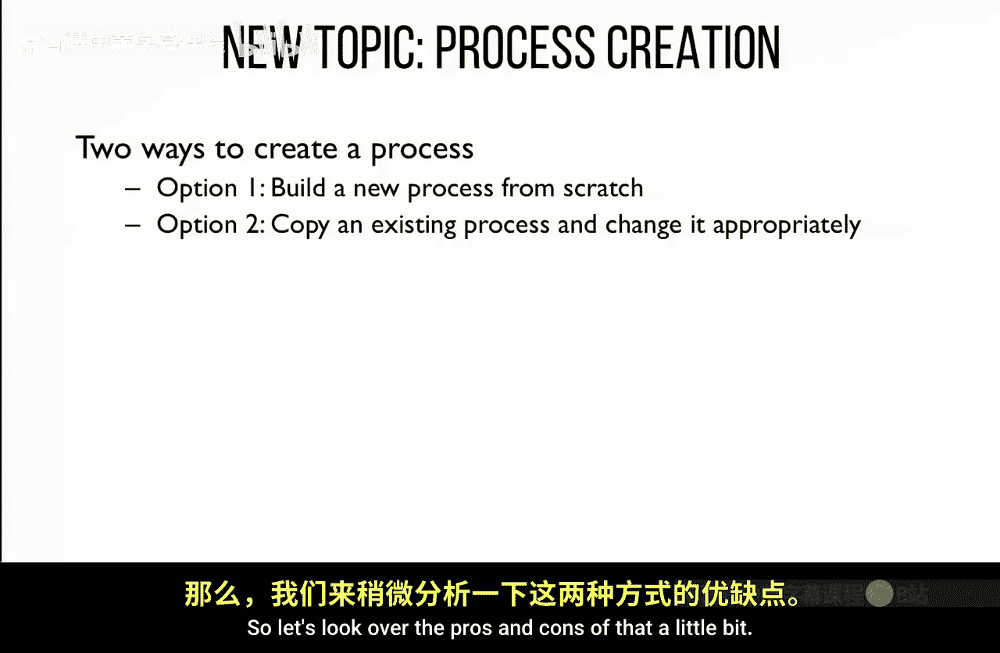

Okay， so option one， you create a new process from scratch and you tell it what executable you want it to run。

 So the way that basically would work is you specify this executable and that lives in the file system and so you'll load that code and the static data that's associated with that into memory you create an empty call stack that you're starting off with no procedures。

 you create an and initialized this process control block or PCB and you put that in the ready list because that's the structure that's basically in the ready list and you'll want to make it look like when you're starting up this process that it is just finished a context switch that you'll remember when we looked through those steps of what happens on a context switch in how we are saving registers to the kernel stack and then we are saving the registers again into the PCB when a process is scheduled。

 It always looks like it just finished running that line of code where it was doing a context switch。

 So that's kind of the default stage。 you want to make it look like a new process has also just gone into that code of where。

It was doing a context switch that's kind of like our invariant there。So people。

 some people really like this model。 You're doing really the minimal amount of work。

 It seems very intuitive that this is how you would start a a process。

 The problem is it's going to be really hard to properly initialize that process with exactly the environment that we want it to have。

 So think about all the permissions that you might want to give this process。

 what you want all of its environment variables to look like。

 how you want it to write to standard out or read from standard in。

 There's just lots of things to configure about a process。

 So when operating systems take this approach， like Windows N T They'll tend to have like a huge argument list for like all the different variations for how you might want to start up this process。

 where you really have to specify exactly where it should read from standard in。

What different limits should be and stuff like that。 Okay， so that's approach 1。

 We're not really going to be using that in this class。

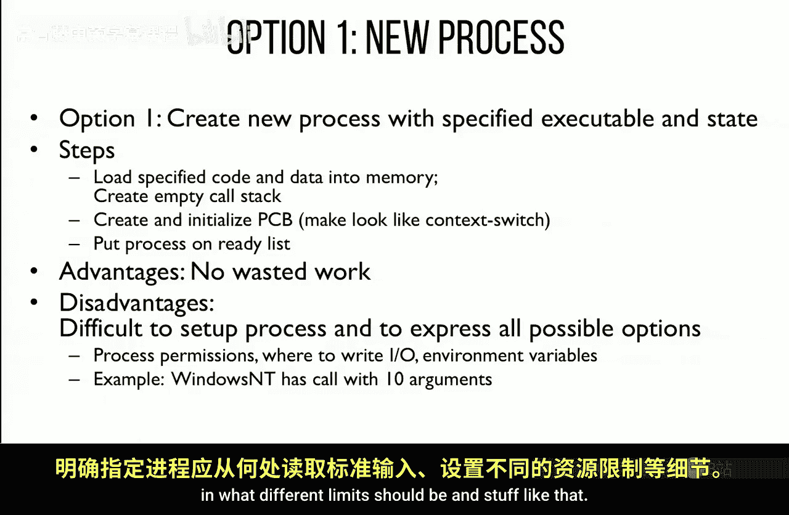

So the option that Unix does is basically you take an existing process。

 and then you make a copy of it or you make a fork of it。

 and then you change it in the ways that you need to。

So we're going to see in a lot of detail that UniX has this fork system call。

 and it basically just makes a perfect copy of the calling process。And then immediately after that。

 you call exec and it will overlay your current process。

 the one that's calling exec with the file image that you've specified here。Okay。

So how does that work， So ForRC makes a copy of the current process。

 So you have by default all of the permissions and the limits and the environment variables set up exactly the same as the current process。

 And you just make a copy of that and save it。 you have to make a couple of changes to make it so that you can tell that it's a child process instead of the parent process。

So what are the things that you might want to change here。So one's pretty obvious。

 you're going to want to make it have a new process I。

 It has to have a new identifier that has to be different from the parent。

 And then a more subtle thing is we are going to change the return code that's been pushed on the stack so that when the child returns from fork because remember it has the exact same stack is the parent。

 So when it calls return， it's going to return back from that fork system call as well。

 the only difference is going to be that we've pushed a zero to the stack of the child so that it can look at the return code and see that it's the child。

 whereas the parent will have the return code that's the PID of the child so each of them can tell who they are in this relationship and then do work accordingly。

Okay， and so then what will often happen is that the child process will call exec。

 and that is like you put your executable here， and it just replaces all of your current code and your current data。

 static data with whatever was specified there。So this is a pretty straightforward way to do things as well。

 The problem is， is that it can be pretty expensive。

 If you really did do a complete copy of the parent processes address space。

 it could be a lot of work to do all that setup up when you're just going to call it exec and waste all of that。

 So there are some implementation details we'll get to later when we understand memory a bit more about how you can avoid some of that work。

 but it could involve a bit of extra work， then that you're just going to throw away when you call exec。

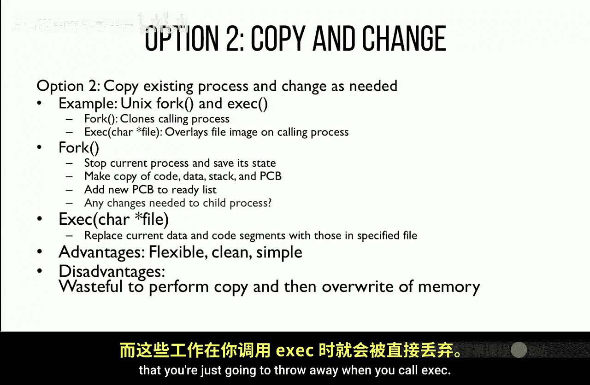

Okay， so let me look， let us look at some kind of pseudocode， kind of C code here。 So this is。

Aulating what a Uniix shell does。 So the think about the shell that you use all of the time。

 It's just sitting around in a forever loop。 and it's getting。

 it's printing out a prompt to you and getting a command from you that you would like to run。

It then calls fork， and then it looks to see from that return value from fork because two processes are going to return after this statement。

 after this call to fork， we'll have two processes running。

Not just threads to completely different processes。

 The child process will see that the return value is 0。 And so this child。

 it will eventually call exec on the command。 And then if the exec returns。

 that means there was an error because it should go off and run LS or your you know my diF process or whatever it was。

 and it shouldn't return here at all。 if it does， it means exec failed because we just we've overlaid our code segment。

 if this is successful， we don't know about this code anymore。And then meanwhile。

 what does the parent do， the other process sees that it's the parent。

 It remembers what the return value was。 And then it calls weight on that P ID。

 So what that does is it doesn't go through the loop until the child process exits。

 That's what this weight system called does。 And so that's useful because if you didn't have this weight here。

 the parent process would just run to the top of this loop again。

 and it would look to get another command and you would just be able to do all of these things。

 So this forces it to wait for the process to continue。

 So this is what you would usually do if you're putting a process in the foreground。 right。

 If you put a process in the background with I an ampersand。

 you don't wait for that process to finish before you ask for the next one。

So that's the basic difference between foreground and background processes as the parent shall wait or not。

Okay， so what I wanted you all to focus on is that there's this beautiful amount of space between when the child process starts and when it calls exec。

 And what's beautiful about that space is that you can write any code that you want there to modify the environment of this running child。

 so you can set up how you want that command to be executed， right。

 so you could set different limits for that child process or you know， you could sandbox it。

 You could redirect its I O。😊，So I'm going to talk a little bit about file descriptors。

 since that's going to be useful for Project 2 as well。 In X D6。

 you're having to deal with file descriptors and what their value should be。

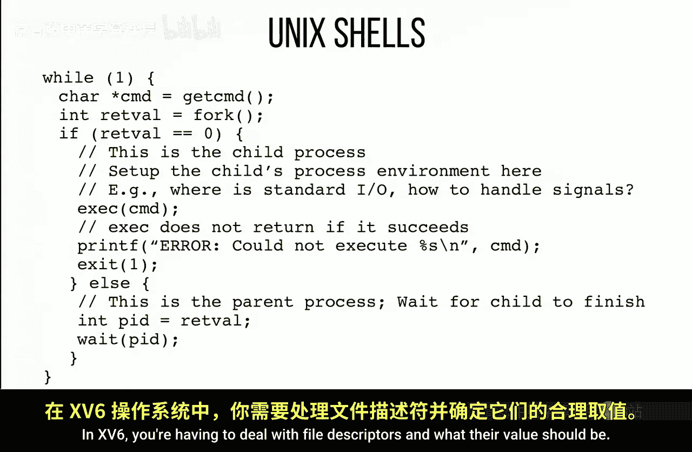

So we'll talk about this a lot more in the last part of the course where we're going to talk about the file system and how to obtain persistence。

 but here this is just kind of a very high level API issue that I thought would be useful for you to look at。

Okay， so what are file descriptors， File descriptors are just simple integers that index into a table and the table then has a lot more interesting information that we'll learn about later。

 like it's tracking the offset of where you've read in this file and lots of metadata information and how to actually read that file。

 But what's important for us is that this file descriptor table tracks all of the open files。

 and it's just a simple index that we can use to access a given file after it's been open。😊，So。

 for example， if you call open and it's a new file。

 we're going to start this is going to return file descriptor 3 in this example， because by default。

 standard in， standard out in standard error are file descriptors 0，1 and 2。

 You have those open by default with every program that you run。Okay， so why is this interesting。

So what's really awesome is this lets you do redirection really easily in a shell。😊。

So what is redirection。 So， you know， like when you run a command and then you said。

 please redirect its output into a file instead of printing the standard out。 So how can we do that。

It's really， really awesome。O， so the idea is that the shell in that time it has before it calls exactec of aas。

 So going back。

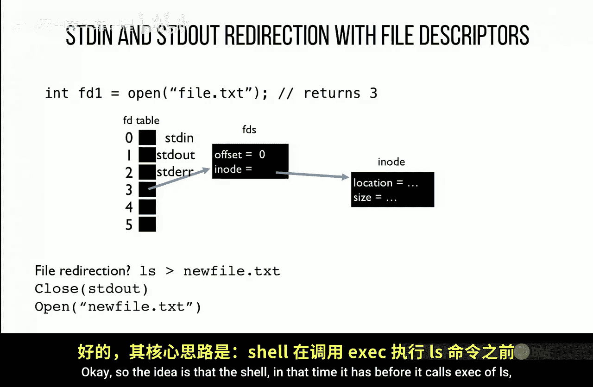

So the shell， you know， it's seeing that LS is the command that it's going to run before it exacts Ls。

 It's going to call clothes and mock around with the environment that Ls is going to see there。Okay。

 so the shell， when it sees this redirection， it says instead of putting the output of L S to standard out。

 we want to put the output to this other file instead。

 So the way that we can do that is the shell just calls close of standard out。

 And so then file descriptor 1 is free。 It's empty。

And then we open new file dot text or any other file， whatever we said here。 And the O S。

 the policy that it implements is it takes the first available file descriptor and uses that for this newly opened file。

 So now file descriptor1， instead of pointing a standard out。

 it'll point to some data structures that let us write to new file dot text。

So what that looks like is now in your program， if you do an F print F to standard out。

 it doesn't show up on your terminal。 It doesn't show up on standard output。

 It actually shows up in new file dot text。So certainly。

 I encourage you to play around with standard out redirection in your shell。 you know。

 just make sure you've used the little redirection symbol for something。 And then in project 3。

 you're going to be implementing this as one of the features of the shell that you add。Okay。

 so I know there's going to be a ton of questions about this once you actually get to Project 3。

 But this is the setup for it so that you will know what that is saying when we talk about it。Yes。

Each process has its own very， very good question。 This is per process。

 There are some shared data structures across processes。

 but this one that we're talking about is absolutely per process。 That's a great question。

Yet this would not work if you were mucking around with other processes， open file tables， yep。

Alright， okay。So that was completely new stuff。Now。

 let us go back to some of the scheduling that you saw。 So we'll start off with some easy scheduling。

 yes。

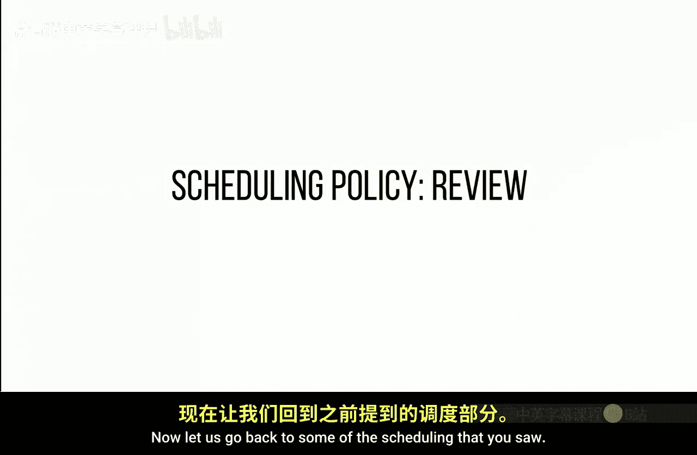

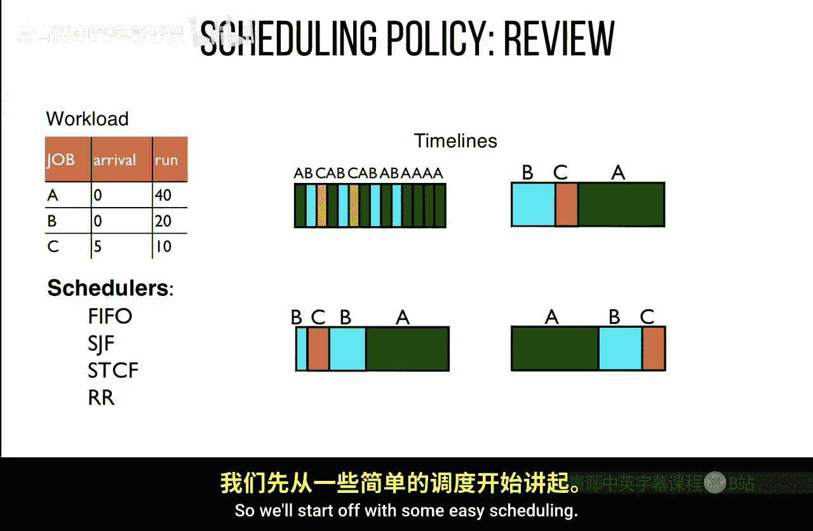

If we do not close the file。的费。在法院的这法院。Okay， you mean like。If in our example here。

 we didn't close standard out if we just directly called open on new file。 We just opened new file。

One of the。Right， then it would have given us index 4 as the file descriptor for new file dot text。

Keep on opening phase and do not。Does this get occupied。 Yeah， yeah， yeah。

 you just keep allocating the next lowest available integer to that file。

 And so there is some limit on how many you can have。 And it's some system configurable thing。

 It's a pretty large number， like 2，56 or 1000 or something like that。 But you'll see an X V 6。

 It's going to be a very small number so that we can kind of stress that。

See when they've all been allocated。WhatYeah。Per process。啊，哈。😊，一个我。要。It's， it's completely separate。

 So I think we'll get into the details of that more later。 But for now。

 just think of it as completely separate。 There is no interaction at all between what's going on in one process and another process opening files。

Yeah。Oh， no， as long as your process eventually calls exit at that point。

 everything will be closed for you。 when you call exit。

 Sometimes we're just being a little particular about you doing all of that stuff because eventually。

 if you have to write a long running service， something that needs to be going for days。

 it's kind of acting like a user level O S， you need to be really careful with tracking resources and making sure that you close everything。

 But generally when you call exit， all of these resources that are associated with a process will be freed。

啊哈。😊，That's how were going to think about it for today。 Yeah， that it's just taking this away。

 And now， because you have to figure out what should we do with this other stuff。

 How do you free that， But we don't care today for today， once you close that。

 you're just taking away that entry。Setting that to null y。Okay。

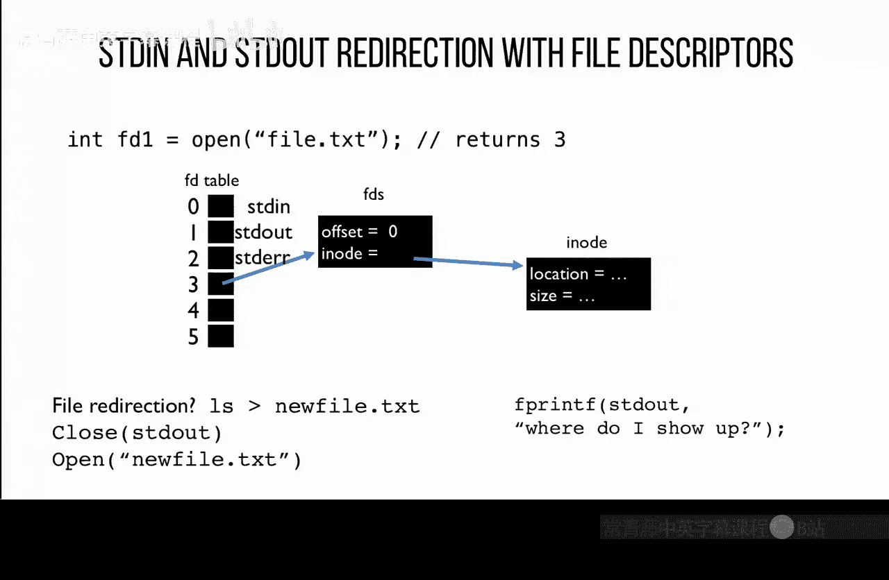

Awesome。😊，Okay， so back to scheduling。 So spend a minute talk with your neighbor。

Figure out which one of these four pictures corresponds to which one of these four schedulers for this particular workload here。

So it should just take you like a minute。Get the answers。All right。So let's hear your answers。

So what's the first picture？First picture must be round Rob and it's using time slices and going between them all。

I can't quite figure out if what the time slice is here。 It must be that， It must be less than 5。

 if this one's ready to go when it's turned。 Hopefully， So that's round Robin。 This one here must be。

Shortest job first， SJF that at time zero， it has a choice between A and B。

 it chooses B as a shorter job than A， so B gets to run， it is non preemptive。

 so when C arrives at time five， the scheduler doesn't get to do anything。

 but at time 20 when B finishes， it then gets to look at C and A and it says。

 oh C is shorter than A and so it runs C next。Alright， so that was shortest job first。

 The next scheduler is clearly shortest time to completion first。So at the beginning， it chooses B。

 but then when C arrives at time five， it then compares the remaining runtime of B， which is 15。

 10 is less than 15， so it preemps B and runs the shorter job C， Then when C is done。

 it looks at the jobs that are left， B is less than a， so to run B。And then time for first come。

 first serve or first in first out just runs the jobs in order。So any questions about those？

Theoretical kind of building blocks for our schedulers。Great。

 so you should be able to calculate turnaround time， response time。

 and you should be able to draw these gantt charts if you're given a workload and told to assume you have a given schedule。

 That's what。

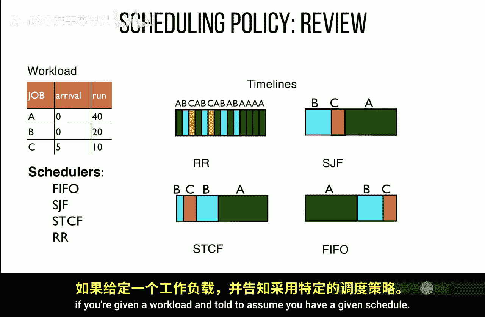

Quz 2 is about。Okay。Quz 3 is looking at that multilevel feedback queue scheduler。

 So you'll remember we're going to have some number of cues。 highest priority queuees are at the top。

 We have some number of ready processes that are at each queue。

 If you have two processes that are at the same priority and they're both ready。

 you're going to round Robbin between them。 These jobs will always run instead of the lower priority jobs。

 So like C will only run once A and B are blocked on I O or exit the system or their priority degrades down below C。

Great。So。I showed this figure in class。 and based on the questions I got after class。

 I don't think most people knew what all of these various colors meant。

 So please take a minute and talk with your neighbor and try to explain what I was trying to show in this figure。

 And then I will go over the figure to make sure you're all interpreting it correctly。All right。

 so let me explain the figure to you all。Yeah。What's your question？

You have to ask the whole class at this point。I want to ask you a question？So this example。

 we're not adding any gaming to it。 So in this example we're assuming that B and C。

 and I'm glad you assumed B and C were the same to John and I did。

 B and C are not demoted because the scheduler doesn't have a gaming mechanism。

It's just saying as long as you relinquish the CPU before your time slice ends。

 it will keep it at the same level as before。So what's going on in this example is we had process A。

 it was the only process in the system， it started off at Q2。

 it used up its time slice so then it got demoted and then it used up that one and it got demoted again so then at this point here two new jobs B and C arrive they're doing lots of IO they start off at a higher priority so they are scheduled first so B runs for a tiny bit of time and then it does IO so at blocks it's no longer in the ready state and so C gets scheduled at that time as well so this is a duration that's shorter than the time slice that we could see back here。

And so the scheduler is not demoting any of them because it's always relinquishing the time slice before。

The quantum before the time slice expires。So we keep alternating between B and C as they do IO。

 but then this starvation mechanism kicks in and notices that job A hasn't been run for some amount of time So maybe it boosted it up to Q1 maybe it boosted it up all the way to Q2。

 we'd have to specify the details there。 but some starvation thing kicks in and we raise its priority and so then eventually it gets the full time slice Now at the end of that time slice。

 it's going to get demoted down to this level here。

 but it's not going to get to run down there right because B and C are using up all of the CPU and it's a lower priority job。

 So it's sitting in the queue here， but it's not getting to run so that's what I'm trying now to show with dashed lines。

 but then that starvation mechanism will again periodically run it notices that process A is never running so it increases its priority so that it is at the highest priority and it gets to run again。

Gets downgraded， and that continues forever。So。Yes。Yes。It would go through the queue。

 It would follow whatever policy we had in place before。

 that our default policy is you use up the time slice， you get demoted by one level。 And then here。

 if we used up the whole time slice。Which we're not going to do。

Then we would have abandoned mode it as well。Does it answer that？Yes。そえの。So what's happening is。

 I mean， B is using the CPU for a little bit of time。 And then it's blocking。

 And so there's no job left to run and then C runs and then block。

 So that's why those two are moving back and forth so quickly。 Now， the time slice at Q2。

 it is this long。 So that's why when job A gets the CPU finally。

 it does get to run for a longer period of time than the others。

 because it's not relinquishing the CPU。 It's using up its whole time slice。

But then once it gets demoted down here， then the jobs that are at the higher priority。

 B and C are going to get to use the CPU again。Yeah。Here， it used on all of its time slice。

 so it got demoted again。That's， yeah， that's what I' trying to draw with these dashed lines to show it gets demoted。

 It just doesn't get to run there。Yes。That's my drawing ability， yeah。This is me using PowerPoint。

 yeah， not too precise。Yes， okay， alright。Moving on。Right， so this is in your third quiz。

 It should be pretty straightforward to do。 If you have any questions， let me know。 Okay。

 so that is it for virtualizing the CPU。 Now we're going to talk about how to virtualize memory。Okay。

 so the first part of this course is all about virtualization。

 How do we give the impression to different processes that they have exclusive access to the resources or to the hardware on this machine。

 So virtualizing the CPU was relatively easy。 I dare to say It just took us about two lectures to talk about mechanism and policy。

 Viualizing memory is going to be a bit more complex。 This is going to be about five lectures。

 We're going to start off with approaches that have a lot of disadvantages and then slowly remove those disadvantages until we get to what modern systems do。

 Okay， so today will be the light and airy that has lots of problems。Okay， so high level。

 why do we need to virtualize memory？ So in the earliest systems。

 we did not virtualize memory when you had a running program。

 it could be the only running program in the system， and it shared memory with the operating system。

 So there was no protection between the running program and the O。

 if this program decided to accidentally overwrite the O。 you completely you know crash your system。

 you'd have to reboot from scratch。 you could read anything you wanted to write anything there。

 but it didn't really matter because you were the only process running anyways。

 there was no other processes that you could be stealing their information from。Okay。

 so it was easy to do， but it's really pretty ridiculous to have a machine where you can only run one process。

 If you look at how many processes are running on your desktop machine。

 it's going to be hundreds or thousands， right。Okay。And the process can destroy the all us。 Okay。

 so we want to provide real， true multi programminggram。

 And there's a number of properties that we're going to want here。 So first。

 we want to have it be transparent。 We shouldn't have to do anything special in our process to make it share memory with other processes。

It should work regardless of how many processes are running。

 We absolutely need to provide protection。 It shouldn't be that one process can read or write the memory of the O or any other process in the system。

 That would be bad if you could steal secrets from another process。

We'll be concerned about efficiency。 We want to make sure we're not wasting memory or Ram that we have in our system。

 We'll be talking about this metric fragmentation。 That's like these little small spaces of memory that you can't use。

And we won't want to slow down processes either， obviously。And then kind of a subtle。

 more difficult property that we will eventually be able to provide is sharing that if you have two cooperating processes。

 they might want to be able to share just portions of their address space or have some shared memory that they're each able to access。

 even though they're not able to access each other's complete address space。

 So we'll get to that towards the end。

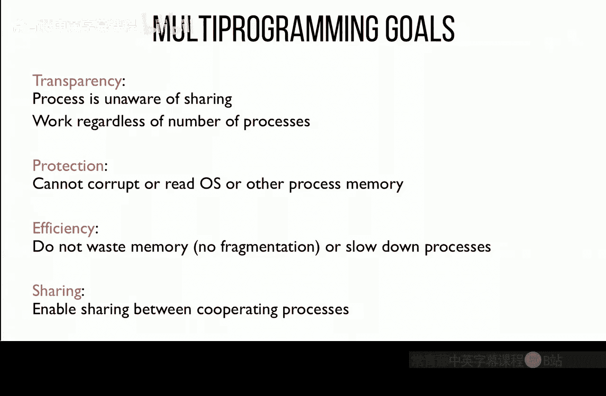

Okay， so you've learned about address spaces in 354。 Let's kind of go over that。 So basically。

 the address space of a process is the process's view of memory。

 And so all of its program code is going to be in its address space。

 It heap will be allocated in the address space， and the stack is allocated in the address space。

But the illusion that the OS is going to provide is somehow we are going to map this virtual address space that each processes to physical memory over here。

 So what's going on in physical memory in this ridiculously tiny machine here is that in physical memory we actually have the OS running。

 we have different processes running and somehow it has to be the case that process A can't read or write process Bs。

Data， right， so how are we going to do that。

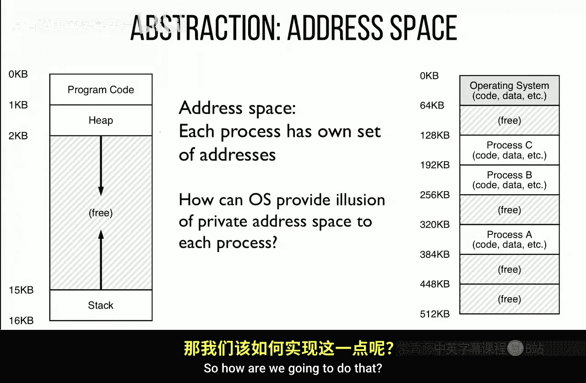

So let's dig into what's actually in an address space in a little bit more detail。

 This is probably review for you。 So we'll have some segments that we'll call the code segment。

My pointers dying， which stinks for me。Okay。We'll have a heap。

 so the heap is where when you call malik that you have dynamically allocated memory。

 that's where that's going to be allocated， and then you have your stack where we will push procedure frames and have all of your local variables there。

So one key thing is that we have some static portions are code。 that's a static， resized segment。

 It doesn't grow over time。 and all of our global variables that we knew about when we started。

 And then the heap and the stack， we don't know how large they're going to be。

 And so the safest way to let them both have as much space as possible within our address space is to put each of them at the two extremes and let them grow towards each other。

 So if you have a sufficiently large address space。

 you're not going to run out of addresses and you'll be able to have as large of a heap and as large of a stack as you want。

Okay， yes。Add space the version。ReSp of。Determin。Well， so。Certain。

 it just changes over time with needing to have more bits。 You know。

 that like a 32 B address space would have been standard a while ago。

 And now we have many machines that will give you a 64 B address space。 So it's basically。

 you just want to give as many bits as possible so that we can。

Have more memory allocated to processes。But， I mean。

 we're going get into more the sizing of everything。 I think。

 as we get into the details of these structures。sorry以来。好不时。How much matter。

Do I need to allocate to this specific。I think we'll get into that later with how do we move things around。

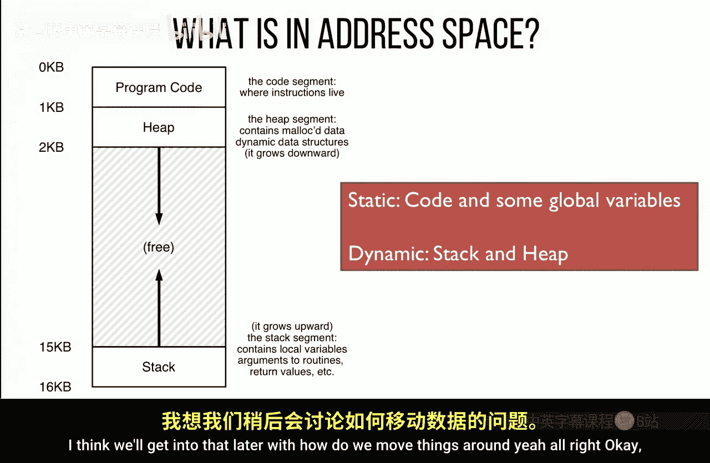

All right。Okay， so high levelvel stuff。 Why do we need dynamic allocation of memory。

 We all know that you don't know ahead of time how much memory， a given process is going to need。

 This process needs to have some data structures， a tree， whatever it's doing。

 You have no idea how much it's going to need。 And so we need to allocate that memory dynamically。

 We need to have dynamic memory allocation because of recursive procedures。

 You don't know how many times a procedure is going to be called。

 You can't preallocate or statically allocate the stack for that。Anytime you call MalC。

 because you have some complex data structure， we don't know how many times you're going to call Malik。

 so this is going to be dynamic。And as you all know。

 theres two different types of dynamic allocation that we see in programs。 we have the stack。

 and we have Heap allocation。

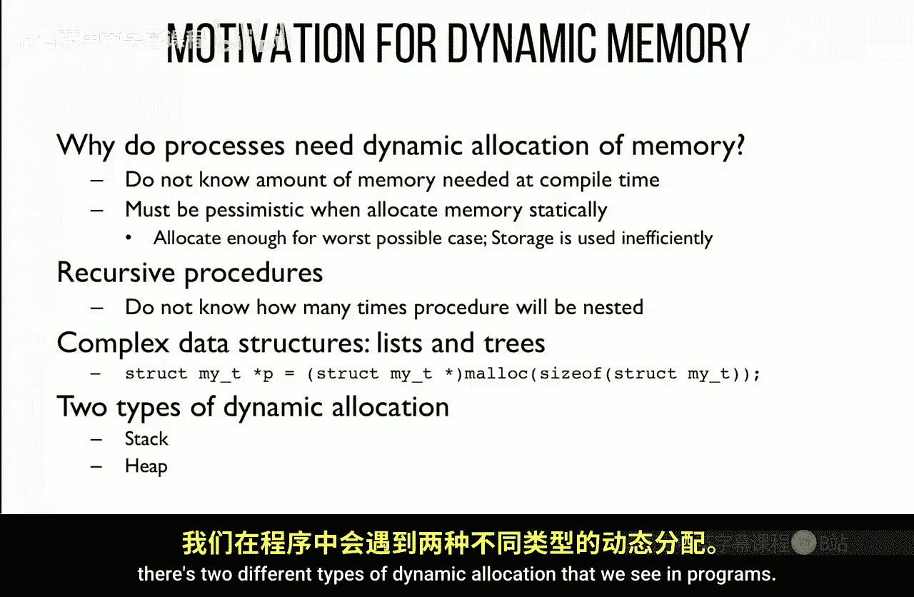

So the idea of the stack， it's a general data structure。

 but it's also what we use for allocating procedure frames and local variables。

The key feature of a stack is that you have to free memory in the reverse order that you allocated in it。

 So if you allocated A， B and C， the first item that you'll have to free will be C。

 And then if you allocate D， then the next thing you'd have to free would B D。Okay。

 so I know this seems really obvious， but what's awesome about this data structure from the O S perspective is just how simple it it is to manage。

 that we will just have a single pointer that's showing where the top of the stack is。

 And that single pointer separates what's been allocated from what is free。

 We don't have to have all this complex managing of what's free versus allocated。

 And we have no wasted space at all。 There's no fragmentation。

 There's no holes and what's been allocated。😊，So when we can use a stack for things， that's awesome。

So let us review what goes on in the stack。So let us look at this when we have Maine。

And then we have int A。 A is going to be allocated on the stack， right。

 It's a local variable when we call fo。The return address of main will be pushed on the stack。

 The parameter that we're passing will be pushed on the stack。 So then when Fo is called。

 it's able to access。The variable that's been pushed on the stack， which now has the name Z。

It has a local variable as well。 So that gets allocated on the stack。We call print A。

 we then we return from Fu and we're able to pop off the stack the。嗯。The parameters that we passed。

 as well as the local space we just allocated for a here。

And then when what was we stored on the stack was the return address that we need to return to back in Maine。

So we're able to figure out where we need to return to。

So I think you've learned about how that stack gets set up in past courses。

 and we're just going to assume that all of that is working here and build on top of that。

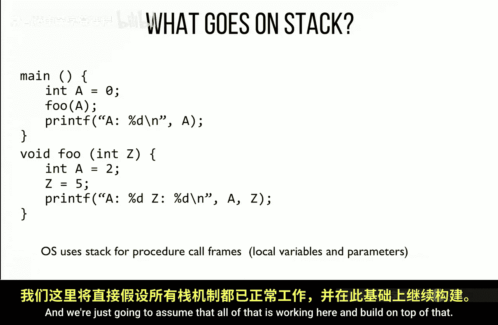

Okay。So that was the stack， our heap， so we use the heap when a user process calls MalEC or new or whatever it is that your language provides。

 the idea of Malik on the heap is that you can allocate and free in random arbitrary orders and the way this is basically going to work。

 is the OS just gives like some library， your Malik library。

 a big chunk of free space that there's the system call called SP that the OS extends your heap and gives that space to the user levelvel library and then the user levelvel library manages that allocated space and doles out little pieces to the process that's calling it。

And so that user levelve library has to have some data structures with tracking which memory is free versus allocated and when you ask Malck for a certain amount of space。

 it searches through its data structures and finds the right size So the problem with heap。

 managed space is that it will have a lot of fragmentation and we'll see this in other。Domains later。

 but basically。What will happen if you try to allocate， you know。

20 Bs that would be problematic because there aren't 20 Bs that are contiguous。

 And if you need 20 bys， you need them to be contiguous so。啊。

There's lots of different ways to kind of solve that problem。

 You would have to def fragmentment things， move the allocated space together。

 move all the free space in another area。 And then you'd be able to do those larger allocations。But。

We are not really going to talk about the details of how you implement Malck because again。

 you may have implemented something like Malck in 354。

 So we're going to assume you know how to organize the heap as well。

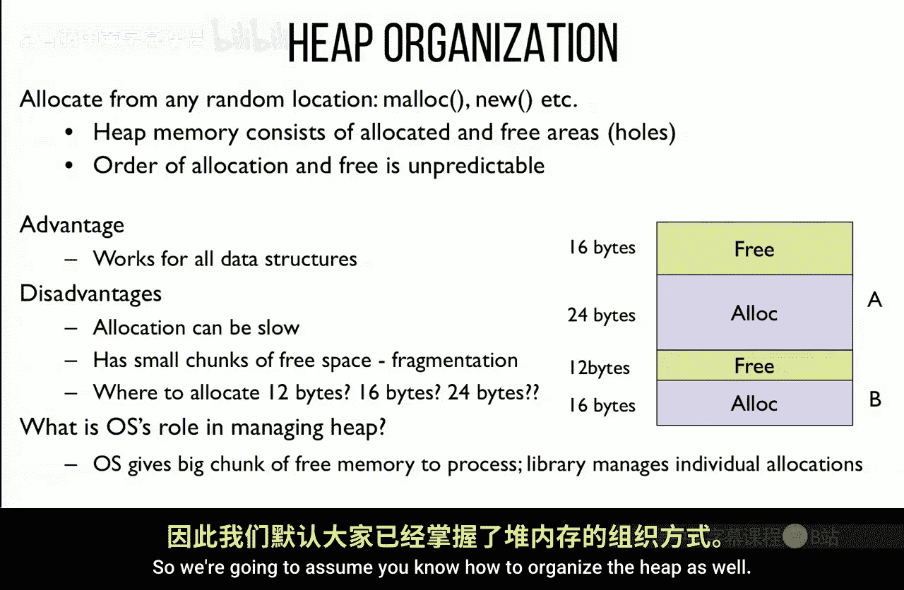

Okay。So。The review here to talk with your neighbor is we have a bunch of addresses。

 and you should figure out where those things will be allocated。 Is it static data， code。

 stack or heap。I think you can do this in about one minute。All right。Okay。

 so I think the first three are straightforward int X， that's a global variable， it's static。

 we knew that that existed when we compiled the program， main is code。That次。

Compils why that's a local variable it's allocated on the stack。😊，Z。

 what is Z Z is also a local variable allocated on the stack。

 but that local variable that's been allocated， you know it's a container。

 it's a pointer to something else， but Z itself is absolutely allocated on the stack for mainine。

 it's a local variable of main。So then here's the interesting one。

 The thing that Z is pointing to that container。 What is it pointing to。

 It's pointing to memory that has been allocated on the heap。

 So the contents of Z are going to be the address of something that Malik has returned in address that lives in the heap。

 So if you look at what Z contains， it will be an address that lives in the heap。Okay。Any questions？

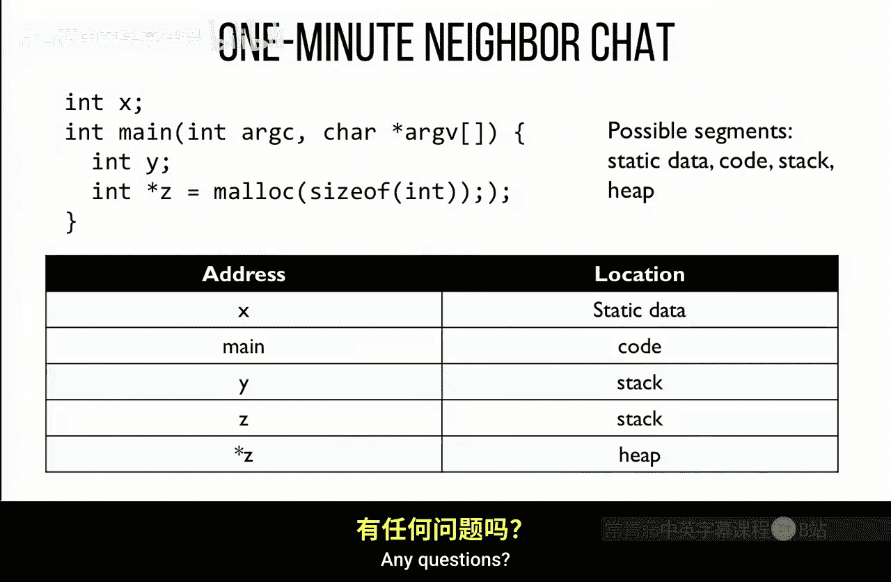

All right， pointer fun。 Okay， so let's look at some more memory addresses。

 So this is a very lovely C program， pretty straightforward。

 Let's look at what it looks like in assembly so you can disassemble。😊。

Compiled code using a variety of tools。 And what you might see is assembly code that looks like this。

And what you will see is kind of nice。 So these are the addresses of the instructions where Maine lives in the address space。

What is move of。This into this。 So this is a user address。 sorry， register。

 And then we are looking at the base pointer on the stack。

Because x has been located on our local stack， and we're looking at something8 away from the base pointer。

 and that's where x has been allocated。 So we move the contents of x into a register。

 Then we add three to the value that's in the register。

 and then we move the new value in the register back off into the stack here。 Okay。

 so that's some assembly code。So that's the setup for our O S question。

 So what I want you to all figure out， we're really going to become obsessed with memory accesses。

 Can you figure out how many memory accesses it's going to be to execute those three assembly instructions and extra credit。

 What are the memory instruction， What are the memory addresses going to be。

So this will take you more than one minute， please talk with people around you。Yeah。

Do you have a question。AMD64 since we're using our registers。嗯。滚。

This is not IA32 this is just like it's some mishmash of assembly that。

I just noticed when I cook when I。somebody口上。た。Song。

My assembly is always going to be like sort of right， sort of， you know。

 don't ever like trust the details of every little thing up there， but yeah。All right。

 so let us look at what addresses we are going to access when we execute this program。

So the first address that we are going to read from will be what？

The first address we' will read from is where the instruction pointer or the PC is pointing to。

 which is this address right here。 So that is our first access。

 We fetch the instruction that's at that address。Yeah， can't forget those instructions。

Don't focus only on data。 Then the next memory access that we make will be relative to the base pointer。

 So we know our base pointer is hex 200。 We add 8 to that。

 And so we'll do a load from this hex address here。 That will be someplace on the stack。

 So we do a load from there into this register。Then our next instruction that we will fetch is at address 1。

3。 We then do an exec of that instruction。Are there any memory accesses associated with that instruction。

 no， it's just。Modifying your register。Then we fetch the next instruction at 19。

 we exact that instruction， which is just doing a store of what was in this register back out into that memory address that's on the stack that's at 200 plus 8 at 208 there。

All right， so five memory accesses to run this tiny little easy program。

And we're going to be looking at a lot of detail on how do we translate these virtual addresses to physical addresses and what that means。

But these are all virtual addresses， things in the process's address space。

This is what you have been familiar with up until this point。

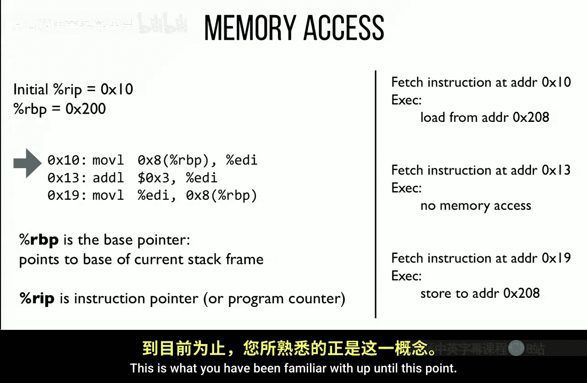

Okay。So that was all background。 What's going on in virtual address spaces with heaps and stacks and virtual addresses。

 Now， we're going to start getting into， well， how do we actually virtualize memory when we only have。

Physical memory to do out to all of these different processes。So the problem is， as we've seen。

 when you compile your code into an executable， there's all of these addresses in there。

 so we're going to have to figure out how the address in one address space when it's the same address as and other processes that it wants to access that's actually going to different places。

So depending upon our time， we'll talk about four mechanisms for doing virtualization， time sharing。

 static relocation， based and base bus bound。

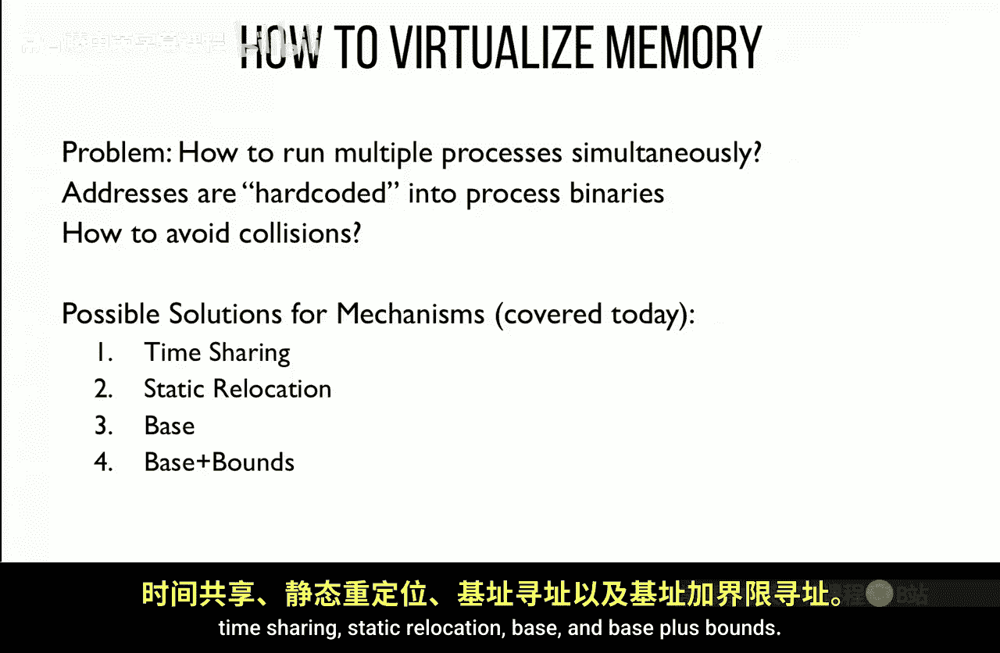

Okay， so the worst thing that we could do that would allow us to virtualize memory。

 It would be to timeshare memory。So this would be ridiculous， but the idea would be。

We have our code and data statically allocated on persistent store。

 we create this process for the first time and we allocate its he and stack and get this process running so process one is the only thing resident in memory except for the OS which is also there doing something。

 but we're ignoring that problem here when this process is done。

 or when we need to do a time slice and do a context switch out。

 then the OS will copy that everything about its current state。

 everything in memory back out to disk the OS chooses another process to run。Creates it。

 runs that for a while， decides that it wants to switch to another process。

 writes that out and so forth。 So this is going to be ridiculously slow。

 It doesn't make any sense in the modern era to be doing all of this copying of this huge amount of memory。

 But this is what earliest systems would have done since it protects processes from one another。

 And you can't tell that other processes are running。

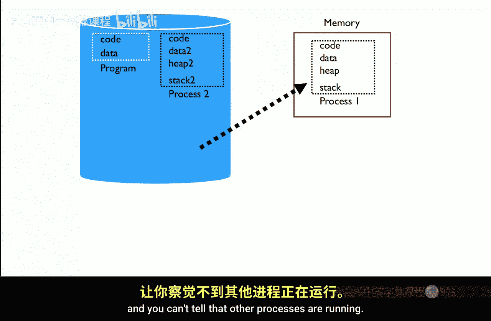

So let us keep that quick。Because that just has ridiculously poor performance。

We don't want to do time sharing， it's clearly going to be better to do space sharing that we have a lot of physical memory and it will be better to dole up that memory and give different amounts of it to different address spaces。

 so all of our remaining solutions will always use space sharing。Okay。

 so another early idea that we no longer do is what's called static relocation。

 So the idea here is that。We are going to figure out ahead of time before we start this process exactly where that process is going to run in physical memory。

 and so then we will actually rewrite it's executable。

 itss binary so that all of its addresses go to where it's been placed in physical memory running this time。

So this is doable。 It can have very good performance。 It's just。

 you can imagine it's a horrendous thing to have to rewrite and executable。😊。

So the idea here is we had our， does this work。Oh， that's awesome， okay。

So we have our standard code here， and then we take all of the memory addresses and we change them to where they're going to be located in physical memory。

 So for one process， the addresses for the instructions are here for another one。

 the instructions are here and we just rewrite it。 So if we had any accesses to static data that would have had to have changed。

 we don't have to rewrite the accesses that are relative to the stack because that's just all stack relative。

 right， It's still just eight from our base pointer and we'll just have different contents in our base pointer for where the stack list for each of them。

😊。

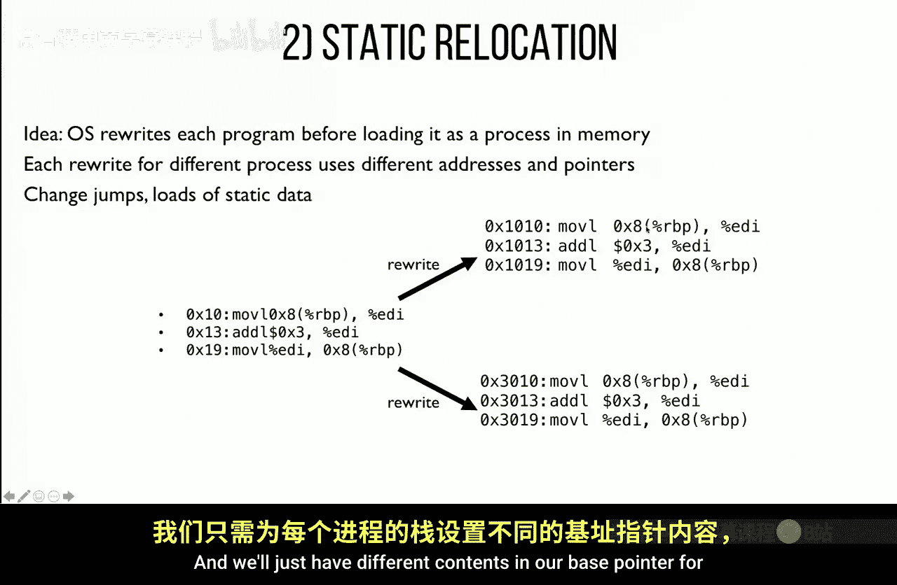

Okay， so the intuition here is that both processes are living in memory together。嗯。

And we'll rewrite where the addresses live。 And we don't have to rewrite the operations that are relative to the stack。

 since those are all relative anyways to a different value。

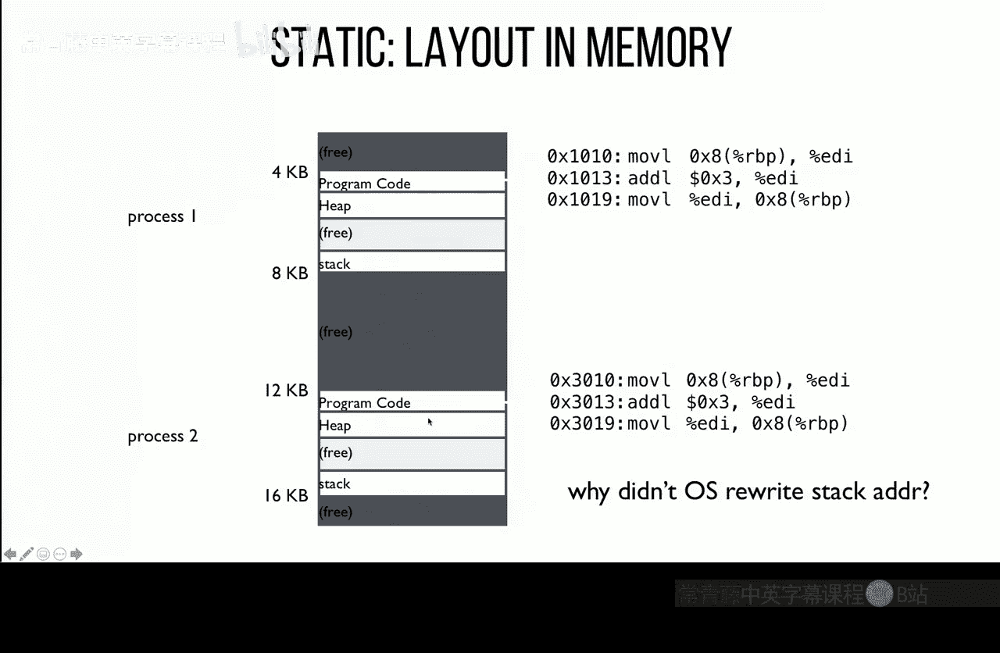

All right， but this does not work very well for a number of reasons， so first of all。

 there's no protection across different processes， if this process is able to generate an address that is down in this process's address space。

 it could just read and write from those addresses， there's no hardware protection。

 there's no OS protection preventing that from happening。So that's one problem， no privacy。

 no isolation。 Another problem is that you can't move these address spaces after they've been placed。

 You did all of that rewriting of the binary to to adjust the addresses。 And then later。

 if you want to move somebody around， you couldn't do that。 Okay， so static is also poor。

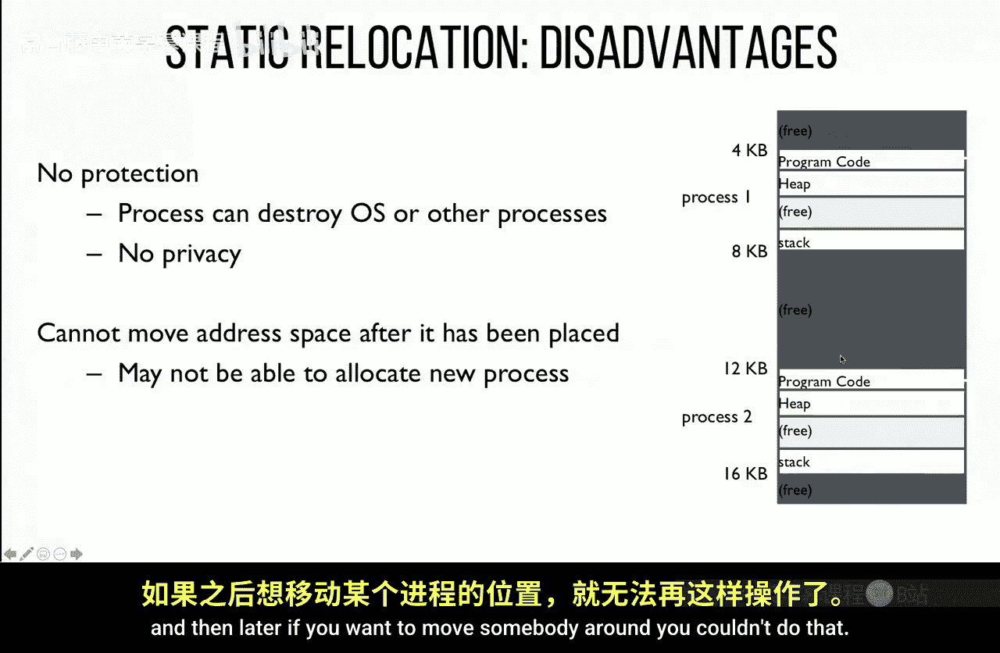

Okay， so let me give you all a break， maybe talk with someone you don't usually talk to。

 what was their experience like with Project one， what's their work style like you're trying to get to know as many people as possible in this class you're going to be looking for future project partners。

 so it's nice to find who has similar styles to you。All right。Okay。

We're going to start talking about our other styles of virtualizing memory。

 so the previous approaches all had really fatal flaws because we didn't have any support from the architecture。

 so we definitely need some hardware support here so that we can provide better isolation so the most basic version we'll look at it starts to have a memory management unit or in MMU you want to think of the MMU as some piece of hardware。

 maybe it's on the same chip as the processor but it's some piece of hardware that's taking the instructions that the CPU is generating and it's translating those from the logical addresses that you see in your user level process and it's translating them to physical addresses that you cannot see unless you connect some hardware probes here。

 what the physical addresses are that are actually accessing memory。Okay， so again， MMU is hardware。

 it translates the logical addresses that you are aware of at your user level process to physical addresses that actually access RAM there。

 and so sometimes instead of logical address， I might use the term virtual address and sometimes instead of physical we might say real or machine。

 those are all basically synonyms there。

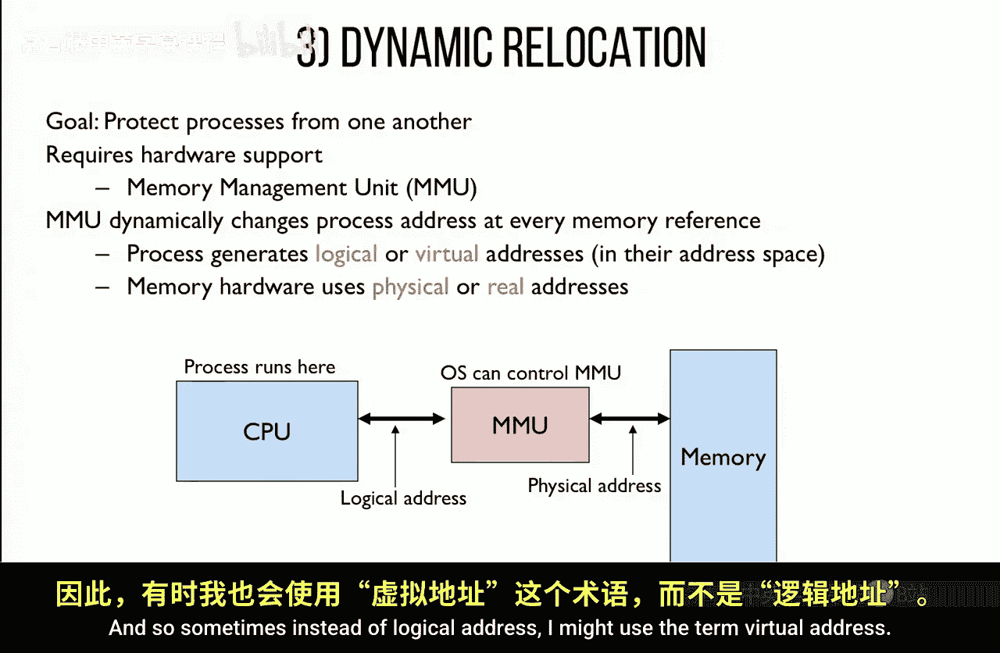

Okay so in our simplest version of dynamic relocation with some hardware support， what do we need。

 The MMU needs to be aware of what mode we're running in。

 so are we in that kernel or that privileged or that protected mode。

 then we can do certain things whereas if we're just in userlel mode we can't So when you're in the O and you're in privileged mode。

 then it has to be the case that you can execute certain privileged instructions that you couldn't otherwise and we didn't have a lot of examples of these privileged instructions before。

 but one of those would be modifying the contents of the MMU telling the MMU what it should use in some of its registers。

And so also when you're in this privileged mode， the MMU will know that。

 and we might be then able to access physical memory directly rather than having our logical addresses translated to physical addresses。

Okay， but then when we're in user mode， when that bit is set to show that we're in user mode。

 then the MMU is going to translate all of our logical addresses that we're generating to physical addresses。

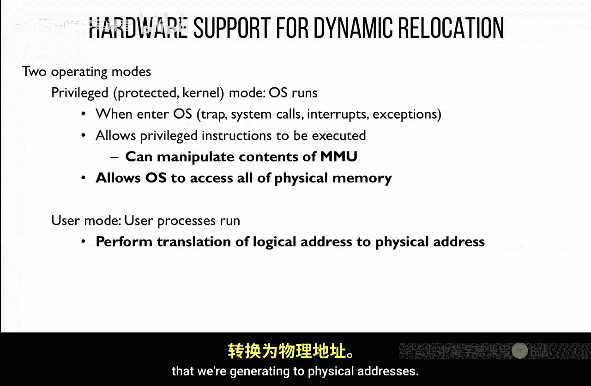

Okay， so what does that look like， So this is the simplest example of an MMU。

 it's going to get much more interesting as we go， but our starting version。

 it has that mode that I was talking about， it's tracking is it in kernel or user mode。

 and then it has a base register and so this would be the number of bits that you have in your architecture we're just assuming a 32 bit architecture。

But could be 64 bit architecture， so the idea is a logical address comes in。

 if the mode is equal to the user， then we are going to add the base register to that logical address to generate a physical address。

 if it's the OS that's running， then we'll just send that address that it's generating directly to physical memory。

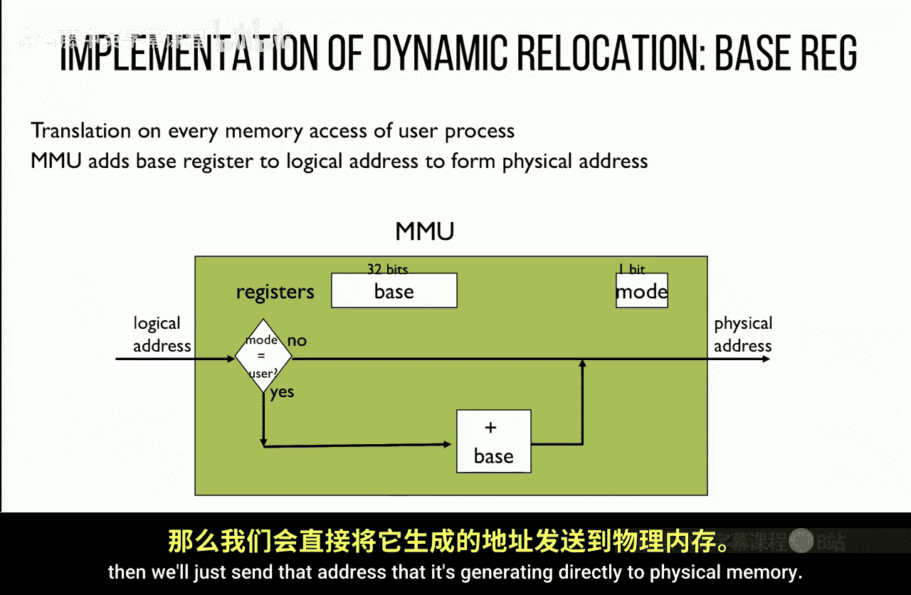

Okay。So this is going to be great。 It's going to give us a lot of power because now we can dynamically change addresses。

 so。We just use this base register。 And so every process that runs。

 it will have a different base register， and that's showing where its address base lives in physical memory。

 And so now when we do a context switch， part of that context switch will involve changing that base register in the MMU。

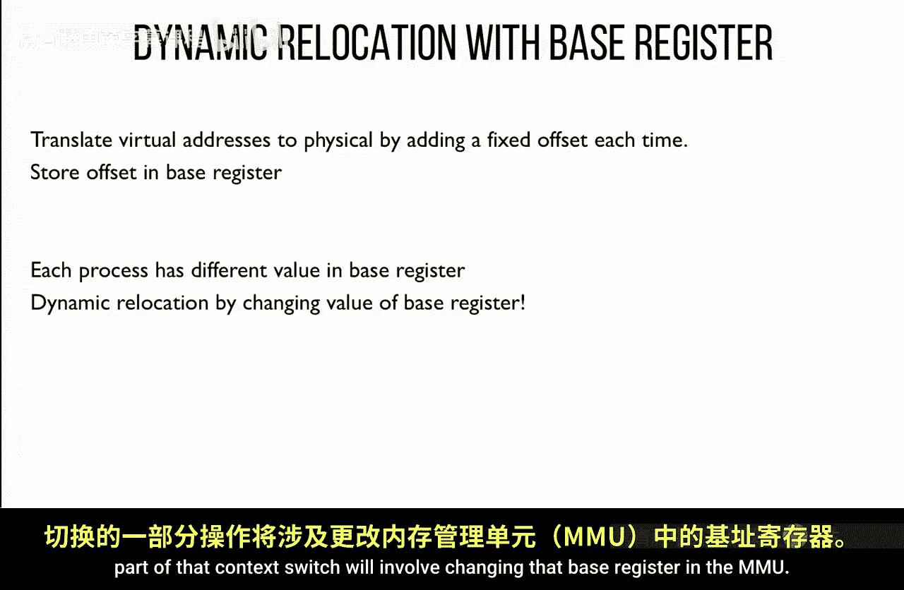

So let's look at some pictures。So now we have two processes。 They are running the exact same code。

 They're accessing the same addresses in their logical address space。

 but those addresses have to be different in physical memory。So for example， in virtual memory。

 process one is doing a load from memory address 100。

 and it's clearly 100 in its logical address space。 And then when P2 does a load of 100。

It is clearly 100 in its virtual address space there。Okay。

 so the key then is that we're going to have this base register that points to the base or the start of our address space。

 and so when we do a load from 100， we just add 100 to the base register。

 and that's the physical address that we need to generate。Okay。

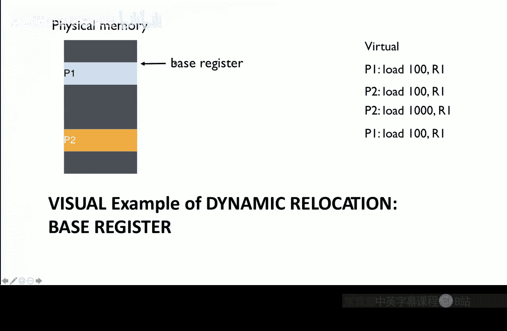

So that will be enough to do a lot of things。 So here's a straightforward quiz for you。

 So who is it or what is it that's actually performing the translation of addresses using that base register。

Process OS or hardware that's doing that。That's hardware。 That's what the MMU is doing。

 It's using the base register to just add on to the logical address to show where that address base lives in physical memory。

 And then which is the entity that's actually determining the contents of the base register and modifying that and telling the hardware。

 what it should hold。 That's the OS that's doing that。 that's OS is privileged。

 So it can modify and access that base register， the OS is determining where a process lives in physical memory。

 It's doing that allocation， and then it's telling the hardware。

 This is where I've placed that process in physical memory。All right， so are we done， Of course not。

 We are very far from done。 So one question with this based register。

 can we protect two processes from accessing each other's address spaces。So can P2 hurt P1。

 can it read or write P1's address space？Well I look at how I've numbered these things here。

It's all unsigned numbers。 right these are not you have no negative numbers。

 So P2 cannot hurt P1 because it can't generate a physical address that's smaller than 4 kB here。

 So any address that it sends， Do I have a good picture， this， remember that picture。

 whatever address it generates in the physical sorry in the logical world。

 It gets added to the base register。 So it's always some value that's at least 4K or higher。

Does that make sense to everybody。Whereas P1。If it generates a large address。

 it's going to get added to this base， and it could then access this physical memory down here with our simple hardware that we have so far。

So， for example。If P1 does a store to this decimal number， which I will not usually use。

 but I have decimal in here。 If we do a store to logical address 3，0，7，2。

 it adds the base of1 K to that。 And so we end up doing a store of at you know。

 this physical address here， which is in。P2s space。So just having a base is not a good solution。

 We are not protecting one process from another。

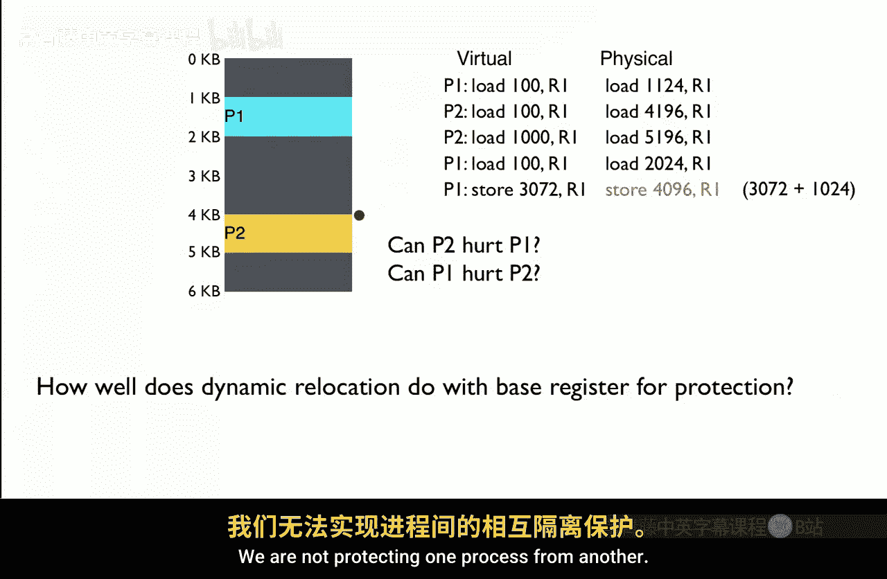

okay。So there's another simple solution to this one。 We just add a bound register。

 so we just make sure that the addresses that a process generate are not larger than its address space。

 right。So we'll still have our base address， it's the starting location of where you're placed in physical memory。

 it's the smallest physical address that you'll generate。

 and then we're going to have a bound that's just saying this is the size of your address base and if your process generates an address that goes beyond the bounds。

 it will cause a segmentation fault， your process will be killed。

 you've done in illegal memory access。

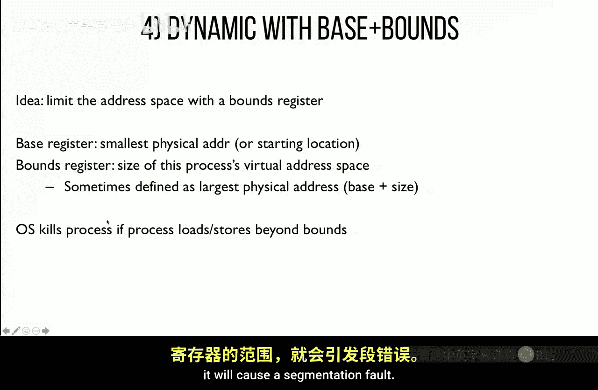

So the implementation of this in the MMU is still very， very simple。 we have our base register。

 we have our mode， but now we're adding a bounds register。

 and so now we always check to make sure that the logical address that we want to access is less than that bounds that it's in our address space and if it is not then we send an error back to the OS It's a trap back to the OS and the OS can kill the process that did this thing I mean the OS could do whatever it wanted at that point has whatever policy makes sense。

 but the policy that makes sense is to kill the process that did that and to tell it that there's a segmentation fault。

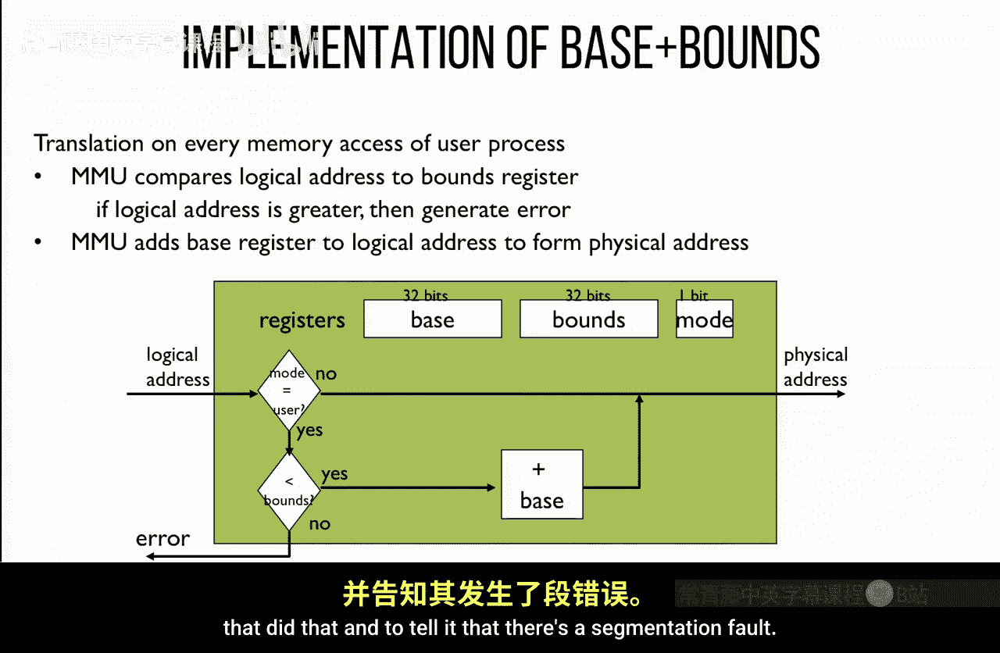

Okay， so simple example， process one is running。 we've set the based register in the MMU to be P1's based register and the Bo register will be P1's Bos register。

And then when we do a contact switch and P2 is now running。

 we will change those registers in the MMU to match P2。

And so now I do not think it is possible for either process to access each other's memory。 So now。

 when P1 tries to do a store to this address that goes beyond its address space。

 what's going to happen。The hardware will tell the OS that there was an error。

 the OS gets this interrupt， the OS then figures out how it wants to handle that interrupt。

 it sees that it was process one that was doing something that caused that to happen and so it delivers a se fault to that process and kills that process as a result。

So by just having a little bounds register to compare to。

 we can make sure that processes aren't generating illegal addresses。O。

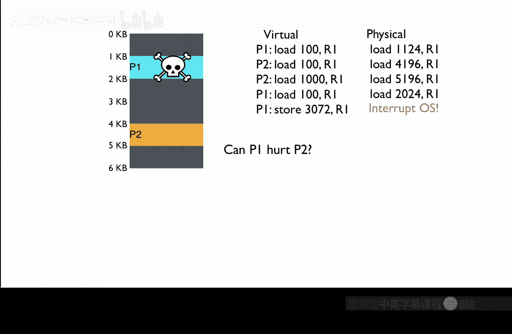

Alright， so。Now just think about what you need to do on a context switch。

Every time we switch between processes。We need to change the basin bounds register in the MMU。

 So that's something that we're going to have to track。

 That's going to be part of that process control block。

 something that's in that PCB that's tracking everything that we need to know about this process。

 all of the registers and stuff like that。So now when we do a context switch。

 we change to privileged mode， we save the base bounds of the old process that was running into its PCB。

 we load the base bounds registers in the MMU for the new process that was saved in its PCB and then we changed back to user mode and jumped to the new process so question for you。

 what would we be implementing if we didn't change the base and bounds register when we did a switch？

So we changed still all the registers。 Let's say we change the stack pointer。 We changed the PC。

 but we don't change the base and bounds register when we do this context switch。None， these are we。

 we're actually trying to do something useful here。

 There's something interesting that we can do if we don't change the base and bounds。Yeah。

That's an interesting guess think you're on the right track here。

 but that's like what basically what threads are， that threads are a context switch to a new execution stream with its own registers。

 its own stack， but it's sharing the same address space as the other thread that was running there so it shares some of the same state as the other thread that was running but it's going to have its own registers。

 So we'll be looking at threads in a lot more detail when we start looking at concurrency。😊。

All right， but of course， user processes can't change the base bounds registers and user processes can't change the privilege mode without doing this。

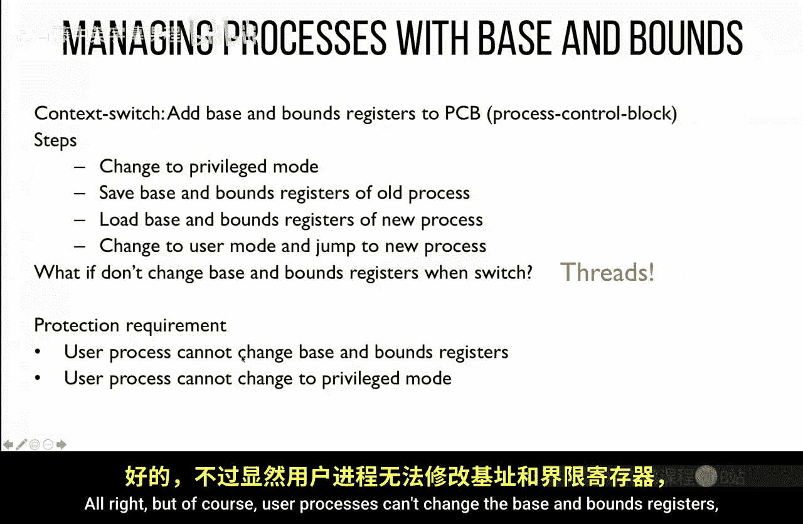

Okay。Alright， so base and bounds give us us a bunch of advantages。 We can support dynamic relocation。

 We can move processes around in physical memory， right。

 If you decide to move the address space of a process from one physical memory location to another。

 All you have to do then is you copy everything， and then you change the base register to show where you've copied it to。

 So we can move things around。 if we have some fragmentation and new processes arrive。

This is really cheap to implement。 It's very little logic。 It can go very， very fast。

 okay but it's going to have a bunch of disadvantages so it's still the case that our address space has to be allocated contiguously So you need to know ahead of time how what's the max address space a process can have and this is going to be ridiculous。

 So you don't know ahead of time how big this process it heap needs to be or how big its stack is going to be。

 So you have to give it know a large address space and with this design with just a base and bounds。

 all of that has to be contiguous So you know you're going to be allocating2 to the 32 bys for this thing。

 it just doesn't it doesn't make any sense in a modern architecture。

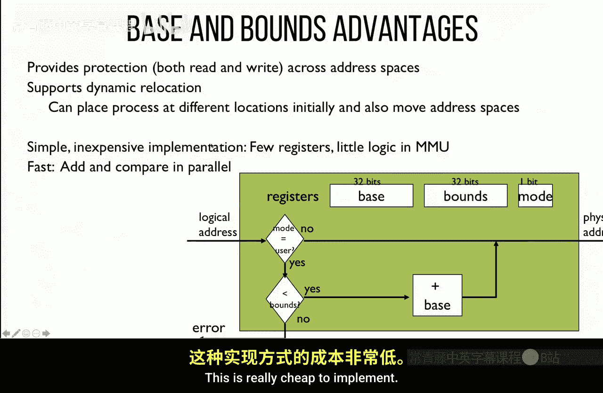

Because basically， you know， you have to still reserve all of this empty space here。

 because when you're generating addresses and you want to get to the stack。

Those are the addresses that are at the end of this logical address space。

 So you would have to allocate all of that。And then another problem that we're going to see in more detail is that you can't have any partial sharing across processes。

 so two processes can have the exact same address space， which is what we would have with threads。

 but it's not going to be possible for two processes to just share code or to have some shared library or to have some memory segment that has some variables in it that they want to be able to communicate with one another。

 they have to share everything or nothing with the approach that we've done。

 so we're going to need some new approaches that allow us to share just portions of our address space。

So to fix all of these problems， we are going to go through a large list of improvements。

 but not today。 So in our future lectures， we'll start looking at how to have segmentation。

 then we'll add paging to that， then we'll have segmentation and paging。

 then we're going multilevel page tables。 and then we're going to add TLBs to that。

 So that will be fun。 and you'll learn a lot。😊，All right。

 so you can look at some announcements while you go and if you have any questions。

 feel free to come and talk。

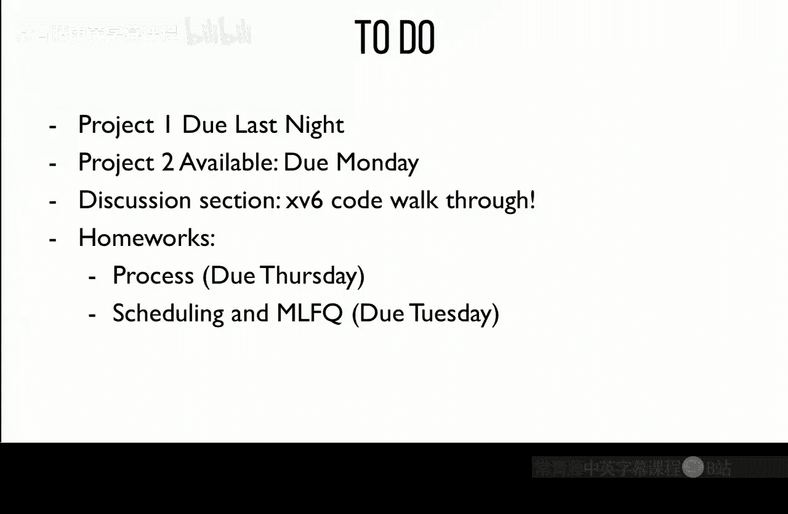