# 威斯康星大学【中英⚡操作系统｜CS 537 Fall19, Introduction to Operating Systems】 p05 P5 Memory Virtualization   Segmentation and Paging  University of -BV1wUzSB3Ecf_p5-

Yeah。All right。Can you hear me through the microphone Pre good great so welcome to 537 again it's raining outside that always makes me a little extra sleepy。

 but hopefully it doesn't have the same effect on you。

 you're all ready to go to learn about this awesome material someone pointed out that I did not post the lecture slides today that was not intentional they were all ready to go and I just got distracted at last minute。

 so if you notice that even like 10 minutes before the class begins and I can remember and upload it but now it's a little too late。

 but they will be uploaded after class。😊，All right。

 so today we're going to continue our topic of virtualizing memory。

 we learned about this a bit last lecture， we're going to continue this for about four lectures。Okay。

 so some announcements，1 I do not like starting with。

 So I talked about our academic misconduct policy when the semester started that you could copy code from one another。

 especially when you're working alone on the first three projects。

 And I warned you all that we would run this automatic copy code detector that is standard in a lot of universities。

 and of course， it found some cases。 It didn't find widespread problems or anything like that。

 but there are definitely people who copied code in ways that are very， very obvious to me。

 So our policy is you do get a zero on those assignments where you copy code from other people。

If you would like to send me some email before I make this all official and kind of explain what happened。

 that might help individual cases。 but you will get a zero on this first assignment。

 I don't intend to notify the you know， go through the chain of command on that at this point。

 But if it happens again in the future， then we would do that。 So if you do this again。

 if you copy code again on a second project， then we'll give you zero on all the project。

 So basically， you should probably drop the course。 If you end up doing that， right。

But we want you all to do the work。 in here。 You are better off struggling with the project。

 doing what you can than copying someone else's code。All right。

 so that's the bad news about Project one that will be graded early next week。

 we'll get your grades back to you。Then the other thing that's going on is Project two you all know is do。

 the handdon directories are now available， the TAs have said they'll make some tests available today for you all to run to test out your code。

Project 3， we're going slow down the pace a tiny bit。

 I'm not going to make this do exactly one week after Project 2， give you a week and a half。

 maybe after Project 2 is due a little bit more time。 This is a pretty standard project。

 The idea is to implement a shell in Linux。 You'll not be working in the X V6 for Project 3。

 You'll come back to X V6 for Project 4。 So we'll often alternate between kind of just doing something in Linux and doing something in X V6。

So project 3， you're going to continue working alone。

 but then project 4 and probably all the ones thereafter， you can work with a project partner。

And so we'll talk more about that later。And then homeworks， you know， ones do today。

 there'll be two more due on Tuesday， and I'll try to kind of keep a steady stream of these easy quizzes to get you looking at the lecture material。

So any questions about these wonderful announcements today。Yeah。Yeah。といてく。嗯。

I think it'll just show me that you did them late。 So I think if you took it afterwards， it's。

 it's really not going to matter。 Take them whatever you want， yeah， but。

It would be best to take them when they're due， yeah。All right， okay。

 so today we're learning about memory virtualization。 We're going to continue where we left off。

 Today you'll be learning about segmentation and paging and the pros and cons of each of those two approaches。

 and we'll really get into paging in a little bit more detail。

 You'll understand how page tables work and what the structure of those page tables look like。😊。

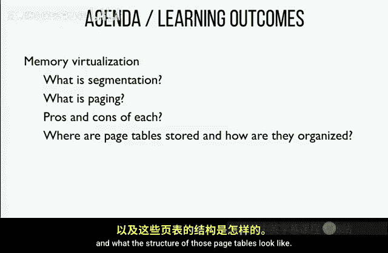

Okay， so let's begin with a bit of review of what we were talking about in our last lecture。

 so you'll remember that user processes have an abstraction of their logical address space within their address space within the memory that they can see your code segment is going to be located。

 you're going to have a heap and a stack that are growing towards one another。

 When you call mallic it allocates from the heap。 When you call procedures or have local variables。

 those things are allocated on the stack。 So that is your user level view of memory。

Now what the OS is doing is it's mapping your logical address space to this physical memory over here。

 and so clearly within physical memory， the operating system is living with its code and data。

 other processes are living there as well， there's some mapping that's going on between those logical addresses and the physical addresses over here。

 so we have a bunch of different ways of doing that mapping and that's really all that we're talking about these days。

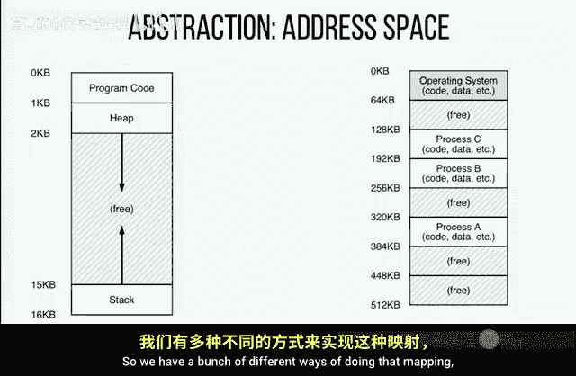

So how are we going to do that mapping？Okay， so let's review what it looks like from the。

User processes view of memory。 So this is not doing any O S work yet。 So what we had in this example。

Was we have our simple assembly code with three instructions， and we showed this before。

 we were showing the addresses in logical or virtual memory that this process accesses。 And remember。

 some of these accesses were relative to the stack pointer。Then we did this arithmetic instruction。

 and then we stored it back to the something on the stack。

And so we have to do memory operation to fetch each instruction。 You'll remember。

 It's fetching from the address that's specified here。

 We then did a load from the address that was 8 away from the base pointer for the stack。

 So 8 plus 200。 That's where we got this load。 We did another fetch。

 There is no memory access associated with that second instruction。

 We then fetched the third instruction from that logical address。

 And then we did a storage to another logical address。So the point of all of this was just remember。

 think about logical addresses。 That's what you are used to seeing when you use a user level program。

Is the mic not working？My favorite， now it picked up。啊。All right。Is it picking up at all。

Picking up some。Raise your hand if you can hear me through the speakers。 Okay。

 see the top floor can hear me better than the people in the back if you're curious about sitting up on the top in the future。

 O， all right。And there it picked up。Okay。So this was our view of user level memory。

So the problem that we're looking at is how do we translate logical addresses to physical addresses and we saw a couple of different approaches in our last lecture So the first approach was we could just do time sharing。

 So you'll remember this meant that each process was the only one that could live in physical memory at a time and so we time sharing that memory So we'd let one process run accessing physical memory directly。

 wed then swap it out to disk and then swap in another process into physical memory so that it could run and access all of memory and there was no protection then between the OS and these user level processes that we're running。

 So we're not going to do time sharing。 that's not a good approach。

 another approach we're not going to do is static relocation。

 You'll remember the idea of this was we don't have any hardware support So what the link or loader needs to do is when you start up a new process and the OS decides where it's going to place that process in physical memory。

 It would actually go through the executable and modify all of the addresses。

So that they would point to their physical locations instead of what the user was dealing with those logical addresses。

Allright， so that's a lot of work。 We don't want to do that either。

 And so we're starting to get a little bit more realistic。

 We're going to look at these dynamic approaches。 The first dynamic relocation approach was that base and bounds。

 Sorry， it was just base。 and then we add base bounds。

 So let's go into those a little bit more details so you'll remember。

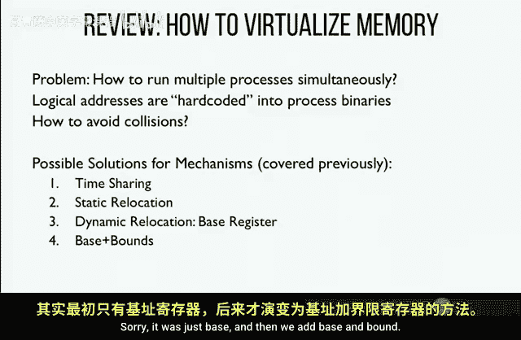

So dynamic relocation。 This gives us some protection across different address spaces。

 It does require some hardware support。 So you'll remember that's that MM M U or the memory management unit。

 That's that hardware。And so the job of the M M U is to take a logical address that you are generating from your program and translate it into a physical address。

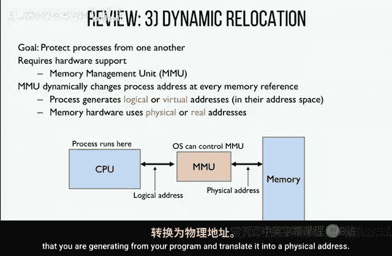

So how did we do that if you'll remember if you look inside the MMU。

 there's this base register and when a logical address comes in and we check what mode we're running in。

 if we're running in user mode， then we need to translate that address from a logical address to a physical address。

 and so you'll just add on the base pointer to that offset within the logical address space that it's using to get the physical address。

 whereas if it's the OS that's running then we take this no path and we just let that address go through as a physical address。

Okay， so what are my questions for you about this？

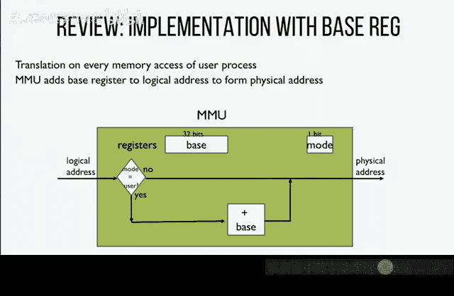

So talk with your neighbor for just a few minutes on why does it have to be hardware that's doing this edition of the base register。

 Why don't we want it to be the O S that does that？

 Does the base register contain a logical or a physical address？

 And then what was the one big problem with the base register approach。So quick review。

 talk with your neighbor， get warmed up。

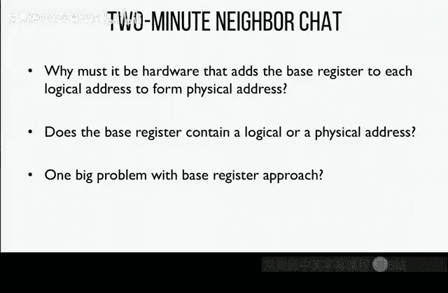

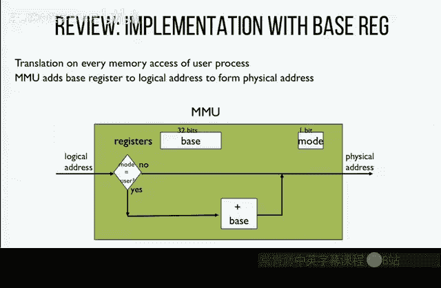

All right。So what's my answer to why does it have to be hardware that's doing all of those additions。

 just you know we're doing those additions to translate logical addresses to physical addresses once or twice on every single assembly instruction that you're executing so clearly we can't have some other software in the OS that's running that's doing all of this edition for us It's got to be hardware that's running all of the time that's doing this very simple translation from logical to physical addresses。

Yeah。

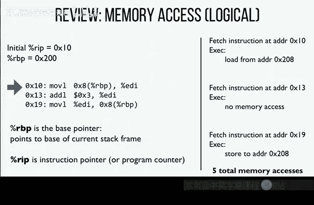

应当し。Yeah， and then we could be doing like an emulator is basically what you'd then be doing。 Yeah。

 yeah， exactly。 So we could emulate all of this。 So I guess it's theoretically possible， but it。

It's only theoretically possible。An emulator could do something like that。

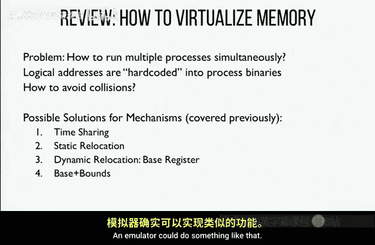

Great， and then is it a logical or a physical address that you're keeping in the space register？

Everybody can mumble for me。Physical， yes， it is telling you the base of where that address space lives in physical memory。

 so it's pointing to some place in physical memory。

 and then all of your offsets are going to be relative to that in physical memory。Great。

 and then the third question was， what's the big limitation of just having a base register is that it doesn't provide any protection across different address spaces。

 right， it'll be possible for us to construct an address that goes beyond the end of our address space and reaches into the memory of another process that's been allocated at a higher address than ours。

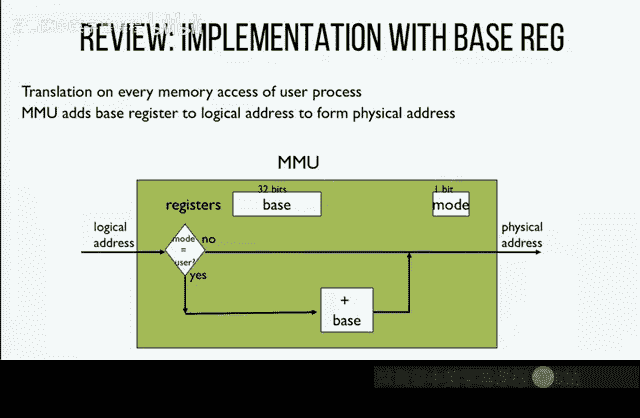

So because of that， that's why we add the bounds register。

And this is basically specifying the size of the address space or the limit of what this process is able to access。

 and so if the process tries to generate a logical address that's greater than that bounds。

 then the hardware will detect that and it will send a trap to the OS notifying the OS that this occurred and the OS can handle that trap and then kill the process that was running that did that so that was an next approach。

 fourth approach base and bounds still very， very simple here。

So anybody remember any questions they have about basin bounds or some of these past approaches。

 yeah。

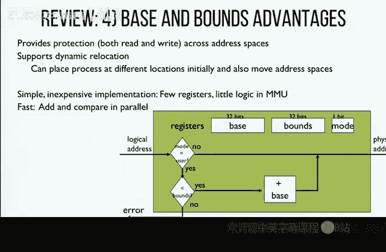

You could do either way。 It's just convention。 just define it one way or the other。

 I like making it the size so that I can do the addition and the comparison in parallel。

 If you made it like that last address， you'd have to add first and then do that。

 But hardware so fast， it's kind of silly to be worrying about keeping that as fast as possible on the critical path。

All right， good question。Okay， so our big problem with basin bounds and why we need to keep looking at this。

 there was a couple problems， kind of a minor problem was that we couldn't have any partial sharing that you could have two threads that had the same address base。

 but it's not going to be possible with base and bounds for threads to just share code or just share a couple of variables in their heap。

That was a minor problem。 the big problem is that it required us to completely allocate our entire address space contiguously in physical memory because we had to have just a base register。

 and then everything had to be relative to that。 So it all had to be contiguous。

 We're going to waste a lot of space。 And it's going to be hard to place these address spaces with that。

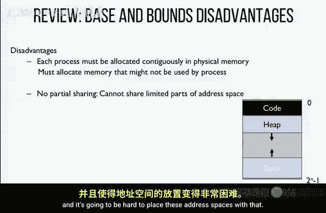

So because of that。Now， we're going to look at something new。 So this is segmentation。

 our fifth approach。And so the idea here is pretty intuitive。

 You already had some notion that some of your memory was different within your user process。

 You knew you had a code segment。 You knew you had a heat。 You knew you had a stack。

 Let's free those。Portions of your address space up and let those portions be placed in different parts of physical memory。

Okay， but really， you know， you could have a segment associated with any portion of your address space that you want。

 But these are like the basics where you would start since they have some intuitive matching here。

And so now each of those segments is going to have associated with it a base and a bound register for its own segments。

 And so， for example， if we have four segments in our program。

 we'll have four pairs of based and bound registers。And so this is pretty nice。

 It lets us place each of those segments separately in physical memory。

 And then what's more nice is that it lets us grow and shrink each of those segments separately。

 So now the heap can grow and we don't have to know ahead of time how big that heap is going to be。

 We don't have to allocate all of that space in our address space for some heap that we don't know how large it's going to be。

 And the stack as well， it's going to be in its own segment and it can grow independently in its own segment with its own bounds register。

😊，And then a minor point that's nice about this is that we can have different protection for different segments。

 so now you can make your code segment read only so if you accidentally write to your code segment。

 the hardware will catch that so you don't have permission to write to that。

 it'll generate a trap and we'll be able to kill that process。

 so that's nice that you can have individual permission bits for different segments and certainly now we're going to be able to share different segments with other processes if we would like。

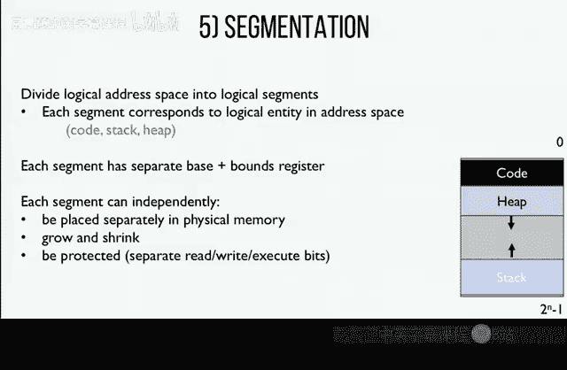

Okay， so how are we going to use segments。 So the first thing we have to figure out is how are we going to do our addressing？

 So now logical addresses are going to have a segment identifier as well as an offset within that segment。

 And then how you come up with that segment identifier is going to be different in different architectures。

 And so that's kind of a detail。 But what we're going to assume is that we're going to use part of our logical address to specify a segment。

 And so the thing that makes the most sense there is to use the top order bits of your address to designate the segment。

So we'll look at exactly how you do that。 So all the addresses associated with the segment will be contiguous to one another。

But in a lot of architectures， if they start off of the 16 bit architecture。

 they don't have then enough bits to carve off some for the segment so then you can have a separate register that designates what segment you are currently accessing so you could say explicitly I have a stack segment and this address is within the stack segment in the register told me that or it could even look at the specific type of memory reference that you're doing the hardware would know that you're fetching an instruction so therefore it should be in the code segment or it would know that everything is on the stack so do things in the stack segment。

 but we're going to assume we have a logical address and we're going to use that logical address to designate a segment and an offset in that segment。

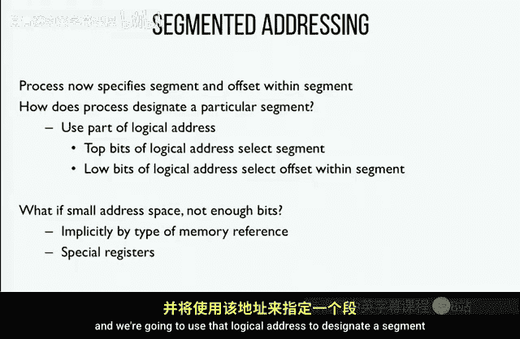

Okay， so let's look at some details to make this concrete。

 So before our M M U had just a single base and bounds register。

 now we'll make it so that it contains a segment table that corresponds to the currently running process。

 So every running process。Every process will have its own segment table， right。

So when we switch to a process， we will load the MMU with the segment table that's associated with that process。

And if we have four segments， our segment table will have four rows and basically it tells us segment  zero lives at physical memory address 2000。

 that's its base register， and that's its size， that's its bounds。

 and then this is the permission that you have to that specific segment。

 so this is probably our code segment because we have read permission to it， but not right。

And you can see segment 3， we're not using。 So we don't have any permissions to it。

 And it has a zero size。 So if we do any accesses to segment 3 or to a logical address with a three in the top order bits that's going to end up causing a trap or a segmentation fault。

Okay， so I've given you some information here。 We're going to be doing a lot of basic arithmetic today of like。

 if we know that we have two bits， that must mean， you know that we have four options， if we have。

 you know，10 bits， we have two to the 10 options， stuff like that。Okay， so if we have four segments。

 then how many bits must we be using in our logical address to pick between those four options，2。

 right， We need two bits to。Pick four numbers，0，1，2 or3。

 So if I tell you that we have a 14 B logical address and we're going to use 14 B a lot just because it's small。

 it's easier for us to look at those numbers than if I gave you 32 or 64 B address。Okay。

 so we'll have a nice 14 bit address in the top two bits are going to designate the segment。

 and then the bottom 12 bits are going to be the offset within that segment。And so remember。

 we're going to be doing a lot with converting between hackx and binary。 and so of course。

 one of these hackx digits， you'll remember that's four bits。

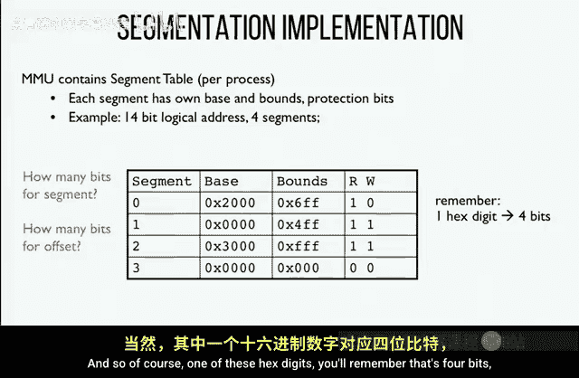

Just to bring you back to that。Okay， so what I want you to figure out。

 and I'll go over the first one with you and then have you work with your neighbor to figure out the rest is if we have this logical address。

 what's the physical address that that corresponds to So I told you this is a 14 B logical address。

 I was really nice and said we have 12 bits for the offset。

 So that means the last three hex digits are all the offset。

 And you can just look at that first hex digit to tell you what segment you are looking at。

So these are nicely constructed。Okay， so this logical address has a segment number of zero right the top two bits are telling me that it's segment 0。

 I then look and make sure that 240 is within the bounds and that we have read permission to this segment。

 and then I'm going to add the base to the offset within that segment that we are accessing in order to get our physical address so that leads us to 2000 plus this offset 240 to get this as our physical address。

Yes。Yes。Each he digital。So great。 So when there aren't things specified at the beginning。

 that means like the top。So I can't go beyond three here。 I can't go up to the number four，So three。

 if you wrote that all out in binary。Right。We would have had。Let's take a number three， F， F F。

 that would be you'd have your two bits， and then each of these are four。

So that's where we get our 14。Okay， so you will all go back to this world of counting and binary pretty quickly。

 yes。Do you want me to use a better pen is your hope？All right。

 so this is just a quick example converting hacks to binary。This is Hex， this is binary。

It's just showing that F is equal to 1，1，1，1， this f was 1，1，1，1， so forth。

And so that's where we're getting that this is 14 bits。Okay。

 any more questions before you all start working on questions 2，3， and 4 with your neighbor。

All right， take your time figure these out。Oh， read and writes， if you have read permission。

 then there's a one。Zero means you don't。Wheres he around。Yes， exactly。Yeahep。Why is it two bits？

Because we have four segments， so we need two bits to pick between them。WellThe number three is one。

 one， yeah。Right。Because zero is zero， zero， one is01， two is one， zero， three is one， one。Yeah。

If we had one。If we had more segments then。We would have to use you know。

 three bits or something here that would change the addressing。我。All right。

 so let's come back together to talk about this。So I think doing an example brought up a number of questions for people。

 I'll go over the answers first and then see what questions remain。Alright。

 so because we have four segments， that's why we have two bits to pick between those four segments and then the remaining bits are just offsets within that segment。

 So in our next address here， the bottom 12 bits。 those are the offset within the segment and it's segment 1 that one is the top bits telling us it's segment 1 there Okay。

 so we're in segment1， so our base is 0， so we just add our offset of 10。

8 to a base of 0 and we get that same thing there。So any questions about that。

So this is going to just get harder and harder。 So if there are things， I mean。

 it gets so much harder than this。 So we need to make sure we're getting this。 Yeah， yes。Louder。

I can't quite hear your。😔，Your questions， so I will make up something。

 so we'll say if you are looking at the number 1108。

I mean you could write all of this out in binary right and you would see like how do you write the number eight one？

0，1，0，0， the 0 is 0，0，0，0。 the one is 0，0，0，1。 so that's my binary representation that took up 12 bits。

This in binary is 01， that's2 bits。And so that's telling me that that's segment one。

So does that help you're definitely these are nice and aligned at some point we're going to have like that the bits and the hex digits don't line up so well with where I cut things off。

This is the warm up， yeah。嗯。Oh yeah， that's a mistake， that's no such thing。 Yeah。

 so just remove one of those zero xes。Who knows what language that's in？O。Any more questions。 Okay。

 so the next one， we are in segment 2， so two。Starts at base 3，0，0，0。

 The offset is less than the bound。 So this is a valid access segment。 Yeah， did all of that。

 So then we just add。30002 are offset and get oh Jesus。

So clearly this is a typo of me cutting and pasting things to do my animation this morning。

 and that is the wrong answer， right， it should be 36，5C okay。All right。

So now we've all seen what profanity words I will be using， I guess。All right， so last one。

 segment three， this is an invalid access， we do not have read or write permission to that address。

 and clearly this offset goes beyond the bounds， so this is going to lead to some type of segmentation fault that we're notified of。

Alright。So I will keep on going let's try a visual interpretation of this to give you other ways of looking at it so in this example this is where two of the segments for one of the processes have been placed in physical memory so you can tell from this picture what the base address must be for each of these segments so the base address of the heap or segment one is。

If you trust me with my drawing。The base is。Mumble it out together， everybody。 this is the base40，0。

 And then the base of the stack or segment tier2， this is going to be the base here。All right。

 so now when we do our。Translations， assuming the same address format as before。

 now when we do a load from 2010， that segment2， so I told you that lives here。

 so you start with the base of 1600 and you add 010 to that to get your physical address， right？So。

Visually， you can view that at， sorry， you don't add2。 you add just the 0，1，0。 right had strip。

 This is what we got the two to get the second number and the 0，1，0 is the offset within that。

So that's how we got 16，0，0 plus the offset will give us this number it looks like。

 And so where we're accessing and physical memory is about where that red dot is。

So let me know if I make any typos， anything like that。 Sometimes every once in a while。

 I do it occasionally， but usually it's a genuine eye goof， yes。Yeah。

 so that's always what's our convention with stacks starting。

At high addresses and growing downwards for ease of presentation here。

 we're just always going to be assuming that all of our segments start at the lower address and grow upwards。

 But it's true we do have to do some fancier stuff to deal with stacks growing the opposite way。

 but we're going to ignore that for a while。Allright， so we'll just get this through this first。

 Okay， everybody is starting with a base that's a lower number and growing upwards in our examples。

 Okay， so let's do another one。 We're doing a load from this logical address。

 So one is our segment number。It starts at physical address base of 400。

 so the final physical address will be 400 plus 010。That look good。

And then we're doing another load from that same segment， which we know lives over here。

 so we just add that offset 10，0 to the base of 400 and get an address that's very nearby the previous one。

So right， we're putting our logical address space， different places in physical memory。

 and we just need to be told where do we start and then everything's relative to that starting address。

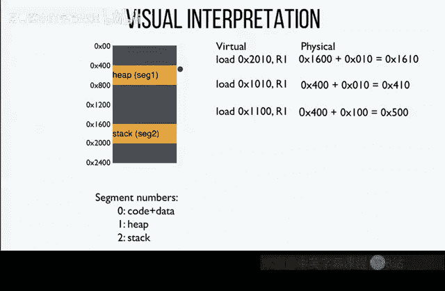

All right。O。So。Let us go back to our。Address trace。

 where before we were just looking at virtual or logical addresses that were being generated by our program。

 and now we have to figure out what are the actual physical addresses that are being output that correspond to a variant of that code that I showed you before。

 I've made it。 So it's just an absolute address instead of something that's relative to the stack point to make this a little bit easier。

Okay， so the first memory access that we needed to do to execute this program was we fetched the instruction that set 0。

0，1，0， right that was a logical address。 The hardware needs to convert that to a physical address。

 So the way that we do that is that is segment 0， which lived at base 4，0，0，0。 So we add 4，0。

0 to that offset。That looks right。 Okay， the next thing that we're going to do is we actually have to execute that instruction that we just fetched。

 which means we are accessing memory location 1，1，0，0。So to translate that to a physical address。

 we take that that's segment1 that lives at base 5800。

 and then we add the offset within that segment， which is 100 there。So 580，0 plus 100 is 59，0，0。

Everybody following so far and agree with my arithmetic。

Then we fetch an instruction at the next logical address。

 We've already kind of gone through segment 0。 Everything's going to be just three off from the other physical address as well。

 So we're going to be at 4，0，1，3。This instruction doesn't have any memory accesses associated with it。

 So we get to go on to fetching the next instruction。

 That's what it looks like 6 beyond where the other one was。

So we're moving through that portion of our address space。

 and then we do a store back to the same place that we loaded from before。

 so we know that physical address as well。All right。

 questions about segmentation and how to form physical addresses from logical addresses。Like this。

You're going to get more practice。We're going to keep adding to this。

 but it's going to be very much more of the same each time we add to it。O。

So segments are a great building block。 They're going to allow us to。

 what's really neat is that it lets us have this sparse allocation of our address space。

 When we didn't have segments， we had to have a contiguous portion of free memory where we could place this whole address space。

 Now， we just have to have enough space to place just the code or just the heap。

 and then the heap can grow separately from the stack。😊，And so if you think back， well。

 how does the heat grow as a bit of a review when you're calling Malek， you're using the heap。

 So the riders of Malik， they had a。portion of space that had been allocated to them by the OS。

 if the Malik library code runs out of that allocated space。

 it does a system called S break into the OS and the OS allocates it more memory。

 allocates more memory to this process， the process that's using that MalC library so that it will have more he in its address space that's valid for it to access。

And then Malik can use that portion to give out。Your allocated memory。The stack is a little bit。

Otter， I guess， is a fine word to use。When we're just pushing things onto the stack， we don't。

Have any checks to see well how far are we along So what ends up happening is really neat here that if you then access like you tried to push something on the stack that we hadn't accessed before。

 So we're growing our stack。 What happens is the hardware still the text that we did a reference past the end of our bounds for the stack。

 And it notifies the O of this problem like it's supposed to do。 but the O says， hey。

 that's right next to the stack of where I had been using， I'm just growing the stack right now。

 we shouldn't kill this process instead I'm going to allocate more stack segment to this process and it keeps going。

 So that's a pretty neat detail for how to get everything to work very efficiently because the O can see you know what happened when you get that trap and。

Adjust accordingly。Great， and then other obvious things we can now have different protection for different segments like we are showing。

 you might have just read permission to your code， but you'll have read right to your heap and your stack。

And all of those things can be placed independently。 Okay， so those are the advantages。

 What are the disadvantages， Because what we're going to keep seeing is each of our approaches is going to have a disadvantage。

 And so therefore， we will add on more mechanisms and more complexity until we get to what modern day systems do。

Okay， so the problem with this is that we still need to allocate our segments contiguously in physical memory。

 and you could imagine having a process with a huge heap that had a very complex data structures and that heap is just too large for any of the free space that's contiguous in physical memory。

So this could be a picture of our physical memory， the OS is living in the low order bits。

 and then we have a bunch of heaps and we have very fragmented free space where there isn't enough contiguous free space to give to our large segment。

So this is what's referred to as external fragmentation。 And so we need to get rid of this。

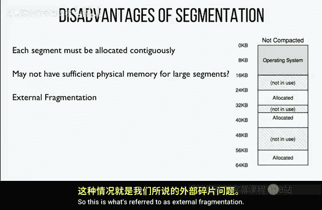

So this is fragmentation， too many small little bits of free space scattered around。

 If we're able to compact our memory and put all the allocated memory together and then have all of the free space together。

 then we wouldn't be suffering from fragmentation。 So this would be one solution。

 This isn't very practical to go around compacting your address space。😊，So we in our next。

 we are going to fix this with paging。

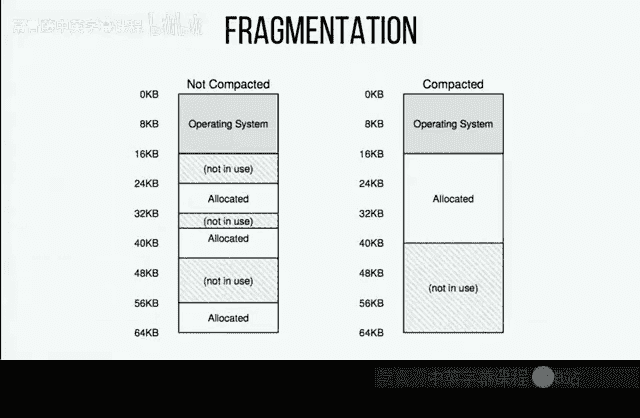

But I guess my intention before we get into paging is。Quickly。

 remember the names of each of the five things that we've done so far。

 So I think this is more like a 30 second chat with your neighbor。 Remember what。

Those five things are。All right。So the first approach was time sharing。

 the second approach was static relocation， third approach is base， fourth approach is。

 base and bounds， fifth approach is segmentation。Okay。

So let us talk about something completely new that's going to fix our problems of external fragmentation。

 Why are you chuckling did I say something funny？All right， so we're going to look at paging now。😊。

All right， so segmentation suffered from the problem of external fragmentation。

 external fragmentation is when you have some free space that is visible to like the entity that's doing the allocation。

 it's external to whatever it is that's actually using this space。

 internal fragmentation would be if I had been given some memory， and I knew that within that memory。

 some of it was useful to me and some of it was not that that's what's internal fragmentation。

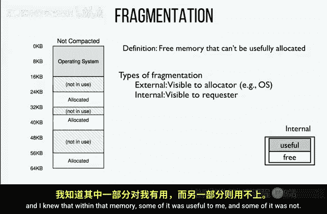

So our next approach is going to suffer from internal fragmentation。

 but the idea here is we are going to use paging that we're not going to make it that our entire address space or a segment within our address space has to be contiguous anymore。

 We're going to chop up our logical address space into pages。

 and then each of those pages can be allocated anywhere in physical memory in RAM where it wants。

 These things do not have to be next to each other anymore。

 So this is going to have a ton of advantages because we can just place pages wherever we want。

 We don't need to find contiguous memory。Okay， so one key thing is that the size of this logical page is going to be the same size as this physical page。

Important， and that these sizes will always be a power of two four kilobytes is a pretty standard page size to be assuming。

 but pages have to be a power of two。Logical pages have to match physical pages。

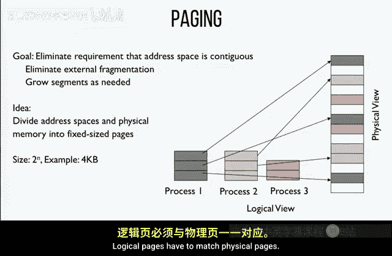

Okay， so how are we going to now translate a logical address that uses pages to a physical address that uses pages。

So remember each of them has the same page size， so again。

 the low order bits are going to tell us the offset within the page that we're looking at。

And the high order bits of our address are going to tell us the particular page number that we're currently accessing。

 So if we have a 32 B address and we have 4 kilo pages， if we have 4 k pages， that's 2 to the  ten12。

 sorry， So since it's 2 to the 12， that means we need 4 Bs assuming a byte addressability to access 4 kiloB there。

 So that's why we would have 12 B there。 if it's a 32。The address。

 then we have 20 Bs remaining for our page number。 So we're going to be doing lots of what can you infer once I tell you the format of an address like。

ok。So the way paging is going to work is we're going to take our physical page number。

 which is sometimes sorry， sorry， sorry， logical page number。

And translate that into a physical page number or a frame。And that just tells us that page table。

 That's what that is。 It just tells us where that logical page lives in physical memory。

And then we're not going to do addition， like we did with segmentation where we added the offset to the base here。

 it's always going to be the case that we can just concatenate bits that since these are always a power of two。

 it's just always the same offset within a page， whether that's logical or physical。Okay。

 so I think we need to always look at examples to make all of this clear。

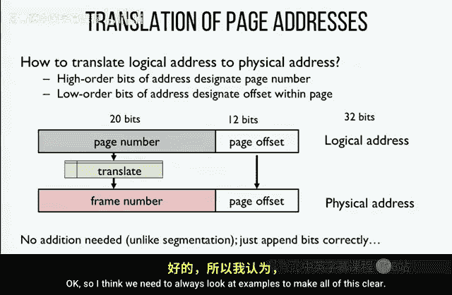

Okay， so here's where we're going to do some arithmetic。So。

We're going to see what we can figure out if I tell you different things。

 So the idea is each of these rows is a different example。 So first。

 if I told you that in our architecture。We have 16 by for our page。 Then how many bits。

 So that's how you can always view these things。This is our。Logical address。

It has some number of total bits。And then it's going to have some number of bits here for the offset。

And some number of bits over here for the logical page number。

And we usually call this VPN for virtual page number to be real consistent there。 Okay。

 so if I told you that。We have 16 by for our page， then how big how many bits must be on our offset or that portion of our address。

4 right because two to the four is equal to 16。 So you need four bits to choose between 16 different。

Values there。Great， so another example， just so you can remember your powers of two。

 how many bits of wool we need if our page size is 1 kB。10。If we have1 MBby as our page size。

 how many bits will we need as part of this address to pick a by within that meby。20。

 it's 2 to the 20 is equal to 1 MB。512 bytes， that's to do the what？9。

 so we need 9 Bs to pick out one of those 512 Bs and our famous 4 kilobys。

 which will be our default case。 If I don't tell you the page size， that's 12 bit。Okay。

So you can figure out some things from the page size about your address format。 Now I'm going to say。

 I'm just going to give you some information and say in this particular architecture。

 because these are architecture， dependent things。If I just tell you that the virtual address size is this many bits。

 now you can tell me how many bits there must be in this portion of the address。So we know the total。

 you know the number of bits for the offsets， and so the difference is going to be how many bits we have in the high portion。

 right yes。This is my level of math。 We do some subtraction now， So we have 10-4 Bs left for our。

For picking out a page number。20-10，32-20，16，-9，32-12。Did make him any mistakes？LetMe know。Alright。

 And so now I've told you how many bits we have in our logical address for specifying a page。 Now。

 you can tell me how many virtual pages we must have。8ight。

So if we have six bits to pick a virtual page， how many virtual pages must there be？64。

 it's2 to the6。 That's how many different items we can pick with  six bits。 So we must have 64 pages。

What about if we have 10 bits？Great， I hear the right mumbling， we must have 1024 pages。

 two to the 12， that's our magic， we know that's 4K。

 that's how many pages we have that's not the size of the page。😊，That's how many pages we have。

 two to the seven， that's 128 pages， two to the 20， that's we have 1 million about pages。 Okay。

 so you can figure all of that out when you're told different properties about the logical address。

Okay。Any questions about that？Yeah。

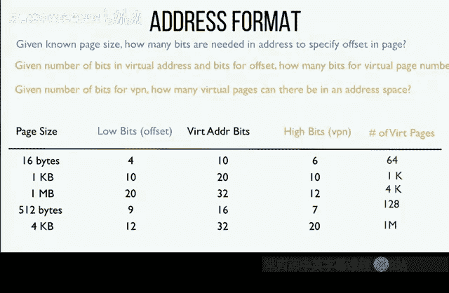

Oh， I just told you that one。 That's a given。 You can't infer that one。

 so I tried to make it that those are all in black and these colors blue。

 it matched to each of those columns where we answered those questions。 in black。

 we just gave you as known information。 Its great。Allright， okay， so let us look at more examples。

 So one thing to note is that you do not have to have the same number of bits in your virtual versus your physical addresses。

 So certainly your page sizes have to be the same。 The number of bits in your offset have to be the same。

 but you could have a different number of pages in your logical address space versus your physical。

 So certainly you could have a larger address space than you have physical memory。

 then it just means that you can't allocate all of those pages and have them all live in physical memory。

 Some of them would be swapped out to disk or you know you could argue things the other way as well。

So。We can have a different number of pages in our logical space versus our physical space。

 but we need to come up with some data structures that will allow us to map between virtual page numbers and physical page numbers。

And we want the simplest thing possible to begin with， and then we are going to make it better。

 So the simplest possible thing that we can think of in operating systems seems to be just a linear array。

 right， but we are going to look up for VPN1。 We will look up the one entry in our array and that will tell us the physical page number of page one。

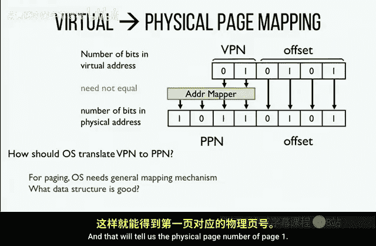

So that's what this data structure is going to basically look like， this is our page table。

 it's a linear page table， will'll make this more complicated as we go。

 you index this linear page table by the virtual page number。

 those high order bits of your logical address。So then if you looked at what's actually in one of those entries in this array。

 it might look something like that picture down below。

 a common assumption is that you have 32 bits for a page table entry， that's what this is。

 it's a page table entry。We're showing the bits there。 The most important thing is that。

Physical page number， or we sometimes call that a physical frame number that frames are the same thing as pages when we talk about physical memory。

 That's just a synonym there。So most of that entry is telling us where does virtual page number 10。

 for example， live。 We're going to say what the physical frame number is there。

 and then there's a whole bunch of other bits that tell us what permissions we have for this。

 what type of caching we should do， is this valid or not。

 is it dirty or not that the page that's cached in memory doesn't match the version that's out on disk So we'll look into these bits in more detail later as we get into that。

 But the main thing right now is that the page table entry contains the。

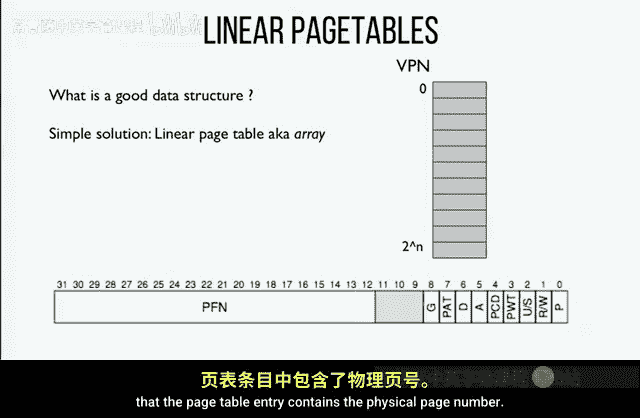

Physical page number， okay。So a picture of what this might look like。I meant to give you all a break。

 So this seems like a good time to break。Talk about your favorite restaurants in Madison。

 perhaps the best sub shop， something where do you go to eat。Great。O。

So it seems like you're all anxious to learn more about paging so let's make all of these details very clear for you Okay。

 so remember each process is going to have its own page tables。

 each process needs to have its own mapping for how do its virtual addresses map to physical addresses so for process one。

When we access this particular address around zero。

 that is going to get translated through P1's page tables to an address that's somewhere at this physical location right and then when we access another offset within that same page we'll look through the page tables。

 figure out where that page lives in physical memory and do the offset calculation and figure out where that is and so forth so that's pretty straightforward。

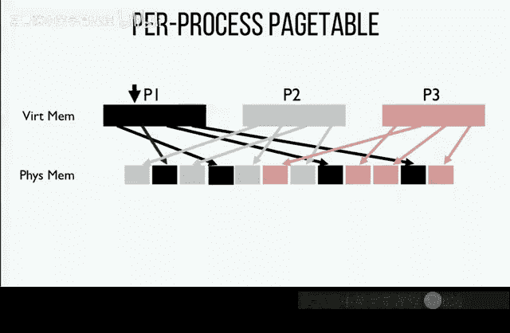

So let's figure out what these page tables are going to look like at a very high conceptual level here。

P1 has its own page table。 It says the zeroth page lives at physical page number three's location。

 right。And。Logical or virtual page one that lives at physical frame number one。

The second one lives in the seventh frame and the fourth lives in the tenth frame。

P2 has a completely different mapping， its low order portion of its address space where logical。

Page 0 lives， lives in physical frame 0。 So that's how we construct this mapping here。

 So I'm sure you can fill in this table straightforward forward4 P3。

 that its's zeroth page lives at physical frame number 8。The first lives in， looks like five。

So forth， Okay， so any questions about that kind of visual way of looking at it。

That's going to be a huge problem with page tables。 This takes up a huge amount of space。 Yes。

 so that's like a major problem。 We are going to spend a lecture and a half on that， yeah。清所。可以。啊。

So you're right that we could have things allocated sparsely throughout。

 we're going to have locality within the logical address space that we're going to see it's still likely that you're going to access like this offset within the same page and that's going to help us some caching of these page translations with TLBs that we're going to look at later。

 so we'll still have locality at the within pages which is enough for like a cache and stuff like that。

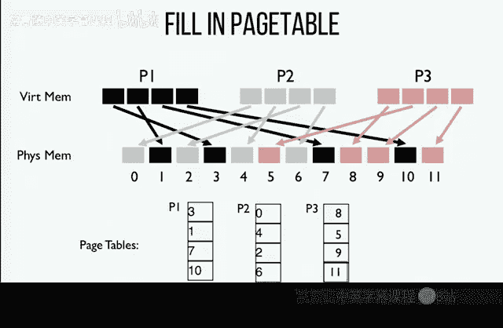

Great。😊，Good questions。 Okay， now this is going to be a。Fairly involves calculation for you。Okay。

 I want you to figure out how big these page tables are。

 I think you've all gotten this intuition that these page tables are a problem。

 they're going to be very large， so I want you to figure out exactly how large is a page table going to be for a single process So the only assumptions you need are we have a 32 B address space that's pretty standard。

 Each page is 4 kilobytes that's standard and each of our page table entries is4 Btes that's pretty standard2 So your first step is to figure out well how many page table entries are there in your page table。

And that's the， that's the hard step。 So figure out how many page table entries you will have with those assumptions。

 I'll give you。Maybe four minutes to do this one。I don't think you can do this in your head。

So if you've got four megabytes， you're done， otherwise we'll go through the steps for this。Okay。

So we said it was key to figure out how many page table entries there were because if you know how many page table entries you have then you will just multiply that by four bytes to get the size of this page table so the key is how many page table entries are there。

How many page table entries are there， There's as many page table entries as we have logical pages。

 right because that's what we're used to index into this thing。

 So we have to figure out how many logical pages do we have。

 And so we're going to do calculations very simple similar to what we did with figuring out the format of our address。

so we have a 32 bit address that's useful。Okay， so exactly the number of entries is equal to the number of virtual pages that we have。

And so it's going to be two ways to the number of bits we have for our VPN。Now。

 how many bits do we have for our VPN， Our total address was 32 B。

 And I told you we have a 4 kiloB page， which requires 12 Bs。So that gets us to。If the total is 32。

And we need 12 bits for the offset for a 4 kilobyte page。Then we must have 20 bits。to pick a VPN。

 if we have 20 bits to pick a VPN， that's 2 to the 20 equals1 million pages that we have that we can address。

If we have 1 million pages and each is four bys， this is taking up our four mebytes。

 so our each page table we have for every process that's running in the system is requiring four megabytes of memory。

 so this clearly seems ridiculous and problematic， but it's still going to be the base of everything that we're going to do here okay。

So any questions about that calculation， it all goes down to if you know how many bits are in your logical address。

 you know how many bits you need to select a byte within a page at a given size。

 then you can figure out how many bits there must be left over for picking a。Page。

 and then you can figure out the size of the page or however many， how many you have of those。Yeah。

What is the。Oh， because I just told you that each page table entry is 4 B。

 That's a pretty typical size that。If you look at what's in those four Bs。

 some of it is telling you the physical frame number and some of them are those permission bits that we looked at on that one slide with the。

With the bits and there's a dirty bit， a present bit， caching bits， things like that。But4 bys。

 I just have to tell you how big each entry is。Great。😊，More questions？

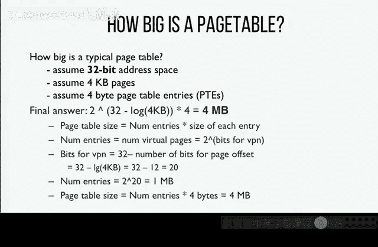

O。Alright， so where are this page tables going to be stored。

 They're not going to be stored in specialized hardware。

 We are going to store the page tables in physical memory of our machine here。

And so the key is going to be that each process has its own page tables。

 We need to tell the hardware just where those page tables live。

 So we're going to have a page table base register。

That has different names on different architectures。 But basically， when we do a context switch now。

 we will put into that page table based register where that。

Page table lives for the currently running process so that the hardware can use those page tables to do all the address translations that it needs to do。

Alright， so when we do a context switch， we need to make sure that we're updating that page table based register。

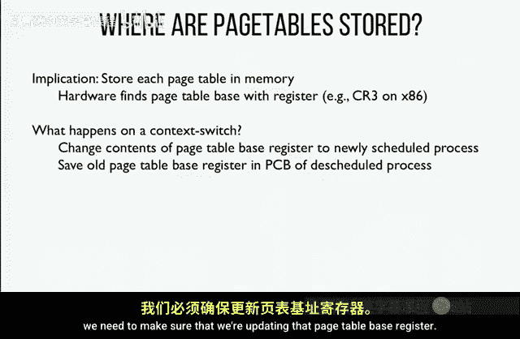

All right， there's other stuff in that each page table entry。 I think we'll get to this stuff later。

 But that's why it's 32 B。 It's because there's all of this other stuff。Okay。

 so I want to do some address calculations。Because this determines that we really understand how all of this works。

 So now we're just going to do a single instruction。 We're simplifying this。

 a single assembly instruction。 How many memory accesses do we need to do now。

So I need to tell you some more stuff。 This page table lives at physical address 5000。

 That's a physical address。 That's where this page table that I'm showing you here lives。

 And so you want to imagine that each of these entries is taking up four bytes。

We'll assume that each page is 4 kB。 And so from that， you can figure out， of course。

 it's their standard 12 B to index into a 4 kiloB page。Okay。

 so let us figure out what memory accesses we need to do to do this one instruction now。

So we know that logically， the first logical address that we're going to fetch is is to get this instruction。

 So we are reading from that address，0，0，1，0， logical address。

 How do we get the physical address for that。We have to look in our page table to see where that is。

 So the page table for this process lives at 5，0，0，0。And we are looking at the zeroth page here。

 So I made that kind of easy to see the page number that it's the top digit here。

 that the bottom three hex digits are giving us an offset within the page。

 and then that top digit is telling us the page number。 So this is page number 0。

 So that's 0 times 4 Bs plus where we start for the page table， which is at 5000。

 So that's why we're getting memory reference at 5000。All right。

 And so when we read that memory location at 5000， we will see that the PPN for this。Address is 2。

 And so then we'll construct our。Physical address， and we will read from page 2， offset 0，1，0。

 So that's our logical address。All right， so the point of this is you thought you were just fetching one instruction。

You're just fetching that instruction， and the hardware needs to actually do two memory references。

 It needs to read the page table to find out the address， where that。Data lives。

 So this is pretty painful。So can you do then the next one if I tell you we need to do a loader store from 1100。

 what's the physical address of that going to be？So maybe spend a minute thinking about that and we'll get to it。

So what page number are we looking for？One， because the bottom three hex digits are telling us the offset。

 it's the top digit that's telling us the page number。

 you could think of that as just looking at element one in this page table。

 but if we actually have to compute memory addresses， it's the base， which is 5。

000 plus1 to index into the one element times4 bytes。So。We need to access the page table。

 which will be at 5000 plus the。To get into the first entry。

 it's four bytes from the beginning that tells us now we've gotten that the physical page number for this address is physical page number zero。

So we take that zero and be appended to our offset VPN1 lives at PPN0， and so what will we get here？

We will get zeroth page in this offset 1，0，0。So， again， we had to do。

Two memory accesses to actually execute that move instruction。

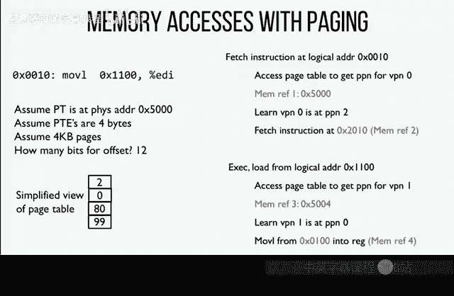

All right， so we're adding a lot of extra work now because of these page tables。

 and we're going to have to figure out how to get rid of all of this extra work that we're adding。O。

So keep in mind， paging actually does have a lot of advantages。

 we're going to want to keep all of these advantages， we don't have any external fragmentation。

 one page is just as good as another， it's going to be very fast to do allocations and free with pages because you just have to find a free page and then freeing it you just set some bits very。

 very fast it's also going to be really easy to use paging with swapping so in a couple lectures for now we're going to move portions of our address space out to disk instead of living in physical memory and the page size is going to match the disk block size and it's going to be really easy to move things from memory to disk so those are advantages。

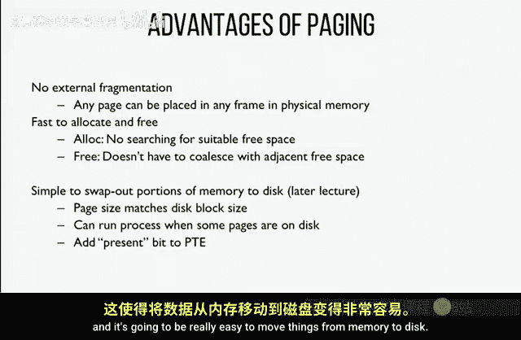

We still have a bunch of disadvantages to paging that we're going to have to fix， though。

 So one problem we're starting to see is that we're going to have internal fragmentation with paging。

 so。Maybe like so we're wasting space within our page。

 which might make you think I should make my page really。

 really small so that I'm not wasting any space within that page。

But why don't you want to make pages really small。Because then we'll have a lot of pages。

 and then our page tables will be even bigger。 right。

 So if we gave it so that our pages were smaller， we're going to have fewer bits in our logical address。

 using to pick an offset within that page。 We'll have more pages， though。

 and we'll have larger page tables。 So that would not be good。

So the other disadvantage we've seen is that we're doing an additional memory reference now because we have to look up in the page table to find out where the user's logical page lives。

 That's going to be a problem that we're going to fix in about two lectures with TLBs or translation locoide buffers。

 the next problem we're going to fix， though， is that right now。

 we're using too much storage for this thing， right we calculated。Four megabytes for this page table。

 something like that。And a big problem with that is that we were assuming that this page table would then be laid out in physical memory contiguously。

 It was a completely linear page table。 So you'd have to allocate 4 MBby contiguously in physical memory。

 That's not realistic。 So we are going to figure out how to basically page the page tables or have multiple levels of page tables。

 and we're going to figure out how to add segmentation together with paging。So in our next lecture。

 we'll review these basics and then it's going to get more complicated so at the beginning of next lecture。

 by all means ask questions to make sure you're understanding this before we make it harder。

See you all on Tuesday。这人啊。そだけで。やで城厕。还到。