# 操作系统内存虚拟化：P5：分段与分页 🧠

在本节课中，我们将继续学习内存虚拟化。我们将深入探讨分段和分页这两种核心的内存管理技术，分析各自的优缺点，并详细了解分页机制中页表的工作原理和结构。

---

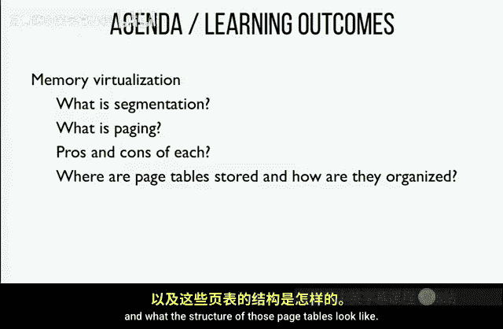

## 课程回顾 📚

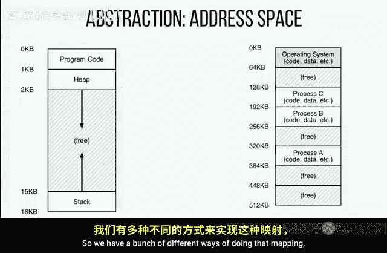

上一节我们介绍了内存虚拟化的基本概念。用户进程看到的是一块逻辑地址空间，其中包含代码段、堆和栈。操作系统的任务是将这些逻辑地址映射到实际的物理内存中。我们已经探讨了几种简单的映射方法。

### 已探讨的映射方法

以下是几种我们已了解的内存映射方法：

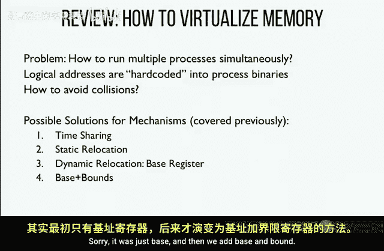

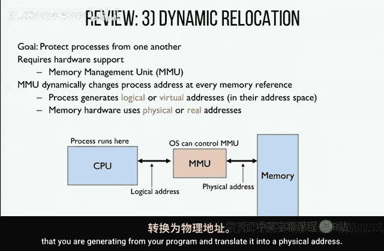

1.  **时间共享**：一次只将一个进程完整地加载到物理内存中运行，然后换出到磁盘，再换入另一个进程。这种方法缺乏保护。
2.  **静态重定位**：在程序加载时，由链接器或加载器修改程序中的所有地址，使其指向物理内存位置。这种方法工作量大且不灵活。
3.  **动态重定位（基址寄存器）**：通过硬件（MMU）将一个基址寄存器加到逻辑地址上来得到物理地址。这种方法简单，但无法防止进程访问超出其地址空间的内存。
4.  **动态重定位（基址+界限寄存器）**：在基址寄存器的基础上增加一个界限寄存器，用于检查逻辑地址是否越界。这提供了基本的保护，但要求整个地址空间在物理内存中连续分配，可能导致**外部碎片**。

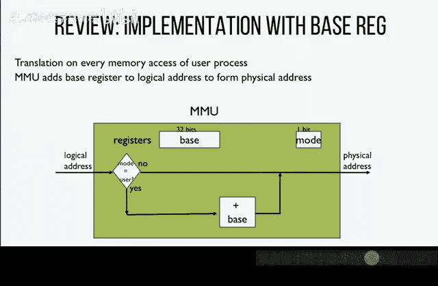

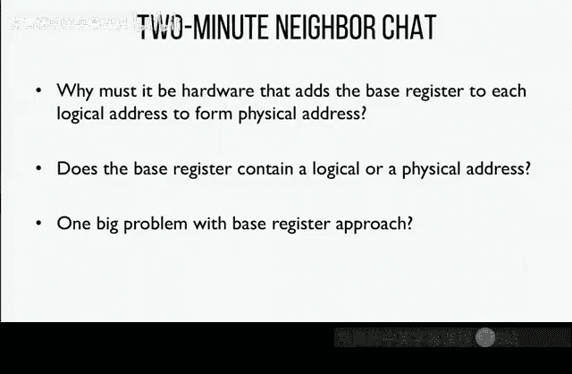

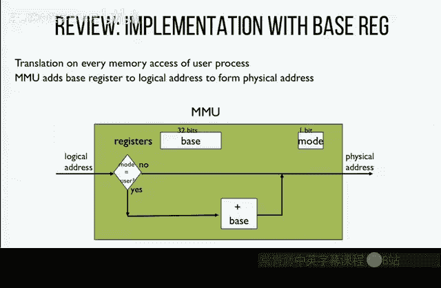

---

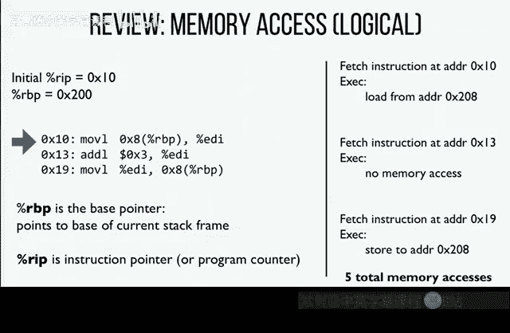

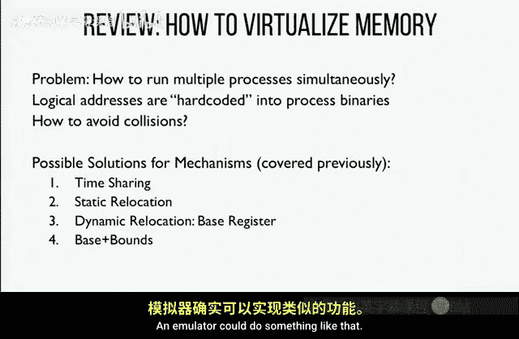

## 分段机制 🧩

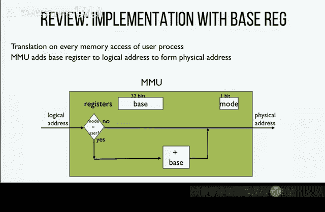

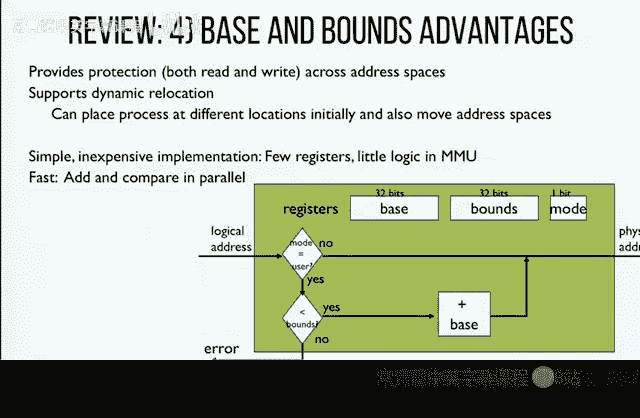

为了解决基址+界限机制中地址空间必须连续分配的问题，我们引入了**分段**。

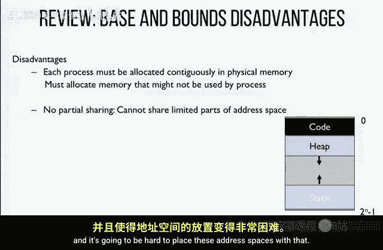

### 分段的核心思想

分段的思想非常直观。我们不再将整个地址空间视为一个整体，而是将其划分为几个逻辑段（如代码段、堆段、栈段）。每个段可以独立地、非连续地放置在物理内存的不同位置。

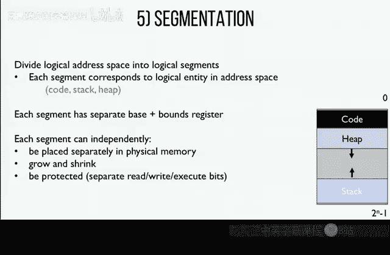

每个段都有自己的一对**基址**和**界限**寄存器。这样，堆和栈可以独立地增长或缩小，而无需预先知道其最终大小。此外，我们还可以为不同的段设置不同的保护权限（例如，代码段设置为只读）。

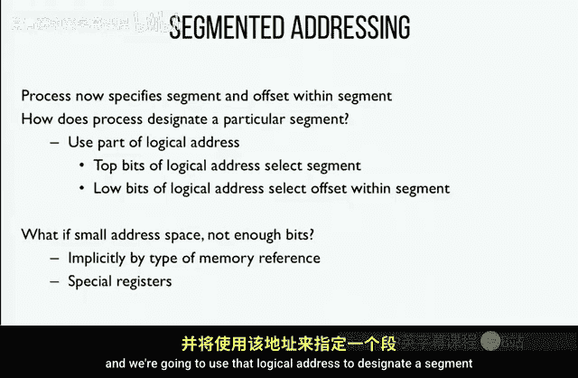

### 地址转换过程

在分段机制下，一个逻辑地址由两部分组成：**段标识符** 和 **段内偏移量**。通常，逻辑地址的高位用于指定段。

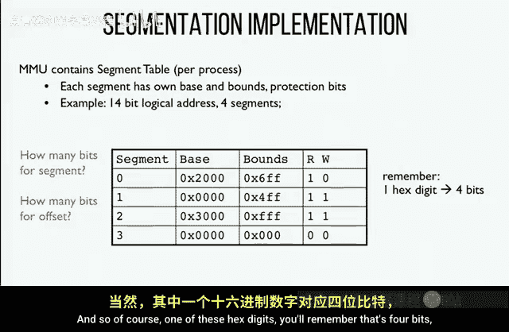

假设我们有一个14位的逻辑地址，其中高2位用于选择4个段之一，低12位是段内偏移。

**转换公式**：
`物理地址 = 段基址 + 段内偏移量`

在访问前，硬件会检查偏移量是否超出段的界限，以及当前操作是否符合段的权限（如读、写）。如果检查失败，会触发一个错误（段错误）。

### 分段的优缺点

**优点**：
*   允许稀疏使用地址空间，更高效地利用物理内存。
*   支持不同段独立增长。
*   可为不同段设置不同的访问权限。
*   便于在进程间共享特定的段（如代码库）。

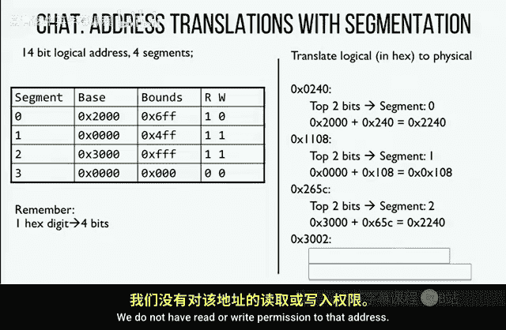

**缺点**：
*   每个段自身在物理内存中仍需**连续存储**。一个大段可能因为找不到足够大的连续空闲区域而无法分配，这仍然是**外部碎片**问题。

---

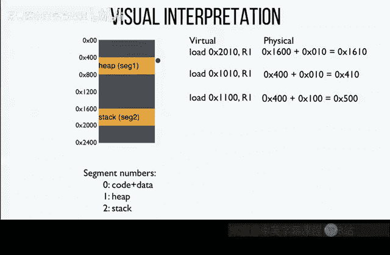

## 分页机制 📄

为了彻底解决外部碎片问题，我们引入了**分页**机制。

### 分页的核心思想

分页将逻辑地址空间和物理地址空间都划分为固定大小的单元，分别称为**页**和**帧**。页的大小通常是2的幂（如4KB）。关键点在于，一个逻辑页可以映射到物理内存中的**任何一个**物理帧，它们不需要连续。

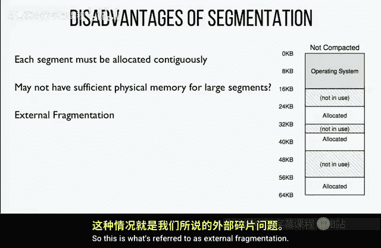

### 地址转换过程

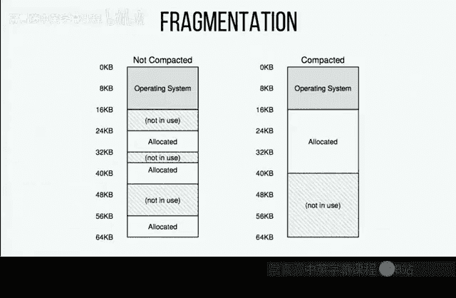

在分页机制下，逻辑地址被分为两部分：**虚拟页号** 和 **页内偏移**。

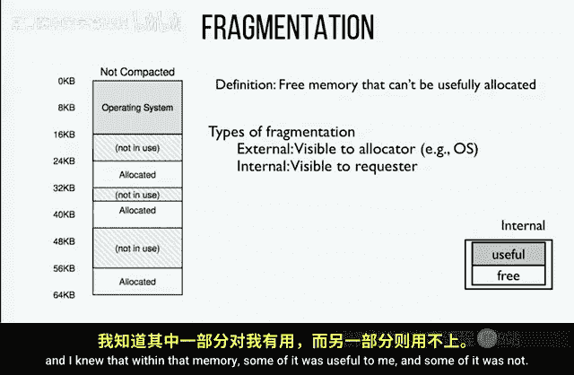

**转换公式**：
`物理地址 = (物理帧号 * 页大小) + 页内偏移量`

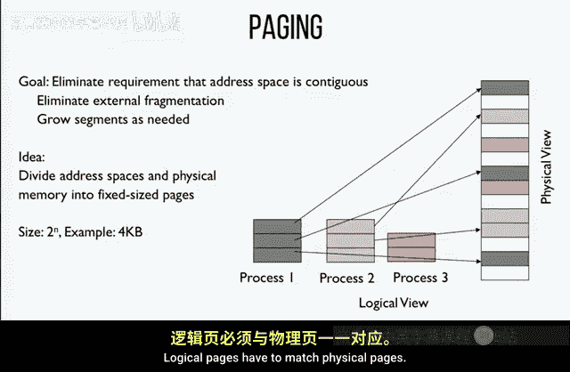

虚拟页号到物理帧号的映射关系，存储在一个称为**页表**的数据结构中。每个进程都有自己独立的页表。

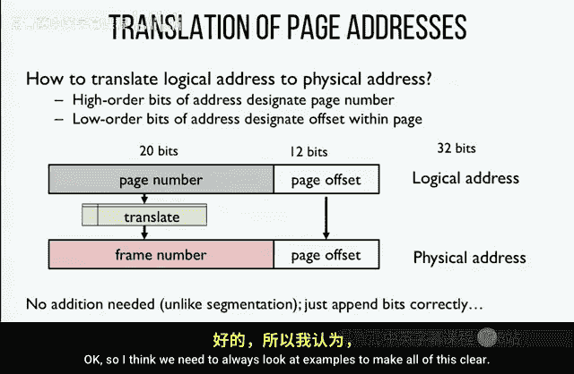

### 页表详解

最简单的页表是一个线性数组。数组的索引是虚拟页号，数组的内容是对应的页表项。一个页表项通常包含：
*   **物理帧号**：最重要的部分，指出页存放在物理内存的哪个帧。
*   **有效位**：指示该页是否在物理内存中。
*   **保护位**：指示页的读、写、执行权限。
*   **脏位**：指示页的内容是否被修改过。
*   **其他位**：如访问位、缓存禁用位等。

操作系统通过一个**页表基址寄存器**来告知硬件当前运行进程的页表在物理内存中的位置。

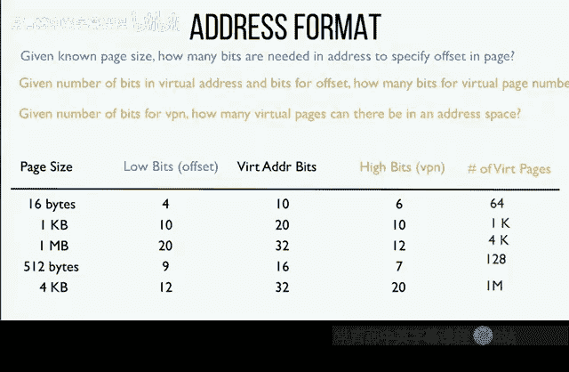

### 分页的性能问题

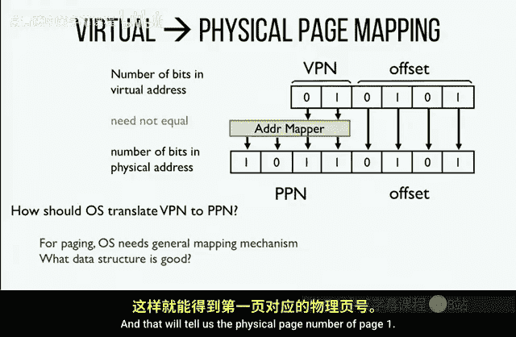

分页引入了一个显著的性能开销：**每次内存访问现在需要两次物理内存访问**。
1.  第一次访问：查询页表，获取物理帧号。
2.  第二次访问：使用得到的物理地址访问实际的数据或指令。

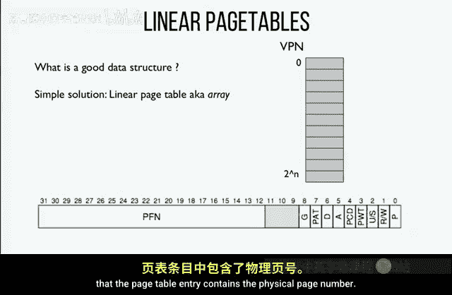

这会使程序运行速度理论上减慢一倍。我们将在后续课程中通过**转换后备缓冲器**来解决这个问题。

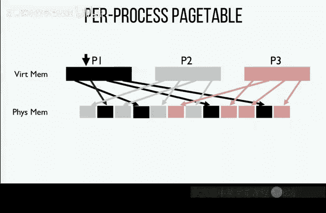

### 分页的存储开销问题

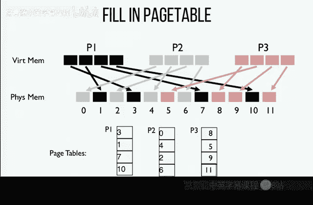

让我们计算一下页表可能有多大。
*   假设：32位地址空间，4KB页大小，每个页表项占4字节。
*   计算：
    *   页内偏移需要 log2(4KB) = 12 位。
    *   虚拟页号有 32 - 12 = 20 位。
    *   虚拟页数量为 2^20 = 1,048,576 个。
    *   页表大小 = 页表项数 * 每个项大小 = 1,048,576 * 4 字节 = **4 MB**。

这意味着**每个进程**的页表就可能占用4MB连续的物理内存！这显然不切实际。我们将在下节课探讨如何通过多级页表等技术来解决页表过大的问题。

### 分页的优缺点

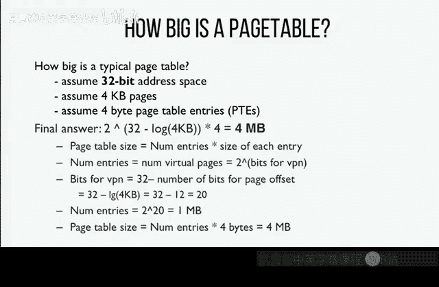

**优点**：
*   **完全消除了外部碎片**：任何空闲的物理帧都可以使用。
*   分配和释放内存非常高效（只需操作位图）。
*   易于与磁盘交换（换页）配合工作，因为页大小通常与磁盘块大小匹配。

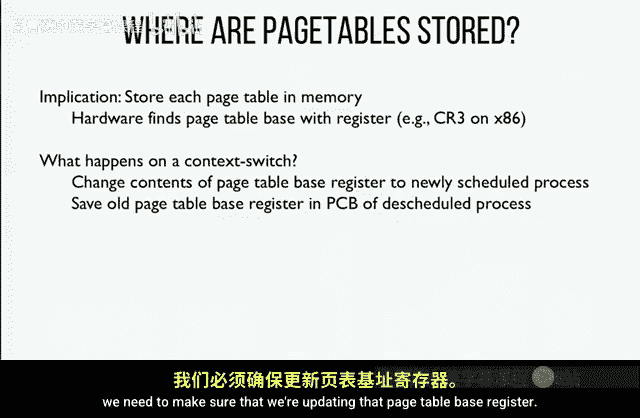

**缺点**：
*   可能产生**内部碎片**（一个页未被完全利用）。
*   地址转换慢（需要额外的内存访问）。
*   简单的线性页表占用内存过大。

---

## 本节总结 🎯

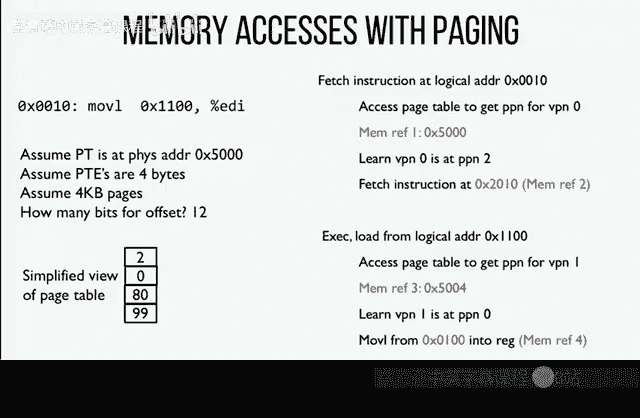

本节课我们一起深入学习了内存虚拟化的两种关键技术：分段和分页。

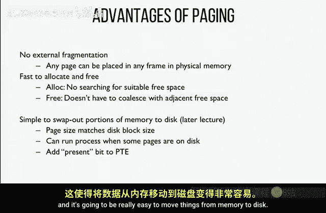

*   **分段**将地址空间按逻辑单元划分，提高了灵活性和保护性，但未能解决外部碎片问题。
*   **分页**使用固定大小的页，彻底消除了外部碎片，是现代操作系统的基础。然而，它带来了地址转换的性能开销和页表存储开销两大新挑战。

在接下来的课程中，我们将探索如何优化分页机制，例如使用TLB来加速地址转换，以及使用多级页表来减少页表的内存占用。