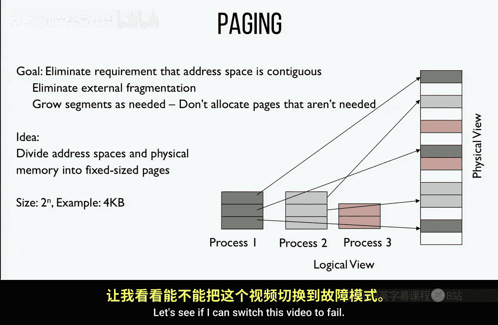
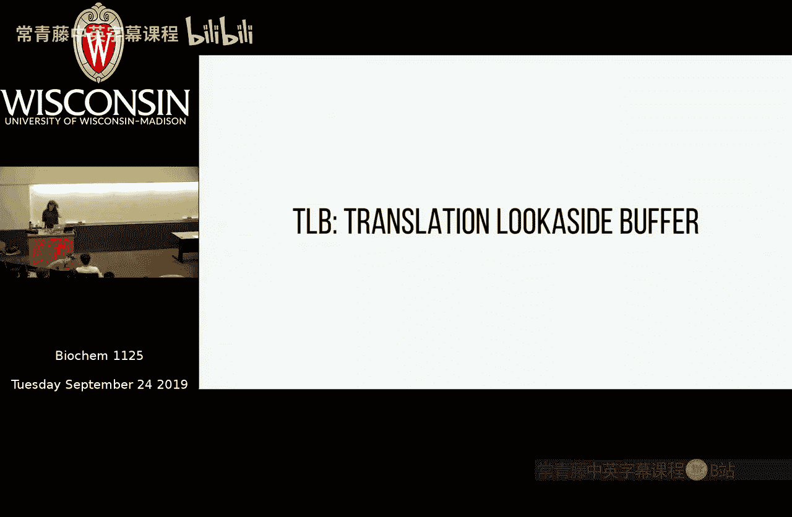
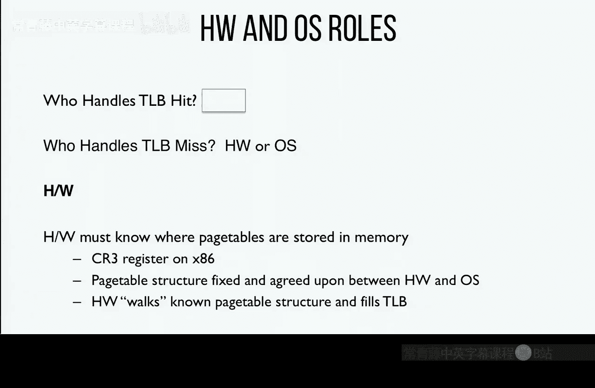

# 威斯康星大学【中英⚡操作系统｜CS 537 Fall19, Introduction to Operating Systems】 p06 P6 Virtualizing Memory_ TLBS _ University of Wisconsin-Madison -BV1wUzSB3Ecf_p6-

Al right， good morning， everyone。 So today we're going to be continuing to talk about how to virtualize memory。

 So we're deep in the heart of this topic。 We've learned about lots of ways of virtualizing memory。

 We learned about what like static relocation， we learned about time sharing。

 we learned about using a base register。 we learned about using base and bounds to add some protection。

 we learned about segmentation， we learned about paging。 And so we were left with paging。

 and it wasn't performing exactly perfectly。 So today's lecture is going to add T Lbss on top of paging。

 so that we can have fast memory translations。 All right， so that's where we are。

 But let us begin with some announcements。 Okay， so you all know Project1 has been graded at this point。

 You should be able to look back in your hand in directory for P1。

 and you'll see three files that have the results of us running all of the tests。

 So if you have any questions about exactly what happened when we ran the test。

 look in your hand in directory。 And then we uploaded to canvas。 your final grade。

 which was out of 120 points。 Yes。😊，Turn up the mic。 I thought I was picking up better， but okay。

All right。It's picking up， and it's pretty loud， okay。Oh， I hate how loud that is。

 That's really the right volume for you all。Okay。All right， Well。

 if anybody thinks it's too loud at some point， please start booing me and putting thumbs down。

Alright， so you can see your project1 grade in canvas。 It's out of 120 points。

 A lot of people did really， really well and got all of the perfect points on this。

 Not everybody did。 That's fine as well。 We don't expect you to do perfectly on every assignment in this class in order to get an A。

 right， So be reassured about that。 So if there were some problems with grading。 And by this， I mean。

 you got a zero on the assignment and you thought it worked pretty well by all means。

 contact the T A about that。 Like if there was just something wrong with how you did the hand in。

 But if you just got like five points off and you didn't expect that， then by all means。

 that is your own business。 And we are not going to help you with those five points。 Okay。

 but if there was something seriously wrong with how things were run， then let us know。😊，O。

 project 2 was due last night。 It seemed like it went pretty smoothly。

 I wish we would have gotten out the test scripts to you a little sooner than we did。

 but you all seem to have survived that experience pretty well。

So that should be graded in the next week as well。 Same type of process。 Oh。

 and some people I noticed they didn't upload their screenshot to canvas。

 So if you are one of those people， just do that。 Okay。

 so I could see that bunch of people didn't do that。 I'll be able to see that as late。

 but it's not the hugest deal in the world。😊，All right， Project 3， it is now available。

 This is a very， very fun project。 You get to write your own shell。

 So you run a shell every day when you're using a Unix machine。

 It's the thing that prompts you to enter in commands and then starts off those jobs for you。

 And so you are going to be implementing something like that。

 it'll be using fork to fork off a new process。 like I talked about a couple lectures ago about how to create a new process。

 And then after you have that child process that you' forked off。

 you called exec on the command that the user wants to run to overlay what's in memory with a new program that should be run in the shell。

 And meanwhile， the shell can go off and either wait for that job or get more jobs inputted through the command prompt。

😊，So that project will also be performed by yourself。 It's the last one that will be。

 I can't promise that。 But Project 4， you will get to work with a project partner。

 but Project 3 is still by yourself。 So in discussion sections tomorrow。

 I am anticipating the Ts we'll go over how to use for and exec。

But I think this will be the last discussion section for a little bit where they are so project focused。

 I'm hoping that in May of the next discussion section next week。

 they'll go over a little bit more lecture content。

 help you review a bit for the upcoming midterm exam。O， so that brings us to the midterm exam。

All right， so you all know it's Thursday， October 10。 It's in the evening。

 We have some huge room situation we have to deal with。 I'll get you rooms later。

 Remember to let me know if you have a justifiable conflict during that time that you have another required class or another required exam。

So if you do， oh， goodness。Allright， so if you do have， I can't look up。

 If you have another exam at that time， fill out the form on canvas to let us know about that。

 and we'll figure that out。Right， okay， and then I'm going keep continuing to make all of these little homeworks available through canvas。

 that the idea of those is that they will help you a lot for that midterm exam so that you'll know what that will look like。

 Those homeworks， Those quizzes are meant to be very low。Cost there， you know。

 you can take them as many times as you need。 So I'm trying to make some available every Tuesday or Thursday after lecture。

 And then they always do one week after I make them available。

So any questions about any of that stuff， projects， exams， homeworks， yeah。Yeah。

Are the quizzes being contributed towards your grade？ So I was imagining they'd be like you know。

1% of your， of your kind it， it would take away from the exam grades。Yeah， so it'll be a tiny。

 tiny amount。 But you know， if you do them all， I think if you do all of them。

 you are going to do much better on the exams than if you don't。

 So if you do really poorly on the exams， and then I go back and I see this person never even took any of the quizzes。

 I'm going to have less sympathy for you when I'm doing final grades than if like， oh。

 they seem like they were trying and they're not doing so long on the exams still So it's always good just to kind of use it as a way of communicating with me about that you're keeping up with the class。

 because I do look at individuals and human beings that those final moments of grading。All right。

 more questions。Al right， okay， so today we are going to continue our topic of virtualization。

 We'll start off by quickly reviewing how paging works。

 Then most of our time is going to be spent on T L Bs。 How can we make page translations faster。

 What are T L Bs， When do T L Bs work well， It's going to depend a lot on the workload。

 What type of access patterns that workload is making， Are they random or are they sequential。😊。

And then we're going to talk about what you need to do on a context switch now that you have this T B in there。

Okay， so what were we talking about before， one of our criteria for determining if a virtualization scheme is good or not is how much fragmentation and what type of fragmentation it causes。

 So some of the techniques like segmentation will cause external fragmentation。

 And this is where different segments have been allocated in physical memory。

 And then there's these holes that are very small， and they might not be able to be used effectively。

 So that type of fragmentation， It's visible to the system that's doing the allocation。

 And so we call that external fragmentation。And then other types of approaches will have what we call internal fragmentation here。

 The system that's doling out those units isn't aware of how those memory chunks are being used。

 But the entity or the process that did get this allocation。

 It knows how well it's using that allocated memory。

 And so it knows if it has some wasted space in there that it's not using。 So certainly with paging。

 we'll have internal fragmentation since the O S is always going to give a process more memory in chunks of like 4 k。

 And if you only needed one B， then you have a lot of internal fragmentation in that case。All right。

 so those are two metrics to keep in mind。Alright， so then we are talking about paging。

 And so here we really are trying to eliminate that requirement that we had with segmentation and with base and bounds that parts of our address space had to be allocated completely contiguously in free memory。

 And so it could be really hard to find enough free memory that was completely contiguous with those other approaches。

 So the beauty of paging is we take our virtual address space。

 And we just split it up into fixed sized chunks or pages。

 And then each of those pages can be allocated anywhere in physical memory。

 And then we have these page tables that do the great job of figuring out where a virtual page is actually located in physical memory。

 okay。😊，So a common page size is4 kilobyte。 It always has to be a power of two。

 The physical pages always have to be the same size as the virtual pages。Okay。

And one kind of neat thing about it is if you have a large address space。

Let's start drawing more today， let's see if I can switch this video too。

Fail。Okay， so now we have a virtual address space。And we have a bunch of pages， right？

And maybe this is our code。And this is our heap。And this is our stack down here。

Some of these have been allocated。And all of these other pages are free。

So we don't actually have to allocate those three pages， any space in physical memory， right。

 So when you look at what's actually in physical memory， what's in Ram。Or physical memory， of course。

 there'll be some mapping that shows you where each of those allocated pages are。

And where the stack is。But we don't have to allocate any physical space for those pages that aren't being used in our virtual space。

 yes。Well， we're still going to have that problem in our virtual address space。

 If this grows all the way up and this one grows all the way down at some point。

 they're needing to use the same virtual address。 and we run out of space。

 But that's what's so great about having， you know。

2 to the 32 Bs or2 to the 64 Bs in our virtual address space。

 The odds of that happening are pretty crazy low。 So it's not really a concern in modern systems that that would happen。

😊，Great， but in the old systems where you were doing， you had small amounts of memory。

 that was a bigger concern。All right。So we need to have a data structure to allow us to map between the virtual pages and the physical pages。

 And so that's what our page table is。 And we're gonna to start off with just a very。

 very simple linear page table where it's just basically an array。

 And if you want to find out where the zeroth virtual page lives in physical memory。

 you go to the zeroth entry of this array。 And what's in this entry or this PT TE page table entry。

 Look something like this。 This is a sample for a 32 B page table entry。

 Most of that page table entry is going to be taken up with the actual physical page number or the physical frame number that this is telling us where that page lives in physical memory。

 And then there's a whole bunch of other bits that are about the protection for this page and help with some policy stop and caching。

Alright， so that's what a linear page table looks like。

So now we will get to some actual more manipulations。

 because this shows if we understand this or not。Okay， so let us see what is happening here。

I want to have two processes that are running P1 and P2。

Each of their page tables you'll remember lives in physical memory。

And so when a process is running and it's loading from a virtual address and its virtual address space。

 the hardware needs to translate this into a physical address。

 And so the first step of this was to look in the page table to figure out where this virtual page lives。

 And so in this example， we can assume again that we have 4 k pages。

 which means the bottom 3 hex digits。That would be 12 Bs。 So that's 2 to the 12， which is 4K。

 So those bottom of  three hex digits are being used for our offset within the page。

 And that top hex digit is being used to designate our virtual page number， right。Okay， so。

 for example， then。If we have0，0，0，0， the zero is， oops， I don't like how I did that。Okay。

 so we are looking for virtual page 0。So we need to know now， what do we need to know。

 We need to know， well， which process is running。So the way that we're going to know that for address translation is basically。

 where is our page table base register currently pointing。

 which page table is currently active since each process has its own page table。 Remember O。

 so I will tell you that the page table base register is currently pointing to P2s page table。

 It points to the lowest address， and it grows to higher numbers from there。 Okay。

 And then the other thing you need to know to figure out exactly what physical address we are going to is how big each of these page table entries are。

 So in this example， we're going to assume that they're 8 B。

So it could be 4 B or 8 B are the typical numbers。 O。

 so let's figure out exactly what physical address we are going to need to do a load from first。

So what is the first thing we are going to do？Is we are going to go to the page table based register and look for entry 0。

 because we're looking for page 0。 So that' so our first physical address that were going to fetch from should be 0。

8，0，0。Everybody agree with me。Since I don't have a way of cheating and looking at the animations before they show up。

 you all can see which if I goof up， okay。So does that make sense to everybody， We。

 We're just getting the zeroth entry from P2's page table。

 which is exactly at the the base location there。Allright， so we will load this value here。

 And this is meant to be just like a blow up of what the contents of memory are。

 So at the zeroth location， we have the physical frame number 6。 So this tells us that。

Page 0 has been mapped to physical page 6。 So where we are going to actually load from should be 6。

And then our offset。 So we found out that 0 is actually mapped to 6。

 and then the offset stays the same。 So that will be our physical address。8。So。

 let's do another example。We're running the same process， now we need to do a load from 1，4，4，4。

How about I have you all figured this out by talking to your neighbor。

 Because I can't quite tell from the vibe in the room if you are finding this obvious or perplexing。

 So please talk with your neighbor and figure out。What are the two memory addresses you're going to need to do load from。

Allright。That， okay。So I made this a little trickier because I told you the page table entry size was 8 and that you're supposed to be generating the actual addresses instead of just getting to look at them like they're an array。

 So I tried to draw on the board kind of what we're doing here。

 So the first step is we need to figure out where。The page table entry is located。

 So the page table entry for virtual page one is going to be equal to the page table based register plus our VPN times the size of each page table entry right because the0th entry would have been a of 0。

 Then the first entry is 8 by away from that and so forth。 So that does our indexing。

 And so the page table entry for page 1 of this process is located at hacks 0，8，0，0，0，8，0，8。

 As I said there， right。Everybody agree with that。Any questions about that one？

Then our next step is we look at that memory address， memory location and。Here。

 it would have been a little clear if I would have written out all the addresses， but I did not。

 But this is the。Index that we're going to be looking at。 So we found out that virtual page。嗯。

1 goes to physical page 2。 And so the way we do our address translation is we just replace the。

 the VPN with our physical frame number， which is 2。 And we keep the offset。

 It's the same offset within that page。Great。So any questions about how to do that indexing and those you're just looking into data structures。

 figuring out the right locations to do accesses， yeah。Exactly。Its neat that。Re time。With paging。

 it is pretty much these nice numbers that you just。

 it's always that since the page sizes are the same。

 you just get to append those bits to the next to the to the physical page。 Yeah。

 it's just an appending operation。Exactly， yeah， you're slicing memory in powers of two。

 So this all works out beautifully。 The pages are all the same size。 It works out beautifully， y。

 yep。😊，So this is our physical address。 This is our physical page number， and again， our offset。

More questions。Yeah。Could you say that utter？Oh， because we're looking at page process 2。

 That's how we got this one。So what I told you is that the page table base register is pointing right here。

 So that must mean it's process 2 that's running。 So we're using process 2's page table there。

 But you're looking at what the next question is going to be。 switch to the next process， yeah。Yeah。

 these are physical addresses。 For now， we'll keep the page tables in physical memory。

 And that's just where we go to get the。The contents of the page table， yeah。

The first memory access that we're doing is to look up in the page table to figure out how we map virtual page numbers to physical page numbers。

 Yes， we are accessing the page table in our first memory access。

 And then our second memory access is actually getting the data that the user wanted when they said。

 do this load。Yeah。All right， yes。The diagram on the left。Is physical。 Yes， yes， absolutely。

 because I'm intermixing these two processes。 It must be physical memory， y。More questions。Yeah。Oh。

 great。 You knew that because I told you where the page table based register was pointing。

 and it was pointing right there in this lovely diagram。

 exactly where that lined up was very important for this example。

Because now you're going to see this awesome animation where we switched。 We had a context switch。

 and on a context switch， what we are going to need to do is tell the hardware。

 where our new page table based register is。 So now we are scheduling process 1。

 Its page table lives here， the hardware knows where the page tablebased register is。

 And so now when process one is running and process  one does a load from the same address in its virtual address space。

 we need to figure out what it what memory it will access in physical memory。 So figure that one out。

 And we'll make sure you get the right answer。😊，All right。

 I love seeing everybody's hands when they're pointing up to the board that I can tell they're pointing out different things there。

 But let us talk about this as a group。😊，Okay， so let's make sure we all understand this。

 Now process one is running， we can tell that because the page table base register is pointing to P1's page table base。

 So now when P1 wants to read。Virtual page 1， the way it figures out where the page table entry for that lives is it takes the page table based register plus the VPN。

 which is one times the size of this entry， which is 8。 So we're going to look at address 0，0，0，8。

That is being shown as this memory location right here， and so now we do a load from there。

 we find out that the mapping tells us that VPN1 maps to PPPN 5。

 so we just replace that portion of our address， append our offset from our virtual address to our physical address and this is the physical address that we have now generated 5。

4，44， that's where we do the load from in physical memory to get the data that this process wants。

So any questions， yes。We got 5。 We didn't get 5，0，0，0， really。 We just got the physical page number。

 And I got that because I was looking up。 This was telling us we're looking for virtual page 1。

 So this was virtual page 0。 This is virtual page 1。 So we did that look up。

 We were told that it's physical page 5。 So then I replaced in my address to put in physical page 5 down there。

哦啊。So you're trying to be more precise， probably with what I was showing you in that previous slide。

 Oh， at animation stink sometimes with。With this， yeah。

 just assume we weren't doing anything quite this fancy。 And I was just throwing the。

 the physical page number at the bottom bitetes of。The bottom bits of our 8 B entry。But you're bite。

 I could have been more precise about that。Yeah。Oh index 0。 We'll say everything， I mean。

This is going to get more precise later， probably as we look at paging page tables， but for now。Well。

 yeah， the page table will always start with index zero。O。Yeah。😊，How do I get what？

The physical page number。 So I had my virtual address，1，4，4，4。

 I then need to find out where page 1 is mapped to find that。

 I find out where the page table base register， tells me to look。

 I index into that by the size of each entry， which is 8。 So I'm going to be looking at。For example。

 where the base register was， which was at zero plus8。Times1 away。So when I look at that。

 I see that I am indeed getting physical page number 5。 That's where this is mapped。

 And I think I tried to even kind of always make it like， oh， this is kind of correct page。

 This is what it's accessing is going to be down here。 It's finding this page。 right。

 This table is telling us the layout of virtual pages to physical pages that are being shown here。

 So we're going to end up going to page。 the page that's at 5。 And we'll do our offset。4，4。

4 from the start of that page。呃。No。I'll go around and get some more questions。 and yeah。

You will never get to see what the physical address is by observing your program's behavior。

 If you wanted to get the physical address， you would need to， you know。

 you could put in some hardware probes to look at the signals that are being sent to memory or you could look at you know。

 what the O S has done。 But certainly you as a user， can't see what these physical addresses are。Its。

Is virtual。 You when you look at addresses in your program， it's always virtual。

 even when you're using GDP， you know， you're still always looking at virtual addresses， yeah。

All right。So that was our review of paging。Okay， so I want you to figure out if these are the steps of each memory reference that we're doing。

 which of these steps are。Expensive。And which ones are cheap， okay。All right。

 so talk with your neighbor and figure out which are cheap and which are expensive。

 because it's basically corresponding to what we just did up here。All right， so remember。

 we're doing all of these steps in hardware。 Hardware is doing the bit manipulation。

 It's taking off the bits that it needs。 It's doing the addition， whatever it needs to do。 Okay。

 so the first step extracting the VPN from a virtual address that's basically just looking at the top order bits to figure out what VPN we're looking at。

 That's step 1 is that probably easy or hard。Easy， okay。

 then we have to calculate the address of the page table entry。 This is just math。

 We take a page table based register。 It's a value that's stored in a register。

 so that should be fast to access。 And then we do some very simple arithmetic and arithmetic had better be very easy for our CPU。

 or we are going to be a very， very slow CPU。 So step 2 is also easy as well。

 that we are calculating an address that's just a register lookup and some arithmetic。Then step 3。

 we have our address。 It was like this number here。

 And now we need to do a read from that address in physical memory。 Is that going be slower fast。

That'll be slow because we're accessing memory。 memorymory is much。

 much slower than accessing registers or doing arithmetic calculations。And then from that。

 we're going to pull out the actual physical frame number， you know， the actual。

Fields that we needed from those 4 B or those 8 B。 And so， again。

 that should be relatively quick because it's just selecting some of the bits that were're at that memory location。

 Then we have to build our physical address。 Do you remember how we build our physical address。

 We take that physical page number that we just read that was slow to get。

 And then we just concatenate on the bits of our offset into that page。 So is that faster slow。Fast。

And then we finally do the thing that the user level program wanted to do。

 We read the contents of that physical address from memory into some register or something like that。

 And so I didn't show that in here。 We're actually doing the load。

 And that one's going to be expensive as well。 So anytime we access memory， it will be slow。

 Anytime we're just doing some address calculations or some bit manipulations that'll be quick。 okay。

So those are the basic steps that you're going to do whenever you need to translate a virtual address to a physical address。

 And we have simple， linear paging。Okay， so we need to fix a couple of problems now。

 So the first problem that we are going to fix today is the fact that we had to do that additional memory reference to the page table and that that was really slow。

 That was step 3。 We want to get rid of accessing the page table because that's stored in memory。

 and we only have an register， the base of that page table。 And then it's a memory access after that。

😊，The second problem that we'll fix in our next lecture will be that these page tables could be very。

 very large， and we're going to figure out how to make the storage for page tables better。 But today。

 let's get rid of that page。Table lookup。Okay。So let us look at an example。

 So this is your user level program that you loved and took a lot of pride in writing。

 And it just accumulates into a sum variable all of the elements of an array A。 okay。

 And so we will assume that array A starts at virtual address 3000。

 And we're not going to look at any of the instruction fetches anymore。 for simplicity。

 And we're going to ignore accesses to I because I is probably stored in a register。

 And we'll ignore accesses to some as well， because that's probably also on a register。 Okay。

 so let's figure out what will be the virtual addresses that this program accesses。

 virtual addresses。😊，So did I give you enough information， I'll say size of ints are 4 B。

 so the first access to the  zeroth element of a will be where a starts。

 which is virtual address 3000。Then our next access to when I is one。

 It will be 24 Bs away from that。 since that's the size of an int。

 and we'll load from this virtual address and so forth。 We just keep incrementing。Our address by 4 B。

 and， of course，8 plus 4 is C， since we're going to get very comfortable with our hex arithmetic。

Okay。So everybody agree with me there that those are the virtual addresses this program is generating。

O， now let us figure out。 I think I'm just going show you the physical addresses that are going to get generated。

 And we'll see what you can figure out from this。Okay。

 so we ended up accessing these physical locations。Can you figure out some stuff from this。嗯。Okay。

 I'll tell you what you can figure out。 and you talk with your neighbor to see why we can infer from this trace that the page table based register must be or probably is at 1000。

 The page table entries are each 4 B and VPN3 goes to P， PN 7。

So you should be able to infer that stuff， making reasonable assumptions。See if you can do it。

 Talk with your neighbor。All right， so I'll go over this。

So we're doing pairs of loads for each load in the user space over here。

 So this is to the page table。 We keep accessing the same address in the page table。

 So the thing to notice is we were needing to do a lookup of page 3。

 and we kept always going to offset C off from 1000。 I mean。

 theres some assumptions that we're doing here。 But most likely what that means is that the page table based register was at 1000。

 And then3 away from that。12 divided by three would mean that each of those entries must be4 bys。

 So that's why index 3。 if we started at 1000 would go to 1000 C。 All right。

 so you could figure that that's very likely。 And then when we keep we read a physical page number out of this address。

 And we seem to be getting the number 7。 That's where our physical page number is that three virtual page 3 is getting mapped to 7。

 So that was the other thing we can infer。 And we keep just depending the same offset to each of those pages in virtual world and physical world。

 So we access 7000 and 7004 and so forth。All right。

 so there's lots of information buried in all of this stuff。

 It's kind of neat when it all comes together well enough that you can figure that out， but。

What we want to be showing here is how useful this is going to be for performance。 that this program。

 that's a pretty basic program。 The way it's structured is the user keeps accessing memory addresses that are on the same page。

 So because of that。We need to keep going to the same page table entry。

 We keep reading over and over again，100 C to see that the mapping 3 goes to 7。

 We should be smart and remember that。 And so basically， we just need to cache that information that。

Virtual page 3 goes to physical page 7。 instead of going to the page table for that over and over again。

So that is what we are going to do with a T L B， which is the abbreviation for translation look side buffer。

 It's a horrible， horrible name。But TLB， that's what we call it。😊，So the basic intuition there is。

 remember， in Ram， in physical memory， we have these page tables for every process that's out there。

 These things are huge。In the common case， we don't just access random page table entries。

 We access just a few of them over and over again。 So what we're going to want to do is we're going to want to have a translation cache that the CPU can access very quickly。

 that's faster to access than going to Ram。 It's not the same as like your hardware cache for data and instructions。

 but it's similar and that it's only keeping these address translations in this TLB cache。

 And so we are just going to keep in our TLB cache。

 The page table entries that we've been accessing recently。Question。

I certainly don't know of any architecture that does anything like that because it's kind of like on a different path。

Maybe you could do something。To somehow do that。 But it。

 it wouldn't be very natural that we want to have in those caches what's stored at a designated virtual address。

 usually。 But， but yeah， you could， you could do something， but。Page translations。

 they go someplace separate。 They go in the TLB。Okay。Alright， so let us look at T L Bs in detail。

 Let me give you a break。Talk about what your favorite movies and television shows are。

 What do you do to relax when you don't want to think about 5，37。😊。

All right， we will continue。 We will learn about TLBs。 So TLBs are just a cache。

 They're caching those address translations。 And so the way we will look up translations in this TLB is you need to have a tag。

 This is what's doing the lookup for you。 You're looking for a match across all of these different TLB entries is for the tag that you're looking up。

 So the tag that we're going to use will be our virtual page number that we want to find。

 And then the answer， the thing that this TLB will spit out is the corresponding physical page number that we got from our page table entry。

 right。😊，And we'll probably have to have some protection bits in our TLB as well。

 All of those other things that I always want to skip in all of the details here。 Allright。

 so our TLB will have some number of entries in it。 for example，64，256。

 That's how many translations that it can remember at any one point in time。

 So modern TLBs are going to be fully associative， if there's 256 entries here。

 the hardware will simultaneously look through all 256 entries of the TLB looking for the tag that you're trying to do a lookup for for your virtual page number。

 And if any of those 256 entries match， it will spit out the physical page number for you。

 that will be a TLB hit a TLB miss would occur if it couldn't find that tag anywhere in the 256 entries。

😊，So that is what a TLB hit versus a TLB miss is if you have a TLB miss。

 what are you going to have to do， you're going to have to go to the page tables and do all of that extra work。

 We didn't have the shortcut。 We'll just do exactly the work that we tried before。

So then when you do the miss， you would find out the correct mapping。

 and then you would load up the T LB with our new mapping and replace something that used to be in there。

 And we'll talk more about how to do decent paid TLB replacement next。Okay。

 so any questions at that level， yeah。Yeah， if， if the tag is already in there。

 if the virtual page number that you're looking up is in there， that's a hit。

 And then we know the answer。 If that tag is not in there anywhere。

 we haven't looked this address up before， then we'll get a miss and we'll have to load it。Okay。

Alright， so let us look at how the T LB will behave for the exact same program that we were looking at before。

 So now when we are doing this， these virtual addresses， what will the TLB behavior look like。

Alright， so we are accessing things sequentially。 We're loading from these virtual addresses through that array。

And so what physical addresses are we going to generate？

 So we have a page table based register pointing at 0， I think。

 And so the first look up that we'll do。 And we need to know what the T L B looks like。

The first thing we'll do is we need to find out where page one lives。

With an offset from this base over here， which is starting at 0。 So that's why we're loading from 0。

 And it's page 1。 So one times the size of the entry， which must be4。

 gives us this address that we need to be doing our load from to get into the page table。Alright。

 so we could have。Great， so， but I should have said first， we first looked up this page one。

 and it was not in the TL B。 We did not have a VPN of one there。 So we had a TL B miss。

 So that's why we did that extra work of going to physical memory and doing the load from that address that's shown in red。

All right。So then now we know where the map， we know the mapping from VPN。1 is to 5。

 So that's why we then do a load from physical address 5。 Okay， So that was doing a miss。

 handling it， putting in the contents in our T LB。 So now the nice thing is now we want to figure out where virtual address 1004 lives。

 And so now we send the VPN of one off to this T LB。 We do our lookup。 the tag matches。

 The entry is valid。 And so we don't have to go to the physical page table anymore。

 We just find out that the。Physical page number is 5。 So we don't have to have that other load。

 Now we just load directly from where we wanted to。 That address 1，0，0，4 is actually 5，0，0。

4 in physical memory。 And so every time we keep looking for virtual page number one。

 we'll keep hitting in the T L B and we'll keep finding out that the physical page number 5。

 So all of those addresses， we'll be pretty easy to do。 we'll get a bunch of hits。That makes sense。

 yeah。We are going to exactly get to that。 We do have to worry about that。 Yep。

 this is assuming one process。Alright， so now we have the same process running and it wants to do a load from page 2。

 It looks in the T L B。 That will be a TL B miss。 So it has to go to the page table at that particular offset。

 load up the T L B with the mapping that it finds there。

 And then it's going to be able to construct its virtual。 Sorry。

 its physical addresses just fine from there on。😊，O。So any questions about that。

 We're using the T L B as a cache。 If we miss in the cache。

 then we have to go to the page tables and do what we did before。Alright。

 so we want to look at what is the miss rate going to be。

 How well is our Tl B usually going to perform？ So calculating the miss rate is pretty straightforward。

 We're only going to look at the miss rate for data。

 We're going to ignore the fact that we're also doing instruction， fetches in all of this。

So what is the mis rate， It's calculated as the number of misses that you have divided by the total number of lookups。

 So let's figure out how many T LB lookups would you do in this example。 Well。

 we are basically looking for 2048 different addresses。

 That's how intenses we're going through this loop。 That's how many lookups we're going to have。

How many misses are we going to have in this code。Each time we go to a new page。

 we're going to have a miss in our T L B because we don't know what the translation is for that page that we're getting to for the first time。

 So we need to figure out how many。Integers。Of a fit on each page。

So I probably need to give you some assumptions。 If I never tell you how big a pages it's 4 kB。

 So if an integer is 4 B， then that means we'll fit 1000 integers per page， right？

 And if we're going to 2000 integers， then that means we're accessing two pages， right？

 So we're going to have。Two misses。So it's how many unique pages we accessed if there are 2048。

Things we accessed， and we can fit 1000。Integers on a page。

 than it must be that we're going to two different pages。

So our miss rate will just be2 divided by 2048。So this is a great miss rate and this is kind of the typical miss rate that you'll see out of TLBs TLBs do really。

 really well for common access patterns that you have in your programs because most programs access items sequentially you access all of the offsets within a page and so that does really well and so often because that number so small。

 you might show the hit rate， that's just one minus the miss rate。So a couple of questions for you。

 would our hit rate get better or worse if we had smaller pages for the same code。

 it would get worse。 We're going to have more accesses to different unique pages。

 Each one of those will be amiss。 So therefore， our hit rate is going to get worse with smaller pages。

Another question for you， let's say we did more iterations。 Let's say we go up to you know。

 a million。 Would our hit rate get better or worse if we accessed a million items in the survey sequentially。

Same， awesome。 All right。 And I didn't even put that as an option out there。

 And you still knew it was the same。 So it will be the same because it's still just the case that we only miss on the first access to each page。

 So our miss rate is always one out of the number of integers on a page， which is 1024。 Yeah。😊，Oh。

 so you you're worried about the T L B with this。 So actually， we。

 this would work just fine with a TL B of just one entry， even right， because we are just。

 we're accessing each of them sequentially。 We figured out what the translation is for this page。

 And then we used it 1024 more times。 And then we move on to the next page。

 and we do that 1024 times。 So we really only need a T L B that fits one entry to get this hit right in this example。

 You got it， okay。That's a good question。It's not going to be the case for other workloads。

 but it is for sequential accesses。 You really just need one T L B entry。Okay。So。

This is the opposite of the question I asked you before。

 If you want to improve your hit rate and you have only a certain number of TLB entries like 256。

 the way to do that is you increase your page size so that more pages。

 more addresses have the same page translations。 And so a metric that I like to see is what's called like TLB reach。

 And so this is basically you want to think of that as how much of your address space can you get to through the T LB。

 So。Without having to ever go to a page table。 So that's just the number of entries that you have multiplied by the page size。

 That's how many bytes you can get to through the T L B without having to go to page tables。

 So that's。Maybe not too common of a metric， but it's a relatively common metric for showing how good your TLB reaches。

Okay。Alright， so let's look at a couple different workloads。 So we saw sequential array accesses。

 Those almost always hit in the T LB。 That's very fast。

What access patterns are not going to work so well。

 So if you really have something that's highly random， it's going to completely different pages。

 and you never repeat your accesses。 We're going to keep missing in the T L B。

 and we'll have to go to the page table every time and do poorly。Okay。

 so let's look at two different workloads。 This is the one on the left is the one we've seen already completely sequential。

 the one on the right is somewhat random， but it's only pseudoran。

 So the thing to notice is that I am seatding this random number generator with the same random seed each time。

S Rand 1，2，3，4。 So the random stream that each of those loops will generate will be exactly the same。

 right。So the nice thing about that then is we're going to access the same array elements each time through the two loops。

 and therefore， we're going to be going to the same pages。

 And so if our TLB has cached those translations from the first loop。

 they should be there for the second loop。So you've probably heard about different types of locality。

 If you've taken a hardware course。 This comes up a lot。

 I think database people sometimes talk about this stuff。

 but there's two types of locality where caches are going to do really well where our past behavior。

 if it's a good predictor of the future， we're going to get good performance。

 So one type of locality is what's called spatial locality。

 And the way you can think of it is that if our accesses are shown along the x axis varying over time。

 and we're showing the address of our access along the Y axis。

 then this is showing that we keep accessing sequential addresses over time。 And so， for example。

 if all of these are going to the same page， then we'll get TLB hits for all of those accesses we have spatial locality。

 we can predict where in space， we can predict which addresses we will access in the future based upon which ones we just access recently in the past。

So that's spatial locality。 The other type of locality is what's called temporal locality。

 So now there's no you can't predict by address where we're going to access。

 but it's very likely that in a short interval of time。

 we'll access something that we access in the past。 So this is temporal locality。

 So this picture exactly corresponds to that pseudorandom。

Program that I showed you before were the first time through the loop， we accessed a bunch of pages。

 and then the second time through the loop， we access those same pages again。

So those are the definitions for spatial locality basically that future accesses will be nearby to the address that we just accessed。

 whereas temporal locality， future accesses are going to be a repeat of those that we accessed recently in the past。

 so let's think about how the TLB works well for each of those types of accesses。

So if we have spatial locality。This is what we were talking about before。

 You keep accessing the same page over and over again， just different offsets there。

 So we keep needing the same VPN to PPN translation。

 the exact same TLB entry is used over and over again。 This would work with any size TLB。

 we could just have one entry and we do fine for spatial locality。

 It's with temporal locality that it matters how many addresses we have in our TLB， right。

 because So， for example， here， if we look at this page first。

 if we then accessed a million pages before we got back to that one。

 then we wouldn't have kept that translation in our TLB still。

 But if we've only accessed three other pages before we get to that。

 And as long as we have four entries in our TLB， that one will still be cached。

 So a temporal locality， there's a relationship between the size of the TLB and if your accesses are still going to be there。

 It depends upon how long it takes for you to access it。All right。Okay。So you might have。

 you might have heard about different replacement policies。 So we have our T LB。 It has 256 entries。

 We have a T LB mess。 There's a page that we think is more important to us now than the ones that are already in there。

 We have to figure out which one of those old entries to kick out or to evict。

To make room for the new one， we're going to talk about these policies a lot more when we talk about memory。

 But one common policy is what's called LRU， or at least recently used。

 where you're going to kick out the entry that was least recently used。

 that was used the furthest in the past。So you could imagine how that would work or another common policy in hardware。

 because this needs to be done really， really fast。 It's just， you know。

 it's another common thing to do is random。And so I want to show you that random is not always bad。

Okay， so what I want you to figure out is imagine you have this array with just five elements in it。

 and you start off with a T LB that has nothing in it。 And its only four entries in our T LB。

And let's say we do this memory access pattern that's really tough for TLBs。

 And that's what's called strideed access。 So instead of accessing every by within this page。

 I'm going be very mean。 And I'm only going to access like one B from this page。

 And then I'm going to stride you know，4 kB further to the same offset in the next page。

 And then another stride to 4 kB。 So I just keep getting like  one memory access out of each page。

 very mean to do strideed access。So what will be the contents of our T L B as we access these five pages and what will our misrate of our T L B be T L B be with an L R U replacement policy where you kick out the page that was accessed the furthest in the past。

So spend a minute with your neighbor and see if you can figure out what the miss rate will be for this workload。

All right， so what will your miss rate be for this workloads with this size TLB？

It'll be 100% right You are never going to hit in the TLB。 So why is this so hoendously awful。

 You start off with some initial content。 So of course， initially we're going to miss。 That's fine。

 we do just one access to page 0。 and so we load up who knows what the mapping is。

 That's not important。 but we'll have some mapping in our TLB now for page 0。

 Then we move on to page1。 We put that in the TLB 2 and 3。 Then we get to page4。

 that'll be another miss。 It's clearly not in our TLB。 We need to do a replacement。

 though we have to kick one of these entries out because we only have four entries。

 and we do what we thought was smart by kicking out the page that has been the longest that we've accessed because heck we're probably not going to look at page 0 again。

 we don't know what this program is doing。But it turns out so we kick out this VPN zero with entry4。

 but I guess I didn't really tell you we keep cycling through this。

 we go back to the beginning each time， so now we're going to access page zero that's the one we just kicked out for page four so we'll have a miss zero will kick out one。

 we then access one and one kicks out two so you never have the right contents of this TLB with using LRU。

So L RU can be a really problematic replacement policy。

 and it would have been better if we just would have done something random and just kicked out any page。

 And then maybe we would have the right one。Maybe we wouldn't。

 So database people certainly get into a lot of different replacement policies。

 They figure out very well how to deal with these types of workloads that are like streaming through huge data sets and they're flushing out。

 caches at different levels。 So this that's kind of what this is doing。

 It has a working set that's larger than the number of entries that we have。

 We're streaming through it。 and we're flushing out our cache。

 And we need to make sure that we at least keep some of our things in the TLB。

 So some access patterns can be really malicious and difficult for our TLB to handle And LRU doesn't necessarily match very well with us。

😊，But we will look at this more later when we look at memory。O。All right。

 so sometimes random is better than what you thought was smart， which is LRU。 Okay。

 so just to make the point， we've been looking at data so far。

 How is TLB performance generally for code， code tends to be very sequential。

 So that tends to have a really good hit rate in the TLB。

 even when you have like an if statement or a while loop。 and you're jumping around。

 It's still probably to something that's relatively close to your previous assembly instruction。

 So that has good locality。😊，Alright。All right， we had the question earlier。 hey。

 is this really going to work with more than one process And no， it is not。

 We were omitting some details there， right？ So we have to be smart about what process is running。

So clearly， you can't just look up your。virtualirtual page number in the T L B。

 Find a different processes， virtualr page number to see where it was mapping to physical memory and use that。

 You have to have your own mappings。 Otherwise， that would let you access another processes address space。

 which is a big security hole。So there's a couple of different solutions to this。

 So the easiest thing to do is every time you do a context switch。

 you just flush all the entries from the TLB and then everything that's in the TLB， you know。

 that's for your address space。 And that will work totally fine。

 The problem with that is it makes context switches more expensive。 right Now。

 every time you do a context switch， you're going to have to load up your TLB again and have a bunch of misses to get that warmed up。

 So it doesn't make context switches more expensive。

 So what modern architectures do is they add a tag that goes along with your virtual page number。

 So we call this an address space identifier or As ID instead of a P ID。 It's for the address space。

 It tends to be a smaller number than your P ID could be。

So you'll have to have a mapping between P I Ds to A S I Ds， but。Now， when you do a lookup。

 you just have to make sure that not only does your tag include the VPN。

 but it also includes this address space identifier。Alright， so let us look at that。 final example。

 I think。Alright， so now we have a T L B， and the tag includes the address space identifiers shown in the last column。

 And let's assume process with。I guess its process too， is running with a。Identifier of 12。

 And so when it does a load of 1，4，4，4， can you tell from this what the physical address should be。

And again，4 k pages， since I didn't specify。 So the low three hex digits are the offset in the page。

 and the top hex digit is the page number。So if we are looking for logical address，1，4，4，4。

 that means it is。Logical or virtual page number one。

 So we look for logical or page number one in our TLB。 We see that it is valid。

 We see that the identifiers match。 So this is us。 And this is our physical page number。

 So this is so nice and happy and much better than looking up page tables。 right。

 So we had a TLB hit。 And we know that our mapping goes from page1 to page 2。

 And so we were able to construct our physical address like that。😊，Now if we have a context switch。

 I think my animation changed and now we are running a different process with this identifier and we do a load from the same virtual address。

 now what will the physical address be that corresponds to this。In our T LB。

 we look for a valid page with a virtual page number that matches one and the A S I Ds match。

 which is 11。 So one maps to 5。 And so we change our。

Virtual page number of one to our physical page number of 5， same offset within that page。

 And that's our physical address。I think that's all that was on there， Any questions about those？

Yeah。Yeah。Yeah， you would just need to make sure that there isn't a currently active process with the same A S Id。

 So it's a little bit easier because it just has to be currently running。

 And that's why you can reuse them safer more quickly than a process I D。 Yeah， great，results。Great。

 we are going to talk about how different processes can share pages。

 And if they're sharing the whole address space together。

 then those will be threads in the same process。 They will have the same address space identifier if they're threads that are part of the same process。

 if we do things with。Sharing individual pages。I think we'll get into that later with how that sharing is going to be set up。

 But the T L B。Yeah， the TLB with how it interacts with that might not be so straightforward。

 And I don't usually show what's going on with Sha because we'll show how the page tables work with sharing。

 but we'll have to think about TLBs。Okay。Alright， so again， I'm going to emphasize for T L Bs。

 It's the context switches that are expensive。Even when we're using aure space identifiers。

 it's still the case that other processes when we context switch to them， they do pollute our TLB。

 When that other process runs， it's going to throw away the TLB entries that corresponded to the previous process。

 So when process A comes back again， it's going to see that the TLB is full of B's entries。

 and it is going to have worse performance at higher TLB mis rate while it loads up that TLB with its page translation。

 So context switches are always a little bit more expensive with TLBs now。

Other things for you just to be aware of， we don't usually just have one TLB in modern architectures。

 TLBs are cheap， but they really， really improve performance。 so we want TLBs to be large。

 They're certainly fully associative。 we can have a separate TLB for data accesses and a separate TLB for instructions and then a thing that's being done these days。

 instead of just having all pages be kilobys to help TLB performance it's pretty common to have these super pages like a page that's one megabyte in size。

 So if you know that really all of that memory is being used that you're not gonna have a lot of internal fragmentation。

 it's very common to have a page translation that works for a whole one MBbyte page so that you'll really improve that TLB hit rate so that's the main point of having a super page It would be to improve your TLB reach and your TLB hit rate。

Okay good。All right， well。I will continue this in our next lecture so that we can just talk a little bit about teabe and then paging page tables。

哎い。

Yeah。One thing about Christmas。