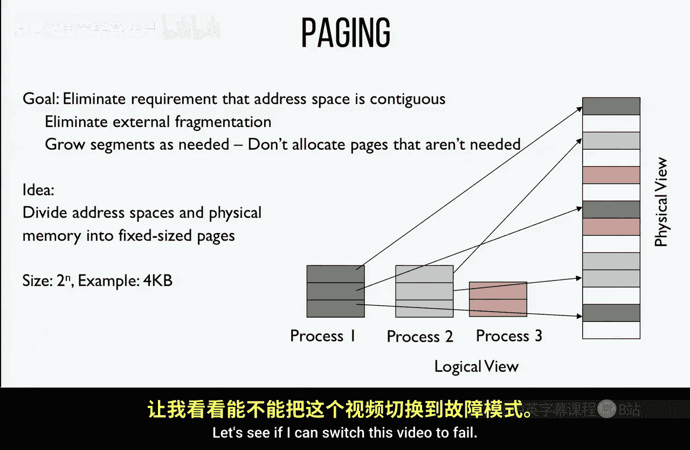
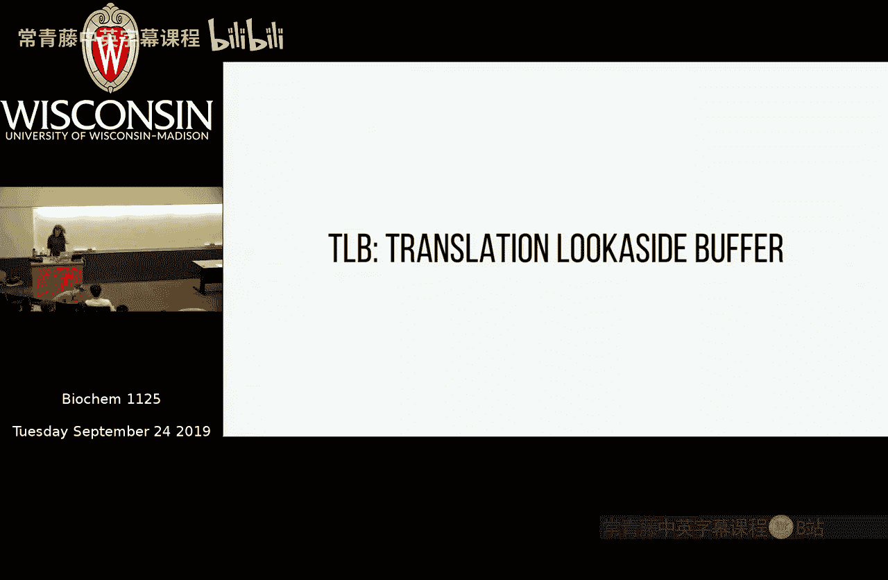
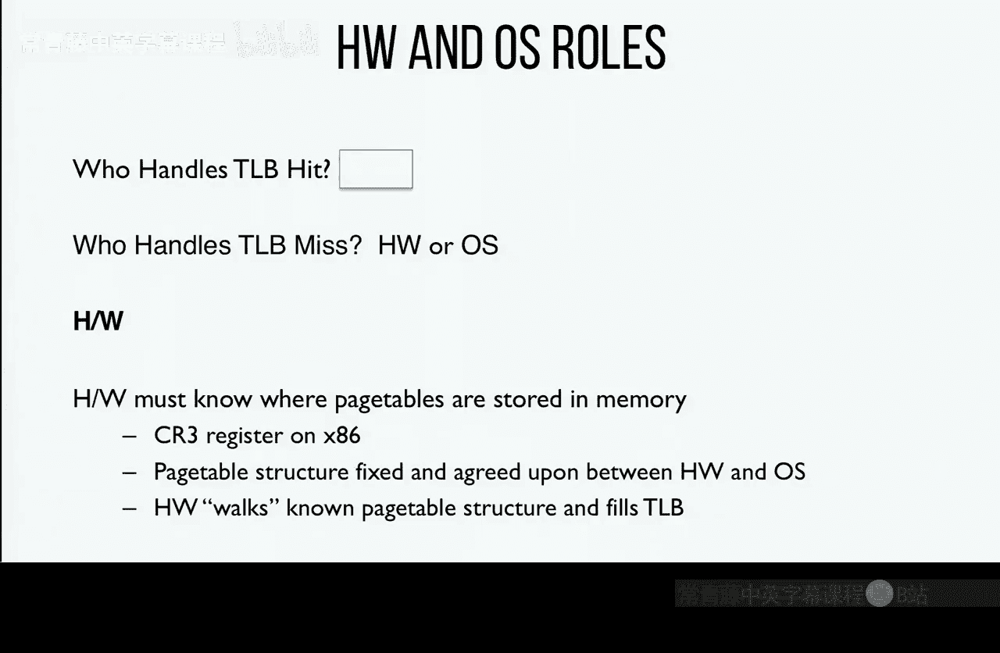

# 操作系统：06：虚拟化内存与TLB 🚀

在本节课中，我们将继续探讨如何虚拟化内存。我们已经学习了多种虚拟化内存的方法，如静态重定位、分时、基址寄存器、基址-界限保护、分段和分页。今天，我们将重点讨论在分页基础上引入**TLB**，以实现快速的内存地址转换。

---

## 课程公告与回顾 📢

上一节我们介绍了分页机制。分页将虚拟地址空间划分为固定大小的**页**，并将这些页映射到物理内存的任何位置。我们使用**页表**来记录这些映射关系。常见的页大小为4KB，且必须是2的幂次方。



然而，分页机制存在一个性能问题：每次内存访问都需要先访问页表（存储在物理内存中），这导致了一次额外的、较慢的内存访问。本节我们将解决这个问题。

---

## 分页地址转换流程 🔄

让我们回顾一下使用简单线性页表进行地址转换的步骤。假设我们有一个虚拟地址，需要找到其对应的物理地址。

1.  **提取虚拟页号**：从虚拟地址中提取出虚拟页号。这通常是通过查看地址的高位比特完成的。
2.  **计算页表项地址**：根据**页表基址寄存器**的值和虚拟页号，计算出对应页表项在物理内存中的地址。公式为：`页表项地址 = 页表基址 + (虚拟页号 * 页表项大小)`。
3.  **访问页表项**：从计算出的物理地址读取页表项。**这一步需要访问物理内存，速度较慢**。
4.  **提取物理页号**：从页表项中提取出物理页号。
5.  **构建物理地址**：将物理页号与虚拟地址中的**页内偏移量**拼接，形成最终的物理地址。
6.  **访问目标数据**：使用构建好的物理地址访问实际的数据。**这一步同样需要访问物理内存**。

在上述步骤中，步骤3（访问页表）是主要的性能瓶颈。

---

## 引入TLB：地址转换旁路缓冲器 ⚡

为了解决访问页表慢的问题，我们引入**TLB**。TLB是CPU内部的一个小型、快速的缓存，专门用于存储最近使用过的虚拟页号到物理页号的映射关系。

**TLB的工作原理如下：**
*   **TLB查询**：当需要转换一个虚拟地址时，CPU首先将虚拟页号发送到TLB进行查询。
*   **TLB命中**：如果在TLB中找到匹配的条目，则直接获得物理页号，无需访问内存中的页表。这非常快。
*   **TLB缺失**：如果在TLB中未找到匹配的条目，则称为TLB缺失。此时，CPU必须执行上述完整的页表查找流程（步骤1-6）。在从页表获得映射关系后，**会将该映射存入TLB中**，替换掉一个旧的条目（根据替换策略，如LRU或随机）。

**TLB条目通常包含：**
*   **标签**：虚拟页号。
*   **数据**：对应的物理页号。
*   **有效位**：指示该条目是否有效。
*   **保护位**：访问权限信息。
*   **地址空间标识符**：用于支持多进程，下文会详细说明。

---

## TLB性能与访问模式 📈



TLB的性能高度依赖于程序的**内存访问模式**。

**1. 顺序访问（空间局部性）**
考虑一个顺序访问数组的程序：
```c
for (i = 0; i < 2048; i++) {
    sum += A[i]; // 假设数组A起始于虚拟地址0x3000，int为4字节
}
```
访问的虚拟地址序列为：`0x3000`, `0x3004`, `0x3008`, ...。假设页大小为4KB，则每1024次访问才会跨越到一个新页。
*   **TLB行为**：首次访问一个新页时，会发生TLB缺失并加载该页的映射。随后对该页的1023次访问都会**TLB命中**。
*   **缺失率**：极低。对于这个2048次的循环，只会有2次缺失（访问两个不同的页），缺失率 = 2 / 2048。

**2. 伪随机访问（时间局部性）**
考虑一个先随机访问数组，再重复同样随机序列的程序：
```c
srand(1234); // 固定随机种子
for (i = 0; i < N; i++) {
    index = rand() % N;
    temp += A[index];
}
// ... 稍后再次执行相同的循环
```
*   **第一次循环**：会产生大量TLB缺失，因为访问的页是随机的。
*   **第二次循环**：由于访问序列完全相同，且TLB中可能还缓存着第一次循环的映射，因此会产生大量**TLB命中**。这体现了**时间局部性**——最近访问过的数据很可能再次被访问。

**3. 步长访问（对TLB不友好）**
考虑以固定的大步长（如4KB）访问内存，每次访问都落在不同的页上，且不重复访问同一页。
*   **TLB行为**：每次访问都是一个新的页，导致每次都是TLB缺失。即使TLB有多个条目，在访问序列长度超过TLB容量后，旧的映射会被挤出，无法被再次利用。
*   **替换策略的影响**：对于这种“工作集大于TLB容量”的流式访问，传统的LRU策略效果很差，有时随机替换策略反而可能更好。

---

## 多进程与TLB管理 🔄

TLB中存储的映射是进程相关的。进程A的虚拟页号1可能映射到物理页号5，而进程B的虚拟页号1可能映射到物理页号9。因此，在多进程环境下，我们需要管理TLB内容。

**解决方案1：上下文切换时清空TLB**
*   最简单的方法是在每次进行进程上下文切换时，**清空整个TLB**。
*   **缺点**：新进程开始运行时，TLB是空的，会导致大量初始缺失，**增加了上下文切换的开销**。

**解决方案2：为TLB条目添加地址空间标识符**
*   现代CPU通常采用这种方法。每个TLB条目除了虚拟页号标签外，还包含一个**地址空间标识符**。
*   ASID是一个较小的数字，用于区分不同进程的地址空间。
*   **上下文切换时**，操作系统只需将CPU的当前ASID寄存器改为新进程的ASID即可，**无需清空TLB**。
*   **TLB查询时**，需要同时匹配虚拟页号和ASID。这样，进程A的条目就不会被进程B的错误匹配。

即使使用ASID，上下文切换仍会带来性能影响，因为新进程的活跃页映射可能不在TLB中，需要逐渐填充，这被称为**TLB预热**。

---

## 总结与拓展 🎯

本节课我们一起学习了：
1.  **回顾了分页机制**及其在地址转换中的性能瓶颈——额外的页表内存访问。
2.  **引入了TLB**作为页表的高速缓存，用于加速地址转换。TLB命中则快速返回物理页号；TLB缺失则需查找页表并更新TLB。
3.  **分析了TLB性能**与程序访问模式的关系。具有良好**空间局部性**（顺序访问）或**时间局部性**（重复访问）的程序TLB命中率高。步长访问等模式对TLB不友好。
4.  **探讨了多进程下的TLB管理**。通过使用**地址空间标识符**，可以在上下文切换时保留TLB内容，减少性能开销。

**拓展知识：**
*   现代系统通常有独立的**指令TLB**和**数据TLB**。
*   为了提升TLB的有效覆盖范围，可以使用**大页**，例如2MB或1GB的页，这样单条TLB条目就能映射更大的内存区域。



在下一讲中，我们将继续探讨如何解决页表自身可能过大而占用过多内存的问题。