# 威斯康星大学【中英⚡操作系统｜CS 537 Fall19, Introduction to Operating Systems】 p07 P7 Memory_ Smaller PageTables _ University of Wisconsin-Madison -BV1wUzSB3Ecf_p7-

All right， this is not thinking of at all。Hello。All right， okay， great， great， great。

So good morning everyone， welcome to CS537， the microphone is working， so I am happy。All right。

 let's get started。So today we're going to be continuing our topic of memory virtualization。

 we just have one more lecture on this topic and then we will be doing some review and then we'll be switching over to concurrency so what I think is great about this class is we have these very three very different three topics so if you like one you might like the next one you might not if you didn't like this topic you very well might like the next one so they're all very separate topics but today we are talking about memory virtualizations specifically how to。

Make our page table smaller all right so begin with some announcements you've all turned in Project two that's being currently graded Project3 that is available to you all it is due one week from today exactly so hopefully you all went to discussion section yesterday and hopefully you learned a lot about fork in Exec there that it really is important to understand how fork works。

 how it makes a copy of the calling process how that child process will be identical to the parent process except for that return code that's given to it and then you can call exec on that child process so this is a very fun project it's really neat that you get to write your own shell right so you could use your own shell then whenever you want in your future life using UniI systems but you probably won't right。

All right。😊，Midterm one， so that midterm ist exactly two weeks from today。

 so today is the last day to let me know if you have any conflicts that you can't take the exam last night。

 if I haven't heard from me after today， you are taking that exam on that day I have posted two sample exams with there's a version that just has the questions and then there's a version that has questions and answers。

I'm hearing more mumbling today， which is bugging me quite a bit。

So if you could wait to talk until after class or until one of our many breaks。Thank you。Allright。

 so there are two sample exams posted。 I really recommend that you first look at the version that does not have the answers posted。

 just do the version with just the question， see if you get the right answers because there's something about looking at the version with the answers and it always seems like yeah I knew that that was obvious but if you really forced yourself to have to specify the answer you would see that it was a little bit harder than you thought so they are these very formulaic multiple choice exams。

 you'll see there's a lot of similarity between the two sample exams that are up there so they are probably pretty good predictors for what your midterm will look like as well So my plan is that next discussion section。

 the Ts will spend that discussion section going over one of those sample exams and doing more lecture content instead of talking about labs or projects。

Yes。There will not be another project before they exam。 Nope， nope。

 I am slightly aware of your workload。We'm trying to give a little gap there。

The mic is cutting in and out as usual。Okay， and so and as usual there are homeworks in Canvas。

 the next one that you're going to get is going to be a lot more interesting than I think all the previous ones that it's going to be using。

 paging with multiple levels of page tables like today's content。

 and I'll just get to that more later， but it's going to be harder than the previous ones。Okay。

 so today we're continuing to talk about how to virtualize memory。

 we're really looking at how we can make the page tables be pageable。

 how can we deal with the fact that page tables are huge and how can we allocate page tables efficiently in memory。

Okay， so last lecture， we were talking about TlBs。 So let's review TlBs a little bit。

Okay oh but first I wanted to give more like big picture。

 make sure you understand who's managing the page tables。

 Obviously it's the operating system that is creating these page tables。

 it is figuring out where a processes pages are allocated in physical memory so it's up to the OS to fill in those values in the page table you know it figures out what that mapping is。

 it's the one that then fills in the values of the。Physical page numbers in the page table。

 when it allocates memory to a process or when it figures out where exactly that process will live in physical memory。

 So it's the O that's setting up those page tables。

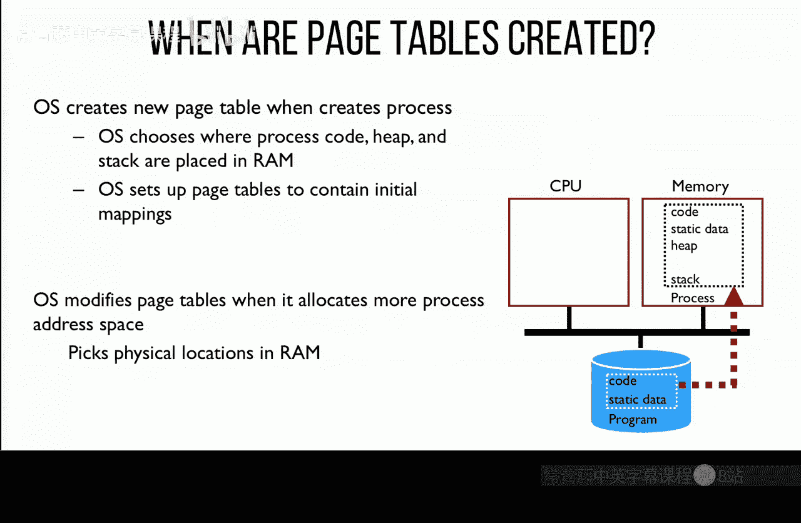

All right。Okay， so then we are talking about how we do that address translation from virtual addresses to physical addresses。

 and there were basically six steps to this。 The first step is if you have a virtual address。

 you need to pull out that VPN， the top order bits to tell you what virtual page number you're looking at。

Then you need to calculate from that where that is in the page table。

 so you'll remember the way that you do that is we're going to have a page table based register that points to the page table for this particular process。

We know where that base is， this is an offset within that。

And so we'll take that page table based register and we'll add the VPN times the size of an entry。

So like four or eight bytes those would be pretty typical sizes so that'll give us an offset。

 this is just telling us now where the page table entry lives， you look in the page table entry。

 what will you see there， you'll see a physical page number or a physical frame number plus some other bits。

That the Os cares about。We' pulled this out。And we use that to form our。Physical address。

With our physical page number， and then we use that same offset。In our physical address。

 since the pages are the same size。All right， so the steps that were expensive here where anytime we have to read anything from memory。

 since this page table is living in memory， that's expensive to do。

 We want to figure out how to make that faster。Allright， so page tables are great。

 except for the fact that we have to do this this extra memory reference and the fact that this page table is going to be huge。

 So at T LBs， we fixed the first problem where it was expensive to go to memory to read that page table entry。

😊。

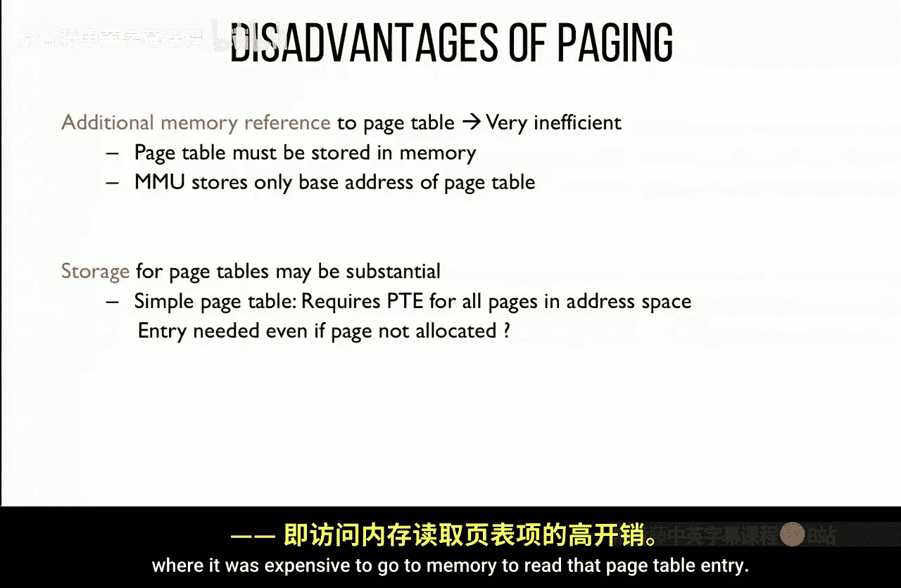

And so that's what we are showing in this animationation here。 You'll remember。

 page tables live in physical memory。But we keep accessing the same page table entries over and over again when the user process accesses the same page over and over again。

 So for example， you have an array that's been allocated。

 you're likely to look at all of the offsets within a single page so you keep accessing the same page。

 So the idea with a TLB is we are just going to cache some of those page translations in hardware in a special TLB hardware cache so that we don't have to go to main memory to get all of those page translations。

All right。So to then elaborate on those five steps a little more。嗯。

There is this step there now that after we。Wow。Okay， well， maybe that's good， finally。😊。

Except you can hear every little breath。 the microphone' is going crazy。 It tells me it's at peak。

 It tells me it's at low， all these things in between。

So after we get the VPN out of our virtual address， we use that to look up into our TLB。

 And if it is in there， that means we have a TLB hit and it's directly telling us the PPN that we're looking for。

 So we don't have to go to the page table。 But if we don't have a TLB hit。

 then we will go to the page table， do this exact same work as before。

And then there'll be a TLB miss and we'll have to load the contents of the TLB with that thing that we've just accessed。

All right。So any questions about that？Okay。If I hold it like this， that's great。😊。

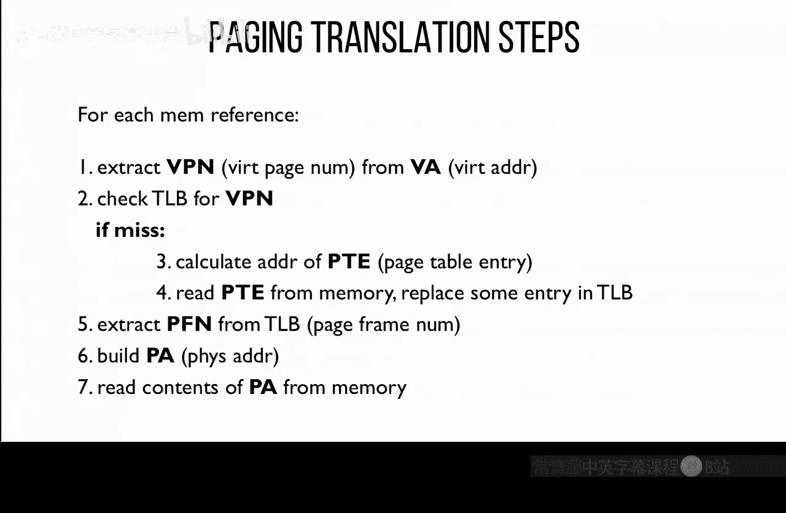

对呀。So the address of the page table is in physical memory。 So that's why there's no recursion there。

 Yeah， that we're told the direct base of that， or it's an address。 Yeah， it's a physical address。

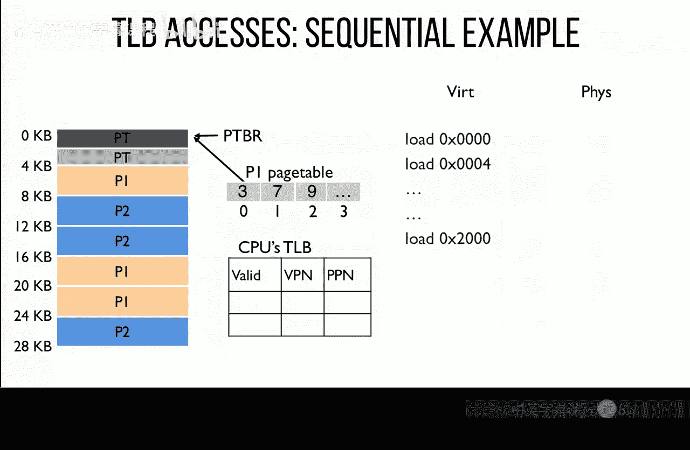

All right so。Even when I hold it like this， it's not working。 Great。

 So who handles a TLB hits on that path。 Is it the hardware or is it the operating system。

So who does the work to figure out if it。If this entry is in the TLB。

And then gets to do most of the steps if it is a hit。So that's all done in hardware， right。

 that that has to be done very quickly if the。Virtual page number is in the T LB。

 The hardware did that look up。 It looked at all of the entries of the TLB in parallel。

 and it was able to extract the physical page number very quickly from that TLB and then construct the physical address from that。

So that's done in hardware。嗯。So then the question is what happens if there is a TLB？See you really。

Okay。All right。嗯。So when there is a TLB Miss then the question is。

 is the hardware or the OS going to handle that and so the answer is either one。

 both answers are correct， there are some architectures that handle TLB misses and hardware and others that handle it in software and their are advantages to both approaches。

😊，So what's the advantage to handling a TLB Miss in hardware？Well， things are going to be faster。

 but then it means that you have to have a convention between hardware and software about exactly how that TLB is formatted。

U。So to communicate between the OS and hardware， the convention is going to be that we're going to have this register that tells us where the base is of our page table and then if there's a TLB miss。

 the hardware knows that's where the page table lives。

 the format of those page tables is a convention that can be followed。

 it says exactly which bits are being used for the PPN and which bits are being used for protection and other permission things and so the hardware is able to walk those page table structures because it knows the exact format。

 it knows how to interpret every memory address there。O。

I'm going to just give up on the microphone pretty soon。All right。

so then the other approach it heard me and now it's penalizing me。😊，If。

The other approach is to have the operating system handle the TLB Miss。

 the advantage of this is that we now can have any type of page table structures that we want。

 there's no agreement that has to occur between hardware and the operating system。

 and so we call this a software managed TLB。And this gives us a lot of flexibility。

 you can really have any data structure you want， but of course it still has to be the case that know the OS runs。

 it figures out what the translation is between a physical page number and the physical page number with whatever data structures at once。

 and then it loads that into the TLB， and so it has to be the OS that has the permissions to do that loading that other processes couldn't just do that。

All right。Okay。Since holding it didn't seem to matter。

 I would rather not have to hold the darn microphone。

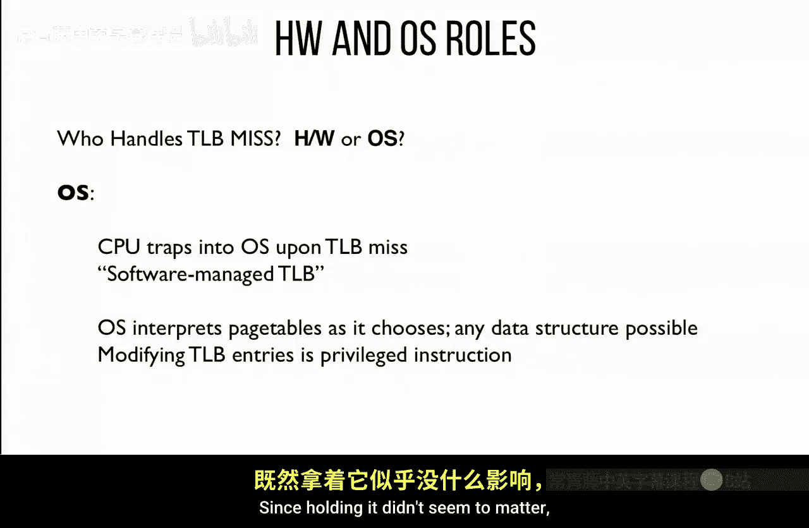

Okay。So to summarize them what we've learned about TLBs， we like having pages as our structure。

 but we don't want to have to access that page table on every memory access。

 So we're going to cache our recent page translations。 That's going to be what's in this TLB。

 The TLB works really， really well on sequential workloads。 So that's in a sequential workload。

 You tend to be accessing the same page over and over again in your user program。

 So therefore it's the same page translations over and over again。

 So the TLB is going to handle that really well。Workloads that have more temporal locality。

 Those are only going to perform well if you have enough TLB entries that by the time you get back to that same page translation。

 it needs to still be in the TL B， and it couldn't have been evicted by accessing other pages。

Al right， so we can have hardware or the operating system handling TLB misses。

 And then something we talked about in the last lecture was the fact that we have TLBs。

 It is increasing the cost of a context switch。 So the cost of a context switch isn't just the cost of going into the O figuring out which process you want to run modifying its registers。

 doing a track return back into the next process。 It's also must take into account the cache state and the TLB state that's getting flushed when you switch between different processes。

 So when we switch between different processes， there's two different approaches we can use。

 One is to completely just get rid of all the entries in the TLB invalidate everything in there so that you won't misinterpret the previous processes page translations for your own。

 or you can add these address space identifiers to every entry。

 And then you know which correspond to your mappings versus the others。😊，Yeah呀。is part of the。

That's a great question。 And it certainly seems like you could do that。

 So why don't we just save all of those translations。

 And I don it certainly seems like something would make a lot of sense to investigate。嗯。

I don't know if anybody' has done that or not， I mean。

You would still have to do a little bit of extra work when you do the context switch to load it back up。

That would be some memory accesses still that you need to do that。

 But that's a reasonable thing to try to see if that would improve。

 So you would take you take a bit of a hit right away when you do your context switch。

 and with the current approach， it's more like a lazy evaluation。

 And so you would see slightly slower performance over the lifetime of your time slice as you start accessing that data。

 Where if you did your approach of loading it， it would take a little bit to get them all loaded and you kind of want things running right away。

 But it seems like a neat thing to look into。So that is certainly the thing about systems。

 You can just come up with ideas like， wouldn't it make sense to do this。

 And then you can try it and you can evaluate it and see if that type of thing actually improves performance。

对。

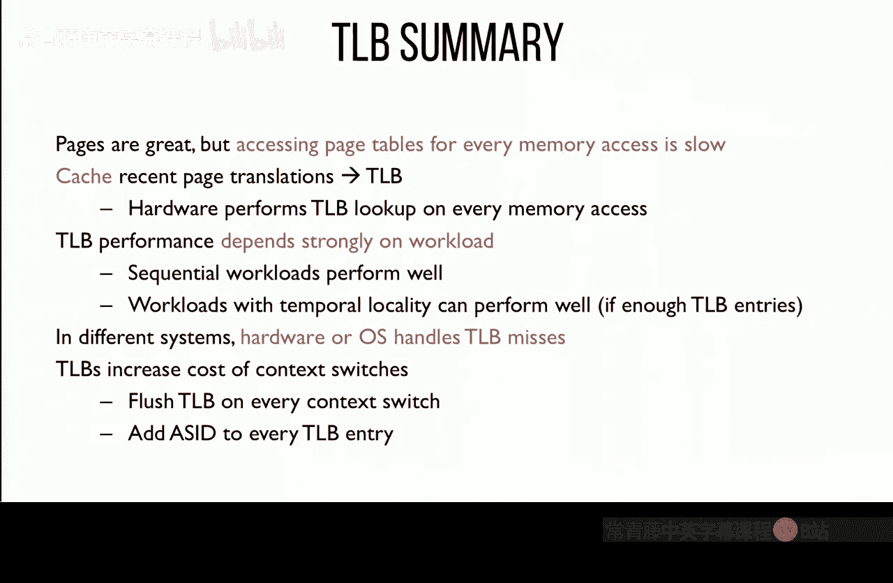

Alright， so we're talking about the fact that there are two disadvantages with paging。

 The first is what we've solved with T LBs。 The second is that page tables are huge and we need to decrease the amount of storage that's required for page tables。

 So let us now get into some new content。Alright， so these are the types of。

Simple formulas you were looking at in the past。 But let's review and figure out how big the page tables are going to be for these four cases。

 And so the thing to remember again is this is what your virtual address looks like。

 I'm telling you how many bits for the total。Addres。

 the page size is going to tell you how many bits you have for an offset。

 The number of pages is telling you how many bits you have for your VPN。

 And it's how many pages you have that tells you how big your page table is going to be。

 So please spend a couple of minutes and work through these with your neighbor and make sure that these are all straightforward computations for you。

All right。So let's go over this。 So I know this one's pretty straightforward。

 but we're going to be doing similar calculations that are going to get a little bit more involved with this。

 So make sure that you understand this first step。 Okay。

 so if each page table entry is 2 B and we're told that we have 32 virtual page numbers。

That's how many entries we need to have。 So it must be a total of 64 B。

 because this is a ridiculous architecture that we're skiming here。 So this is a tiny page table。

 but it's just a ridiculous setup here。 So that one's not very realistic。

Page table size of two bytes， each entry sorry page table entry size is two bytes。

 if our virtual address is 24， this whole thing is 24。And we have 16 pages。

Then how many bits do we have or we just have 16 pages No， pages are 16 bys， sorry。

If pages are 16 bytes， then how many bits are being used in our offset。F right， so we have four here。

 which must mean we have 20 bits for our VPN。Which must mean that we have 2 to the 20。嗯。

Entries and each entry is two Bs， so the total size will be2 to the 21 Bs。

Or that looks like 2 MBby to me。Everybody agree？Alright， so now every entry is 4 B。

 We have 32 B virtual addresses。32 bits for that whole thing。Pages are 4K。So if pages are 4K。

 how many bits must there be in the offset 12。So how many bits are left for specifying a virtual page number。

 There's 20 bits left。 So we have two to the 20 pages that we can address uniquely。

 So there's two to the 20 entries。 Each entry is4 bytes。So that'll be 2 to the 22。For a page table。

So now let's get into 64 bit addresses，64 bits for the whole address。Each page is 4K。

 so it's the same number of bits that we must have in our offset to pick one of those bytes within the 4K。

 How many pages do we now have？52。So the size of this page table is2 to the 52。Times 4。

 So this is just a ridiculous。Gabyte size page table。 So clearly， this is not what systems do。

 Systems do not have linear page tables that are megabytes or gigabytes in size。

 So we're gonna to have to do something smarter than our linear page tables that we've been looking at so far。

Alright。

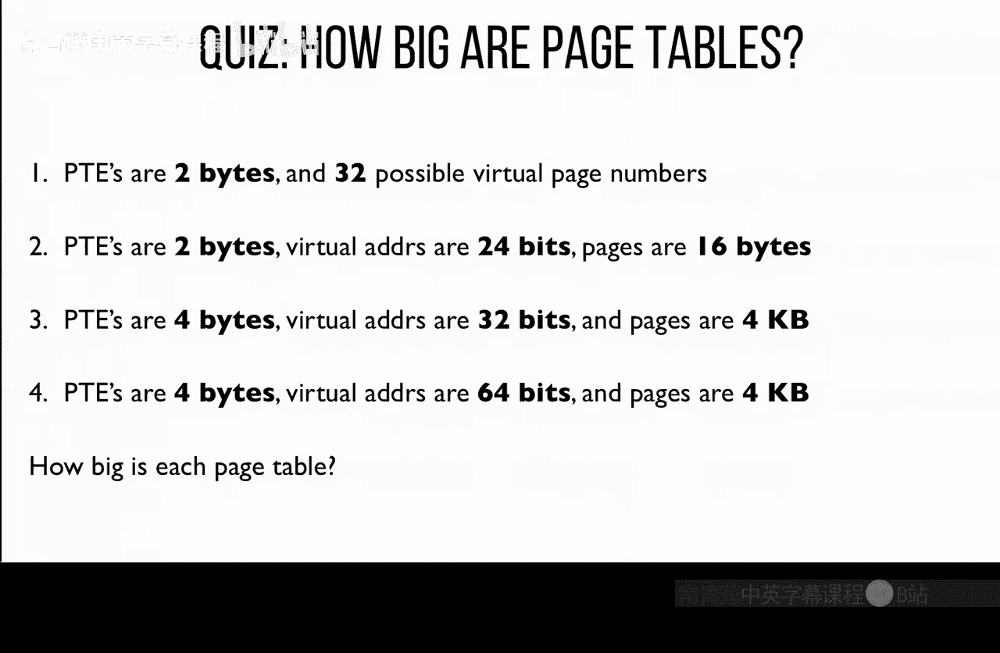

Okay。So why are page tables so large。 So it's because we're using this ridiculous data structure where we're just assuming we have a linear page table。

 But basically， it's also how we use address spaces。

 So if you look at the view that a process has of its address space what it sees in virtual memory。

 We are using a portion of the address space for its code。

 We are using the next portion for the heap。 And then were putting the stack at the other extreme of its address space and letting the two grow towards each other so that the heap and the stack would each be able to be the maximum amount。

 right So this let us make sure we could have as large as possible heap and stack when we don't know those sizes dynamically before the program starts。

 So the problem is， we have all of these pages in our virtual address space。

 And I guess it's good that we don't have to allocate any physical memory for them， right。

 They're not allocated， they're not valid， they're not being used by the program。

 So we're not allocateocating any space for them in physical memory。 the O knows that。😊。

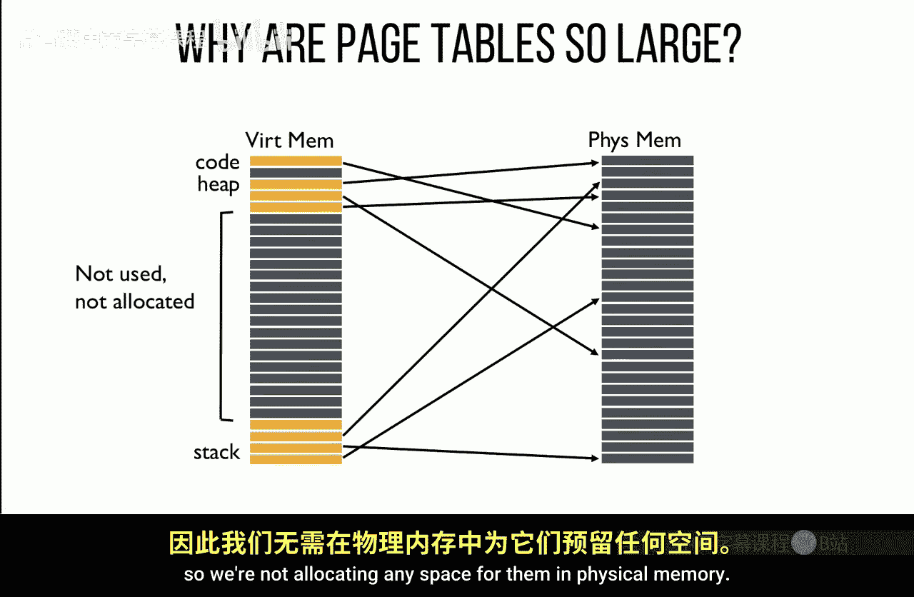

It doesn't do that。So if you look at what the page table would look like for that previous program。

 you would see that the first couple of entries are valid。

 And then the last couple of entries are valid， pointing to whatever this user had in the stack。

But we had to have invalid， empty entries in our page table for all of that stuff we weren't using just so that the address arithmetic would work correctly so that the process can access these pages down here。

Right， so we still had to allocate these addresses in our page table。

 even though they're all invalid。So we want to fix that and not use this type of data structure。

So does that problem make sense to everybody？Okay， so what we're going to do is we're going to figure out how to avoid storing those entries。

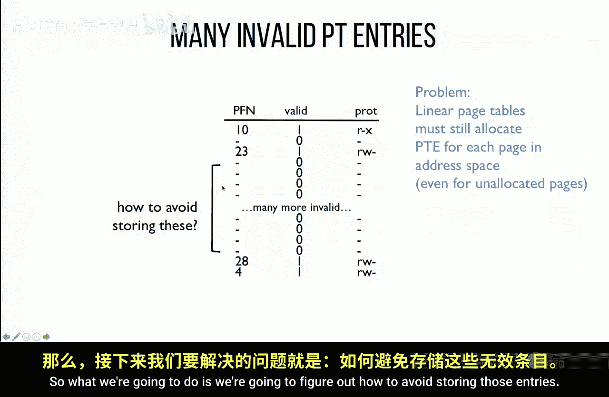

Okay。So there's going to be a couple of different approaches to how we can avoid having these linear page tables。

 Basically， we're gonna to have a range of different data structures instead of linear page tables。

 And so， of course， if we have our software managed TLB。

 the OS can use whatever data structure at once。 there's no convention that we have to have with hardware。

 So you can be as clever as you want with this。 So basically remember that the hardware is looking for the VPN in the TLB on every memory access。

 that's always still the same process。 That's the first step。 And then if we have a TLB hit。

 we're done， we don't have to access these page tables， but if we have a miss。

 then we will trap into the O and the O is going to do this work of looking up in its new data structures for this translation and loading the TLB okay。

Alright， so today we're going to look at a couple of different approaches。

 We'll look at segmented page tables。 And then the big deal of the day， the multilevel page tables。

 and then wrap up with some inverted page tables。O。

So one thing to notice is that our page table structures have contiguously allocated entries。 right。

 There's a big bunch of dead space in the middle。 And we saw this problem before for address spaces。

 So now we're seeing this problem with page tables before we saw this problem with address spaces。

 and having a a bunch of invalid things in the middle of our。

Data structure that has to be allocated contiguously。 We solved in the past with segments。 right。

 So what we're going to do now is we're going to have segments for each part of the page table。

 basically， so that we won't have to allocate these empty things here。

 We'll just say this part of the page table for this segment。

 It starts here and it ends shortly thereafter。 in this other segment。

 it starts here and it ends shortly thereafter。 And so all of our addressing will be relative to the start of that portion of the page table。

Okay。

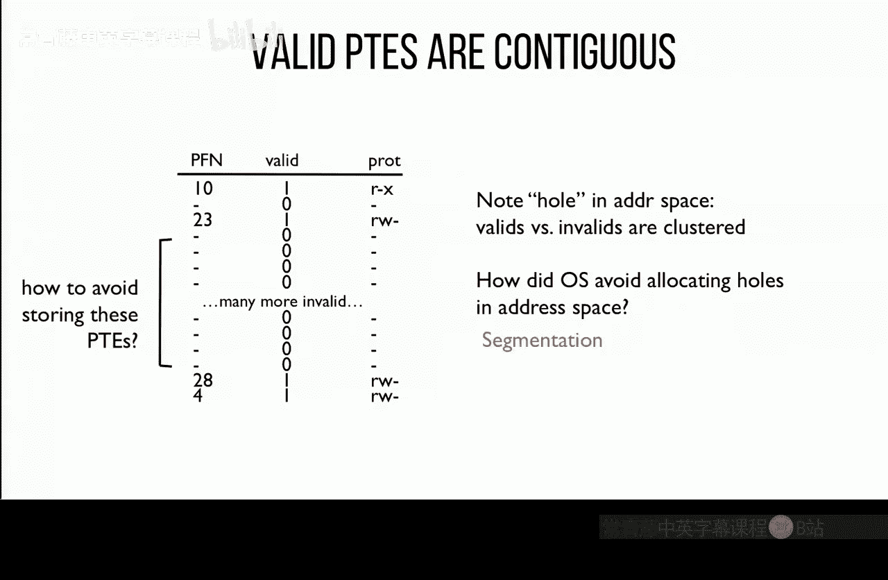

Alright， so we're still going to use virtual addresses and split up the bits in order to figure out what segment we're addressing and then what page within that segment we're addressing。

So it's still the case like before where we have segments。 Those can be variable length。

 You'll have your code segment， your heap segment， your stack segment。 that has a certain size。

 And then we're going to divide up each segment into pages。

 So we're going to get the best of both worlds here where we can still take those pages and put them any place in physical memory。

 They're all exchangeable。 We won't have any external fragmentation。 We just have internal fragments。

Okay， so that's beautiful。 And so we want to look at what our virtual address format is going to look like。

 What we're basically doing is we were taking that virtual address and we're taking the top order bits and letting that specify a segment number。

😊，And now the remaining high order bits after that are specifying our virtual page number within that segment。

And then we still have pages， so we still have an offset within that page。Okay。

 so what we're going to now have is each segment's page tables will have a base。

 and it will have a bound so that we make sure that we don't go past the end of that segment。

So let's do some examples。

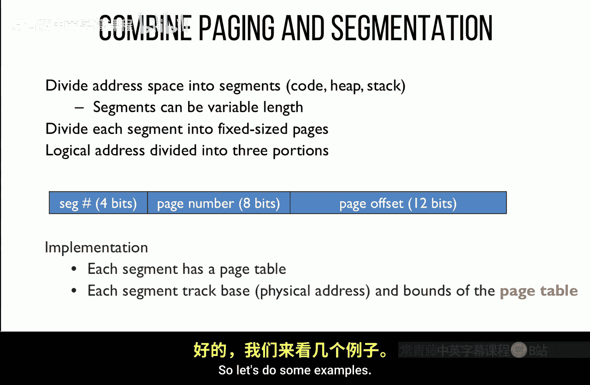

All right。So each process， again， has its own segment table。 This is different per process。

But what does the segment table now contain， It contains the base not of that where the user's process lives in physical memory。

 It's the base of the page table for this segment。 right。

 And it tells me the bounds of that page table for that segment。 And I'm kind of cheating here。

 And we'll just say bounds in this example。 It's just like the number of PTE entries that are valid for that segment。

 I'm not doing any size or something like that。 So it's just the number of entries that are valid。

Okay， so I'm telling you a nice format for addresses。We're using our classic 12 Bs for an offset。

 which means 4K pages。 How many bits do we have for a VPN， It's 8 B。

That's also an easy number to deal with， since it's two hecx digits。

 And then we have a segment number， which is four bits。

And that's also easy because it's just one hex digits。

 So you can look at these addresses I've given you。

 And it's really easy to pull off which parts are for the segment and which parts are for the VPN and which are for the offset。

Okay， so when you look at this address here。You should be able to split this up。

 We have a 0 as the segment number。 We have 0，2 as the VPN， and then we have 0，7，0。

As are offset within that page。 So what that means is， os， you got to。You got to take。

 this is segment number 0。 So I go into the segment table。

 I see that the base of its page table lives at this memory location， which is starting over here。

And we need to look for page 2。 That's what the second two hex digits are telling me。

 So this is the0th。 This is the first。 This is the second page。you know， page table entry。

 This is telling me the physical page number。 right That's what I got from doing that work。

 I found out the physical page number， just like before what wasn't page tables。

 It's telling me the physical page number for that page that I've been doing this translation。

 So therefore， it's physical page number 4。That's where I'm getting this physical page number four here。

So our physical address， physical memory doesn't have to have the same number of bits as virtual memory or your virtual address spaces。

 but they will always have the same number of bits for the offset。

 but you could have a different number of pages in the two spaces。

But what we learned from this is that the physical page number is 4。 and of course。

 the offset remains 0，7，0。Okay。So。The only way to figure out if you know this is for you to do it。

 So I will let you all spend a minute and do example 2。 And then we we'll make sure we all got that。

So' just do the next example。All right， so did you all get that。

 I hope let us look into why that is the right answer。So segment number is two。

 so I use the segment table to find out where the base of the page table is for segment2。

 it lives at physical memory address 001， that's where this page table lives in physical memory and then we are told we need the second012 tooth entry in that page table so it is 012 this is the physical page number where 202 lives。

 that's where that lives in physical memory so we just take that page number and then concatenate that with the offset within that page。

So that is how we're going to combine segmentation and paging。All right。What about the next one。

Can you get this one quickly or are you going to get tricked and spend more time than you need to figuring this one out。

So one quick thing to always do is check if this thing is valid and what the permission bits are。

 so this poor user they're trying to read from segment one。

 they do not have read permission to that so you don't have to do any more translations after that。

 they don't have permission segmentation fault okay next one。They're doing a right to segment zero。

Can you discard this one quickly or are you going to get sucked into a rat hole of doing address translations？

Always check first。 We're saying， do a right to this one。

 You do not have right permission to segment 0。 So another segmentation fault。Okay， next time。

 segment two， you're doing a right。 you do have right permission。

How long do you have to look at this one before you decide you shouldn't do a whole lot of work with it。

So we are looking for page number 1，0 in Hx，1，0 in hex is larger than F。

 So we're going past our bounds。 And I said， just assume bounds is specified in terms of the number of entries。

 So10 is past the bounds for that particular one。 So that is not valid either。

 that segment is not that large。 You're trying to access a page that's past the end of this segment。

 So therefore， error。And then this one is not going to be an error。

 So I will let you spend another minutes figuring this one out。All right。

 so I hope this is what everybody got。Segment 2， it's all valid。

 the base of the page table for segment2 lives at this physical address， we're looking for entry 3。

0123， it's 2A is the physical page number where this page lives in physical memory。

 so I take 2A and concatenate with that the offset within that page， so 2A568。All right。

Congratulations everybody。Any questions about this。Yeah。Oh great。

 so it's going to be per process and it's not going to。

I'm sure different people have done different things here， but you need this to be fast。

 this should be in registers， it's a small amount of information。

 there's a small number of segments that you have per process。

 so it should all be in registers as opposed to。Random memory。All right。Okay。

 so that's all in hardware， obviously when you do a context switch。

 you're going to need to change this segment table to be accurate for the current funding process。

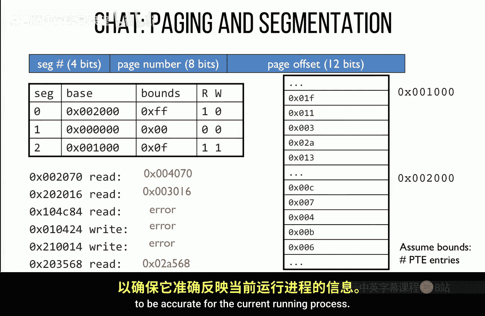

Okay， so this is pretty good combining segmentation and paging。

 but it's not going to fix all of our problems。 So it is going to let us support these sparse address spaces and by sparse address space。

 that means there's a lot of holes。 There's a lot of free space in them。 They're not compact。

 they're not contiguous that we have sparse address spaces when we have a heap on one side and a stack on the other and all that dead space in between。

 So having segments is really great because now we don't have to allocate space for the page table entries that correspond to all of those addresses in the middle of our address space。

😊，And it lets us have all the advantages of paging。 We don't have any external fragmentation。

 We can just allocate any page we want。 They're all equivalent。 And as we'll see in our next lecture。

 this is going to let us run processes even when we don't have enough physical memory for all of the address spaces of all of the processes that want to run。

 We're able to swap out some of the pages to disk instead of having to be in physical memory。

And then something I'll take a brief detour for is that it's going to allow us to have sharing at both the segment level and the paging level。

 so I wanted you to think for a minute， what does it mean for two processes to be sharing the same memory segment？

We want it to be the case that that memory segment might even be mapped into different locations in each of their virtual address spaces。

 but they need to be accessing the same values for those variables。

 the same values in physical memory。 So basically， we're going to map their address spaces to share the same physical pages at some point。

 So we can do this at both the。

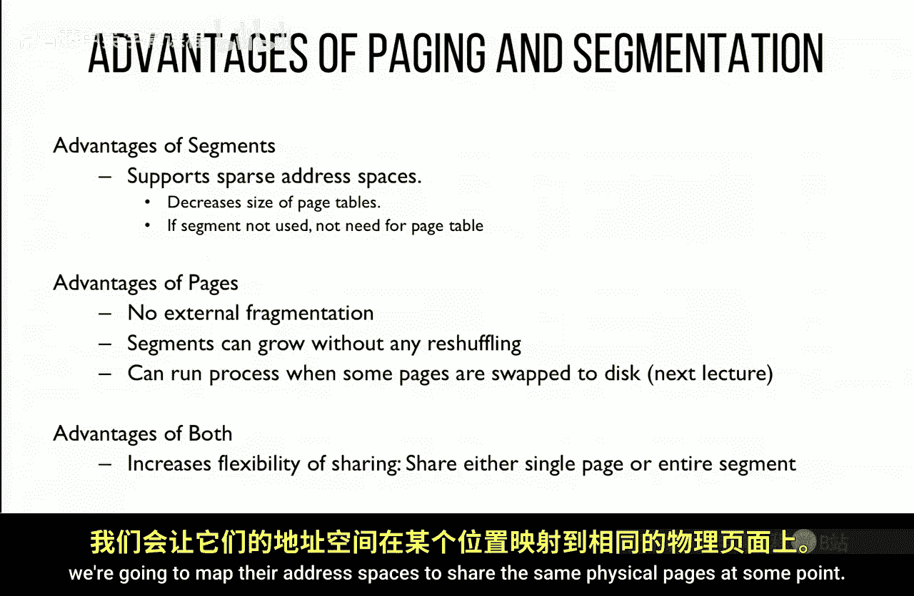

Segment level and the page level。 So why was I showing this particular example。

So the point here is you're going to see this is how you could set up some a shared memory segment between two processes。

 So each of them will see the same physical memory。

 but they might have different addresses to get there。 So in one process， P1。

 we're going to map the shared memory segment into segment 8。

 because I'm using the same format as always， that's telling us this is segment 8。

And you'll notice that segment8 for process one， its page table starts at physical address2 and whereas in nine I've made that shared memory segment be mapped to segment 9 for it and it's also pointing to the same base for that page table so what that means is now when each of them does their accesses to page two within that segment they're going to end up going to012。

 they'll each see that that's at physical page four right did I do that right？

So both of those virtual addresses in these different processes will actually be mapped to the same physical address。

 so when they do their loads in stores， they'll end up getting the same data that the other one sees there as well。

 So that's pretty neat how you can have processes share portions of their address space without having to share their whole address space。

So that's pretty awesome。I don't have any animation there。 The last one just shows。

 I wanted to show that you could also have sharing just at the page level。 So in this example。

 we're looking at segment A。That has a certain base of three page zero there and just notice that that's also mapped to the same physical page as some other page in a different segment。

 so it is possible that you could have two processes with different virtual page numbers that end up mapping to the same physical page and then they'd be end up seeing the same data at that address。

So you can have sharing at these other levels。 But I think conceptually。

 it makes the most sense to think of it as you have sharing of segments。

 That's the shared memory segments and whatever you have there is also。

Being shared with another process。

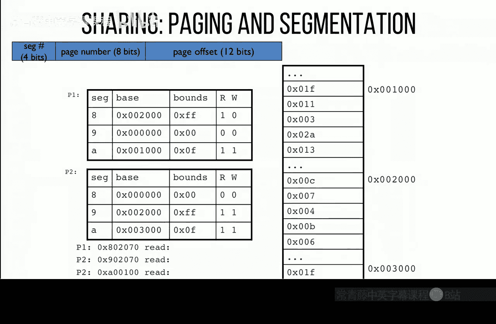

All right。Okay。But this isn't solving every problem。

 So our problem is that we still have these really large page tables。

We were looking at how large those page tables could be。 they're just a problem。

 So if you really do have a large heap。 If you really have allocated all the space on your heap。

 you still have to allocate all the space for that page table。

 Our previous approach of segmentation and paging， it was only really a win when we had a sparse address space。

 and we weren't using a lot of it and a lot of it was unallocated。

 If we really are using a lot of our heap。 our page table is still going to be huge。 So， for example。

 if we have a 2 B segment，18 B for the page number，16 B for the offset。

And I tell you that each entry takes up 4 B。 You can figure out how many pages we have 2 to the 18 within this segment。

 that this segment has that many pages。 It's still a1 MB page table if we really are using up that whole heap。

 So we do not want to have a 1 MB page table。And just allocate that in physical memory。

 because then we have to find one meby that's free。 And it's hard to do that contiguously。

So we want to page the page tables so that we chop this 1 MB up into 4 k chunks。

 And then those 4 k chunks can be placed wherever we want， just like every other page can。Okay。So。

We are going to get into how to do this。 So our goal here is we're going to chop up page tables into page sized units so that we don't have to allocate that whole page table contiguously。

And so what this is going to mean is we're going to have a multi levell page table where the outer level points to the page table for the next level。

And then we don't have to allocate page tables。If we were not allocating the pages that need those translations。

 So that's pretty nice。And this is what is used in modern architectures， multilevel page tables。

 again， this means if the hardware is interpreting this， that this is a convention。

 that the hardware knows exactly how we're structuring these page tables。

 our address format is well defined。 everybody knows how big the pages and what each of the different levels are。

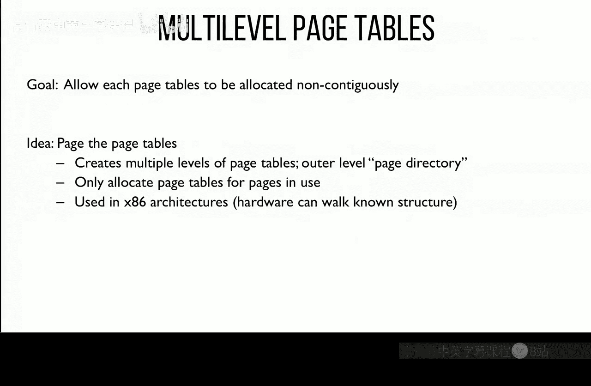

So I am going to give you a couple minute break before you have to get into this one， right。

So maybe talk about traveling and vacation。 What's the coolest。

 most awesome place you've ever been to。😊，All right。Okay， everybody。O。嗯。

So let us understand how we can page the page tables so we're going to have this very stylized form for our format of our addresses it's still going to be the case that the low order bits are picking an offset within our page the high order bits are now specifying an outer page what this really means is that。

This is pointing to another level of page tables。 So for each process。

 each process is going to have its own page directory。

 and that's just what we're calling the page tables for the page tables。

 So each process will know the base of its page directory and then the outer bits are picking an entry within that。

 So if we have eight bits for our outer page， it must be the case that we have two to the eighth entries in this top level directory。

Then from this we got the base of our next page table and then this is the offset within that page table。

 so certainly other entries were pointing to other page tables and those bits would have been picking offsets within other page tables this inner page is picking the offset within the page table that we're pointing to since we had those outer bits and then at this point we're going to be knowing what the final physical page number is and we concatenate that again with the page offset so at this point we're getting the physical page number where that virtual page with all of those 18 bits has been allocated in physical memory。

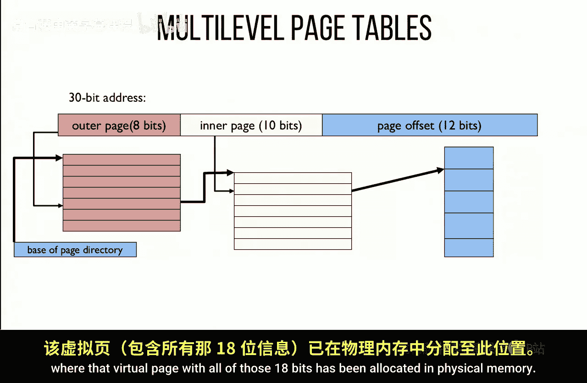

So examples， of course。Okay， so I'm making this a lot easier by only showing things that are valid。

 All right， so I will tell you where the page directory lives。

And I will then tell you where certain page tables live that correspond to that。

So this is physical page number three that's page tables so if you ever get to here then this is the page table that you'll look at this is the page table that we get to that lives at physical page number 92 that we got to from over there okay so what we need to do now is translate this virtual address and I'm assuming four bits for the outer page four bits for the inner page 12 bits for the page offset what are we going to do so we look at the top four order bits which is the first hex digit it's zero so with the zeroth entry in our page table。

Set up very nicely you can tell you're not making mistakes here the page table for the outer page zero lives at physical page three in physical memory I've told you with the second column second table what its contents are and now we're told you need to look at the first page within that page table so that will give us the physical page number of 23 double check that it's valid it looks good so we'll translate01 into23。

See if that's what I have here， it is indeed same offset within that page。And so again。

 notice that if we have invalid entries in our page directory。

 that means we don't even need to allocate the page tables that correspond to all of those entries。

 Those pages aren't valid。 We don't even need to have page tables for them。

 So that's where we're doing this big savings。 And the other really nice thing is that we're going to construct this portion of the page table to exactly fit within a page so that we can move them around interchangeably。

Okay， so let me give you another example for you to get to do。Two address translations。

Have a go at it and we will be convened。All right。So this example was set up to leave you to the right answers right so the outer bits will tell us which outer page table we need to be looking at from the page directory so there's only one page directory in this example but really every process has its own page directory we would need to know where the base is for a currently running one but we are looking for。

The zeroth entry， so we get that its page table lives in physical page number three。

 I told you that that's what's here， we're going to get the fourth entry01，2 three，4。

Zero4 virtual page number corresponds to physical page number 80。

 so then we just concatenate our offset there， so it should be physical page 80 with that offset。

Any questions about that？So then the next one， again， set up nicely， we're looking at outer page F。

That is the only one that's shown there， the page table for that outer page lives at physical address 92 or the one that corresponds to physical page 92 that's the only one I'm showing you here。

 you need to get the E entry from that if you count all of that that should be the E entry。

And so that lives at physical page 5580。Any questions about that， yes。Well。

 I meant to count correctly。 So on this outer one or this one。

So it should be if I could see my highlighter， it would be easier zero1，2，3，4，5，6，7，8，9， 10，11， 12。

 13， 14。 Yeah， imagine there's some zeros in there。😊，Yeah， I didn't mean to like oh。

 let's trick you here。All right。I only see 14。All right， so other than that。

Any other things people see or don't understand？

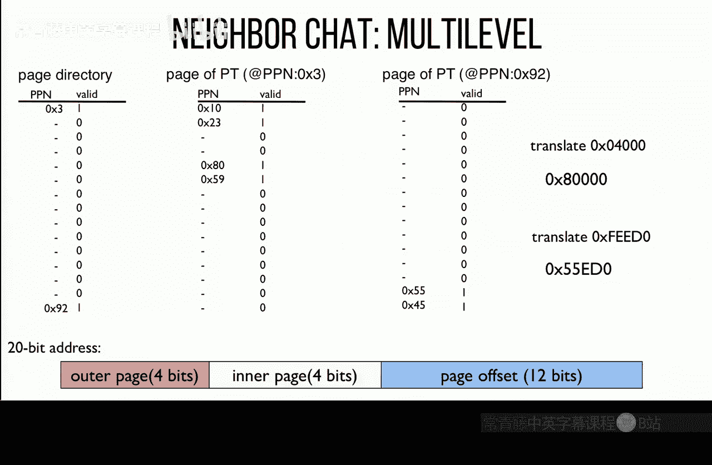

Okay。So this example was set up to be really straightforward。

 I'm going to have a lovely homework for you all to do that will actually stress your abilities。

 I assure you。 So this example， it's not available yet， it should be。In a couple of days or today。

 so you're gonna to be doing multilevel page translations， but the bits are not going to be so nice。

 So it's going to be the case that I think pages are 10 bits so that means you can't just look at the hex digits to see exactly what virtual page number you're looking at。

 you have to write out the bits and transform them and see really how many bits are going to the page number versus the offset。

 So that's one complication， the other complication it's just going to show a dump of physical memory with no hints about which ones seem to be page tables or which ones are really valid And so if you start going down the wrong path you will just happily keep going down the wrong path because we filled in everything for you。

 So this will really， really stress that you understand how to do these translations with two levels。

 So it's just two levels at least in that homework。

But you'll see more of that when you do that homework，Now。

 it turns out real systems do not just have two levels of page tables。

 So as your address space gets larger， we're going to run into the problem where maybe that inner level page table isn't fitting in a page anymore。

 So well， so the key is we need to make it so that each page table will fit within a page。

 So how are we going to do that。So it really depends upon what your address structure looks like。

 so let's assume we have a 30 bit address， 12 bit page offset or 4 kilobyte pages。

 how should we structure this so that the page tables that we're indexing with these bits。

 the inner page bits that that page table will fit within a page。

So there's some calculations we can do to figure out how many bits should be devoted to the inner page。

 assuming a 4 kB page。So again， our goal is that each of those inner page tables has to fit within a page。

 they have to fill up four kilobytes if I tell you how big each of those page table entries is。

 then you can figure out how many page table entries there must be so we'll do our usual assume that each page table entry takes up 4 bytes and then if each page is 4 kilobytes and each of them entries is taking up four bytes it must mean that we can have1000 entries on that inner page table right 1000 times  four is 4K。

So that's how many entries we can fit here。And so what does that tell us about our address format？

If this is picking。1000 entries， then it must mean that we have 10 Bs there， right。

 since 2 to the 10 is 1024。 So in our address format， we will devote 10 Bs to the inner page。

 And then since I told you how large the whole address is， you can figure out how many bits are。

 obviously， in the outer page。 So 30-10 and 12 gives us 8 B。

 So this would be a reasonable address format。 if you had a 30 B address。

So does the motivation for that make sense to everybody that we need to make those inner page tables fit within a page。

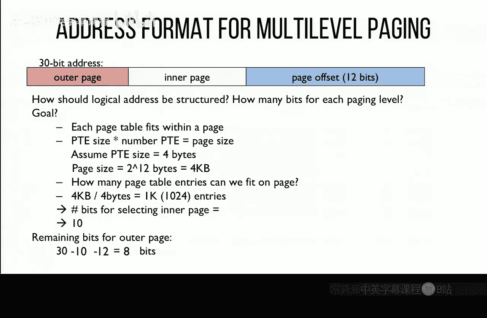

O。Now， the problem is， we don't have 30 B addresses these days。

 We might have a machine with 64 B addresses。 So what are you going to do there。

 We are not just going to have two levels of page tables。 We will probably have three levels。

So let's assume we have our 64 bit address。We are going to end up recursively applying that math to multiple levels of page tables。

And so let's just first figure out how large of a virtual address space we can support。

 assuming  four kilobyte pages and4 byte entries。So if we only had one level page table。

Then that would mean that we could only fit 1000 entries there，1000 pages。So we can fit basically 1。

000 entries on every level。So here how large is our address space。 we could have 1000 pages。

 Each of them is 4， so we could have a 4 MB address space with just one level。

 As you add on more levels that lets us have more page tables。But we were able to go through。

 so we were able to get basically in this tree， this hierarchy of page tables。

 you get  a thousand more for everyone that you had in the past。So with three levels。

 you're going to be able to support this size of address space for terabytes。

 that's plenty for what we can imagine doing these days。

 and so threeleve page table certainly maps what users are going to expect these days。

 whereas a four gigabyte address space， maybe you have an application that wants more than that。

 So we are going to need three levels of page tables。

Because you really would not be able to support a user process that wanted to have a larger address space than four gigabytes if you only have two levels of page tables。

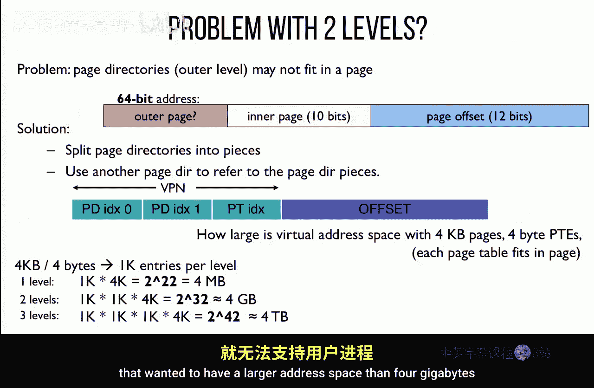

Okay， so I。was really assuming there was going to be some more math in here。Yeah。

Maybe that's after this。 Maybe I've removed that slide。 Okay。

 so I would have liked to have done a calculation where we figure out how many。

Bits we're going to use for each level， but I assume don't remove that。 So anyways。

 so I want to remind you that we are using TLBs with these multiple levels of page tables So we're first going to go to the TLB And if our virtual page number。

 which is all of those inner and outer bits for all of those different levels。

 that's what we're still using for our tag into the TLB。

 So if that's in there we get to shortcut doing all of these lookups through all of the page tables because as we add more page tables。

 that's just more memory references right with a two level page table that means two extra memory references just to do what the user wanted just to do one page translation。

😊，O。So again， TLBs become more and more useful， the more levels of page tables we have so here let's assume we have a three levell page table。

 let's assume we have these tiny pages for our example because we're only to have a 16 bit address and then let's assume that the currently running process has an address space identifier of 211。

So let us figure out how many physical accesses to memory are you actually going to need to do for each instruction。

And we'll assume that the TLB doesn't change contents as we go。 We have enough space。

 We can just we'll have more entries there。 So this instruction， for example， we need to fetch it。

 It lives at virtual address AA1，0， and that instruction is trying to do a move or a load from that memory address of 11。

11 into a register。So we want to do some of the lookups to see do these pages seem to live？

Are there translations in the TLB right now？So it's useful to look at what our format is for addresses。

So I said。This one's set up to be nice。If we have。256 byte pages。That's two to the eighth， right。

 so this is eight bits。So this is going to be two hex digits。For our page offset。

I told you the total thing is 16。And what other stuff did I tell you？Three level page table， well。

 that doesn't really matter for this example， because what matters is that it's telling us that our virtual page number。

Is the other eight bits？And that is what we're looking for in the TLB right。

 it doesn't matter how that's being split across outer inner whatever page tables。

 this is the tag that we're looking for in the TLB。Okay。So when we take the address， AA10。The 1。

0 is the offset。 A A is the virtual page number。And so is A A in the， in the。TLB。No， it is not。

 So we're going to have a Tl B Miss whenever we have a Tl B miss。

 that means we have to do a bunch of lookups。 We have to go into that。

We have to do one address translation for every level。 Remember。

 when we did one level linear page tables， that meant we were incurring one extra。

Look up when we have two levels， it's going to be two memory lookups。 When we have three levels。

 it's three memory accesses just to do that page translation from A A to whatever it is。

 We don't know what it is in this example。So we have to do three address translations， address。

 you know， memory lookups， because we had a TLB miss。 And then the user。

 we get to do what they really wanted to do， which was fetch the instruction at whatever physical address that is that now we know what it is。

 So that's going to incur four memory access is just to do that one little instruction。

 That's how important TL Bs are。 We better be hitting in the TLB all the time because this is really。

 really expensive if we don't。Okay， and then we need to do the actual instruction。

 which is to do a load from page 1，1。Do we have that in the TLB？Doesn't look like it。

 We're not doing very well yet。 We'll have a until be missed。

 That's going be three address translations again since it's a three levell page table。

 And then we're gonna to do the memory instruction itself， which is another memory access。

 So that's 8 memory accesses in that tiny little assembly instruction there。Okay。

 so that one was horrible。 Now we are fetching another instruction that lives at B B1，3。

So is this in R TLB？So we look for BB。It is this address space identifier。 That's great。 It is valid。

 And so now I don't care what's in those multi levelsls of page tables。 I just know the answer。

 that virtual page lives at physical page 91。 I'm very， very happy。

 So now I can just fetch the instruction that lives at 91，1，3。😊，I find out that it's an ad。

 and then I can do that ad。 So this instruction that hit in the T LB。

 It only involves one memory access， which was to do the actual instruction fetch from the physical address that we were able to figure out。

So does that make sense to everybody with the hit？Okay， all right。

 and I skipped this step before in A here where we had a miss。 we would of course。

 have loaded the TLB with the new information that we got to help us out in the future。 Okay。

 next memory fetch is to virtual page5， is that here。Something funny is looking on。

 So the acidd of 12，2 is not us。 We better not use that one。 Here's us。

 but this entry is not valid in the TLB。 Maybe it was from a previous time we were Who knows why It's not valid。

 though。 So we cannot use it。 This is a TLB miss。 We have to do the page walk involving three memory accesses。

 and then we're able to fetch the instruction that we wanted。 Now we do this move instruction。

 that's a store into FF 1，0 is FF in the TLB。It is。It's valid。

 so we know that we're going to be doing a move into physical address。This is right。0，5 is 91。 yep。

 and then。I'm suspicious， sorry。FF， great， great， great。This is what we were looking at。

 F F is physical page 23。 The offset was 10。 Offet is 10。All right。

 so that is how we will use a TLB to short circuit a lot of these page lookups and to translate virtual page numbers to physical page numbers。

Any questions about using the TLB for this example？All right。

 so it's just a lot of grungy looking at addresses for a while。

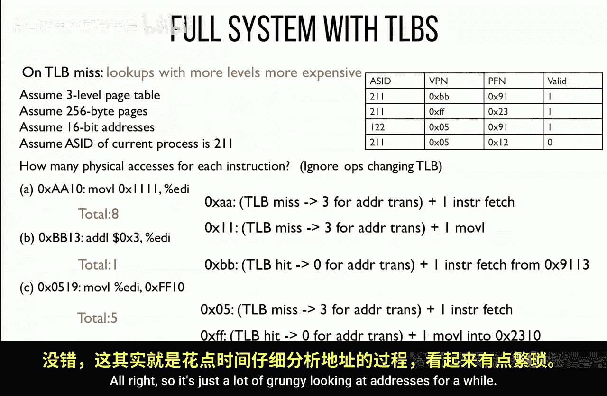

Allright， finally， something different。 Okay， inverted page tables。 So this is a new concept。

So the observation here is that we really don't need to know the address translation for pages in our virtual address space that aren't valid。

 So why are we kind of doing a data structure that's focused around virtual address。

 So what some architectures have tried to do is you have an inverted page table by inverted。

 it means you're using the physical page number to figure out things about the virtual address number Now we always have to do our lookups。

 though we have a virtual address and we need to get to a physical address。

 but we're keeping our data structure somehow proportional to the number of physical pages that we have instead。

 So you could imagine it having like some list structure where you have our tree。

 you have one entry for every physical page， you search through your list or you search through that tree and you try to find the virtual page number that you're looking for Now that's clearly ridiculously slow。

 you can't be searching through a data structure every time you need to do an address translation。

 That's not going to work。 So what systems have done then is to use。Our fine technique of hashing。

 So basically in。You just take a hash over your virtual page number and your address space identifier that gets you to a small portion of your data set。

 then you can look very quickly to see if anything that hash to that same value actually has your correct VPN and address space identifier。

 and it will tell you in that data structure where the physical frame numbers that you're looking for。

 So it's just kind of like a hash table to help you get to the translation of virtual page number to physical page number and you only have to have as many entries as you had physical pages。

 So if you can't find the look the translation in the structure。

 that means that it's not a valid translation。Yeah。Well。

 I think they make the structure to start with proportional to the amount of physical memory that they have so that everything is just proportional to the amount of physical memory。

 since that's not going to change over time。 And so sure， at first， it's going to be very sparse。

 You won't have too many virtual addresses that you're translating。

 And then it's going to fill up over time。 but。It it shouldn't be the case that your virtual address space is a lot larger than physical memory。

 but this is more done like in research systems where they're like building something。Interesting。

 they want to stress some different part of the system。

 and it's not going to support swapping and paging to disk as well as what we'll talk about in our next lecture。

All right。Okay。So， but just still remember， even when you have an inverted page table or you have other interesting data structures。

 we still always have that TLB that's happening before this。

 that it's only if we have a TLB miss that we go through these other data structures that we might be keeping。

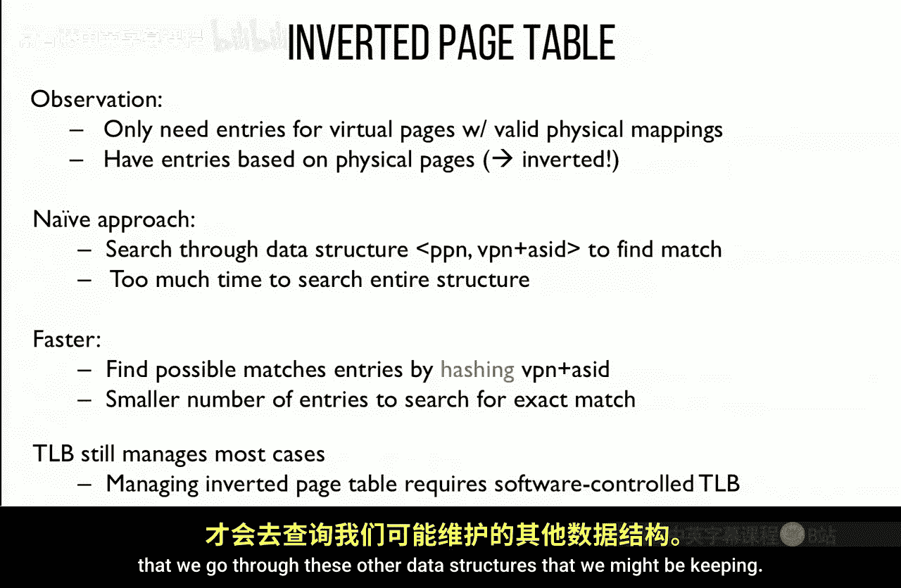

Okay， so today we've been talking about how to have better page table structures that the goal is to keep each of the page tables fitting within a page and in order to do that you really do need to look at the format of your virtual addresses to make sure that you're using the right number of bits to access into each and then now we'll have this page level directory at the start of it that's unique to every process that tells you where all of the page tables live for that process。

Okay， so next lecture， we're going to talk about what we're going to do when we don't have enough physical memory for all of the processes that are running。

 We're going to move up a little bit。 I don't think we're going to obsess so much about bits。

Ever again in this course， I think that was the most exodimmal arithmetic we will be doing。 Okay。

 so it's a little bit higher level in our next lecture。😊。

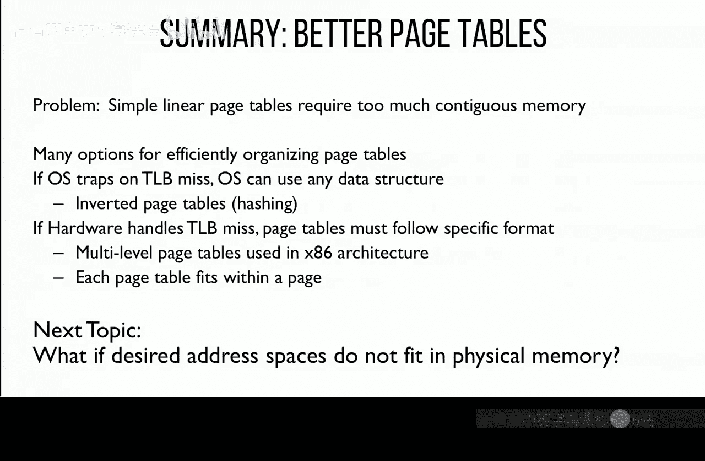