# 操作系统：第7讲：更小的页表 🗂️

在本节课中，我们将继续学习内存虚拟化，重点关注如何减小页表的大小。页表是内存管理的关键数据结构，但其本身可能占用大量内存。我们将探讨几种优化页表大小的方法，包括分段页表、多级页表和反向页表。

---

## 回顾：TLB与地址转换

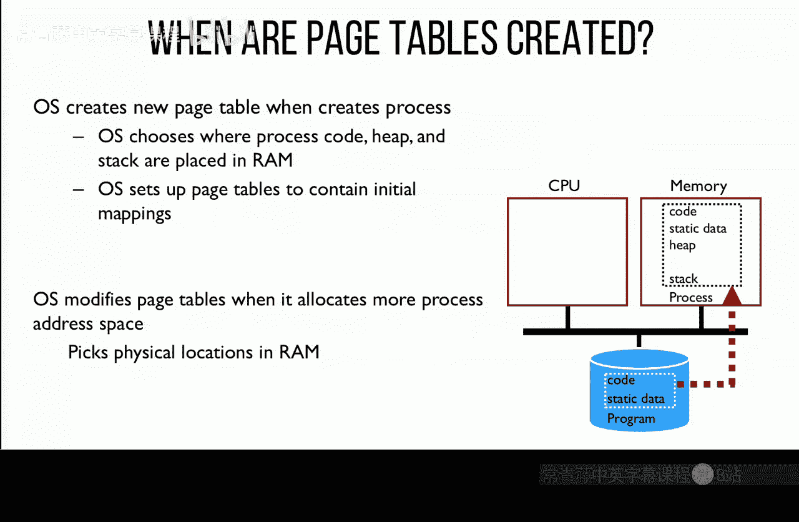

上一节我们介绍了转换后备缓冲器（TLB），它通过缓存最近使用的页表项来加速地址转换。本节中，我们来看看页表本身存在的另一个问题：它们可能非常庞大。

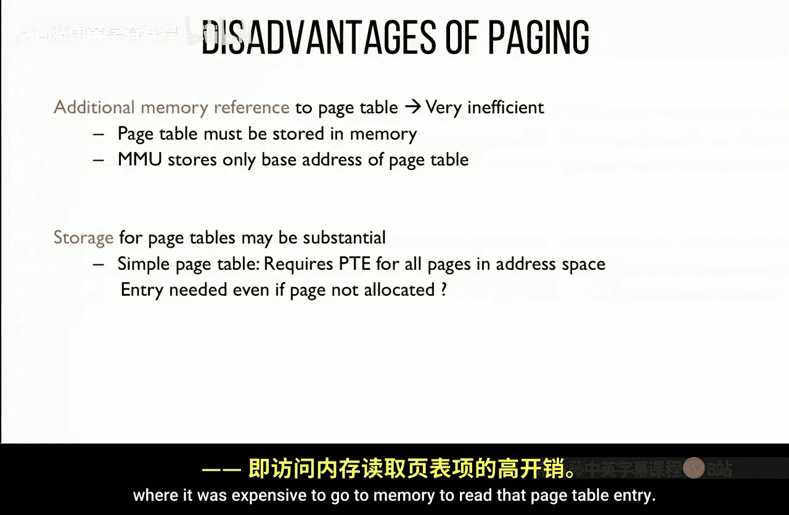

地址转换的基本步骤如下：
1.  从虚拟地址中提取虚拟页号（VPN）。
2.  使用页表基址寄存器（PTBR）和VPN计算页表项（PTE）的地址：`PTE地址 = PTBR + (VPN * PTE大小)`。
3.  从内存中读取PTE，获取物理页号（PPN）。
4.  将PPN与页内偏移量组合，形成物理地址。

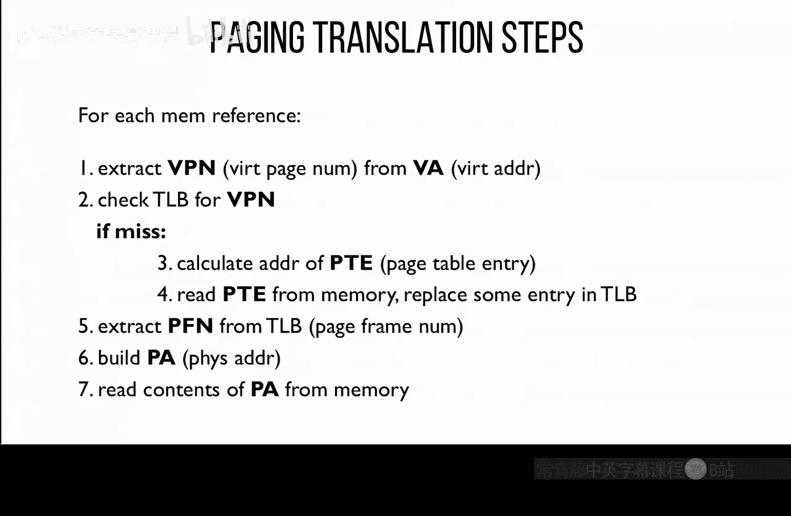

虽然TLB解决了每次转换都需要访问内存（步骤3）的性能问题，但页表本身在内存中占用大量空间的问题依然存在。

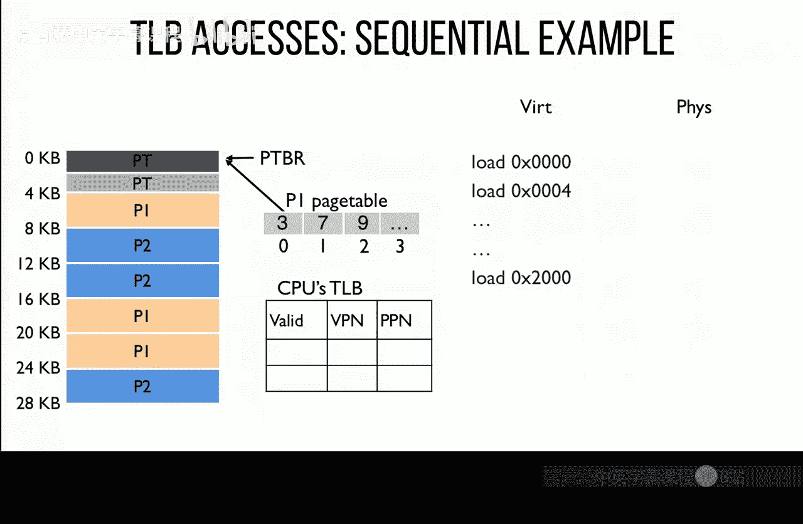

---

## 页表为何如此庞大？🤔

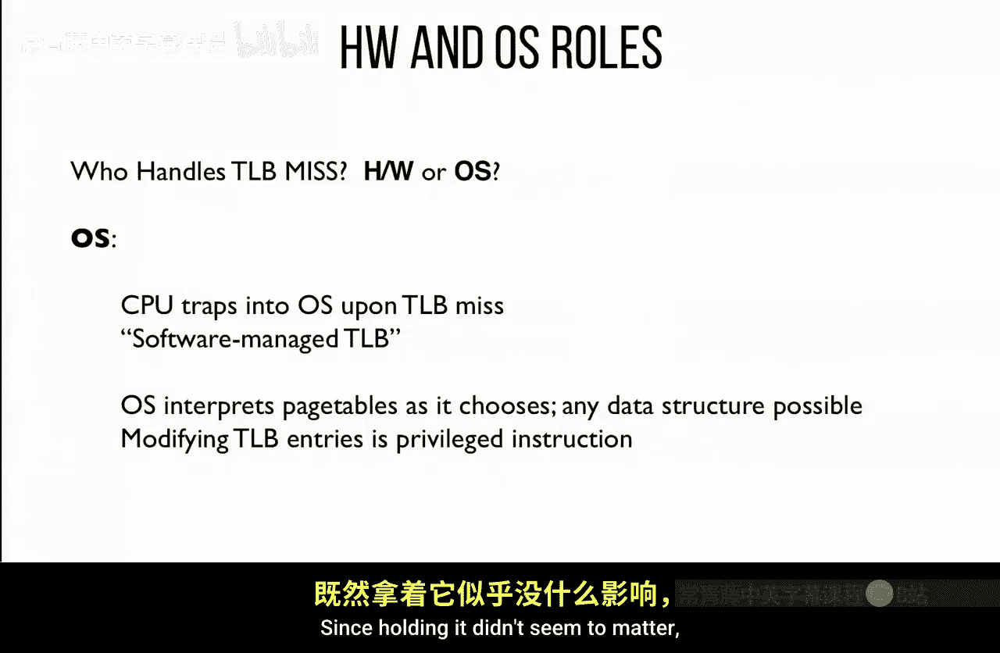

页表庞大的根本原因在于其简单的线性结构。对于一个进程，其虚拟地址空间通常包含代码段、堆和栈，它们之间可能存在大量未使用的“空洞”。然而，在简单的线性页表中，即使这些区域无效，也需要为它们预留页表项，以确保地址算术正确。这导致了内存的浪费。

我们的目标是找到一种数据结构，能够避免为这些未使用的虚拟地址空间分配页表项。

---

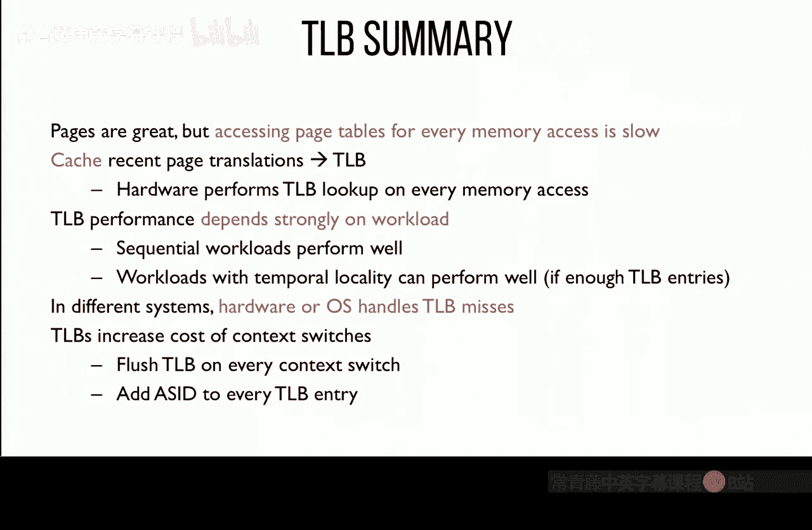

## 方法一：分段页表

解决稀疏地址空间问题的一个思路是借鉴分段的思想。我们可以为地址空间的不同部分（如代码、堆、栈）分别维护页表，而不是使用一个巨大的线性页表。

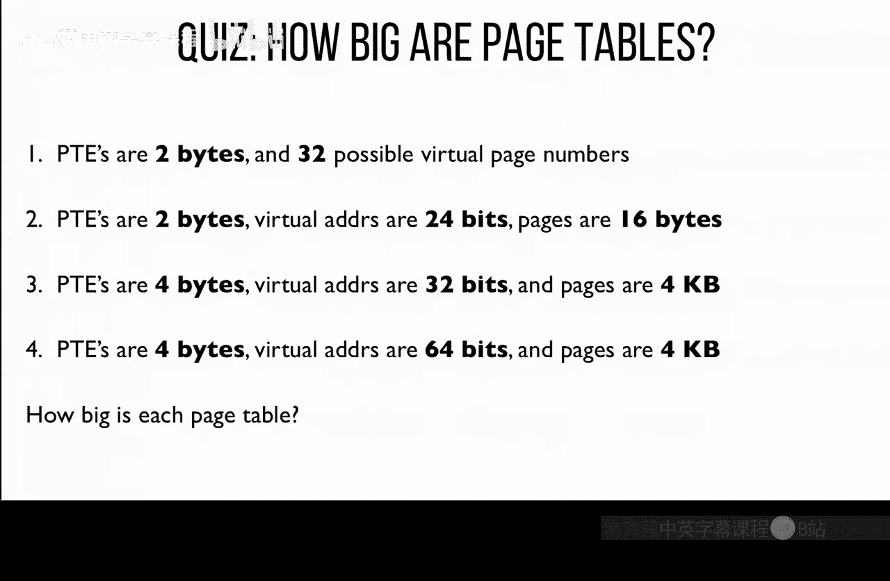

以下是其工作原理：
*   虚拟地址被划分为：段号、段内虚拟页号（VPN）和页内偏移量。
*   系统为每个进程维护一个段表。段表中的每一项包含对应段的页表基址和界限（有效页表项的数量）。
*   进行地址转换时，首先使用段号在段表中找到对应段的页表基址。然后，使用段内VPN在该页表中查找，获得物理页号（PPN）。

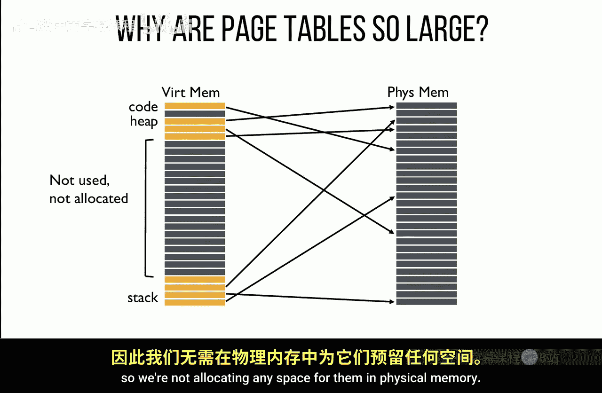

### 分段页表示例

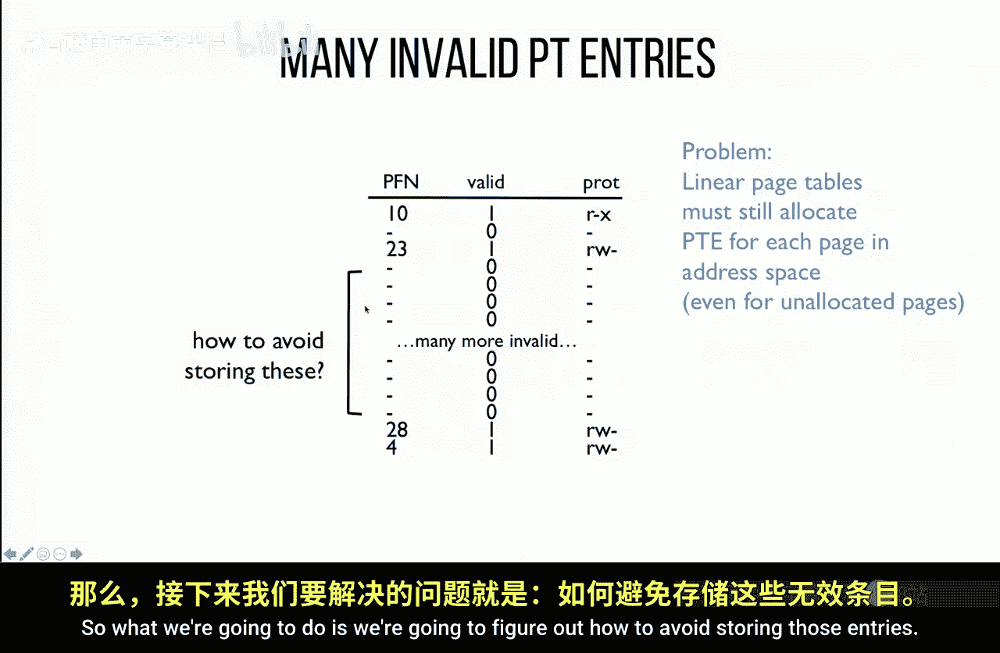

假设虚拟地址格式为：4位段号，8位VPN，12位偏移量（4KB页）。物理内存布局如下：

**段表（每个进程一个）**
| 段号 | 页表基址（物理） | 界限（项数） | 权限 |
| :--- | :--- | :--- | :--- |
| 0 | 0x200 | 0x0F | R/W |
| 1 | 0x300 | 0x0A | R |
| 2 | 0x001 | 0x10 | R/W |

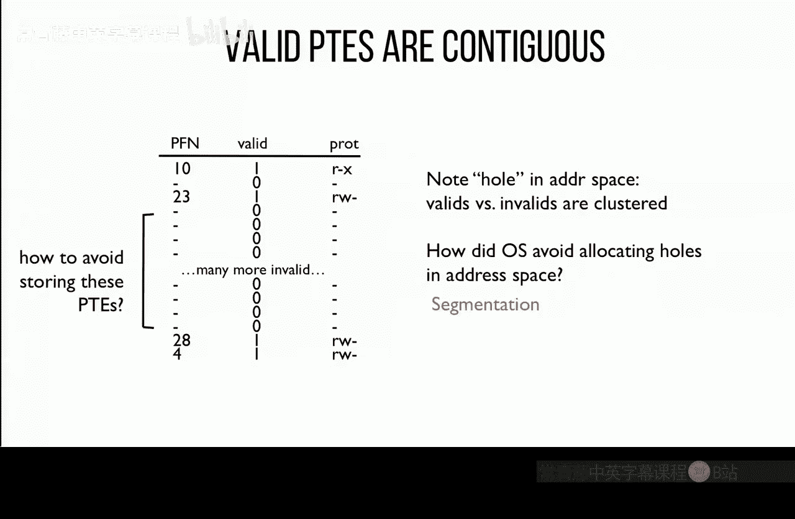

**物理地址 0x200 处的页表（对应段0）**
| VPN | PPN | 有效位 |
| :--- | :--- | :--- |
| 0x00 | 0x10 | 1 |
| 0x01 | 0x23 | 1 |
| 0x02 | 0x04 | 1 |
| ... | ... | ... |

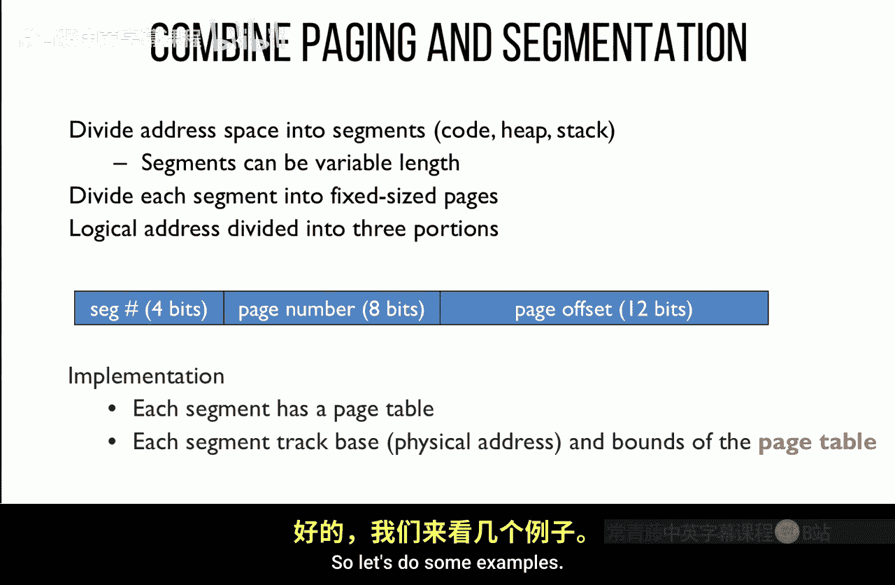

**转换虚拟地址 0x02070**
1.  拆分地址：段号=0， VPN=0x02， 偏移量=0x070。
2.  查段表：段0的页表基址为0x200，权限为R/W。
3.  查页表：在基址0x200的页表中，找到VPN 0x02对应的项，得到PPN 0x04。
4.  组合物理地址：`物理地址 = (PPN << 12) | 偏移量 = 0x04070`。

这种方法优点在于，只为实际使用的段分配页表，避免了中间“空洞”造成的浪费。同时，它保留了分页的所有优点（无外部碎片，页面可交换）。

---

## 方法二：多级页表 🌳

分段页表在地址空间非常稀疏时效果很好。但是，如果某个段（如堆）本身很大且被完全使用，其页表仍然会很大。为了解决这个问题，我们引入多级页表的核心思想：**将页表本身进行分页**。

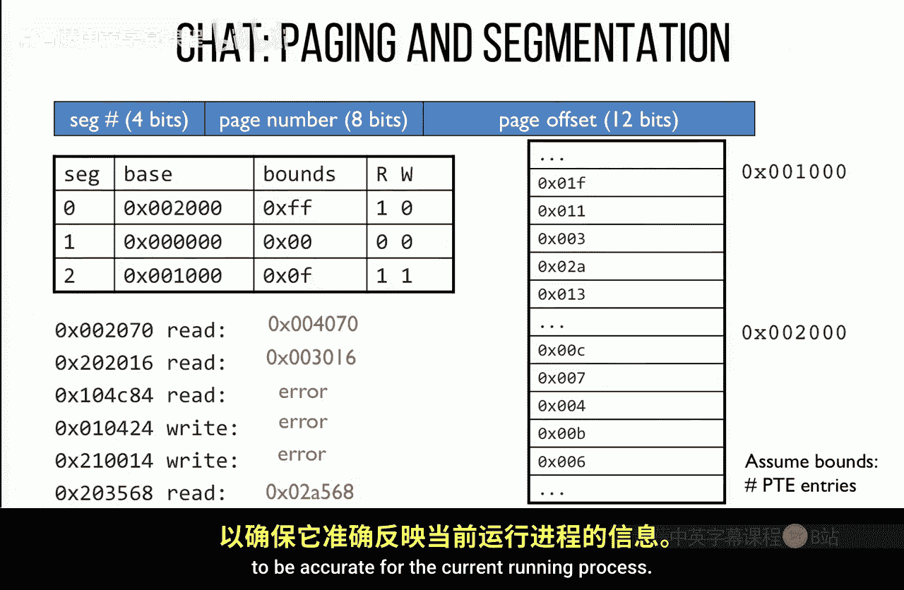

多级页表将单一大页表拆分成多个较小的页表，并将它们组织成树状结构。常用的形式是两级页表：
*   **页目录**：第一级表。每个进程有一个页目录，其每一项指向一个第二级页表。
*   **页表**：第二级表。每个第二级页表恰好占用一个物理页帧，其中包含实际的虚拟页到物理页的映射。

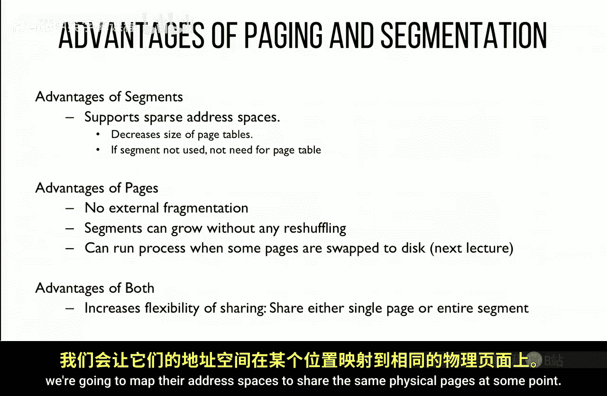

### 地址转换与多级页表

虚拟地址被重新解释为：**页目录索引（PDX）**、**页表索引（PTX）** 和**页内偏移量**。

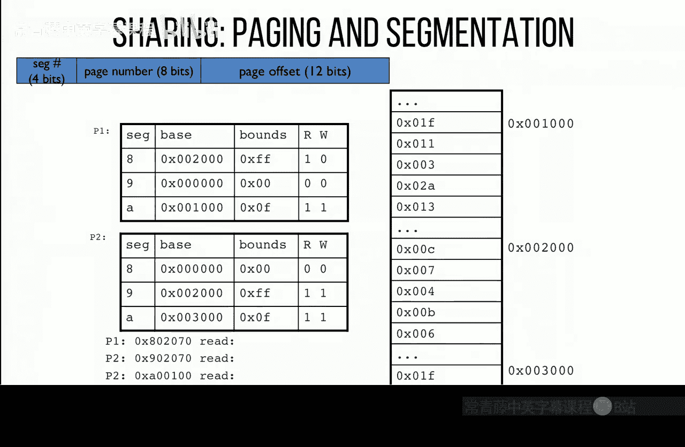

转换步骤：
1.  使用页目录基址寄存器（PDBR）和PDX，找到第二级页表的基址。
2.  使用该基址和PTX，在第二级页表中找到页表项（PTE），获得物理页号（PPN）。
3.  将PPN与偏移量组合成物理地址。

关键优势在于，如果虚拟地址空间的某个区域完全未使用，那么在页目录中对应的项可以标记为无效，从而完全不需要分配第二级页表。这极大地节省了内存。

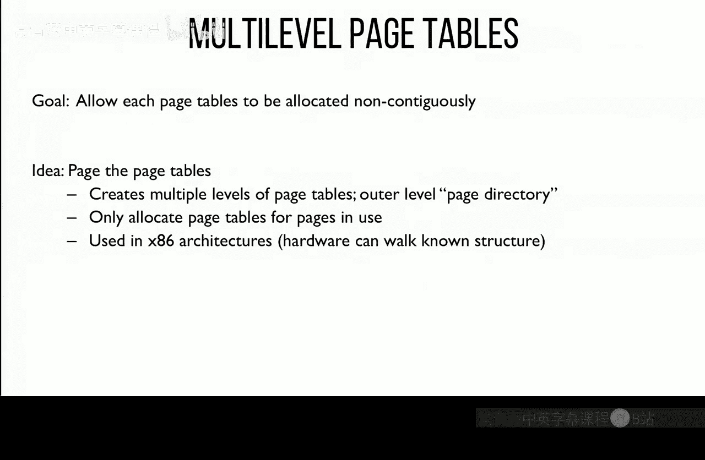

### 多级页表示例

假设虚拟地址格式：4位PDX，4位PTX，12位偏移量。已知当前进程页目录基址（PDBR）对应的物理页内容，以及相关第二级页表内容。

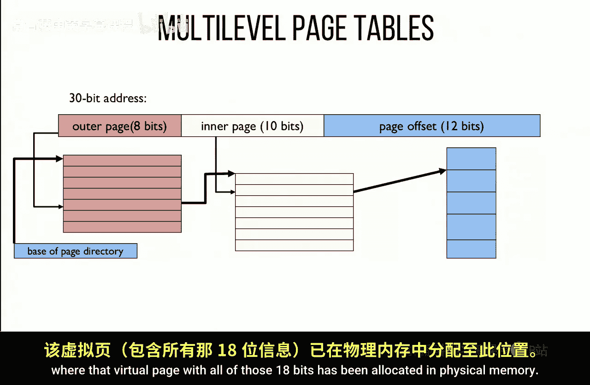

**转换虚拟地址 0x1350**
1.  拆分地址：PDX=0x1， PTX=0x3， 偏移量=0x350。
2.  查页目录：在PDBR指向的页中，找到索引0x1的项，假设它告诉我们第二级页表位于物理页0x92。
3.  查页表：在物理页0x92中，找到索引0x3的项，假设它给出PPN=0x55。
4.  组合物理地址：`物理地址 = 0x55350`。

现代系统（如64位地址空间）通常使用三级或四级页表，以确保每一级页表都能装在一个物理页内。计算每级索引位数的方法是：`索引位数 = log2(页大小 / PTE大小)`。例如，对于4KB页和8字节PTE，每级页表可有512项，因此索引需要9位。

---

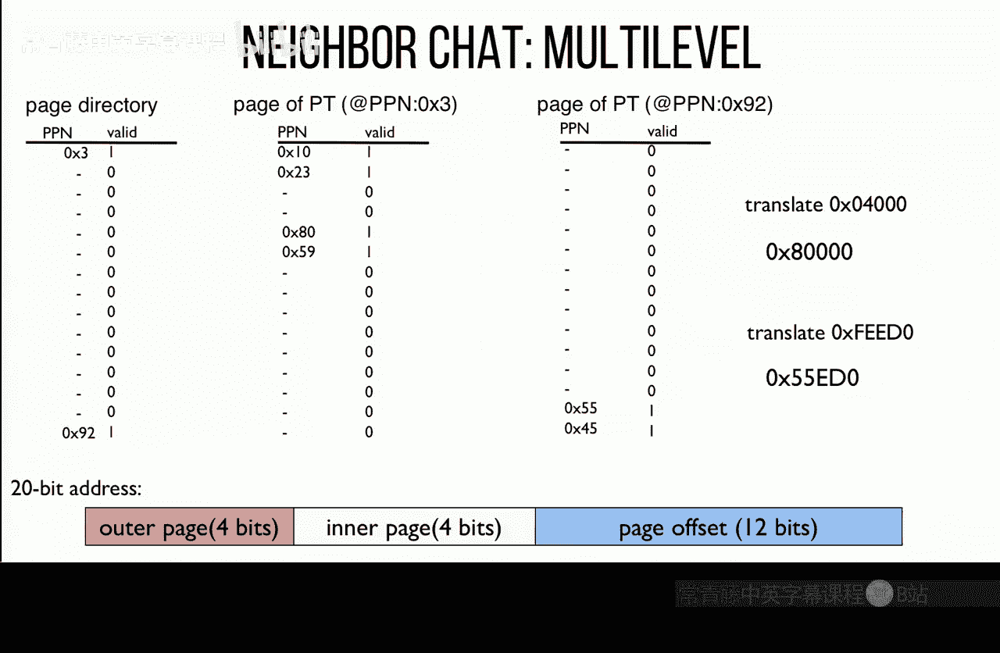

## TLB与多级页表的协同

多级页表引入了一个代价：一次地址转换可能需要进行多次内存访问（每一级一次）。这使得TLB变得更加重要。

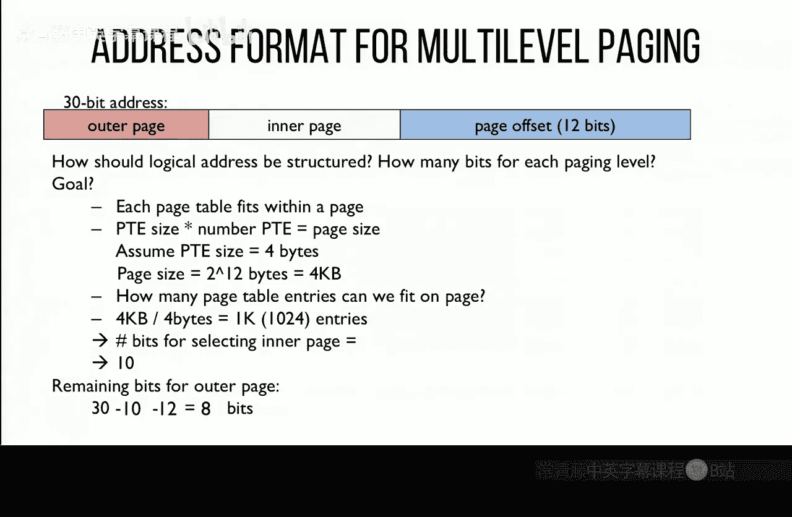

工作流程如下：
1.  首先，用完整的VPN（所有级索引位的组合）查询TLB。
2.  如果TLB命中，则直接获得PPN，无需访问任何级页表。
3.  如果TLB未命中，则必须进行“页表遍历”，依次查询每一级页表，最终找到PPN，并将其载入TLB。

因此，TLB的命中率对于系统性能至关重要，它能避免昂贵的多级页表遍历。

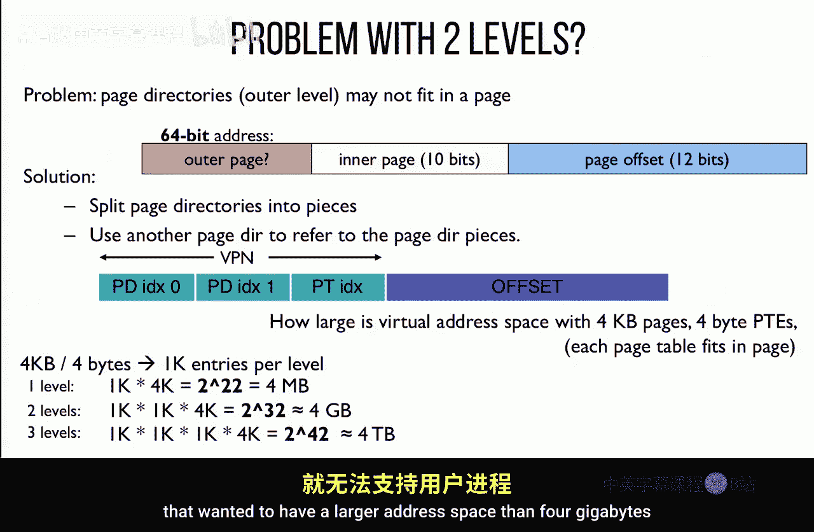

---

## 方法三：反向页表

另一种思路是改变数据结构的核心。传统页表以虚拟地址为索引，条目数与虚拟页数相关。反向页表则以物理地址为索引，条目数等于物理页帧的数量。

在反向页表中，每个条目记录占用该物理页帧的虚拟页号（VPN）和进程ID。进行地址转换时，需要根据目标VPN和进程ID，搜索反向页表以找到对应的物理页帧。显然，线性搜索效率极低。

因此，实际实现通常采用哈希表。对`(VPN, ASID)`进行哈希，得到一个索引，指向哈希桶。在桶中查找匹配的条目，即可获得物理页帧号。这种方法将页表大小与物理内存大小而非虚拟地址空间大小绑定，适用于某些特定场景。

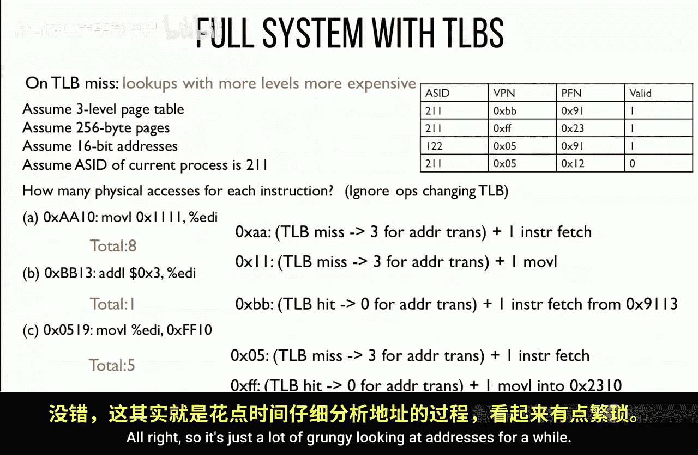

---

## 总结

本节课我们一起学习了如何设计更紧凑的页表结构。
*   我们首先分析了简单线性页表占用内存过大的问题。
*   接着，探讨了**分段页表**，它通过为地址空间的不同段分别维护页表来节省空间。
*   然后，深入讲解了**多级页表**，这是现代操作系统的通用解决方案，通过将页表分页并组织成层次结构，极大地减少了内存占用，并保持了灵活性。
*   最后，简要介绍了**反向页表**这一替代设计思路。

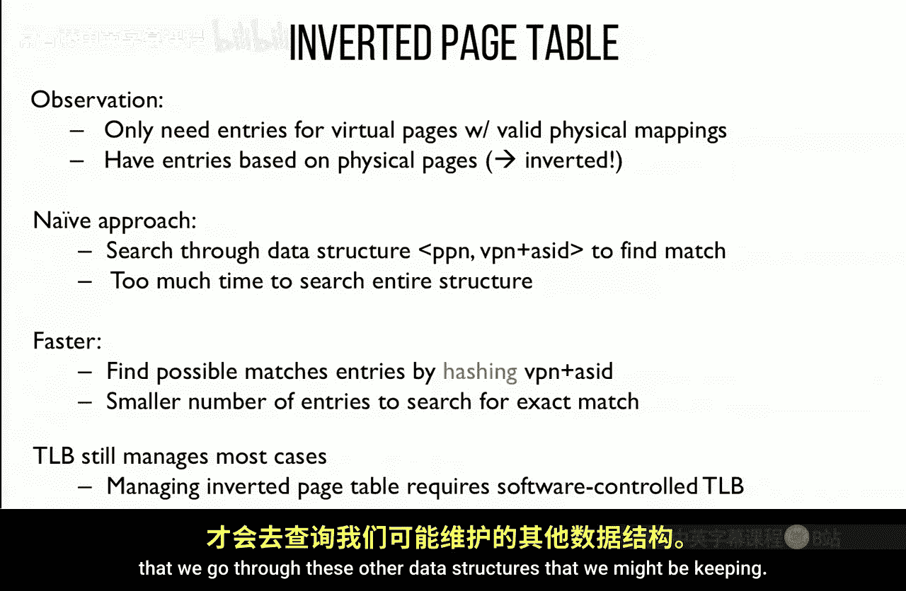

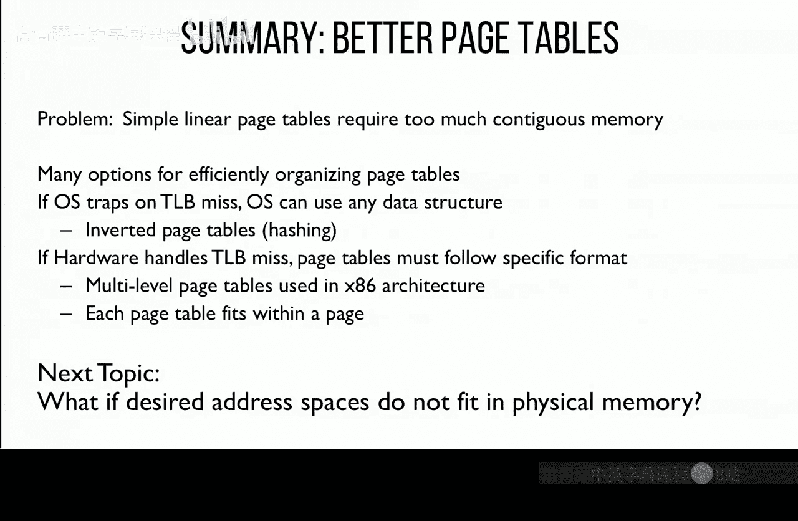

所有这些方法都与TLB协同工作，TLB负责加速频繁的地址转换，而这些页表结构则负责高效地管理映射关系。下一讲，我们将探讨当物理内存不足时，操作系统如何通过交换和分页技术来管理内存。