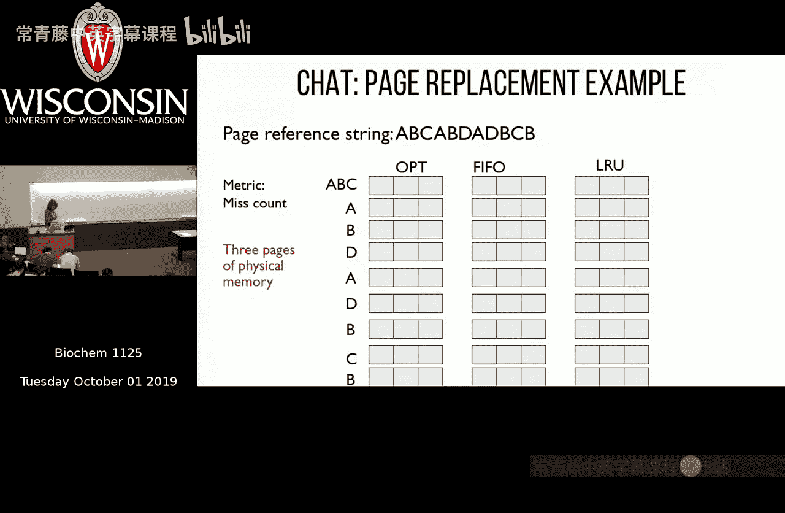
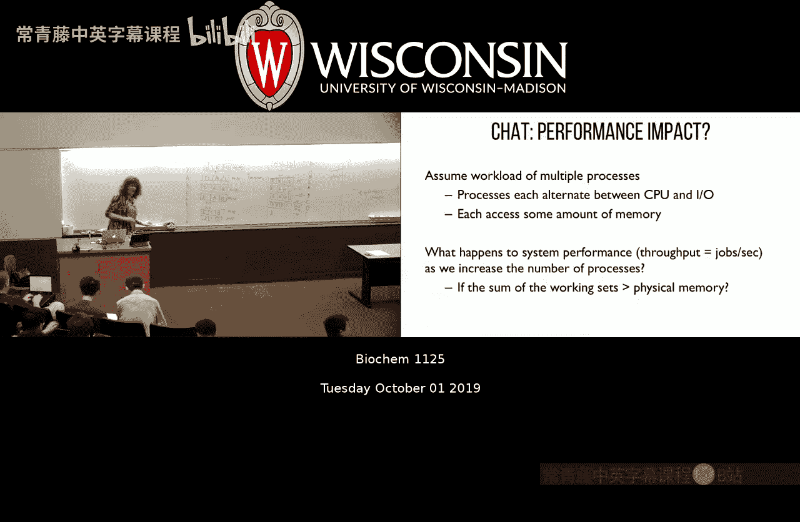

# 威斯康星大学【中英⚡操作系统｜CS 537 Fall19, Introduction to Operating Systems】 p08 P8 Memory_ Swapping _ University of Wisconsin-Madison -BV1wUzSB3Ecf_p8-

All right， good morning everyone， so I'm thrilled that you are all here this morning。

 I was quite fearing that I was going to trudge through the rain and I was going to get here and there'd be nobody here。

 but I'd still have to give the lecture and have it recorded than everybody would sit at home and their toasty drinking hot chocolate watching the video later。

 so I'm thrilled that you are all experiencing the rain with me here。

 Today is our last lecture on virtual memory。 so we'll wrap that up by talking about swapping or how we handle address spaces that are larger than the amount of physical memory。

😊，Okay， so announcements。 So Project 3 is due on Thursday， you all know。

 And so the Ts have made a bunch of sample tests available to you all to start running。

And I know people who get really into this project tend to obsess a lot about like the corner cases and the handling of all of the errors。

 And so I would like to encourage you not to totally obsess about that。

 that the main point of it really is to be able to do the fork and the exact and handle redirection and handle putting jobs in the background and waiting for them。

 So some of the test cases will have some of those error cases where there's。

 you know multiple symbols that there shouldn't be。

 but please don't spend a whole lot of time on that。

 We don't want to have our plan is not to have a lot of hidden test cases that test the strange cases。

 The hidden test cases will be mainline functionality。 All right。Yes。誰にの。

I think if our spec does not give defined behavior， we are not going to test that case。

 But if the spec says it and you can infer that from combining two rules， and technically。

 we could do it， but。第二次。やってるの。TA。助けそ。新め。Yeah， I think we want to give an answer to people who do say what's a reasonable behavior for this odd case。

 and so we will come up with what we think is a reasonable behavior。

 but it doesn't mean that we're going to test that if it's not in this spec。

So there are certainly a lot of different shells out there and it makes a lot of sense to see how that behavior would be on the shell that you're running。

 and so comparing to bash would make a lot of sense。

 that's good default behavior for what should we do。

 and you'll see like the output gets intermingled when you run your shell and you put something in the background in all of those jobs。

 their output just they get intermingled， you can't control it。

 It's whatever the scheduler decided to do with those processes。Great。

 so more questions about Project 3。Okay， so project 4 will be due after the midterm。

 So let's talk about the midterm。 The midterm is a week from this Thursday in the evening。

 We're going to be in two separate rooms。 So I'll have to figure out some policy for splitting everybody up for that。

Our plan is that tomorrow's discussion section， the Ts will do a review for that midterm。

 So I've given out two sample exams。 And so they're going to figure out some way of either having you spend time going over the sample exams in the answers or some other review。

 So people have comments on how they would like to spend their discussion section。

 by all means send mail to me or your T A， and they'll be able to incorporate that to have a better discussion section for you tomorrow。

In terms of the remaining lectures we have before that midterm。 So today is Tuesday。

 we're going to wrap up virtual memory on Thursday。

 we're going to talk about concurrency kind of motivation for it， introduce threads。 So technically。

 that can be on the midterm。 It's going to be pretty straightforward。 So it won't be very complex。

 The next Tuesday， we will spend in lecture with review。

 I'll go over questions that you all have and just do the quick。

 Here's what we've covered so far in this course。 Then Thursday。

 there'll be a lecture that will not be on the midterm because we'll be talking about locks。

 We'll save that for midterm 2。 And then it's Thursday evening that you have the exam。

 In the exam will be pretty similar in format to the previous ones。 It's multiple choice。

 Scron very boring， very quantitative。 I'll see if I can come up with anything creative to put on that。

 But it's got to be straightforward answer。 So I seem to run out of creativity for those things。😊。

Okay， any questions about the midterm， closed book， closed notes。No calculators。A type of stuff。Okay。

All right， so today we're talking about virtual memory。

 we're going to figure out how to support multiple processes that either in combination or a single process that your air address space is too large for the amount of physical memory that you have in the system。

So we'll talk about both the mechanisms for supporting this as well as the policies that the OS might want to implement。

Okay， so let's review a little bit before we were talking about how to do address translations going from a virtual address or a virtual page number to a physical address or to a physical page number。

And so there are a bunch of steps with this， so basically every time you're doing a memory reference in your program。

 either an instruction fetch or a load in store， we have to translate those virtual addresses to physical addresses。

 so for every one of those address translations。We need to go to the virtual address and extract the VPN。

 which is usually the high order bits of that virtual address。

And then the hardware for us is going to check the TLB for that VPN does that in parallel look up。

And if there's a hit， we're happy， we get the physical frame number from the T L B。

 But if there's a T L B miss， then either the hardware or the O S is going to walk the page tables。

 And so this involves calculating the address of the page table entry that it needs to look into。😊。

And then it pulls out from that page table entry， the physical page number。

 And maybe it has to do this multiple times if we have multiple levels of page tables。

 It depends upon how large our pages are and how many bits we have in our virtual address。

 And then finally， we've calculated the mapping between VPN and PPN by going through the page tables。

 And so then we'll replace some entry in the TLB with this new mapping that we've discovered。

 We'll pick some victim。 We'll kick that one out。 We won't know that mapping anymore。

 and we'll record the new mapping。So now we finally we have the mapping。 It's in the T L B。

 We'll get the physical page number， and then we can append the offset from the original virtual address to the physical page number to get our physical address。

 And then we can read that。 right， So those are all the steps that we've gone through in the past couple of lectures。

Any questions about that overview。 So the thing to remember here is we were talking about T and B misses in the past。

 TL B misses。 They do have some cost。 They do mean that we have to go to memory to access this page translation。

 but we're still just going to memory。 So they're not good， but it's not like we're going to disk。

 which is what we're going to be talking about today。Right right。Okay。

 so then the other thing that we were talking a lot about was we're going to have multiple levels of page tables。

 you'll recall。 So the goal with multilevel page tables is we need to have each page table fit within a page。

And there are two advantages for that。 First， you don't then have to allocate certain page tables if their page table entries aren't valid。

 right， You can just completely omit the allocation of those portions of the page table。 And also。

 because then those page tables are exactly a page。

 we can place them any place we want in physical memory just like user level pages。

 They're just the same as any other page。 So they're really， really easy to manage。

So the thing I wanted to focus on was what do you do when you have many。

 many bits in your virtual address， maybe 64， maybe 48。

 How do you figure out how many bits are going to be used for each of these different levels of page table。

So remember， the key calculation that you're doing here is you need to figure out how big the pages are in this architecture。

 So if I tell you there's a 12 B offset， then that means we have 4 k pages。

 And then if I tell you how big each page table entry is like 4 B。

 Then that tells you how many entries you can fit on a single page。 right。

 So here it would be 4 kB divided by 4 B， that means we can fit 1000 entries on a page。

And so if we can fit 1000 entries on a page， then that means we must be using 10 B or 2 to the 10 is equal to 1 K。

 That's where we get that from。 We have 10 Bs to pick one of those entries in that particular page table。

 So each level here is going to be basically 10 B。 as long as we're assuming that every page table entry is the same size。

 because each of these page tables needs to fit on， on a page。 So we're going to keep。

Kin of dividing this by 10 bit，10 bit，10 B until you get to the outermost page table or the page directory。

 And just however many bits you have left over less than 10。

 that'll be how many are being used in the outer level there。So does that make sense to everybody？

Side up， okay。All right， so that's the review of page translations。

 And so today we're talking about a new topic。 We're going to be talking about swapping。Okay。

 so clearly， we need to have the goal that you can run more processes that have address spaces that are larger than the amount of physical memory that you have in your system。

 You don't want it to be the case that because a bunch of other jobs are running。

 that you can't run your job or just because there's some other job in the system that's this big memory hog that you can't run yours。

 So we want this to both work from a correctness standpoint， as well as performance。 So correctness。

 that'll be one thing。 And then we're gonna to figure out also how to make this perform pretty well when the sum of all of your address spaces is bigger than the amount of physical memory that you have。

So basically， we're trying to provide this illusion。 It's that role of O S to provide an abstraction。

 to provide an illusion， to give each process the impression that they have as much memory as they need for their virtual address space。

 even when the amount of physical memory is actually less than that， okay。

And so in order for this illusion to work， we're going to need some properties out of our workloads。

 We're going to have to have locality in our workloads。

 and we're going to need a little bit of support from our hardware as well。

 that it's going to need to do some accounting for us。Okay， so let's see what this animation。

 what the point of this thing was。 Okay so I think we saw this at the beginning of a semester where we're starting up a process and how do we first kind of get it going。

 It had its code and its static data on persistent storage on disk。

 and then when we create that process in its virtual memory address space。

We need its code to be available， and we need static data to be available。

 and we're going to have that heap and stack growing towards one another。

But one place where virtual memory ends up being kind of useful is to think about， well。

 what does modern code look like， So probably when you write your programs。

 you include all of these standard libraries， you link with all sorts of libraries。

 and it turns out those libraries are huge， There's all sorts of functionality that people are providing these days and you might just be calling a few routines out of them and you're not actually accessing most of the libraries that you're linking with。

So if we kind of blow this up and look at what's actually in the code that you're linking in your're executable。

 you linked with a whole bunch of different libraries that could be pretty large。

 and those libraries definitely have to be part of your virtual address space。

But the question then is， if you don't actually even access some of those libraries。

 what should this look like。So one thing that you could do is when you start up your program in physical memory。

 you instantiate or make this resident， the code that you wrote。

 along with LibB C or some library that is very common that you know you're very likely to use。

 so you'll start off with that stuff resident when you get your process first loaded and running。

But these other libraries will not be resident yet in physical memory。 So what will happen is then。

So we' instantiated those。 but then as our program actually runs and it starts to call some routine to deal with some web server or whatever is in the B and we access that in our virtual address space。

 then the OS will instantiate that in physical memory and set up the page table so that you can now access that part of your virtual address space and it goes to physical memory And so that process of moving pages from disk to physical memory is what we call paging in and then obviously the opposite of that。

 when we have to do some replacements and we have to move pages from physical memory back out to disk we'll call that paging out。

O， so there's going to be a ton of actual mechanisms to make all this work。

 But that's kind of the intuition。 If you're not accessing something。

It shouldn't live in physical memory。 It should live out on disk。

 And then once you actually access it or you've accessed it recently。

 that's when you should page it in and have it actually in physical memory。Because certainly。

 it's going to be somewhat costly to move things or to page things from disk into memory。

 Discs are pretty slow。 It's like 10 milliseconds to access something from disk and to move 4 kB around。

 So that's really， really expensive。Okay， so in order for this to have good performance。

 it has to be the case that processes aren't just randomly accessing one B from one page and one bite from another page of some really large address space。

 right， So we're going to assume all of those things about locality of reference that we are also assuming for Tl Bs to work well。

 right， So it's that same notion。 we have to have spatial and temporal locality。

So what was spatial locality that said that。We will likely access addresses in the future that are near in space to those that we accessed in the past。

 So if you think about all of the addresses on a single page， those all have good spatial locality。

 right， So if you were accessing an array sequentially and you move that page from disk into memory。

 now you're going to get to access all of the addresses that are on that same page。

 So pages give us some good spatial locality by default。

And then the other aspect is that temporal locality。

 So that says that if we access a page recently in the past。

 we're likely to access that same exact page or that exact same address again in the future。

 So that's just saying once we page something in， we should keep it in physical memory for a while。

 have some accesses to it before we kick it out again。All right。So this tends to work very。

 very well in practice because this is how people tend to think and decode。

 And when people have done studies over the years， what seems to be pretty constant is that you have a small piece of your code。

10% of it where you're going spend 90% of your time， that you have some inner loop in there。

 And then you have all these other libraries or special error handling code that was rarely executed。

 But your main work is being done in just 10% of that code。 That's where most of your time is spent。

 So those are the pages that we have to make sure actually resident in physical memory。

 the others can be out on disk。O。So I think those are all my points there。And so。

 I'm sure you've seen。This memory hierarchy picture before in previous classes。

 So the notion here is that at all levels of the system。

 you can make these kind of assumptions about the cost versus the speed versus the size of different types of memory。

 So registers are the fastest to access。 You can access them within an instruction cycle。

 but they're really， really expensive。 we can't build all of memory out of the same technology。

 We build registers out of so theyre have high cost。 And so because of the high cost。

 they tend to have small size。 We have a small number of registers。Then you have like your L1。

 your L2 caches。 those are not as fast as registers， theyre not as expensive。

 but we can make them a little bit bigger。 and then beneath that the backing store for your hardware cash is Ram。

 It main memory And then finally below that there's disk storage later in the semester we'll talk about how SSDs versus hard drives differ something about the cost of those in the access their technology and how they work。

 thatll I think pretty interesting later in the semester。

 but for now it's just this abstract hard drive is what we should be assuming there。 But in any case。

 hard drives， they have a large capacity。 they're relatively cheap per byte， but they're also much。

 much slower。 So what we need to have be the case is that we have a lot of locality and our programs that once you've access some data it gets moved into registers。

 you then tend to access that data over and over again， whether it's in registers。

 then you spill it into the cache。 And then if it's not accessed very much in the cache。

 it gets spill。To main memory and so forth。 So the transitions kind of move data between all of those things in the same way。

But you can think of like， which layer， who's responsible for moving data between these different layers。

 So it'll be like your compiler figured out what data should go into registers versus live and memory。

 right， That was like a static decision。 You needed to make that really。Fast at runtime。

 So you precompute what should actually be in registers。

 And then how do you decide what should go in the cache versus main memory。

 It's hardware that's making that decision for you based upon what memory you actually are accessing at any given point in time。

 And then who's making a decision of what should be in main memory versus disk。

 It's going to be the O S that's making that decision。 So now we have software。

 Something that's a little bit slower because disk is so slow。

 It's okay that we have to run the O S to move things back and forth between memory and disk。

 Where we wouldn't want to run the O S to figure out what should be in the hardware cache versus Ram。

 because that would be too slow okay。All right。Let's go over some intuition。So as we've already said。

 we want to keep all of the pages that this process hasn't referenced at all or recently on disk instead of RAM that disc is acting as this slower。

 cheaper backing store for memory， and it needs to be the case that your process can run。

 even when all of its pages， all of its address space are not currently in physical memory。

And the O S and the hardware are going to cooperate together to make it seem like your physical memory is actually as large as your virtual address space or as your disk。

 okay。So we're going to talk about the mechanism to make this happen。

 How do we actually figure out where pages live in memory or disk。

 And then we're going to talk about a policy。 How does the O S figure out what pages should actually live in memory at a given time versus disk。

Okay， so mechanisms first。So in the past， so these are all those mysterious bits in the page table entries。

 you know， all this time you've been saying yes， we have four bytes for page table entries。

 And the most important part in the past for us was the physical frame number。

 And then maybe we had some permission bits like can you read and write that page and was the entry valid and we have those same types of entries in the TLB or in the page tables。

 Well， I showed you that picture， there's all these other bits as well。

 some of those other bits are the present bit。 So the present bit tells us if this page is currently resident in physical memory。

 or if it's actually out on disk right now。 So that is one bit that we are going to add here。

 So when the present bit is set， that means that this page is currently mapped to a page and physical memory。

 if it's0。 It's out on disk right now。 and we'll also have that valid bit just like we did before saying that this isn't even a valid address translation。

 This page isn't part of your virtual address space。

 you shouldn't be doing a lookup for it you'll get。Segmentation fault， if you do。O。

So when the present bit is set， it's all good， it's just like what we were doing in the past。

 but if it's clear， then the page lives on disk， and that means our page table entry。

 it's going to point to the block on disk。 So instead of having a physical frame number in that entry。

 it's going to have the block address for where that virtual page lives on the disk right now。

 So pretty similar， it's just the location on disk instead of the location in memory。

And if a process accesses a page that is not present。We will then have a trap into the O S。

 And so the O S will get to invoke some code and be able to handle this page fault and figure out how to bring that page in and。

How的。Kick another page out。Okay， but it's O S。 that's going to always handle this page fault。

So even if we had like a T L B that was managed by hardware and the T L B walked the page tables when we had a T L B Miss。

 If the hardware then sees that a page isn't present， it'll then trap into the O S。

 and the O S has to handle this pageva。Alright。So let us look at a picture。

So this is a very cartoon like page table， and I have now added， in addition to the valid bits。

 saying that this is a valid entry or not and the protection bits。

 we are now going to have this present bit。And then we have a physical frame number。

 which is going to point to a physical page if it's in memory。

 and it'll point to a disc block if it is not。So， for example， present。

 this page must live in physical memory。 This page is not present。

 So it lives on disk at block address 23。 This page down here is not present， so it lives on。

Physical， sorry， block number 28 on disk。 This one is in memory。

 and it lives at physical page number 4。Okay， great。

 So what happens now if this process wants to access VPN B， if we count。

 I think this one here is entry B。And。So this was not in the T L B。

 And so we then look at this entry。 This is the last level of the page table。

 We might have had to walk through many other page tables before we got to this innermost page table。

 And what we see then is that this is a valid entry。 but the page is not present。

 So we're going to generate this page fault。 and the O S will then， I think have an animation。Oh。

 some it's doing something。 So it's， it's， that's the worst。Okay。嗯。

It will then read page 28 from disk。 It will allocate some memory for that in physical memory。

 and then it will change that page table so that the present bit is set and the PFN now doesn't point to a disk block。

 It points to the physical page that's allocated for that。Yeah。Like the number。啊，哈。😊，Yeah。

 we're going to have a field that could be used for either one。

 It certainly doesn't mean we need the same number of bits。

 but we should have allocated the maximum number that you need for either one。

 So we'll use that same space for both of those。 Great question。 Yeah。

 because we're using the same field for either type of address， y。And certainly disks are larger。

But so we have to have enough bits to be able to access or whatever part of our disk is using。

 So that's a good question， too。 So we just need to point to a disk block that's part of the disk area that we're using for swapping。

 So you don't have to really access any arbitrary block of the disk where all your file system lives。

 You probably end up allocating just a portion of your disk for this swapping space。

 And so it just has to be a pointer within that swapping here。

But we will talk about the file system later。O。And that animation was useless。 So I ignored that。

right。 Okay， so let's go over the page the address translations now with this extra step。

 So we knew what to do before with T LB misses。 We'd walk the page tables Now。

 as part of the paged table。😊，Look up， we might end up seeing that we're having a page fault。

 which means that that page is not currently resident in memory。 so at that point。

 once you see that the present fit is not set， that's a page fault。 we trap into the OS。

 this page faults are definitely handled by the OS and not by hardware。

 we're gonna have to do a whole bunch of policy work。

 figure out who we want our victim page to be so we have just a fixed amount of physical memory right and it's likely all of that was being used by some other process in the past。

 we might have to kick a page out so that we can read this new page into that space。

And so we'll talk about this a little bit more later。

 But now this is another one of those bits that we need to track per page as part of the page table entry。

 So we had protection bits of readwr valid and present， now we're adding a dirty bit。

 So if the dirty bit is that it means that this page has been modified， a process wrote to this page。

 And so what that means is that the page that's in physical memory doesn't match the version that might be on disk。

 So because it doesn't match the version that's on disk。

 if we want to throw away that copy and memory， we're gonna have to write it out to disk。

 whereasas if the two were identical。 if it was a clean page。 if it hadn't been modified。

 then you don't have to write it out， you can do this optimization where you just discard the page and you know that if you want to access it again in the future。

 the valid copy is still on disk。So it's an optimization to have this dirty bit so that you don't have to write out clean pages。

Okay， and so as part of our page fault， after we've kicked out a page。

 we then will actually read in the page that we want into that space in physical memory。

 we'll update the page table to set the present fit and then keep running that process that had this page fault。

So the question is kind of what was going on while we were having this page fault。So with TLB misses。

 those were pretty quick。 And we wanted to just keep the process that was using the CPU running during a TLB Miss。

 because those were pretty quick。 Those were just some extra memory references we needed to do。

But how long is a page fault going to take？ And so what should be happening during that page fault。上。

Great。Great， awesome。 Yes， so this is taking so long。 and it's just like the process did some IO。

 And so whenever you have a page fault in your process。

 the scheduler or the O will move that process into a blocked state。

 and then the scheduler just gets to pick another process that's currently ready。

 the highest priority process and get that one running。 And then when that page fault complete。

 and we've moved that page from disk into memory， then we'll need to mark this state of that process as now ready。

 and then the scheduler can choose that process if at wants。

 if that ready process has a higher priority than the currently running process。

 it would preempt the previously running process， or it would just keep this the other one running。😊。

Okay， so the main point of this is page faults are really， really expensive。

 You're definitely having some interaction with other parts of the O S at those points。

 stopping that job， running somebody else while you go off and let the disk do the pageva work for you。

Okay。All right， so let's talk about some policies。 I think that's basically it for mechanisms。

 It'll come up some more。 but let's talk about policies。Okay， so page faults are really。

 really expensive， Tens of milliseconds to just read in one page from disk。

 And so what's going to be very important for us is to minimize the number of page faults。

But because they're so expensive， it also means that the O S can do some work to really figure out what the best pages are to have in memory。

 If you think about how many instructions you can run in 10 milliseconds， it's， you know， millions。

 billions of instructions。 you can really do a lot of figuring out what's the best page to have in memory。

So we're going to talk about two different decisions that the O S needs to make。

 First is what's called page selection。 This is figuring out what page should be brought into memory or when a page should be brought into memory。

 And then the other part is page replacement， Who should be our victim Page。

 who we should kick out to make room for the pages that we want to have in memory。

So we'll talk about those two parts。 So page selection first。

 So you might have heard of demand paging before。 So the idea of demand paging is you start off with。

The only thing you'd have resident would be the starting code for main when you start off your process。

 And then as your process runs and it accesses some data pages。

 accesses more instruction pages on demand， you fetch those pages from disk and bring them into memory。

 So you're as lazy as possible until you actually positively know that this process is definitely accessing that page。

 and then you go through the work of bringing in that page from disk into physical memory。Okay。

But the problem with this is you've been lazy， you' procrastinated on when you have to bring in that page。

 so then your process every time it reaches a new page。

 it's going to have that hiccup of 10 milliseconds where it has to wait for that page to be brought in maybe it even gets scheduled out and another process gets run instead so it can take a while to kind of get going that maybe it would have been better for us if we would have been a little bit more aggressive and tried to figure out ahead of time that a process was going to access certain pages instead of waiting until the process actually does access those pages。

 so that's what prepaging is or anticipatory paging or prefetching where before the process actually accesses the page we guess that it's going to access that page and we do the work of bringing in to physical memory from disk。

And so you can kind of think of this as， well， wouldn't it be nice if we had an oracle that would。

 again， kind of like that scheduling oracle where we were able to figure out how long a process was going to use the CPU。

 And then we could do optimal things。 if you knew exactly the page references that a process was going to make if we had an oracle that told us that we could also develop some optimal policy to figure out what should be brought in and what we should have in memory at any given point in time。

 But we don't have that。So what most systems do is they have。

 they basically can just tell that you're accessing memory sequentially。

 So if they see that you've accessed virtual address 10 and 11 and 12 and 13， then they get really。

 really smart， and they figure you're going access 14 and 15 and 160。

 So they'll usually kind of have an adaptive。Window or buffer size。

 And so you kind of start off conservatively， assuming the prefetch window is pretty small。

 and then maybe you just keep increasing that as you see， yes。

 it really is accessing some large arrays sequentially to bring in those things ahead of time。

But what's the problem of doing prefeting？So。I guess I'll give you all a minute to talk with your neighbor about what are some of the costs of。

Prepaging or prefeing。All right， so what are the problems with prefeting that you came up with。Yes。

It's very easy to be very wrong。 So that's our main problem。 If we're wrong。

 then we're going to have a couple of different costs。 So there are kind of two costs to being wrong。

Can you think of two costs of being wrong？Do you want to keep going？Mhm。M， exactly。score。Great。

 great， those are the exact two things with your prefetching of the wrong page。

 you spent time doing that prefetch you were keeping the disc more utilized and it's probably keeping the disc from doing some useful work and then you kicked out some things from memory that might actually have been needed for this stuff that was just garbage so there's kind of two cost of being on。

Right，So what most systems do these days is you know they have demand paging as their base。

 They do some amount of prepaging if it can detect that you're having sequential accesses。

 and then they combine that with having hints。 So you might have heard of like this M advised system call before。

 So it's just a hint that you can pass to the O， if you know how you're accessing the data structures in your program。

 So there's different flags that you can pass to am advised。

 So you could give it a region of memory like an array and say advise this region of memory sequential。

 And then if the O Cs that you start to access that， it knows oh yes， I'm doing this sequentially。

 or you could give it a region of memory and say， you don't cache this， that basically。

 you know that you're going to be touching each of those pages just once。

 but then you're not going to reaccess them。 There's no temporal locality to that data that you're accessing。

 So you tell it not to fetch it。 or you could give am advised and say prefetch to a certain region that you。

you're going to need shortly in the future。 and that would tell the O to go off and do that。

 So if you really really care about performance and you really understand the access patterns of your highly optimized application。

 you can look into using those m advisedvis routines。

 but it's pretty hard to use them well and to do better than what the O was just going to do by default for you with its own detection of what you're accessing。

So that。Sure。Great， so your OS has to do some amount of work to kind of initiate that so it has to pick which page is going to be the victim and so when that happens。

 it then does that small amount of work using the CPU so no other process could be run。

 but then it sends that off to the disk to actually do the work。

 the disk is then doing that work and the CPU is free to switch to another process。Right。

 and it's the disk that is working for 10 milliseconds。 The actual O S overhead。

 it's not going to be very much at all compared to that，Okay。Alright， so then the other part of this。

 there was page selection figuring out when we should bring in pages that we care about。

 Then other part of it is page replacement， figuring out who's the victim page that we are going to kick out of memory。

So again， remember， there's two states that that victim page could be in。

 It could be in the dirty state， which means that someone wrote to that page sometime in the past after we brought in a copy from disk。

 and now the copy that's in memory doesn't match the copy that's on disk。 So we tracked that。

 we set this dirty bit when you wrote to the page。 and now if we pick it as a victim will write out that page。

 But if the page is clean， then we the version matches the one on disk and we don't have to write it out again。

Okay， so it's nice。 We have an optimal algorithm in this case so what's the optimal page to kick out So again we have to assume we have some crazy knowledge of the future。

 we have some oracle that's able to tell us the exact stream of pages that this workload is going to accessed。

 So we'll look into the future we'll look at all of the pages that are being accessed and we'll kick out the page that's either never being accessed ever again or that's being accessed the furthest in the future。

 And so that guarantees that what we're keeping in memory is the stuff that's going to be accessed the soonest。

So that's great if we can do it。 But， of course， we don't have optimal information。

And so we come up with other heuristic other algorithms that work pretty well in practice。

 So common page replacement algorithms are just fiIFO。

 You replace the page that you brought into memory at the earliest point in time that's been in memory the longest。

 So there's some intuition to this。 If you started accessing it a long time ago。

 maybe you're done with it now， maybe that's a good page to replace。 It's certainly is really。

 really easy to implement。 You just need to track when you brought things in。

 and then you're able to just keep a list of that and know who to kick out。

 So it's really really easy to implement， but it's probably not going to give you the best performance because we know there's a lot of locality in workloads。

 We know that， you know，10% of the code is where 90% of your accesses are。

 So it would be much better for us to actually figure out what those 10% of pages are and keep those in。

 And so we need to look at the pages that have actually been accessed recently and keep those in memory instead of just using fiIFO。

😊，So with LRU or least recently used， you use past behavior of this process to predict future behavior。

 So we're going to kick out the page that is least recently used or that was used the most in the past。

 That's our victim page。And so if the process really does have locality。

 if past is a good prediction of the future， it's going to be a good predictor of opt。

 it's kind of like instead of looking forward in time， it just looks backward in time。

 but opt and LRU are exactly the same except Op looks forward。

 LRU looks backwards to make that estimation。But this is going to be a bunch harder to actually implement LRU。

 We're gonna to look into a bunch of mechanisms for actually doing this。

 and it doesn't handle all workloads well。 So we'll talk about that。

 But I would like you all to take a couple of minutes with your neighbor and figure out what would be in memory for this workload。

 So the idea here is we have three pages in physical memory， incrediblycr small。

 We have a reference stream where this is the page number that's being accessed by our workload。

If you ever access the same page twice in a row like AAA we just remove that so to just see a single a you'll never see the same page reference twice and then what we're showing here is the same string here and I just wrote it down like this to make it easier to do the work but basically for opt you know your first three accesses to A B and C。

 those are all going to be misses and it will fill up the buffer then when we access a that will be a hit when we access B that will be a hit when we access D though that will be a miss and you have to figure out for the optimal policy which page it should throw away and then count how many page faults you're going to have with opt and then do the same thing for FiIFO with a FiIFO algorithm and then LRU and we'll see how they all do so I expect this will take you a couple of minutes work with your neighbor and figure this out。

Together as a group and see if we can figure this out， see if you can tell me the right answers here。

 so with the opt algorithm， the first three axises we have three misses。Then we access a。

 that's a hit。We access B， that's a hit。Then we access D。

 and so the question then is who should we kick out？And it's definitely a miss。

So who do we kick out between A， B and C？C， and the way we figured that out was we are here right now and we looked forward in time of those that are in memory A。

 B and C， which is access the furthest in the future or never and it C， so that's our victim。

 so now in memory we have A BD。Now we access A， that's a hint， access D， that's a hit， access B。

 that's a hint。We access C， that's a miss。You wish I had an animation instead of this board。

 but this is what we've got when we access C， who should we kick out。A or D。 We look into the future。

 B is the only page we access so we could kick out A or D。 So here we had our miss。 We have。

 let's say， C。B， D， and then we access B， that's a hit。So again， with opt。

 you look into the future and you pick as you victim。

 the page that will never be accessed or that's accessed the furthest in the future。

 And that's the optimal algorithm。 That's the best you can do。

 That's how you can minimize your number of page faults or page misses。So for this one。

 we had a total of five misses。Al right，50。We access A， B， those are both hits。

We had our three misses to start。Kind of cold start misses。

 Then we access D and who should we replaced。A， because we're just going to go PIO。

 We nicely just go through our buffer， our list and kick out the first one that we brought in。

 which was A。So this was a miss。And then， oh， we got very unlucky。

I know how to construct my workloads so that we did the wrong thing here。 right。

 we access A now A is no longer in memory。 so we have another miss。 and who do we kick out this time。

We kick out B， right， because that was the second one we brought in。And now we access D again。

Luckily， that's a hit。Then we access B。Pretty unlucky。B is going to kick out C。And then， of course。

 we access C because that's life。 And so who does C kick out。D， we keep making bad decisions。

We have another myth。And then our last exes to be， which is in our buffer。 It's in memory。

 So how many misses did I have here， total of seven misses。

So we can guarantee that FiIO will always have as many misses as opt or more， right。

 That opts the best we can。 It's going to have the minimal number of misses。

 It's possible for PIFO to do just as well as opt， but it can't do any better than that。

So any questions about the decisions that FiIFO made。Okay， let's look at LRU。Three misses to start。

I I had。Have done this before that instead of the C， I use a 5。 I had a quiz where I。

I have no idea what is going on in my head where those two things are to same。Okay， all right。

 so three misses。😊，To start， we access A， that's a hit。We access B， that's a hit。

We access D and who should we kick out？We look into the past and who was the one we least recently accessed。

 yes， which was C because we accessed A and B here。So that's kind of nice。 We have A， B D now。

But that was a mess。So again， LRU is going backwards from this point and saying， okay。

 we've accessed B and A more recently than C。 So kick out C。Okay， so now we're accessing A。

 that's a hit。 We're accessing D。 That's a hit。 We're accessing B。 That's a hit。 We're accessing C。

 Which one is this going to kick out， We're going to look in the past， and we will kick out。A。

So now we have CBDD。That was our miss。And then we access as our last one， B， which is a hit。

So this one ended up having the same performance as optt。 They both had five misses。

 They don't have the exact same behavior。 Their reasoning for what they keep in memory isn't exactly the same。

 but they tend to have kind of similar performance。 That's our goal anyways。

 We hope that L RU is a good approximation for optt。Okay。

 any questions about any of those three algorithms， yes。For FIO。The last line will be access B。

 which is hit。走。So。You're saying when we access C。 So we had been here D A B， and then we accessed C。

And so， since we had。We had just thrown out。All of those， the next。

 it's easier like if you keep like a pointer to kind of track where you are。

 because every time we made a replacement。We were here。And so then it shows where to replace from。呀。

Yes。Yes， exactly。So the opt policy doesn't look at frequency at all。

 It doesn't look at how many times it looks at how long will it be before you access those things。

So because in terms of page faults， we're going to pay the page fault the first time we bring it in。

 And then it doesn't matter how many times we access it after that。

 And it turns out there are going to be a lot of algorithms that use frequency。

 and that can be a good predictor for the future。 But in terms of what's going to be optimal。

 we just need to know how far away in the future is it that we're going to access。Yeah。Well。

 so L R U goes backwards in time to figure out who which page was accessed the furthest in the past。

 Where optt knows the future。 It's perfect， and it's able to look at the future stream。

To do the actual right thing， whereas LU is guessing there's some locality to your accesses。

 If you've been accessing D a lot recently， you're likely to keep accessing D in the future as well。

Okay。All right， yeah。Well， that would be like that example that we looked at with the T LB。

 How LRU does horrible if you have a streaming workload that's one larger than your what you have。

 So Opt would know not to kick out the thing that you're going to access soon。

 but L RU would keep missing every single time and would do horrible， horrible。Great。Okay。

So what's interesting to think about is what happens as you add more memory with these replacement policies。

 So in general， we want it to be the case that， you know， as you increase more。

As you increase the amount of memory in your system。And maybe you look at your miss rates。

When you have more memory， you want that miss rate to be lower。

 and there's some curve to that And so certainly with an opt policy。

 you're going to see something where you have more memory， you have a lower miss rate。

And so that's also going to be the case for LRU that LR U is going to keep。

If you give it more memory， it's going to have cached exactly the same things that it would have cacheed with a smaller amount of memory。

 just plus a little bit more。So it always does better with L U or opt if you give it more memory。

 because it just cachees additional things to what it would have in the past。But PIO is really weird。

 PIO doesn't guarantee that if you give it more memory that it's actually going to do better or that it's going to keep caching the same things plus a little bit more。

 so。Let us look at an example of this。 So this is just kind of this theoretical thing that everybody that takes an O S class ends up knowing that there's this thing called Balatedi's anomaly that says that even though most algorithms do better when you give them more memory。

 FiIO isn't guaranteed to do better when you give it more memory， so。

There are a couple of these weird instruction streams that we can generate。

 where we can make FiIO do worse than with more memory than less。 So this is one of those。

 And so spend a minute and figure out what the。Misrate is going to be。

For three pages versus four pages，5 over replacement， that access stream。嗯。All right。

 so help me get this example worked out。So we're using PIF。

We'll start with having three pages in physical memory。

 our first three accesses are all Col start misses， so we have three misses。We then access D。

 who should I kick out？Please mumble as a group that's useful for me。

 we kick out A because that was the first one that we brought in。

So then we contract this is the next we're I're going to kick out。 So that was another miss。

We access A， which one I were going to kick out。B， thank you。DAC， that's another miss。We access B。

 who are we going to kick out？See。That was another mess。We access E， who are we going to kick out？

Do we just keep kicking everybody out。Another mess。A， that's a hint。B， that's a hit。See。

 who are we going to kick out？A， thank you because we're just bifo through that。

 so we have in memory now EC，B。Then we access D and who will we kick out？第一。ECD and then E is a hit。

If I wrote this out at all， correctly。I believe we have 3，4，5，6，7，8，9 misses。So。

9 misses with three pages。So LRU， an optt， would be guaranteed that if we ran them。

 that they would do better if we gave them more memory。 But FiIO is not going to be like that。

So let me write down that instruction stream again。So that I don't get too confused。

Is that the same instruction stream or did I skip some things， That looks good。Okay， so more memory。

 Now， what happens when we。Access A， that's a hit。When we access B， that's a hit。When we access E。

 who are we going to kick out。A， thank you， so we have E， BCD for another miss。When we access A。

 who will we kick out。第一。It's a miss when we access B that will also be a miss。

 we'll have to kick out C。E A B， D， that was amiss。When we access C， that is also a mess。

I think you're。Seeing that this is just not working out very well for us today。That's another miss。

And of course， D was what we just kicked out and it's going to kick out E。

 which is what we're going to access again。😊，So this one should have a total of 10 misses， I believe。

So they are going to kick out different items and those things that kicked out will be different depending upon exactly how many pages you have in physical memory and with the instruction stream you end up seeing。

 it might be that the things that you kicked out。Here we're more needed than the things you kicked up there。

All right。So I imagine you can do this yourself with other instruction。

 streams and amounts of memory。O。So I wanted to talk about how we can actually implement LRU。Okay。

So implementing these algorithms is going to be a combination of hardware and O S work here。

So you could imagine doing LRU perfectly in software。 So kind of how you visualize how to do LRU。

 maybe you would keep a list of all the pages that you've accessed over time。

 just like a linked list， doubly linked list。 And then whenever you reference the page。

 what would you do to make sure that it doesn't get kicked out。

 you probably move that page to the front of the list。

 Those are the things that have been most recently accessed。 And then as pages percolate to the back。

 those are the ones that haven't been accessed recently。 So if you ever have to pick a victim page。

 you're just going to go to the end of the list and pick that as your victim page。

So this algorithm is going to tend to be slower when you access a page because you'll have to remove it from the list and add it to the beginning。

 that shouldn't be too bad though， but it'll be really fast on replacement because you just go to the end of the list and see which one's the oldest there。

You could also implement LRU completely in hardware。

 so the basic idea here could be you have a timestamp associated with each page when you reference a page。

 you just store the system clock associated with that in the page。Someplace。

 And then when you need a victim， you'll do a lot of work。

 you'll scan through the registers to actually find the oldest clock。

 So the trade off there is that it's really fast when you reference a page because you just store a clock or a timestamp at that point。

 But your replacement or finding a victim is going to be ridiculously slow。

 especially as you have more memory when you have to scan through when looking for the victim page。嗯。

So implementing LRU perfectly turns out to be not very practical or something that's easy to do。

 and why should we bother trying to do LRU perfectly since LRU wasn't already the optimal。

 It was just trying to guess the future anyways。 So let's just be a little bit more approximate and don't be so perfect with trying to pick out or kick out the exact beast recently used page。

 we want to kick out something that hasn't been an access somewhat recently。

So this is where we get the clock algorithm from， that the idea here is we want to track when a page is accessed with a use bit。

 we'll set this use bit whenever we access a page， whenever we read or write to it。

And then when we need a victim page， we're going to scan through all of memory and look for a page that doesn't have its use bit set because that means we haven't accessed that page recently。

Okay。So we're going to have a pointer。 We're going move。

 We're going to treat all of our pages like they're a circular buffer and keep looking at them。

 So let's do an example。All right。So imagine we have only four pages in our physical memory。

 And there's some initial use bits that we're going to assume we have here that pages 0，1。

 and 3 have been accessed somewhat recently。 And so their use bit has was set when we accessed them。

 We're clearing use bits when we look for victims。 So this page was cleared sometime in the past。

 and we haven't accessed it since then。And we're going to keep track of where our clock hand currently is。

 This is where we're looking for victims and saying， is this the page we're going to kick out。

So let's figure out which page we are going to kick out。 So we start with our cock hand at page 0。

 We check the use bit。 It's been accessed， so we don't want to pick that one。 So basically。

 we keep clearing those use bits as we go to track that we've looked at them and kind of reset their state。

 And we moved up to page 2 before we found one whose use bit was already at 0 before we got there。

 So that's going to be our victim page。We'll evict the contents of that from physical memory out to disk。

 We'll page out those contents to disk， page out， And then we page in whatever we wanted to。

 But we're looking at replacement here。 So we picked this as our。As our victim。Okay。

 so now let's imagine。Page0 is access。 So when we access a page， we're supposed to set the use bit。

And now， let's imagine we need to find another victim。 We need to bring in another page into memory。

 So who will our victim be。We'll scan with our clock hands。

 setting use bits to 0 until we find one whose use bit was already 0。

 So one will be our victim in that。All right。 so you just work through those examples。

And it should be pretty straightforward to figure out which page you're going to evict。O。

So that's the basis of what modern systems do for page replacement， but it's way too simplistic。

 So some of the extensions that you would add to the clock algorithm and practice would be you should actually keep around a free list。

 You should have a bunch of empty pages that you can use right away when you need them。

 You don't want to run that clock algorithm right when you have a page fault and you're desperately in need for a page。

 do some of that work ahead of time get a bunch of victim pages all at once because it's much more efficient to use the disk for writing out a bunch of pages。

 you know， right out 20 at once rather than just once， one page。

 you'll get better bandwidth out of your disk。 So， yes， we'll do multiple pages at once。

Another extension that people do is they look at the state of that dirty bit。

 So I told you if the dirty bit is set for a page， that means we have to write the page out to disk。

 That means it's more expensive to replace dirty pages and our algorithm will be a little bit faster if we give preference to picking clean pages as victims。

 So you could do a pass through with the clock first ignoring pages whose dirty bit is set。

 And then if you weren't able to find any picking ones that did have its dirty bit。

 So give some preference to keeping dirty pages in memory instead of clean pages。And then finally。

 something else that people do is they want to have more than just one use bit so you don't get a lot of information by just tracking has this page accessed at all。

 so they'll just add basically multiple use bits to get more precision there。

 So like in software you would have a chance counter And when you do that scan of your clock hand and you see the use bit is cleared rather than picking it right away as the victim。

 you like increment this chance counter and then you keep going to see like who。

Who hasn't been accessed the most， Who has the highest chance count counter is the one that you're going to replace。

So just that you can give pages multiple chances to be accessed as the clock hand sweeps around before you pick them as victim。

Okay。So any questions about clock？All right， so it's an approximation of LRU that is practical to implement。

Okay， so I'm going keep this pretty brief。 We saw before with TLBs that LRU is not optimal by any means。

 just like the question that was asked。 if you're streaming through like a large amount of memory in a circular manner。

 You might end up keeping kicking out the page that you're just about to access。

 So part of the problem is LRU doesn't look at frequency of accesses as well at all。

 and maybe frequency is a good predictor。 So some systems do try to implement like least frequently used as the page that you should get rid of。

 that if you were accessing that page really a lot recently。

 that's probably more important than you just access it at once。

But LFU is really hard to implement in practice because if you access a page you know a million times yesterday。

 we need to reflect something about the time and that。 if you access this with a lot of frequency。

 but a while ago， we somehow have to decay that information so that we can tell that it's not like current that that behavior of that process has changed So pure LFU is not a good predictor of what you're going to do near in the future。

 So modern algorithms tend to try to do a combination of LFU and LRU where maybe you have two cus And one of them is based on frequency。

 And once you've accessed a page enough， then you move it into the LRU Q。

 or there's these LRU2 or LRU K algorithms where the idea there is you look at for the case reference to that page in the past。

 which was the。Recently used。 so like you did L RU 10。

 you look at the 10th reference for to each of those pages in the past。 and how recent was that。

 So you're trying to combine frequency and recency。 So if you take a database class。

 I think they get much more into the details of how to do some of these good replacement algorithms。

Okay。Last thing to talk about， really the goal of all of these things is it better be the case that your working set of your workload fits in memory。

 So think about what your process actually needs for memory。

 if you don't have enough physical memory for your working sets for the pages that you keep accessing over and over again。

 you're going to just get horrible performance regardless of if we use an optimal algorithm or something worse。

 because you're just accessing more pages then you have physical memory for。

 and you're just going to keep having a lot of page faults。

 So really the goal of all of these things is buy more memory be a plug for buying more memory for your system。

 It doesn't matter how smart you are。 if you don't have enough memory in your system and you need to access all of those pages。

 you're going to have performance right your processes are going to be constantly thrashing That's what we call it when you're constantly page faulting when you have to bring in a page that you've accessed。

And then you have to page out something that you're still going to need very soon in the future。

 So that's why we get such poor performance in our real systems。 even today is processor。

 so they're just accessing more and more memory， and they need more physical memory to keep up。

So one kind of challenge for you to think about， which I will leave you with as a puzzle for you to think about at home。

So imagine you have a process that's alternating between CPU and I O。

 and you have a bunch of those processes that are all acting the same。

 and they're all accessing a decent amount of memory。What will the performance curve of that process。

 of that workload look over time？ So imagine along the Xaxxes。

 we're increasing the number of processes that are running。That are alternating between CPU and IL。

 And up here on our Y axis， we're measuring the throughput of the system。

Or the number of jobs per second that you're able to complete。

So what is this curve going to look like， you know， is it going to just keep getting better。

 is it going to keep getting worse， What combination of behavior are you going to see？ So basically。

 you， when you have just one process running， you're not going to finish a lot of jobs per second and that job was doing IO So you could have add in another job on there and you could get more throughput as you add more jobs because they're overlapping IO and CPU。

But does that happen forever， So I'll let you think about that and we'll answer that question on Thursday。

Okay， that sounds good enough。I will see you all on Thursday。

