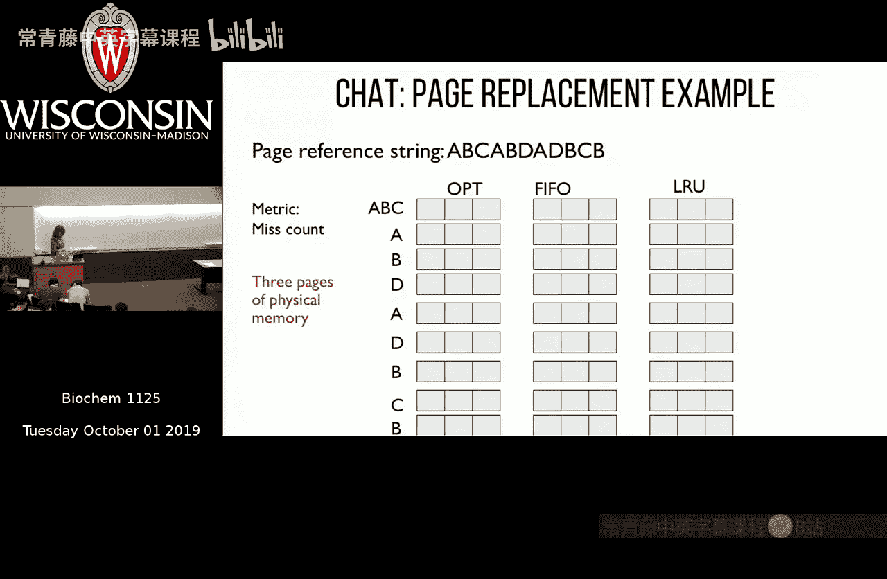
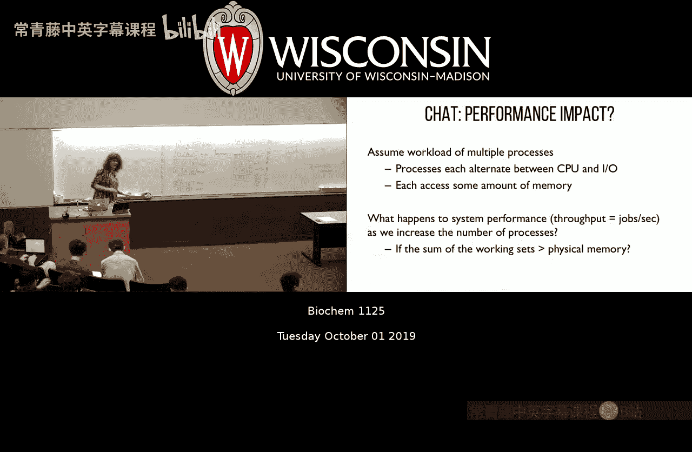

# 操作系统：P8：内存交换

在本节课中，我们将要学习虚拟内存的最后一个核心概念：交换。当多个进程的地址空间总和，或者单个进程的地址空间，超过了系统物理内存的总量时，操作系统如何管理内存？我们将探讨支持这一功能的机制，以及操作系统用于决定哪些页面应保留在内存中的策略。

## 课程公告与回顾

在深入新内容之前，我们先回顾一下重要的课程安排和之前的知识点。

### 项目与期中考试安排

项目3将于本周四截止。助教们已经发布了一些示例测试供大家运行。请注意，项目的核心目标是实现 `fork`、`exec`、重定向以及后台作业处理等功能。虽然测试中可能包含一些错误处理案例，但请不要过度纠结于极端情况的处理。我们的隐藏测试将主要考察主流功能。

期中考试将于下周四晚上举行，地点分为两个教室。明天的讨论课将进行期中复习，助教会带领大家回顾已发布的两份样卷。在考试前的剩余课程安排如下：今天（周二）和周四完成虚拟内存的讲解；下周二进行课程总复习；下周四讲解并发和锁（这部分内容属于期中考试2的范围）。期中考试为闭卷考试，形式为选择题。

### 虚拟地址翻译回顾

上一节我们详细介绍了虚拟地址到物理地址的翻译过程。每次程序进行内存引用（取指令或加载/存储数据）时，都需要进行此翻译。其核心步骤如下：
1.  从虚拟地址中提取虚拟页号。
2.  硬件并行查询TLB。
3.  若TLB命中，则获得物理页框号。
4.  若TLB未命中，则硬件或操作系统需要遍历页表。
5.  计算并查找页表项，获取物理页框号（对于多级页表，此过程可能重复多次）。
6.  将新的VPN到PPN的映射关系替换到TLB中。
7.  将物理页框号与原始虚拟地址中的偏移量组合，得到最终的物理地址。

TLB未命中需要访问内存，有一定开销，但远低于我们今天要讨论的访问磁盘的开销。

### 多级页表设计

我们使用多级页表的主要目标是让每一级页表的大小恰好能放入一个物理页框中。这样做有两个好处：一是对于无效的页表项，可以完全不分配对应的页表部分，节省空间；二是这些页表可以像普通用户页面一样，被灵活地放置在物理内存的任何位置。

关键的计算在于根据页大小和页表项大小，确定每一级页表索引使用的位数。例如，如果页大小为4KB（偏移量12位），每个页表项为4字节，那么一个页框可以容纳 `4096 / 4 = 1024` 个页表项，这需要10位（2^10 = 1024）来索引。我们持续用10位来划分虚拟地址，直到最外层的页目录，剩余不足10位的部分即作为最外层页表的索引。

## 交换：机制与策略

现在，让我们进入今天的核心主题：交换。我们的目标是支持运行总地址空间大于物理内存的多个进程，或者单个大地址空间进程。这不仅要在功能上正确，还要在性能上可行。

### 交换的基本思想

操作系统需要为每个进程营造一个假象：它们拥有与其虚拟地址空间一样大（甚至和磁盘一样大）的物理内存。为了实现这个假象，我们需要程序访问具有**局部性**，并且硬件提供一些记账支持。

现代程序通常会链接许多庞大的标准库，但实际可能只调用其中的少数例程。因此，操作系统可以采用**按需调页**的策略：进程启动时，只将最可能用到的代码（如主函数和常用库）加载到物理内存中。当进程访问到尚未加载的虚拟页时，就会触发一个**缺页异常**。操作系统会捕获这个异常，将所需的页面从磁盘读入物理内存，这个过程称为**调入**。反之，当需要腾出空间时，操作系统会将物理内存中的页面写回磁盘，这个过程称为**调出**。

由于磁盘访问非常缓慢（约10毫秒），为了获得良好性能，程序必须展现出良好的**空间局部性**（倾向于访问相邻地址）和**时间局部性**（倾向于重复访问最近访问过的地址）。研究表明，程序90%的时间通常只运行在10%的代码上，这为交换策略的有效性提供了基础。

### 内存层次结构

系统的内存层次结构体现了速度、容量和成本的权衡：
*   **寄存器**：最快，但容量最小，成本最高。
*   **高速缓存**：速度、容量和成本介于寄存器和主存之间。
*   **主存**：作为高速缓存的后备存储。
*   **磁盘**：容量大，成本低，但速度非常慢。

数据在这些层次间移动的决策者不同：编译器决定什么数据放入寄存器；硬件决定什么数据放入高速缓存；而操作系统则负责决定什么页面应保留在主存中，什么应交换到磁盘上。

### 缺页处理机制

为了实现交换，页表项中需要增加一些状态位。除了我们之前见过的有效位、保护位和物理页框号，现在还需要：
*   **存在位**：指示该页当前是否在物理内存中。若为0，表示该页目前在磁盘上。
*   **脏位**：指示该页自调入内存后是否被修改过。如果被修改过（脏），在换出时就必须写回磁盘；如果未被修改（干净），则可以直接丢弃，因为磁盘上有相同副本。

当进程访问一个存在位为0的页面时，会触发缺页异常，陷入操作系统。操作系统需要执行以下步骤：
1.  找到一个空闲的物理页框。如果没有，则需选择一个**牺牲页**换出。
2.  如果牺牲页的脏位为1，则将其内容写回磁盘。
3.  从磁盘读入所需页面到刚腾出的物理页框中。
4.  更新页表项：设置存在位为1，更新物理页框号，并重置脏位和引用位。
5.  重新执行触发缺页的指令。

由于磁盘操作非常耗时（约10毫秒），在发生缺页时，当前进程会被阻塞，操作系统调度器会切换到另一个就绪进程运行。当磁盘I/O完成后，原进程会被标记为就绪状态，等待再次被调度。

## 页面置换策略

缺页处理成本高昂，因此减少缺页次数至关重要。操作系统需要制定两个关键策略：**页面选择**（何时调入页面）和**页面置换**（选择哪个页面作为牺牲页换出）。

### 页面选择策略

*   **按需调页**：仅在进程实际访问某个页面时才将其调入内存。这是最懒惰的策略，但可能导致进程启动初期频繁缺页，性能出现“卡顿”。
*   **预调页**：预测进程将要访问的页面，并提前将其调入内存。例如，如果检测到进程正在顺序访问数组，可以预取接下来的几个页面。预调页的风险在于预测错误会导致不必要的磁盘I/O，并可能换出真正需要的页面。现代系统通常以按需调页为基础，结合对顺序访问模式的检测进行适度的预调页。程序员也可以通过 `madvise` 系统调用向操作系统提供访问模式的提示。

### 页面置换算法

接下来，我们重点讨论如何选择牺牲页。假设我们有一个“先知”能预知未来的页面访问序列，那么**最优算法**总是选择在未来最长时间内不会被访问，或者永远不会再被访问的页面进行置换。这给出了缺页次数的下限，但在现实中无法实现。

实践中常用的启发式算法包括：

#### 先进先出算法
FIFO算法选择在内存中驻留时间最长的页面进行置换。它实现简单，但性能往往不佳，因为它忽略了页面的访问历史。更反直觉的是，在某些特定访问序列下，**增加物理内存反而可能导致FIFO的缺页次数增加**，这种现象称为Belady异常。

#### 最近最少使用算法
LRU算法基于“过去是未来的良好预测”这一局部性原理，选择最久未被访问的页面进行置换。它的性能通常接近最优算法。然而，完美实现LRU的成本很高（无论是维护精确的访问时间链表还是硬件时间戳）。

#### 时钟算法
由于完美LRU难以实现，现代操作系统广泛使用其近似算法——**时钟算法**。
*   它为每个页设置一个**使用位**。当页面被访问时，硬件自动将该位置1。
*   操作系统维护一个类似钟表指针的循环链表，指向下一个候选牺牲页。
*   当需要置换页面时，操作系统检查指针指向的页面的使用位：
    *   如果为1，则将其清0，指针移向下一个页面。
    *   如果为0，则选择该页面作为牺牲页。
*   该算法实质上是寻找一个最近未被访问过的页面（使用位为0），是LRU的一种高效近似。

实际系统中的时钟算法还会有更多优化，例如：
*   维护一个空闲页框列表，提前批量换出页面以提高磁盘I/O效率。
*   在扫描时优先选择干净页（脏位为0）作为牺牲页，避免昂贵的写磁盘操作。
*   使用多个位（如访问计数）来更精确地区分页面的“热度”。

#### 其他算法
还有一些算法尝试结合访问频率和访问新近度，例如LRU-K算法（考察倒数第K次访问的时间）或使用两个队列分别管理新页面和频繁访问的页面。这些算法更复杂，常见于数据库等对缓存管理要求极高的系统。

## 工作集与系统颠簸

无论算法多么精妙，一个根本前提是：进程的**工作集**（即其在短时间内活跃访问的页面集合）必须能够装入物理内存。如果物理内存不足以容纳工作集，进程将陷入频繁的缺页和换页中，这种现象称为**颠簸**。此时，系统大部分时间都花在磁盘I/O上，CPU利用率急剧下降，性能会变得极差。

因此，解决性能问题最直接有效的方法往往是增加物理内存。

## 总结与思考

本节课中，我们一起学习了操作系统如何处理大于物理内存的地址空间，即交换技术。我们首先回顾了虚拟地址翻译和多级页表。然后，深入探讨了交换的机制，包括页表项中的存在位和脏位，以及缺页异常的处理流程。接着，我们分析了多种页面置换策略，从理论上的最优算法，到简单的FIFO，再到基于局部性的LRU及其高效近似——时钟算法。最后，我们指出了工作集概念的重要性以及系统颠簸的成因。

留给大家一个思考题：假设系统中有多个进程，它们交替执行CPU计算和I/O操作，并且每个进程都需要相当数量的内存。随着系统中进程数量的增加，系统的吞吐量（每秒完成的作业数）会如何变化？是持续上升，达到峰值后下降，还是会出现其他情况？我们将在下节课讨论并发时揭晓答案。