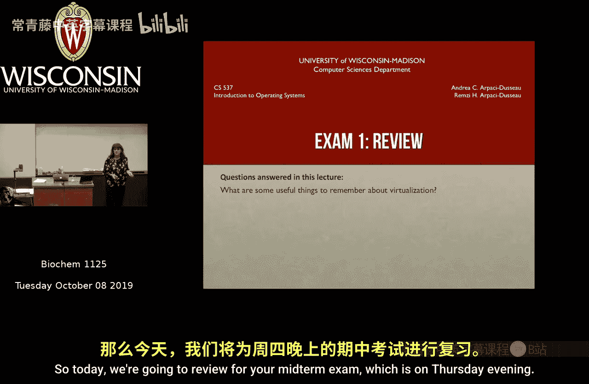
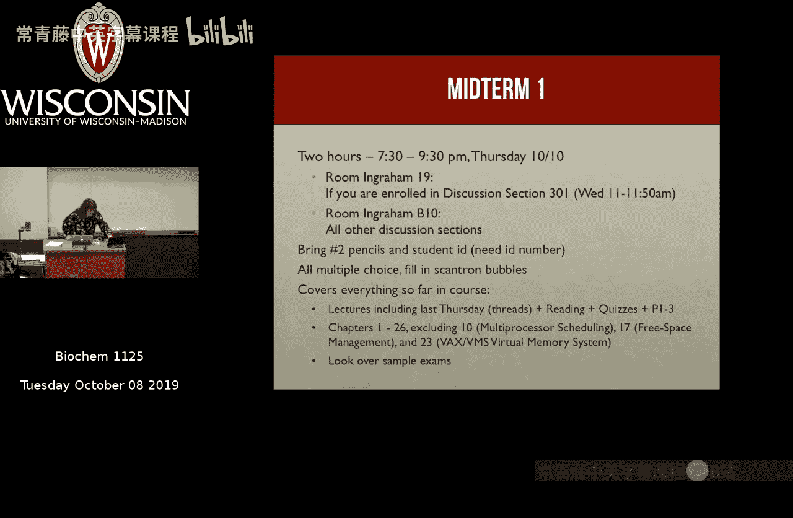
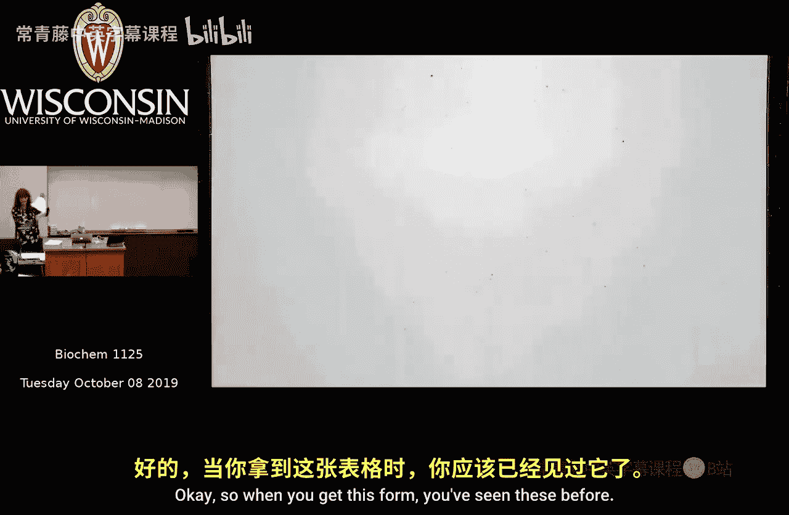
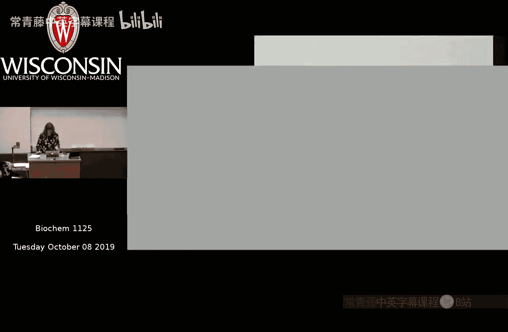
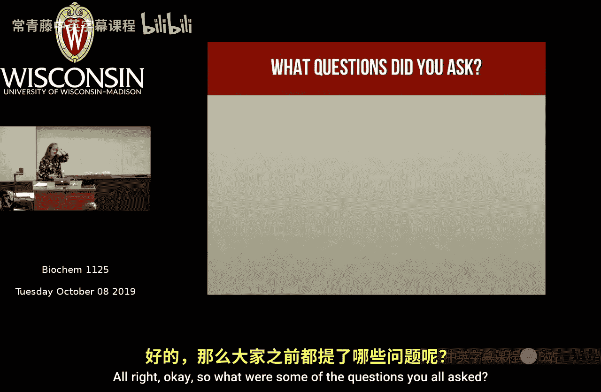
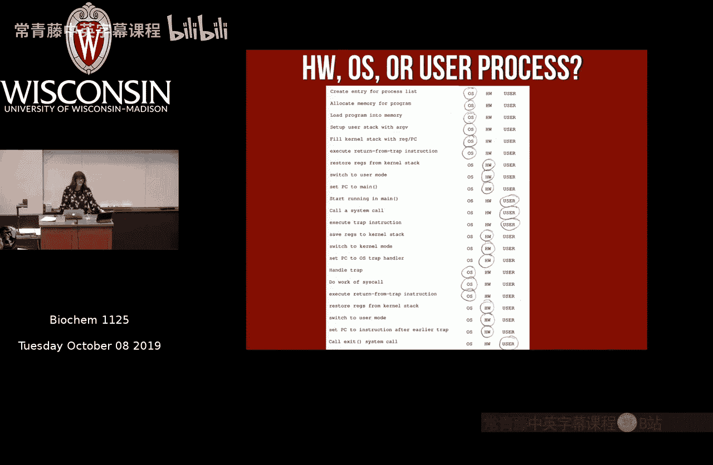
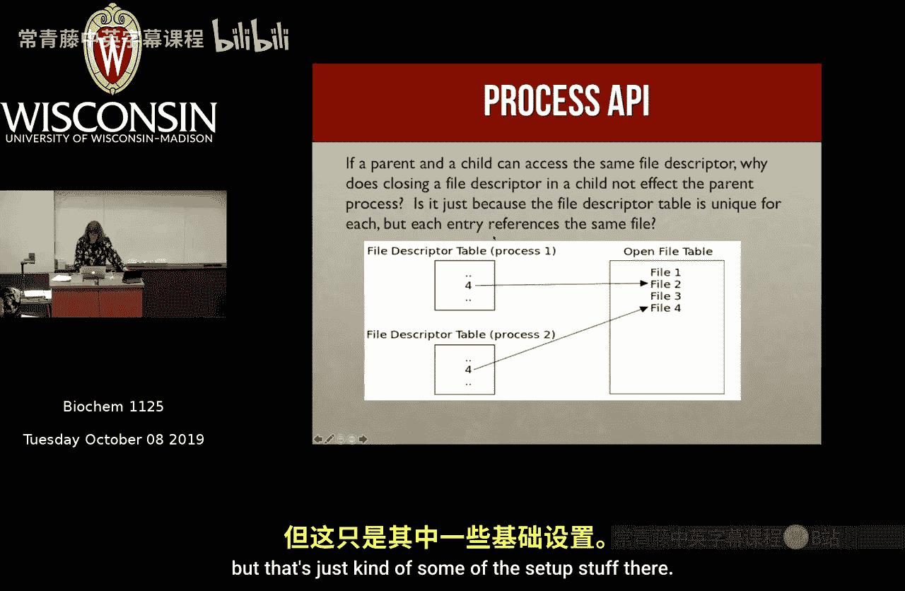
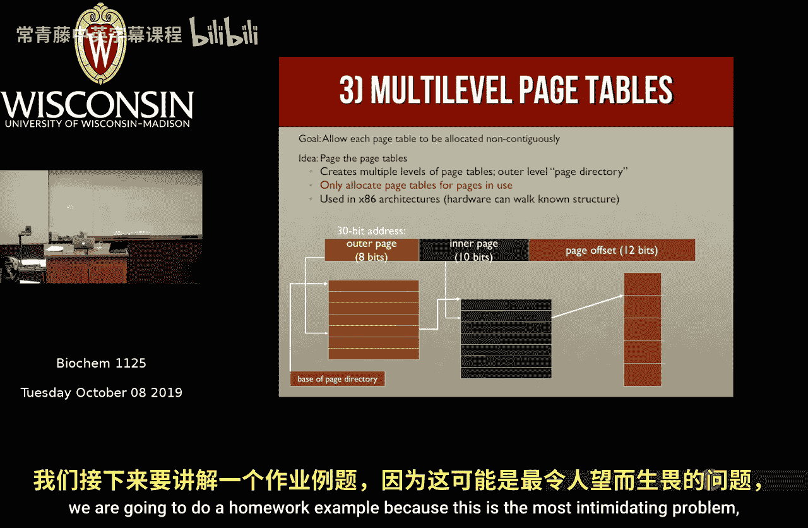
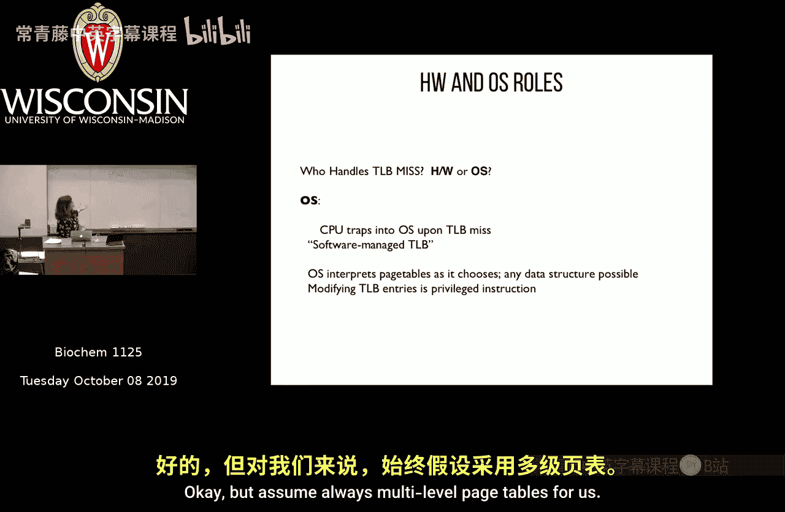
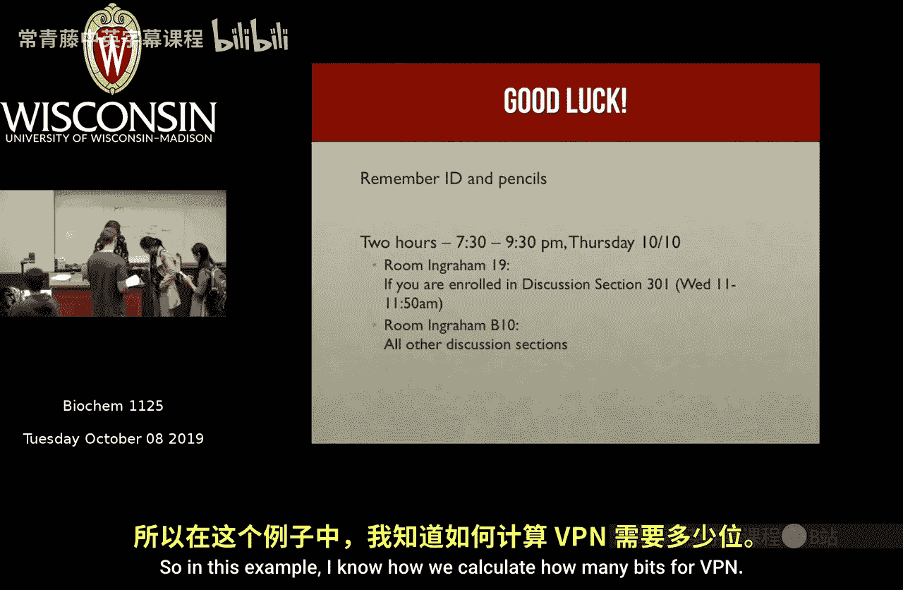

# 威斯康星大学【中英⚡操作系统｜CS 537 Fall19, Introduction to Operating Systems】 p09 P9 Exam-1 Review _ University of Wisconsin-Madison -BV1wUzSB3Ecf_p9-

All right， good morning everyone。Okay， so we're going to have our review for the midterm on Thursday。

Good morning， everybody。I'll wait till everybody takes a seat。Okay。

 so you'll see that today's slides have a different format。

 Hopefully you like the format I've been using more the other days。

 because this is the format I used to use。 and then other faculty members updated my slides to the new more modern look that you've been seeing for the other parts of this semester。

 So that's why these look old。 they are my old slides。

 except modified in some cases to answer your questions for today。

 So today we're going to review for your midterm exam， which is on Thursday evening。 But first。

 some announcements， of course。 So first announcement， we have P2 graded。

 those grades should be in your hand in directory as well as in canvas。

 if you see any dramatic problems like you got a zero。

 or you got half credit and you really thought it worked at 90% level， then certainly talk to the Ts。

 But if you think you just got a few points off that you shouldn't have。

 then that's just what happened。 but the Ts did try to look at individual cases individually and see like if you didn't put things in a source directory。

 they took care of all of that stuff so that things would compile in the right environment。😊。

Alright， so PiizzI was done P3， you all turned that in on Thursday。 And as some of you know。

 there were some problems with the instructional machines around midnights or around when the you were supposed to turn it in。

 So I guess apparently， there's periodically the denial of service attacks onto the instructional machines。

 And those probably happened more often late at night。

 but I'm not quite sure about the distribution throughout the day。And so that happened that night。

 And so we get a couple of lessons for that。 One bad lesson。

 could be that we have to make these do at 5 PM。 Maybe that doesn't matter to you all。

 I have no idea when you care about when assignments are due。

 But then at least the lab would be available to help us solve any problems that occur when projects are due。

 The other thing to think about is don't wait until the last minute to turn something in。

 It's very easy for us。 if you have like your 95% version working at 10。 I mean， who knows。

 you have your own problems that occur at the last minute。

 it's not just if the instructional machines go down。

 people have problems at the last minute sometimes And so if you have a version in your hand in machine in your hand in directory that looks really。

 really similar to the last version， you want to submit， that's a lot easier for us。

 And if you submitted nothing at all before that problem occurred at that last minute。

 There's also a very good flag to know about to pass to copy or to the remote copy Sp。

 It's this dash P flag which preserves your timing attributes。 So this would let us。

Know exactly when you modify a file。 So usually when you do copy on a file。

The timestamps that we see on the destination file will be when you did the copy。

 But if you pass that flag， it， it preserves the modification and access times that are associated with that file。

 So we can see when you actually modified that file last。 And as long as that's before the deadline。

 things are a lot easier for us as well。Okay。P 4。 So this is exciting。

 You get to do another project in X V 6。 X V 6， by default just has a basic round robin scheduler。

 It schedules a new process that's runnable every time or tick。😊，So in this project。

 you're going to make it so that processes can have different timeslicd lengths and also that processes can be at different priority levels。

 and you'll have to pick the highest priority process to run。

 And then there's going to be a whole bunch of system calls。

 You get to add to support this in some user level programs to test it and to kind of stress its functionality a little bit。

 So that will be due today。 It is meant to be more work than the previous projects。

 That's why you get to work with a project partner now。

 So I do strongly recommend that you work with a project partner。Yes。

 there's some inertia sometimes to overcome with that。

 but it's usually worthwhile to get to know someone else and start working with them。 Again。

 you're welcome to switch to a different project partner in the future or drop your project partner。

 hopefully that doesn't happen， but you are welcome to change project partners throughout the semester。

 So you do get to choose your own project partner。 If you do not know anyone。

 We will make a form available today。😊，And so if you submit that you would like your project partner。

 there's a bunch of questions there where I try to find out about your working style。

 I try to match you with someone who sounds like a good match。I kind of do that in batches。

 So it takes like maybe a day after you've submitted。 But if you do submit to that。

 then it's like a binding agreement。 I don't want to assign you to somebody。 And then you say， oh。

 sorry， I decided to work with somebody else because I've already told it I a person that you'll work with them。

Alright， so any questions about projects， I don't know yet when Project 4 is going to be due。

 I wanted to look more carefully at the calendar and figure out really what's a reasonable amount of time。

 Given we have more projects to do as the semester goes。Any questions about projects。Okay。

 you are all in the mood to think about the exam， right？ Okay， so the exam， as you know。

 is Thursday evening， Two hours。 it's in two different rooms。

 So if you're in a discussion section of 301， which is the one that meets at 11 AM。

 we want you to go to this small room over in Ingraham。 If you are in any other discussion section。

 please go to the other room。 Okay， so that's a requirement。It's a scanron exam。

 So by all means bring number two pencils just like the old days。

 You also need to bring your student I D or at least know your I D number。

 because that's what the system understands。 And you are just in number as far as our automated system is。

 is concerned。 and it's going to grade you automatically and upload the grades beautifully and quickly into campus。

 As long as you have that student I D number。So let us look at a scanshot form。

Because I have never gotten 100% compliance in this class before I'm filling these things out correctly。

 believe it or not， Okay， so when you get this form， you've seen these before。

You really do need to write your last name and your first name and then fill in the bubbles that correspond to each of the letters of your name okay。

 the system understands the bubbles， the system does not understand what you write there。

Then the other thing that you must fill in。There's my big hand。 Okay， is this identification number。

 that's your ID number on your。Whsk card， fill in the number。

 really fill in all of those bubbles to make that match。

The other thing we're going to have is we'll probably have a special code。

Which is like different people who will have different versions of the exam。

 so on your exam it'll tell you fill out code A is number two or something like that and you'll do that。

 but fill in the darn bubbles here so that the computer understands what you have done。

And then these are all the questions you could have， you could have up to 240 questions。

 but there will not be 240 questions。And there's you can do just A or B。

 or it can go all the way up to E。That iss how you allowed a scan transform， I think。That is what。

Everyone knows。

Okay， so I think the best way to review for this exam is to go over the practice exams that I posted on Cans。

 but those are practice exams that I Well， those are the real exams that I gave the last two semesters that I taught this course。

 Any other practice exams that you see floating around are still going to be useful。

 but there when other instructors taught the course， slightly different emphasis。

 maybe not multiple choice， it was all different。 So those are the two that will get you the most value for your time put in right。

Technically it covers all of the material through last Thursday's lecture。

 it could cover all of the textbook， it could cover all the quizzes that you've done。

 and it could cover the projects， the projects would be really high level type questions。

 like do you understand how a shell works， do you understand how for an exact works？Okay。

Any questions about that really high level stuff。All right。

So today's review is basically going to go over the questions that people posted to that form and kind of fill in some other background information when I thought that that made sense。

 So in this exam， you're going over virtualization。

 how does the OS provide an abstraction or some al to user processes that they own the machine in its entirety and so we have looked into two different abstractions。

 one is for the CPU where we give each entity， the notion that it' a process that that's how it owns the CPU and then we virtualize memory by giving process address spaces and so then within each of those。

 we often talked about a mechanism like a context switch is a mechanism for helping us to implement that abstraction and then we had a bunch of different policies for choosing exactly which process to schedule when those were like the smart decisions about what you want to do at a given point in time whereas the mechanism。

 the context which is all the lowlevel assembly code and the guts of actually making at work with saving。

S and stuff。O。And then with memory， we looked at a bunch of different actual approaches for doing this dynamic relocation was when we started to have like a base and bounds register within an MMU or a memory management unit。

 that's where it really got more interesting when you just have like static relocation。

 that was what you would do if you don't have any hardware support and you have to just at the low time modify all of the address so that they correspond to where the OS has placed that address space in physical memory。

So we won't talk too much about the ones that come before dynamic relocation or base bounds。

 We talked a lot about segmentation。Where you might have a code segment， a heap segment。

 a stack segment。 And then we talked a lot about paging。

And various aspects of that to make that go faster。 for example， we'll have a TLB。

 some hardware support where we can go directly from a virtual page number to a physical page number to make that translation very fast so that you don't have to walk a bunch of page tables。

 And then another consideration that we looked at in a lot of detail was what you do in page tables are huge And we want the page tables themselves to fit within a page。

 We then have multiple levels of page tables where each of those page tables fits within a page。

 That's what the multi-level page tables are。 And then at the very end。

 we were looking at swapping So how do you support virtual address spaces that are greater than the amount of physical memory that you have in a machine。

 And that could be that you have a single process whose virtual addresses more than you have physical memory。

 or it could just be that the sum of all the processes that you have that their desired memory is more than the physical amount you have。

 yes。I thought we were better。 We never know。 I thought the key was going to be I stand。 Oh。

 that's better， right， Okay， great。Okay， more questions， yes。Oh， no， we。

 we just have these very similar linear tables。 I mean。

 you could technically have any type of data structure that you want。

 but we just have these very simple levels of。I mean， it is a tree structure。

 but it's a very formulaic。Fix size at each level。All right。Okay。

 so what were some of the questions you all asked？

So here's kind of a good quiz for yourself。 these aren't questions that I made up。

 but they're questions someone else made up。These are the steps that take place when you start up a user process and if you can read that font。

 the idea would be can you figure out for each of these steps and they're not phrased the most precisely。

 they're a bit vague， would you say that it's hardware。

 the OS or the user process itself that does each of those things。

So I'll give you all a minute to talk with your neighbor。

 and if you had to pick one of those three for each of those items， what would you pick。

 And it's kind of a logical time progression you will notice through those instructions for starting up a new process。

One minute， talk。这个。All right。So I don't find the questions the most precise。

 but this at least gives some intuitive feel。So who create， oh， no？好不了。So I don't know。😊，All。

 so who's？Who's just？Okay， first one， who's responsible， and then I can't read this one。

My eyes are too bad。Okay， so who creates this PCB， the process control block and puts it in the process list。

 it's the OS that's going to do that， it needs to track all of the active processes。

 who's going to allocate memory for the process， it's the OS。

 the OS knows exactly what physical memory has been allocated and it's tracking all of that。

Wwhich entity loads the program into memory， it's the OS that does that work。

 who sets up the user stack， the OS does all of that fills the kernel stack。

 it does all of that initialization stuff and then the OS calls。

 I don't really like the word execute there， it calls the return from trap instruction so I would ask that differently if it were me because certainly it's the hardware that then does the work from of return from trap。

After you've called fork or something like that and so then the hardware does the restoring of the registers from the kernel stack。

 it switches to user mode from kernel mode， it has to be that that' can be done atically that you have hardware support from that and then it jumps up right away to the main which was on a stack and so it sets the PC register to what it was able to get from the stack so the hardware does that then the user process starts running in main。

 it calls a system call and within that system call library wrapper function， the setup。

 that's what executes this trap instruction or calls the trap instruction anyways。

 then the hardware does that transition back into the OS the OS does the work of handling the trap it sees you know that certain trap number has occurred and it jumps to the handler for doing that。

 it does the work of handling the system call and then it eventually calls return from trap。

 which then transitions back through the hardware and then the user is able to do whatever it。

And eventually it calls exit。All right。So that is kind of a general overview of what happens when you start up a process。

Okay， some more questions so someone looked at the homework in the book and one of them was talking about using fork and the goal here was you want a child process to print hello and you want the parent process to print goodbye and you want to make sure that the child process always prints first can you do this without calling weight in the parent so if you could call weight what would you do you'd have the child process print hello then you'd have the parent call weight。

Well sir you have it print hello and then exit and then the parent calls weight and then the parent would know that the child had printed and exited at that point after that weight statement is done and then the parent could print goodbye so that synchronization would work that's kind of similar to what you did in your shell where you know with a foreground job that that child process has done its work before control。

 after you have to wait for that child process to complete。O。

 but could you do it without calling weight， you can't do it any nice way with what you've learned so far。

 you could do some silly things where you sleep amount a certain amount of time。

 That's a good way to have some race conditions， but it probably would work。

 And then we're going to talk in our next couple of lectures about some different synchronization primitives like condition variables and sephores that you could also use。

 but we haven't talked about that yet yeah。Or you could do things with pipes or signals or other things。

 but we haven't technically talked about that stuff。 yet， that's all that meant。

And then a question was， could the child process wait for a parent and no。

 it's always the case that the parent waits for the child。

And does it ever make sense for the child process to for the parent to call exec instead of the child。

 like what you did with your shell。 And that doesn't make any sense that I can think of that the parent has more information about the child。

 that the parent knows the P I D of the child。 The child， it can get the P I D of the parent。

 but that's not as natural of a thing。 And that's not how that weight relationship is set up。

So it really is that the parent is supposed to be treated as the parent and to be able to wait for the child。

 not the other way around。Okay。All right。So another question which you also kind of saw in your shell assignment。

 was there you were having the parent and the child sometimes deal with the same file descriptors when you were closing file descriptors so that you could do redirection。

And so someone wondered， why is it the case that in one， like the child process。

 you can close a file and in the parent process， you can still access that file。

 So the thing to keep in mind is that this file descriptor table， when you call fork。

 we make a copy of that。And so they will originally have the exact same contents and they're both pointing to the same open file table that's going to be stored within the OS。

 so when they do reads or writes， they are seeing the same file through that interface there it could be different file descriptor numbers here。

 but then if one of these processes calls close， for example。

 Pro one calls close on file descriptor4， that doesn't hurt anything to do with process tos accesses to that file descriptor。

 it can continue to read and write to that file。But we're going to talk more about files later in the course。

 but that's just kind of some of the setup stuff。

Okay。Nobody asked any questions about scheduling， believe it or not。

 So we are just mostly going to talk about virtual addresses， virtual address spaces。

So there's one question， what do addresses look like from the program's perspective。

 like from the user processes perspective， so just remember。

 user process is dealing with virtual addresses， those virtual addresses were chosen by the compiler。

 it's choosing you know exactly how to lay out the code。

 exactly where to allocate within the virtual address space， each individual static data element。

 you know how to manage the heap through mallic and stuff like that。

 those are all virtual addresses that we're dealing with there。

So then if I asked you to figure out what the virtual addresses are that are going to be generated by this small piece of assembly code。

 that would be the first step before figuring out what the physical addresses are that are going to be generated right so this is the easier first step to figure out the virtual addresses being generated。

And make sure you include instruction fetches whenever you're asked one of these questions about how many memory accesses are going to be involved。

 Okay， so let's figure out the virtual memory addresses。So virtual memory。

 the first address we access is to fetch the instruction， which is at address 10。

 so there's one fetch there。1， memory access。 Then we actually exact that instruction。

 We're doing a load from 8 B away from the。Base pointer。Which is at address 2000。

 so we add sorry 200， we add 8 to 200， so we're going to do a load from virtual or logical address 208。

Okay， then we do a fetch of this logical virtual address， that instruction at13。

 that instruction doesn't access memory so that is great。

And then finally we fetched the instruction at 19， this is doing a store back into that address we already figured out 8 plus 200 okay so those are the virtual addresses that get generated and then the more complex step is to figure out the physical addresses that are generated and so we'll get into that。

A couple slides down the road。 Any questions about this， though。

 So that's kind of the level of understanding assembly that I expect you to do。

 I will probably always give those exact same three assembly instructions。All right。Okay。

 so then we are looking at different ways that you could virtualize memory。

 and we start with one process uses RAM at a time。Which of these approaches was that That's time sharing。

 This is not what modern system is going to do。 It's going to have a ridiculously bad performance。

 right， We're going to page or swap in and process memory from disk into physical memory， let it run。

 let no other processes is run when that one's done， we'll move it back out into disk。

So that's really slow rewriting code and addresses before running。

 that's the static relocation that we talked about。Third。

 add a per process starting location to the virtual address to obtain a physical address。

 that's base。The dynamic approach that verifies an address is in a valid range。

 that's bounds that we look to make sure that the address that you're generating is less than the bounds register or kind of the limit for that address space to make sure that you're not maliciously or accidentally modifying or reading another processs address space。

And then finally， several base and bound pairs per process that is segmentation。

 where we have multiple segments in our process and each of those is going to have a base and a bound as well。

So the question is which of these need hardware support？Some of can say， well。

 everything requires hardware support。 we're running on hardware。

 but to actually do the address translations， it's like three through five that need that that we're assuming we have that MMU that can do the adding to a base register that if we don't have hardware support to do address translation。

 you'd be forced to do something like time sharing or the rewriting of code with the static relocation。

 So all of these later ones， they're going to assume we have some type of MMU hardware to help us out。

ok。All right， so base and bounds。So this was kind of the first reasonable approach that we looked at。

 that here we're going to assume that we have this memory management unit or this MMU that is translating addresses that are generated by the CPU。

 those are logical or virtual addresses that were generating from the user processes perspective。

 and they are being translated out to physical addresses that are actually sent to RAM， remember。

And so one of the keys was that we need to know over here if we're in user or kernel mode that the OSS has to be able to access all of physical memory so we don't want to do any translation to the OSS's memory accesses so the OS can access all the physical memory so we don't do any checks or manipulations of the OS if it's a user process then we make sure that the address that it's generating is within the bounds。

And then we'll add the base register to that so that we're offsetted relative to where that process has been placed in physical memory。

Okay， so some people asked， well， what about the stack segment。

 I've read some stuff in the book and maybe seen some other people's practice exams where there's a stack segment and you have to subtract things and compare to a base that's below and I just don't ever like getting into those details。

 so for me that's something you are free and welcome to look into and understand。

 but I am not going to ask anything about stack segments growing the opposite way and needing to do subtraction there。

All right。Okay， another question that was asked from one of the exams was Que 73。

 so I'll let you all figure this one out and figure out the phrasing of this。

 perhaps you could say the phrasing was a little odd。

 One advantage of adding segmentation to paging is that it potentially reduces the size of the page table。

 So what I meant by this phrasing is consider you had a system that only did paging。

And if we add segmentation to that， is this now an advantage that we get out of that？

So if you have both， what's the advantage compared to only having paging？

So is this one true or false， I guess talk with your neighbor。See if you agree。Os。Okay。

 so my answer here is true。So if we don't have segmentation and just assume we have linear page tables here。

 then if you have just a single contiguous address space。

 then to figure out the physical page where this virtual page lives way down here。

 you have to have a corresponding page table that has an entry。

You know that corresponds to each of those pages， so you have to have a huge number of invalid entries in your page table so that you could do that easy。

 simple， linear lookup in your page table to see that the pages that are at the end of your address space where their translation is。

Whereas if we added segmentation to that， which is what this question was asking。

 would that reduce the size of this page table and it would be now we would have three page tables。

 the code would one would be very small， the heap one could also be just as big as the heap actually is。

 and the page table for the stack would be actually just as big as it needs to be for the stack and you don't have to represent all of those dead invalid pages in the middle。

 right？So any questions about that？All right， so the next question is。

If you had segmentation already and you added paging to that。

 so it really does end up being the same final system here， but just relative to segmentation。

 is it going to help us reduce any internal fragmentation by having paging？Nope。

 because segmentation doesn't even have fragmentation internal fragmentation paging does have internal fragmentation。

 remember internal means that the wasted space is visible to the entity that's getting that memory。

 so this application had a。Heap where we just needed to allocate you know one byte。

 perhaps for our next variable， but the system has to give us a whole page。

 so it's going to give us all of this wasted space as well in 4K increments。So with paging。

 it has to give us allocations and fixed size chunks which is going to lead to internal fragmentation。

 whereas with just pure segmentation， we wouldn't have to do things in any of those fixed size chunks and we wouldn't have internal fragmentation。

All right。Moving along。Get to do some more math。All right。

So the standard quiz here to get you towards figuring out what address formats look like。

So for each of those page sizes， you should be able to figure out the number of low order bits that would be dedicated within both the virtual address and the physical address to picking an offset within that page。

Right， so if we have 16 B， it must。 That's 2 to the four。 So we must have4。

Bits of our address that are being used to select one of those 16 B from the page。

 right So that's how you do those calculations for We're trying to go back to our virtual address。

And we're trying to figure out how many bits are being dedicated to the offset。

Versus the virtual page number。Okay， so that one's four， the next one is。10。The next one is。

22 to the 20 is one meg。5ive12 is two to the nine。Yes。Is there a question？

And then 4K that's 2 to the 12， so that's how many bits you need in your address to pick a byte offset within that page size。

 so that's starting to tell us something about the structure of our virtual address。

So that's really important that you can do these pretty quickly。Any questions？All right。

 so then if I told you the same things as before， this is the page size。

 this is the number of low order bits， and I told you how many total bits are in your virtual address you could figure out how many bits must be being used for the VPN。

So how would you be doing this？You just do some simple subtraction right。

 that's what this simple picture tells us here if our virtual address total was 10 bits。

And our offset was fours。Then it must be we have six bits for our VPN， simple subtraction， okay。

All right， do all of those look good？啊好好好。然后。No， I don't always subtract right，😊，There you go。Okay。

 so then the last question would be， can you then figure out how many virtual pages you must be able to address in this system？

 So if I tell you how many， this is the same thing corrected from the previous slide。

 That's how many bits you have first picking a VPN。

 So the number of virtual pages you must have in your system will be 2 to the number of bits you have。

 right， So 2 to the 6，64，2 to the 10th，2 to the 12th，2 to the 7th，2 to the 20th。

 That's how many virtual pages you have。So being able to do that is important because it's going to help you figure out how large your page tables are because you need to have an entry for each of your virtual pages。

 so that's also telling you how many。嗯。Page table entries you have。

 So then if you are able to figure out how many page table entries you have and the size of each of those page table entries。

 you can figure out how much space they're taking up。So that's what we will look at last。

Okay so just to kind of review all of that， remember we're going from virtual addresses to physical addresses。

 they have to have the same number of low order bits being used to pick an offset within a page because the page sizes are the same in your virtual address space and in your physical address space and then what we were doing is we're just translating with some lookups table lookups virtual page numbers to physical page numbers and we're keeping that's what's being basically kept in those page tables it's just a translation between those things and we're using that virtual page number to just do a simple lookup。

 a simple index to get this contents out and of course we saw that the page table entries have a little bit more than just these。

Physical page numbers or physical frame numbers， PPNs or PFNs。

 they also have all of those protection bits and the valid bits and other caching information and stuff like that。

 but really the most interesting thing most of the time is the actual PPN that we're looking。O。

So this would be the final math type question。That we did in class before。

 and this probably it should seem a lot easier now。

 so you have to figure out how big a page table is。If I tell you that you have a 32 bit address。

Space32 bit address， you have 4 kilobyte pages and4 byte page tables。

 Then you're going to exactly figure out well， how many bits are being used for the。Page offset。

 that will be 12 of the bits， 12 32 minus 12 gives us 20 bits that are being used for a virtual page number。

 20 bits。So we'll have two to the 20 actual pages and each of those pages takes up four bytes。

 so that's where we get two to the 20 times four bytes or four megabytes。

So you should be able to figure out the size of a page table given these characteristics of。

What the virtual address looks like okay， so that's all for。Vinear page tables。

 And so the point of all of this was to say， hey， this is huge。 This is just ridiculous。

 We can't store 4 MBby continuouslytigly in physical memory。 We can't keep that in Ram。

 We're going to have to do something a lot smarter than this。

 That's why we're going to need to have those multiple levels of page tables so that we don't have to allocate every single byte。

 Like what we were looking at here。 It's just not realistic to have to allocate space for those invalid entries there。

Okay， and the other thing to remember is that the hardware will know the base of the page table or the page directory that we'll see when we add on more levels that the hardware knows where that lives。

 because the hardware is able to walk those page tables and do the translations when there's a TLB mess。

And so the important thing that must now happen on a context switch is that part of the context switch。

 in addition to changing all of the registers that are associated with that user process to a different user process。

 would be also changing that page table base in the MMU so that the hardware knows where the address space for the new process lives。

All right。Any questions about that？Okay， so you are welcome to do these calculations。

 I feel like I've had enough of them。Do you all want to spend a minute doing these for yourself or should we move on？

Raise your hand if you want to move on。Okay， I decided to ask the positive question for what I wanted to do there。

 and I saw a lot of hands， so then we get to move on， great。😊，Okay so then after linear page tables。

 we looked at multilevel page tables and again the motivation for this is we want each of the page tables to fit within a page。

 so we were doing all of these calculations to like we already know how to figure out the number of bits being used for a page offset。

 we then werere figuring out the number of bits that are going to be used to select an entry within a page table that fits within a page。

And so why does it end up being 10 bits here， it must have been the case that we had a 4 kilobyte page and each entry takes four bytes。

 so it must mean that therefore we can fit 1000 entries on a page， which is 10 bits there。

So that's a pretty common thing to end up happening with four kilobyte pages and four byte entries。

 you can fit 1k entries within a page which is two to the10。

So then if you have a larger and larger address space。

 you kind of recursively apply that and each level of the page table would be getting 10 bits if we have all those same assumptions。

Okay， so now instead of the hardware knowing the base of a linear page table。

 it is going to know the base of the page directory because the outer level is pointing to page more page tables。

 right， it's not telling us directly the physical frame number for this thing that we're looking up。

 it's just telling us the base for the next level of page tables and then we'll use the next set of bits to offset within the page tables for particular outer page。

Yes。Yeah， yeah。 the hardware will understand this structure as well and can do all of this walking as well。

 That's why all these things have to be so well defined with architecture。

 Ex how many bits are being used for this。 And it knows the size of the pages and all of these things are well defined。

 Yep， yep， so the hardware can do this as well。Oh， great， so。So， for example。Within here。

 we could have an entryB invalid。 And that would mean， And let's say。

 But let's say the ones around it were not。The ones around it are valid。

 that means that we for some reason just didn't allocate this one page to the address space of this process。

 but if this entry back here were invalid， then it means that all of the pages within this portion of address space are invalid。

 so that's if at this level。Things are invalid and we're not even pointing to another page table。

 that's probably like the middle portion of your address space where there's a huge amount that hasn't been allocated。

Does that make sense？So we're saving a lot more space。 if something over here is invalid。

 it's not pointing to even any page tables， whereas here， if it's invalid。

 it just means we're not pointing to the final page。Okay， yeah。

As if the outer page versus the out page， how is that determined？Oh great， so we basically。

 we need to make sure that each of these page tables fits within a page。

 so that's where we were getting the 10 bits。Or how many could be used fit to select an entry within that page。

So if I tell you how many bits are in the address， you just apply this basically recursively。

 So you figured out that it was 12 for this one。 You figured out that it was 10 for this one。

 And then you just say 30 minus。22 is equal to 8， so that's 8 for the outside。 But if we saw that。

 let's say I told you that this was 38 and so this was 16 bits left for our outer page that would give us too many entries to fit in a single page so we would then have another level of page tables and of those 16 bits we would make 10 be another level of our page table and then。

The remainder for another outer bubble。So you just need to make sure that each。

Level of these page tables fits within a page。And the outer one might not be as large as the page。

Certainly fine if it's smaller， just can't be bigger than a page。Yeah。Oh no。

 it could be hardware or it could be soft or it could be the less。Either one。

 it just has to be a well defined convention for the hardware to do this。 So like in X 86。

 the hardware can lock these page deck。The OS， if there's a page fault。

 if we find out that know one of these pages is not present in physical memory and it's been swapped out to disk。

 then that is the OS that's going to do that work。 The OS will handle page faults。

 but not TlB misses or page walks。Yeah。Could you yell？Yeah。Yeah， to do these calculations。

I have to give you enough information。 You know， So for this one。

 you'd need to know how many bits are in the total address。

 and then you would be able to divide it up appropriately。嗯。Well。

 you should be able to figure out how many bits are being dedicated to this inner page。

 Is that your question。Yeah， so to figure out how many bits are dedicated to here。

 I would have to have told you， well you。If you know how many bits are being dedicated to the page offset。

 it's 12 B。 So that means pages are 4 kB。 And if I told you that each page table entry was 4 B。

 then that means you can fit 10004 byte entries on a 4 kilo page。 So therefore。

 we have 10 Bs to select one of those2 to the 10 entries。So you can just do that math and。

Figure out the format。All right， we are going to do a homework example because。

This is the most intimidating problem， right？So I can't show everything beautifully on the slides。

But I thought I would kind of go through that one homework assignment because I'm sure there will be one like this on the exam Okay。

 so this was like the tiny， tiny little pages so that you can do everything by hand and I just show you like a dump of physical memory and you have to figure out what are actual like interesting user values that the user is trying to actually load or store versus what are all the page table entries。

So in these problems， we look at tiny pages，32 Bs each。

The virtual address space is different size than the physical address space。

 so the virtual address space we assume it has 1000 pages， physical memory has just 128 pages。

It must be the case then that we have five bits for our offset because it has to pick one of two to the five equals 32 bys。

 so five bits for our offset。 And if there are 1000 pages， it must mean we have 10 bits for our VPN。

So it's a total of 15 bits in our virtual address。So we could figure that out from me telling you those first two statements。

And then you can figure out the format of what the physical address must be as well。

So how many bits must be in the physical address？What do you come up with？12 awesome yes。

 so again it's five bits for the offset because page sizes are the same and then2 to 7 is equal to 128。

 We have to be able to pick out one of the 128 pages。

 so we must have 12 bits in our physical address。 Great。

 then the other information I'm going to tell you is that each of the page table entries is just one by in our tiny machine。

😊，And then there's some other information about the fact that this is a multilevel page table。

 It is going to have two levels， an outer page directory。

 And the format of that is that the upper bit tells us if the entry is valid and the remaining 7 bits point to a physical page number and7。

Is it up。To find any physical address。Okay。All right。

 so if you look at what an actual page table entry looks like the first bit is valid。

 and then it's pointing to a physical frame number for our next part。Okay。

This is what your homework looks like。 and a lot of the sample problems on midterms。 So I can't show。

The full memory dump， so I'm just trying to kind of focus on what parts。Are important to look at。

So if I tell you， we need to figure out。What are the contents of virtual address 611C？

SoWe're going to have to go through a bunch of steps。

 We're going to have to figure out where the entry is in the page directory。

 Then we're going to have to find the entry in the next level of the page table。

 and then we're going to have to go actually read the contents from that physical address。

 It's going to be three lookups for sure。And I'm going to tell you where the directory lives。

 the physical page of the directory for this particular process， of course。

 each process has its own page directory and this register gets switched on context switches。Okay。

So I then nicely tell you this these are the 32。Fights within page 108。

 but I want you to figure out what entry， which one of those。Fights is relevant to us。

 where do we start？So what I like to do。Is I take 611 c， and I write that out in binary 61，1 c。

That was easy to write， but it doesn't match the format of these addresses。

And these addresses we said， the bottom five bits are being used for the offset。

 the next five bits are being used to pick an entry within the 32 byte page and then the top five bits are picking an entry within the outer page directory so we look at it like this。

So now we need to find a particular entry of this page directory。 What entry do we want to look for？

Deimal or hex。Are acceptable。Actually， just decimal。

So how would you figure out what entry within the page directory we're going to find our next level of the next page table at？

Right so we're using these outer bits， and so what's this number in decimal？It's 16 plus 8， 24。

 so we want to look for the 24th entry and that's in red so that we won't make any addition mistakes so we get that the page table that we need to look at its base lives at page a1。

Okay， so what that means is。Oh， sorry。 that wasn't quite right。 We get the contents A1。

 We need to look to see is this valid or not， We write that out as bits。

 The top bit tells us if this is valid or not。The rest of the bits tell us the physical page number where this page table lives。

 if we translate 1-00001 into a number that should be 33， 32 plus1。

 plus at the top that was telling us it was valid， so what does that mean I'm going to show you next I'll show you the contents of page 33。

Now you need to figure out what entry in page 33 is the one that we're looking for。

And so it's nicely shown in red。 But how do we get to that。

This is telling us the entry for that second model。 And that number is。8ats。

So that's why we went to0，1，2，3，4，5，6，7，8， B5。 let's write that out in binary to make sure this thing is valid。

 The top bit is indeed a one。 The rest of the bits are telling us the final physical page number when we translate this big virtual page number。

Whi were everything beyond the offset， that virtual page number is being mapped to this physical page number。

So we need physical page number 53 is like our final address translation bit of work。

So we are going to go to page 53， the data that this user actually cared about was on page 53 at offsetet。

嗯。Sorry。😔，啊。16 plus 8 plus 4。Y 28。 So the final field， the 28th。Index on page 53 has the value of 8。

 So if a user did a load from this particular virtual address， they would see the final value of 8。

So this is exactly like all of those quiz problems that I gave you。

 And there definitely will be a question like this Thursday night， because this is as hard as I can。

Thank you all do， yes。取消的。So on page you one of8。这不一啊哈。😊，And so each。BGB。two。

Because I'm just confused why are they more polite？Oh， well。

 certainly these are unrealistically small。So， but it works because we have such a small address space that I'm able to fit in one byte。

 a valid bit， plus enough bit to go up to you know the number of pages that we have in this machine。

 which is just like 128。Yeah。So it's because we have only 128。

Pages in our machine that we were able to fit all of this stuff in one B。All right， yes。If what？Oh。

 so two to the five bytes， that means a 32 byte page。 Yeah， so we have that's why we have five bits。

 sorry， we have five bits as our page offset。That means we have 32 byte pages。

 and that's why we have 32 bytes that I'm showing you in each of these examples。More questions。

So I will make this slide available for you all to look at and again。

 it's exactly the same as that homework and it's exactly the same as some。

Practice problems from the past。Okay。So that is very mechanical， right， hardware can do this。

 so can you。Okay。Yeah。😊，Hardware is doing that all the time。😊，Just some bitman。对对。

It's just doing some manipulations。Okay， so then we were talking about TLBs and so who handles a TLB hits？

😊，That's always hardware right， the hardware TLB is a special cache that is caching VPNs to PPPN so that we don't have to do all that work that we just did in the previous example。

 even the hardware doesn't want to do all of that on every single memory access it wants to look up instead into this TLB and looking up into the TLB lets it skip everything except getting down to this thing here。

 it would tell us that oh， this VPN maps to page 53 that's what the TLB would be telling us。

 it'd be telling us that those 10 bits in a VPN correspond to page 53 as a PPN and then it can just take those bits of the offset and appendit to the PPPN to get the actual address。

So that's why TLBs are so wonderful， you don't have to do all of this work if I gave you a TLB。

 you could have just seen that that VPN was in there and you would have been done much faster。Okay。

 so TLB hits are always hit by managed by hardware。

 TLB misses can be handled either by hardware or software。

 we've had a bunch of questions about that today， certainly hardware can handle TLB misses。

 it just has to know the exact format of all of these addresses it needs to know where the base is of the page table or the page directory and those things can be communicated just with special registers there。

And the hardware can just walk all those structures。

 or if you want to do more work in the OS and come up with a more clever data structure。

 the OS would be welcome to do that， and then it could have whatever data structures it chooses。Okay。

 but assume always multi level page tables。

For us，Some more questions。So one question was what's the difference between a present bit and a valid bit so valid tells us if a particular page has been allocated or not whereas present is telling us if that page currently is present or lives in physical memory or if it's been swapped out to disk that it's not currently resident so if you kind of look at the different states that a page could be in each page within your virtual address space it could map to nothing so if you access it that would be an error would be a segmentation fault。

 it could be living right now in physical memory， if you access that it would be quick。

That page could be living on disk。 It would be very slow to access that。 So because of that。

 we're going to have more fields in our page tables than we've been assuming in many of these examples。

 So， for example， in addition to the valid bit that we' were doing in our。

Homework where the valid bit was just the top bit we would also have within our page table entries is a present bit and maybe some permissions。

 can we read or write that page So if you haven't allocated a page if it's not valid。

 and then the user process tries to access it， we're going to get a segmentation fault。

 But if the page is just not present。 If that bit isn't set。

 then what does that mean it means that in our page table instead of recording a physical page。

 it's going to record a block address， right So the hardware is going to tell us， hey。

 the present bit is cleared。 that's going to cause a trap into the O。 that's a page fault。

 the O knows how to handle that， it knows how to interpret the page tables。

 it knows how to do the read from disk。 it knows to schedule another process while it's doing that expensive operation of pageaging in。

Things from disk into main memory。Yes。啊哈。😊，Yes， great。Perfect。O。

So the way that a process is able to expand its address space is it calls S break that will cause the OS to allocate physical pages to that。

Process and to make those entries valid and point to where it's been allocated perfect。

So that's what this SB system call does， and I bet in Project5。

 maybe you'll start to look at that in XP6。All right。So someone asked for an example of that anomaly。

 so I wrote everything out that the other day I had wrote very messily on the board and I did not appreciate creating this slide。

 but no animations and hopefully it is correct。So remember that we need to have a page replacement policy。

 so when you find that you need to kick out a page from physical memory to disk because you don't have enough space and physical memory for all the pages that you're accessing we're going to have different page replacement policies like the optimal one or LRU or PIFO and so the good results with LRU and optimal is that they always get better performance as you add more memory that's kind of intuitive that as you add more memory。

 those algorithms are able to cache exactly what they did with a smaller memory plus a little bit more the smaller amounts are always a pure subset of what they can cache the larger amount。

But fiIFO acts very strangely and you can actually get worse performance。

 though that's not the common case， but you can get worse performance as you add more memory。

 so that was the purpose of this contrived reference string to kind of look through what the。

Pages would be replaced and which accesses would cause hits or misses so the idea here is that we're comparing for the fiIF replacement policy with three pages in memory versus four pages what they would bring in and replace and when you'd have hits versus misses。

 so the first time you access A B and C， those are all misses when we access D。

 we will kick out the first。The one that was first in relative to now。

 so we kick out D and when we access D。So can go like that。嗯。Yeah， yes， so we just keep， I mean。

 you guys can look through this and you will see that you get nine misses in the one case and Ted in the other。

 And hopefully you can just run that algorithm。 All right。😊，So。That is all I had prepared for you。

 but you still have 15 minutes and so I can answer questions from the floor for 15 minutes。

 but otherwise on Thursday， remember to bring your pencils。

 your ID and to show up in the right room that you should go to the room depending upon your discussion section。

So I guess I'll wait two minutes for everybody that wants to leave to leave。

 and then if there are people still in the room that want to ask questions， I will continue to talk。

To the room of people here。Okay， so you says about the internal fragment。给我的。

It was no advantage to add paging to segmentation because paging then adds internal fragmentation。

So adding segmentation toaging or paging to segment。

It is no advantage to add paging to segmentation in terms of fragmentation。

Because there will still be internal event yeah， paging。Has internal fragmentation。

 segmentation does not。Because if you only needed one bite， you would have done like。

 here's the base。Here's the bounds。And there's no fragmentation here。

 The only reason you'd have fragmentation would be if you had like another address space that was put here。

And then this was too small to fit anything useful there。

 Then we would call that external fragmentation。Okay。

And this you were saying the example that's internal fact this one's internal Okay so anytime you have like a fixed size allocation chunk。

 then it's internal because you have to give everybody that amount and if they didn't want to allocated that amount and you're using some part of it that exactly exactly sure。

Just have a question about what you might have already answered。questions。I haven't。 well。

 that you know it's probably similar to what I did in the past。

 which is I seem to usually flip over a little bit， you know like maybe it'll be 130。

It's a lot of questions， but some of them are really easy。 Like， how many bits do you need for。

In an offset with it。It's a lot of and the more questions the less weight goes to each one。

 right as opposed if I asked you five， then they would each be worth a lot。

 so I think I'm doing you a favor with a lot of questions。share。Right so like。I put up the example。

this example for a future one， okay。I have like。Yeah because I was just going to wait until we get closer to the final yeah it will be I will accommodate you it just will happen near then。

that person will be me and it will happen at the end when we get close to that date Yeah yeah sure。

Yes。In this。I know how we calculate。Like how many bits will VP？

