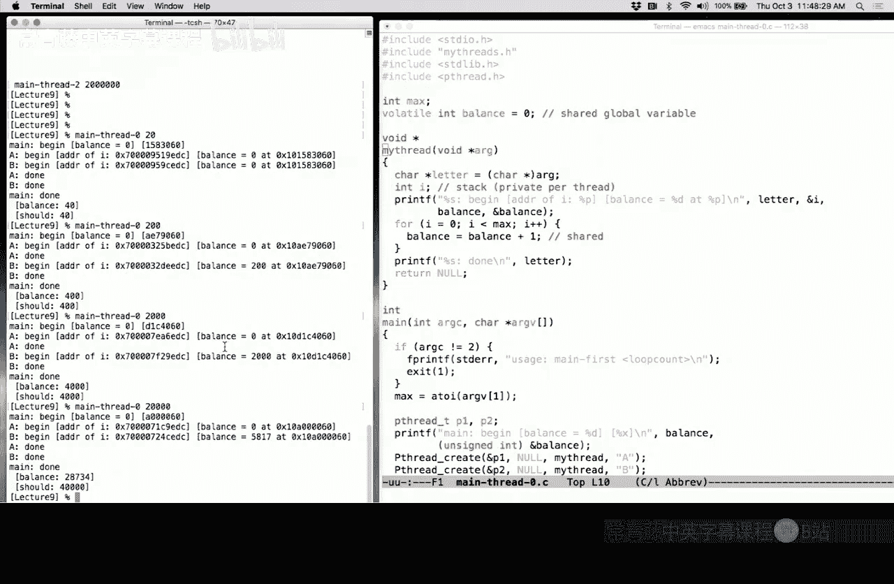
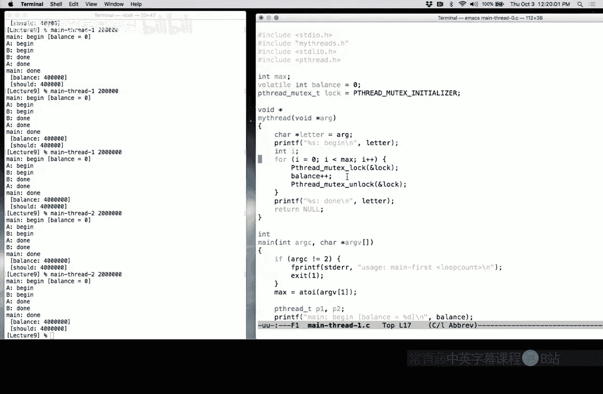

# 威斯康星大学【中英⚡操作系统｜CS 537 Fall19, Introduction to Operating Systems】 p10 P10 Introduction to Concurrency _ University of Wisconsin-Madison -BV1wUzSB3Ecf_p10-

Start recording today。What I said will be a mystery for posterity at this point。 O。

 now it is recording。All right， so today we're going to finish up virtual memory。

 and then we're going to mostly be talking about concurrency。

So to review what we were talking about in our previous lecture， we are talking about swapping。

 So the basic idea of swapping or paging out to disk is we need to support address spaces who sum is greater than the amount of physical memory we have in the machine。

 And so we provide this illusion from the O to applications to make them think that they are the only application that's actually running and that they have all of the memory available to them。

 So their performance might be slightly worse because they're sharing but they should still have the same correctness and the same behavior as if they were the only process running on the machine at that time。

 And so basically what we're going to do is we're going to use the disk or whatever we have a persistent storage to page out portions of the processes address space to that disk And if we're smart with our policies and we figure out what pages we should move in and out。

 we can end up getting the same performance as if we really just had a larger memory and your whole address space was in physical memory the whole time。

Okay， and so I'm not enjoying that。Okay， so to review。

What exactly happens when you need to translate a virtual address to a physical address you've seen these steps many times now。

 So the first step is you look in the TLB for a match between your VPN or your virtual page number is it in the TLB or not if it is。

 that's a TLB hit you're completely done。 you will now know what the physical page number is。

 you need to do no more lookups and you just append the offset from the virtual page into the physical page and you're done So that's a great fast case。

 that should be the common case。What could happen is that VPN might not be in the TLB。

 that would be a TLB Miss when you have a TLB Miss。

 it could be either the hardware or the OS that then has to walk the page tables and do all of that work to figure out where that virtual page lives in physical memory。

 Of course， it might not actually live in physical memory。

 It depends upon whether that present bit is set in the page table for the particular page you're looking up。

If it is present， then that's also。Relatively straightforward。

 So what we were talking about in our last lecture is if the page is not present。

 If that present bit is not set， then that's what's called the page fault。 This is very。

 very expensive to handle its milliseconds worth of time。

 because we're actually going to have to go out to disk to fetch that page from disk。

 And so we introduced a bunch of new bits to be aware of that are going to be in each of those page table entries。

 So， for example， we might want to have a use bit， which is going to show how recently a particular page was used in like that clock algorithm or LRU would look to see if the use bit was set to pick the best page to keep in memory versus to throw out to the disk system there。

Another bit that we were adding to our Ps or our page table entries is that dirty bit。

 The dirty bit shows that we've modified the page since it was out on disk。

 so the two copies don't match。 So if we need to evict that page from memory。

 we're going to have to write out those contents to keep everything synchronized。And so。

 remember when。When we have a page fault there， it's going to take a long time to handle that。

 So in the meantime， the process that caused that fault to happen is going to be blocked。

 We're not going to schedule it。 It doesn't have any useful work to do。

 We want to schedule another process that's ready that has some useful work to do while the I O system is going off in handling that page fault doing that read from disk。

Finally， when that page gets read back from disk， we'll update our page table to show the physical page where that now resides and will set the present bit so that future accesses to this will know that the page is in memory。

And then finally， our last step is that we mark that this process is now ready。

 and then maybe the scheduler will pick this process as the next one to run。

 but it could keep another process running instead。

 That's really whatever is up to the scheduling policy there。So that is our review。

 and especially if you understand all the details of how to walk page tables。

 then you've got a good picture of what's going on in your head here。Okay。

 so the question I left to all with at the end of lecture last time was to think about the performance of a workload where you have processes that are alternating between I O and CPU。

 And maybe they also have a pretty big memory footprint or a large working set where they need to access a decent amount of memory in order to get useful work done。

And so， I was asking you。Can you think of what a graph would look like？

As we increase the number of processes that are running。Along the X axis。

And then our Y axis is some measure of throughputs。

So maybe it's some amount of work that's getting done per second， or maybe it's。

Utilization of the CPU， in fact maybe utilization of CPU is the easiest one to kind of think about。

Because the utilization of the CPU it would start at 0%， there's no useful work getting done。

 and then at 100% it's fully maxed out we're getting every cycle out of the CPU。

 so as you add processes， if we use utilization as our metric， when there's zero processes。

 obviously we're getting zero work done our utilization is zero when we add one process。

It's going to depend upon its ratio of compute time to I O time with how much the CPU gets utilized。

 right， So if it had like a cycle that was using the CPU for 25% of the time。

 then our utilization would be about 25%。 And if we added another process that was doing the same thing。

Maybe our utilization would get up to 50 and then 75 and 100。So it increases for a while。 And。

 of course， those things aren't all going to be synchronized so perfectly So our line wouldn't be so perfect as this。

 But basically， it goes up until it maxes out at something。

Our CPU is as utilized as it's going to get for this workload。

 And we keep adding processes for a while， and there'll be some extra overhead with the context switches。

 but it'll be doing okay。 We'll still have our00% utilization。But at some point。

 your performance is going to drop way down。And what that happens at that point is that at this point。

 know the sum of our working sets。For these processes that want to run。

 the amount of memory that they have to access to get any useful work done is going to exceed the physical amount of memory we have in that machine。

 And so then we're going to start spending all of our time thrashing。And so at that point。

 you were basically handling page faults all the time。 And those page faults are not useful work。

 They're not adding to the CPU utilization of your machine。 So at some point。

 you're just not getting anything you're done。 You're just always waiting for some page fault to be handled。

 So if you ever see your system performance falling off a cliff like this。

 it's often because you don't have enough memory because you're spending all of your time handling page faults。

Alright， Any questions。Allright。Kind of okay。Oh。Is that why the C。

 S lab computers sometimes have really bad performance。It's certainly， well。

 it shouldn't cause them to crash。 That is really bad if it's somehow。Exacerbates some bug out there。

 But yeah， I could imagine that the C S Inal lab， if you have a lot of people running different things。

 you're going to end up getting into this mode where。It's， it's possible。Yeah。

 that's why sometimes you don't like having to share computers with other people。

 because we try to provide this illusion that you have the machine to yourself。

 but it's just an illusion。 And at some point， it's probably a memory problem that you're running into。

 Yep， So search around for a machine that has fewer things running。

Yeah so that's also why you can't necessarily just look for the machine with the lowest utilization and use that as your machine。

 because then you could be finding a machine that's only 10% utilized and you're like， oh。

 that's a great machine Nobodys using that I'm going to add to that load and you're just going to keep adding to this part of the graph here。

 so you really need to look for a machine that has the lowest memory amount being used at that point of time。

 that's the one you should pick to do your work on。All right。Okay。

 so then the other things that I wanted to。leave you with is this is kind of a challenge question。

 So we've been talking a bit about like maybe hardware being able to set a dirty bit or a use bit so that the O S could look at that and it could make better choices about what page should be picked at as a victim。

So the intellectual exercise is to think about， well。

 what if you had a machine in architecture that didn't automatically set this dirty bit whenever a page was written to。

 Could you emulate that in software。So the insight here。

 And so imagine we have a machine where it's even it's a hardware filled T L B。

 So whenever we have a TL B miss， T the hardware understands the format of the page tables。

 and it does all of the walking。 And the O S really doesn't get involved with any of these address translations。

 But somehow the O S needs to track that a certain page has just been written to that we've just done an address translation for a particular page。

So kind of the neat thing that you can do here。 Well。

 when does the O S get control from the hardware。It's when a process doesn't have permission to write or to access a particular page。

 So if the OS wants to emulate having a dirty bit， what it can do is it can modify the page table that the hardware is walking and make it fakely look like this process doesn't have right permission to that page and then we'll get the hardware will give us a Seg fault。

 The OS gets to handle that。 The OS has some other data structure that it's been keeping secret that shows。

 yeah， this process really does have right permission to this。

 I was just trying to emulate a dirty bit。And so then it gets control。 It can set its's dirty bed。

 do whatever accounting it wants to do。Say， hey， this process really should be able to access this page。

And it just resumes the process and lets the hardware continue with that work。

 And so it modifies the page table so that it shows that now the process really does have right permission to that page。

 So then future access is to that。Page won't cause that trap to occur。

 And it's only when you need to set the dirty bit for the first time。

 So it doesn't really hurt performance。 It's just only when you need to set the dirty bit or change the dirty bit and notice what's happening that you would kind of go through all of that。

So that's sort of like a bonus level of question。 And so if you think that's neat， that's awesome。

 If you're like， I don't know what she's talking about right now。

 you can pretty much let that one go。 But that's kind of。

 that's kind of a neat thing to understand how to do。😊，Alright， so that is it for virtual memory。

 So we've been talking so far about how to give each process the impression that it has exclusive access to all of physical memory。

 We were talking about how to put a code segment， a heap segment。

 a stack segment in your address space。 We talked about a bunch of different ways of doing address translation。

 really focusing on the ones that allow us to do dynamic relocation。

 So remember the first dynamic relocation approaches we just have like a base register。

 Then we had a base and bounds。 And then we had segmentation。

And then we started looking at paging and combining paging with segmentation。

 And the tricky thing about paging that really makes it work in modern systems is why we need to have a TLB there so that most translations can be done very。

 very quickly because we're doing these address lookups all the time every time we do an instruction fetch or load or stored a memory。

 And then the other thing that's a little bit complex and is interesting to understand is really how to make it so that page tables fit within pages。

 And so that's why we have those multi-level page tables so that each page table fits within a page And we have that page directory that's kind of like our outer level that tells us where all of the individual page tables live in memory。

And then our last lecture was just how do we really handle it when we have more virtual memory address spaces than physical memory？

All right。So that is it for virtual memory。And I think if you all have questions on that。

 please have them prepared for Tuesday when we kind of go over all of that stuff again before the exam。

Okay， so yes， at this point， we have completely covered how the O S provides this illusion or this abstraction so that each process thinks that they had exclusive access to the machine。

 So first， we talked about how we could virtualize the CPU。 We talked about a mechanism。

 and then we talked about policy。 So the mechanism was really how to do that context switch。

 And then the policy that we would also implement would be like round Robbin or shortest job first or the ones that have preemption like shortest time to completion first。

And then after we talked about how to virtualize the CPU， we talked about how to virtualize memory。

 And that's what we've been going over。 Okay， so we're completely done with that stuff。

 It's kind of the foundation and the base that really helps you understand how everything is working。

 And the next stuff is going to assume you know that。

 But it's really not going to get into all the details too much。

 So it really is a huge focus shift in the class。 And I really like the other topics as well。

 So I like talking about concurrency。 Okay， so on to a new topic。😊，Okay， concurrency。F。All right。

So why do we need to worry about concurrency So this graph is showing what is it processor speed performance versus relative to some machine from 1978。

 the backs 11 and as you all know， performance was increasing。 this is on a log scale。

 so it was increasing exponentially for many fine years in the 80s and 90s that was just like the prime time to be a computer architect we were seeing great performance improvements。

And then that performance improvement starts to level off dramatically because of scaling properties of transistors that basically you just can't keep making transistors smaller and faster。

 We've run into a lot of actual physical limits there。So now the growth is very， very small per year。

 And so really the only way to get faster then is if we can't make a single CPU faster due to all these limits that we're hitting。

 we're just going to have to start using more CPUs and do things in parallel。

 So that's the motivation for that。We're not seeing increases in speed。

 So we have to start using parallelism。 We're going to have multiple cores within even a single machine。

 So how can we use multiple cores？ So one approach would be how we use them in the instructional lab。

 right， You have a bunch of different users that all use the machine。

 You have a bunch of different processes or applications。 They're not cooperative in any way。

 But you can throw more jobs on that machine when you have more CPUs， but。

That isn't going to speed up an individual application。 So instead。

 what we really want to focus on is how can we write these really high performance。

 sophisticated applications that on their own are able to to utilize multiple Cs， okay。

So one option would be we already understand how to use processes。

 So you're going to figure out how to split up your application to have multiple processes that are all working or cooperating together in order to get some work done。

 So you could imagine a web browser being built this way。

 It's pretty common to isolate like each tab with a different process。

 And then you have some isolation in those different requests that you're doing。

 can't interfere with one another。 And you have some security benefits actually out of doing that。

So the way that you would end up structuring something like this is if the different applications。

 sorry， the different processes within that application need to communicate with one another。

You have to do kind of painful， slow ways to do that。

 So you can have like shared messages where you communicate the data that you need to across the different processes。

 or you can use something that's called a pipe where you can basically send messages from one process to another。

But the problem with this is that it's going to be really。

 really slow to do all of that communication through shared messages or through pipes。

 and it's going to be pretty expensive to context switch across process because we're doing a process context switch。

 we know some of the costs was associated with just changing registers。

 but also now we're needing to completely change the address space of these processes。

 even though they're cooperating and we know that means flushing the TLB and taking kind of all of these cache performance hits。

 So it really is like our memory performance is going to be bad when we have to context switch across different processes。

So we're going to just completely disregard that。And move on to option 2。

 which is what we're going to be learning about where we want to have multithreaded applications。

 So the idea here is that we'll have a single process and we'll have multiple threads that can all be executing concurrently within that process。

 And so those threads could all be running on the same CPU or maybe the scheduler is picking up each individual thread and running it on a different core so that we can get that parallelism that we are hoping for。

So the way to think about a thread is it's just like a process。

 It's a running stream of instructions， except all of the threads that are in a process share the same address space。

So we're not going to have those same like you have to flush the TLB when you switch between one thread and another。

 and they can all access the same code and they can all access the same heap。

 the same data that you've dynamically allocated using MAC or anything that you had as a global variable。

 That will just be shared。 It'll be very easy to access the same memory。

So we are going to be figuring out how to take that task that you wanted to make faster and how to split it up across cooperating threads。

 And so that is a key that these are cooperating threads。 if we were doing the process approach。

 you can't assume that different processes are cooperative。

 we really had to have isolation between each of them。

 make sure they can't read and write each other's memory here we are assuming for sure that those threads are cooperative with one another if they're in the same process。

 and so that's going to make some things easier to do。Okay。

So as we write our multi threaded applications， we're going to see that there's a bunch of different kind of common stylistic patterns that people do。

So one common approach is to have what's called like this producer consumer relationship across different threads。

 So imagine you have some threads that are producing work。And like， they've done a first pass over。

Looking at some data， for example， And then they're able to maybe summarize that data。

 And they put it into a shared queue。 And then the next phase of the work grabs that work out of the queue。

 They are the consumers of the work that's been generated。

 And they figure out some more transformations on that。

 So like you have this shared buffer between the producers and the consumers where the producers are producing work that the consumers understand and know how to manipulate。

 So we'll be talking about how to do the synchronization between producer。

 consumer styles in a lot of detail in this class。😊。

Then something that's very related to this is to have like a pipeline of dependencies within a parallel program。

 So here the idea is that there's multiple stages of work and each of those stages is pretty similar。

 So for example， you have a pipeline whenever you use UniX pipes and you pipe the output of one command is the input to the next and the output of that command could be the input to the next command you know on the command line。

So theoretically， all of those components can be running in parallel as long as they have work to do。

 So each of those components you could view as a thread that's waiting for some work。

 doing some tasks and producing more work for the next task in the pipeline。And then finally。

 I think the one that's easiest to imagine is you have critical work that needs to be done。

 But then maybe there's some background work that。Isn't so essential。

 and you can defer that until maybe the CPU is idle or you've accumulated a bunch of work and then get it all done at once。

So you could think about when we were looking at virtual memory。

 where was there some work that might have been useful to put into the background。

So if you think about what we are talking about with swapping。

Where was some task that we could have moved off like the critical path and moved into another thread that was part of the O S。

Doing something useful for us。 Anyone have any ideas related to swapping and page replacements。Yeah。

Yeah， so we need to have those victim pages that are like the free pages where when we have a page fault and we need a free page to put our page we care about into in the background it would have been great if we had been doing a bunch of work to find。

 you know，50 victim pages。 So we'd have 50 free pages available for when the next page fault occurs。

 We'd already have a free page to use rather than having to do that work right then actively。

 So it's pretty common to have like you know， page De running in the past that's doing things like running around。

 looking at all the pages to see which are used， which ones are not being used and to start flushing that work out in the back。

So certainly within an O S， we have lots of different threads that are doing some work that just needs to be done eventually。

 some cleanup work and stuff。But we're not going be doing too much with within the O S having threads。

 We're going to focus more on user level applications， using threads。Okay。

 so let's get into some details， which for me， I think means let's have an animation。 Okay。

 so we are trying to figure out exactly what state is shared across threads that are part of the same process。

 So I'm imagining here。 we have two CPUs， and we have a thread running on each of them and there are threads that are part of the same process。

So we need to figure out what did the threads actually share？So first of all， the question is。

 do threads share page directories？Yes， because they share the same address space so they better have the same translations。

 it better be the case that when thread one looks at a certain logical or virtual address。

 it sees the same physical address that another thread looks like those all need to map to the same memory locations。

 so yes， there's some page directories that live in memory and the page tablebased register that's associated with each of those threads is going to point to the same page directory there。

Okay， next question， there's instruction pointers associated with each of these threads。

 Are those shared across the two threads。No， so it's clearly we want each thread to be able to be executing the functions that it needs to at a given point in time。

 It's running in a different portion of the code than the others。

 So it has to have its own instruction pointer。All right， so then the next question is。

 so I think the point I wanted to emphasize here is yes， they are sharing the same code。

 they can each access the same memory but they will have different instruction pointers so they are executing different portions of that code than one another。

 though they're in the same code address space， okay。So， oh， this is missing some。

Animation part here。 So then the question is do threads share the stack pointer and what's going on with stacks？

So are they going to have the same stack pointer？No， so they're in the same address space。

 They each are going to have their own stacks because they're each calling their own functions。

 Of course， And so， of course， you have to have the frame pointer， you know。

 the stack frames there so that you can call functions and return from them through each thread's own instruction path。

 But it also then is implying that all of the local variables are completely separate for these two threads。

 right， So the stacks are gonna be technically in the same address space。

 If these were malicious threads， they could actually read or write each other's stacks and mess up those stacks。

 But they're not supposed to their cooperative threads。

 And so your stack pointer will point to your own stack。 And as long as you well behaveved。

 you'll have your own local variables and stuff like that。Okay。

 so any questions about kind of what you share there。And all of the regular registers。

 those are completely independent。 You are not sharing registers。

 You have your own state that's associated with where that thread is currently executing in the code。

 its own variables and so forth。Okay， so what's actually shared when you have multiple threads that are in the same address space。

 well they're the same process， so they have the same PID， they do have the same address space。

 which is definitely useful for code and for your heap data。

 if one thread opens a file and it has a valid file descriptor you can share that file descriptor across threads and each of them can be doing reads or writes and you'll have to synchronize how you do that but they can be cooperating with how they access files。

Any of environment variables that you have in that process like your current working directory that's all going to be shared。

 they're certainly part of the same user and the same group you're going to have the same permissions across all of the threads in a process。

 If you have limits set up for the process， you're still going to have those limits。

But then there are some things that are separate per thread。

 So we do need a way to identify each thread。 So there will be a thread I D。 Then most importantly。

 each thread has its own set of registers。 So when we do a context switch across threads。

 It's going to be pretty similar to a context switch across processor， processes。 Sorry。

 we will be saving and restoring the registers that are associated with each thread。

 but we just don't need to change the page table you know， based register stuff。 page directory。嗯。

So we do need to save and restore the program counter， the stack pointer， all of the registers。

 but nothing to do with the address space。 And so， yes， as we said before。

 each thread is going to have its own stack so that it can be making its own。

Procedure calls and have its own local variables。Any questions？All right。

 so there are a lot of different libraries out there for creating and managing threads。

 we'll be assuming Po P threads in this class。 and so the most。Ovious， necessary operations。

 Are we have to have a way of creating a thread。 We'll look at that in a little bit more detail。

 Each thread has to be able to exit or terminate without exiting from the entire process。

 We need it to be that one thread can exit and the process keeps running。

 It isn't until all of the threads have exited that your process is going to exit。 And then finally。

 we're going to have a way to let one thread wait for another thread to call exit。

 And so in thread terminology， This is going to be called join that you're joining with another process to see when it's done。

 So that's almost identical to the weight function that you've been looking at in your shell for processes。

 But when it's thread， we call it join instead。😊，O。All right。

 so the idea of threads has been around for a long， long time。

 but there wasn't initially support for this， so back in those days when you don't have OS support。

 you could implement a thread library completely at the user level。

 so basically you have one kernel thread because that's what you always have in a process and we're going to write a user level library that somehow maps the threads that the user process thinks it has onto this one kernel thread。

And so at the user level， you have to do all of the context switch code。 You know。

 you just write some assembly code to save registers to some thread process， thread。

Control blocks instead of process control blocks and do what you can。

 So there are some advantages to having a user level thread library that does context switches。

 And so it's basically， well， the first one is obvious， you don't have support from the O to do it。

 Another one more subtle one is that you can have more specialized scheduling policies。

 if you're writing your own。 So if you're just relying on the Os to do scheduling choices for you。

 It has to do like the general case， what usually works well for very general purpose workloads。

 But if you know that your threads are all cooperating。

 then maybe you don't need to implement any preemption。

 you don't have to do something as fancy as around Robin。

 And when you don't have to do stuff like that， you can tend to get better performance because you can run maybe one thread to completion。

 And then it has much better cash behavior than if you are constantly context switching across different threads。

So sometimes you can do very specialized scheduling policies that really match well to your workload。

 And another advantage of having a user level thread library is that then you don't actually have to go into the O S when you're doing your context switches or when you're doing your synchronization。

 And it's a little bit faster。 if you don't have to do a system call to。

 to do every little decision you need to make。So those are the advantages。

 But what are the clear disadvantages of having just one user level thread that all sorry。

 one kernel level thread and all of our user level threads are being mapped onto that。Yeah。Well。

 that's the problem。 So this would only work on a single CPU。 yeah， single CPU。

 I think that's listed as the first。Yeah， you can't leverage multiprocess。Yeah。

 so if you just need to have threads to have better like utilization of your IO system and you need to have lots of work going。

 it's still useful to do this。 Or people do like many to one where they might just not have enough kernel level threads。

 But then some of the switches are done at the user level。 But yeah。

 you can't do this on you can't utilize multiple cores this way。

 And then once's another problem that I flashed up there very quickly。

It's that because the O S doesn't know that you actually have many threads worth of work。

 if the one thread that was running blocks on IO or a page fault。

The O S is going to think you don't have any more useful work to do。

 And it's going to block your entire process， right， So your one thread did a page fault。

 You would love it if you could just switch to another thread that has some useful work to do。

 It's not related to that at all。 The O S doesn't know that So what's going to block your whole process because of that one page fault。

So。That is something to understand about that mismatch between user level threads and kernel threads there。

But we are not going to assume that that's what we're doing anymore。

 We will go to the best case here， where the O S is actually providing us support for kernel level threads。

 It's the kernel that's doing the context switches and doing the scheduling across different threads。

And so these have exactly the opposing pros and cons now we can use a multiprocessor， of course。

 when one thread blocks， the OS just picks another thread or another process to run on that now idle CPU。

 but it's going to have slightly higher overhead because we have to go into the kernel whenever we want to do some synchronization。

 and it can be really tricky to make a highly scalable OS that can really run on 16 cores and do all of this。

 but that's topic for a future course。Okay。So let's look at a demo。

And we'll look at the code that we looked at in the very first class。 In the first class， I said。

 hey， it's okay。 if you don't understand what I'm talking about。 But today。

 we are going to understand what I was showing that first day。Okay， so this is some code。

 It's called main thread version 0。 And so it starts with a main， of course。

And it looks at its arguments and it says， you better pass me a loop counter， if you don't。

 I'm going to exit， then uses that number as the max value。

We are going to start up two worker threads in this program。

 So we'll have a total of three threads because we started with one。

 and then we're going to add these two。 So we have to allocate some structures that the Posss thread library understands。

Then we're going to print out some stuff because we're going to have this balance。

 which is a global variable。So it's a global variable。

 all threads should be seeing the same value in that global variable。

 and we use this keyword volatile to tell the compiler that there are multiple threads that are changing and accessing this variable。

 and so it can't just be kept in a register for the whole time， it has to be kept in memory。

All right， so we'll be getting to that。Then we call P thread create。 in this capital P。

 it's just a wrapper for lowercase P thread create that looks at the return codes because we always look at our return codes。

 right， And if it had given an error， then we need to handle that and exit。

 But I've just hidden that code from you。So we pass in the P thread structure that we allocated。

 null is the second argument。 That's just some stuff to do with the stack。

 We're just using default stack sizes， so we don't need to do anything fancy。

 Then I pass in the function that I want this thread to start with to start executing。

 So instead of having main where this thing is going to start。

 it's going to start executing with my thread that that would be pushed on a stack to get started。

 and that's its。Starting an ending point。And then in this interface。

 you can pass arguments to the function that you're calling。 And the way that this will work is that。

Since you could have many different types of functions， they all have to return just a a void star。

 you know， a pointer to some structure that we don't know what it is。

 And then we can be given an argument that's a pointer to some structure， whatever we want it to be。

 So we're just given a pointer。 That's our choice here。So look。

 and I'm just going to pass in A And B。 just tab a little bit more information so we can print out which threat is running。

 what its arguments were。Then our main thread does absolutely nothing useful。

 It just waits for those two threads to finish。 And the way that it does that is it just passes in that thread structure that we allocated before。

 And we're not doing anything special。 So null is the result is what we passed there。All right。

 so let us look at my thread。So we passed in a string。 I know that it's just a。That it's a string。

 So I'm gonna remember that。And then I'm going to print out in each thread。Which one it is A or B。

 And then I've allocated I on the stack。 So each of those will have its own copy of I， right。

Because I is going to be our art。Ittererate， and so clearly those need to be different across the two threads。

And then were going to look at what is in balance and what the address of balance is。

So let's just do that much so far。In can。Can you see what's in the other screen。 Okay。

 so let's just run this for a small number of iterations。 So we began。

 We saw that balance holds the value of 0， and it was stored at this particular address。

 Tread A begins。 And I just wanted to show you all to make sure you believe me that each of them has a different。

Address for I that that is a local variable that's on each of their stacks that those are different。

 whereasas the balance variable is a global variable。

 They're each seeing the same global variable there for balance。

And so what each of them are doing is they are incrementing balance by one for 20 times。

 So if this program works correctly， what we'll see is what happened here where at the end。

 the value is equal to 40， right。So we'll go into this in much more gory detail。In slides。

 and so this program works。For a while。And then at some point。

 I gave it a few more increments to do then we have this race condition。

 we have a context switch at an inopportune time， and this program that I thought was working。

 and I thought I had tested， it now says balance is equal to 28，734， instead of each of them。

 correctly incrementing balance by 20，000 getting 40，000 as the result。

So we are going to be spending a couple of lectures understanding why that's happening and then figuring out how to fix that。

And I think before I start showing you all the details on why。

 I will give you a couple of minute break， and then we'll come back to slides。All right。

 we'll get started again。 So are there any basic questions about how that code worked。

Our broken code that starts。Some processes up。

All right， so that is good that there's no high level questions and now we will get into all of the low level details to explain how all of that was working。

Great。Okay so basically what we're going to look at is different thread schedules where some of the thread schedules lead to the correct results and others lead to these race conditions where we're going to get the incorrect final answer and so we're going to look at three simple lines of assembly code and they correspond exactly to that key instruction in that inner loop where each of the threads is just incrementing balance by one and so these are the three instructions that correspond to that。

 we're moving the value that's in the balance variable that's at this particular address into a register then we're adding one to that register and then we're moving that value back out to the shared memory location and each thread is going to be doing that over and over again in the inner loop。

All right。So。It's a little noisy for me today。 So if you have questions。

 let me know and I will answer them for you。Okay， so what I want to show here。So remember。

 registers are being virtualized by the O。 So what that means is each thread thinks it has its own copy of each of the registers。

 So that means the O is saving each of the registers when we're not running。

 We will have a copy of that。 So that's what's in this process control block。

 or I probably should have called it a thread control block that we're now associating with every thread。

 So we're going to save all of its registers in this thread control block。

 but I'm only showing the two that we care about for today。

 which will be this EAX register and then our instruction pointer。 And so this is the global state。

 It's what's actually part of the hardware at this point in time。

 We're showing what are the contents of that balance variable。 we're starting at 100。

 There's an EA register that's actually physically present on the machine。

 and then there's the actual instruction pointer。 that's part of that machine。All right。

 so what i want to show is what is going to be the state after each of these instructions complete。

 let's make sure we understand each of these steps。

So thread1 is running initially and so indeed our instruction pointer is pointing to this particular address。

 we haven't yet initialized EAX， it has some garbage stuff in it and we just did a context switch from thread1 and so it and we got the value of the instruction pointer from what we had saved in the past for this thread okay so then we do a move from that variable into EAX so what's that going to do we have a value of 100 now in the EAX register。

And we advance our instruction pointer to point to the next instruction。 Then we call add。

 and we add one to E A X。And then we're at the next instruction。

 and then we move what's in EAX back to memory。And so we have 101 back there。

 So that's kind of the straightforward case that we hope always works， right。

Now there's multiple threads here， the scheduler can decide to switch to another thread at any point in time。

 so let's assume now that the OS decides to switch to threadread2。

 So what's going to happen is we need to save the state of thread1。

 so we take the values that are currently in the hardware and we put them in the control block for thread1 and we take thread2s values and put it in the hardware。

 That's what a context switch is right。So that's what I'm showing here。

 We copied the old values into Ts1 control block and T2's RIP went out to the actual register。

 So now thread2 looks like it is and it is running at this particular instruction and it has all of its right state in the hardware at that point in time。

Okay， so now we're going to keep running and now we're fetching the instruction here for thread2。

 it does its work， it moves the value that was in the balance variable which was 101 into the register。

 it increments the register to 102 and then it moves that back to the shared variable so that 102 lives there so at the end of two iterations in this case。

 balance holds our desired result of 102。So that worked。

So are there questions about what was happening there， yeah。Yeah， in these examples。

 it's all in the same processor。 the exact same concepts are going to apply when we have multiple processors。

 but it is easiest at this point to think of it as a single processor。

 and the scheduler is just making arbitrary decisions。

 and it's going to make like the worst decisions possible for us in some of the later examples。Great。

 so think of it as a single processor， and we're just switching back and forth between them at bad points in time。

More questions about how this was working。Yeah。Great， if we didn't put that volatile keyword。

 it probably wouldn't be doing these moves back and forth。

 It just would have been adding one forever and ever back to this register。

 And then at the end of the program， it would have written it back to balance。

So if we would have tried to run our program like that。

 then they each would have been modifying just their own local copy for a while。

 and you'd see even quicker than this example that it would run into problems。Yeah， good question。

Yeah。Oh， so， I mean， there's no guarantee that the scheduler is going to do this beautiful schedule for us。

 So that's what we're going to have to figure out how to make it so that this is the type of schedule that's guaranteed from the scheduler。

 If that's what your question is。Okay， so we'll look at some cases where it does not work。

So that was a schedule that worked。 Now let's look at an interleaving of instructions across T1 and T2 that leads to bad results。

 So T1 runs again first， we move the value of balance into the EAX register。 So we have a 100 there。

 we add one to it。 and then we're about to execute this move back of 101 into the shared variable But before we're able to do that the scheduler decides I want to run T2 now。

 because the scheduler can do this whenever it wants。

 And so before we copy 101 back to the balance T2 gets scheduled， we do that thread switch。

 you'll notice we put back the contents in the process control block for T1 for where it should resume from when we switch back to it and what it had in the value of EAX。

 When thread2 runs。We take its state and put that in the hardware， it hadn't yet initialized EAX。

 it has a different instruction pointer， so that's what's in our hardware。

 and that's where we're going to start fetching instructions from。

 So we execute the instruction at 195 for T2， it moves the value of 100。

 that it was in balance into its own EAX register。Which we show there， Then we add one to it。

 and then we write it back out。 So now the memory for balance holds 101。T2 is done。

We switch back to T1 because we know we need to run T1， it wasn't done yet。

It's going to execute just this one instruction。 We had saved its value of EAX。

 which was also1 and one101， but it already added to it。

 So all it's doing is moving that back into balance。 and so it just copies 101 over the。

Value that's already there。 So we get the incorrect result in this case that we've lost the work that one of them did。

 that we just overwrote the result that one of them had done because of this bad instruction interlaving。

Okay， so to make sure that you really understand what's going on。

 it is useful if you understand the registers and what's happening。O。

 so what I want you all to spend some time doing。It's too slow for us to draw the pictures like this each time。

 So I like to show these timeline views instead of so time is going down on the slide。

 And then I'm showing what is being scheduled in each thread。 So there's just one core again。

 And so first， what's happening in this example， This is the good schedule where first thread。

 one got run completely。 And then thread 2， I've changed the value that thread2 is incrementing。

 balanced by so that we can see some more interesting cases by doing this。

 So with this nice schedule， how much is going to be added to the variable when we're done with it。

 Itll be nicely three since we added one。 and then we added two。 We're adding a total of three。

So the way that can be useful to kind of track what's happening in this shorthand notation。

I find it useful to think about， what's in balance at each point in time or when it changes and what's in the EA X register when T1 is running versus for T2。

 So again， think of this as the registers are being virtualized。

 each thread thinks it has its own register。 We're saving and restoring those registers properly。

 So each of them does like have its own copy of that register。

 So you can then see if balance starts at0， what we're moving into EA X for T1 is 0。

 we then add a one to it， and then we move it back to the balance。

 And if it's not shown then the value stay the same。 And then we're moving one into T2's EAX。

 we're adding2 to it， and then we're moving it back。All right。

 so we'll use kind of this shorthand notation， except I'm going to have you figure them out。Okay。

 so this is also the example that we did。Already， so how much was added in this case？

We'll see that it will be 2， because balance starts at 0。 We move 0 into T 1's E A X。

 Then we add1 to it。 But then we have the context switch。

And so T 2 C thinks that 0 is the current value。 Then we move T1's value back to balance。

T 2 adds 2 to that。 Its old value moves 2 back。 And so we're stuck with2 at the end。

 So we kind of lost T 1's work。 So that was the example that we showed。In more gory detail。

 I'd like you to spend a moment figuring out what the final value will be for this case。

So talk to your neighbors， spend a minute。It'll be fun。

So I think it really does get easier if you write out balance and T1s， E A X and T 2s， E A X。

So who here thinks the answer is three， raise your hand。Of course it's not three。

 that would be correct， it's not who thinks the answer is two。

 raise your hand and who thinks the answer is one， raiseise your hand， okay， thanks， great， okay。

 one incorrect results。So balance holds 0 initially。 T 2 moves that over into its EA X。

 Then thread1 runs。 It moves what it sees in balance into its E A X。 Then we switch to thread2。

 It adds 2 to its E A X to get 2。 Then we switch back to thread1。 It adds one to its value of E A X。

 Then we switch back to thread 2， and it moves its E A X to balance， then we switch back to to T 1。

 and it moves its E A X to balance。😊，So that is why we get one。 So this type of thing can happen。

 This seems to be a pretty extreme malicious scheduler that did this to us。

 But in order for your code to be correct， after millions of iterations with no race conditions。

 you have to be worried about cases， even extremists as this one。Okay。So here's another one。

That one looks like it's going to be good right。 So the nice thing to observe here is that， again。

 each of these three instructions， they ran consecutively。

 we didn't have any context switches between them。 So that's starting to show that there's something about keeping these three instructions together。

 that's very， very important。Okay， and so one last one to make sure you're getting this。

 What's the final value going to be。Shortcut， yeah， I heard too。

 that you're able to see that the final value that's getting moved out to the balance variable is whatever P2 had in its EAX doesn't kind of matter what happened in between what thread2 is doing。

 it gets the final say it's the last rid or wins。And so you can write it out in more detail。

 seeing that T1 does some work， but basically T2 has that value of two。

 and it overwrites balance with that value of  two at the end。So any questions about this。O。

So what we've seen here is that we're going to get incorrect results whenever we have this nondeterministic behavior that we do not know exactly which instructions are going to be run one after another。

 and we're getting different results depending upon exactly what the scheduler does。

 So we have this race condition， this bug that is nondeterministic and depends upon the CPU schedule。

 And so this is why this class is so much fun。 not only do you have to get your programs working for the one case。

 but you have to worry about all the possible interleavings that could happen in your programs and get them to work for all。

 So that is where we are going with this， right that should be exciting。

 get this is so difficult and we get to learn how to do this。

 right so it really is good to think of the scheduler as being malicious。 It's doing context。

 which is it the exact wrong time for us because when you run code for 247。

 eventually it's going to do those bad interleavings。😊。

So what we saw in all those previous cases is that those three instructions need to be executed all together all in one run。

 so we're going to use the phrase that this is a critical section。

 there's something key about these three instructions， and we need them all to execute atically。

 but if atomically means it can't be divided， we're not having a switch in between any of those instructions。

 they're atomic。And more generally， we could look at this as we need to provide just mutual exclusion for this critical section。

 So it's okay if we have a context switch at this point to a completely different process。 right。

 if we do something completely different。 that's not going to mess us up。 We only have a problem。

 if we have the context switch to another thread that's messing around with the balance variable at this point。

 So we call that that we need mutual exclusion for a particular critical section saying that across this code。

 we can't switch over to another thread that's going to do that exact same code or that's going to do code that's also manipulating that balance variable。

 But it would be okay to switch to somebody else。O。

So that's what we're going to be covering for the next several lectures is how can we build up protection for critical sections so that we're guaranteed that we get the scheduling properties that we need。

 And so the idea is we want to provide higher level primitives that application developers can use。

 So we'll understand what locks are， We'll understand what condition variables and monitors are and we'll understand semaphos。

 and they all have different properties， performance characteristics。

 as well as as semantics for how exactly you use them and how you coordinate between one thread and another。

So most of the time， we're going to want to just be users of those synchronization primitives。

 but since this is O class， we're also going to understand how to implement those synchronization primitives within the O or within a user level library。

 and there's a bunch of different ways that you can do that。

 that we're going to have some hardware instructions that are atomic that we can build as a very strong primitive。

 more interesting things on top of like test and set or exchange that they do a whole bunch of things in one atomic construction。

So that's really going to be our best primitive， the others are a little bit more theoretical。Okay。

 so。This is not my summary though I will this is just apparently a summary for why we want concurrency so we want high performance。

😊，Yeah， our whole goal of doing concurrency is that we need high performance when we have multiple cores。

 we have these threads now and we're going to do conducts which is okay。

 so I want to talk about locks， though， So this is the one thing we'll just briefly introduce。😊。

So basically， we're going to put a lock around our critical section that was incrementing the balance variable and that this is a primitive that's available to us in Poss P threads。

 very simple to use。 You just allocate it and initialize it to show that the lock is not currently being held。

 and then we're going to have two primitives that allow us to lock or acquire the lock。And basically。

 what this says is when I call this， it's going to block or spin weight。

 but it's better performance if we just block that we're just going to wait at that call。

Until we're sure that nobody else has the lock。So we'll just wait at that statement until no one has the lock so either someone has released the lock or no one ever acquired it。

 so then when you're done with a critical section you call release or unlock and that lets other processes grab the lock。

Okay， so。Let us just see very quickly what code looks like when we use locks。So main thread 1。c。

 our second version。We saw that incrementing that balance variable， that is a critical section。

 It needs to execute atomically。 So in C， it looks like it's one statement， but， of course。

 that is three assembly。 Oh， thank you。Great， so this is version1 instead of version0。

 I've just added locks around the incrementing of balance。

 so balance was just one C statement that obviously three assembly instructions and we need to make sure that that executes atomically and the way we can do that is by making sure that we have a lock around it so we have now a global variable that is a lock。

 the lock has to be shared across all the threads of the process。 so it has to be a global variable。

 we initialize it to show that the lock is not held。

 then when the first thread comes through and calls lock。

 it'll see that the lock isn't held right now and so the lock will return and then if while that thread is incrementing balance。

 we have a context switch and the other thread gets scheduled and it calls lock。

Lock will not return because the previous thread has not yet called unlock。

 So the second thread will just be stuck there until the first thread gets scheduled again。

 finishes its work， and then calls unlock。 And then once it's called unlock。

 the other one can finish， it's called a lock。 So that guarantees that all of those important instructions execute consecutively。

So now， if I run this version of the code， I am fairly confident that it might be slow， but。

It will be correct for any values that I want to add to a shared counter， so。

This is going to have very poor performance， though。

 because we're constantly calling lock and unlock。 There are other ways that you could do this。 So。

 for example， we could。Call lock and unlock around the entire loop。

 So this is making our critical section much larger。

 That doesn't give us as much concurrency in the program because now none of those operations can be going on concurrently across those threats。

 but。It will give us much better performance。 See， that's happening almost instantaneously。

 because now I only have to call lock one time for each one。

 There's no blocking and waiting for the lock to be released。But in general， we want to have context。

 which is small。 So we'll kind of talk about those issues as we go。 And in our next lecture。

 we're going to talk about how do you actually implement Lock。

Given a variety of different assumptions。 So that's going to be fun。

 but that will not be on your exam next week， but we'll talk about that on Thursday since Tuesday will be a review。

 And so I'll post a form。 So if you have questions that you'd like to ask for the review for Tuesday。

 fill out the form。 See you Tuesday。Have been outside。Because。

It takes like a few seconds for for you to get。Yeah， what do you do to change the performance。

Oh here right， so here the I'm grabbing the lock just once and then I'm doing all my work and then I'm calling on lock and then the other thread can go through and do this whereas the one。

This one it's calling lock and unlock every time through the loop it's calling it you know two million times and there's just a lot of overhead associated with calling these routines Oh I see so actually when you have it outside the loop it's not actually concurrancy anymore it's not really yeah all right thank。

No。商品吧。嗯。Oh。Maybe。

