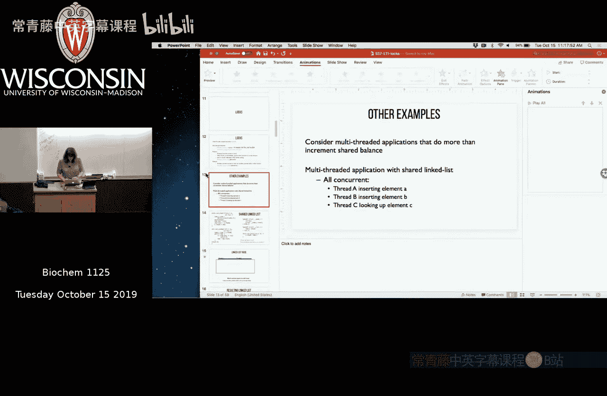
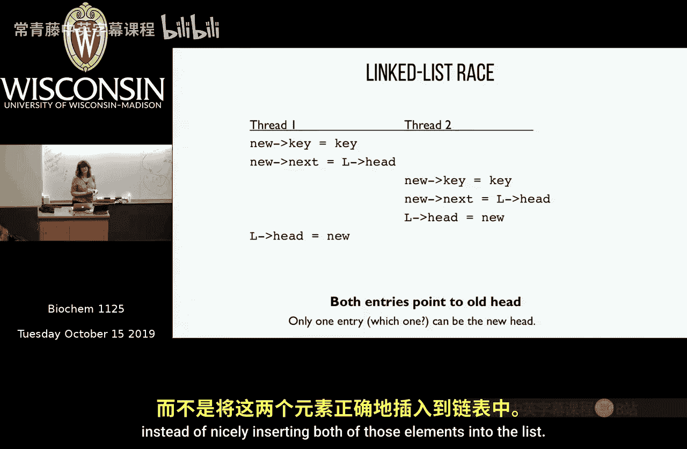
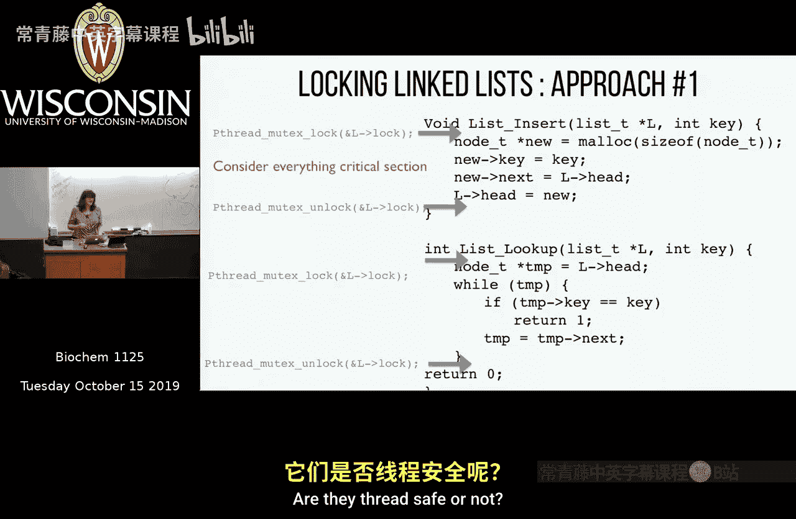
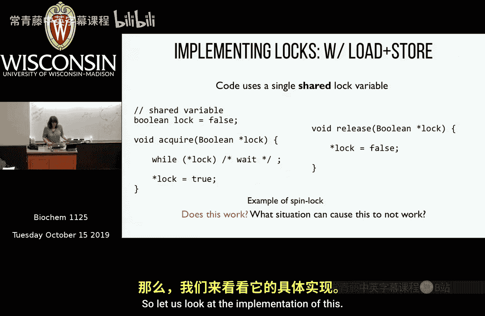
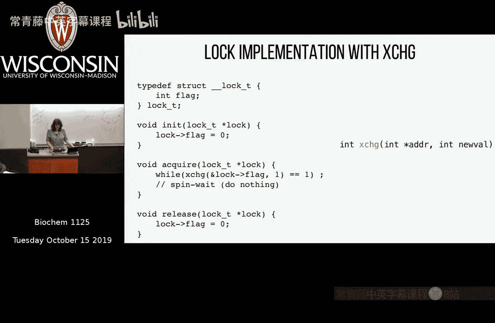
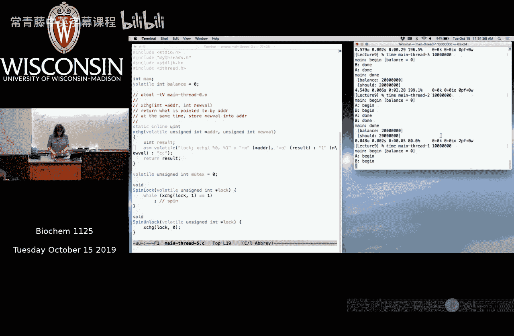
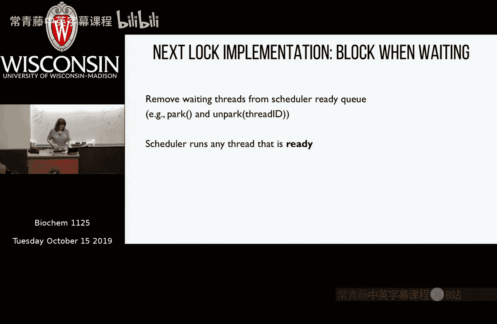

# 威斯康星大学【中英⚡操作系统｜CS 537 Fall19, Introduction to Operating Systems】 p11 P11 Concurrency_ Locks _ University of Wisconsin-Madison -BV1wUzSB3Ecf_p11-

All right， Good morning， everybody。 It's great to see you all again， after the exam。😊。

So we're going to be continuing our topic on concurrency that we had one lecture on before the exam。

 then we had a bit of a break since we had a review。 then we had no lecture。 took an exam。

 So congrats， I' finishing your first exam。 I thought the average was pretty decently high on this。

 So you can get the exact details of how you did by looking at that midterm1 Pdf file in your handin directory that shows for every question what the right answer was and what you answered。

 And I've also posted all of the questions， the actual exam you took and my detailed solution guide explaining my rationale for the answers I gave。

 So you should take a look at that to figure out what went on with the exam that you took。

 So basically the way that I tend to grade is I look at quintiles for you know the top 20% of students scored an 81 points or above then the second20% scored 77 or above and so forth。

 So that's just very rough。 But basically the top quintile as an A。Quntile is an A B。

71 and above is a B，65 and above is a B， C。 And then there's lots of wiggle room down there at the bottom。

But， of course， things change quite a bit by the time we get to your final grades。

 and we look at the actual numbers you got， not how it mapped to these letter grades at that point。

Okay， so people have asked， are future exams going to be cumulative at all。

 They are slightly cumulative。 You can't completely forget this material。

 I tend to go back through the exam and see which questions did people find very difficult because I get these great statistics from doing a multiple choice exam。

 That's the awesome thing from me about multiple choice exams is I get to see exactly how many people got each question right or wrong。

 And lots of stuff。 So I pick out the difficult questions and ask them again on the next exam。

So please spend some time looking over the solutions to that exam that you took。

 So what I'm anticipating is that in discussion section tomorrow， the Ts will go over a little bit。

 Those midterm answers， as well as going over Project 4。

 So you all know that Project 4 is due right now on the X C6 scheduler。

 lots of details there to getting that All right， it's a frustrating project in that when it fails。

 And when you don't get processes running， it can fail pretty horrendously。

 So give yourself some time for that and let yourself be patient。😊，If it's not working。

 you just usually have a small bug。 you have to fix。 And then it works great。

 If you haven't yet found a partner and you want to have a partner assigned to you。

 then fill out that form， We still make matches as people trickle in until we get to an odd number of people。

 And then we're like， sorry， that odd last person。 We didn't have a even number for you， but。

So keep submitting if you are interested。So any questions about the midterm or project 4。O。

 I'm sure you have lots of questions about Project 4。

 but you realize this is not the right atmosphere for that。Okay， so today。

 we're going to continue talking about concurrency。

 We're going to go over a different example than incrementing that global balance variable to make it a little bit more interesting to see why we might need mutual exclusion across multiple threads。

 Well， and then we'll look at different ways of implementing locks。

 We'll look at how to implement locks by disabling interrupts。

 which is a bad idea with using just loads in stores， which is a bad idea。 And then finally。

 the implementation that works。 which is we use these atomic hardware instructions like test and set。

 And that's how all modern lock primitives and synchronization primitives are built up。😊，Allright。

Okay， so you'll remember。In our lecture last week， we are motivating why concurrency is such an important problem while we all have to understand how to program with multiple threads。

 So quite a while ago， it was the case that Moore's law was giving us this great improvement in processor speed every year。

 This is a log scales。 It was really， really getting faster just at the architecture level。 know。

 instructions were executing more quickly。 you didn't really have to do a whole lot in software。

 But at some point that performance improvement has flattened out。

 And so the only way that we're getting performance improvements now as to add multiple cores or multiple processors to a single machine。

 And then using all of those cores simultaneously。 So we're going to be talking about how can use threads to use all of those cores simultaneously。

Alright， so you'll remember this was a picture kind of showing what different threads running as part of the same process are going to share。

So you'll remember that each thread that's part of the same process。

 They have the same address space。 They have the same view of virtual memory。

 So they have the same code。 They have the same heap。They're going to virtualize their registers。

 So each thread thinks that it has its own copy of all of the you know， integer registers。

 the instruction pointer， the stack pointer and all of that。Because obviously。

 they're executing at different points in the code。

 So they're going to have to have different instruction pointers or different program counters or PCs。

 They each have different stacks within that shared address space。

 since they each have their own copies of local variables。

 They're each calling their own procedures and functions and stuff like that。

 And then though their page tables are going to be shared， they're part of the same address space。

 they're part of the same process。 So if you looked at the value of that page directory based register or page table based register。

 they both be pointing to the same page table in physical memory there。

So I think that's the main point to that。Alright， so then the next thing we were looking at was trying to understand what could go on when you have multiple threads of the same process。

 executing code， and you could have context whiches occurring at arbitrary points。

 Would we get always the correct expected result。So we were doing these timeline views where we have time going down。

 oops。And we have multiple threads。 And so I'm just trying to show an interleaving of instructions of what could be happening here。

 So what's happening in this particular example is thread1 is moving some value into its EA X register。

 So that was like that balance variable。 It's getting what that value is。

 It's then adding one to it in the register。 And then it's moving that value that's in the register back out to the shared memory location。

 Then we have a context switch and another thread runs and it grabs what's now in the balance variable。

 which is one more than it used to be。 adds two to it in its local register。

 and then stores out that value that's in its local register back out to the balance variable。

 So this example worked perfectly because we had a context switch at a nice convenient point。😊。

So nothing was going wrong here。U。But there were many， many examples where if we have a time。

 If we have a context switch that occurs at a bad moment， we could get the wrong results here。

 So try to remember why this one went wrong。So thread  one runs。

 It gets the current value of balance in its register。

 Then we have a context switch over to this thread。

 It gets the old value also of balance into its register， adds 2 to it。

 and then writes that out to the shared value。Then we have a switch back to thread1。

 It adds just one back to the value that it saw back here and copies that back out or stores that back out to balance。

 So the result of running this is that we just see that the variable was incremented by one， right。

 instead of by3， which is the desired result of running these two threads。So again。

 this is just going to end up getting this value of E A X here。

 adding one to it and writing that back out to the balance variable in memory。So。

Any questions about that。Do you remember what was going on with that。 So remember。

 registers are virtualized。 You really want to view it as each thread has its own copy of those registers。

 because those registers are being saved and restored every time you do a context switch across different threads。

 So that's why it looks like they have their own。Copy of those registers。And then， of course。

 this is a heap variable。 So they're able to access the same variable。

 They're seeing the same values there。And then the other interesting thing to think about is I'm going to always be assuming we're running on a single core or unprocessor。

 And so I'm showing all of this like as a scheduler that's doing context switches that bad points in time。

 but you really could view this as threads running on different cores and that these things are just kind of happening at about the same time。

 just in on different cores and then they really are updating different registers。

 but still that same variable is going to be accessed on the heap And so you end up getting kind of the same functional results。

 whether this is just being time shared on a single core。

 or if this was really running on different cores at slightly different instances in time。

 know one of these operations is always going to happen slightly before the other one of those stores is going to happen last and be the one that wins。

So any questions。Alright， so what we ended up seeing in our lecture a long time ago is that because of this concurrency。

 we were getting nondeministic results that sometimes we were getting the correct result that that balance variable was being incremented by three。

 sometimes just by one， sometimes by two。So we're getting different results。

 even with the exact same inputs， because there are these timing variations。

 There's these race conditions， depending upon exactly what the scheduler decides to do。

So it's pretty painful for us that we write code that worked one time。

 and then we run it for 1000 iterations， and then it fails because at some point。

 the CPU scheduler decides to do something that's very bad to us and have a switch at the exact bad moment in time for us。

So you really do have to get in the mindset of， you know， what is the scheduler going to do。

 You can't make any assumptions about it。 You have to assume that this scheduler is malicious。

 Once it gets to try a billion times on your code， it's going to find the worst possible inter leave of instructions for you。

 So that's a good mindset to get into。 is assume that the scheduler is eventually going to do something malicious to you。

Alright， so what we were looking at in the previous lecture was we had those three instructions。

 And what we saw is that we would only get the correct results if they all three executed atomically or they all executed without any interruptions。

 without any switching over to another thread。So that's what we're going to be looking at now is how can we provide that。

 How can we provide aimity or how can we make it so that we provide mutual exclusion。

 which means that。When this runs， it excludes that same code running on another thread。

So if we have this critical section of code and then we need to have mutual exclusion over that。

 that means that only one thread can be executing in that critical section at a time。O。

So then we talked about locks。And this is still a little bit what we were talking about before the exam that locks are this primitive that are provided in any system I can really think of that provides mutual exclusions。

 So sometimes they're just called a mutex as a shorthand way of saying mutual exclusion。

 They provide they are a mutex。 So P threads， the Pos thread library that allows you to create threads and wait for threads also allows you to provide it has different synchronization methods within the P threads library。

 So one of them is this P thread muttex And so on your heap in some shared space。

 you're just going to allocate a lock and initialize it to some you know unlocked value。

And then whenever you have a critical section， what the thread will do is it will call P thread newt lock。

 which is like acquiring a lock。 And what that means is that this。

Library call is not going to return until it can guarantee that no other thread currently has that lock。

 right， It'll just wait here until all of the other threads have called unlock lock or they never called lock to begin with。

 And we don't know yet what's going on inside of P thread Mu text lock。

 We're gonna to look at different ways of actually implementing that。 It could be that we spin wait。

 We just busy wait， We just keep checking some variables to see。

 is it okay to to return from Mu text lock。 or later we're going to get some support from the scheduler to actually block this process and say there's no point in running us right now。

 We don't have the lock wait until we have the lock。 and then schedule us。Okay。And then release。

 that's the opposite of a choir。 We then tell every other process that we are done with this critical section and they can run。

 Okay， so that's the interface there。Mo你。Let me go back to the code we are looking at in class the other week。

And let's remind you of this stuff。Because I'm having a feeling。 Maybe you all don't remember this。

Okay， so you'll remember， we had this main routine， and it starts up two threads。

 And the two threads are going to start at the function call My thread。

 And we're passing in a string to each of them so that I can identify them better。

 And then this main thread calls join， which is very similar to calling weight on processes。

 We just use the terminology join when we're talking about threads。

 And so the main thread has to wait until both of those threads are done before it can continue and print out that balance value。

And we had a shared。Variable balance that's allocated on the heap that we use the keyword volatile for to tell the compiler that it shouldn't be keeping that in a register。

 that it's going to be modified by multiple threads。 So it has to be kept in memory。

 Then this is the my thread routine that each of the threads are starting with。

 They have some local variables that are allocated on its private stack。

 And what it they each do is they just increment balance by one through each time through the loop。

 So if we run。That routine for just like 10 iterations。

 we get the result that we expect that with two threads incrementing it 10 times at the end。

 it's equal to 20， right， And then we do it 100 times， and it still works。 We do it 1 thousand times。

 It still works。 Do 10000 times。 I's doing pretty well today。 There we go。All right。

 we got up to 10000。 And that's at what point it failed。

 that one of these threads had the copy of balance in its register when we had a context switch to the other thread and that other thread ends up overriding some of the work that this thread is also doing because it's just doing it in its local register。

All right。So what we looked at then in class last time was。Adding P threads to this。Sorry。

 adding new text to this。 So the idea is incrementing balance。 That's a critical section。

 That single C statement corresponds to three assembly instructions。

 we need to make sure that they execute atomically， This is our critical section。

 So we wrap acquiring a lock around incrementing balance so that it cannot be the case that both threads are doing that operation concurrently or at the same time or in parallel。

 That cannot be happening。 And so now， when we run that version， main thread 1。It's a lot slower。

 maybe you could tell。But。It's slower。We have to wait， but it is always correct。

And it is quite a bit slower because we're doing a lot of work with the P threadd Mutex routine that it's actually putting a process to its blocking it if the lock isn't available。

 So there's lots of extra overhead that's associated with that。

 So we'll be looking at other implementations of locks that are better in some circumstances。

 But certainly this one's a good generic one and works in lots of general cases。Okay。

 so any question about this code， This is what we looked at last week， two weeks ago。

 But it's fine if you don't remember it。 So please。😊，Get us all back into the mindset of this。

If there's things you want me to go over about this。Yeah。Oh， great。

 So when we look at how lock is implemented， it needs to have some atomic primitives that it's using in order to provide a correct implementation of lock。

So then it gives us， once we have this lock， we know that no other thread can have that lock。

 So we're the only thread that could be executing this statement right now。

 And only after we call unlocklock， could another thread acquire the lock and be inside this critical section incrementing that variable。

Any more questions？Alright。Oops。

去。

Frustrating。What did。😔，Okay。So instead of always incrementing a balance variable as our example。

 I thought we'd look at a different one as well。 So imagine we have a multithreaded application and we have some complex data structure。

 Our complex data structure is going to be a linked list here。

 but it could be something more interesting than that。

 And imagine you have all of these threads that are simultaneously trying to add elements to that linked list or look up elements on that linked list。

 So imagine we have three threads。 threadh A is trying to do an insert。

 B is trying to do an insert and C is doing a lookup。😊。

So let's look at a kind of simple implementation of a linked list。

 So we'll have some node structure that has some key。 And that's what we can look up。

 And then we just have a pointer to another node structure。

 Our list is going to be represented with just a head pointer to the first node of this list。

 And then we're going to have a procedure for initializing our list which just sets the head of that list Okay。

 so that's all the setup stuff。Then what's our code for actually inserting a new key into this list。

 So we're given a list and we're given the key that we want to insert。

 We're going to Malik a new node for that。 We'll check to make sure that Malick returned something reasonable。

 We then set the key of that node equal to the key that we care about。

 We then set the next pointer of this node to the head of the list。

 So we're adding it to the front of the list。 and then we'll set the head of the list to our item here。

Okay， and then look up what that is doing is it just iterates over all of the elements of the list。

 basically looking to see if a key in the list ever matches the key that we care about。

 And if it does， it returns one， Otherwise， if it couldn't find the key， it returns 0。O。

 so I'd like you to take a minute and perhaps talk with a friend and figure out if we had multiple threads all running this code simultaneously without any locks。

 What could go wrong。Give you two minutes。Come up with an example where it fails。All right。

So the problem solvingd in that insert code， the lookup code is going to be fine。 for this example。

 So what's a schedule where this can go poorly。So we have the first thread， I'll say a thread A。

 it allocates， it calls malik， you know， it gets its new structure。

 it sets the key to whatever it wanted， and then it sets its next field equal to the head， right。

And then， meanwhile， thread 2 or B comes along。 It sets， its key to B。 It sets next to head。

They're both pointing there。 Then we set head equal to new， which is pointing to be's。

But then we have a context switch， and we flip back to thread1， and it sets head equal to its node。

So you can see what happened there is poor thread 2。It has this orphan node。It did this work。

 It added it to the list。 But another thread was doing those same operations。 Concurrently。

 we had this race condition， and we end up overriding the list had instead of nicely inserting both of those elements into the list。

Os。Yeah。There's no problem in lookup。 Yeah， we can talk about that more。

嗯。So， but we'll， we'll get to that And if we're done with this example。 And then if that isn't clear。

 then we should keep talking about it， yeah。嗯。So is what goes wrong with the insert。

Does that make sense to everybody that that's exactly what would happen。 One of those nodes。

 it is not pointed to by head。 It's not part of the chain anymore。Okay。

 so let's figure out how we're going to fix this。Okay。

 so how are we going to add locks to our example？So we'll start with what we thought were all of these nice。

 easy， boring structures。 And so how should we modify them so that we have a lock that's associated with each list now。

 So we don't want to have just a global lock that every list would use。

 We want this lock to be specific to this particular list so that operations that are being performed on other list。

 Those can be performing you know， concurrently with this。

 There's no problem if people are inserting into another list。

 So this lock will be associated with a particular list。We'll just associate with a lock with a list。

 And then when we initialize our list， we'll also initialize the lock to show that it's not held right now。

 Allright。And then。Our first approach for now making all of this atomic。Will be， let's be really。

 really safe。 And we'll say this looks like it was dangerous。

 I'm gonna make sure that all of that executes atically， right。

 Everything that's in any one of these routines。 I'll say that's a critical section。

 and it shouldn't go on at the same time as anybody else。But what's the problem with that。In general。

 we want critical sections to be as small as possible。

 because thats the size of the critical section determines how many different threads can be executing concurrently。

 So that certainly matters when you have a multi core system。

 We want to be able to be using all of those other cores in parallel。So the question is。

 is it safe to basically call Mutex lock。Later on， in this example。So we could move it after Malik。

 And you might wonder， well， is it safe to move this Lock air after Malik， I Malik thread safe。

 And you've probably seen lots of things about looking at different libraries。

 Are they thread safe or not？ And so now， this will' start to matter to you。

 So let us go look at a man page。

From Malik。So here's a nice Malik man page。 All the stuff you used to read about。 Now。

 you have to look at the stuff that's down a little lower than just the basics of how Malik works and start to look at。

 well， is Mal thread safe or not safe or not。 And Malik is thread safe and it talks more about how it's actually thread safe。

 And in the notes， it talks a little bit more about。How it uses some internal， Yeah。

 to avoid corruption in multithreaded applications。

 Me Texas are used internally to Malik to protect all of its data structures。

 So Malik is worried about being used in multithreaded applications and it will work correctly。

 if you call Malik in your multithreaded application。 But now。

 whenever you write a multi threaded application， you do need to look at all of those library routines you are calling and make sure that if there was some shared data structure that that's actually being protected correctly。

O。So， Malik is safe。I have just lost my mind。H。Okay。So。It's also going to be safe to move that。

Grabing of the lock after setting the key， right， because setting that key had nothing to do with anybody else。

 That was just our own node at that point。 Nobody else looks at the key so we can definitely make the critical sections smaller and just put our lock acquire before messing around with the next pointer and messing around at the head pointer that those two instructions are really the critical section where we have a problem if there's a context switch between those two exact instructions。

 As long as we。Set our next。And then atomically set the head equal in the same time。

 and we won't have lost anything。 So those two instructions have to execute atomically。

So everybody believed me that those two need to be atomic。

So the next question that I promised we would get back to is what's going on with lookup。

So one safe thing to do would be to just make all of that a critical section as well and to say that we don't want to be doing any lookups while people are messing around with this list。

But if this really is the only code that we know about。

 if there really is not a delete function or anything else。

 it actually would be okay to remove those。Lock and unlock lines。

 because think about what the list looks like from the perspective of someone doing a lookup。

Think about it racing with like another thread that's doing an insert simultaneously。

Let me erase them。So if we do a lookup。When the list looks like this， we'll see。A， B， and C。

 just fine。We could find any of those。And let's imagine we have now another thread。 and it's。

Making a new element。And that's how far it's gotten in the this insert code。

 It's just set the key equal to D。 If we do our lookup， It works fine。

 It's just like it's running after the insert is how we want to view that。😊。

And so then let's imagine that the list insert ran one more instruction。 It set new next。

 equal to L head。Our lookup is still going to operate correctly。

 It's going to start at the list head， and it's just going to see A， B And C。

 You just want to think of that as the lookup ran before this insert。

 There's this timing that it does impose。On how those higher level operations behave。

 But the lookup still behaves correctly。 that didn't run into a corrupted data structure or follow a pointer that wasn't valid。

And then if D ran one more instruction。If it set list head equal to itself。Then if we do the lookup。

 it would see D， ABC。But so it always sees a correct list， just sometimes D is in it。

 and sometimes D isn't。So we don't actually need to have these lock acquire and release instructions in the lookup。

 If this really is all of the code that we wrote for the list， There's probably some list delete。

 And then our lookup probably could be sensitive to that， so we don't。Have that here。So。

Any questions about putting in these lot constructions。呀。

So it's not so interesting in a unpros setting。 But if you really think about it as like， we have。

 let's say， four cores。And they're all doing lock insert。Yeah。

There's some code that' we call the non critical section code。And all of that can be overlapped。

 right？And so we're getting 100% utilization out of our system when we have four threads that are all doing noncritical section code。

 Then when one of them does a critical section， that means the others can still be doing noncritical section code。

 It's only when another one tries to do critical section code。

 that this one has to like spin weight or block or weight。

 And so then we're not getting any utilization out of this core here。

 So the smaller the critical section is the more noncritical section code we have and the more code that can be overlapped with others。

 Does that make sense。 Great， great， thanks。Some more questions。Okay。

So we're going start looking at how do you actually implement locks。

So that's the interesting thing from the O S perspective。 I mean。

 I think using locks are interesting， too， but we're going to actually figure out how to implement locks。

So the idea here is we're going to look at a bunch of different synchronization primitives。

 things like locks， conditioned variables and semaphos and a bunch of different ways of implementing them and see which are best。

Okay， so we're gonna have a bunch of goals in our implementation of locks。

 There' are some that are just basic correctness。 How do you get a clock， a lock to act correctly。

 So first， we have to provide mutual exclusion。 That's the whole thing we've been talking about。

 mutualual exclusion means there's only one thread in the critical section。

 Only one thread can acquire a lock at a single point in time。

 So that's one of the requirements for lock correctness， but it's not the only requirement。

 We also have to provide progress， or we have to show that this lock implementation is deadlock free。

 That means if you have a bunch of threads that want to acquire the lock。

 You better let at you better let at least one of those threads actually get the lock。

 You can't prevent all of them。From getting a lock。

 So those two together mean exactly one needs to be able to get the lock。

 And then bounded waitinging means that if you have a thread that acquires a lock。

If that lock is eventually released， you know， the one that each one that was waiting for it had better eventually get the lock。

 You can't be unfair to one of the threads and never let that one acquire the lock and let all the other threads acquire it instead。

So it's a lot like what we saw with starvation with the threads with a scheduler。

 You better eventually schedule all of the threads。

 Here We're saying you better eventually give the lock to each of the threads。Okay。

 so that's mostly what we'll be looking at will be correctness。

 but we'll also look a bit at fairness that we don't want it to be that some threads have to wait longer than others to acquire the lock。

 And then we're also going to look at performance a little bit。

 But this would be more if you were taking a multiprocesor class。

 You can get into arbitrary levels of detail here， which is really neat。

 So we're going to figure out how to not use the CPU for spin waiting。

 so that we actually relinquish the CPU when we don't have the lock。

And we will worry a little bit about how to make it so that the lock is fast to acquire when there's no contention。

 So you can imagine you want the common case to be that。

Most threads are executing non criticalitical section code。 And just every once in a while。

 you have to grab a lock。 that's how we're gonna to get the most concurrency。

 So we want it to be really fast when we grab a lock。

 if no one else is also trying to grab the lock or has the lock held that that's the common case。

 There's no contention。 and that's a very fast case。

So we're going to look at three different ways to implement locks。The first one。

 so all of them are going to require some type of atomic instructions。

 We need to have something that is indivisible， that can't be interrupted。

 And we'll use that to build up our lock implementation。So we'll go through three different examples。

 The first is we can turn off interrupts。 If we're running on just a single core， a un processor。

 If we don't have interrupts and we don't do any I O。

 then the scheduler isn't going to switch to some other thread， and we can have some atomic code。

 Second case we'll look at is we'll assume that loads and stores are atomic。

 and then we'll look at special instruction。So first， bad way of implementing a lock。

So the idea here is before you go into a critical section。

 the way that you acquire a lock is you just disable interrupts。

 and then you do your critical section。 you increment the balance variable。

 you add your node to the linked list， whatever it was in your critical section。

And then when you're done with that， you turn on， interrupts again。So in that small case。

 this might work pretty well on a unpro。 The scheduler wouldn't have interrupts going off so that time or tick wouldn't happen so the scheduler wouldn't switch to another threat。

But this isn't going to work in a lot of circumstances。 So what are some of the circumstances where。

This would not be a good way of implementing a lock， to just disable interrupts。呀。Multiprocessor。

 definitely， this is not going to work because that other core just has another scheduler running。

 It's running another thread that's doing the same thing。

 And that can be in the same critical section as us。

 So this is definitely not going to work on multiprocessors。 That's our number one problem。

Some more subtle problems。Yeah。喂。You won't be able to kill the process， right。

 So this could be a malicious process。 It's just desires。 I'm going to pretend to acquire a lock。

 and it now has interrupts disabled。 It can hold on to the core forever or ever。

 It could just do a busy loop， and you'd be stuck。 There's no way to kill it and it would get extra CPU time if it was trying to get some work done。

 So that's a second good problem。What are my other problems here？

And we can't perform any other necessary work。 So what would happen if we had a page fault in our critical section？

 What if we wanted to do some I O， What if we wanted to read from terminal。

 We can't do any of that type of stuff while we have a lock acquired。 So that's kind of problematic。

So this is， it's just way too heavy handed of a solution。

 We want to be able to run other threads and other processes。

 We just don't want to run those that want to do the same critical section code as us。Okay。

 so goodbye to trying to implement mocks by disabling interrupts。Okay。

 so the next approach for implementing locks， we need some type of atomic instruction。

 something that can't be interrupted by the scheduler。

 And so what is atomic on modern architectures would be just like a load or a store of a single word。

So we'll start with that。So let us imagine you are trying to implement。

A lock with word based loads and stores。I guess we can have anything smaller than a word。

 We can have a single bit booleing in here， too。 So we're going set our lock equal to false to begin。

 That's that shared lock allocated on the heap。Then when a thread wants to call a choir。

 what's it going to do， It's going to spin weight while the lock is held。

And then once it sees that the lock is not held。So， for example， the first time it calls a choir。

 the lock is not held there。 So it would fall through the wild loop。 It would set lock equal to true。

So then if another thread came along Anne tried to call a choir。

That second thread would see that lock is now equal to true。

 and it would busy wait there until the first thread cause release sets the lock equal to false。

 And then that second thread would be able to continue the wild instruction and set lock equal to true。

 So that's the intuition on why this is supposed to work or what you might think it might work。

 But it doesn't work at all。So let us look at the implementation of this。

Mean thread。3。Great。So this is the exact same code we looked at before。 That's what Maine looks like。

This is what my thread looks like， except now， instead of calling P thread new text。

 we're calling our new implementation called spininlock。 And inside of that critical section。

 we're incrementing balance just like before。And my spin lock acquire code looks just like what I showed on the slide。

 I busy waits while the lock variable is true。When I then see that it is not true that the lock is not held。

 I then grab the lock。 I set the lock。 And then what I do to release the lock is I just set it back to false。

 Okay， so let us see how this code works。Let's try to work it on a small example。 That one worked。

Balance was 20， and they expected it to be 20， go up to 100。 That's still working。 go up to 1000。

 That's still working。 Go up to 10000， and it didn't work。So why is this。Spinlock code。

 completely broken。Yeah。People know why this code is broken， yeah。Right。Perfect， perfect。

 So now we've just moved this problem of atomity to our spin lock implementation。

 where now it could be the case that one thread sees that lock is equal to 0。 It's not held。

 We then have a context switch。 We go over to another thread。 It also sees lock is not equal to one。

 It's not held。 So it grabs the lock。 It goes into the critical section。

 We then have a context switch back to the first one。 And it's already passed that statement。

 Remember， and it also sets lock to one and grabs the lock。

 So there's no atomity between testing the lock and setting the lock， which is our problem。So。

So that was our demo。 And then this is the example that shows that we have a race condition in how we're implementing our lock acquire。

 that we have a context switch after the one sees that the lock is false。

 The other one also sees the lock is false。 They each then set it to true。 They each grab the lock。

 and they each go into the critical section。 So that is not good。Alright， so we can't。

 So the question is， can we implement locks with。Just loads in stores of words。

So this used to be an interesting problem for more theoretical people。

 So you can construct these really convoluted。Kind of logic。

 brain puzzle problems where can you get this to work。 And so this is an example。

 I think of just like a logic puzzle because it's not going to be practical and it's not going to work in modern systems。

 But it will work if you just assume like you have two threads and all you have is fraicity are loads in stores。

嗯。What you can do is our lock is now represented with a turn variable。

Which shows which thread will get the lock if they both want the thread。

 And then we're going to split our lock up into two different。

Elements showing which thread wants the lock right now。

 So now what happens with lock acquire is if so will imagine we have two threads with thread I D 0 and1。

 If thread I D 0 wants to acquire the lock， It sets its element of lock to true。

 it nicely sets the turn variable to 1-0， which is the other threads turn。

 And then it sits here and spin weights while the other thread looks at the other threads value for lock to see if it wants the lock。

And let's imagine it didn't want the other thing。 I didn't want the lock。 So that would be great。

 And that first thread would just fall through the wild loop。

 It doesn't need to look at the end because it saw this was false。 So acquire exits。

 and we're able to enter the critical section。So。These are kind of neat to look through the way that I figure out if things are correct or not。

 Well， first of all， we should really be looking at the assembly to make sure that it works okay at that level。

 But otherwise， as a systems person， I just kind of exhaustively look at every single case of interleavings that could happen and convince myself that for every interleaving that could happen。

 things still work correctly。So the example I was talking through before was。

 let's say it's just thread 0 that wants the lock。 It sets its lock to true。

 takes the turn to the other。 It sees that the other thread does not want it。

 It's able to go into its critical section。 Then if we have a context switch and the other thread，s。

The other thread runs。 It sets its lock to true， sets the turn to the other thread。

 and it then will get stuck in this while loop。 right。

 It will see that the other thread 0 is holding the lock right now。Of the other one， and。

And the turn is0。Great， so， and it's the other threads turn。

 So this one' is going to spin weight there forever until we have a context switch back to thread 0。

 and it will release the lock。 at which point then if we have a context switch back to thread 1。

 it will see that this is equal to false。 And so we'll be able to continue that statement。Alright。

 so you can go through all of the different cases and convince yourself that this code does work。

I'll let you do this if you find this interesting。 I kind of do。

 but it's really not a great point for this class because it turns out this implementation doesn't work on modern multicore processors。

 and that's because all of our reasoning always assumes that we have sequential consistency。

 which means that from the perspective of different core on one core。

 if we do these operations sequentially that another core will see those memory operations in the same sequential order and it turns out modern architectures in order to get better performance。

 they don't guarantee that across cores， so。You have to do all sorts of extra memory。

 flashes and barriers。 And so just modern processors， this isn't going to work on。

But it's really neat， like theoretically and to kind of think through this reasoning of different thread schedules and what you can assume about them。

So maybe I'll have a homework or something on that。 But I'll leave that to think about in。

More reflective times。 So Im want to move on to what's actually done in current systems。

 So because test and set， that's what we are trying to do there， right。

 we are testing a value on our far lock with a while loop。

 And then we were trying to set it to show that we were holding the lock。 That wasn't atomic。

 that was problematic。 So all modern architectures now include operations that do multiple things atomically like test and set or compare and swap。

 So we'll look at that。Okay， so。This is called an atomic exchange instruction。

 which is really the same thing as a test and set。 And so this is like pseudocode for what this instruction is going to do。

 But this is just pseudocode。 this is just kind of if we had a C function that executed atomically。

 this is what it would。Basically， do。 It's a good way to think about it。 So we have an address。

 and we have a new value that we want to set that address to。

 What we're going to do is we're going to remember the old value at that address。

 We're then going to set the address to the new value and then we'll return the old value that we remembered。

 that we remembered。 And thenll all happen atomically。 So that's the key。 It has to be atomic。

So let's say we， we can actually put this in A C program， which is pretty neat。

 So the way to do this in C is that you can use this compiler directive。

 ASM to include assembly code and。So there's some ways of specifying parameters here for the assembly instruction。

 But basically， we're going to be able to just copy in these different parameters here into the assembly instruction with this format。

 Then you'll see that there's this interesting little lock， oops。This little like lock。

Assembly instruction。 And what that's saying is that the memory bus has to be locked at that point that we can't have other cores doing tests and sets or other atomic things at the same time。

 or we wouldn't have atity。 So you have to do this lock。 You have to grab hold of the memory bus。

 So it is going to be kind of an expensive operation to do。 But it's still just。

 know one instruction holding onto the memory bus。 And then this one instruction that's guaranteed to be atomic。

 And so it's guaranteed to be atomic that we can do this exchange that we can return the old value that was at an address and set that address equal to a new value and have that all the atomic。

 So now we have a test in a set that's atomic。O。So let us think about how you would actually now implement locks with this test and set or exchange operation。

 So now we have our lock。 It just has a flag。We need to initialize that。

 We need to do something to acquire it。 We're just going to spin weight。

 And then we need to release the fl。So how would we do this implementation。

So well initialize a convention is set the lock to be not held or false。

Then when we release the flag， release the lock， it makes sense that we're setting it back to false。

 just like how we initialize it。 And so then here's the only tricky thing。

 What do we want to do here， We need to spin。And while the old value of the flag is equal to one。

 we need to keep spinning， right。Because that means the lock is currently held。

But we wanted to also atomically set this。 So we will also set the value to one。

 but return the old value back。 So the test that we're looking to see is the old value equal to one is atomic with setting it equal to one。

 So if we ever see that the value returned by exchange is 0， we will get out of that while loop。

 but we will also have atomically have set it equal to one for the next thread that comes through and tries to call a cho。

And then if we release it， we set it back to0 so that the next thread coming through。

 when it caused exchange， it would see the old value of the flag， which would be 0。

 and it would be able to go through that line。Alright。

 so that's pretty awesome to have this hardware primitive that lets us do things atomically。😊。

So I will show you that this actually works。

Okay， so that is in main thread， I hope for。Oh， no。

 this is the one that does not have the implementation We could put in our code， main thread 5。So。

 that's the exact。Stuff I showed you on the slide。really， this really does work。

 And then our spin lock is just going to call that wild exchange lock and one1。Okay。

So now when I run this code， main thread 5。I'm pretty confident this thing is going to work for very。

 very large values of。Iterations。 and you'll also notice it's much。

 much faster than that old version that was using the P thread Mutex， that the P thread newt1。

Hopefully， it was。去完了了。Oh， no， it wasn't。 It was one。Shareless。It's much。

 much slower when we had to acquire locks all the time as with P thread implementation。

 instead of this very low overhead version that just does been waiting using that single exchange operation。

 which is very， very inexpensive。 But if we have to call P thread Mutex lock， it's very， very slow。

Okay。So they are each better for different circumstances， which we'll talk about more later。

Okay， still going。

Okay。So it turns out different architectures provide different atomic constructions that are interesting that you can use to build up block primitives。

 So another common atomic primitive that's interesting is something that's called compare and swap。

 So again， this is just the pseudocode to think about what it does atomically。It takes an address。

 it takes， and then two values， and it remembers the old value that was stored at that address。

 if the value that was stored at that address is equal to some expected value。

 only then does it set the address equal to the new value， and then it returns the old value。

So really intuitive， right？Not， but you can reason through things。

Here are some questions This doesn't have anything to do with lock acquire。

 but just think through what happens with exchange and compare and swap and what would be the final values of A。

 B， C and D， if you executed those in four instructions， given these。

Implementations of exchange and compare and swap， single thread， nothing funny going on。

So I'll give you a couple minutes to talk through your neighbor and fill in those values just to make sure you understand how those primitives work。

All right， so if you've got that A was two， B was 3， C was 1， and D was1， we're all done here。

 but I think I'll go through the steps。So understanding the first one is easy after the assignment A is equal to1。

 a will equal b equal to1 after we do exchange with the address of a and2， then a is equal to2。

 we give it the new value and B gets the old value of a which was1 so B will be equal to1 and a will be equal to2 That's what the exchange does atomically。

Then we do compare and swap and so what happens is we return as C the old value of the address。

 right， so C is going to be equal to what B used to be， which is one。

And then we only put into the value， the address of B， the value of three。

 if B was equal to two before we did this， and it was not B was equal to1， so it stays what it was。

 which is one。Then after this instruction， we return into D the old value of B。

 which D is now equal to1， but B was equal to1。 It did match the expected value。

 So we do set B equal to a new value of  three。Okay， so that's just how those operations work。

 seeing how they're useful。 People do end up using this to implement locks， clearly。

 which we'll look at， but you can do it for more interesting operations like these lockfr data structures where you use compare and swap to like atomically add elements into a list and to get things to work。

 So maybe we'll look at that at the end of this concurrency section。 we will see。Okay。

So then the question is， how are you going to implement lock A with the compare and swap operation。

 So instead of using exchange or test and set， we'll try to use compare and swap。

So you want to think about， it's going to return the old value of the flag。

So we want to keep spinning while the flag is equal to true or held。

And then when do we want to set the flag equal to one。

Which is what we'll put here with the new value that we want to set it to。

 We want to set it when it wasn't held in the past， when it was not held。

So your lock acquire code could look something like this that this thing is going to keep spinning as long as someone has the lock held。

 if the lock is true， when it's not true anymore， then it will be able to grab the lock。

 And when that happens， we'll have seen that the expected value， it was0， and we set it equal to one。

Atomically。 So we grab the lock atomically。So it ends up being pretty similar to the test and set。

 but it's doing a little bit extra work that really isn't needed for a acquire， but O。Right， so。

We now can implement a basic spin weight lock acquire using either exchange or compare and swap。

 and using that it guarantees correctness of our first two criteria。 It guarantees mutual exclusion。

 meaning only one thread at a time can hold a lock and it guarantees progress。

 If there are threads that want to grab the lock， one will definitely get it。

But it's not going to provide all of these other criteria that we want locks to do。

 So it doesn't guarantee that it's bounded waiting for any thread。

 Some thread that's been waiting on that wild loop could get really unlucky。

 and it could be forced to keep testing。 and someone else races in and keeps getting the lock。

 And it doesn't guarantee fairness because some threads could wait longer periods of time。 So。

 and we're just spinning a lot。 So that's not the best for performance。 Let's look an example。Okay。

 so we're imagining our spin lock implementation。 We're going to have a couple of different threads。

 and they're each trying to acquire the same lock。Theres a lot of time in the critical section。

A gets scheduled。 That's what I'm showing here。 Time along the X axises。 A gets scheduled。

 It grabs the lock。 It unlocks it。 It's tiny long critical section， grabs the lock。

 Then we have a time slice。 and we do a context switch to B。Now， B。

 let's say it wants to also call lock right at the beginning of its time slice。

 What's going to happen。 It's going to see that the lock is held。

 and it's just going to waste that entire time slice busy waiting and spinning。 So that's horrendous。

 And then we switch back to a with our simple round Robbin scheduler。 A unlocks the lock。

 but a gets to grab it again when it caused ends it's time slice。

 And we just have this horrific behavior where B could be starved from grabbing that lock。

 There's not bounded waiting。 It could wait forever trying to acquire that lock。

 It's just kind of probabilistic。 Does it get to acquire the lock or not。Okay。

 so we want to fix this。 We always need to fix some more things。 Alright。

 so that is what we are going to fix with something that's called ticket locks。

So ticket locks are a lot like when you go to the deli， when you go to the deli。

 it's not everybody just waiting to see if the server is idle and grabbing them and telling them to do their work。

 we can organize everybody at the deli by saying you're going to get a ticket that ticket grabbing a ticket is an atomic operation right it increments everybody just gets zero and then one and then two and then three that's atomic that you're able to get the next value of that ticket and then the server is going to notify everybody if it's their turn or not they're just going through all the ticket numbers in order and telling you is it your turn or not so that's exactly what we're going to implement with ticket locks in systems。

And so what's really nice is that we have this atomic construction and lots of different hardware called fetch and add。

 And it does exactly what you would think atomically。

 It takes the old value and it adds one to it and it returns the old。 It returns the old value。 Okay。

 so that is beautiful。😊，All right， so let us look at kind of how this would work conceptually。

So imagine we have three threads and they all want to call lock。 And then A is going to unlock it。

A is going to call lock again。 What we want to show here is that A is not going to get this lock until B and C have had their turn。

 We're going to be fair。 It's going to be guaranteed that B will get the lock next， and then C。

Allright， so let's kind of show what happens。 So a calls lock。It calls fetch an ad on ticket。

 It gets 0， and ticket gets incremented to1。 It's going to keep spinning until the turn is equal to its ticket。

 and it is at that point。 So it gets to run。Then when B calls locke。It gets the ticket1。

 and it just keeps spinning until turn is equal to what what it wants to。

 And it's not what it wants to。 So it gets stuck spinning here。

 And C gets the next ticket and keeps spinning。 Then at some point， A calls unlock。

 It increments turn。 So turn is now equal to one。 Now， B will see that its ticket is equal to turn。

 And so it will be the one that gets to acquire the lock next。Now。

 all those other threads like C will still be stuck spin waiting。

 It will still be wasting its time slice， but we are guaranteed that at least we'll run in the order that you try to acquire those locks。

Okay， so code， code makes this much more precise and understandable， right。

So what does our lock look like now？Locks have both a ticket and a turn associated with them。

 When we initialize a lock， we set the ticket and the turn equal to 0。

 When you want to acquire a lock。 All you do is you do that fetch and ad atomic instruction on ticket。

 So we get the old value of ticket。 and we increment it to a new one。 and that's atomic。

 So we can't have a context switch there。 We're not gonna have any problems。

 Everybody's guaranteed to get the next ticket in line。

And then we spin weight until the turn is equal to our turn。 It started at 0。

 So the zero thread definitely gets the， the turn。Then when this zero thread calls release。

 it increments turn so that the next thread will， will have its turn。

So this implementation is pretty straightforward， and it will work and implement what we showed kind of in the previous slide there。

So one tiny question， one tiny optimization you can do there is that you don't actually have to do a fetch addd atomic for that incrementing of the lock turn variable when you release it。

So I think the book uses， it assumes that it has to be atomic， but it doesn't have to be。

 And you can find other examples where they show that it doesn't have to be atomic here。

 because you can think about the reasoning on why is it safe for just one thread to do this increment without it being atomic。

 There's only one thread that could be calling release at this point in time。 right。

 There was the thread that just finished its critical section and had the lock is the only thread that's calling release。

 There's only one thread that's doing that。 So you know that that can't be interrupted until you actually incremented turn and another thread gets to go。

 So you don't need that expensive hardware instruction。 for incrementing turn at the end。O。Alright。

 so。What I want to talk about now is performance。 So all of our previous examples have been assuming we do spin waitinging。

 There are called spin locks。 you just keep busy waiting。

 looking at the value of a variable until it equals what you want it to equal。

 So this works really well when locks have low contention。 if that lock is going to be free。

 you had to do just a tiny bit of work to see that it was free and to grab it。

So that works well then， but it doesn't work well if the lock is going to be held for a long time and you're going to be busy waiting for a long。

 long time。So one case where the lock is going to be held a long time is that you just have one CPU。

 So if you just have one CPU and you're scheduled and you see a lock is held。

 why would you bother sitting around and spin waiting that lock can't get released until another thread gets scheduled on that same CPU。

 So it would be better for you to just give up the CPU let that other thread that holds the lock run and release the lock。

Okay， so let's look at some pictures of that。Okay， so。

So this problem just gets worse and worse as you have more threads in the system that if。B。

 C and D all want to hold this lock。Sorry， I want to acquire the lock， and A holds it。

 Then B is going to waste its time slice。 C is going to waste its time slice and so on until A calls unlock。

 And then B would get to be scheduled。 So this is with ticket locks。 B gets the lock next。

 but C And D are still stuck spin waiting。So this is going to have really poor performance for wasting the CPU for all of these time slices。

So one small improvement that we can do to this is that when it's not your turn。

 why are you spin waiting， why don't you be nice and call yield which give it's a system call so that the scheduler can decide to run someone else。

 it can do whatever policy at once， it can schedule the process it thinks that has the lock it can do in the next round Robin。

 it can schedule the highest priority job whatever it once All we know is we're giving up the CPU because we were not getting any work done we need someone else to run before we'll see turn change。

So what will that look like？So with no yield， this is what our timeline looked like with yield。

 Now what happens。 B runs。 It Cs that turned is not equal。 It ticket。 So it calls yields。

 So it just runs for a small amount of time。 And then C would run for a little bit。

 C that it's not its turn。 D would run。 C， it's not its turn。 Then A gets to run。

 And it calls unlock。 And then now when B gets scheduled。

It will see that the turn is equal to its ticket and be able to acquire the lock and be happy and use its whole time sliceously。

Allright， and then the other ones， when they run， they will still keep calling Y。Okay。

 so my question for you all。Is。All right。我。All right， so I wanted you to figure out。😊。

Which is very tricky to do。😊，All right。Okay。So this is just to emphasize how much faster it is if you call yield。

 So the idea here is if。A。Holds the lock。And then。B through J all waste their time slices。

 Then how long does B need to wait before it gets to acquire the lock。

 And it's basically the number of threads times their time slice plus the last。

Time slice that A was using for its critical section。

 and then B gets to go at a time 110 milliseconds。But if you use that yield approach。

 then a ran for its whole time slice， then the remaining nine just run for the time it takes to do a context switch。

 which we say is1 millisecond， then a runs again for the remainder of its time slice。

 which includes the context switch cost and then B gets to go at time 29 milliseconds。 So we do much。

 much better if we have this yield implementation。So the basic observation is。

 if you don't have yield， then how much time are we wasting。

 It's going to be on the order of the number of threads times their whole time slice。

 But if you are able to call yield， then it's just on the order of a context switch cost。Okay。

But what we are going to see next， which we will say for our next lecture。

 is calling yield isn't the smartest thing。 We need to figure out like what are the exact right times to call yield。

 Let's actually put ourselves to sleep， Let's block Let's wait until the thread。 that has the lock。

 releases the lock and tells us to wake up and that will be the most efficient implementation that we can do。

 actually run when we know we can get the lock。 So that's what we'll look at next。

 kind of coordinating the scheduler with our lock implementation。

 and that will be the fun of Thursday。 And we'll also talk about conditioned variables。

 other synchronization methods as well。

。