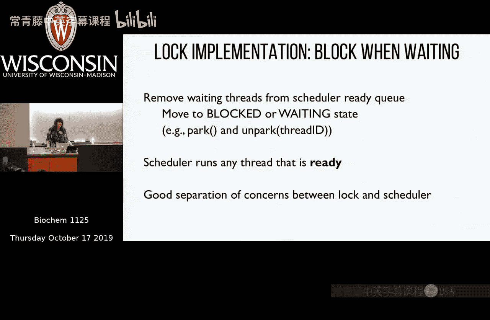
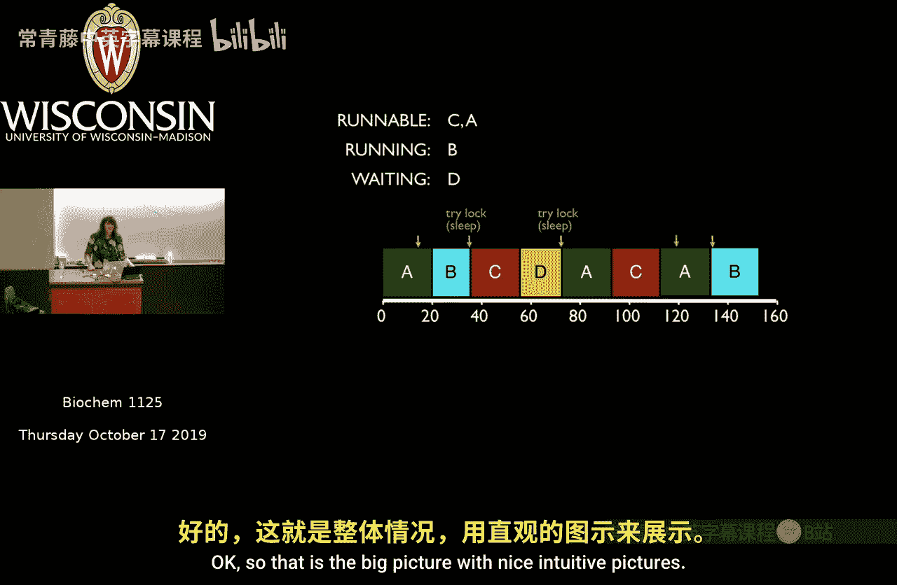
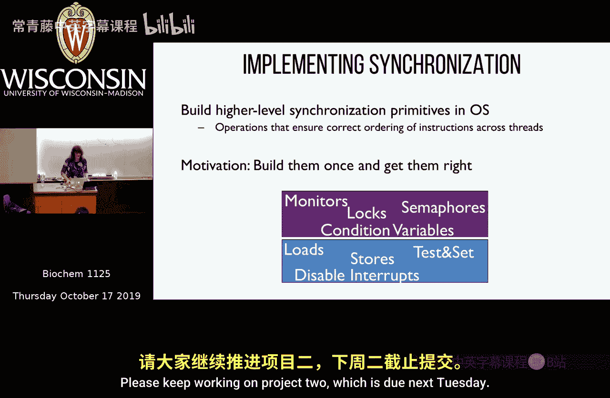

# 威斯康星大学【中英⚡操作系统｜CS 537 Fall19, Introduction to Operating Systems】 p12 P12 Concurrency_ Queue Locks and Condition Variables _ University -BV1wUzSB3Ecf_p12-

没。All right， good morning， everybody。 So today we're going to be talking about concurrency。

 We're continuing off where we left before。 Last time we were talking about how to implement locks or how to give mutual exclusion to cooperating threads。

 but we were not doing it in the most efficient way possible。 We are doing a lot of spin waitinging。

 So today we're going to look at a better way to implement locks or at least a different way of implementing locks。

 And then we'll be looking at another type of synchronization primitive。

 which are conditioned variables that allow you to control the ordering across different threads and that one thread has to run something first before another thread is allowed to continue that。

😊，Allright， so some announcements， you all know that Project 4。

 I think it is Project 4 on the scheduler is due on Tuesday。

 So we have a bunch of test scripts that are released and your hand in directories are now available。

 So please start turning in that project and wrap that project up because on Tuesday or so your next project will be available。

 So the next project is going to be harder than the previous ones。

 so it's going to be an XP6 and it's dealing with the memory system。

 And if you have not worked with a project partner for the scheduler。

 I strongly recommend you add a partner for this one。 It is more work than the scheduler。 Okay。

 so for the memory  one you're going to have to understand the structure of the page tables in XP6 and you're going to have to understand how it allocates physical memory to different processes in X V6。

 and you'll have about two weeks to work on that next project。 Okay so wrap a project 4。😊。

Get a project partner for Project 5。 if you have not done so already。O。

 but there's no exams to be thinking about at this point， at least， right， just projects， okay。

Alright， so once you're quiet in here， I will continue。Okay。

 so we're going to be talking about how to implement locks using blocking instead of spin weighting so that we'll have more efficient usage of the CPU that we really only want the scheduler to run us when we actually can grab the lock。

 Then we'll look at how we can implement condition variables and how you use condition variables to implement things like thread join or waiting for a process and then how you can do things like producer consumer relationships with condition variables。

😊，O， so to recap what we were talking about with locks before。

 there are a number of requirements to correctly implement locks。

 The first and most basic is that a lock has to provide mutual exclusion， right。

 that only one thread can grab a lock or acquire a lock at a time。

The second requirement was progress。 This says that your system has to be deadlock free。

 If a thread wants to grab the lock， the system better let at least one thread actually grab the lock。

 It can't hold them all back。 And then the third is the hardest and not every implementation actually does this。

 that it should be starvation free that a process or thread shouldn't be able to wait forever before it gets the lock。

Okay， and then we were looking at this fairness criteria saying it would be nice if our implementation actually was fair across different threads that want the lock that gave the lock to the threads and the order that they requested them in。

 So we were looking at ticket locks for that。😊，And then we were looking at performance。

 and we hadn't solved that problem yet。But you'll remember。

 this is what our spin weighting implementation of locks looked like。 It's pretty simple。

 There's just a flag or Boolean variable that's associated with the lock。

 You set it to one or true when a thread holds the lock。

 you set it back to 0 when the lock is free or it's been released。 And the trick was。

 we needed to have， oh goodness。we needed to have this test and set the atomic that it needs to be the case that the thread can test to see if the value of flag is false。

 and then it will fall through that while loop and acquire the lock。

 And then it needs to atomically set that flag equal to one at the same time。

 We can't have a context switch between the moment when a thread test the value of that flag and sets it to be held true。

 So that's what that hardware primitive of exchange or these different test and set operations do。

 So we looked at that before。And then the next thing we were looking at was how to implement a ticket lock。

 And remember the idea of a ticket lock was that this was a very fair implementation that we strictly give the lock to the process that's been waiting for the longest。

 And the way that we implemented that was we had two variables associated with a lock。

 There was a ticket number and a turn And you basically get a ticket。

 And then you wait until the lock gets to your turn。 And then it's your turn。

 So we use this new hardware primitive that's also atomic to do that。

 We need a fetch and ad to be atomic。 We have to be able to add one to an old ticket value and give that new ticket value to the thread。

😊，And so you remember， this is what the code for a ticket lock looked like that we have。

I hate this microphone。 We have a ticket and a turn associated with each lock， initialize them to 0。

 The way a choir works is you atomically increment the ticket value。

 that thing that's shared that like you go up to the deelli counter， you get your ticket number。

 That's your unique turn。 And then you just wait until the value that's being called out to everybody。

😊，嗯。Is equal to your ticket。And we had this optimization in here where it's better if you yield the processor instead of spin waiting。

 because at this point， you know that you don't have the。

Le so it's better to let another thread run at that point。

And then the way that release works is it just increments the turn variable so that we'll get the next thread。

 And this can either be done with an atomic ad or you could just increment that variable。

So that's what our ticket lock implementation looked like。

Any questions that you are daring enough to ask about that ticket lock implementation。All right。Okay。

 so then we were talking about how it's better to yield the processor if you don't have the lock instead of just busy spin waitinging because we saw if you just busy spin weight while you're waiting to get the lock。

 you just end up wasting a whole time slice that the scheduler gave to you because the scheduler doesn't know anything about lock。

 Those are implemented and completely different modules， you have your scheduler。

 you have your lock implementation， they're not supposed to be intermingled。

 So if a thread A has the lock held and thread B gets scheduled and wants to acquire the lock。

 It's just going to spin weight until some time in the future。 A decides to unlock that lock。

 and then it finishes its time slice B gets scheduled， and then it'll be able to grab the lock。

 So that's the default spin weighting implementation。

 And then we looked at the slight optimization where it would be better if B。

 when it sees that it can't get the lock this time around， it just yields the CPU。

 It calls into the scheduler and says I can't get any work done right now。 just runs somebody else。

 It doesn't move it to the block state。 It keeps it ready， runnable。It just says。

 schedule somebody else right now， right， So we basically just pay the overhead of doing a context switch into B doing that check one time and then doing a context switch out to another thread at that point。

So yields are much better than not yielding。 Basically。

 how much time are we wasting now with this implementation。

 instead of wasting time that's proportional to the length of the time slice were just wasting time that's now equal to the context switch cost。

 And so， you know， that's just microseconds， whereas the time slices milliseconds。 So much。

 much better to yield， at least。 But it's still not really what we want to do。

 Because these other threads， they knew that they weren't getting any work done。

 Why don't we kind of keep track of the fact that you're waiting for a thread and move you to a block state if you can't get any work done and then move you to the ready state when you actually can get some work done。

So that's going to be the idea of our next and final implementation of locks。

 So the idea here is that when a thread sees that it can't acquire a lock within that lock。

 acquire code。 It's going to move itself to the block state and put itself onto a queue。

 And the scheduler will then know which threads are not locked。

 It's just the default schedulers know they're supposed to schedule ready or runable jobs。

 it'll pick one of the other jobs to run。And so this is kind of a nice abstraction that each component is doing what it does best。

 right， The scheduler picks among the ready jobs and the lock knows what jobs can't run right now。

 So that works pretty well。 So let's see if you can see these colors。 Yeah， alright。😊。

Okay， so we're going to just do a little example here。 Imagine we have three processes， A， B。

 C and D， and they're each using locks a lot。 What's going to happen。 We schedule A。

 So it's in the running state。 It grabs a lock。 It stays running until its time slice expires。

 And then the scheduler says， hey， I'm going to schedule somebody else。

 B moves into the running state。 A goes back to run aable。😊，Then B tries to acquire a lock。

 but it can't， because A has that lock held。 So what's going to happen in our new implementation is B is going to go into the block or the waiting or the sleeping state that there's no point in scheduling B right now。

So the scheduler will pick another runable job。 Maybe it picks C， makes that one run for a while。

 C's time slice is done。 So it picks D。 D runs for a while。 It also tries to grab the lock。

 So it also gets moved to the waiting state。 So neither B or D can be run right now because they're not runable。

 They're not ready。 And so the scheduler can pick another thread。 Maybe it picks A， A runs， C runs。

 so forth。 A finally runs enough that it's done with its very long critical section。

 apparentlypparently， And it releases the lock。 And so when we release the lock。

 one of the waiting threads。 Just one of them will be moved from。😊，Waiting to runable。

 And B was the first one that arrived。 So this is a fair implementation。

 And so B is the one that's chosen to be runable。 It doesn't mean that it's actually run at this point。

 It just means that it's moved to a runable state， right。

 It's up to the scheduler to choose when it actually wants to run it。

 The lock is just figuring out which ones are runable and the scheduler can still do whatever policies at once。

 to pick which is the best one to run at that point。So in our scheduling policy。

 A gets to hold on to the time slice the CPU until it's done with its time slice。

 And then maybe finally， at that point， B is scheduled。 Allright， so this is much more efficient。

 the scheduler knows exactly which threads have any point in being scheduled。Okay。

 so that is the big picture with nice， intuitive pictures。 Now we switch over to code， right。😊。

Okay。So this is an approach that isn't going to be correct。

 And we're going to keep adding to it until it's correct。

 But I wanted to give you the intuition first and then figure out what we need to modify to make it work in all the cases。

So a lock is now going to be associated with a queue， So every lock will have its own queue。

 And then we always have to have some Boolean variable associated with our lock that shows if the lock is held or not right now。

So what does a choir do now？You see， I've left some space to fill in some other things that we're going to have to add later。

 But the idea of lock is that it does a test of the lock variable to see if it the lock is held or not。

 If the lock is held right now， it adds itself to this queue。

 We're maintaining a queue that's associated with this lock。

 So we know all the threads that want to acquire this lock。 and it's kept in a nice sortdid order。

So if the lock is held， we add ourselves to the queue。

 and then there's this interface with the scheduler to say that this thread should be parked or it should be moved to the block state。

 and we won't look at that park implementation。 That's something low level that actually moves that thread into the blocked state。

But if the lock is not held， then we just grab the lock。

 So this is kind of similar to the intuition of what we did before。 right。

 We have a test and then a set， basically。And then the release， it also looks at these cues。

 it sees there's nobody in the queue。 that means the lock must。 nobody else wants to get this lock。

 so it just sets the lock equal to false。 you know the lock is not held right now。

 But if there is someone that was in the queue， it removes that item from the queue and unparks it。

 it sets it to be runable at that point。So that's the basic intuition。

 But there's a bunch of problems with this implementation。

 But does the intuition make sense to everybody， We're putting threads on a queue and we wake up the next thread on that queue when we release the lock so that they will grab the lock。

Yeah。Great。😊，So here we say， if this one here。Yeah， if the queue is empty。

 then nobody else wanted this lock。 So we just set the lock equal to false and move on with our lives and the lock is free so that the next process that calls a choir we'll be able to get it。

 But if there is another thread that's in the queue。

 That means they had called the choir and they were stuck up here in park。

 Then we remove that thread from the queue that we're tracking。 And we call unpark on it。

 which sets it to the runnable state。 And so that thread will continue from this line here。

 So that's a very good question。 Yeah when we called unpar。

 it woke up this thread that was parked here。 and it gets to continue from that point there and it will just fall out of thisir statement then and it will have the lock。

 It will have acquired the lock。Thank you for that question， yes。We are not using tickets anymore。

Ticket locks are valuable。 They distinctly track things。

 And this is just a different implementation where we're going to use a queue now to track things。

Great， great， great。 So that's the case here where the releasing thread looks at the queue。

 It sees that it's empty。 That means no other threads have called a choir。

 Nobody else is waiting for this lock。 So we just set the lock to be equal to free。

And go off and do some noncritical section code。 And at some point later。

 another thread will want to acquire the lock， or maybe this one。

 And it will see that the lock is free at that point。 Lock will be equal to false。

 and it will just set lock equal to true and be done with acquiring stuff。All right。

But this code should make you uneasy， it makes you uneasy for a lot of reasons。

 But there's one main correctness reason it should make you uneasy。

 And that's that we need to make this work atomic， right。

 We need to make it that testing this variable and then doing something in reaction to that。

 adding our to a queue。 that has to be an atomic operation。So how are we going to do that。

 We're trying to provide atomic operations。 How are we going to make this atomic？

 So we go back to all the building blocks that we already know about， which are nice。

 simple spin locks， using our nice， simple hardware primitives that give us some atity。 So basically。

 we're going to put our lock acquire inside of a tiny critical section that's very controlled by our lock library。

 And we're going to protect that critical section， which is a simple spin weight variable called guard。

 So we're going to add another boolean to our lock structure。 And this is just telling us， you know。

 this is like the lock for the。😊，The lock acquire。So we just do a simple test and set。

And so you'll notice that we've now made this a critical section here。

 The testing of lock and then the reacting to it is within the critical section that is guarded by the guard variable。

So we can't have a context switch and have another thread also called lock。

And acquire and think that it sees that the lock is available and grab the lock。

 We won't have a race condition there anymore， because only one thread at a time will be able to do the critical section within this acquire code。

And then we do the same thing for the release code where we put that in a critical section as well that's protected by that same guard variable so that we can't have any context switches between those two。

Alright， so you could then certainly construct some examples for yourself。

 where if you don't have that guard variable， do different orderings of statements and see that you would get some incorrect results if you had a malicious scheduler that was。

Running one line from here and then interrupting and running another line down there。

 You should be able to come up with examples that do that。 Allright。

 So I have some questions for you so that you can talk about this。

 So we've gone over why guard is used。Other questions for you。

 Why is it O to spin on guard when before we were saying it was a bad idea to do spin waiting。

Think about why I'm going to give you a couple minutes to do this in the release code。

 this is tricky。 and we'll show you if you really understand this or not。

 Why don't we set lock equal to false when we call onpar。

You'll notice we've only set lock equal to false on the true part of this if statement。

 and we don't set it to false in the else branch。 So figure that out。 And then one last question is。

 is there a base condition still， but start simple and get down to the end。

 I'll give you about five minutes to talk with your neighbors about this one。All right。

 so let's see what we can figure out here。 So we already went over why guard is being used。 Remember。

 it is protecting the critical section within the lock acquire and within the lock release code that this test in this set。

 and then this test of testing to see if the queue is empty。

 and that set that has to be done atomically。 So that's why we have guard。

 But then we're doing spinning on guard And I've already argued that spinning is really bad because you could waste a whole time slice。

 So why do you think it's okay to spin in this case。Other than。

 it would be really hard probably to implement blocking within blocking that we kind of need a little primitive。

 But could you argue that spinning is a reasonable thing to do here versus giving a user a lock implementation that does spinning。

Yeah。宝括。Great。Great， that's exactly the reason。 So this spin lock。

 this guard is protecting a tiny critical section。 It's just two instructions。

 It's not an arbitrary length of like the user's critical section。 It's a tiny critical section。

 So the odds of that lock actually being held， that guard being set are pretty small。

 And so the likelihood of having to wait for somebody else is pretty small。

 So just because this is small。 It's then more safe。

 to just spin weight because it's probably going to be free。 Great， Allright。

 so trickier one in release。😊，The the goal of release。

 you could really view it as it usually wants to set lock equal to false because we've released that lock。

 Now， someone else can grab it。 So why don't we set lock to false in the else statement here。

 because we're。So what's going on there， why we don't want to really to set the lock equal to false。

Going to get some yeah。Great， so we're definitely just passing off this lock to another thread。

 So you could think about， would it have worked for us to set lock equal to false and then somehow have the other thread that just got woken up。

 set it to true。And that wouldn't work。I think we'd have some race conditions there because so we're still so we're in guard。

 that's being protected。 so that seems pretty good， but you'll notice that when this one wakes up。

 it doesn't have the guard anymore。 so it can't then set true and know that no other race has occurred there。

 so we really do have to just like someone if we set it to true。

 another thread could come through and grab the lock before the one we woke up， grabs the lock。

So I'll say that again， so we can't set lock equal to true here and wake this one up and assume that this one would then grab the lock because we set lock to false so another thread could call a choir and grab the lock instead and then we'd have two threads thinking that they have the lock。

All right， so that's why we can't do that。 we just have to pass off the lock directly to someone else。

Then the final question， it's kind of related to this。 Is there a race condition in this code， So。

 yes， there is。 So the question is， what is the race condition。

And part of the problem is it involves this park and unpar code。

 which you might feel are already a bit mysterious。Yeah。C。对。Great。😊，啊，哈。😊，Yep， right here。Yep。Yep。

 if you。Perfect， that's exactly the case。 And I think I quickly typed up what he said and put it on this slide so that I can show it all to you。

 So exactly what he said， we have one thread that it sees that the lock is held。

 So it adds itself to the queue。 And that's that's doneatomically， when we're done with that。

 we set the guard equal to false because we can't hold on to the guard when we park ourselves because we can't be holding that guard。

 if we did， then no other thread would be able to do anything with lock acquire lock relief， right。

 so we have to release that guard before we put ourselves to sleep。

 But we have this tiny race condition now， where if another thread right after we set guard default。

 But before we put ourselves to sleep， Another thread comes in。😊，Gets into the critical section。

 grabs the guard lock。 It sees that there is a thread that's on the queue。

 So it calls onpar and it removes that thread from the queue， and it calls onpar。The problem is。

 it's calling on park on something that isn't parked。Which maybe your implementation is O with that。

 But the really bad thing is that when Fred won， when we context switch back to that one and it calls Park。

 it is just going to be stuck there forever。 Nobodys going ever call on park on it。

So we have a race condition between these two cases。

 We're kind of like losing the fact that an unpared signal was sent to us and we get stuck on park。

So the fix to this requires interfaces that you do not know about。 So basically， what we do is we。

 there's a。A way to notify the scheduler and the system that we are going to call park in the future。

 So this set some flag， some place。 And so now if we have that context switch after we've set guard。

 and then we call on park， the system will remember that this thread。

Once to call guard and an unpark has occurred for it。 And so when the park happens。

 it doesn't actually make it stay blocked。 It lets it return immediately from that and doesn't put that thread to sleep。

So it just has to remember some extra state， track that and wake up this process if an unpar happened after the set park occurred。

All right。Yeah。Excuse me。Yeah， so Separ is telling the scheduler that it has an intention of calling Park in the future。

 so we don't really know exactly what the implementation looks like。

 we imagine that's below our level， but the impact of that is if you call Se Park and then another thread calls onpar for that thread we will remember that fact。

 and then when the park occurs later， we will know about that and we won't force it to wait there。

So we just need to record some information about what happened。 So that if we have a， then you know。

 the only time we could have that bad。Context， which would be right here。

 but we've already called set Park。 So we have recorded the fact that we are going to call park while we still had the guard variable set。

 So it ends up being okay。All right。So the set park isn't the most important detail of that。

 Put that fifth on the list， but make sure you understand how the guard works and the basic queuing works and that basically you block and wake up threads there。

All right。More questions about the Q lock。Okay。I think if you understand how that works。

 it's showing that you really understand what's going on with all this。 Allright， so higher level。

 what I'd like you to think about when you're writing programs that use locks。

 you shouldn't be making any assumptions about how that is implemented， Is it doing a strict queue。

 Is it being totally fair， you shouldn't make any assumptions about when you call release。

 what exactly will be the thread that wakes up。 So maybe for the best fairness and performance properties。

 it's usually the case that the longest waiting thread wakes up。

 but the implementation might not be so strict as that。 And they might wake up other threads。

 So your code has to be correct， even if another thread wakes up。 And it sounds like， well。

 how could your code ever make these assumptions， but we'll see it's pretty easy to make assumptions about what thread wakes up。

So we'll come back to that。Alright， so the other thing I wanted to talk about is， well。

 when should you use a lock that does spin waitinging versus one that does blocking。

 This isn't totally obvious。 So on a unprocessor， it's always the case that you should do blocking。

 right， So if you have a single core and you are waiting for a lock。

 then you're being scheduled on that single core。 And that means that the process that's actually holding the lock isn't scheduled right now。

 So why are you waiting for something to happen。 So if it's a unproor。

 you should always just block so that the thread that's holding lock can be scheduled and really push that lock。

The more interesting case and the one that we're really trying to optimize for is you're on a multiprocessor。

 right， We have multiple cores， different threads are running on different cores。

 And maybe the thread that has the lock right now is running on a different core。 Maybe it's not。

 Who knows。Alright， so we want to figure out when is it better to spin versus to block。So basically。

 if the lock is going to be held for just a small amount of time。

 if it's a tiny critical section and that threads running on another core。

 then you should just spin weight until that thing is released because it's going to be fast。

A context switch takes some number of microseconds。 You hurt your cash performance。

Why be so generous and let someone else run if it was just going to be a tiny bit amount of time that you had to spend wait to get that lock。

But if it's really going to take a long time， then it would be better for system utilization if you paid the cost of a context switch and blocked and went to sleep and let another thread run。

So we want to figure out the exact trade offs of when you should spin versus block。

 And that's all relative to the context switch cost。So we'll start off by imagining。

 which is what we always do， right， we imagine we have some perfect prediction of the future and we can predict exactly how long that lock is going to be held。

And if we know everything perfectly about the future。

 we can often figure out what the optimal behavior is。

 And then we make some sacrifice because we don't know the future。 And so we can't do optimal。

Allright。So let's look at if you end up spinning as your implementation， just pure spin waiting。

 and the lock is going to be held for tea time。 How much time are you going to waste。T， right。

 you're gonna be been waiting for that entire time T until the lock is released。

If instead our implementation did a block， how much time would we have wasted。

 it'd be exactly C the time for our contact switch。So what is the best action when T is less than C？

Spin。Because then we'll only weight T， which is smaller than C。 And if T is greater than C。

 then we should block and just pay the cost of a context switch。So， I think。So， questions about that。

Spin weight， if it's short， block if it's long。But this requires knowledge of the future。

 which we do not have。 So let's come up with something that we can do practically。

 So a lot of systems will do this thing called two phase waitinging on locks。

 where what they do is they spin weight for some amount of time。

 And if they get the lock while they' spin waiting， that's great。

 But if they spin weight and they still haven't gotten the lock before their spin interval is done。

 then they block。And so what's neat about this is that the theoreticians like this。

 and they can do some simple analysis to come up with a competitive algorithm。

 And so what this is doing with a competitive algorithm is you're bounding your worst case performance。

 So it should be the case So we're going to look at like。

 how did we actually do and what would the optimal algorithm have done。

 And we're going to show that our worst case is always within a factor of two of optimal。

 if we do this simple two phase weighting。So what could。

 what would be the worst possible performance that we would ever get if we did spinning or blocking。

 It would be if the lock was held for a long period of time and we did spin waiting the whole time。

Whereas so we spin weight for T， which is much， much greater than C。

 The optimal algorithm would have just blocked immediately because it knew the future。

 It knew that it was going to be held for a long period of time。

 So it knew it should just context switch right away。😊。

So we can look at the ratio of our actual performance， which is T to the optimal performance。

 which would have been C。 And that's some unbounded ratio there。

 So this is pretty bad for us to just keep being optimistic holding onto that lock and thinking。

 I'm sure any day now the。You know， the lock will be released。

So what the optimal thing does is it spin weights for exactly time C。 And then it blocks。

 And then this is within a factor of two of the optimal approach。

 So there's two cases to look at if the spin time was short。

 our our two phase algorithm ends up being optimal because we spin weight the exact same thing as the optimal would have done。

If the if we were going to have to wait a long period of time， if T was greater than C。

 the optimal one would have blocked immediately paying C。

 but we're going to pay C of spin time and C to do the actual context switch。

 when we find out we have to do a context switch。 So our performance will be two times C and optimal with C。

 So we're within a ratio of two。 So that's why they'll use the terminology that this is too competitive。

 We're within a factor of two of the optimal algorithm。So。I think this is neat。

 you'll end up seeing this analogy a lot in real life。 So they'll talk about this， like with like。

 should you rent or buy skis， and it seems very， I don't know。 has to be about skis。 But anyways。

 at what point should you buy your skis versus rent。

 It's when you rented so often that you've now paid in rental cost。

 the same cost as if you just would have bought the thing。 You're within a factor of two of optimal。

Oh， so C should be a constant。 It we'll assume it's a constant for this。

 even so it is like the time to do a context switch to save all those registers to make some assumptions about your memory impact。

Yeah。る場所ョ。No， you usually have to pick your lock library that you're going to use。

 And so people will find they have。 there might be a two phase waitinging algorithm。

 but usually it's just a pure block or a pure spin lock that you can choose between。

 But this is what would be best if you， if this implementation exists， which it does in some system。

Allright， more questions。 So I also think about this， like when I'm waiting for the elevator。

 if I'm waiting longer than it would have taken me to just walk down the stairs， then I say， okay。

 it's time to start walking now so that I'll not be waiting forever for this elevator。 All right。

Okay。So we are now done with locks and we will move on to our next synchronization primitive。

 which will be condition variables。Okay。So with all of these concurrency primitives。

 some of them are giving us mutual exclusion， saying that only one thread at a time can be in a critical section or acquire a lock。

 But another primitive that we need is to be able to provide ordering。 So with ordering。

 we say that one thread has to do some type of work。

 And then signal to another thread that that work has been done。

 And then the next thread gets to do its work。 So that's ordering。

 And we're going to solve this with two different things。

 We're going to talk about condition variables today。 And then we'll talk about semaphos next week。

 And they have a lot of the same properties， just some people like one style more than the other。

We'll start with condition fairs， both they're a little easier。Okay， so by the end of today。

 you're going to understand how to implement a thread join at a conceptual level。

 So we've seen in the P thread library that you can create threads。

 right this is what our code looked like that we've been using。

 we create two threads and then the parent thread calls join and it needs to wait at those statements until the children threads have called exit right。

So we are going to make sure that we wait at that join statement using condition variables。

 So within the join implementation， we will be using condition variables。So a condition variable。

 All that is is a Q。 There's no other state associated with it。

 It's just a queue of threads that are waiting on this particular condition variable。 Nothing else。

 And we'll have two different operations that are most important thread B can call weight on a particular condition variable。

 And it's going to wait there until another thread calls signal。

 And so this other thread can call signal。 And it doesn't remember anything about has。

You know what's happened in the past， so we'll look at that in more detail。

So to get into more of the details of the interface。

There's also a lock associated with condition variables that you allocate separately。

 And so when you call weight， you have to have a protecting lock that you have held。

 And the way weight will work is it assumes this lock is held。

 if the condition and then you wait on this condition variable and you release that lock。

So another thread can acquire the lock。And call signal on you。

 And then when you are woken up by that signal， you will reacquire that lock within the weight call and weight will only return after that thread has been given back that lock。

Okay， so that's a little weird At first。 When you call weight， you have to have the lock。

 you'll release the lock so that other threads can get some work done。

 And then when weight wakes up and returns， it will reacquire the lock before it does that。Okay。

 so we will see examples to see why this is the case。Okay。

 so here's our first attempt at writing some join code。 And， of course， it is not going to work。

So what we will do here is within thread joinin we're like， hey。

 maybe that means you just wait for a child to signal you。 And maybe this will be enough。

 So it works in one vy execution stream。 in this case， the parent。

 So I'm showing a timeline of instructions that I've labeled here。 the parent calls lock。

 it calls weight。 when it calls weight。 It is stuck waiting until someone calls signal and it releases that new text lock。

And then we have a context switch。 The child does a bunch of work。 And at the end。

 it calls thread exit。 thread exit just calls signal。

 which wakes up the parent that was waiting over here。And so then the thread。

 the parent wakes up at Z。 You know， it's acquired the lock and the unacquid set。

 So that one worked great that this parent is stuck here until the child calls signal。Okay。

 so that's one case。That one works， but let's look for a broken signal， a broken schedule。

 So how about you talk to the person next to you and come up with a case where this would not have worked。

There's not much code up there， So there's not many interleavings that are possible。Alright。

 so what inter leavingaving doesn't work。Excuse me。Great， so if the child calls exit first。

 it's going to call signal。 The signal doesn't do anything because there's no threads that are on the queue。

 There's no state associated with this。 We just call signal and more done。

 And then the parent thread calls join。 It grabs the mutex。 It calls weight。

 and it's just stuck there waiting forever。So this is pretty miserable。

 our parent doesn't know that it can go home， all right， so we're stuck。

So what we need to do with condition variables is you almost always have to have some other state that you're associated with it。

 just normal variables in your application that are tracking what's going on in the system。

 So we're always going to have additional variables in addition to our condition variables。

And we're going to check this state to see if we actually should call wait or not。Okay。

 so this is our next implementation。And it's going to fix our previous problem。

 so now this additional state that we're talking about is we have a variable called done。

 it's a shared variable between the child and the parent。So now if the child calls exit first。

 it's going to set Don equal to1 and then call signal。 then when the parent calls join。

 it will grab the muttex， it see that it will see that Don is equal to one， so it won't call weight。

 It sees that the child has exited and the parent is happy and thread join completes。 Okay。

 so that fixes that problem very nicely by just keeping some state。But this is not perfect。

 And so you probably can sense something because we're kind of。

Doing some things not atomically over here。 We're not doing anything with that mutex variable over there。

 What's the whole point of having this mutex protecting done and wait if the child isn't using the mutex。

 too。So let's see if you can come up with an ordering that does not work。

When we don't have the child grabbing a mutex。So the bad case is the parent runs first。

 It grabs the new text。 It sets done。 it looks it done。 And then it's like it's not done yet。

 I'm about to call wait before that happens， we have a context switch to the child。

 The child now sets done equal to one Call signal。 but that signal doesn't do anything at all。

 And then we have our context switch back to the parent。

 which calls weight and it gets stuck there forever。

 So we have to make sure that this is a critical section relative to this as a critical section。

 We can't allow a context switch to occur and for the child to be able to execute that code if we're in the middle of that over here。

So to fix that， we just put that in a critical section as well with the same new text lock and so now if we have a context switch at that time I talked about before where we've checked done。

 we're about to call weight， if now we have a context switch over to the child what happens in thread exitit it's not going to be able to grab this mut text right it's spin weights or blocks forever here and so eventually we switch back to the parent and the parent can finish that critical section call weight and unlock the mut text and then at some point in the future we'll have our context switch back to the child and it can finish that up。

So， questions about that。Okay， so that is our second rule of thumb， whenever you're modifying state。

 you need to put that as part of the mutex that you're holding。All right。

 so that was a fairly simple example with join。 We are now going to look at producer consumer relationships。

 So this is going to keep using condition variables， and it's going to get more complex。

So our example here， producer consumer relationships occur all the time in systems。

 a common one that you may have seen is when you have pipes。

 so the idea is you have some shared circular buffer that's of a finite size and you have writers that are writing into this pipe and they have to stop writing if the buffer gets completely full right it's a static buffer we can't allocate more memory。

On the other hand， readers， they're reading from that。

 and they have to stop and wait if there isn't anything in the buffer。

 So they each have something that they need to wait for。

 There's some synchronization or ordering across readers and writers。

So the generic case of this is called producer Consumer。

 where producers are just producing data and consumers are grabbing data and working on it or reading it。

So for example， if you implement a web server， it's pretty common to have like one thread that's paying attention to the network and it's pulling in requests and putting them into some type of queue。

 that thing that's paying attention to the network and getting the basic requests as the producer and then you have all of these worker threads that are grabbing the request from that queue。

 and they're going off and reading the files or doing the work that was requested there。

So that's very， very common。 So we're going to figure out how to use condition variables to make sure that producers wait when that buffer is full and make it so that consumers wait when the buffer is empty。

We'll start with a really， really simple case。 We're just going to have one producer thread。

 one consumer thread， and we're just going to have one element in our buffer。

 So this variable max is going to be equal to  one。

 and we're going to be tracking the number of buffers that are currently filled。So this is our code。

We're going track how many elements are currently full。 It starts at 0。

 We have one thread that's the producer， one thread。 that's the consumer。

 and we're going track their state。They're both runnable。 A scheduler decides to run thread to。

 in our example。So what are they each doing， They're just forever either producing or consuming。

 And what does producing mean， It means they grab the new text lock。

 They look to see if the buffer's full， if the buffer's full。

 they have to wait until there's some space there。 Otherwise， if there is some space。

 there's some work， which we're encapsulating and not showing once it's done。

 filling up that element， it signals to the consumer that it should wake up and do some work。

 And then we're done with our critical section。O， mean， the consumer it forever is consuming。

 There's a critical section where it has to wait if there's no elements for it to read。

And once it's consumed an element， it can signal to the producer that there must be an empty buffer for the producer to now fill up。

Okay， so we are going to look at this in detail to make sure you understand how the condition variable of things work。

Okay， so we start off thread two is running， goes into this while loop， it grabs the mut text lock。

Check's numb full is equal to 0。 It is。 so it calls condition weight。What does condition weight do？

Remember， it releases the muttex lock， this thing that it had held up here。And just goes to sleep。

So I changed the state here to say that we're blocked on this particular condition variable。

So the scheduler doesn't have the choice of running this thread anymore。

 So maybe it will choose thread 1 to change to running。And thread one。

 can it grab the butt stock at this point？Yes， because the definition of weight over here that's the same mutex that's protecting them both。

 We relinquish this mutex over here so that this one can run and can do the relevant work。

 That's really， really important。 This weight releases the muttex before it goes to sleep so that the producer can do its work。

So the producer is able to grab the in text lock。 It checks to see if noome full is equal to max。

 It's not。It does the work of filling things up， it then calls signal。What does signal do？

Signal wakes up this thread over here， so it's no longer blocked on the condition variable。

But it needs to acquire still that mut text before it's allowed to return from this routine。 right。

 So that's the important thing there。 And it gets woken up， but it needs to acquire the mut text。

 It doesn't just automatically get it because the producer still holds that mut text。

 So it's only at some point down here。 This thread calls unlock。And so once we call unlock。

 thread2 becomes runable。 It's not waiting for the Muex anymore。

But we can't assume that it's the one that gets it。 So this is what I was talking about before。

 where you can't make any assumptions for the correctness of your program about which thread is actually given a lock。

 It's probably not going to be a completely fair implementation。

 So what lots of implementations do is this thread didn't actually get the lock at this point。

The producer keeps on running， and it gets the lock next。

 And so Tread2 is still waiting to get the lock over here。

 So I probably should use different terminology over here。 Thread 2 is still waiting for this lock。

So producer Juan runs。It happens to get the lock next。Don't make any assumptions about that。

 It now sees that nu full is equal to max and it puts itself to sleep。 And， of course。

 when it puts itself to sleep， it releases the muex。 And so once it releases that mutex。

 then the consumer is the only one that wanted that lock。 so it will get the lock。

 it will get to get the contents of that buffer and continue on。All right。So this is broken code。

 Of course， it kind of works for the one contrived example that I set up for you。

But let's see if you can find a case where this will not work if you have two consumers。

So this is going be tricky。 But see if you can figure out a case where if you had two consumers。

 you would not wake up the correct。Thread， they has some work to do。

So talk about this for a couple of minutes。Talk about how the code basically works。

 any level of discussion you can have about this code。All right。

 so did that raise any questions for people or so first of all。

 did that raise any questions for people of realizing you don't understand how something works， yeah。

Oh， so that's very abstract。 We're just assuming we have some buffer and the producer's doing some work。

 It's filling， you know， it's copying data into that buffer。 That's what the producer is doing。

 And then the consumer is just reading out that stuff。

 And we just need to make sure that the consumer reads the stuff that the producer wrote into there。

It's very abstract。 It's just the producer put some work into a queue for us and the consumer is grabbing that work or that data out of that shared structure。

Good question。More questions about what's going on。Okay。

 so was anybody able to come up with an example where this doesn't work。Oh yeah。So basically。

 the problem you have to get it to go into is if a consumer wakes up another consumer instead of waking up a producer because the way that we wrote this code is we're callinging signal。

 and we were assuming that this signal is telling a producer， hey， now there's an empty buffer。

 but it could be the case because we can't make any assumptions about who is actually woken up or ordering or anything like that。

 you could wake up another consumer， So this is one example scenario that would get to that。So。

 for example， we have two consumers， one runs， and they see that there's nothing for it to consume。

 So they go to sleep。 Then another consumer runs。 They see that there's nothing to consume。

 So they go to sleep as well。 right， So they're both stuck on conned weight。

Then our producer comes along， the Muex has been released， so that's fine。

 it's able to grab the muttex lock， the buffers are empty so it doesn't have to wait。

 it does some nice filling of the buffer and then it calls con signal and that wakes up one of the consumers we'll assume that it's consumer2 that wakes up。

So it wakes up， but it doesn't run yet。 And then it calls unlock。 it comes around and。

Grabs a lock again， and goes to sleep。So we now have a consumer that's just woken up。

And it consumes that stuff and calls signal。 and because this was a consumer。

And now we know that there's an empty buffer。 We would like it to wake up the producer so that the producer can make more work。

 but we just have this one conditionded variable here。

 and there's both a consumer and a producer waiting on it。

 So maybe we get unlucky and we wake up the other consumer instead。

 And so other consumer returns from conditioned weight and there's nothing in that buffer。

 So our code is quite broken there。So as you observed， we want consumer 2 to be the sorry。

 We want consumer one to be the。We wanted the producer to be the one that woke up。 but instead。

 we woke up the consumer。Okay。So that is the basic problem。

 and so maybe you were able to detect how to fix this by the language that I was using saying the problem was we were just using one condition variable。

All right so there's a bunch of ways to actually wake up the right thread。

 one approach that you could do if you didn't have much thinking time and you just wanted to get something working is you just wake up all of the threads and so there's a way to do that where instead of calling signal you call broadcast and everybody wakes up and checks to see am I the right one to wake up。

 can I do my work right now？We are not going to spend much time on that one。

The right way to do it is to use separate condition variables for the two conditions。

 There's separate conditions for when the producer is supposed to run and versus a separate condition for when a consumer is run。

 So we shouldn't be using the same conditioned variable for them both。

 So we'll use two different condition variables， one called empty。That the producer waits on。

 it needs to wait until there is an empty buffer。 and then when it fills a buffer。

 it can signal that now there is a full buffer。 so there's this cross relationship here where we are signaling now definitely to a consumer so that the consumer knows that there is a buffer that it can look at。

And the consumers are signaling that there's an empty buffer that the producer can definitely fill。

All right， so this is almost right now， but not quite。So。

Can you come up with an example where this code is not going to work either？

Or some intuition on what could go wrong。I that nice。All right， so the bad case now。

Is due the fact that we have an if statement here。So what can happen is that we have a consumer that runs and it waits。

 and then a producer。Runs and fills up that。Buffffer the way that it's supposed to。

 And it nicely calls condition signal and wakes up that waiting consumer。

But before this consumer is able to grab the mutex lock。Another consumer comes along。

And it is the lucky one that grabs the lock first。And that second consumer then consumes that buffer。

 right， because it sees that second consumer sees that there is something there。

 It doesn't call weight。 It does the work calls signal， whatever。

 But the problem is that second consumer consumed the buffer。

 The first consumer still was woken up here。 And now， when it returns from that statement。

 it thinks there's a buffer that it can get。 And so we're going to have some problem there。So。

 the fix there is。Usually， you can just change your if statements to while statements。

 because what that means is that when that first producer woke up from weight。

 it needed to recheck the condition that it was sleeping on because some other thread could have raced in and changed the state of the system。

 It can't assume anything about what happened between this signal over here and when it woke up。

 Another thread could have come in and changed the number of full buffers。

 So we recheck that condition。ちちち。So this is what our final code will look like。

 you just recheck and if so in that case that we were looking at where there was a problem。

 that first consumer it will wake up， it will then see that numb full is back to zero and it will just go back to sleep and everybody is happy and it works。

No， so the problem was we。The signal woke up this。Thread from the condition variable waiting。

 but it didn't get the lock yet。And another thread is able to get the lock。

And it gets to then consume that element。 And then later， when the second consumer releases the lock。

 the first one grabs the lock and finishes the condition weight。 And， but it's already too late。

Great， so that you really do have to view those two steps as different。

 That's how all modern systems are built， they。Wake you up first from the condition variable。

 and then you have to acquire the lock as a separate step。

 So theoreticians came up with condition variables first。

 and they didn't make those two things separate because it's much more elegant to write your code。

 if those things happen atomically。 But people found when they actually tried to implement condition variables and deal with locks and the cues。

 they couldn't make those things happen atomically。 So that's not how real implementations。

 do things。 So you have to assume you first W up from the condition variable。

 And then you grab the lock。 And because of that race conditions can happen in your code。

 And because of that， you have to recheck the state of the system when you wake up。Great。

More questions about this code。So this quote ends up being fairly generic。

 It should work for any number of producers and consumers and any number of elements in your your buffer。

 But we will continue to probably look at producer consumer a bit more。Okay。

 but what we learned about that is that you do need to recheck your assumptions when you wake up from a weight because another threat could have come through。

 And so， in fact， a lot of implementations don't even then worry about making this totally correct。

 because they know that the way people write applications is they recheck these conditions。

 So sometimes there are these things called spurious wakeups where a weight thread is just woken up。

 even though it didn't get a signal。 or sometimes people will implement signals as broadcast and they'll just wake up everybody。

 And if everybody's woken up， they better Ill recheck those conditions and only let one of them go through。

So if you ever write code that has conditioned variables。

 a good way to really stress test it is to change all your signals to broadcast and really wake everybody up and have as many race conditions as possible and see if it still works。

All right。 so what we've seen from this with condition variables。

 they have no state associated with them themselves。

 So your application program has to have the additional state。That you're waiting for。

 you always need to be changing the state and doing the weight and signal with the Muex or the lock held。

 and then whenever a thread wakes up after waiting。

 it does need to recheck the state in a wild loop there。Alright， so at this point。

 we are done with locks and condition variables。 So monitors are just something。

 it's just like language support for putting locks together with condition variables that there's just language support that says when you enter this module or do operations that are synchronized that are associated with a certain object。

 It automatically grabs the lock for you。 And then the condition variables that are associated with that all release that lock automatically as well。

 So they're pretty nice as a language structure。 but monitors are really just locks plus condition variables that have some nice language support。

😊，Okay， so in our next lecture， we're going to talk about semaphos。

 semaphos are going to have a lot of similarities to condition variables。

 except they are going to have state associated with them that is being tracked by the actual semaphore。

And that is it。 And I'll see you all next week。 Please keep working on Project 2。

Which is due next Tuesday。

