# 威斯康星大学【中英⚡操作系统｜CS 537 Fall19, Introduction to Operating Systems】 p13 P13 Concurrency_ Semaphores _ University of Wisconsin-Madison -BV1wUzSB3Ecf_p13-

All right， good morning， everybody。 It's great to see you all again。

 at the start of another exciting week。 A couple of announcements。

 you all know that projects something is due today at 5 PM。

 So the details on when exactly projects are due。 So we're saying it's five in case there's problems overnight with networks or computers。

 So officially you have to get it in by5。 but unofficially as long as everything is working okay and you want to give up your night。

 you are welcome to turn it in by 7 AM the next morning。 That's when I get up。

 that's when I'll turn off the AFS permissions to the hand and directory and your evening is done。

 But by all means give up earlier than that， we would prefer you get done by5。

 we'd prefer you get done by midnight。 But if you really need an extension。

 you can work through the night。 but please don't ruin your next day for this one projects right you have many。

 many projects in this class。 I know you have many projects and work in other class。 at some point。

 move on。 There's tons and tons of projects that you do in this class each one only ends up count。😊。

Like 6% of your grade， right， you have a lot of projects。Alright， so speaking of lots of projects。

 Project 5 will then be available the next morning。 Project 5 is also on X V 6。

 It's about the memory system。 It's about allocating physical memory。

 as well as playing around with the page tables for individual processes。😊。

So if you could quiet down a little bit， then I will continue。 I can hear too much whispering。

So I strongly recommend that you work with a project partner on Project 5。

 even if you never have in the past， it really is a lot more work than the previous ones。

 And so it's best if you find someone that you know personally。 But if you are not doing that。

 then you can fill out that matching form， and we will match you with someone that we think is appropriate。

😊，All right， midterm 2， isn't this delightful。 So midterm 2 is two weeks from tomorrow。

 So it will be mostly on concurrency with a tiny bit of review on the abstractions that you covered in the first part。

😊，So by tomorrow， let me know if you have a conflict。

 I've gotten a bunch of conflict notifications already。

 and I'm going start to put some quizzes up on P。 Those same quizzes where they're not counted from many points。

 You can do them late。 You'll see the solutions。 You can type in the solutions if you want， yes。

Those ottopics will not be on the exam。 It will be just previous stuff and concurrency。Yes。

It's still not about locks。 I know， we are not yet in our project world on locks。

 We're still back in the world of memory。 implementingmplementing things takes a lot longer apparentlypparently。

 than just learning about them conceptually。 Yeah， so we'll eventually get to that。

 I think that's Project 6。😊，All right。And then my office hours today are a little bit later than usual。

 So any questions about administrative stuff。Yes。I didn't think I really wanted to tell you this。

 so it's going to be slightly less than a two week turnaround because we're running out of weeks。

 and I want you trying to schedule around Thanksgiving so you're not having to work your whole Thanksgiving。

 So it's slightly shorter than two weeks， yeah。😊，Yep。

So all of the exams total are worth 50% of your grade。 Well I said 45。

 because there's going to be these 5% bonuses for the homeworks。

 and then it'll be roughly equal between those three。Yeah。

More questions。All right， let us talk about concurrency。 So today we're going to talk about semaphos。

 So previously， we were talking about conditioned variables。 Today。

 you'll understand the difference between semaphoes and conditioned variables。

 Then we're going to go through a whole bunch of examples of how you actually use semaphos。

 how you can use semaphos to implement locks， how you can implement semaphos using locks and conditioned variables because there is an equivalence across locks and conditioned variables versus semaphos。

 Then we'll talk about all of these classic synchronization problems and how you can implement them with semaphos。

 like how we can do that join or weight， how you can do producer consumer。

 how you can do this dining philosopher and how you can do reader writer locks。

 So I think this stuff is pretty neat。😊。

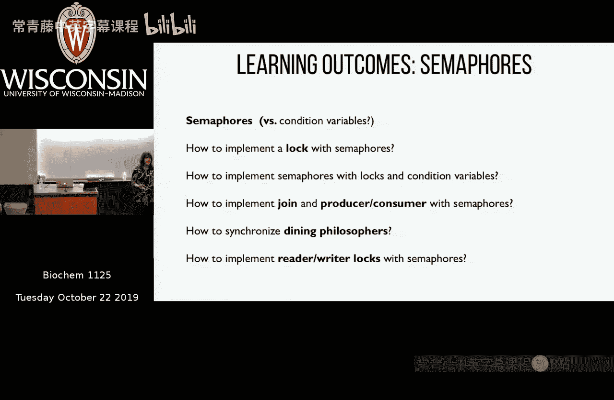

Okay， so let us recap what you've already learned。 So we've been talking about concurrency。

 Remember we have multiple threads。 They have some shared state， some shared variables。

 and we need to coordinate their access to that shared state。

 And there's two basic types of primitives we have。 We have those that provide mutual exclusion。

 So these were like locks。 This is making sure that only one thread at a time has grabbed a lock and is executing some critical section。

 right And then the second type of concurrency primitive we were looking at where those that provide ordering。

 So this says that one thread has to do some work before another thread can continue。

 So there's some synchronization or some scheduling or some ordering that has to occur across those different threads or across those different processes。

 And so that's where we were looking at condition variables that conditioned variables could provide this ordering。

 But condition variables cannot not provide mutual exclusion。 right。

 We needed to still have locks with our conditioned variables so that we could also have mutual exclusion along with our ordering。

😊。

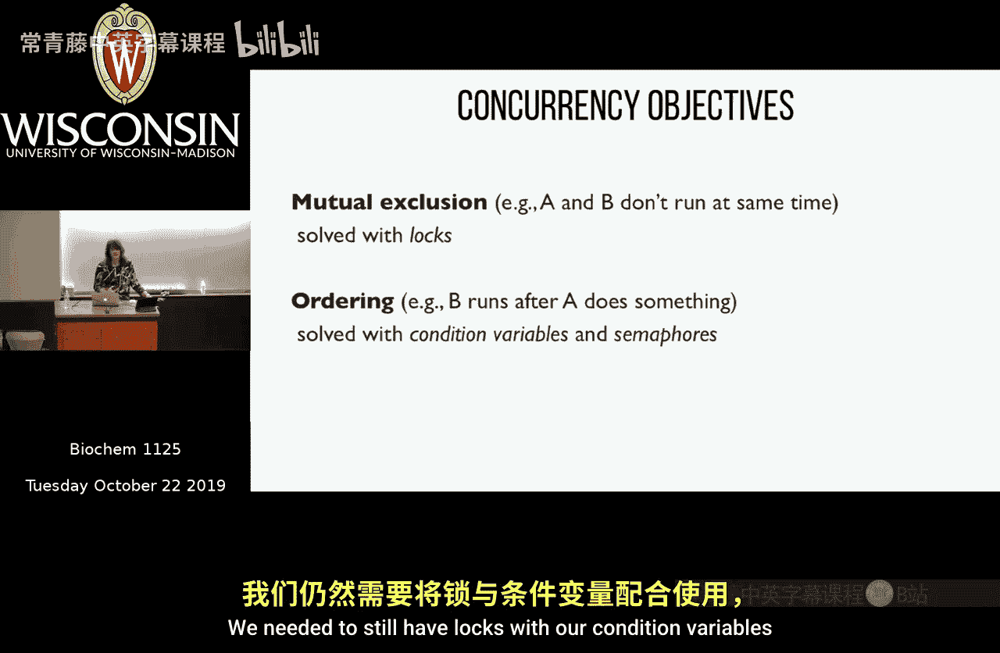

Okay， so we said that there are two different basic primitives that you can operate on condition variables。

 There really isn't much to do with initializing a condition variable。

 It's just an empty queue when you initialize it。 but then a thread can call weight on a particular condition variable and you do have to have a muex or a lock held when you call weight on a particular condition variable。

 So there's always this muttex that's associated with each condition variable。

 And the way weight works， is you have the lock held when you call weight。

 and then you wait in that call until someone else call signal and until you reacquire that lock。

 So weight will not return until someone else is called signal and until this thread has been able to acquire the lock that no one else is holding it。

O， and then signal does everything I was saying there that it's going to wake up one waiting thread。

 some thread that had called weight in the past and is waiting on that condition variable。

And if there's no waiting thread， it just does nothing。

 So I think it's really important for you to think about kind of this as an implementation of condition variables with weight。

 So there are cues， right， We have threads that are waiting on a particular condition variable。

 And maybe we have a thread that's waiting for a different knock。

And then if some thread calls signal on that condition variable， what's going to happen。

 we're going to wake up one of those threads that was waiting on that condition variable。

And now it has to wait for the the lock。 It doesn't immediately return from weight。

 That thread that was woken up by the signal。 Now it doesn't have to wait for the condition variable。

 but it has to wait to acquire that lock。 So now if another thread calls release of lock。

 We can't guarantee that it's going to be a that gets that lock。

 It could be any other thread in the system that's waiting for it。 So in this example。

 we could say it's D that gets the lock。And A will have to wait until D releases the lock。

So that was important in all of our examples， because that was why we needed that wild statement。

 because it's possible that the thread that woke up a set some condition like it puts up。

Buffer in the queue。 And then A thinks that buffer is going to be there。

 But then another thread comes in and races and actually gets it。

 So A has to recheck the condition when it actually gets the lock and wakes up and returns from that weight call。

Al right， so think about that implementation of separate cue for condition variables versus locks。

 when you're trying to reason through what's going to happen in some application code that's calling condition variables。

Alright， so any questions about。Those interfaces or how those work。

I'll go through some more examples that we went through last week to remind you of this。

 But any questions about just how that worked。

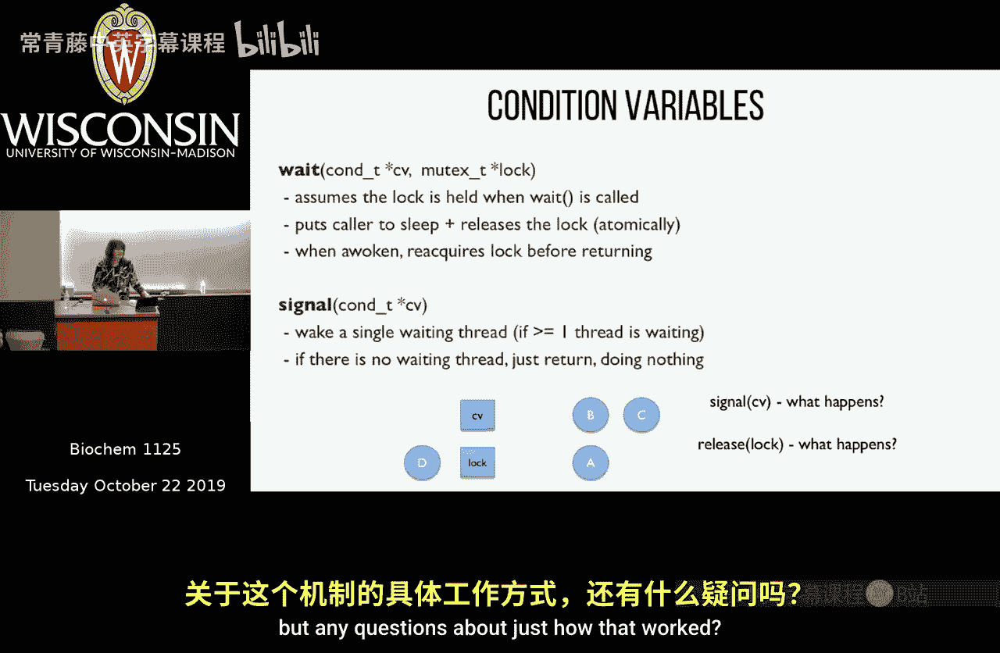

Alright， okay， so one of the examples we were looking at was how to do a join。 So remember。

 we have some parent thread， Our main thread of our program。

 It caused P threadread create to start up two threads A and B that are going to run the same routine when they get started when those threads call exit。

 We want the parent thread to wait until those child threads called exit。

 And they wait at this join statement。 and then it continues。

 So this isn't we don't need mutual exclusion for any of this。 We need ordering。 right。

 We don't want our parent thread to return from this join until after thread P1 has called exit。

 And we don't want to return from this join statement here。

 until thread P2 has called exit in its code。😊，Right。Okay， so we looked at how to implement join。

And this was the code that we came up with。 This is the correct code。

 And so there's a bunch of details here that are important to remember。

 So the basic way that thread join works is it is waiting until the child calls signal。

 But we saw that because there's no state associated with condition variables。

 we have to record some additional state to remember what has actually happened that if we didn't do this check to see if someone was done。

 if we just had the weight in the signal， then it was possible for the child to call signal first。

 And then the parent to call weight later。 And then it would be stuck forever in the weight。

 So that's why we needed this extra。St variable of done。

 And then we also need the mu textes around our testing and basically our reaction to that test so that this is a critical section。

 testing the variable and then waiting because of the results of that variable。

 that that has to be a critical section relative to this other critical section over here where this other thread is setting done that if we didn't have those mutt locks。

 it'd be possible for us to have a context switch at a bad point in time。 right。

 that we could the parent thread， it could test that done is equal to zero。

 And then right before it calls weight， we could have a context switch over to the child who could set done equals one called signal。

 the signal would do nothing， we then have a context switch back to this one。

 and this thread would be stuck on the weight forever。 So that would cause this deadlock。

 this bad situation。 So that's why we need that。Mut text lock around the two critical sections so that we can't have a bad context switch between those two pieces of code。

So any questions about that？All right。Okay， so then the other example that we were looking at was this producer consumer relationship。

 And so you'll remember that we have a shared buffer between the producer and the consumer。

 The producer is producing work。 It's putting something that the consumers are going to read out of this shared buffer。

 And so again， we have to have these newtexes around the critical sections。😊。

As we manipulate this shared state， numb full being this variable that showed how many buffers were full。

 and then what we saw is that the producers wait on one particular condition variable。

 they need to wait until there's at least an empty buffer in that shared queue and the consumers need to wait until there's at least one full buffer in that shared queue。

 and then once they either consume or produce a buffer。

 they will signal to the other style of thread that now there should be an empty buffer for the producer to fill there。

So that was one thing we saw。 We definitely need that those locks again so that we will have critical sections between our testing and our reaction to that testing。

 We need to。Use two separate condition variables。 And then the other thing we were seeing is that you need this while loop that you need to recheck the condition that you were waiting on because it's possible if you didn't do that。

 if you just had an if statement that another thread could have raced in and change the state of the world that they would get the lock before that thread that was just woken up because of a signal。

 it could wake up from the condition variable but could be stuck trying to acquire the lock and another thread could come in。

 acquire the lock and use up that buffer。 And then the first one would wake up and see that there's no buffer there for it to use anymore。

 So that's why we needed that wild loop to recheck the condition。 and it just goes back to sleep。

 if another thread raced in and used up that buffer。So any questions about that code。

So I certainly encourage you all to go through these examples in gory detail that it'll basically be like。

 you know， do you understand the purpose of every line of code here。

 what would happen if I removed any one of these lines of code。

 what would happen if I switched around the lines， all of that。

 like exactly what can happen in all the different scenario。

 So you should understand all the code at that level。😊。

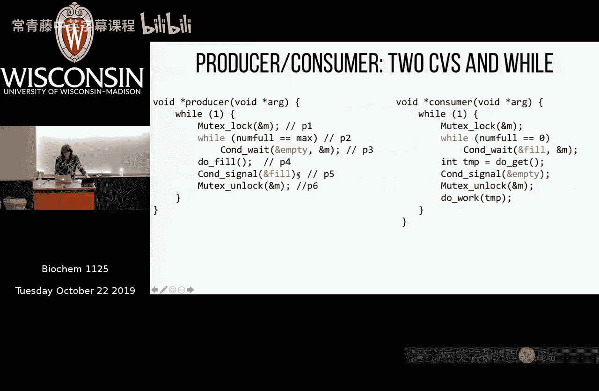

O。So our rules of thumb that we were seeing for conditioned variables or that we always need to keep some additional state to track what's going on in the program rather than just blindly waiting or signaling on conditioned variables。

 you always need to have a mu text lock held when you do the weight in the signal so that you're manipulating the state that's associated with the conditioned variables in a critical section along with that。

 And then finally， it's often the case that when you wake up from waiting。

 you need to recheck the state to make sure that the state of the world didn't change that a different thread didn't come in and grab your resource。

 So use a wild loop instead of an if。Okay。So that's it for condition variables。

 We're going to continue to talk a little bit about them because we're going to be contrasting them now with semaphos。

Anybody want to talk more about condition variables。Yeah。Great。

 so the condition variable and the lock are definitely working together and coordinated that you will have this lock that's associated with the condition variable。

 but all interfaces well， like in C， the interfaces will work such that you pass in the mut textex that's associated with this condition variable that that's what Poss threads assumes It assumes that we've already called lock。

 we hold the lock that we pass in condition weight。

 and then the implementation will release that lock while we wait and then it will reacquire that lock before we return after we receive the signal。

 So they are very associated。 And when you do have languages that have support for monitors。

 It's often the case that these locks are implicit and you don't even see the fact that you're actually acquiring a lock or releasing a lock when you get like some synchronized method。

 But there is then a lock that's associated with it and it's just hidden from you and just behind the scenes。

 it adds in all of these lock acquires and passing the locks around。😊。

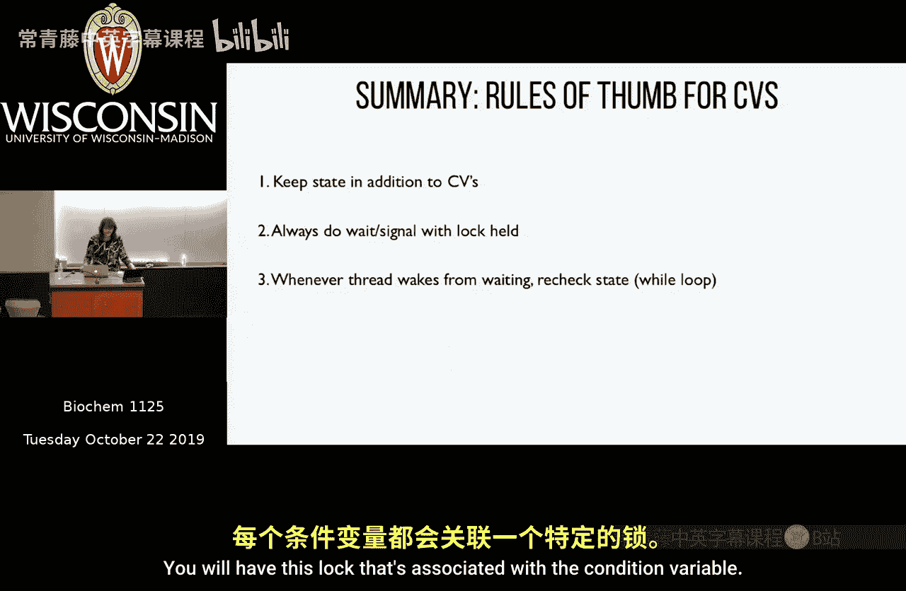

Yeah。Mmhm。Right。Well， it's not that it could fail。 Well something could。Great。

 so you you're talking about this case here like， So okay， so there's one thing it's required。

 So we call condition weight， and we are holding a lock。

 We absolutely have to relinquish that lock while we're waiting because other threads need to do something to change things because we're waiting for something。

 and they probably have to grab the lock in order to change things。

 So we have to release that lock while we're waiting。

 But then when someone calls signal to us The way most implementations work is that we don't just immediately return and have the lock。

 We first wake up on that condition variable and then we have to as a separate step。

 grab the lock before we can return from weight。That the theoreticians who came up with this didn't want that to be two separate steps。

 It was more elegant if you didn't have to。 But every time people have had to implement this。

 they see that it has to be two separate steps。Great。More questions about condition variables。Yeah。

Mmhm。Yeah， it's a global variable。 Yeah， and I initially showed that。

 but it got dropped off on this slide。 It's a global variable allocated on the heap。

 And we are assuming it's getting incremented in this do fill routine and it's getting decremented in do get。

😊，Yep， so it definitely has to be a shared variable there。Mmhm。More questions。Yeah。

Why do we have to talk today， right？ So it's true What we're going to see is that semaphos are functionally equivalent。

 Everything you can do with semaphos you could have done with locks and conditioned variables。

 Just some people like one style more than the other。 Peoples。

 It's just really a matter of personal preference。 Some things are slightly easier to express in one versus the other。

 I used to think semaphos were more elegant。 But now I'm a fan of condition variables and locks。

 people can change their minds over time。 they're definitely they're just equivalent in a matter of preference。

😊。

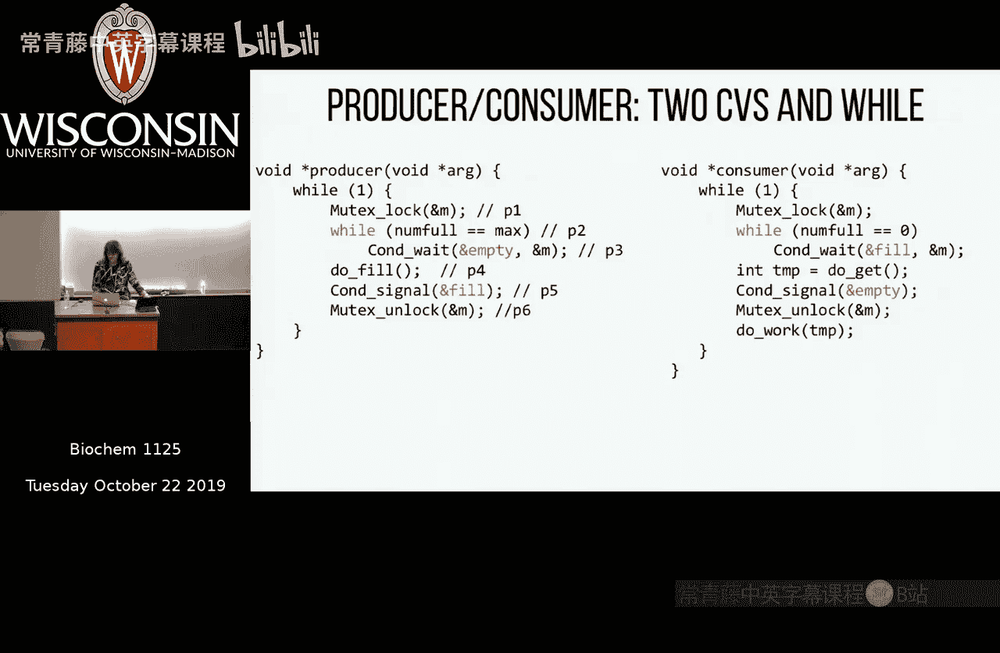

Okay。All right。More questions about conditioned variables。Okay， so then we will talk about semaphoes。

 Okay， so what we're seeing with condition variables is that they have no state associated with them other than that Q。

 right， All you could do is call weights。 And then you had to wait until someone called a signal。So。

In your application code， you would always have other state that was helping you to track the state of the world and figure out if you should call weight or not。

 So this seems a little bit odd。 Why do you have to have that separate state。 In many cases。

 you can kind of embed that state into the semapho itself。 And so our semaphore is going to track。

 It's just an integer value。And that integer value is associated with this semapho。

 and user programs can't directly access it。 They can't say， hey， Sepho。

 what's your current value or do any testing of it。

 There's just these well defined primitives that do it。

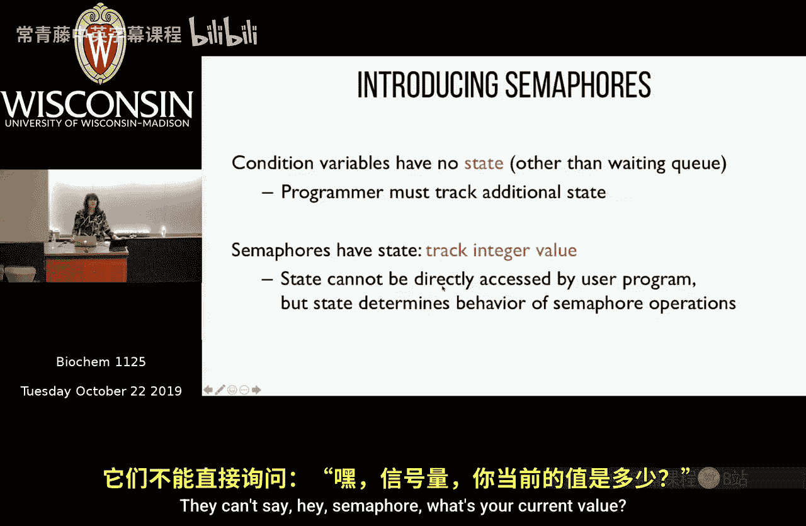

O but as we are saying， semaphoes are exactly equivalent to locks plus conditioned variables。

 it's all just a matter of preference which one you want to use。

 and so you can kind of prove that they're equivalent by kind of doing the following constructions。

 so we're going to show that you can implement locks on top of semaphos。

If we had many lectures worth of time， I think we could show that you can do condition variables on semaphos。

 but that's really difficult， so we're going to skip that step。

 but people can do that and then we're going to show that you can implement semaphos on top of locks and conditioned variables。

Okay。Al right， so what are these Semapho operations we are dying to know about。

 So you do need to initialize a semapho with an initial value， which will be tracked。

 But after we've initialized it， the user can't find out what that value is anymore directly。

Then we're going to have these two routines， sometimes called like semaphore weight or test。

 or sometimes it's called P， because the original implementer， designer of Semaphos was Dutch。

 so it has a Dutch word， but P is basically weight。

And the way weights works is it waits until the value of the semaphore is greater than zero。

 and once it's greater than zero， then it decrements the semapho value。 So how it weights。

 you know it's probably going to block there would make the most sense。

And then the corresponding routine， as you can call signal or post on that semaphore。

 or it would then V in the original Dutch language， and that increments the semaphore value， again。

 there's a value associated with the sephore， and if the value is greater than zero。

 then there should be a weighting weighter and it will wake that up。Okay。

 so let's look at some examples。

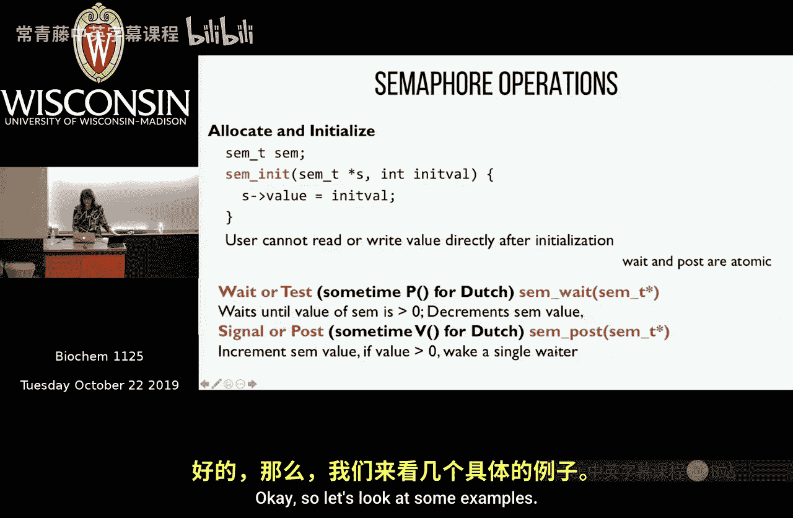

Okay， so let's build a lock from a sepho。So let's assume someone has implemented semaphos for us。

 and we want to build blocks on top of that。 So do we understand semaphos enough to build blocks on top of it。

So you will need to initialize the semaphore and then call weight and call post。

 and so I'll give you all a minute to talk with your neighbor about how you would implement locks on top of semaphos given that this is the definition of those semapho routines。

So I'll give you two minutes。 It's really simple code。Okay。

 so lock acquire is basically going to be ending up calling just some weight and lock release is going to call some post that we're waiting when we acquire。

 and then we're posting or signaling when we release。 That makes sense。

 So really the whole question is， how should we be initializing that semapho value so that the first time you call some weight。

 you don't have to wait。 But then the second time， if another thread tries to call acquire。

 it will have to wait。So the trick is， how do we initialize our S4 to get that behavior。To one。Great。

 so we initialize it to one。 so therefore， when the first thread calls a cho， we'll call some weight。

 it will see that the value is greater than0 right now。 it will decrement that down to zero。

 Then if another thread comes along and tries to call a cho。

 it will then see that the value currently is zero。

 and so its stuck waiting until it's greater than zero。

 So then when the first thread comes along and calls release that will call post。

 which increments the value to back to one。 there is now weighting weighter and so it will wake that one up。

 so it will acquire the lock。 So the semapho is a very straightforward mapping to locks that you just initialize a semapho to one if you want it to act like a lock and allow one thread to acquire this resource or to。

😊，Grab the lock， yeah。So。Right， again， you should not make any assumptions about which thread is actually woken up。

More questions。Okay， so we have implemented locks on top of semaphos。

 We are not going to implement condition variables on semaphos， but people have done it。

 They thought it would be easy。 It's kind of a neat retrospective about all of their experience and really how difficult it was to not have any race conditions and get it working in practice but it is possible。

 But you are not responsible for any of that information。 other than it is possible。

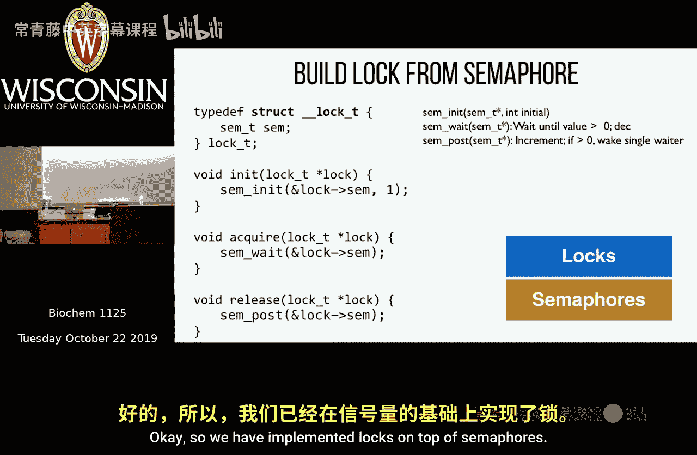

Okay， so we understand a little bit about how to use sephoes。

 Let's look at now we want to do instead of locks and mutual exclusion。

 let's see if we want to do ordering with our semaphore， how we should initialize our semapho。

 So this was the thread join code that we saw last week for how we would implement it with condition variables。

 and now we want to implement thread join and thread exit with semaphoes。

And so you'll see the code has gotten much， much simpler。 We're getting rid of the separate locks。

 we're getting rid of the separate state variables。

 and now all of that code is in this atomic routine of some weight and some post。

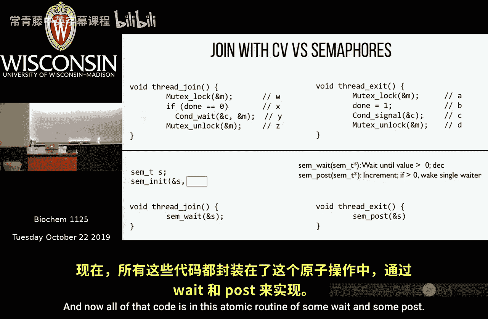

So now our only question is， how do we initialize this semaphore so that the join needs to wait until the thread。

Child has called exit。So confer with your neighbor for 30 seconds。

 and we'll see if you figure this out。Alright， so who has a answer here。0， yes。

 so it probably wasn't one because that's what we used in the previous example。

 One gave us mutual exclusion。 It let one thread pass through the weight。

 And then the next thread's needed to wait。 But if we initiallyize this to0。

 then if the parent calls thread joined first， it's going to be stuck here because we have to wait until the value is greater than 0。

 So we're stuck here waiting。 then the child thread gets schedule at some point that child thread calls thread exit。

 then it calls some post， which increments it， once we increment it to one。

 then we'll wake this one up to our parent can continue。 So by setting it initially to 0。

 we're saying we have to call post before a thread can continue from its calling weight。

So we have to have a post before the wait。 So that's how we can have this synchronization or ordering across the different threats by setting it to 0 first。

Questions。Al right。 so semaphos embed some states within them。

 and they behave differently depending upon the value that it has internally。

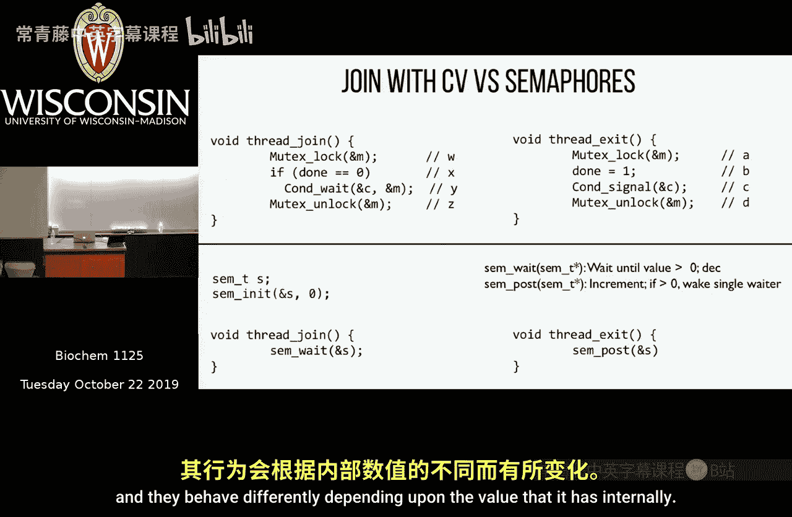

Okay， so now we are going to actually build a semapho from our implementations。

 from a lock in a condition variable。So semaphoes have a bunch of stuff associated with them。

 they have this value， they have a lock associated with them。

 I mean we have to have a critical section within our implementation。

 and we're going to have a condition variable within our implementation that's basically acting as our cue to remember all of the threads that are waiting on the semaphore。

So then when we initialize a sema4， we'll just set the value equal to what the user wanted it to and initialize our condition variable and our lock。

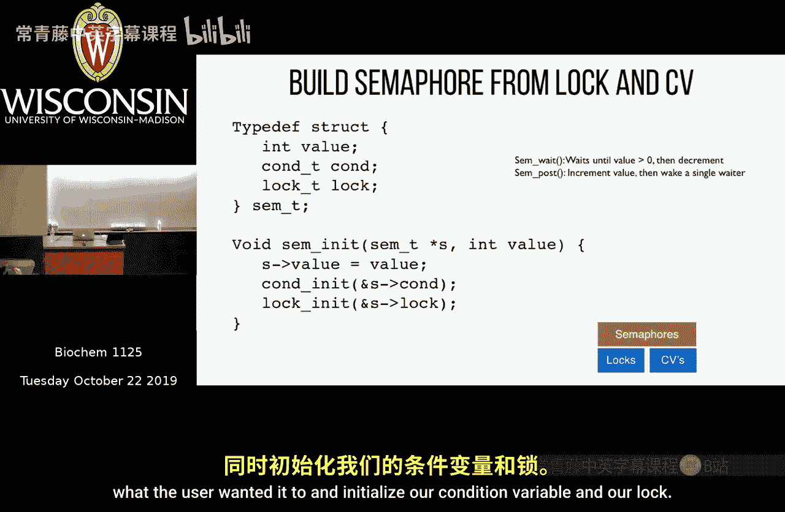

So that's some standard。Initialization code。Now， let us look at how we want to implement this。

So it looks like I didn't hide any of this from you。So let us go over how this code should work。Okay。

 so some wait， we said， we want it to wait until the value is greater than 0。

 And then after that's the fact we're going to decrement。

So we just wait while the value is less than or equal to 0。

 and we keep waiting on the condition variable。When we wait on a condition variable。

 remember that releases the lock that was associated with that， that should have passed in the lock。

I should have passed in the lock as part of this。Kd weight routine， right。

 It takes up Muex or Locke is the second parameter there， which I forgot to show。U。

So then when we're。Waiting on that condition variable， another thread could call post。

 It needs to acquire the lock。So that it's a critical section where it's incrementing this value。

 It could then increment the value to one and call condition signal， which will wake someone up。

If there's anybody waiting on that condition variable。

 this call will wake it up and then we can release our lock。And so then when the original waiter。

Wakes up over here， it will decrement the value and end that critical section there。

So this implementation of semaphos， we can do it on top of a lock and conditioned variable because we need to have the lock to provide mutual exclusions so that we can have this be part of a critical section and we need the conditioned variable so that we can have the signaling across the two threads and have the queue there。

Yes。Yes。Correct。Correct。け。しですが。Exactly， exactly。 so we called condition weight。

when we called condition weight， we released the lock， then this one over here calls signal。

 it will wake this thread up from the condition variable part。

 but this thread still needs to acquire the lock， it can't do that until the thread over here calls lock release now the lock isn't held now this thread can acquire the lock and it will return from condition weight and then it will check to make sure the value now really is zero or greater and then it will do the decrement and release the lock。

Exactly。So locks are very useful for being able to provide us this mutual exclusion and have critical sections and the condition variables are very useful for having the cues and the signaling。

 and then semaphos are the combination of the two where we're able to autoomically modify those internal variables and。

And then wait or not， depending upon the values of those internal variables。All right。

 Any more questions about because this kind of shows， I think， very clearly what a semaphore does。

 yeah。That that's a good question。 I could。 I don't think that's a substantial difference。

 I can't think of any issues with why one would be substantially better than another。

 even with multiprocessors or anything。s's not。 it's mostly just personal preference with those two。

More questions。

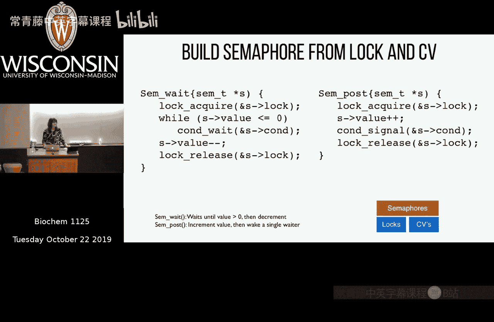

Okay， so let us look at producer consumer。 So remember。

 we were looking at producer consumer with condition variables。

Their code is going to get a bit simpler with semaphos。

 and we're going to start off with a really simple case again。

 we'll assume we have just one producer thread， one consumer thread。

 and we'll have just one shared buffer between them。

And so our producer is forever waiting for there to be an empty buffer。

 when there is an empty buffer， it fills it。 And then it signals to the consumer that there's now a full buffer。

 The consumer was waiting for that full buffer then uses it up。

 and then it can cause signal to the producer， which was stuck over here until that one called signal。

So you can see that it does have this then ordering that it's imposing on how they can be scheduled。

 So our only question is， how do we initialize those two semaphos to get that desired behavior。

 We have to figure out how to initialize empty buffer and how to initialize full buffer。

So I'll give you a minute to talk and tell me the answer。All right。

 so how should we initialize empty buffer？To one， great， because there's one empty buffer。

 It has this very intuitive mapping between what we said it and how many resources we have。

 We have one empty buffer。 So we're going to initialize it to one。

 The result of that is that one producer can run initially。

 the first time a producer calls some weight on empty buffer。 it's equal to one。

 it gets to return from that， it decs it down to zero。

 So the result of that is if the producer runs twice， all by itself。

 the second time through it's going to see that empty buffer is0 and itll be stuck waiting there right So the producer will get to run exactly once if we initialize the empty buffer。

 se of4 to1。 So that's really nice。 And then how do we want to initialize full buffer。😊。

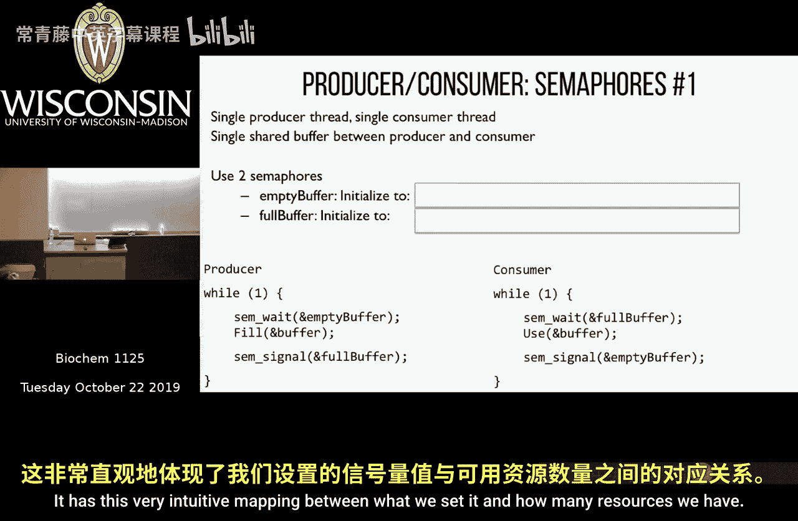

Zero， great， because we have zero full buffers， and so the first time a consumer calls se weight on full buffer。

 it sees that that semapho is zero， it has to wait while that value is zero or smaller。😊。

And so the consumer needs to wait for the producer to run once called signal。

 which increments that value to one。 And then the consumer will be able to continue from that statement。

 Use up the buffer。 And then the next time it comes around， it'll be stock waiting there。

So initializing semaphos is really the。Key step to all of this work。So any questions about that？

All right， so let's make the example slightly more complicated。

Now let's assume we have a shared buffer that has n elements。

I'm using the buffer as a circular array。 you'll see here。 So we are filling the array in order。

That's what this is doing， wrapping around to the beginning。

 And then we're using the elements in order as well。

 And we have just a single producer thread and a single consumer thread。So now。

 how should we initialize empty buffer and how should we initialize full buffer？ Well。

 we want the producer to be able to run n times before it has to wait for the consumer to consume one of those elements。

 So we're going to now initialize empty buffer to n。 It's the number of resources we have。

 It's the number of times， a thread should be able to call some weight and continue without the consumer having to run。

 So after the producer runs n times， it will have called signal n times。

 which will be incrementing full buffer up to n showing how much how many full buffers we have。

 and then the consumer could run n times。 And then as the consumer calls signal。

That will allow the producer to run again。So， of course， it doesn't have to be the case。

 though that the producer runs n times and then the consumer runs n times。

 This coordination allows us to have many different schedules there that it's very possible for the producer to run once to decrement empty buffer to n -1 to then incrementment full buffer to one。

 and then the consumer could get scheduled and return from some weight and use up that one buffer and then signal that that's how many there are。

 So we could have any number of times that the producer runs and the consumer up to n。Alright。

 So any questions about that code。So this was still a single producer thread and a single consumer thread。

 So we were still filling everything up。Concutively。

 it's guaranteed that we filled up element I before we filled up element I plus one。

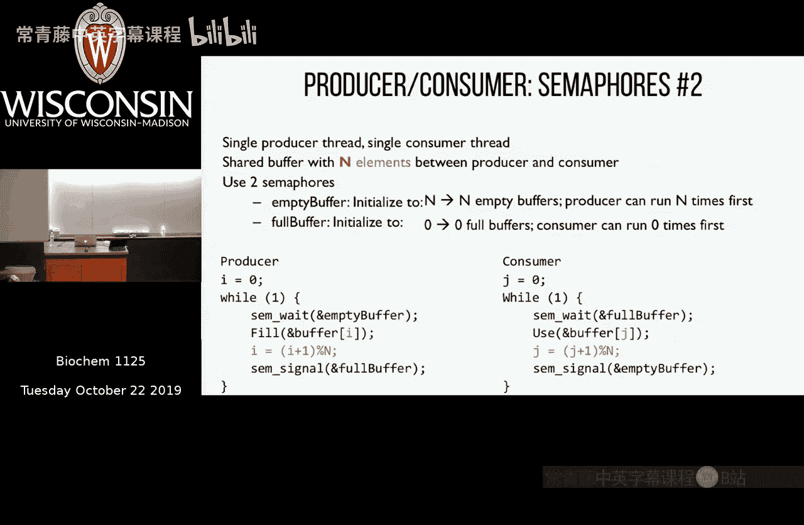

So let's make it a bit more concurrent。So this is more realistic producer consumer code。 Now。

 what we're going to have is we're going to have a lot of different threads。

 This is how this would really be used in the system。 Many threads all running concurrently。

 both producers and consumers。 And， of course， there's a shared buffer with many elements。 And。

 you know， our requirements。Okay， so now I write this code and I ask you if it works correctly。

 So the intuition on how it's supposed to work。Is。Our producer。

 let's say we initialize empty buffer to N。 We then find an empty element in here。

It's not guaranteed。 We want it to be able to just like search through。

 and we're no longer requiring that it's treated as a circular buffer because the producers and the consumers could be going at different rates。

啊。So it might not be like the items are adjacent that necessarily are full。

 And so we find some empty buffer out of those N， and then we fill in that particular one。

 and then we signal to a consumer。 Then it can now run， and it should be able to find a full one。

So the question is， if we have many producer threads and many consumer threads。

 is this code going to work。And so I will give you a minute to talk with your neighbor to figure out why this code will not work。

There is some problem。All right， so does anyone have any hypotheses on what is probably wrong with this code。

Yeah。I cant sort of imagine the situation where。A single producer buying。

M that point context which occurs。Okay's the same。Exactly。Exactly， yeah， so the problem is。😊。

So the idea of find empty buffer is there' some state associated with this array。

 and we're recording as a buffer。Is it full or empty。

 And we're looking through that and figuring out， okay。

 this is the buffer that this producer is going to grab and then fill up。 Now， the problem is。

 is that this thing isn't atomic。 So it's possible that we could have had a context switch within find empty。

 And another producer would find that same buffer and think that it's empty。

 And so they both grabbed that。 and then they both fill it up。

 And so we clearly do not want that to be the case。

 So my eye is a private variable across these threads。

 And so using like my as part of the name is a good signal of that。

 But the intention is that they each have their own copy of my eye。

 but that buffer is shared between them。Alright， so we need to have some mutual exclusion in this example。

 yes。Great， so it's like a lock that lets n threads grab the resource is how to think of it。

 So we're initializing the semapho to n， which means end producers can all be in that code simultaneously。

 So that's kind of the nice thing about it is that it's not the limited。

 Locks are just like n equals one。 This is a generalization of that。 So now we have end producers。

 They're all kind of calling， find empty simultaneously。 They all might grab the same buffer。

 all might fill that same buffer。 So we've done n items to work。

 but we didn't put that work in the proper element。

 And then we're going to signal N of them consumers to wake up。

 and they're only going to be able to find one。😊，Yes。Oh， so in the previous 1。

 I made it that we only had one producer thread and one consumer thread。 And so we were just going。

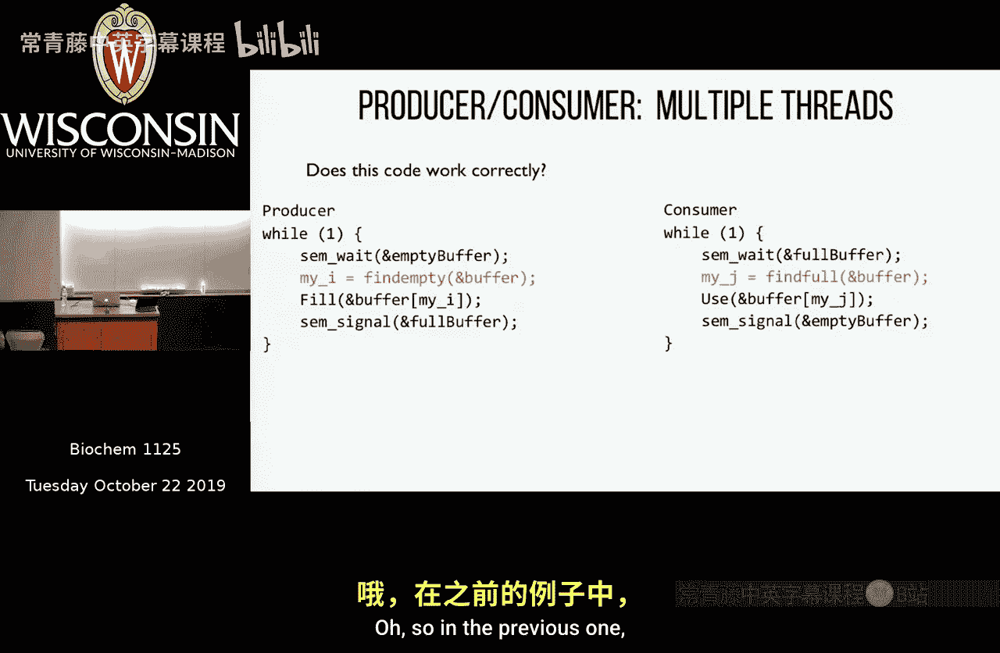

In a circular manner through them， when he filled up one element。 And then that element was consumed。

 So this is kind of a contrived example。 And then this now this is more like the generalization and how you would really write it。

 So you would associate state with each element of this buffer saying。

 is it full or empty or being filled up or being emptied。

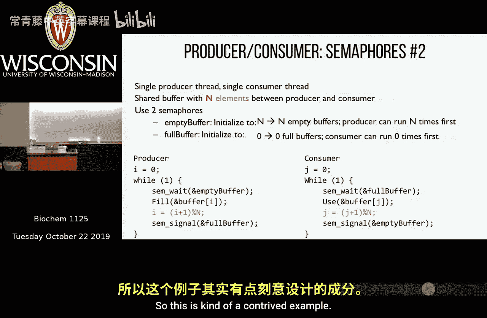

You would have to initialize things differently if you didn't assume that it was empty。

 like if there were two items full， we would have to then initialize the semapho to show that there were two items full and subtract to from how many producers could run。

But I would， I would think of it in general cases it's empty when you start。All right。

 so how are we going to fix this， We need to add some mutual exclusion to this。

 So how are we going to do that。

So here's my first proposal for you。Is this code going to work？Of course it's not。

 so why is this code not going to work？Come up with an example where this code will not work。

 It looks a lot like our condition variable code。 Now， it's not working with semaphoes， though。

So someone have an example where this code would not work。

So what's the problematic case when we have a mutex as our first statement here。

So what will happen if the consumer runs first， That's an easy way to trigger this problem。

 The consumer grabs the muttex。 and that's fine。 It can do that。 It got the lock。

 then it calls some weight full buffers。 That's zero right now。 So it's stuck waiting here forever。

 Some ofs don't do anything about releasing other locks or anything。 So now this consumer， in effect。

 has this muttex。 No other consumer can run。 No producer can run We're stuck in this deadlock situation where a consumer is stuck forever on this S weight for full buffer and the producers that would have been happy to fill up that buffer for you。

 are stuck here waiting for the muttex， which that consumer is never going to release。So。

That's why with condition variables， we could do something kind of similar to that。

 but it was key with condition variables that the consumer， you know， when it was waiting。

 it released the muttex so that the producer could run。

Grab the mutts and do the work that it needed to。 Semaphos don't do anything like that。

So any questions about this code。Okay， next example。Does this code work？So this code， I believe。

 will work。 We could have N。Consumers， you know， they're all stuck on some weight。 That's great。

 of the full buffer。 Then we have N producers come along。 They're able to pass through this。

 And then one at a time， they grab an empty buffer and fill it up and release the mutt so that one of the other producers then can continue through。

 So we won't have any deadlock with this situation。 But what might not be ideal about this code。

 yeah。😊，Does just mean that。Exactly， yeah， so we've said this is the critical section。

 We have mutual exclusion over both of those two statements。

 So only one producer at a time can be filling up a buffer and only one consumer at a time can be even using a buffer。

 We can only even have one producer filling or one producer using since it's the same mut text there。

So what's the better way to write this code， We want the critical section to be as small as possible。

 since that's the part where we have no concurrency where we can't have multiple threads doing the work。

 So the only work that really needs to be in the critical section is actually finding the empty buffer or finding the full buffer。

 So that's what should be protected by our muex that we need to just make sure that one thread at a time is looking through all the buffers is to find an empty one。

 one thread at a time is looking through all the buffers is to find a full one。

 And once it's found that buffer and recorded that。

 then it can use that one up and it knows that no one else is going to find that buffer as。

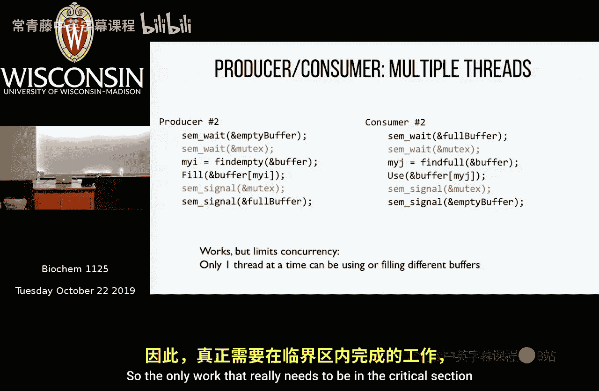

Two， because it's set the state as part of that statement。

So any questions about producer consumer code with semaphos。

So if you wrote producer consumer code with smaphos， it would probably look very。

 very simple to this。 It's very few lines of code。 You just get everything exactly right。

 and it works very nicely。Yeah。Yeah， I always regret that I don't show that code more。

The idea of find empty。Like if n is equal to 4 and they all start in state E。

Then what we want it to do is it's going to look through one of those elements。

 and then maybe it would market like in progress when it grabs that。

And then all of the other producers know that they shouldn't grab that。

 And all the consumers also know that that's not a valid one to take yet。 And then once it's done。

 filling up the buffer， then that producer can change the state to full。

And then a consumer would know that it could grab that one。

 So it needs to have four states to show that it's either completely empty or completely full or if it's in transition and no other thread should take it right now。

Yeah二。Great， so。Here， when we're looking through for an empty buffer。

 that's what Find emptyty is looking for。As part of find empty。

 it's changing it from the empty state to in progress。So that then when， when it's in full。

 it's in progress。 And then when it's done with fill， it sets it to the full state。

So that's what Phil is going to do。 is at the end， it will market as full so that then when the consumer runs。

 it can look through that and find this full one。So you just need to track the state of each individual element of that buffer。

All right。More questions。ok 。So that's the code that I showed you。 That looks great。

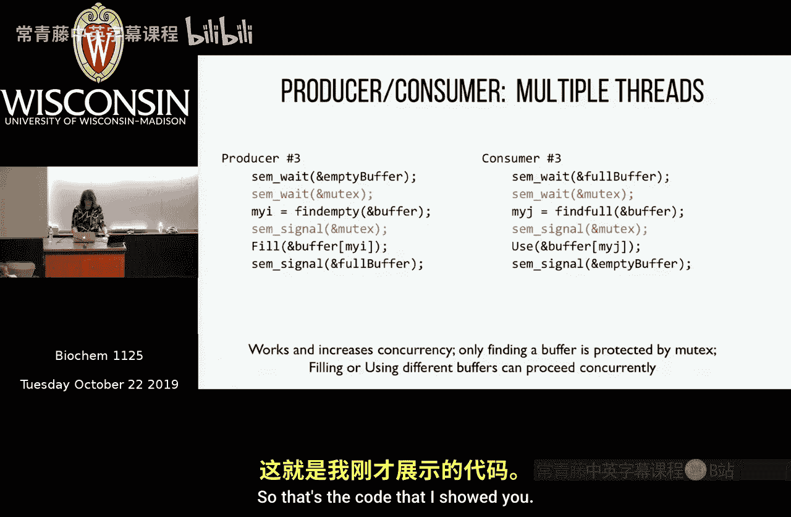

All right， next， we're going to look at some classic problems for synchronization。

 So do you all want a two minute break before we do this， or should I continue on。2 minute break。

 Okay， I'll give you all a break。 And then we're gonna do some more examples。

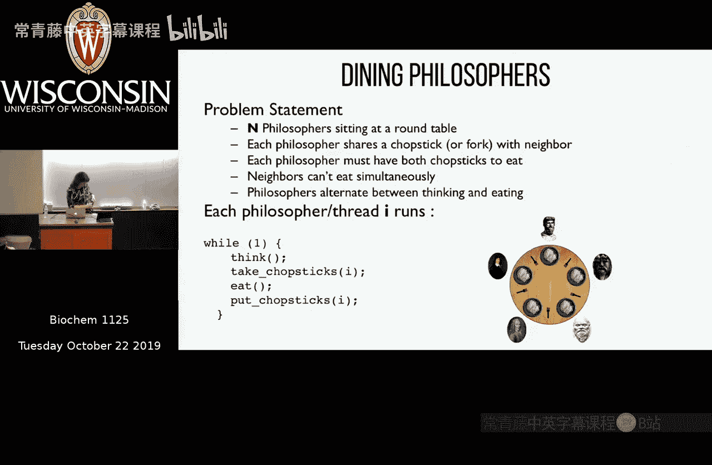

All right， so someone had the good question of why does it really matter if you put that filling of the buffer or using of the buffer in the critical section or not。

 what does it matter if you have more concurrency or not。

 and so it doesn't matter if you're running on a single core right so if you're doing one thread or another thread who really cares the whole assumption of all of this on why we care so much about concurrency is that we do have multiple cores for these examples and so we would like it to be the case that one thread on one core can be filling a buffer while another thread and another core is filling a different buffer and another thread and another core is using the buffer and so forth so you really this is helping us with more parallelism in the system。

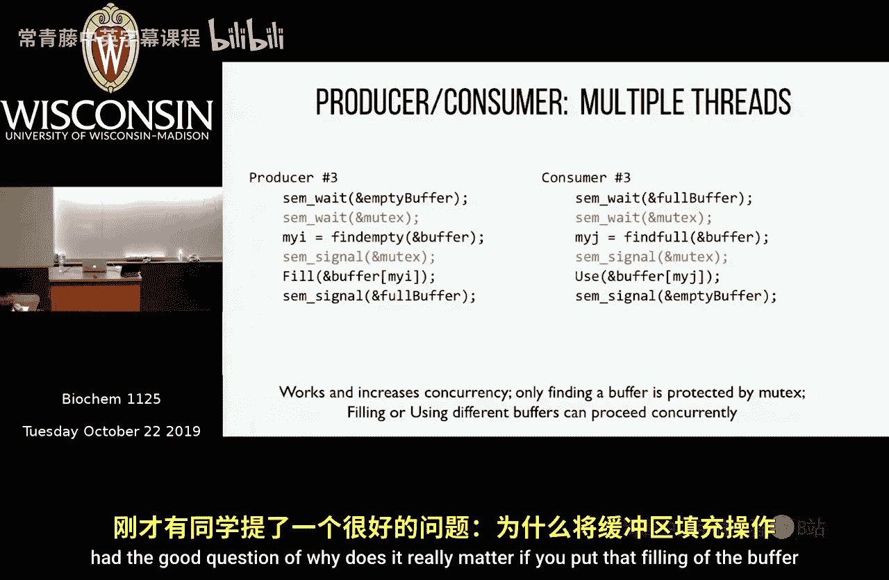

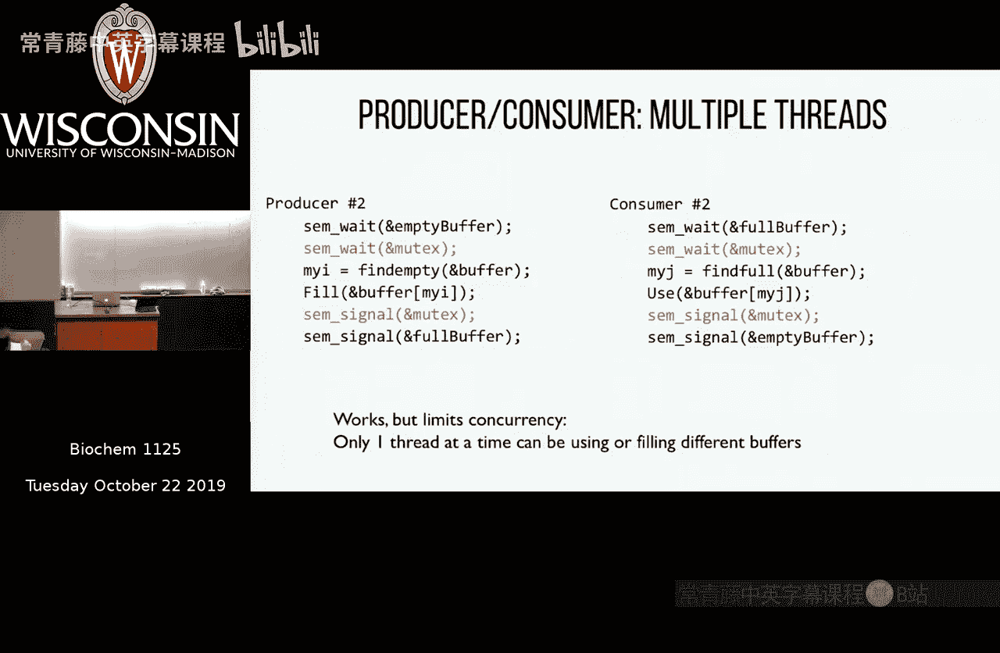

All right， anybody think of any more questions with producer consumer？All right。

 then we will move on to this classic synchronization problem and so you can think of this problem as just like a logic puzzle or it's supposed to be representative of like synchronization problems in general and how to avoid having deadlock in systems So it sounds like kind of a contrived set up。

 but it really is if you have multiple resources that threads need to acquire and each of them has to get more than one resource。

 how can you make sure that there isn't any deadlock in the system。

 but you can't be holding on one resource or one semapho while you're waiting for another。

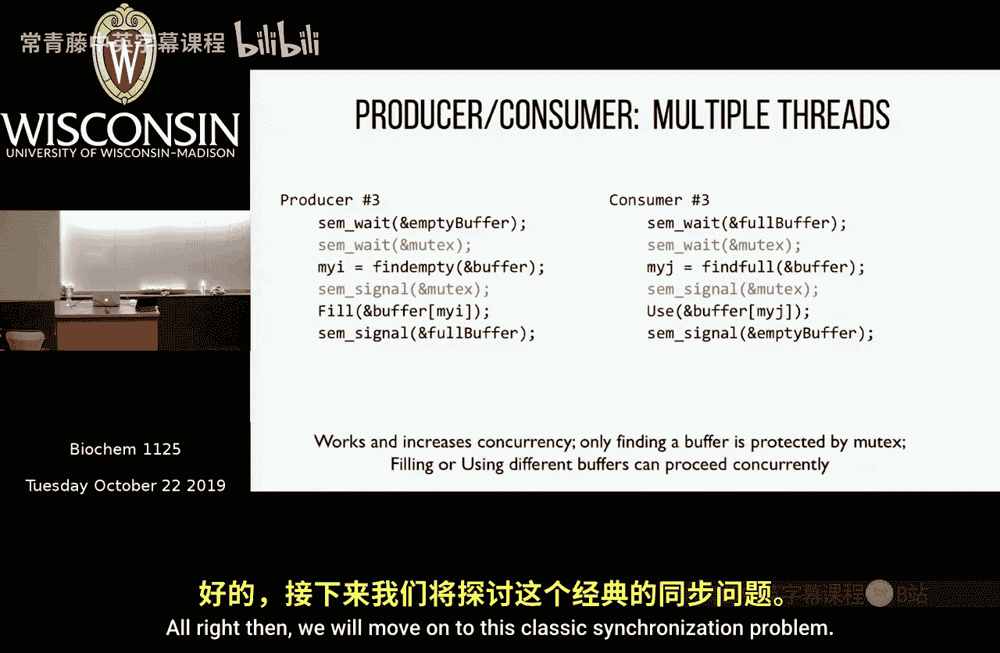

Smapho basically， so the formulation of this is we will imagine we have N philosophers that are at some round table and of course philosophers are threads and each philosopher has to grab both of its forks or chopsticks in order to eat。

 but they're sharing that resource with their neighbor there。

 and only one of them can grab that fork or chopstick at a time。

And we want to imagine that what each of those philosophers are threads。

 what they're constantly doing is they're thinking for some amount of time about great thoughts。

 and then they decide they' are getting hungry。 And so they need to pick up their two chopsticks on either side。

 they then eat for some arbitrary amount of time， they're using that resource for some amount of time。

 And then when they're done， they release those two resources。

 So what's going be tricky about this is that we have this circular dependency across all of the resources。

So let's think about how we could represent this with semaphos。

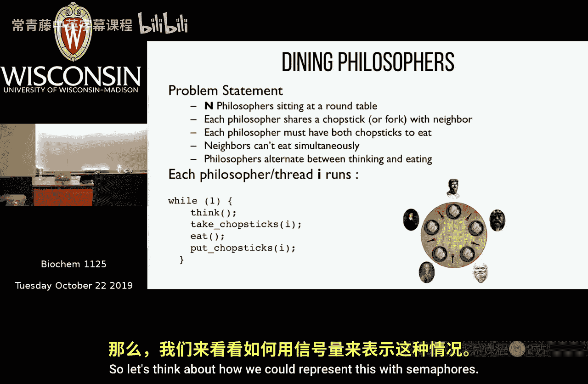

So I'm just going show the code for take chopsticks and put chopsticks。

 So these are the routines that you need to call before you actually use the resource， right。

 before you eat。

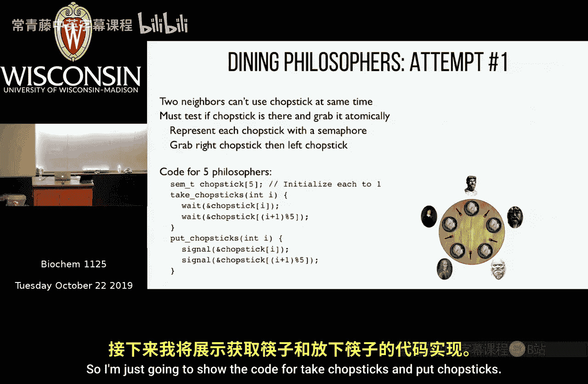

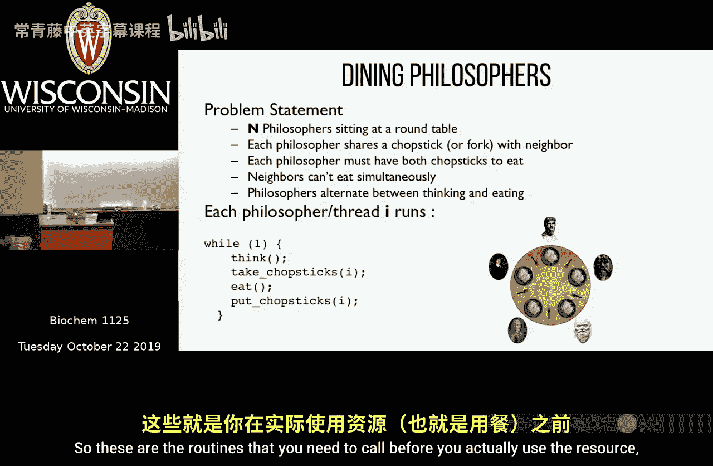

Okay， so this is the code for taking your chopsticks。 So basically。

It needs to be the case that two neighbors can't grab a chopstick at the same point in time so we can't like do a test is the chopstick available and then grab it。

 that needs to be an atomic operation， so that's why semaphore seem like they could be a good representation for that that we can atomically test to see if the value of the semaphore is greater than one and grab it and then if the second thread or philosopher tries to call weight on that semaphore and sees that that semaphore has already been grabbed。

 it won't be able to grab it。Okay， so basically， all of the code does willll initialize all of our chopstick semaphos to be one because that's how many of each one there is。

 That's how many resources there are。 That's how many times you can call weight and have it continue。

 And so we'll have philosopher eye weight on one of its chopsticks eye and then the other one is the one to its left or right。

 however， we want to do our circle in our numbering。

 But it's the other chopstick with some modular arithmetic to bake it wrap around in the circular buffer。

 And then when you're done， you put them down by calling signal。Okay。

So what is going to happen when we run this code。 So let's do some imagination。

 Let's imagine that philosopher 0 calls take。 It then is able to call weight for this particular chopstick and continue。

 And then it calls weight on the other chopstick， and it's able to continue。 Now。

 imagine that thread one。😊，Tries to call take。Well， it's not able to。

 I guess I'm just imagining that it's this philosopher， philosopher， too， that runs。

 It's able to call weight successfully。 This one over here is able to call weight on this one because we could have a context switch at any point。

The next philosopher is able to grab that chopstick。 And then this philosopher。

The way the scheduling worked， it was able to grab this chopstick。And then now。

 if we have our context switch back to philosopher 0，1，2， and it calls weight on。The other chopstick。

This one here。It's going to see that the neighbor already called wait on that so it's going to be stuck there。

So it won't be able to acquire that chopstick until it gets released。

 So what will happen eventually is philosophers 0 calls put down chopsticks， which call signal。

Calls put。Then this other one can acquire that resource。Okay， so it seems like maybe this works。

 but it doesn't。 So what is an example where this code will not work。Yeah。Exactly。

 so if every philosopher grabs its their left chopstick。

 then they're all going to be waiting to pick up their right chopstick and will have deadlock there。

 So I'm supposed to have， this is exactly that picture。

 So they each called weight and got the first chopstick。

 now they' each stuck waiting on the next one。 Nobody is going to be able to continue with a statement。

 So nobody is going to be able to call a signal and drop in the chopsticks there。Okay。Al right。

 so we need to fix this code。And so one way to fix this code is we can't have this circular dependency。

And so the easiest way to do that。What is this code？Okay。All right。I'm like at some point in my life。

 I guess I put some time into these animations。😊。

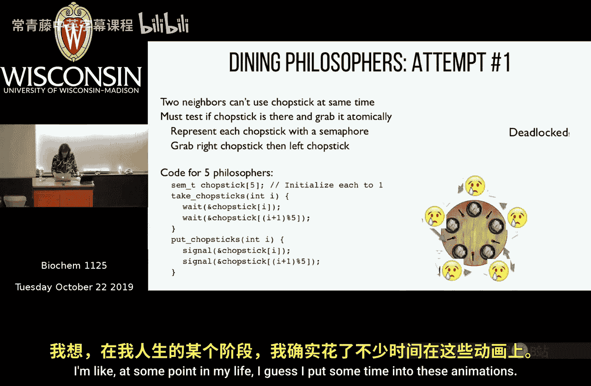

Okay， they're all hungry and starving。😊，Okay， so the way that we break this deadlock is we have philosophers。

 0，1，2， and three all act one way。 they all grab the lower number chopstick first。

 but the fourth philosopher， it grabs them in the opposite order。

 so this is not going to lead to deadlock anymore， but it is still not optimal。

So what will happen now is philosopher zero can grab。Choptick 0， philosopher 1 can grab chopstick 1。

2，3， so forth。This philosopher is not going to cause deadlock， though。

 It's not going to be able to grab chopsticks 0。 So that's beautiful。 So as a result， at some point。

 we'll have a context switch back to this philosopher and they will be able to get their other chopstick。

 At some point， they will get scheduled and be able to grab that。

Now we're not having a lot of concurrency in the system you'll notice there's only one philosopher that' that's able to eat。

 one thread that's able to run， even though there should be more concurrency in this system。

 but at least we're not going to deadlock so this thread is able to eat eventually it will be done eating and will call put and put those down and when it puts those down then the other philosopher can grab it。

嗯。Choptick at that point。So no deadlock were're making slow。

 steady progress with this somewhat improved code。But what is not good about this solution is that。

 as I was saying， it's limiting the amount of concurrency。

 We're not really maximizing the liveness of the situation。

So that's what we're going to look at next is how to really do this maximally efficient solution。

So does everybody understand this approach first， So this is kind of like the classic solution。

 but it's just not great。

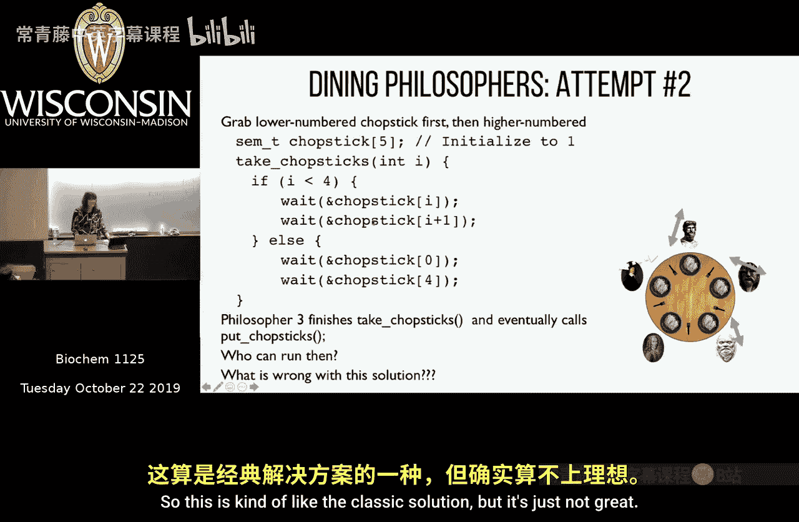

So the next solution， I think once you understand it， it's really， really awesome。

 but it takes a while  honestly， to understand this next bit of code。 So， so get get ready， okay。😊。

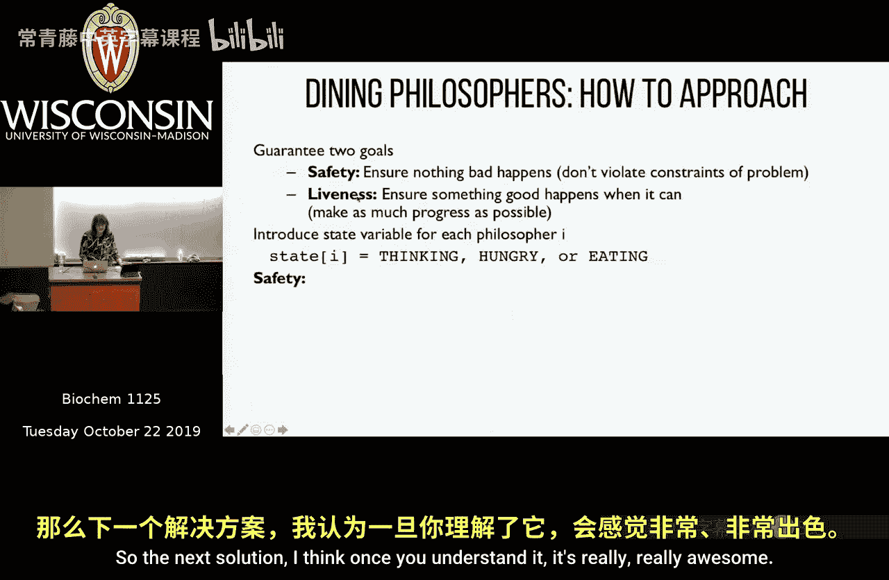

All right， so we want to think about what are the requirements of this system。 And so so far。

 we've just been thinking about safety。 We've been trying to make sure that nothing bad happens。

 You know， that it's never the case that two different philosophers grabbed the same chopstick。

 That wasn't possible in any of our previous solutions， but we weren't doing anything about liveness。

 We weren't making sure that philosophers were able to grab chopsticks when they should have been able to。

So we want to maximize our liveness as well。So we're going to have an implementation that guarantees those two goals to do that。

 we're going to track the state now of every philosopher。

 we're going to say it's either in the thinking state。

 it's either in the hungry state when it wants to pick up the chopsticks， but it's waiting to。

 and then when it finally transitions to having the resources， then it will move to the eating state。

So we're now going to express our safety goal a little bit more formally。

 So what does it mean in this system to be safe， that nothing bad is happening？

So we need it to be the case that for all I， for all threads， for all philosophers。

 it is not the case that this philosopher is eating and its neighbor is also eating。Right。

That's our formal requirement for safety。 That's guaranteeing that we don't。

 We're not using the same resource across both of those entities。

So that's the formal expression for safety。And we're going to be able to just directly embed this in our solution now that we've formulaized it like that。

 And then the liveness one is a little bit trickier。 But basically。

 we want to keep the system as live as possible。 So what's the liveness specification。

It should never be the case。That there's a philosopher that's hungry。 It wants to eat。

And its neighbors are not eating。So if the neighbors are not。

 both of its neighbors are not eating and it's hungry， it better be able to eat， right。

 It better be able to get those two chops。So we can specify that formally by saying， for all I。

 it is not the case that this particular philosopher is hungry and neither of its two neighbors are eating。

One neighbor is not eating， and the other neighbor is not eating。

So it should not be the case that you are hungry and neither of your two neighbors are eating。

Alright， so this is the setup。 And this is， the code is going to fall pretty naturally from this。

 This is giving all of our requirements。 So this is the beautifully elegant code for implementing this。

 And I do want you to understand this。 And it's not as bad as it looks。😊。

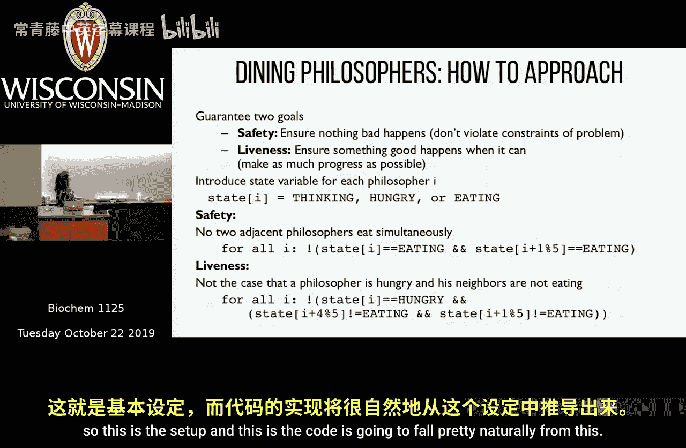

Okay。So we are going to have a may eat semaphore and this is basically going to tell a given thread or philosopher that it can eat right now。

 and then we're going to have one semaphore that we're using as a muttex and so anytime we say a semaphore is being used for a muttex that almost always means we need to initialize that to one。

 remember so that one thread can grab that mutex and we're going to see that we need to initialize this may eat to zero for everybody else。

And we'll get into why that is。 So everybody starts off in the thinking state。

 And then when a thread wants to eat， it calls this take chopsticks routine where I is the philosopher number。

So it just calls it once。It doesn't call it for both chopsticks。 This is grabbing both chopsticks。

So we're going to put all of this code in a critical section protected by Muex。

 And so what do we do in that critical sections， We say， our state is hungry。And then we see。

 we check to see， is it safe for me to eat。 So we already said we're safe to eat if。I'm hungry。

And neither of my neighbors are eating right now。So if neither of my neighbors are eating right now。

 it's safe for me to eat。 They're not using the chopsticks。 They're not using the resource。

 So I'll set my state to eating。And I'll signal on my own semapho so that it was initialized to 0 before。

 When I call signal on my own sephore， it's going to increment it to one because then you look and you see what happens after I call test safety and liveness on myself。

 And I release my。Mutex， I then call weight on that semaphore that I just signaled down here。

 So this was initialized to 0。 If I didn't signal and increment it to  one。

 then I'll be stuck here waiting for a while。But if it is the case that neither of my neighbors are eating。

 I called signal， then I incremented it to one。 And so that weight call will return just like we wanted。

So that's how we can guarantee the safety of this system that you're able to pick up the chopsticks as long as neither of your two neighbors are currently eating。

Does that part make sense to people。Yeah。Oh great， so I need to have this new text here because I need this to be in a critical section。

 I need to have mutual exclusion over testing my state and I mean setting my state and testing it。

 if I didn't have those new textes， then lots of philosophers would be simultaneously setting to hungry and having race conditions with what they're looking at and multiple of them could all think that they can transition to eating so since we're looking at different global state variables that needs to be protected in a。

Critical section with that mutex。But you'll notice we do release the mutt before we call weight down here。

 If we reversed that， this code wouldn't work。 So that's what's really neat about this。

 is that within our critical section， we can be looking at all the state variables figuring things out。

 We call signal on our semapho。 The semaphore remembers that all for us。

 And then we can call weight on that and have the desired result。Okay。

 so that was the safety part of it。 The liveness part happens when we're putting down a chopstick。

 So now we're done with the resources and we're going into the thinking state。

 And so now we need to test if the fact that we're not eating anymore。

 if that enables either of our two neighbors to start eating。

So for our neighbor on our left and our neighbor on our right。

 we now see if the fact that we're moving to thinking is going to let them go live。

 let them grab the resource， so we call first for the one neighbor and then for the other neighbor and they also look to see am I hungry and are neither of my two neighbors eating right now if so then I'm going to start eating and I'm going to call signal。

 so those threads that those neighbors that we just called it on we're calling signal for them。

 they were in the past waiting here and we'll wake them up where they were waiting there？So。

 questions about this。It's going to take some time looking at this code， I imagine。

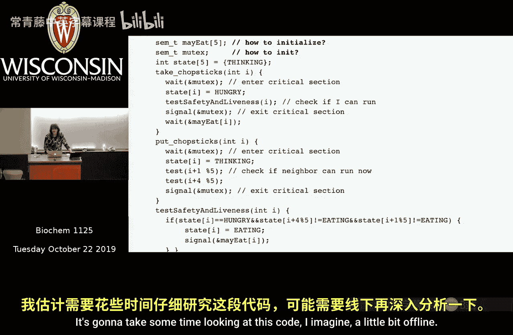

A little bit offline so we can go through kind of how this would work kind of conceptually。

Without looking at the code in too much detail。 So just conceptually。

 how do we imagine this would work。 So philosopher 0 calls take chopsticks。

It can look at the state next to it。 It can see that neither of those two are eating right now。

 So it's able to move to the eating state。 right When this philosopher tries to call。

 take chopsticks， What's it going to see， It's going to see that it's hungry。

 but the neighbor on the left is in the eating state。 So it can't proceed。

 It's going to be stuck in take chopsticks。 So it stays in the hungry state。

Then this philosopher tries to call it take chopsticks。

It will see that neither of its two neighbors are currently in the eating state。

 so it will be able to go to the eating state， call signal on itself and proceed。

And then we keep going around。 That one's going to stay hungry。

 and that one's going to stay hungry since they have neighbors that are eating。

 So this is maximizing the liveness， the number of resources that can be used by specifying these requirements the way that we did。

And then what's going to happen when we call put chopsticks for zero？

We are going to move our state from eating to thinking and will test the liveness of our neighbors。

The liveness of this one， it's still going to have one of its neighbors eating。

 so it's going to stay hungry， but when we test the liveness for this one。

 it's going to see that it is in the hungry state and neither of its two neighbors are eating。

 so it should be able to proceed， so it will move to the eating state and so forth。

And this continues on and on。And my animation stops， yes。So， you。Yeah， I should go back。

So what we want to assume is happening is this first code here。

 we have no idea how long they're going to call， think。

 but then at some point they're going to decide that they're hungry and they're going to try to take their chopsticks and we have no idea how long they're going to use the chopsticks。

 but then they're going to put them down so everybody is doing this simultaneously but independently。

 they're not coordinated， we have no idea anything about the ordering or anything about that so that's why the code is tricky to write because we need to be able to grab those resources at arbitrary points in time。

Yeah。You should not assume certainly that n is equal to 5。

 So this is nice that it will work for an arbitrary N。 Yeah， yeah， in all of our examples。

 only two could be eating at most， but this will scale very nicely to more N。So keep it general。

I'm sure you could。 if you knew that there's only two a dozen， like you could do some shortcut on it。

 I'm not， I'd be worried I would have some。Race condition。

 but it does seem like you could do something more efficient if you made some more assumptions there。

So more questions about this code。Okay。嗯。I highly suggest some more questions about this code。😊。

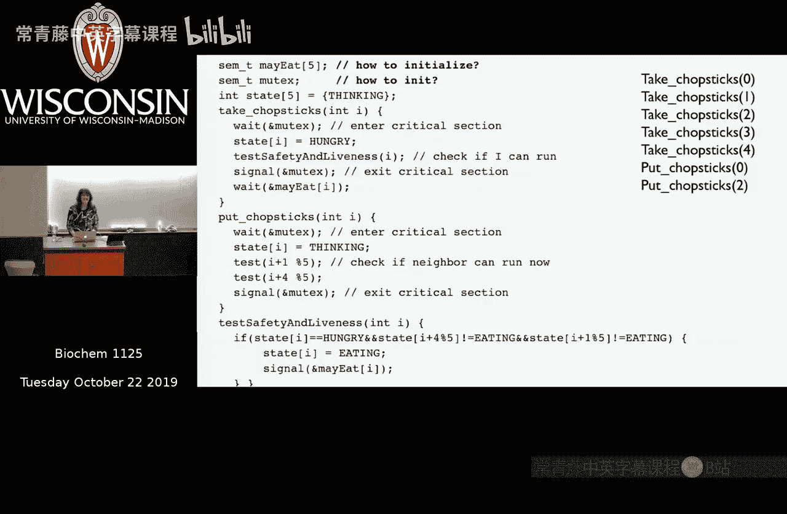

Okay so I'm just going warn you what we're going to talk about at the start of next lecture rather than going through this。

 so we're going to now look at how to do reader writer locks and so I'll just give the incentive for that today。

 so rather than just having a simple lock that provides just mutual exclusion and let's just one thread have that resource we wanted it to be the case with a reader writer lock that multiple readers can all have the resource because you can all be reading a structure and you're not going to be messing up anybody else but if one thread is writing to that you can't have anybody else writing to it because then they would have conflicts and you also can't have any people reading it because they might see the structure in some indeterministic state right so with a reader writer lock。

 you can have multiple readers grab the lock but only one writer and then there's a bunch of different ways that you can implement reader writer locks so。

It all depends upon who you want to have priority。 So basically。

 the idea is you could have all the readers be able to run。

 So let's say you had some readers that have the lock and then。Wri comes and wants to grab the lock。

 You're not going to let the writer grab the lock while the readers have it because they're reading the structure。

 But then what should you do when another reader comes along。

So you could argue that the reader that comes along later。

 it should have to wait for the writer to grab the lock because that would be more fair。

 but you could argue that the reader should get to go because maybe the reader has only a tiny bit of work。

 and and that writer can't go anyways right now。 so you might as well have one more thread reading the structure and maybe they'll be done before the writer even would get his turn anyways。

 So we're going to look at two different implementations。

 one that gives the priority to readers and one to give writers。

 and just to quickly show you what you're going to be looking at。

 this is the simple reader gets preference code。 And then this is very similar to the dining philosopher structure with what we looked up there。

 So we'll go through this at the beginning of next lecture。

 it'll be a good review of did you understand the dining philosophers to understand these reader writer locks。

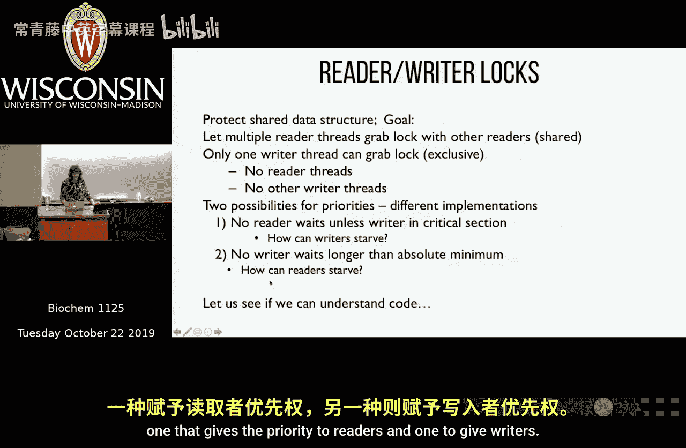

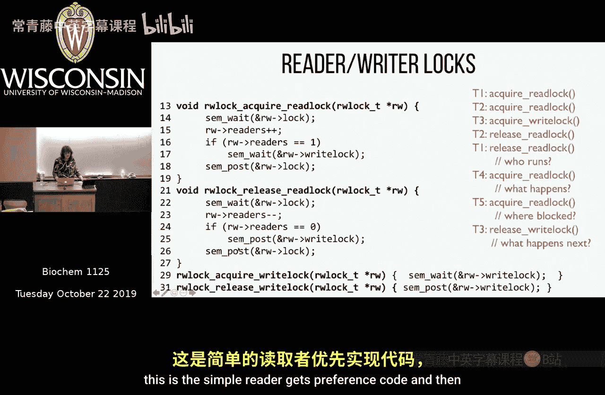

Okay， so we'll continue talking about semaphos in the next lecture。

 go finish up your project if you haven't， I'll see you all on Thursday。

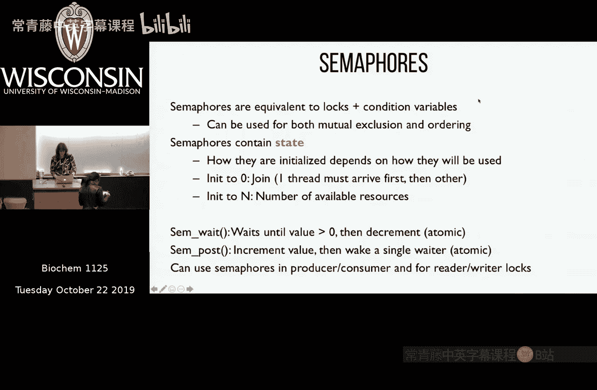