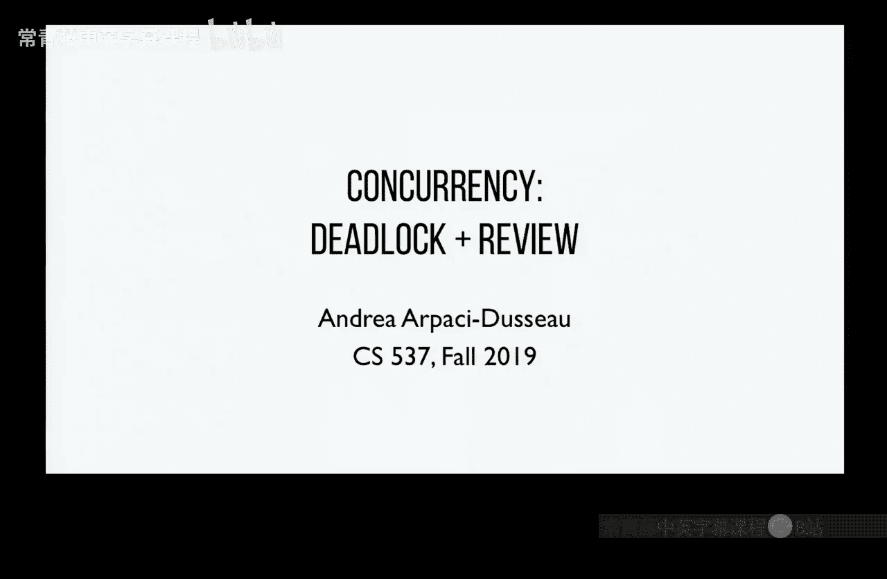
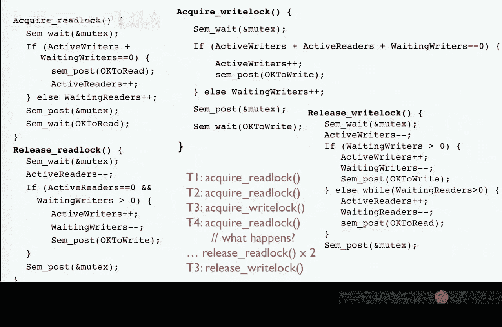

# 威斯康星大学【中英⚡操作系统｜CS 537 Fall19, Introduction to Operating Systems】 p15 P15 Concurrency_ Deadlock + Review _ University of Wisconsin-Madis -BV1wUzSB3Ecf_p15-

All right， good morning， everybody。 It's very loud today。 I hope you all enjoyed the snow。😊。

And hopefully we won't see any more of that right until next semester until after this class is done。

 maybe this will be the only snowstorm we have so today we're going to wrap up concurrency we'll be talking about some of those concurrency bugs that we were talking about in the last lecture we were finishing up with deadlock and then I'll spend some time reviewing for the midterm that's next week on Wednesday。

呃。Things are failing today for me。

J。

All right， so for some reason， I cannot see anything on my computer or on the screen there。

 but it works up here。And does this work， Yes， great。 okay。

 so Project 5 you all know is available now， it is due on Monday。

 We made it a bit simpler than I initially had grand envisionings of I assume that the Ts will go over how to do this project in more detail in discussion section tomorrow some of them started a bit last week。

 but last week it was very high level and then tomorrow would be going over more of the actual details of that specific project。

 So if you don't have a project partner still you are welcome to fill out that form and request one。

 we just keep making matches as long as we see requests So feel free to do that。

 we are trying to make it so that no one can totally fail on this project that there are different levels of difficulty And so you should turn in versions corresponding to what level you get to So you could turn in code for all three versions or if you're positive that your last version is great。

 then you'll get all the points for the easier versions as well。 Okay so the first version version 0。

😊，The idea of that one was you just allocate every other page of physical memory to processes。

 And you just have to make sure it's every other page of physical memory because they each chapter to have that buffer page in between them。

 And you just mark all of them as you don't know what process they belong to。

 So that's like the easiest level to get done。Then the next version is you just keep， again。

 giving alternate pages to processes。 But this time you go through the code paths and you figure out which process each of those pages belongs to。

 So some of the pages will still be unknown processes。

 It's kind of hard to figure out some of the boot up processes and some of the O which pages it's using for its page tables。

 So we've told you in a couple cases that you should just mark them as unknown pages。

So that's version 1。 And then version 2 is the same level of you figured out which pages belong to with which processes。

 though some of them will still be unknown according to the cases that we've given you。

 but you're trying to do allocations such that you give contiguous pages that belong to the same process。

 So it won't always be possible， but when it's possible。

 you'll give a page to a contiguous chunk there。So hopefully that will be clear to you after you've looked through the spec if you haven't done that already。

 but we are trying to give you three different levels of difficulty there。

So any questions about the project that I can answer for you at this point。All right， okay。

 so midterm 2， it's next week。 A bunch of practice exams with solutions have been posted for a while。

 So the exam that you see will look very similar to those practice exams。 So as always。

 we encourage you to look at those practice exams very carefully。

 We're going to be in the same exam rooms as last time。

 except now we're switching who's in the big room versus the small room。

 So the small room will be for the last two discussion sections of the day。

 I think that's 304 and 305。 But it's posted on canvas。😊，People ask， is it a cumulative exam。

 It technically is cumulative， though most of the questions will be about concurrency。

 I'll have some that are about virtualization。 But what I usually do there is I take questions that are very similar or identical to the ones that you saw on midterm1 to give you some incentive to go through midterm1 and make sure that you understood all of those。

 I take the questions that people did the worst on。

 And I slightly rephrase them or ask them exactly the way they were。

 So look through midterm1 and make sure you understand all those solutions。

 And I usually just do the true false on those。 I don't do the longer problems in that case。

So any questions about the midterm？Right and it only covers is the material up through today。

 It will not cover anything about I O， which we will cover on Thursday and Tuesday of next week。O。

So let's do a little bit of a review。 So we're talking about concurrency。

 were going to have two primitives that we need to provide。 one is mutual exclusion。

 we need to make sure that two processes aren't accessing data in the same critical section at the same time。

 and we can provide those mutual exclusion with locks or semaphos， and then we talked about ordering。

 we often needed to be the case that one thread runs and does something generate some data， exits。

 does something like that before another process A is able to run and do something。

 so we are able to provide ordering with conditioned variables and semaphos。

So you should all be very familiar with the interfaces for condition variables。

 you can wait on a condition variable。 It does require that you have a mutex held when you call weight。

 there's a corresponding lock or mutex that goes along with every condition variable and when you call weight。

 you release the lock and you go to sleep and you are stuck there until another thread calls signal on that same condition variable and if there is no waitinging thread。

 remember signal just returns and doesn't do anything at all。

 it does not remember the fact that a signal came before the weight。

 that information is completely lost in the condition variable。And again。

 remember that it is not atomic really to grab， to be released。

 to be notified that you have gotten the signal for condition variable and that you grab the lock。

 So in that weight call， if a was signaled， it would no longer be waiting for the condition variable。

 but it does need to wait until it gets the lock。 We don't know which thread will actually be given the lock。

 it might be a different thread and a might get the lock later。Okay。

 so that was why we basically needed that wild loop because we don't know when A is going to wake up。

 It might be that the world has changed。 Vas have changed in that time between when the signal occurred and when A returned from the weight。

 because it might have taken a while to grab that lock。

 So that's why it had to check like the buffers。 if it's a consumer to make sure that there really is still something in one of those buffers。

Alright， so any questions about condition variables。Okay。

 and then I talked a bunch of different times very briefly about monitors。

 but I don't think I ever made an official slide。 So I thought， well， it should be in your notes。

Because you should know what monitors are， the motivation for monitors is that there're just locks and condition variables。

 but there's language support so that programmers can't make some of these trivial locking errors that they could if they had to call lock and unlock explicitly。

 So the idea is that people often use locks and semaphoes and conditioned variables a little bit wrong。

 monitorits give them some type of language support so that that's less likely to happen。

 So the basic idea is that a bunch of different languages and environments have provided monitors over the years。

They'll usually have some type of keyword to say that this method is synchronized and what that means then is that this method is a critical section。

 and so there will be an implicit lock that's associated with all of the synchronized methods associated with a certain object and it will always acquire that same lock at the beginning of a synchronized method and then release the lock at the end of that。

 and the languages will provide condition variables as well。

 and they'll do the corresponding correct things with locks for those condition variables。

 You're just not aware that there are locks。In those languages that provide monitors。

So it makes some things easier， but also， you still have all the same problems of worrying about deadlock and ordering。

 and it still has lots and lots of problems， but some people think it's a little bit easier to program with monitors instead of just locks and condition variables。

But given that I like C， I'm gonna like locks and condition variables rather than higher level language constructs。

Okay。So then in contrast to condition variables， we had another way of providing ordering。

 That's semaphos。 The main difference between semaphoes and condition variables， again。

 is that condition variables， they have no state。 They're not recording at all。

If we've called signal already or not， whereas semaphoes， I have state associated with them。

 every semaphore has an integer value that's associated with it。 And when we call weight and post。

 we look at the value of that semaphore。 and that determines what we do。

So semaphos are going to be able to do both locking and act like an ordering primitive。

 like condition variables。 And how we use them is going to depend upon how we initialize their state。

 So in general， if you initialize it to one， a semaphore to one， that is letting one。Thread。

Get you know， grab the semaphore。 So that's acting like mutual exclusion like a lock。

 When you initialize the state to 0。 Then what that means is that the first thread that calls weight。

 it's stuck there for a while， It's waiting until the value is greater than 0。

 So that thread needs to wait until another thread calls post。

 That other thread increments the value。 It will now be one。 So it will wake up a single waiter。

 and that thread that was waiting， wakes up。So no locks with semaphores。

 It's doing those things all within the。The sepho weight and post。

 And then it doesn't have to be just a binary semaphore。 It doesn't have to be just one or0。

 You can have these counting semaphos， which just means that the integer can be an arbitrary integer。

 not just0 or one， like a binary semapho that you could only use for locking。

 It can actually be recording like how much of a resource that you have。

 So we saw that semaphos could be useful for producer consumer relationships where you could show like how many empty buffers you had or how many full buffers you have。

 That's what you'd be tracking in the state of the semaphore。

 And that's how many threads would be able to then produce or consume。

So any questions about the basic definitions for semaphores。Allright， so that is our review。

 And so then we were starting to look at concurrency bugs。

And we saw that there are a bunch of bugs that occur in a variety of multithreaded applications。

 even multithreaded applications that have been out for many， many years， tested extensively。

 They're supposed to be production level code。 There tends to be a lot of concurrency bugs in them。

 So we looked at some atity bugs or bugs that were needed mutual exclusion that didn't have them。

 We looked in a bug that was due to ordering where something needed to happen in one thread before another thread ran。

And then we were looking at deadlock。 And that's when we kind of ran out of time。

So let's look at deadlock。 So you'll remember， we had our example of the cars going through an intersection and that there's four conditions that all need to be true in order for deadlock to happen。

So it has to be the case that you require mutual exclusion。

 So only one thread can have a resource at a time， because if you could just let multiple threads use the resource。

 then we wouldn't have dead dolk。We require that you have this hold and weight property。

 meaning you're holding on to one resource like this。

 a square of cement while you're waiting for the next square of cement。

You have to have no preemption， meaning you can't take a resource away from a thread。

 You can't make this car back up。 That would be like preempting。

 And you have to have this circular weight where one thread is waiting for another in a circular graph。

So if we can eliminate any one of those four。Conditions， we can eliminate deadlock。

 And so we're going to look at a bunch of examples of different ways of doing this。

 where we eliminate one of those four different conditions。All right。

 so the first thing that we'll look at， we started to look at this in the last lecture is how can we eliminate mutual exclusion。

 So basically locks are what provide mutual exclusion。

 so let's not provide locks in the way we solve problems。

And so the way that people do this is they build these lock free or these weightfr data structures or algorithms。

 And they're kind of neat。 Once you get into them， they're really awesome to think about like how to do different algorithms using kind of this mindset。

😊，But a lot of them， they'll be built on different hardware atomic primitives。

 a good building block is this compare and swap。 and you'll remember what that does is it says if the value that's being stored at address is equal to expected。

 then it says that's good and it sets address equal to the value at address equal to new and returns true or one。

 but if address was changed sometime， and it doesn't match expected。

 then it's going to return zero and it's not going to set that value equal to new。All right。

So this turns out to be a really neat building block and。So the idea here is， for example。

 before how did we implement an ad using locks， we'd say that incrementing value was our critical section。

 We needed to make sure that that executed atomically relative to anybody else accessing value。

 So we put that code within a lock， acquire and release。 And so we knew that that was atomic。

 The other way to do this is to use this neat compare and swap。Hardware instruction。

And this does not acquire any locks， but it will only put the value of old plus amount into value。

 If value hasn't changed since we grabbed it。Up here。

So that's why we want to make sure that value is still equal to old。

 That means that a different thread didn't come through and simultaneously increment value while we were trying to do that。

So this time I tried to draw。A little animation here。Well， I didn't animate it。

 but it has everything on there that I think is interesting to look at。Okay。

 so this is showing like a timeline of what's happened to go across two different threads。

 This is this weight free algorithm or this lock free algorithm。

And we'll assume that value is initially 10。 And thread1 wants to add the value of  two to it。

And he too wants to add the value of three to it。Okay。

 so let's imagine this thread T1 gets scheduled first。

 It grabs the current value that's stored there。 It sees that it's equal to 10。

 Then let's assume we have a context switch。 T2 runs。

And it also grabs the value and stores it an old， its own copy of that， right。

 that's a value that's on the stack。 It's local to each thread。

And it also sees that it's equal to 10。 That's fine。

 Then we do this nice atomic construction for compare and swap。😊，And what does that do。

 It looks to see， does the value that's stored here still equal old， and it does。

 That means another other thread raisedd in。 And so it's going to update the value stored at Val to be 13 old plus the amount that it wants to。

 and it returns true。Because it saw that the value matched what it had expected。

 So this thread is done。 It did that atomic ad very， very efficiently and nicely。

 It's done with the wild loop。Now， at some point， we have a context switch back to thread1。

 It does that compare and swap operation。 It sees that the value that' stored at value is now 13。

 It's not the 10 that it expected because somebody came in and changed that value。

 So it returns false as part of that single hardware and instruction。

 It's guaranteed to execute atomically。And so it goes back through the while loop。

 sets old equal to 13 this time， which is the current new value。 It executes the compare and swap。

It now sees that vowel still does equal old and it's able to then add two to that and return true and be done。

So that is how you can build these lockfr algorithms or these weightfr algorithms that you're never stuck just waiting for the thread to acquire a lock。

 You're always doing some amount of work。 Though maybe your work gets wasted， right。

 Like you stored a value。 You tried to add to it。 And you found out that someone else has tried to do that a in between when you were there。

So that's how these lock free algorithms work。People will do more。

Interesting algorithms than just adding though with this， they're really good for data structures。

 so for example， these waitfr algorithms can help you insert an item at the front of a linked list。

So in the past， we looked at this insert code， and this is what it looked like when we needed to make sure that adding an element to the front of the list executed atomically。

 right， that this is our critical section。 We can't have it be the case that we record what the head is。

 and someone else also does that， that then the head is only going to point to one of us。

That was the problem that we saw at the beginning of concurrency that kind of motivated why we needed to have locks。

So it turns out you don't need to implement this with locks。

 you can also implement them with that beautiful compare swap， atomic hardware instruction。

 and you'll see that the format looks very， very similar to the previous one that often that's kind of this template that we' end up seeing。

 that you kind of need to remember what it is that can't change you remember this invariant that you need to have hold。

 and then as long as the thing that you're changing because we're trying to set head equal to N。

So we're going to set head equal to n as long as it's the case that。

He and and next are currently the same。 That's what needed to be executed atomically there。

 So we're checking to make sure that those two are equal and then only setting head equal to end that that second statement。

If nobody else raced in and changed。Alright， so let us look at this 1 I made into a horrible animation。

 We'll see if this works。Alright， so we have two threads。

 We have a linked list that's starting off where our head is pointing to a single element with a value 5。

 And there's nobody else in our linked list。We have two threads。

 Thread 1 wants to insert the value 2。 T 2 wants to insert the value 3。 It allocates a node。

 sets the value。 We have the context switch。 The other thread allocates a node sets the value。

And then thread one， what does it do， It sets its next value equal to what the head is pointing to。

Now， let's imagine we have a context switch and T2 also does the same thing。

 It sets the next field equal to what head is pointing to。

And now let's imagine that T2 gets to continue running what's going to happen。

 It's going to do that compare and swap。 It's going to see that it is the case that what head is pointing to is the same thing as what our and next is pointing to。

So we are able to do this atomic assignment。 We set head equal to what we're pointing to。Yeah。

And return true， so we're done with that wild loop over in T2。

Then we have our contact switch back to T1。It sees that something happened in between the time when it's set next equal to head。

 and when it's trying to do this switch， it sees that head does not equal the same thing that we're pointing to。

 So it returns false。 We go through the while loop again。

We now set next equal to what head is pointing to。Which is that element that has three in it。

We do our compare and swap。We see that head， nothing bad has happened。

 No other threat has gotten in there。 Head still equals is pointed to the same thing that we are。

 So we set the head to point to us， and we're done。

So it's kind of neat kind of getting into this mentality about thinking about what needs to not have changed since you recorded some information。

 and there's correspondence definitely to what you would have put in a critical section with code that uses locks。

So any questions about this。I don't have a whole lot of examples of this type of stuff。

 So it's basically if you understand the previous example and this one。

 then that is enough to feel like you understand how these things work。Right。Okay。

 so that was our first way of making sure we don't have deadlock。 We don't have mutual exclusion。

 We don't have locks。 The second way that we can make sure that we don't have deadlock is to make it so that we don't hold on to one resource while we're waiting for the next resource。

 So it cannot be the case that we have one lock and we're holding onto that lock。

 And while we're holding onto that lock。 we're waiting for another resource。

 And we're not going to get rid of the first lock until we get the second lock and so forth。

So the way that people make sure that they don't have this condition be true of holding and waiting。

 you can have like these metal locks。 So basically。This seems a bit contrived。

 but this is how it would work。 You have like a me lock that you have to be holding。

While you grab all of the locks that you're going to need。

So the idea here is that only one thread at a time can be grabbing locks， right。

But then you can unlock them whenever you want。 So that's why there's some concurrency still in the system。

 So， for example， let's imagine threadread1 runs， and it grabs the me lock。

 and it's trying to grab these。 And at some point， let's say it has to wait。

 Then let's say we have a context switch and someone else runs thread 2。

 It won't be able to grab the meta lock and thread3 won't be able to grab the metal lock。

 So there won't be any contention or anything that could happen out of order with lock 1 and lock 2。

 Then at some point， thread one is able to grab all of the locks that it wants。

 And it will unlock the me lock。 And now maybe this thread， thread 2 runs。

And it's able to get the metal lock， And it won't be able to get thread one's lock yet。

 but that's okay。 It's not causing any deadlock。Because at some point。

 thread 1 will release lock 1 and lock 2。 And at that point。

 our second thread will be able to get them as well。 So we can have some overlap across different。

Critical sections with this， but only one thread at a time can be grabbing the locks。

 so we won't be holding on to one while we wait for another。Alright。

 so there's some disadvantages of this， though。 So what are some of the obvious problems with this。

Yeah。Right， right， it's definitely limiting the amount of concurrency that we have that someone else isn't going to be able to。

 Well if yeah， it's holding that lock for like the worst case amount of time。 And in fact。

 it's worse than that。 It's like if you have an if branch in your code later。

 and you might grab a lock。 you have to conservatively and pessimistically grab all of those locks at the beginning because you can't grab many locks in the future conditionally while you hold other locks。

 So you have to know ahead of time all the locks that you're going to hold and you have to be very conservative。

 And if it's possible that you'll want to grab a future lock， you have to grab that lock。

And it certainly is kind of not letting us have the most concurrency And so it kind of degenerates to just saying we're going to have one big lock that everybody has to grab before they do any work。

 and so certainly that's what you'll see a lot of code looks like like the first time you pour an application to be multi-threaded。

 People often just put like one big lock around everything and then it's correct。

 and then they can slowly work on making it perform better and figuring out smaller amounts of critical sections and have different locks for different operations and make those smaller。

 but it's pretty common to just have one big lock when you're trying to get multithreaded code to work correctly。

Okay， the third condition that needs to hold for there to be deadlock is to not have preemption。

 so we'll allow there to be preemption。So the idea here is that we will。

Force threads if they run into problems to unlock their held locks。So basically， you have some code。

 you grab a lock。 if you need to grab another lock。You see if it's available， and if it's not。

 then you very nicely unlock all of your held locks and try again through the whole loop again。

 So you give away all of your locks。When you can't get one。

 So this can be very tricky to do because maybe you had it means you can't really modify some data structures after you've grabbed A unless you can undo all of that if you're forced to unlock。

But this is possible to do in some circumstances。 And it does mean that we don't have deadlock。

 but we can have something that's similar that's called live lock。Where。You're making progress。

 but the state of the system it's kind of changing。 but sorry。

 we're not making progress at a high level for anything useful。

 but the state of all of the processes keeps changing。

 We keep executing different instructions or not stuck at one particular instruction across all the different threads。

 So what would happen if two threads were simultaneously trying to do this。

 and they had bad timing is that they might each just be forced to continually unlock and and trylock and they just always see that the lock that they want is held so they have to give up。

So what systems often do is if they get into this situation where the locks that they want appear to be contented for and that someone else is holding them is you wait longer and longer before you try again so that you have less contention with other threads that are also trying to grab the locks that like the first time you try immediately。

 the next time maybe you wait a clock tick the next time you like two clock ticks， next time four。

 eight， so forth。All right。So that is allowing there to be preemption now of locks。

And then the final approach is to make sure you don't have a circular chain of。Requests。

So the way that we're going to solve this is we're going to make sure that locks can be acquired in a linear。

 well defined order。So we will have some convention in our application or in our system that says you have to grab block A before B。

 before C and so forth。And。So sometimes this works well if there really isn't ordering， but it。

Sometimes you don't think of your system as having this type of ordering。

 but this is probably what is done most often in practice in many systems that are really complex and have a lot of different layersers。

 So if you look at the XV6 code， Yes they do this approach。 they have a linear lock order。

 some rules on the order that locks need to be acquired And so for example。

 when you need to create a file， you need to grab a whole bunch of different locks and we'll talk about these structures in the upcoming weeks very soon。

 but you need to get a lock on the directory that holds the file。

 you need to get a lock on the metadata that's associated with the file。

 you need to get a lock on the disk block buffer so that no other file uses that block。

You have to grab locks that are associated with a device and then with the process that's creating this。

 And so they just always make sure you grab those locks in that order。

 Then you can't have any circular weights and you won't have deadlock。 if you can guarantee that。

 And if you look at the Linux code， there's some places where it has similar rules on the order that locks can be obtained。

So this is the most practical way to do this。So to summarize what we've learned about deadlock。

Really， the thing that you want to do for correctness is it's better to have poor performance。

 to have more locks， you know， one big lock。Lock more things than you think that you need。

 And then as you're able to figure out your system and its behavior more。

 then you can try to make your locks more fine grain。

It gets really tricky to figure out what's going on in other layers。

 If you're going to call another layer and it's going to grab locks。

 we saw that that caused deadlock in some circumstances where it really wasn't the fault of the person implementing the library。

 and it wasn't the fault of the。Application that was calling it。

 It was the interaction between those two that caused some type of circularity。

When you're doing complex systems work， it's always best to kind of just pick an approach for how you're going to deal with deadlock。

 either just always use weightfree data structures。

 always use trilocks or always have an ordering and just use that as your deadlock approach。

 And that for most systems， it's pretty common to say， we're going to have some type of lock order。

All right。So that is deadlock。And so then what I wanted to do with the remaining time is kind of review for the midterm next week。

All right， to you in the mood for that。All right。😊，Okay， so you'll remember。

The first part of our course， the first EZ piece， what we were talking about there。

 we were talking about virtualization， how can we abstract resources and give some type of representation that would make sense to an application。

 so for the CPU we virtualized that as a process， we talked about the mechanism of context switches we talked about policies of different schedulers。

Offer memory， the physical resources， Ram。 We talked about how you provide an address space as the。

Abstraction there。 And we talked about a different， a bunch of different ways of。

Protecting different processes and allocating memory to different processes with dynamic relocation。

 which is like the simple base bounds。 Then we had multiple segments。 And then we had paging。

And then within paging， we looked at multi-level page tables。

 we looked at TLBs to speed up that translation from a virtual page number to a physical page number。

 and we looked at swapping where you could move pages from physical memory out to disk and back again so that you could support more virtual addresses than you actually have physical memory for。

O， so you should remember something about that type of stuff before Wednesday。

But this looks a bit more complex we've talked about since then， doesn't it。Yeah。

 that looks pretty neat， okay， so with concurrency， we talked about threads。

 so you need to remember the differences between processes and threads， like what is duplicated。

 what is shared， like the heap is shared across threads。

 but threads will essentially have different stacks and local variables。😊。

Then we talked about a bunch of different synchronization techniques。

 we talked about ones that provide mutual exclusion like lock， semaphores and monitors。

 and we talked about synchronization techniques that provide ordering like condition variables and semaphos。

Okay， and we talked about different implementations for lockCs。

We didn't really look at the implementation。 We looked at different implementations。

 So we saw that you could do some spin weighting using like atomic hardware instructions。

 And we looked at， could you also do blocking， or sometimes you would put threads on a queue and wake them up when the lock was available。

 And it's not like there's one way that's better than the other。 In some cases。

 it's better to spin weight in other cases， it's better to block。

 that it depended a lot on how long you're going to have to wait for a thread for a lock to be available。

 that if it was going to be a short amount of time and you're running on a multiprocessor。

 you just want to spin weight until that other thread relinquish the lock。

 like if there was some really short critical section。 But if it's going to be a long amount of time。

 then you're better off paying the cost of a context switch。

 going to sleep and waiting until the thread mocks the lock and wakes you up。

And then the part that I like the most is we talked about a bunch of these classic synchronization problems how do you use semi ofphos and conditioned variables in kind of interesting ways。

 So there's the basic producer consumer relationship where producers put work into a shared queue。

 and we had to make sure that we had enough empty buffers for the producers。

 and then consumers are grabbing work out of the queue。

 and we had to make sure that there was actually work for those consumers to take out。

 And so I think for your next project， the one after the one you're working on right now。

 you are finally going to be getting to synchronization and it will be using condition variables to implement like this producer consumer in an application。

 So we will not be an X V6， you will be doing a user level application。😊，All right。

 And then we also talked about how to do reader writer locks。

 and we looked at two different ways to do that。 One gave priority to readers and another to writers。

 and then we looked at dining philosophers。 And there was a simple implementation that made sure that you didn't have any deadlock。

But then there was a more complex implementation that made sure that we just provided safety and liveness that let us have a lot more concurrency across multiple threads that needed to acquire multiple resources simultaneously。

Okay。So。it's kind of neat。 You could go back to the dining philosopher's code and think about why does it guarantee that there isn't deadlock now that we understand more properties of deadlock。

 So maybe we'll get to that。We'll see okay。So here is a review question for you kind of going back to processes versus threads here we're just looking at processes。

 and so for you to remember what's shared and what isn't across processes， spend a minute。

 talk with your neighbor， figure out how many times hellah will be displayed and the final value of A。

Call fork a bunch of times， what is it doing？That'。Oh， how many times will hello be displayed Oh。

 there's another one in there？Great， so how many times will？Hello， be printed out。Oh， no。

Four times this stuff。 you better be able to figure out。All right。

 so I have some messy writing on the board that kind of explains this， okay。

 so we start off with one thread， it calls fork。😊，So after that point we have a parent and a child。

 they each have the same value of A because we copy the address space。

 they then increment their own copies of a， so theyre this isn't shared right。

 the address spaces you start off with a copy and then all the changes to A are going to be independent across each of those processes。

Okay， then。We have a parent and a child， they call fork again， that's the second fork。

 the increment A again， then they all call fork again。That's this one down here， our third time。

 our third branching， but then we look at the return value of fork and it's only。

 I guess in this case， it's the child that's printing， hello。So。

There's four processes at that point that are children。So we had one， then we had two。

 then we had four， then we had eight， but only the children processes of those last eight is printing out Ho。

You'll remember that the parent sees for the return code of fork， the P I D of the child。

 So that's how you tell the difference between the parent and the child。

So this code is doing nothing useful。 I cannot figure out why anybody would write anything like this。

 but it will have eight processes at the end， four of which will be the child of this last one。

 and they are the ones printing hello。Does that make sense to everybody。Okay。

 I see mostly nodding heads， which is good。 Okay， so what will the final value of a be。

So it starts off at0。 We then increment it to  one， increment it to2， increment it to 3。

 So that's what we'll see。 So all of them will be ending up doing the exact same work， right。

 So it started off to 0 as the parent。 Then we called fork。

 And so then the parent and the child each got a copy with a being equal to 0。

 They each then increment their own copy of a to1。 We then called fork。

Both all of the processes will then be given a value of a that's equal to1。And they call4。

 All of them have values equal to one or copying it。

 So all of their address spaces look exactly the same。 Oops， well I've forgotten a in there。

 but you are we incremented this to two。Called fork， each of them has a value of two。

 and then each of them increments it to three。So does that make sense to everybody？

So raise your hand if you want to talk to your neighbor about getting this result。All right。

 people look happy and enough。All right， so be able to do an example like that。 Okay。

 then this is one that has threads instead。So I'll always try to trick you a little bit with what's shared versus what's local。

 be on the watch for that。 Remember， values that are allocated on the heap。

 Those are shared by threads of the same address space。 If it's allocated on the stack。

 That's independent for each thread。 So balance in this example is on the heap that's shared results is allocated on the stack that's private to each thread。

 So we start off。 We had our main thread， and then we create two more。

 So we have three total threads。 then when thread P1 prints result is this what value will be printed。

So what value will be printed？200， right， So every thread has its own copy of results。

 It's allocated on the stack。 So each of them just very nicely increments result by 200。

 And that's completely deterministic， No race conditions， nothing bad about that at all。

 So that one was fine。 But when we try to look at balance。 What are we going to see there。

 What value for balance will be printed。who kind of knows because we don't have any locks that we did there and we've seen many times that we're moving a value that's in memory into registers。

 We can have lots of different race conditions across these two threads， P1 and P2 that are both。

While they're not doing a loop at least， but we still could lose， you know there's some known values。

 I think it could be 100 or 200， oh no it can be 100， it could be 200 or 400。

Out of the two possibilities， yeah。Oh， great。 Just， it's a global variable。

 Global variables are allocated。In a segment that's shared anyways， yeah。

You writes not we're not calling mallc for that， but it's in a shared segment。Yes。Right。

 so volatile is a keyword for the compiler that if we didn't use that keyword。

 the compiler would be safe。 would think it could keep balance in just a register。

 which would give us even worse results than if we kept it in memory。 you know。

 so that we do have to keep it out in memory so that multiple threads can be accessing it with locks and do synchronization。

 whereas if balances kept。In a register， which you would see more often if you had it as a local variable。

 there's just different circumstances where you would want to use that more than others。

 but basically， it's telling the compiler， you must keep this in memory and do loads and stores into registers rather than just keeping it in a register since multiple threads will be updating that variable。

So it doesn't give us any synchronization， like the keyword synchronized wood with a monitor。

 It's just giving us the opportunity to at least share that variable across processes。Yeah， yeah。

 I meant to say threats， yeah。But it's not giving us anything with locking。

 It's just keeping that variable in memory instead of keeping it in a register， which。

Wouldn't allow us to share。More questions。Okay， what's the next question for you， Okay。

 so I released a couple of homeworks。And so you should definitely be able to do these types of examples。

 I have one code example that we do over and over again where we just keep moving that balance value into our register and so this is what I mean that we use the volatile keyword here so that it keeps moving it from memory into a register and not just keeping it in a register the whole time。

 but balance is stored at address 2000， we move it into our register。

 we add one to it and we move it back out into the global variable。

And we do this many times across two threads， and there is no locking。

So the point of this is to make sure that you kind of understand what is virtualized across threads。

 so remember the abstraction that we're giving the threads is that they each have their own copy of all of the registers。

 they each have their own program counter， they each have their own stack pointer so we're doing like a context switch across those threads we're saving the value of those registers in someplace when that thread isn't running So the registers are virtualized。

 they each think they have their own copy of it but of course they should be seeing the same contents of memory location 2000。

So。嗯。This was an example taken from a sample midterm and so usually what I'll do on an exam is there's some number of them that are questions on your exam。

 but the way to solve them is usually to do all of the work。

 make sure you're understanding what's happening at every statement and then just fill in the ones that I actually asked you about。

All right， so if address 2000 starts off with zero， oh is this working， great？

Then what we'll move into the AX register and that first statement for thread zero will be zero。

 right， and then we add one to AX and we'll get the value of one in AX。

Then we have a context switch over to thread1。 And after that statement executes what will be the value of it's stored in in AX。

Zero right， because you'll probably want to write all this stuff down。

 but 2000 still holds the value of  zero。 we're moving zero into AX。

 and then we switch back over here， we move one back into 2000， so 2000 will contain the number one。

Then we have our contact switch。 We add one back to A X。

 We have to remember from the previous time what was in A X for this particular thread。 It was0。

 So we add one to that， and we get one。And then， we move。That value back to 2000。

 and balance now contains the number one。 So already， we've had a race condition。

 We've lost one of the values that one of them did all this work to calculate and to store。

 And then the other thread just overwrote that value without getting the updated value。All right。

So it's kind of interesting to think about， how would this have looked different if we had been using some atomic instructions to atomically increment things instead。

 but this is not what we have。We're just moving， adding and storing back。 Okay。

 then there's some code for doing the branches。 I'm not interested in that。

 There's nothing shared across that。 So each of them had some loop counter。

 but that loop counter was stored on the stack。So that's not shared and so nothing went wrong there。

But I guess we could have a weird question where we didn't allocate eye on the stack。

 and instead we made that shared， and that might produce some interesting example but I will think about that。

For exam or not。 Allright， So then what goes on here， we move what's in 2000 into A X。

 So what will that be。Mumles。1。Thank you。 We switch back to this one。 We move 20。

 What's at 2000 into A X。 That's one。 We add one to that。 That's2。 We add one to this one。

 which will be。😊，What the statement here， what will the results of this one be。2， right。

 because you need to make sure you're looking at the value of A X that is virtualized across these two threads。

 and A X from thread1's perspective was still one。 So when we add one to it， it will be two。 Okay。

 And then we move our register out， which will be two。 And then this one also moves its register out。

 which will be two。 So each time they overwrote the others's work here。So any questions about that。

 yeah。医。Right， so 2000 is a shared，'s part you know it's one address。

 it's a part of their shared address space， so they will see the same values at 2000。

 they're threads that are part of the same process here。Yes。

And so it is also kind of interesting to think about， you know。

 it's not possible for balance at the end of this to have an arbitrary value。

 It's not like random garbage can get in there。 It's not possible for balance。

 in the end to have negative values or the value 1000。

 It's got to be some value that's equal to 4 or less。

 That's how much work you could end up losing here。All right。Okay。

 so this is what I wanted to get to。So basically I need to give you a model for how to execute code so that I can ask you questions like showing you some reader writer code or some producer consumer code or join code or dining philosophers and have you kind of execute it and say what would happen when one thread runs and another thread runs。

 so I want to give you like these interleavings without giving you a ton of information so the way that I've come up with to do this is I'm going to tell you the order that different threads are scheduled in in like time ticks。

 so for example， if we have two different threads in our system T and S。

 I'll give you like a string of time ticks and this is saying that T was scheduled for three time ticks and S was scheduled for two after that。

And basically， what could you get done in a time tick， it's going to be one C statement。

 so that would tell you that T ran for three C statements and then S ran for two C statements。

 So if I need to ask you about synchronization， so we need to look into some things about synchronization so I want it to be the case that if I give you a while loop。

 it takes one time or tick to do。We'll say the whole while condition check and one timer tick to do the whole if condition check。

If I give you like a C function and don't show you the insides of it。

 it'll be like Q add or Q remove。 Just assume that that takes one time or tick to do that whole function code。

And then here's the part that is the point of this question。 I Want to show like。

 what happens with Mutex' lock。So if a lock is available。

 then it will just take one timer tick to grab that lock。

 And so then the next tick you'd execute the statement that's after that lock。

But if the lock is currently held， then no matter how many time or tick your threat is scheduled。

 you're not going to return from that lock statement because you're waiting for someone else to get scheduled and release the lock for you。

So that's what all of this is saying。So this is the exact same text that is in the。

Practice exams and it will be the same text that will be on your exam。

And then there's also some rules for what you should do on the condition weight and the semaphore weight。

If like semapho wait， if it's ready to go， if the semaphore is。

Greater than zero then it just takes one timer tick to do that。

 Otherwise if you're stuck there waiting again， you could have to do an arbitrary number of timer ticks until another thread is scheduled and calls post on that。

 And then you have one more timer tick to finish it up and be done。Okay。

W you to understand all of the rules。 and then the point of this one is just to make sure you。

It's to make sure we can interpret those rules correctly。All right。So。

What we want to imagine here is we have a parent and a child。Process or threads that are running。

 And the parent is calling join。 Remember， the parent wants to wait until the child is done。

 and the child is calling thread exit。 So what I'm showing you in this example is that if we just ran。

The parent with one tick， what would be the line that it would execute after that timer tick。So。

I want to say that we started at P1， the lock is not held。 And so the next timer tick。

 we would start at P2， but it just took one timer tick to do the Mu text lock function。

Does everybody agree with my definition here。Okay， so now I want to say。

 assume the scheduler continues on and switches over to the the child。

So we've now executed one timer tick for P， one timer tick for C。

 Now which line will the child execute when it gets scheduled again。So kind of where。

 if it gets another timer take in the future， where will it be still running。

It'll still be in C 1 because it can't grab that Mutex。

 So that's what I'm trying to do with these kind of simulated instruction streams is so that you can see the dependencies across them and to see that the child would be stuck in calling Mutex lock until the parent calls Mutex unlock。

Because it can't grab that lock。Okay， so then what happens next， the parent runs three timer ticks。

 So what will it do， It takes one timer tick to look at is done equal to0。 It is。

 And then it calls condition weight， and it's going to be stuck in condition weight until a signal is called。

 So no matter how many strings of P I gave you as long as it was two or more。

 it's always going to be stuck in P3 at that point。Right。

Because the parent is stuck waiting for the child to run and to call signal。

 So when the parent gets scheduled again， it will be still needing。

 It will still be inside the condition weight at this point。All right， now at some point。

 we run the child three times。What's going to happen。 So remember condition weight。

 we passed in the mutex so that condition weight could release the mutex。

 So now when the child gets scheduled， it will have the muttex。

 So it will take one statement to finish up the to C 1。 Then it will do C 2， and then it will do C 3。

 Those are the three timer ticks for。For C， so then the next statement that it will get to do will be C4 unlocking the mutex。

Is that making sense？Allright， then we switch back to the parent。

Is the parent going to get to run at this point。No， because the child still has the lock。

 so the parent is still stuck in P3， no matter how many times I tell you it gets scheduled。

And then I let the child run， in which case it's going to unlock the muttex and run some code that's not shown here。

 and so the answer for this one was like none of the above beyond it's none of these cases。

 the child is done since some other code at this point so now when we run the parent it would have finished the call to condition wait。

 it takes one time or tick to do the unlock and then in the next one it's doing something else。So。

Any questions about this， because I certainly then， I think I have two。

 I have a couple samples of this in practice exams so that you can kind of get the hang of how to do this。

 yeah。It。It will always take one to get in and then some arbitrary number while it waits for the other one to call signal。

 And then it will， once it calls signal， it takes one more。

So think two will always end up being the minimum that it ever could be because one to go in and then the signal to wake it up where semaphos could end up being a little bit different because a semaphore。

 you could see that it was the value that it needed to be。 And so that one would just take one。

 potentially， that was ready to go。 Good question， yeah。Basically。Yes。Exactly。

 exactly because we need two things to return from this first we need to be signaled and then we need to be able to acquire the lock and in this example with the interleaving I gave you the lock wasn't yet available so it had to just keep waiting for that。

Good question。All right， Any more questions about this example。All right。

 so other things to remember going into the exam， remember back to ticket locks， remember the idea。

 what was the goal of a ticket lock， It was to make sure that threads would get the lock in the order that they requested and they used a different atomic hardware instruction this。

Addd， fetch an ad， atomic fetch and ad， we haven't looked at that recently。

 but it was pretty neat how it would atomically make sure that everybody got their own unique turn and basically you have to wait until the locks turn is what your turn is and then we had that optimization where you keep yielding the CPU rather than busy weight so that another thread that's in the critical section and needs to release the lock would actually get some work done。

And then when you release the lock， all you're doing is you're incrementing the turn so that the thread that's waiting for that particular one will get to go。

So you should kind of remember how that code works。

 that this could be code that I could use to have you step through for an example。

 other code that I could give you as an example to make sure that you can understand with scheduling what would happen would be that the lock that's implemented as a queue。

 So this one。Remember it's pretty tricky and so that's why I like it。

 but you need to make sure that you understand like what that guard variable is doing。

 remember that that's。😊，The lock guard for the critical section within the lock acquire code itself。

 And it was just a little spin lock for that。 And it set it up at the beginning。

 And then it sets guard equal to the false shortly thereafter。

 And it's basically adding itself to a Q if the lock is not available。

 And then we kind of had this tricky stuff with it was possible to miss。A。Onpar。

 which is a lot like a signal。Before we actually get parked。 So that's very， very similar to losing。

 you know， calming weight on a condition variable just after another process called signal on that。

And so there's this special call where you kind of notify the scheduler that you're going to go to sleep。

 you're going to park yourself， that's what set Park did。

 and you do that before you release the guard for the critical section and then if you called that and the signal comes in before you call park。

 the system remembers that you had the intention of parking and it doesn't force you to wait at that park。

But you should spend some time looking at that code as well，Oh， because。

I would argue that it's a tiny， tiny critical section， and so we know it's a short critical section。

 it's not like we're giving this lock implementation to a user process that could have a huge critical section。

 and so the odds of it having to wait a long period of time are very small because it should be a quick critical section。

Yep。Other questions about this code。Great。And so some other code that you should remember how it works is the dining philosophers。

This is the one that tests for safety and liveness and just again that you can understand how it works。

 that you'd never have to recreate this code， but that you could execute it if。Told to do that。

All right。So anybody remember any questions about this。But it is， you know， if you think about， like。

 why is there no deadlock in this example， you're only ever waiting on your own other than a brief time of holding a mutax。

 like， when are you calling weight on something。You're never holding another resource while you call weights。

 So we don't have。The hold and weight property。 So therefore， we're not going to have。Deadlock here。

All right， And then I love the reader writer implementations。

 There's the simpler one that gives priority to readers that， again。

 you understand the code and you can do different interleavings and then the more complex reader writer code that gives priority to writers and that you just understand how that works and can reason through you know why it doesn't deadlock why it doesn't。

Have problems。 how is it going to give locks to different threads over time？All right。

So that's all I was going to go over。 I'm happy to answer questions that you might have that you remember。

😊，Otherwise， in discussion section tomorrow， the Ts will go over the project。

 and then I think in next Wednesday's discussion section right before the exam。

 there'd be more review for the exam， but it's pretty late at that point。Yes。Let me on the。

