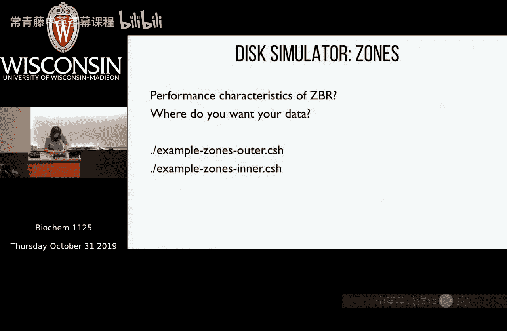
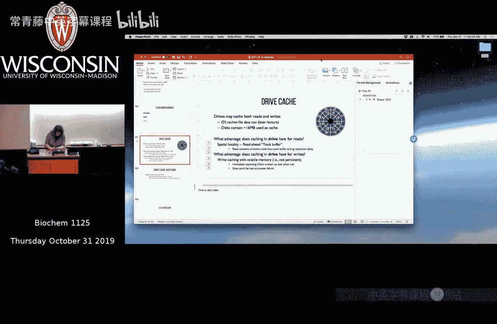
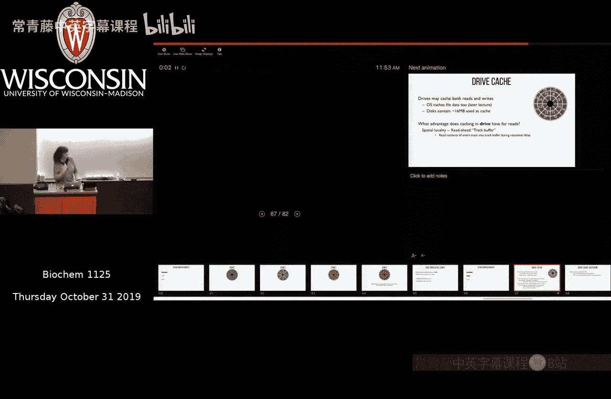
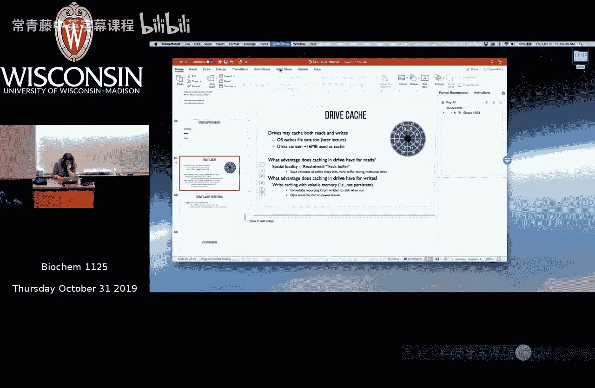
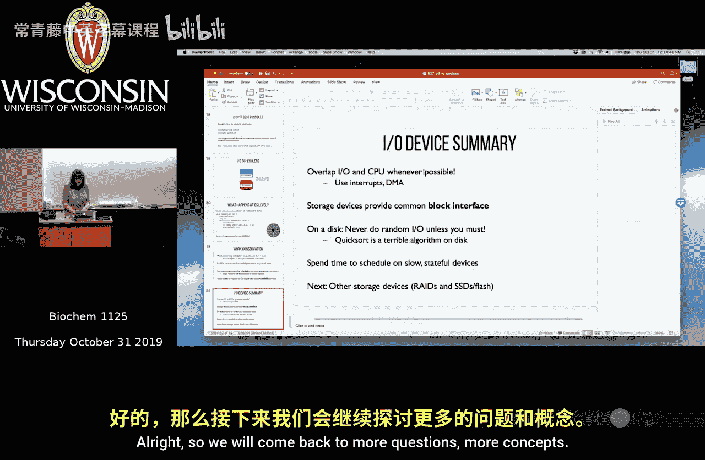

# 威斯康星大学【中英⚡操作系统｜CS 537 Fall19, Introduction to Operating Systems】 p16 P16 Persistence_ IO devices _ University of Wisconsin-Madison -BV1wUzSB3Ecf_p16-

。All right。 Good morning， everybody。 Happy Halloween。 It doesn't look like Halloween outside。

 I thought it was pretty crazy walking over here， but I guess it was fun。

 I'm trying to view that that was fun to walk through all of that。 Yeah， it was different。 right。

 Try to have a positive attitude about this。😊，So today we're talking about a completely new topic。

 it's our third easy piece about persistence， but first some announcements。

 so Project three grades have all been made， known in Canvas。

 email the TAs if there's any problems with that。Project 5， so。I。

Anticipated that we were going to have those test scripts available for releasing on Monday of this week。

 that's what I talked with the Ts about， then it became Tuesday， then it became Wednesday morning。

 then it became Wednesday afternoon， then it became Wednesday evening。

 so you all know as much as I do about when those darn test scripts are going to be available but any irritation you're feeling。

 believe me I'm feeling that。Completely。But I apologize that it's taking so long and hopefully by the time class is done。

 maybe the test groupss will be available then you can look at your output and see that you're getting what's expected there。

😊，But I will continue to talk to the Ds and hound them about getting those out。

Because we need test scripts， that's how we define the specification and exactly what the right output is。

 I completely understand that we need test scripts All right。

 so we will continue to work on that and let you know。😊，The good news is。

 we do have a lot of lab hours starting tomorrow and through the weekend。

 there are a lot of peer mentors and Ts who are stepping up and using their time to talk with you all all about the project on Friday and the weekend。

😊，And we are trying to have these three different versions。

 That was to make it so that you had different levels of commitment you could have to the project。

 The first one， we're calling V1 A because it's version 1， kind of the first that。

Easiest version of that where you just have to allocate alternating pages and you don't need to know which process owns a particular page。

 You just mark them all negative too。 Then the second version。

 you just alternate the pages that are allocated， but you have to figure out which process owns each page。

 and then the second version， you're supposed to do this more contiguous allocation。But again。

 I think we need the test scripts so that you know the exact specification on some of the sorting details there。

 So continue to ask questions on Piazza， and we will get this all resolved。O。

 the thing that is very well defined is the midterm that is on Wednesday evening。

 There are practice exams that are available。 You can look in canvass to see which room you should go in。

 And as you know， it's mostly about concurrency。 It's not at all about today or next week。

 And there's some review questions about virtualization。

 So any questions about that administrative stuff。All right。

So today we're talking about IO and how to provide persistence。

 so it's basically how does the OS interact with IO devices and how can we optimize this。

 so some variants of different protocols there then we're going to be talking a lot about how hard disk drives work so this is going to become more and more antiquated。

 but it's good to know how they work and certainly file systems that have been designed。

 they have been designed with hard drives in mind and so they'll always kind of have some of those assumptions buried within them and we slowly change file systems over time so that they work better with new devices like flash but just a lot of the policies that are always going to be embedded in file systems will probably go back to what hard drives look like。

So we'll do some calculations so that you can figure out how fast a hard drive is going to be for different workloads。

 that sequential workloads perform much better than random。

 and then we're going to look at a whole bunch of different disscheduling algorithms for how we actually order our IO requests。

Okay so remember there are three parts to this course。

 We've talked about virtualization and concurrency already。

 you know that virtualization means giving the impression to each application that it owns the resource just for itself。

 So we talked about address spaces and processes for that。

And then we just finished talking about concurrency。

 so here we were figuring out how to manage the fact that each process thinks it has its own processor。

 but it doesn't really， so how to make it so that independent processes。

 it's all transparent to them， but when they do need to cooperate and interact。

 that we have these locks and semaphos and conditioned variables to really manage that concurrency that's going on in the system。

And then that brings us to our third and final piece of this course。

 And every part really is quite a bit different。 Everybody can have their favorite part of the course。

 I don't know what most students like the most。 Perence， we're going to start off a little slow。

 And then I think it gets more interesting as we go to tell you the truth Okay。

 so the main problem with persistence is we need to make sure that our data stays available even after we reboot the system。

 right So we've lost the state of our memory， we've lost the state of our registers。

 and we need to make sure that when we reboot， we have all the state， the files that we care about。

 So that's a pretty straightforward problem to solve if you nicely shut down your system at welldefined points。

 but it becomes a lot more interesting。 And this is what I find interesting is kind of how to deal with your file system state。

 when you can have crashes at any inopportune point in time。

 So what this is going to mean is that when we update the data structures that are in the file system。

 we're going to have to be really， really careful about the order that we do that。 so that。😊。

State that's left on disk will be consistent。 Okay。

 but that will be kind of what we reach at the end of this topic。

So first we'll go over some device characteristics that we need to understand how different storage devices work。

So they have some interesting performance characteristics。

 And then when we design our file system and our IO scheduler。

 the more we know about how those devices work， the better job we're going to be able to do。😊。

So then we'll start at kind of the highest level， we'll talk about what does the file system API look like for programmers。

 how do you open files and create files and stuff like that， read and write from them。

 then we'll talk about what's going on inside of the file system， what does its metadata look like。

 what do its data structures look like， how does it allocate different blocks of a storage device to particular files and then the most interesting stuff that we finish with is really how you do that crash recovery So how do we have journaling mechanisms that can roll back the state of a file system if we have a crash while we're updating structures and we didn't get them all updated when that crash or failure spontaneously occur？

And then at the end of the course， depending upon how much time we have。

 we'll go into distributed systems to some amount of depth just based on how many lectures we have at that point。

 So we could talk about distributed file systems at that point so that you understand what's going on with NFS or AFS is the file system that we run here at Wisconsin。

 that the instructional machines are all running。 And that's why when you log into different instructional machines。

 you can see the same distributed file systems set up。

 And that's how we do all the permissions for like hand in directories。

 It's with these AFS file system permissions。O， so that's the overview。 Allright。

 so we need to motivate why we need I O。 I think a lot of us think that， oh。

 processing and computation， maybe that's more interesting。 but certainly data matters quite a lot。

 Maybe we all realize data matters more and more these days。

If you think about what it would be like to provide an application that couldn't do any input or any output。

An application that has no input。 What would that look like。

It would have to always compute the same results。 Maybe that's okay。

 Maybe it can have some randomness in it， but it's always going to do the exact same computation every time if it doesn't have any input at all。

 And what would an application look like that has no output。That seems even worse。

 You can't see what it did。 unless you have some covert channel。

 maybe you can watch it and see how much energy it consumed。

 But we generally want it to nicely give us some output so we can see what it did。

And we certainly often need to record some state， some work that was performed by one application to use it as input for the next application。

 or the next time we run that application。right so we need IO。

 and so what we're going to talk about is a little bit about the hardware and basically we want it to be that we can have different IO devices and at some level that needs to look the same to the OS so that the OS doesn't have to deal with every little detail of every different device that's out there。

Okay。So this is a very high level picture just to give you some idea about what's going on in the system。

So we're going to be focused on mostly disks， but there's going to be this hierarchy of buses in your system。

 If you had multiple CPUs or multiple cores， we'd show them all up here sharing the memory bus。

 and there's a high bandwidth bus here that's connecting the processor to memory to RamM。

RightAnd then there's other buses that hang off of that one that are of gradually lesser bandwidths usually。

 so you'd have like your graphics bus to communicate with your graphics card and then an even lower bandwidth bus to interact with IO devices like disks。

 whether they're solid state or hard drives down there there's tons of different protocols and that is below the level that we are going to look at for us it's just somehow we're able to communicate between the CPU and a IO card that's controlling these disks down here。

So another way of looking at this with different technology， different protocols， we have our CPU。

 we have a high bandwidth bus that's connecting us to memory。

 we have a high bandwidth bus that's connecting us to our graphics card。

 I don't care about any of that stuff today， but then we have another bus that's connecting us to the IO subsystem。

There's very low bandwidth。Connections to your keyboard and mouse。

 We're not sending a lot of data between those。 The network is really interesting。 You can take 6。

40 to figure out how to interact with that network card。 Today， we're really。

 again looking at how do we。Interact with these different discs that are out here。

 and there's a bunch of different protocols。That have higher or lower performance or that have higher end or lower end discs。

 But that's kind of all below our level of detail here。O， because there're sy disks。

 they're sad discs。 But for us， it's just there's some protocol that lets us communicate with disks from the CPU。

All right， so。We're assuming that we have some device that we can communicate with。 So， for example。

 the device is out here。On each disc。And the OS has some way of interacting with that device。

 So there's going to be some registers on that device that the OS can read or write。So conceptually。

 there's going to be some status register that you can read on that device saying。

 is the device busy or is it idle right now， is it ready to do some work。

 then there's going to be like a command register that you can write to where you tell the device what you want it to do。

 like send a network packet or wait for a network packet or write a disk block or read a disk block and then there's the actual data。

 So when you're doing a write， you would put the data there that you want to write when you do a read。

 maybe that lets you read back the data that the device just generated for you。

And then within that device， there's a whole bunch of stuff that we are not going to look at that's kind of behind the scenes。

 we only care about how we interact with it， but certainly within that device。

 it's going to have whatever hardware it needs to implement the functions that it needs to do。

 it will have its own CPU will have its own RAM to access and it might have other hardware out there as well。

Okay。So this is the protocol that we're going to start with。

 just basically how does the OS interact with a device。

 and then we'll slowly optimize it and make it perform a bit better。Okay。

 so this is just kind of how we would begin。 So a process wants to read。

 that's what know we're writing in this protocol we're writing。So we need to wait。

 we keep reading the status register， and while it's busy， we just spin white。Because。

 because that means some other processes interacting with a device right now。

 some other processes doing a V right at this disk。And then when we see that it's not busy。

Then we can write our data that we want to write to the disk to this register。

And then we write the right command to the command register。

 and then at that point the disk has the work that it needs to do。

 it has all the information that it needs， it goes off and does the work。

 and the status will have been set to busy while the disk is doing that work when it's done。

 it'll set that status to done or something like that and then this process can continue doing whatever else it needed to do。

All right。So that's the basic protocol。 Let's look at this in action。

 So I just want to make sure that you understand what can be going on in parallel。

 So certainly we can have one process A that's running on the CPU and another process C that's using the disk right that's doing some reader right operation on the disk。

 The disc is very slow。 we want the disk to be utilized while the processor is also doing something else。

 So in this example， process A wants to do some IO at this point。

 So it's going to spin weight here on the status being busy。 So for all of step1。

 this one is corresponding to this one here。A is seeing that the status is busy because the disk is working on C。

And then when step one is done and the status is no longer busy。

 A will spend some time writing the data to their data register。

 this is doing a right of a block that's going to take some amount of time。

 so that's showing up and then when A is done with that， it writes the right command to the register。

 that's really quick， it's just one word or something like that。

And then it needs to sit and busy wait on that status so that it knows that the disc is done so at this point down here the disc needed to do work for A。

 it was reading from its registers， and then here at this point it was actually doing the right that process A requested。

And then when we're all done。Then a is done， and we can switch to another。Task here， sorry。

 while the read is going on， oops， maybe I didn't draw that the way I wanted to draw it。No。

 we're just busy waiting。 Yeah， in this example， A is stuck busy waiting， which is just horrible。

 And clearly， we're going to fix in the next example。Yeah。

In this in this bad example that we're starting with。 But we are going to fix that problem。Yes。

 here we are busy waiting while we wait for the status to get done。

 but we are knowing that that must not be how current systems work。Yes。Yeahち。Well。

So we're starting off with kind of a bad example。 but we will have like 512 by is the minimum amount that you could write。

 Yes， that's a sector size that we'll get to。 So in this example， yes。

 there's somehow some there's some way of giving 512 by to the disk。Okay。

 so let's start fixing this protocol and making it more realistic。Okay。

 so the first thing we want to fix is we were bothered by the fact that we're doing busy waiting when we were implementing locks。

 we already saw that you don't always just want to busy wait and hold onto the CPU。

 it makes a lot of sense to block or wait until something is done and then wake up when you're notified that that event has completed。

 so certainly disks are able to generate interrupts。

 they're able to tell the processor that some event has taken place。

 some work has been accomplished and so what we want to do is instead of busy waiting。

 have some interrupts here。So basically the protocol will work such that we need to wait。

 we register that we are interested in hearing about the fact that the disc is idle。

We'll wait until we see that， we then do the same operations of writing our data out。

 writing the command， and then waiting for the interrupt。So， the difference。

Is that now this is what the protocol should look like。 Okay， so A wants to do some I O。

It can block at that point so we can schedule process B。

 we don't have to busy wait on the CPU wasting that for a。

 and then when we find out that the disk is done， then we go to step two， write the data。

 write the command， which is quick and then。Then after doing that small bit of setup for a to get that work done。

We don't need to be scheduled A anymore， we can certainly run another user process B at that point there since A does not need to wait。

 and then when A is done here， we'll have another interrupt that lets A run again and process that IO。

 and it knows that the right is complete at that point。So that is， and then B gets scheduled。

 Who knows what I drew here。 Allright， so clearly， we don't want to spin weights。

 We want to have interrupts move the state of that process to blocked or sleeping while it's waiting for that I O to complete and then move it back to runnable when it's done and it can be scheduled。

你有没事。Oh， so certainly like the disk has this one register that tells the rest of the world what its state is and。

I get， I mean， so。You would need to wait until the disc was ready for your command and then you can write the command to it。

嗯。Certainly， we're going to be able to have multiple I Oos later that we will schedule。

 So we'll talk about that at the end of lecture。Chris time。嗯哼。kind creating。一个个。Well。

 this is certainly code that's inside of the OS， so we are as part of the right operation。

 there's code that's making sure that that's all atomic and correct。

 that there's a lot of paths in between the user process calling right and then all of this happening。

Okay。Yeah that' here I talked about concurrency and mutual exclusion， and now you're all like， well。

 you better make sure that works。All right，So just like with locks。

 we said that sometimes it was better to spin weight and sometimes it was better to block。

 remember it was all about how long that context， how long the context switches and how long the critical section is going to be in by some other process。

 So it's kind of the same thing here that it's not always the case that interrupts are better than polling。

So you might want to think about some cases where polling could be the way to go。 So first。

 certainly if you have a very fast device， so if you're interacting with nonvolat memory。

 a modern storage technology， maybe in that world， it'd be better to just spin weight for the right to take place since that right is going to be so fast。

 And just like with the two phase waiting for spin locks。

 you could imagine something similar here where if you don't know how long a request is going to take。

 you could spin wait here， and then if it takes longer than that。

 then you could go to sleep and wait for the interrupt。

Another thing that people worry about with devices is that it could be the case that you get a flood of interrupts that all come at one time and your interrupt handler could be slow and you have some bug there or it's just taking too long and it could be the case that you receive the next interrupt before you finished handling the previous interrupt and so you get stuck in kind of this live lock situation where the interrupts just keep piling up and you're not able to get any of the work done there So that's why a lot of times when you're in an interrupt handler。

 you'll turn off interrupts both for the mutual exclusion。 it's easier to think about the properties。

 but also you just need to get some work done and get that interrupt handled rather than handle a different one。

So you often ignore interrupts while you're handling one interrupt。

And then another thing a lot of systems do is that you don't want to just handle one interrupt at a time。

 We kind of want to batch together， interrupts or different requests that are arriving。

 and then handle them all at once。 and that that will be more efficient than doing them each separately。

Okay， so those are the issues with doing think interrupts or polling。All right。

 so we're going to look at two more kind of variants。

 so the other thing that wasn't making a whole lot of sense to people was we were doing programmed IO。

 which means that we were writing all of our data to this register or some some interface with the device。

 and that is not what modern machines usually do。So what we were imagining was happening before in our protocol was we had a running。

And then it needed to write this data to some data register and doing that used up the CPU while we did all of this work。

 like we knew that we have this data that we want to write。

 and we are having to loop over all of the bytes of that big block and copy it over the memory bus to the disk bus and be involved in that transfer with the CPU and the disk。

And so that's a bit inefficient。 And then once we were done， you know。

 that A was using the disk and B could use the CPU。

 So this is programmed Io where there's some interface where we say， you know。

 do this right of this bite from the CPU to the disk。

 And the CPU has to be involved with all of that。 So that's kind of costly。

 especially when you do large data transfers。So this is something that would happen with network cards or disks。

 that you have a lot of data that you want to transfer。

 You don't want the CPU to be involved with every single byte of that transfer。

So that's why we have DMA or direct memory access。 So the idea here is that you just need to write a pointer to the device and tell the device where that buffer is。

 where it lives in memory that you want to have copied。 And then the hardware。

 the DMA engine is going to take care of doing the work instead of the main CPU of copying that data from RAM over into the device that it needs。

 So we're going to free up the CPU to do more useful work than just copying memory around。Alright。

 so there's a lot of interesting issues with DM MA with like。

 you have to make sure that you pin those pages in memory。

 You can't then decide to swap that out or delocate those pages and stuff like that。

 And is it virtually addressed or is it physically addressed。 So if you're interested in that stuff。

 you can look into it later。Okay， so what we most modern systems will have instead of program I is that they will have DMA and so what the protocol looks like in that case is we've gotten rid of that step where we have to do all that expensive copying of data to some explicit data register and instead the DMA engine is going to be active at that point。

 copying memory from RAM to the device， so we're using DMA there and then another process can be using a CPUU at that point。

 so we're getting more effective utilization out of our CPU with that。All right。

 so any questions about the quick？Overview of DNA。Okay。And so in this picture。

I'm showing that we no longer on the CPU have to do step two， so we've really gotten。

So so that the CPU is not very involved with I O anymore。

 Here was when A was doing useful work for itself， and it decided it wanted to do I O。

 Then B is able to run。 And it's only when we have to do like a tiny bit of initiation of。

Telling the。Disk that it should now go off and do the right that the CPU will have to be involved again。

So， that is。The optimizations that improve performance， the last variation。

 special instructions versus memory map Di。 It's not an issue of performance。

 It's just some machines do this differently than other machines。

So how do we actually write that command to the command register？

So you'll see in some architectures that there'll be special instructions for interacting with I O devices。

 So there could be these in out instructions that you write to a particular port and you say what you should write to a particular port。

Or another approach that some architectures do is they'll do memory mapped IO。

 where basically you make it look like the device lives someplace in the process' address space。

 And so then when you do a read or a write to a particular address。

 you're actually doing a read or a write to the register that's on that device。

 So that's pretty neat。 it kind of makes everything uniform that it looks like it's part of your address space and we can do all the permissions in the page tables to make that work correctly。

And so that's why you remember when we looked back at what a page table entry looked like and there were a whole bunch of bits。

 sometimes that we didn't really care about like it would say， can data from this be cached or not。

 So for example， in the page table entry， you'd want the system to know that this was actually an IO device and it shouldn't cache the data there because like if a process needs to write to that device。

 We wouldn't want to just be buffering that in memory。

 we need to make sure that we actually flush that right out to the device。

 So there's entries in the page table entry to tell us that it's this thing that shouldn't be cached and to always do the actual right So what it thinks is memory。

 but will actually be a device。Alright， so that is kind of the low level stuff on how we can interact with devices。

嗯。So if you look， there's like new devices that are released all the time。

 Everybody has their own protocol for exactly how to interact because it's just whatever convention they want。

 You know how do they want to define a right。 what are the bits that represent everything。

 So we don't want it to be the case that Linux has to be modified every time someone comes up with a new variant of a different keyboard or disk。

 So that's why we have device drivers。 So the idea is that it's the device driver code that's loaded into the O that understands all of those low-level details that are associated with each device。

 So it's the responsibility of the manufacturer that's making that device to provide the device driver that knows how to interact with the low-level details of that device。

 So if you look at a lot of source code out there for operating systems。

 a huge portion of it is this mucky device driver code that's just very special purpose。

 And certainly I hate it when I。I know， well， I have some old device driver。

 and I have to figure out how to reinstall that and get that updated。All right。

 so this is what the stack looks like。 So we have our application， it's running at user level。

 Then below that， we have the file system。 you can also bypass the file system。

Interact with a raw device where here you would just be seeing like sectors or bytes of the storage device and read or write those directly。

But then there's an interface， of course， between the application and the file system。

 which we'll be assuming is Pos， so this makes it standard so that on anyOS。

 you can port your application and open files and read and write them and that always looks the same。

But then we have a bunch of other interfaces in here as well you will see so we have a lot of different file systems within different OSs。

 EX T3，XT4， ButfS， F2FS， they all have different performance characteristics and we don't want to have to rewrite oops the entire stack when we have a new file system data structure or some optimization that we're doing up there。

 So what's below the file system is that there's this generic block layer and the generic block layer exposes from the storage devices just a very common interface of like a linear array of sectors and that the file system above that can just read or write those blocks without having to know anything about what the disk looks like underneath。

And that this layer will take care of scheduling and merging requests and kind of what's going on across different operations。

 And then below that， we're going to have the device driver that is。

Code that's running inside of the O S that the generic block layer can interact with。

 And it knows how to do all the low level details of actually what bits to write into different registers and how to interpret different fields。

Alright， so this is the overview of how things work。

Today we're going to be talking about what the devices look like at the bottom of the stack。

 and we'll do that for a couple of lectures and then we'll start back up at the top and talk about what this interface looks like and how file systems are actually implemented in a couple lectures from now。

O。Hard disks。 O， so what's neat about hard disks。 They've been around for a long time。

 but it's actually kind of neat that they are slow and that they are mechanical because it gives us some challenges。

 I guess I like it when things aren't just easy。 We have to know how the thing behaves so that we can get the best performance out of it。

 that that's what a lot of O work is is that we get a new technology that comes out。

 and we need to figure out how we were making assumptions in the past about the reliability characteristics of that device or the performance characteristics。

 And now that those have changed。 We need to figure out how we need to adapt to that so that applications don't have to be changed and they can still get good performance。

So hard disks are incredibly slow compared to everything else that's going on in the processor。

 know that accessing a disk is going to take on the order of milliseconds。

 whereas if you think about instructions， many thousands or millions are taking place in that same amount of time。

So disks are going to expose a common interface。 We are going to have just like a linear array of sectors and sectors are about 512 by。

 I think there are always 512 by that you can read or write。 And that all happens atically。

 So that's the unit of atity when you're interacting with a disk。And basically。

 all you can really do is read or write to those sectors。 And on top of that。

 we will have abstractions like files and directories。Okay， so let's understand how disks work。

 So we're just going to go over a bunch of terminology。So that， you know， every part of the disk。

 Okay， so discs are made of platters。 These are。Cirles。

They're not necessarily gray circles and they have a recording media on both sides of this。

 so they have two surfaces and you change how it's magnetized so that you can see ones or zeros on that surface and in the middle you have a spindle here and so the platter spins around that at a constant speed and it's always spinning。

😊，And so we'll have multiple platters that are all part of that disk drive。

 and they're all spinning together。And basically， what's going to matter for performance is that there's going to be some revolutions per minute R PMM。

 And so you can think about that as if you're told that it has a 10000 R PMM。

 which wouldn't be a unreasonable number for a disk。

 It's still taking you 6 milliseconds to spin around。 And that's very fast for human beings。

 but it's just really， really slow compared to how fast you can access memory。Okay。

So then within a surface， each of them are divided into rings， which we are going to call tracks。

 so they're just concentric circles here， and they're just tiny， tiny tracks covering the disk。

 and then the terminology that we use for the stack of all the tracks across all of the surfaces is a cylinder。

Okay。So then within tracks， we divide those up into sectors。

 and this is what we're going to view that the OS is going to be able to see that the disc will export in this case。

 we have only 24 sectors numbered from 0 to 23， and that's what the OS would see。

 just a linear array of sectors，0 to 23。And it's up to the disk to figure out how to map that in linear bay to its disk geometry。

 there's a whole bunch of interesting different ways to do this， but we will not cover that。

Unless someone comes to office hours and asks about that。Okay， so for us。

 we don't really care how that's done。😊，All right， and then we have one disk arm that is able to control a disc head that's on each surface。

 And basically， when you activate the head， you're able to read or write the data that's underneath。

Okay， so this is all the terminology that we went over， spindle in the middle， platters。

 surfaces on both sides， sectors is one individual thing that you can read or write， a track。

 one concentric circle， cylinder is the set of all the tracks across the platters or the surfaces。

 and then we have should really be just like one disk arm， but then there's a head per surface there。

Alright， so any questions about that exciting terminology。All right。

So today we're going to be doing some straightforward math。

 So we just want to figure out and get some good feel for how long it takes to access a disk。

 So what we're going to see is that the time it takes you to read or writete data is going to have three components。

 There's the seek time， the rotation time， and then the actual time it takes to transfer。😊，Okay。So。

What's going to happen here， The first thing we need to do is seek。 So， for example。

 if the disc head was in the inner track here and we're told that we need to read sector number one。

What will happen is that we'll do a seek from that inner track to the outer track so that we're on the correct track for disk1。

 That's the seek time。Second step is the rotation time， so once we're on the correct。Track。

 we need to wait until it rotates around so that 0 or one。

 I said one is underneath the disk head here。 And so the disc remember it's constantly spinning。

 It's not like it stopped while we were waiting to do our seek。

 It's constantly rotating while we do that seek。 And then once the disc head is actually in place。

 then there's this very small amount of transfer time to actually do the readed while the disc head is positioned correctly。

O。Alright， so what we want to do is figure out kind of what's our performance to expect when we have a random workload versus a sequential workload。

Okay， so we're going to look at the different costs here， Seeq plus rotation plus transfer。

So let's first figure out how what's the average seat cost when we just have to do a random  O。

 So the disc cat is in some random location， and we have to seek to some random location on the disk。

So technically， seat cost because these are mechanical devices。

 It's not like it's just some purely linear model or time it takes to get from one place to another。

 It really does have like some inertia。 There's some weight to getting that diskarm moving。

 and then it glides smoothly and efficiently， but then when it gets towards the end。

 it has to slow down， that takes some time， it has to get positioned exactly right over this tiny。

 tiny little sector to do the reader right。 So it's not strictly a linear function。

 but we are just going to assume it's linear in this course。So seeks usually take many。

 many milliseconds。 I guess 4 to 10 is kind of typical。

 So if the seeking from the outer to the inner takes。10 milliseconds。 We need to figure out， well。

 what's the average seek time。 And so the first step then would be to figure out， well。

 what's the average seek distance。And so there's some derivation that you can do that because it's not just one half because you have to take it that you're at an average location and you need to move to some average location away from that。

 So if you integrate over all of the different possibilities for start locations and end locations。

 it turns out that one third of the max is the average seek distance that you'll end up doing for a random unknown I O there。

So we're just going to assume random， if we don't know anything else that we have to do one third of a fall seek。

Okay， so that is our seek time， rotation time， it basically just depends upon how fast that disc is moving。

 what are the RPMs， so pretty typical RPM speeds are 7，200， 15，000 RPMs。

 so let's figure out if this is our RPMs， how long will it actually take to do one full rotation。

So again I said we're just doing simple math today， if it's RPMs。

 then we need to figure out the amount of time per revolution。

 so just take the inverse of this in one minute we do 7200 rotations so in one second we do that divided by 60 and so that ends up being 8。

3 milliseconds for every rotation， so pretty slow in our computation times so that's to do a full rotation。

 how what's the average rotation distance if we're at one location。

 it's on average it'll be half the distance away from that that we're going to have to wait。

So average rotation distance is one half， so average rotation time will be about four milliseconds。

Okay， let us go quickly through this rather dry material。 Okay。

 so then let's do how long it takes to do a transfer。 So again， how long does a transfer take。

 That's just based on how fast the disk is spinning because the disc is spinning at a constant rate。

 So we better be able to read or write the data at the rate that it's spinning。😊。

So they'll usually tell you in the disk spec what the maximum transfer rate is。

 maybe it's 100 megabytes per second， and so just to figure out how long it takes then to transfer one sector。

 512 bytes times one second for 100 megabytes is5 microseconds。

 so order of magnitude different than our se and rotation times which were milliseconds there。Okay。

 so what you get out of that is seeks are really slow， rotations are really slow。

 and transfers we can pretty much ignore they very fast。

So let's think about the implications of this for different workloads that you might send to a disk。

 So we have sequential workloads where basically you're doing very large reads and write or just to a bunch of consecutive addresses。

 And then you have random workloads that read small amounts of data at a time。Yeah。

Oh once you're in a sector， then it's just there is a lot of complicated positioning stuff that it needs to do to make sure it's exactly on track。

 and that's at a mechanical level that's below what I know too much about。 but I mean。

 they do have like they have to encode within sectors every once in a while。

 the address that they're reading for so that they can validate that they really are where they think that they are because they can do some mathematical calculations to figure out I basically need to move this much。

 but then they actually do a read and they read some data that's recorded within the sector to say this is sector number 1000。

 And if they were trying to get to sector 1001， they know that they need to wait a little bit longer。

Right， it should be you were there。 You're ready， and it goes， right。

 And so that's kind of an interesting difference between reads and write for reads。

 You can be kind of optimistic and sloppy。 And you find out you were， you read the wrong sector。

 and then you're told it's the wrong sector with a right。

 you better be there in time and be writing the right place。 So you'll see in a lot of disks。

 They do a little better on reads than they do on rights for that reason。Okay。So。

Sequential workloads tend to be fast because you don't have any seek or rotation once you get to the beginning of your access and then you read a lot。

 whereas random workloads tend to be very slow because you're just spending all of your time seeking and waiting for rotations。

So let us look at two similar discs。Of different capacities， one rotates twice as fast as the other。

 This one has half the seat time as the other， but they still have a similar max transfer time。

 and they have some number of platters and they have some amount of cash that we'll talk about later。

 Okay， so let's figure out what's the sequential workload for a sequential workload。

 what's the throughput of each。So we're basically told this one。

 your sequential workload the best throughput that you can get is just that max transfer time。

 you're doing a huge transfer， after you get your diskAD positioned。

 you can transfer data at a reasonable rate there。Okay。

The case that is going to be a lot different is what happens if we have a random workload and how we need to figure out the throughput for this。

So we need to have some size of random reads that we're doing。

 And so we'll assume that we're doing 16 kBte reads， still kind of small reads。

And this is the table that I showed you before， and let's figure out the throughput for an average random 16 kilobyte beat。

So remember the time is seekq plus rotation plus transfer， what's the average seek cost。

 this one's we're just told， so that's great， only we were told all of our numbers。

The one we have to figure out is what's the average rotation time in milliseconds。

 because that's our units that we're going to spend here。So average rotation。

We just need to look at our RPM， and it's going to be one half of how long it takes for that disk to spin around。

 And so it's just easy to。Cancel out units and make sure that you get all of this right if we have 15。

000 RPm that's one minute for that many revolutions， 60 secondsd in a minute。

 1000 milliseconds in a second， all of our units will cancel and we are left with that that is two milliseconds for the average rotation。

Okay。So sequence four milliseconds， average rotation is two milliseconds， and then the transfer。

Again， just look at units。We're transferring 16 kilobytes。

 we know that we can transfer 125 megabytes in one second。

Have to do something with the kilobytes and the megabytes， presumably I did that。

 but I didn't show that and then get all the units right。 Transfers are very fast。

 They don't really matter。 Okay， so then you add all that up together。

 That's how long it will take you to do a random 16 kilobyte read on this first disc。

 And so then we can figure out our throughput。And what do we get there。

 We get that we can do 16 kB every 6。1 milliseconds， convert all of our other units。

 And we're getting only 2。5 MB per second。So just to remember， 2。5 megabytes per second。

 very different than if you are more optimized in your workload and what your file system is doing to get sequential bandwidth。

 so basically the whole challenge of whatever we do in the file system is to make sure that we do as many sequential transfers as possible。

 you can't just treat a disk like you can treat memory that's random access that memory has the same speed whether you read it sequentially or random disks。

 we're going to see hugely different transfer speeds if we access it sequentially versus random okay。

So you can do the same math to check that you can do this for the other disc。

And I will let you look at that on your own because that's so exciting to do。Alright， yeah。

So I think this is really like the low point in terms of like conceptual material。😊，So okay。

 so then you can do these calculations and you can figure out all the barracud is even slower with random throughput。

 even though it wasn't that much different for sequential throughput。

 okay so it's usually people are really worried about their random performance。

 you just need to throw more discs at the problem if you have a lot of random is to do。😊，Okay。

 now you're getting into something different。Yeah， all right。

 so now we have this cute visualization of how a disk actually behaves and so let us see what this disc simulator looks like。

😊，Because we're going to start looking at different scheduling policies and kind of low level details of what we should actually do at the disc。

Okay， example random。Okay， so our first simulation。Is going to show a random workload。

 And so we're seeing this is the disc head。 These are our tracks。

 and these are the requests for different sectors that we need to read or write， and I'll start it。

And I'll pause it and you'll see what it kind of nicely shows you is it seeking。

 rotating or doing the transfer at different points in time。

 so it's blue right now it's going to request 10， we've already done a seek。

 we happen to be in the right place and we're just doing rotation right now so I will continue it。

We got that， and then we seek to the next one。 We got that。 And then it's rotation for that。

 C rotate transfer。 Allright， so that was how the simulator kind of shows what's happening。

As you access these different random sectors。 So any questions about that。Okay。

And then just for contrast。Let's see what it would look like for a sequential workload。

 This is going to be really exciting。Okay， take a little bit to get there。

 but then once we do those requests， we don't have to do any seeks or wait for rotations。

 so our time to do that transfer， which is printed out over here。

 165 units of whatever it was compared to 615 units。

 it's just much faster to do sequential accesses than。Random， as you know and would expect。

So now we're going to get into some more details that I think are interesting。

So we're going to figure out a little bit more about the mapping of those sectors to particular locations on the disc。

Okay， so let's look at what happens if you have a big sequential request to do。

 but it spans multiple tracks。しち？O。So if you look at this。😔，We we're accessing 1011，12 and 13。

 and you'll see that's 10，11，12 and 13。And that looks pretty good。

 It looks like it's kind of nice and sequential。 But we're going to have to do a little seek in there。

 right。So let's see what happens。So we're in the right location to start with。 We get 10，11。

 Now we have to do a。Seek over there。 And if you line everything up what you think is perfectly。

 you're not going to account for the fact that there's a little bit of time that it takes you to do a seek from one track to the next。

 So you end up having to wait a full rotation on your disc， so。

The first people to design disks might have done something like that。

 but now people know that you need to have what's called track skew there。

 and you also have cylinder skew that basically at every level where you're having to activate a different head or do a seek。

 you need to do some different allocations。 So now we have 10。

11 and it better be that we have a little bit of time before we reach 12 and 13。

So you'll see now we get 10。And 11， then we do our C。

 and we have plenty of time to get settled before we see 12 and 13 come under the discca。

 So when we do our allocation of sectors to particular locations on the disk。

 we'll always take into account this track s。Great。😊。

So this is just some slides so that you can later remember what I just showed you that like if we were reading 8。

9。10，11， 12， 13， 14， 15， we better not put 16 there because we won't have time to get out there。

And so instead a different layout that people could do 8， nine， 10， 11， 12， 15。

 and then give us some time to get over 16 there。And that will work。Okay， so that's trackscu。

Something else to know about modern disks。 so if you think about concentric circles and you think about the fact that like how many sectors can you fit in each of these？

So we probably want to have constant density in your recording。

 which would mean that you're going to have more sectors on the outside than you're going to have on the inside。

 If you had it perfectly， it would be too many calculations。

 So what they usually end up doing is that they divide the disk into zones and put tracks that are next to one another within the same zone。

 and then they put them the same number of sectors per track。All the same within that zone。

 So what would end up happening is that we would say， oh。

 we can fit more sectors in this outer zone per track than we can in the inner zone there so that our goal here is to have constant density in our recording。

 which leads to this zoned bit recording where it's different for different zones。

So what's the implication of this。So。YouWhere would you want your data to be allocated is the question or where should the file system allocate data？

Yeah， yeah， you're going to get a lot more sectors in the same amount of time if your large sequential file is allocated to the outside of this disk。

 So that's one of the many reasons why sometimes disk performance goes down over time is maybe at beginning。

 it was able to allocate you empty sectors on the outer tracks。 And then over time。

 it's got to allocate more on the inter tracks。 disk also tend to perform a lot worse over time because of fragmentation where they can't allocate nearby blocks to you but also the outer zones are。

 might not be available anymore either。And so it really does matter for sequential workloads。

 It doesn't matter so much for random workloads。 If you were doing lots of seeks anyways。

 it doesn't matter that you go to the outside。 So let's。Let's look at our simulator。Okay。So。Great。

 so you can see that there are more sectors allocated on the outer track。Oh。Thanks。That's horrible。

Okay。So if we do requests on along the outer track。That was pretty fast to read six blocks。

 it took us 121。Units of time。And if we were forced to have our file on the inner tracks。First。

 we had to do a seek， which is too bad for us。 But then we certainly have to wait longer before those tracks spin underneath the。

This head， when we're on the inner track there。 So our total。

Our total transfer time is much larger here。 So， yes， we had to do a seek。

 but also every transfer is taking us longer because we're at this point where we're not seeing as much spin underneath us there。

All right， so that is the second innovation。

Okay。Last thing， so one thing to keep in mind is that we're not always reading。

That's horrible。 That's what my screen looks like。 Why I've been so unhappy lately。

 But why is it now doing that up there。

Do do it。

And I like， so I read on the there's this problem with the most recent release of PowerPoint that for some machines。

 it does that。 and I swear I reverted。 and I went back to an older version of PowerPoint。 And no。

 that doesn't make any sense unless it。Did another auto update on me because I didn't turn that off。

That would explain it。Okay。嗯。

You want to have to look at the slide that's coming up。

Well， I guess we can do this， can't we？Okay。😊，あ。😊，All right， okay。Sober。嗯。

So it's not usually the case that you have to go to the actual disk surface to read or write sectors。

 the disk is going to have a cache on it， and so there are a couple of different types of caches one type of cache is what's called just like a track buffer that the idea here is that you don't want it to be the case like when you're doing a read like let's say you get over to this track and we're doing a large sequential read and the sequential read needs to start at sector 8 but by the time we get over there our disk head is at 10 so we would have to wait for the whole thing to spin wed then get to eight and we' be waiting like a full extra rotation so the way the track buffer works is once you get to the right track it just immediately starts reading from the disk surface into this track buffer that's on the disk and so it will start reading at 10 and then you'll just have to pick up8 and nine and the rest of that track will already be in the buffer for you and your read will complete much faster so read ahead。

Able to work with this track buffer rights are have other properties。

 So imagine what we want to do with a right now。 So if we have a little bit of buffering inside of our disk。

 then instead of actually writing it to the medium。

 what the disc will do is it writes it to its memory to this。

Volat memory and and then they often report back to you yes I did that right and so a lot of times that's just fine。

 everything works out great later it decides to do the right for you。

 but what sometimes happens is you have a power failure and it told you that it did a right and it actually hadn't made it persistent and so lots of applications don't care but if you are writing like a financial application where you are transferring somebody's money and you need to make sure that it really did get there then you can't have that immediate reporting turned on in your disk so lots of diskmanus turn on immediate reporting。

 they run their benchmarks， they tell you how fast their rights are。

 but those aren't rights that are actually going out to the disk so if you ever care about this or you see that you're getting strange behavior if your machine is crashing a lot you need to check to see as this immediate reporting feature turned on in your disk and turned it off。

Okay， so if you care a lot about crash consistency， which we will later。

 we won't be able to buffer things in memory like that。Okay。And the other thing。

 once we have some buffering， what we can now do is we'll have what's called tagged command queuing。

 So we don't want to just send one request to the disk at a time。 We have， you know。

 requests from many different processes that have all been submitted to the disk。

 The disk is going to take a long time to service those all。

 So we should take us as an opportunity to do some scheduling and to order those requests in the order that we can service them fastest。

Okay， so let's look at IO schedulers。So the idea here is we need to figure out what order these requests should be served in。

 And so what we want to do is minimize the seek and rotation time。

 So change the order of those requests so that we can minimize how long the Siq is going to be and how long the rotation will be。

 And so it has some similarities to CPU scheduling。 but it's different in kind of a neat way。

 So with CPU scheduling。 we just really cared about how long a job was。

 And what tried to get the shorter jobs first with IO requests。

 It doesn't really matter that some of them are longer than others。

 What matters is that some of them are harder to get to than others。 that some of them。

 depending upon where the discca is right now， have a larger C and rotation time than others。

 whereas with CPU scheduling is not like it was harder to schedule some jobs than others。

 We assumed a context， which was the same。 And we just looked at how long that job would take。Okay。

Oh let's see how this works。so let's kind get some intuition for how important disk scheduling is。😊。

So let's assume， make it easy that it takes 10 milliseconds to do both the seek and rotate for some random request。

 And so we want to figure out。What would if we did first come first serve。

 if we had to do each request in this order here， what would be the second and rotation time for workloads with first come first serve。

10， 20， 30， 40， 50，60。 So the number 60 is buried under this block here。はい。😊。

And then best possible what would。😊，Workload time B here if we could reorder those requests。

So let's say it takes us 10 milliseconds to get here and then we'll also serve this one and this one which will be essentially free because it's right next to us and then 10 milliseconds to get to this one and then those other ones are essentially free because it comes right after so wonder here is the number of 20 milliseconds。

All right。So let us look at our simulator。So this will be looking at different schedulers。

And you can see this good。Okay， so just to contrast， this is we have our queue。

 a bunch of outstanding requests that are buffered in the disc。

 and we are going to schedule them first come first serve。So again。

 we're just paying the seek and notation， however it comes。 We have no control over that。

 The workload determined the performance of our IO system。So what would be a better approach？

The first thing we're going to look at is， well， let's just try to minimize seek time。

 So it's tough to figure out rotation。 that's constantly changing。 So what we can control， though。

 is seek time。 So we can basically just like order the block numbers。

 And that's going to help us figure out what track it's on。

 And so we'll just do the request in sorted order here。

So shortest seek time first is the name of an algorithm。

Same workload request and we're going to do everybody that's on the outer tracks and then everybody that's on the inner tracks。

 we're minimizing the seek time here so you look at your queue of requests that you need to handle and you say from where the diskca is right now。

 it's a greedy approach， what's the closest one to where the discK is right now in terms of seek costs and you do that one and then after you've done that one you take a greedy algorithm and you say what's the next one after that until you are done with everything there。

Okay。But we can do better。So let's say we want to start thinking about rotation。

So we want to get request seven。22 and2。So our question is。What can we possibly do， We got 7。

We got to。 now we pay that little。Seek and we get 22。

But maybe the disc could have done a little bit better here that if it was getting 7。

 and then it was getting。2， kind of 22 came in between。

 So if the disk knows exactly its geometry and it knows exactly what's going on。

 the disc could do better scheduling here。 and it could。

Do what we call shortest positioning time first。So same workload。

And it knows it can do a little seek。Get that request and go back out。

 And so this was just purely a win compared to the other one。

 So it's not optimal to do shortest seek time first If you're able to figure out the exact time it will take you to do a seek and do the rotation。

 You could do shortest positioning time first and reduce the rotation time that you're waiting for as well。

 But the O S can't do that。 the O S does not have that low level of detail about what's going on in the disk。

 So if the O S tried to do that。Same request。Start it。It's。

Could have a system that looks more like this。And it just has a really slow seek time。

So the OS has really no idea what's going on inside of the disk。

 It can't make any assumptions about oh， this is how long it will take to seek or do any type of head switching。

 It's really up to the disk to do the scheduling if it wants to do things at the best level So the OS can do things by sorting the block numbers to minimize。

 seek distance and seek time but it can't do anything to know what's going to happen with rotation。

 It doesn't know anything about the actual layout to do anything that's smart。😊，All right。Okay。

 so there is an IO scheduler that's inside the disk and there's an IO scheduler that's inside of the OS and different。

 there's pros and cons to each you have to have them in both。So as I was just saying。

 it's only the disc that can really do positioning time that can figure out how long it's going to take for a sector to rotate underneath the disccat。

 the OS doesn't know where the disccat is， it doesn't know the exact mapping。

So that's the stuff I was saying。Allright， so just like with CPU scheduling。

 we were worried about starvation， right， we were worried about with shortest job first。

 if you have a long job， it could have gotten starved forever by all these short jobs that were arriving so we can have the same problem with IO scheduling that we could have starvation here。

Right so what could happen with shortest seek time first with starvation。

 we could just keep getting more and more requests that are really close to where the current discca is。

 and we would starve out that request that has a large seek time to go away。

So let's look at an example。Starve。And so this simulation is going to have requests that keep arriving。

 I think。And one of them is kind of far away，30， something's far away。

And it's just never going to get serviced because we keep doing this greedy。

 optimal approach where we keep trying to minimize the seek distance。

 And so as long as requests keep coming that are nearby to us will'll never do the long seek to ones that are far away。

All right。I should just keep that running while we go do something else，All right。

 so there are a whole bunch of algorithms that try to avoid starvation。

 and so the most common and the easiest one to do is what's called this elevator algorithm。

 and so now you'll never look at elevators the same when you're sitting。😊，You don't like this。Yeah。

So。Yeah， we usually do have just one arm per surface。

 but there will be like a different head per surface。 But why you could have more。

You'd still have some rotation。Well， you couldn't have an arm per track because there's millions of tracks。

 Its， yeah， there's all my pictures are just ridiculously small。 right， This is a terabyte of data。

 We have a lot of sectors that would be a lot of。 so you could build a very expensive device。

 perhaps this way。Yeah， but I mean， I think there has been some weird system that had like two。

Heads per。啊。Surface， but that's just kind of weird。All right。

 so the common approach to make sure you don't have starvation is what's called the elevator algorithm。

 It's pretty similar to what happens when you are waiting for an elevator that if the elevator goes by you when you're waiting and it's going in the correct direction that you want to go。

 it picks you up， the doors open， you go in。 So this is kind of the same thing。

 we have these different request that we need to service and the disarm sweeps from the bottom floor or the outer track to the inner track and if it runs across a track that needs to have be serviced。

 it's going to wait there and do that request。So there are two different variants of this。

There's the one that's called scan where it reads to the inner。

 and then it reads again while it's going to the outer servicing request as you go in and then you go out again。

But what's a slight disadvantage to doing that， to doing requests as you go in and then doing requests again as you go out。

And then as you go back in again。Yeah。The对。It still guarantees it won't have starvation because you will go out to whatever track you need to。

 It's just a little bit unfair because are to spend you've just been in the inner tracks and you're going to spend time servicing requests that have just arrived for those inner tracks。

 And meanwhile， there's a bunch of requests that have been accumulating through the outer tracks and it's been a long time since you've been on the outer tracks。

Like。Youre moving。Oh， well。BaicallyYeah， but I think now that we have our track buffers。

 we'll be able to service things from the track buffer and from other caching things that we have。

 And those those layers will save us from being stuck on a single track for us。Does that make sense。

Because the data will be in the track buffer from that whole track。

 And so we don't have to reread it again。So if we keep getting requests to the same track we'll be able to use a track buffer but the disadvantage is that we do end up spending time on the inner tracks for a bunch and then it takes us a while to get back out to the outer tracks and then the reverse so what a lot of systems do instead is what's called circular scan or C scan where they just always go from the outer to the inner and then they just move back out to the outer without doing any request and then they go from the outer to the inner again and that's a little bit more fair to requests that arrive over time。

All right， and then a final approach for worrying about starvation is to do what's called a bounded window where here we're just going to say。

 make sure you do all of the requests that have arrived in the last window of 128 requests and then after you've done all of those。

 move on to the next window， all 128 requests。嗯。So we can look at that。

So this is this batched version of shortest access time first or shortest positioning time first。

 and so this has a little batch of two， and so you could set that window or that batch size to different amounts and you have to do all of the requests in that batch or that window before you're allowed to move on to the next one and so you can do shortest seek time or shortest positioning time within that batch but we won't starve anybody because we have to finish everybody up in that batch before we move on to the next one。

So you can kind of think about the tradeoffs of the batch size for performance versus fairness。

 right that if you had a very large batch size， that would be basically like the same thing as not having a batch size at all。

 that would give us better performance， but it would move more towards starvation。

 whereas what would be the case if you have a all are just。Hynotize burn out。嗯。Let's see that。

If you had a window size of one， then that degenerates to the case where it's just first come first serve again。

 So we're doing as fair as possible， but we're getting the worst case performance。

 So by setting that batch size， we can get a trade off between performance and fairness there。

 Were clearly first come first serve is the most fair thing you could do。Okay。So。

I just want to emphasize shortest seek time first is not optimal。

 Shortest positioning time first is not optimal either。 that even shortest positioning time first。

 where we take into account rotation， it's not optimal。 It's a greedy algorithm。

 You're looking at for where the disc head is right now。

 What's the shortest one that I can get to next。 It doesn't look at the full workload that it's needing to schedule and look at all combinations and figure out what would minimize。

Positioning time， you know， of all combinations， because if you， it should really be。

 it's proportional to。Looking at the factorial of all the combinations there。

 If he wanted to get the optimal schedule so we can。Look at that as I think our last example。

See greedy。 great。 So we're doing shortest access time first。 It's taking rotation into account。

 We have some known workload。 We are。Organizing it to each time。

Go to the one that has the shortest positioning time next。But by being greedy， unfortunately。

 we left a bunch of。Expensive things at the end。And we're paying for that now， right？

Whereas if we did the optimal algorithm。Same workload。

We don't do the one at the beginning that gives us the shortest seat time first at that point。

 we look at the combination of you know should we have done 17 firsts， 9 firsts， two first，6 firsts。

 29 first and then for each of those being first what should be then the second all the combinations you figure out the optimal schedule and then you're going to come up with something different than our greedy algorithm so nobody does this optimal scheduling certainly it would just be too much computation and you don't know what the future is going to bring so this is even assuming we know all of our future requests in the real world you're not going to know what requests are going to come come next so you could not do anything。

Okay。In our next lecture， we'll do one little last bit about OS scheduling。

And then we're going to talk about other types of devices。

 We'll either talk about raids or we'll talk about SSDs。 Not sure which one next， but。That will be。

Higher level than this stuff。 All right， so we will come back to more questions， more concepts。

