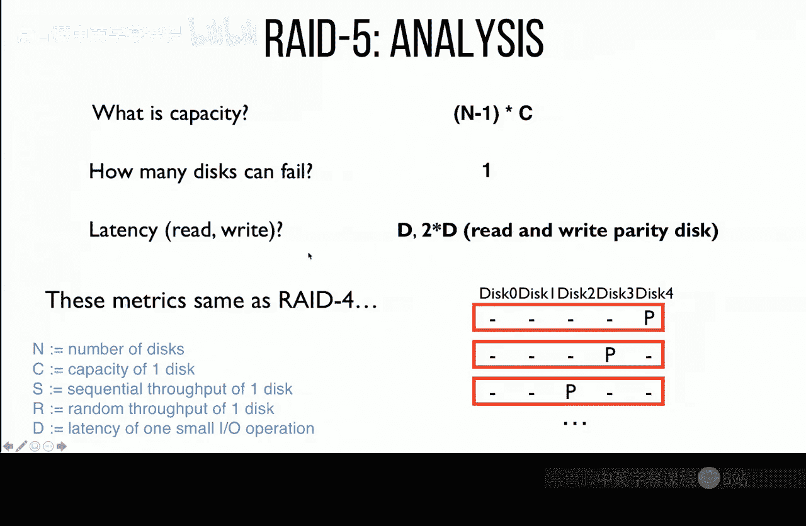
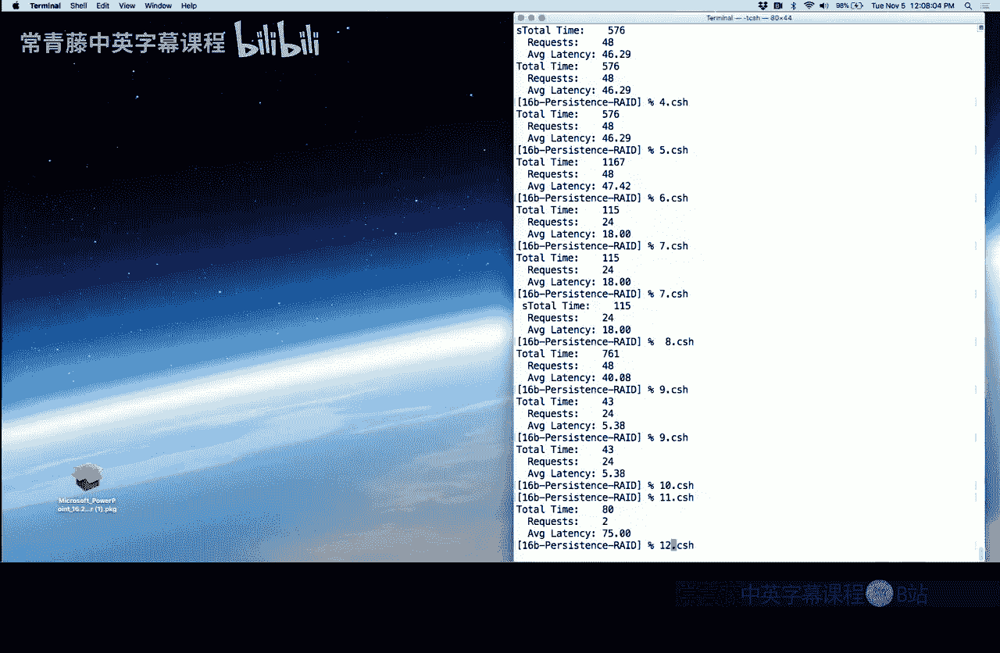
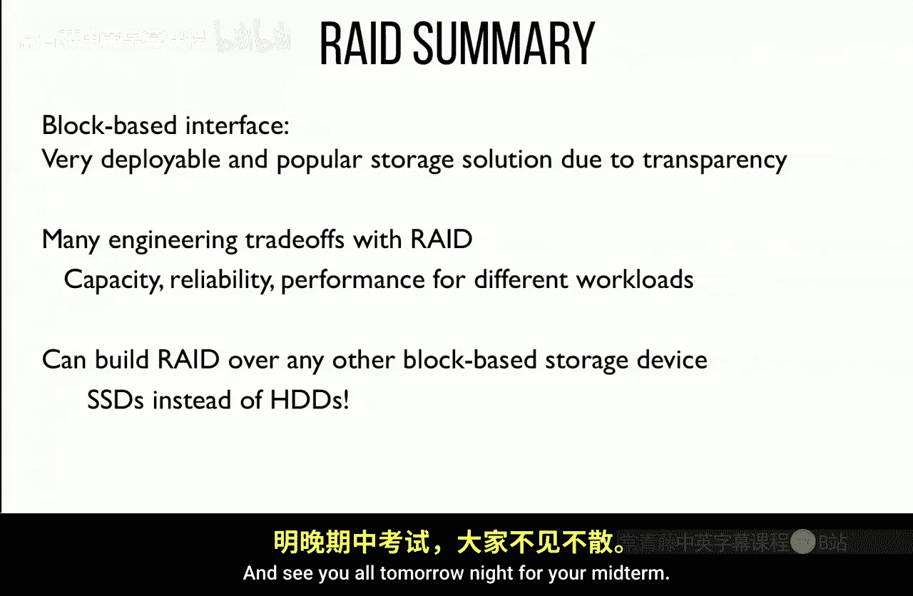

# 威斯康星大学【中英⚡操作系统｜CS 537 Fall19, Introduction to Operating Systems】 p17 P17 Persistence_ Raid _ University of Wisconsin-Madison -BV1wUzSB3Ecf_p17-

All right， good morning everybody。 so today we're going to be talking about persistence。

 start with a couple of announcements so you all know that Project5 was due yesterday。

 it was meant to be pretty straightforward。 I think the most complicated part was getting output to exactly match the test cases so we're going to have to be extra careful when we do that grading to make sure that。

The version you think you implemented matches the version we think you're testing with。So hopefully。

 in future semesters， when we reuse that project， we will iron out all of those little glitches that you saw。

 Lookie Project 6， that is going to be available this week。

 You'll have the usual turnaround time to get that done。

 It's not going to be in the X V6 environment。 So maybe that's a pleasant change of pace。

 Maybe you'll miss X V6。 I'm not sure。 but it's to implement this map reduced framework。

 which is what Google uses and a lot of other people for data processing。

 And so it involves this highly concurrent data structure that you'll get some experience building and then adding locks do to make sure that these mappers and these reducers access that data structure atically。

Alright。 And then you all know that midterm 2 is tomorrow evening。

 There's a bunch of practice exams available。 We'll spend discussion sections tomorrow doing review。

 The rooms I didn't fill in。 It's the same rooms as the last exam。

 except discussion sections 304 and 305 will be in the smaller room。

 which is on the it's like Ingraham 19。 and everybody else is in the bigger room。

 Ingraham B10 downstairs。The test is mostly about concurrency。

 There'll be some questions to review virtualization。

 They're mostly just repeats or small phrases that have been changed from the previous midterm。

 There's nothing about persistence， nothing about last Thursday's lecture， or today's lecture。

And then the peer mentors and Ts that would have had off would have had lab hours will now have office hours。

Mostly this evening and they whole bed in that same room as they did last time， which is C， S 12，0，7。

So any questions about the midterm at this point？Same Scron。 samee fill in the bubbles。Alright。

So today， we're going to be talking about persistence。 We're going to continue on into raids。

 So we'll be looking at what is the motivation for using more than one disk。

 Why we want to a redundant array of inexpensive or independent disks。

We'll talk about a bunch of the different grade levels， Ra levels 0，1，4， and 5。

 We'll talk about how each grade level does differently according to different metrics。

 like reliability， capacity and performance。O。So to recap a little bit what we were talking about last week。

 we've started to talk about persistence。 So here we need to make sure that our files or the data that we care about are kept around。

 even after we reboot the system or if there's a malicious power outage at the exact right point in time。

 exact wrong point in time。So we're beginning by talking about a bunch of the actual storage devices。

 the hardware that's out there。 So last time we talked mostly about hard disks today。

 we're talking about raid， and then our next lecture well talk about flash or solid state devices。

 Then we're going to move to the top of the stack， We'll talk about what the API looks like for user applications that want to interact with the file system。

 Then we'll talk about how the file system is actually implemented。

 what the data structures look like， how you go about allocating particular blocks to get good performance。

 and then we'll talk about crash recovery or really how the file system to make sure that all of its data structures remain consistent regardless of when a crash could occur。

All right， so this is the basic picture we gave of what the hardware looks like。

We have our CPU where we're running our user processes and our OS。

 Theres a high bandwidth bus to access memory， Then there are buses of lower bandwidth to access other devices that are out there。

 like a graphics card and our IO peripheral devices out here。

So the main thing to remember is just that it's a completely different resource。

 We can be running something on the CPU while the disk is simultaneously are concurrently working on the request that we've sent it。

 Those are independent。Actions， and we can have multiple。Disks out here in this this bus as well。of。

 I mean the catch my breath today。So this is the disc terminology that we went over the last time。

This disc it rotates around a spindle， we have a number of platters， each platter has two surfaces。

 a top and the bottom。Platters are divided into these concentric rings or tracks。

 The stack of all the tracks is called a cylinder。The smallest amount that you can read or write is what's called a sector。

 which is 512 by， so we usually combine those sectors into blocks of like 4 kilobytes。All right。

 And then each of we have a。Disk arm， and then a disc head that's activated on each surface as this disc spins around so that it can read or write individual sectors。

All right， so many questions about that basic， how the disc works。 Mike is working well today。

Allright。 so basically， what do we go over the last lecture。

 We said that the way that the file systems view a disk is a linear array of sectors from 0 up to the max size of the disk。

We looked at what is the I O time， How long does it take to do or read or write。

 And that had three components。 There was the seek time。

 How long it takes to move that disk arm over the correct track。 Then there was the rotation time。

 How long does it take for the disk to spin around and for the sector to be under the disc head that you want to read or write。

 And then there was the actual transfer time， which was very fast。

 And that's just based upon how fast the disk is spinning。

 How long it's going to take for you disc head to completely pass over that sector。

The other main point that we saw is that sequential bandwidth is much。

 much greater than random bandwidth。 Remember， sequential bandwidth。

 It's basically all transfer time， which is very fast。

 And random bandwidth is a factor of seek time and rotation times， which are very slow。

 many milliseconds。Allright， then we talked about a couple of details about disks。

 We talked about trackske。 Remember， that's the fact that the blocks across different tracks。

 We have to change the addressing so that a sequential read that spans multiple tracks can go as fast as possible。

 We talked about zones， which said that we wanted a constant density of how many sectors are recorded in each track so that you end up getting better bandwidth on the outer tracks of a disk than the inner tracks。

And then we were talking about buffering or caching on a disk。

 The fact that each track has like a track buffer。 And so when you do a read and you're at the right track。

 the disk starts to immediately read the contents from that surface。

 into the track buffer so that when you do reads from that track。

 the data that you want might already be in that track buffer。

 And there was also caching where rights might be kept in volatile memory and then flushed out to the persistent surfaces of that disk when it was convenient。

So once you have buffering， then you can start doing disc scheduling。 So with this， the file system。

 the I O system that's running on the processor sends a bunch of requests down to the disk。

 and the disc can reorder those requests to get the best bandwidth possible。

And so there's a bunch of different scheduling algorithms。

 The easiest would be first come first serve， of course， then there' shortest seek time first。

 See time is pretty easy to approximate。 You can think about that because seek time is all based on the track that you're going to。

 And so basically， if you just sort the sector numbers。

 you end up kind of scheduling by shortest seek time first。

 you just go to the request that's closest to where you are right now。

If you try to do something more complex， like shortest positioning time first。

 that's taking into account both seek and rotation there， the disk is trying to figure out oh。

 based on how the disk is moving right now， It knows that it can seek over to another track while the disk is rotating。

 get a certain request and go back and do another seek to someplace else。

 And it can kind of catch requests as they go by。 The O S can't do anything like shortest positioning time first。

 because the disc the O S does not have that lowlevel knowledge of exactly what's going on inside the disk exactly how sectors are laid out across platters and that would just be too low level of knowledge to have。

Then we saw there was a bunch of algorithms for dealing with starvation。

 So if you just do shortest seek time first， you could end up starving out requests that are far away on the disk。

So there are different algorithms for dealing with that。

 There's this elevator algorithm where the disc head just scans across the disk from the outer tracks to the inner tracks and then back again and kind of services requests as it passes by。

 The circular scan is a slight variant to that where the disc head just only traverses in one direction。

 Like it only gets requests when it's going from the outer tracks to the inner tracks。

 And it moves back out to the outer， and then gets requests again from outer to inner。

And then we briefly discussed the fact that all of these algorithms were still just greedy algorithms。

 They're always just looking at what's the next request that would be best to do。

 Which one will have the shortest positioning time or the shortest seek time relative to where I am right now。

 None of them were optimal algorithms that looked at all the combinations of requests that it that it has in the queue right now。

Alright， so that's the quick。Rrace through what we covered in our previous lecture。

 And then we are briefly talking about the fact that the disc does have an I O scheduler。

 The disc has a number of requests that it needs to handle。Now， the O S has an I O scheduler as well。

 So you know， different we have different processes running up here。

 Some of them are doing file operations。 Some of them are paging virtual memory from memory out to disk。

 There's lots of different I O that needs to be accomplished。

 And so the O S does do some ordering of those requests。 It does coalescing。

 It tries to find like requests that are next to one another and merge them into one bigger request。

But there's something else that it does。 that's kind of interesting。

So imagine that you had two different processes， A and B， And they're each basically reading。

 Let's imagine that A is reading from the outer tracks and B is reading from the inner tracks of this huge disk。

And so that A does some reading， and then it does a little bit of processing。

 And so what's going to happen。While a is doing that processing， the diskched， we're gonna so sorry。

 we we run A， It initiates an idO request and it blocks， right。

 So then the scheduler switches over to B， and it initiates a read and blocks。

 And then we go back to A。 Now hopefully at that point， A read is done。

 and A can be scheduled and do that small amount of processing。

And then A will go back and do another B， which will cause it to block and so forth。

 So what the disc ends up seeing are requests from A And B and A And B continually intermingled。

 right， And so this is going to have poor performance because now we're doing a bunch of random accesses to this disc that are very far away from each other。

So what would be better is if somehow we could get all of A's requests serviced and then all of B's requests handled。

But how are we going to do that， Because A needs to do a read。

 And it needs to get the results from that before it goes off and does the next read。 Now。

 the O S can do some things like prefeching where it kind of detects that A is。

Doing sequential reads， and it predicts accurately。 if it's sequential， it's pretty easy to do。

 And it just does a whole bunch of reads for A's process。 So the O S can do prefetching。

 But something else that it can do is what's called anticipatory scheduling。 Well so the idea here。

Is that we notice that A keeps generating new work。

 and it would be better for the disk if we didn't tell the disk to do B's request and put only B's request in the queue。

 It would be better if we told the disk about A's next request so that the disc wouldn't have to do that huge disk C。

So what this ends up being is an example of a nonwork conserving scheduler。 So in general。

 we've been looking at work conserving schedulers， which mean that if there's any work to do in the system。

 it's a good idea to do that work。 right， We don't want to keep our resource idle。 We never said， oh。

 we're going to keep the CPU idle and not do anything。 It's usually better to do something。

But this is a case where it's better for the disk to actually be idle and wait until A's next request arrives。

 rather than going off and doing this huge seek to handle B。

 If A is going to soon initiate a request back to where the disc head was in the past。So。

You might end up seeing this word word in other contexts that this is a non word conserving scheduler。

 It's anticipatory。 It keeps your resource idle。so that it can end up having better requests to handle in the future than what it would have had if it looked at what was only there right now。

 So it kind of anticipates what's going to happen in the future， keeps itself idle。

 and then it knows it can then handle another request from A that will be nearby where the discca is rather than doing that long seek to be。

All right， so。Any questions about that。Okay， so we're gonna keep this pretty brief。Summarize that。

 What we basically saw is that we want to overlap I O and CPU。 We can do that by using interrupts。

 We can do that using that direct memory access， that DMA so that the CPU didn't have to be involved with every transfer of data from the host memory and the device。

 This DMA engine was able to do some of that transfer for us。

The other thing we saw is that all storage devices or most storage devices。

 every storage device we're going to look in this class is going to provide a block interface。

 And that's just a consistent interface that all devices will adhere to。

 And so it'll be transparent to the O S。 What type of block devices is actually attached to the machine。

I always like you shouldn't do randomo。These are slow devices， mechanical devices。

 So it makes sense to spend some time to actually figure out what's the best process or the best request to schedule because they're such expensive operations。

Al right so that was a quick summary。 Now we're going to get on to today's lecture。All right。

 so today we are talking about raid。What is Ra？In our previous lecture。

 we looked at just having a single hard drive， a single disk。

 But sometimes we want to have more than that。 There's a variety of reasons why you might want to have more than one disk on your machine。

 You might need more capacity。 You might need more reliability。

 You might want to be able to work when that one disk fails。

 and maybe you want higher performance that you want to be able to read at a higher throughput or get better performance with multiple disks。

But the problem is that most file systems assume that linear array of blocks like we were talking about in the last lecture。

 So we somehow have to give that interface to the file system that's running on top of this disk。Now。

 one solution is to not provide any interface and to just like mount a different bioystem on every disk or every partition that you have out there across these disks。

And so this is called just a P of disk and the idea is we're going to have a different file system mounted on each of the disks and then when the application wants to read or write a file。

 it will know which file system that is， it knows how the directory structure is organized so that it can direct that you'll put slash temp on one disk。

 maybe you'll put your home directory on another disk， you'll put your experimental data on another。

 and so they'll all have different file names that will allow you to access those。So this works。

 We'll talk about the APIs to support this a little bit more in a future lecture。

 but it's not like the most elegant solution clearly。

 And it's not going to port very well when you have different numbers of disks or different setups here。

 So this is not what we want to do。What we want to do is what's called rate。

 So rate stands for a redundant array of inexpensive disks or redundant array of independent disks。

 People use that both terms。 And it's just really， really elegant here。

 because the file system is going to think that it has just one large disk that it's running on top of。

 It's going to have just one large linear array of blocks that it's reading and writing to。

 And there's going to be some mapping from these individual disks to that linear array。

 It's it's going to look like we have a large disk that has great capacity。

 great performance and suitable reliability。And it's awesome because it's completely transparent。

 The file system will not know how many actual hard drives are within this rate system。😊。

And it's just really easy to deploy out there。 So let's figure out how to do this。Okay。

 so one argument is， well， why do we actually want to use inexpensive disks。

 Why do we want to have a bunch of cheap disks instead of just buying one really expensive disk。

 So the idea here is that with Ra， we're able to leverage commodities of scale。

 So it's generally much， much cheaper to produce components that lots and lots of people buy right we are able to figure out how to manufacture those。

 And if most consumers buy that one smaller， cheaper device， it will become even cheaper。

 Whereas if we try to have a really high end device that's the fastest one that has the most capacity that tends to really cost a premium to purchase。

 So we want to use the cheapest devices that we can and use multiple ones of them and figure out how to get them all working together and figure out how to handle all the errors that they might generate。

Okay。So the basic idea here is our array device is going to look like it's a linear array of blocks just like an individual disc did。

 And then we are going to have some mapping from that linear array of blocks down to the individual disc beneath it。

 And we're mostly going to be talking about how should we actually do that mapping today。Okay。

 so let's think about how we might want to do this mapping from the logical blocks that the file system sees to the physical blocks that are actually on each of those individual discs。

 So you could think of this as being kind of similar to virtual memory。 right。

 We had the same problem there where we had to go from a virtual page to a physical page。 Now。

 we're kind of going from a logical block address to a physical block address。

So when we did this with virtual memory， it was pretty complicated。 right。

 It was we had a table that told us， know， we had a page table that tracked this mapping because that mapping was dynamic At runtime。

 we determined where a virtual page lived in physical memory。So that was。

 it involved this extra access。 It involved all of these updates。 It's pretty complicated。

 We're going to do something much simpler here because we don't need as much flexibility as we did for virtual memory。

With raids， we're going to have a static mapping。 So we're just going to use simple arithmetic to figure out how to go from a logical block number to a physical block number。

 And the arithmetic will just be slightly different depending upon how many disks we have and the actual grade level that we're implementing。

Okay。So another thing we're going to do in addition to having just simple mapping this is we're going to have redundancy。

So when we have more discs， it's more likely that one of them will fail。

Just with probabilities there， if you had 1000 disks and they all have independent failures。

It becomes more and more likely that you'll have at least one failure， the more disk you have。

 So it's going to become important to have multiple copies of our data across different physical disks。

 So in this picture here， it looks like this data from 0 to 100 is replicated or copied across two disks。

 And then the data from 100 to 200 is replicated or copied across those two disks。

So we'll look at different replication strategies as well。Okay。

 so we're going to try to figure out well， how many copies should we actually keep for every logical block。

And so certainly in general， the more copies you have。

 it's definitely going to improve your reliability。 But the interplay with performance is really。

 really complex。 So sometimes it's better。 It improves your performance to have multiple copies。

 right。So why would it improve your performance to have multiple copies？Yeah。

It could be faster to access one of the copies than the other， right。

 So and for what types of operations would that work well。There's a high level just with reads。

 then if you're reading two data， if you're reading the same data item and it's copied on two disk and you're saying。

 like， if the disk head is closer to the one。The sector on one of those discs than the other。

 You'd do much better to read it on the。The disc where the discca is closer to that sector。

 That's great。 So that for reads， redundancy can definitely improve performance。 But for rights。

 it can often decrease performance。Because then you're always going to be running at the rate of the slowest disk there。

 right， If we have to update both copies with this redundant data and wait until they're both finished to make sure everything's consistent。

 we're going to run at the rate of the slowest disk there。

And there's going to be lots of other complications for rights as well that we'll get to。 Okay。

 And then clearly， as we have more copies， we're going to hurt space efficiency since we have multiple copies。

Okay， so in this lecture， the way we're going to talk about raid is we're going to go over four different grade levels。

 there's raid levels 0，1，4 and 5 that we'll talk about。 and yes。

 I can count correctly two and three are just systems that nobody uses and they just don't make any sense given to current technology so we'll look at zero。

1，4 and5。 and then we're going to look at a bunch of different workloads。

 We've seen that random and sequential behave very， very differently。

 and then we'll look at reads and rights as well because that's going to be performed very differently on raids and then we'll have a bunch of different metrics capacity。

 reliability and performance。Okay， so the first question is。

 how should we actually map those logical blocks to specific physical blocks on disk？

So we'll start looking at rate level 0。And then we're going to look at a bunch of different workloads。

 We'll have reads and writes。 We'll look at sequential and random。

And then we have our metrics that I was talking about。 And so specifically。

 we'll figure out how much capacity is now available to higher levels， given a number of disks。

 and we'll keep all of this generic formulaic。 So we'll do all of our calculations in terms of like how many disks are intered。

 It just N。 What's the capacity of a single disk， which will be C。

 So you can think of that as it's about 500 GB。 if you want to think about a number。

Then we'll figure out like what's our sequential throughput using this raid based on S。

 which is the sequential throughput for one disk， are the random throughput of one disk。

 figure out the system random throughput， and then D is the latency。Right。Okay。

 so let's look at our first grade level， which is also called striping。

 So this is the easiest approach。 We always start with the easiest approach。

 and we make it more complicated。So this has no redundancy， no multiple copies at all。

 So this is what the linear array looks like to the file system that's running on top。

 It sees logical blocks 0 through 7。 And then we need to map those blocks to each of the disks that we're running on。

 And in this example， we'll just have two disks。And so logical block 0 will map to block 0 on disk 1。

 logical block 1 will map to offset 0 on sorry， That was disk 0。 This is disk 1，2 goes back to here。

3 goes over here and so forth。So we're just going to stripe or kind of round robin or alternate where each of these logical blocks is placed across these disks here。

So another way that we like to look at this is that you could imagine these are the。

Physical blocks on each of the disks。 This is the zeroth offset， then the first offset。

 second offset， third offset。 And then the contents here are telling us what logical block number is allocated there。

 So logical blocks 0 is the zero location on disk 0， and then one and 2 and 3 and 4。

 So it's just simple striping across those disks。Striping， rate 0。

And so this is what the picture looks like with four discs。

 We're just striping or kind of alternating where those blocks go across desks。

And so some terminology， we call this a stripe。 It's the one block from each of the disks that are all at the same offset that that'll be useful terminology。

 especially as we get into other rate levels。So to emphasize that there is simple math to figure out what like so given a logical address。

 A that the file system wants to generate and read or write。

You can calculate the disk where you need to send your request to as part of the rate controller and then the offset within that actual disk to read。

 So spend a minute and come up with the simple math formula to do that。Competition。Alright。

 so if I tell you I want to read logical block number 0 for 8 or 12， that should map to disk 0。

 If I tell you， I'm going to read logical block number 1，5，9 or 13， that should map to disk 1。

 So what's the simple function that calculates that。Mumble a math function for me， as a group。

Module that mod。 Yes， so the disk number is the logical address， mod， the discount。 So 0，4，8 and 12。

 mod 4 is all 0。 These mod 4 is 1， so forth。 And then the offset is simply the logical block number divided integer division by the disc count。

 So0，1，2，3 and 4 divided by 4 is all going to be 0。 It's the0 offset，4 through 7 divided by4 is one。

 that would be the first offset。 So very simple arithmetic to figure out the correct disk number and block number within a disk given a logical block number。

Any questions about that。O。No so real systems are a little bit more complex than this and we'll just ignore this。

 What we've assumed here is that we have what's called a chunk size of one。

 but in general it would be inefficient to read just like one sector of 512 Btes or one block of 4 kilobytes per disk we want to have like a larger unit of transfer for each disk so the raid system will combine multiple blocks into what it will call a chunk you could have a chunk size of one block or two blocks or four or eight and then all of the arithmetic would be based upon these chunks。

 but we are going to ignore that， but you might see that some other time if you look into raids in more detail we'll just assume a chunk size of one to keep this simple。

All right， oh， a visualization。Okay。So。We have this。Little disc simulator。

And this is a system with four discs。And it's with rate level 0。 So we're striping。

 This has the logical block number allocated to each disc。

 And then this little black box is showing where the disc head is on each disc。 And then up here。

 we're going to have a sequence of operations to read。 And I don't think I can make this bigger。

So let's run this tiny little simulation where we just want to read block 56， does that say。

 So 56 is on which disk it's disk 0。 So what we're going to see is we're going to see that that gets red。

 and there we are。Al right， so we didn't learned too much from that extremely simple simulation。

So let's look at something that's more interesting。Second one， Okay。

 now we're doing a bunch of operations， striping， all reads。 Let's start this。Okay。

 so what is this really emphasizing？ So the point is that all of those disks are operating in parallel for us。

 right， So were getting n times the bandwidth of a single system。

 We have N random operations that are all working in parallel。 So that's really quite beautiful。

 That's why we love raid that we are getting all of those operations working。😊，Working。

And then that's， I think I have one more。What is this one doing， I think it's。

Just doing the same thing。 but writes。 So when do you know。

 reads and writes on grade level 0 operate exactly the same。

 It doesn't matter if we're reading or writing。 We just do seek， wait for the rotation。

 do the read or write， and we're done。Okay， so any questions about。

How that is working with grade level 0。For operations， okay。Well， then。Let's do some analysis。

So we want to figure out。If I， if you know these parameters， given that we're doing rate levels 0。

 we want to be able to evaluate all of these different grade levels and see that there's never going to be one best rate level。

 There's going to be some that are better for different metrics。

 and there's going to be some that are better for different workloads。So with rate level zero。

What's the capacity of that system， given these。Varis。Mumble it out for me。

So sees the capacity of one disk。 We have N disks。 And so it's simply going to be n times C。

 All right， This is going to be a simple math。 How many disks can fail without us losing any data。0。

 if a disk fails， we don't have any redundancy， and we will lose the data that was on there。

 What's the latency of a read or write， given the numbers I gave down here。

It's just D because we're not doing anything different。

 a single operation takes just as much latency or time that we have to wait for it as it would have with a single disk。

 But throughput， that's a little bit more interesting。

 That's where I was showing you that we really have all end disks doing the work for us in terms of throughput。

 They were all operating in parallel。 So the throughput with a raid 0 is going to be for sequential accesses。

 it will be n times the sequential bandwidth of one disk， like one disk could do 100 meby per second。

 If we have six disk will get 600 meby per second up to some other bandwidth limits of other buses。

 random aisle willll just get n times that random。Bandth， so this is a really big win。

So that's great。eight。Any questions about grade level 0。O。So let's move on to the next system。

 So what we want to fix is the fact that if we lost any disks。

 we would lose some data and maybe the disks that the disk that fails。

 it could have been the one that holds our root directory or includes the super blocklock for the file system or holds some really essential information for the file system。

 And our file system is not going to work at all。 if that one key disk fails， yeah。Great。😊，Right。

 so this is certainly the peak random bandwidth that we could get。

 assuming this perfectly load balance system where all of the requests go evenly across all of the different disks。

 I think probability， there's going to be some tail you can figure out。 you know。

 what' what's the load imbalance to expect for different distributions of requests。

 But it would certainly be very odd for them to all go to one requests。

 There will be some that have more load to managed in other disks。

 But if it's truly a random workload， it'll be pretty evenly distributed。All right。Okay。

 so we want to fix this problem of we can only， we can't handle any disks failing。

 So that's what Ra one is going to do。 So again， it's the same interface that the file system is going to see。

 It's going to think it has a disk of size  four blocks。

 And then we are going to just simply replicate those four blocks across both disks。 So here the。

Lo disk size that's being exported to the file system is exactly the same as the physical disk that each one actually has。

 We just have two copies of it。So it turns out people usually combine mirroring and striping。

 So Meing is Ra 1。 Sing was Ra 0。 Sometimes you'll see this Ra 10。

 which is really one and 0 that we're doing both mirroring and striping。So at two disk。

 we can just do pure mirroring with four disk。 we can do a combination of striping and mirroring。

 which is what lots of systems are going to do。 So we。

 we stripe across these two groups where we alternate between 0 and 1 and 2 and 3 and 4， etc ce。

 But then we replicate blocks 0 across these two disks in that group there。

So for short hand notation， I'll just refer this usually to Ra one with striping。

 But if we have more than one， sorry， Ra 1， which is mirroring。 But if we have more than two disks。

 we'll also be doing striping with that as well。All right， Any questions about what that looks like。

O。So now that we have rate level1 and mirroring， how many disks could now fail without losing any data。

So the first thing you need to think about is what's the failure model here。

So there's one way that these discs could fail。 that would be a nightmare for us。

 It could be that they fail by giving us the wrong data back。

So that's what happens with like latent sector errors and happens with a lot of kind of disc corruption that can happen。

 And so if we did that， then maybe we'd have to read both blocks and see if they're the same。

 and only if they're the same。 and do we trust it。 But that's not the model we're going to have for how disks fail。

 The model that we're going assume for disc is that their fail stop。

 which means they just completely die and completely stop working and they don't give us any data and they notify us or we were able to easily figure out that they're not working。

 And so they don't continue to corrupt data or do anything bad， they just stop and notify of this。

 And so this is going to make our life a lot lot easier。 So if we have fail stop disks。

 then how many disks can we definitely tolerate the failure of。One and。

But it's also possible that we could handle more failures if we got really lucky， right。

So it could be that。The disk 0 dies and disk 2 dies， and we'd be totally fine。

 We could handle two failures。 But if it was disk 0 that dies and disc1 that dies。

 then we would lose some of our disk blocks。 So in general。

 we'll say that we can only handle one disk failure with raid1。

 but it's possible with some luck that we could actually handle more failures than that。O。Oh。

 more visualizations。So this is going to be visualizations。Of。Right level one。Okay。

 so you'll see we have mirroring and striping， and I think this first workload is going to do reads。

 let's see。Yes， it's doing reads。 These look like they're random reads。

 And so they're working beautifully。 We're still getting how much bandwidth out of this system。😊。

If we have， if R is the random bandwidth of one disk。

 what's the bandwidth that we got out of that system for these random reads。That's。On it again。

They're all working very nicely。 So all N disks are giving us the R bandwidth。

 So our total random bandwidth will be n times R in this case， right。E， so。Maybe that's obvious。

Maybe it will seem less so as we look at other approaches。

 So I think this next one is going to do rights。 Yeah， it's just doing rights because they're yellow。

Rights， we have to keep them in sync， right， We need to update both copies of this block when we change them。

 So they're behaving nicely in sync。 So what's our bandwidth going to be for random rights if our was our random bandwidth。

Itll be n divided by two times R， since we're getting only half of the disk's worth of useful work there。

 yeah。certainly don。Yeah， yeah。It's most likely the case。

 So we usually in a want to have homogeneous disks where all of the discs in our array all have the same capacity。

 Theyre the exact same make and model。 They have the same performance。

 You could try to do something crazy with heterogeneous disks or some perform differently。

 But certainly， we're going to do the same layout。 Like， I don't know of anybody that decides， oh。

 we should use numbering from the outer tracks to the inner on one of our copies and do the reverse mapping on another one。

Yeah， it's， it's tricky。But you， I mean， you could try to do something like that where you do different layouts that are still easy to calculate mathematically so that you could optimize some seeks。

 But it I don't think you're going end up getting much of a win out of it。

 But it's a good research question to look into。More questions about Ra one。

Nearing random reads randoms。So that was random。What happens with sequential？

Which must be number six。Okay， this still looks like it's mirroring， let's run it。

So what happened there？Let us。Run that again， I think the next one is a slowmo version of it。Okay。

So we're trying to do sequential reads。 And so the question is。

 do we get n times the sequential bandwidth with N discs。

So if we're just doing one big sequential read， then we're only going to get n divided by two times the sequential bandwidth。

 right， because。For example， one disk could， we could have done this a little differently。

 in this picture， we showed disk 0 read this one， and then disk1 read this one and so forth。

 And we kind of alternate it back and forth across them。

And it doesn't help this disc at all that it's missing half of the blocks。

 It takes just as long to kind of skip to the next one as if it had actually done that read。

 Or another way you could have viewed this is we could have just kept this disc completely idle and this disc completely idle。

 and then we would have gotten half of the sequential bandwidth of them as well。

 because only half of the disc would have been doing work。

So one of the models is that with sequential reads with grade level 1。

 you're only going to get half the total bandwidth that you could have。Now。

 I don't always like this model。 This is where one of I disagree with my coauthor on kind of what's the best that a raid system could do。

 So could you imagine a different way that we could have like a sequential workload。

ItHas many sequential operations in it。 And then we could get the full n times S。

 the sequential bandwidth of one disk times all n disks。How。

 how could we get n times S is my question。接过来。Okay。Even like here， we're saying。嗯。So。

Like so in this approach here。Yeah， like this disc here。 is only picking up every other that one。

 And then the other disc is picking up the other one。 But this。

 picking up every other takes just as long as reading everyone would have。 So with this approach。

 we only get half the bandwidth。 And then the other approach would be， we have disk 0。

 read all of the blocks and disc to read all of its blocks。 And then half the disks are idle。

 So both with both of those arguments， we're only getting half the possible bandwidth。

 So my question was， is there a different way to do this to get all of them。

 And I didn't understand if you were proposing something or not， So I'm going to。Have someone else。

Yeah。Yeah。Yeah， that's how I view it that that could happen to that we if you just view either we have a lot of sequential requests to do and disk 0 and 2 will do the first one。

 and then disc 2 and three will do the next sequential request。 And so therefore。

 and they're all going on simultaneously。 we would be getting all of them operating and doing sequential operations。

 Or if it was just like really a huge sequential read of the whole disk。

 then you could divide up that huge sequential read， like you were suggesting。

 and give the second half that's still a large amount of data to the first and third disk。

 And you know， it's reading enough sequentially that you are able to amortize that initial seek and notation to get to the start of that sequential read that you need to do y。

So。Either answer ends up being okay。 It's all kind of like， well。

 what is the raid system really able to do， What is the raid control they're really able to do。

 What does your workload really look like that you're going to get some slight differences there。

So either n divided by2 times s or just n times s。Okay， I think that's it。All right。

 so let's do our analysis， what's the capacity of our system as a function of C and N？C times N。

Divided by2。How many discs can fail in this system？One， maybe more。 What's our latency。

 It's still just the same。 It still takes just as much time to do an individual reader， right， Okay。

 so the interesting other analysis kind of visualize this layout in your head。

 What's our steady state throughput for random reads。We decided it was。

N times are that all of them are doing work。 Requests are going to all of them。 Evenly。

 we'll assume random rights， the steady state throughput will be。And divided by two times R。

 since they both need to do the work for every operation。Sequential rights。

 they definitely both have to do it。 We't can't win on that one。 Sequ reads， disagreement。

 maybe it's in divided by two times S。 But maybe if you have a lot of sequential reads going on。

 all of the disc can be doing something useful。All right， any questions about rate level one？

Marrying。O。S issue。 so for those of us that really worry about system crashes and power failures and making sure that disks keep all of their data consistent。

 you can think about what goes on inside of a raid as it does updates。 So for example。

 imagine block to here， we need to write new data to it。

 So the way that that's going to work is we send that request a to the raid system and the rate hardware controller。

 or this is done in software。 it does individual rights to each of those two disks right。

So that worked out great。 Keep running along。 Then the file system decides it wants to write the value T to block 3。

 So it does that。 But then what could happen is the raid system could have a crash。

 There's software running in there， or we could have a power failure。

 and it could be the case than that we have different data across these two disks。

So that's a pretty bad problem because we saw that don it's not like we check the two values。

 Sometimes when you read that block， you might read from disk1， sometimes you might read from disk 0。

 and you'd see different results。So what's the general fix for this？So basically。

 if you buy a very expensive hardware raid and you have this all done in hardware。

 then that usually includes not just， you know a processor to do this work。

 it'll have some small amount of nonvolatile raM in it。

 some RAM that stays active even if it loses power and so basically that raid will record the operations that it was in the middle of doing before it actually does them。

 so that raid will record oh， I'm writing block T to。

Or hunting T to block  three on both of these disks。 And then if there's a crash and then it reboots。

 it can look in that little journal and see， oh， I was in the middle of doing it。

 and I didn't get it done。 And so it will replay all of that。Software ba。

 if you just try to configure this on your own system， you're not going to have this。 And so it'。

 that's why you didn't pay so much money。 And you don't get quite the exact same reliability and functionality as if you had bought a hardware device to do all of that for you。

But we're going to look at this problem a lot more when we look at just how can file systems in general deal with inconsistency and crashes that occur at bad points。

Okay， so we've looked at two raid systems at this point。 One had good capacity， but poor reliability。

 That was grade level。0， and we looked at one that had poor capacity， but good reliability。

 That was very level 1。 Of course， there must be lots of systems in between these two。

 So let us look at one， rate level 4。Okay， notice we do not yet have performance on this as one of our metrics。

 Ra level 4 is going to be bad at performance， but it's going to do well on those other two metrics。

Okay， so red level 4。 We're going to use one disk as a pary disk。

 That last disc is not going to hold any useful data for the file system。

 It's just going to have a function of all of the other data。

 It's going to contain parity for all of the other data that's associated with a given stripe。

So basically it's going to be a lot like in algebra where if you have one unknown and you had n variables and minus1 unknown。

 you can kind of figure out what that one unknown is。

 so we're going to treat each stripe as a different like equation and all of the data within that stripe or the different variables and so if we lose one of them we'll be able to read compute it。

Okay， so this is what grade level 4 would look like with four disks。 Of course。

 you could have an arbitrary number of disks。 But the last disc you'll always view as as holding parity。

 And so the parity is computed over the other blocks within that stripe。

 So P 0 is a function of block 0，1 and 2。 P1 is a function over 3，4 and 5。

And the function that turns out to work really well， that's very simple， fast， easy。

 symmetric is an XOR function， and so each of these blocks here will just be a bit wise XO of the data blocks that are on the other disks。

So let's do an example。So this is a very weird sector of three Bs， instead of 512 Bs。

 But let's figure out what the parity disk would hold。 And I switch this to have five disks。

 It really can have any number of disks。 It doesn't have to be a power of two or any nice number。

5 is a totally fine number of disks for a rate。Okay。

 so what would be the first bitete of our pary block over here， It's the XO of0，0，1， and1。Which is。0。

So think of it as you know， you make it so that we have an even number of ones across all of the。

Bits there。So 0，0，1， and1， xor is 0，1，1，0， and 1。 We need another one to have an even number of ones。

0，1，1 and one。 We need another one there to have an even number of ones。 So 0，1。

1 is the x or over these。Blocks here。All right， everybody buy that。Okay。

 so what's awesome about this now is， let's imagine one of those disks dies。 You have no memory。

 You cannot remember what was on that disk。 And now you can use that awesome ex parity function to calculate what was on this disk。

 And so the model you really want to think about is disk1 died completely。 It fail stopped。

 We get a new disk， We replace it in our system。 We go out。

 We read all of the data on the other disks and we can recompute what must have been on that disk。

 And then once that reconstruction is done。 a system can continue to run and read from disk1。😊。

So that's what's called reconstruction。 I you get a new disk and you fill it up with what you're able to compute。

 So what should disk 1 contain， It's just that X or function again。 So with 0，1，1，0 as the first bit。

 the first bit of disk 1 must have held a。0， and that's what all the other stuff is， too。

 If you just do that X or function。Alright。 so reconstruction with Ra 4 uses Xors。Okay。Allright。

 so there's lots of interesting complications here。So let us imagine。We had this stripe here。

 and now we want to overwrite this block here。How are we going to update the parody？

So the straightforward way to do that is I know what my new contents are。 And I do the Xor。

 just like I showed you with the blocks from those other disks。But what does that require you to do。

You have to read all of those other discs。To write out the parodity。 So this is looking really。

 really costly。 It's gonna have bad performance。 We write out this one。 We have to read， read， read。

 and write out a parody。So if we have a lot of disks。

 that's just going to get worse and worse as an approach。 for， we change one block。

 We have to read from all of the other disks。So another way to do this is to look at what changed in the block from the old copy to the new copy。

 and then change those same bits in the parity from the old to the new。So， for example。

So what we're going to do here then is when disk 0， if we're changing this from a 0，1，0 to a 0，1，1。

 for example， that's what we want to write out。 We would compare 0，1，0 and 0，11。

 We' see that the first two Bs are the same。 So therefore。

 the first two Bs of the parity must be the same。 the last bit of the data changed。

 So the last bit of the parity changed。 So that's kind of neat that just by looking to see what changes。

 you can then figure out what must also change in the parity。

 and you don't have to look and see what was on all of those other disks。

 So this can really be a good performance optimization when you have a lot of disks that you don't have to read all of those other ones。

So that's what I wrote out here。You just read the old value of the data that's changing。

 you read the old value of the parity， and then we look to see what changed here。

 zero changed to one。 So this bit of the parity must change to one as well。 One is the new value。

 one was the old value。 So that doesn't change。 one was the old parity。

 so that must also be one and the new parity。Okay， so that's another way of updating parity with Ra 4 or Ra 5。

 We'll see。 And it has much different performance characteristics。

 So instead of having to read all of the blocks， what you're now doing is you're doing two reads for every write plus two write。

 right So we have to read the old parity， write the new parity。

 read the old data and write the new data。 So every time we want to write one data block。

 We're now doing four operations。😊，So this is sounding not the best。

 It's going have some performance problems。Okay， so let's look at these。8s。So this is Ra 4。

 And so you'll see we have four disks。 The data is being striped across three of them。

 and then a parodity block is on the last disk。And we're trying to do a bunch of it looks like reads。

 So reads are great。 Reads aren't the worst thing in the world。 These are random reads。

 How much bandwidth are we getting out of our Ra4 system。It's n-1。

 the number of data disks times the random bandwidth， right。

 that all of those data discs are able to do the good random work。 So that's great。Reads are good。

Let's look， though， at something else。Let's see what this one is going to do。 This is doing right。

 Oh， that one wasn't too bad either。 What did that do。This one is doing sequential rights。

 So sequential rights are also pretty good because we're able to。

 you know we have this big sequential right in memory and you know you're able to then compute able to compute the parity blocks for each of those doing that parity computation and memory is much faster than writing to disk。

 So the limiting factor in our system is doing the disk rights， not doing the parity computations。

 So this is going to end up performing just like n minus-1 times S。

 each of the data blocks is able to do their useful sequential work and the parity disk keeps up with that and writes out the parity information。

Okay。So that one looked good too。I think then they start to not look so good。

So what in the world is going on now， right？It's doing right。 And to do a right。

 it needs to read the old block， read the old pary， write the new parity。

And it seems to be going very slowly， but it's hard to really see why。

But the reason it's doing really badly is because this pary disk has to be involved in every single operation。

 right， So we are nicely able to do the data， reads and writes parallel across these three disks。

 but the parodity disk has to be involved with every single update。

So that is the bottleneck of our system。So。Let's do our analysis real quick capacity of rate 4。

 What's the useful capacity of this。And minus1 times C， how many disks can fail？One。

 what's the latency。 It's D for reads， writes。 We're going to have to read and write the pary disk。

 So it's going to be twice that。Okay， this is the interesting one。

 so what's the steady state throughput for reads？N-1 times S。 We saw that。

 We saw that all of the disks or the data disk were able to do their useful work。

 reading sequentially。Rights ended up being the same thing。 We calculate the parity in memory。

 that's fast。 and we just have to write out the parity also sequentially to the last disc。

 And so that last disc is doing work。 doesn't count towards our useful steady state throughput。

 but it's not slowing us down。Then we saw random reads were also pretty good n minus one of the disks。

 all the data disks were doing useful random work for us。

 but then it was this horrible case of the random rights where all of the operations have to go to that pary disk。

 We had to read the old parity right the new parity for every single random right that we wanted to do so that one disk ends up determining the whole random throughput of our system So we're getting no benefit out of having more disks。

 It's not a function of n。 and in fact， it's worse random write throughput than if we just had one disk in our system right So this is horrible。

 we cannot use rate4 people do not use rate for for this reason。Okay， any questions about Ra  four？

Yeah。Could you say that a lot louder。Oh so this is。Okay， so for every random right， we have to。

Read the old data and write the old data。 That's fine。

 But we also had to read the old parity and write the new parity。

 We were doing that differential approach to do that。

 So every right now does two operations on the pary disk。

And so it's able to only then do half of the。Operations。

So I think you could complain about the model if you wanted to get into details。

 but it's basically it has to do twice as much work in their random operations。

 So we'll call it that one half R。Yeah。Why isn't it R divided by 4。

 So all of those other discs are doing operations， but they're not our bottleneck。

So the pary disk is the bottleneck。 That's determining the throughput of our system。

 And spent we're sending twice as many operations to that pary disk as we had original operations。

So it doesn't matter that the data disks are doing stuff。

 The parity disk has to do a read and a write。 So that's why we're doing twice as many operations。

 So we'll get half the useful bandwidth。Os。嗯。So。It was based on that we're having to do this for every time we do a。

Update。So we're trying to do all of these random rights。And this is our parody。Disk。And now。

 when we wanted to modify this， the approach was we have to read the old value and write the new one。

 We know that。 So a bunch of random rights are occurring。

 and most of they're all going to different disks for doing this part for reading the data。

And updating the data。 That's fine。 But the problem is， each one of these causes， you know。

 a read of the old pary and a write of the new parity for every one of those。

 So the pary disk becomes the bottleneck of the system。

 It's determining how many operations you can do per second。 It's all about the parody disk。

 Everything's going there。We're doing twice as many operations。

 We're doing a read and a write for every one random write that the file system wanted to do。

 So since we're doing two twice as many operations on that parody disk， we can only get。

Like half the useful bandwidth out of the system。 If this parody disk was just a normal disk and it was able to do our operations per second。

Now， it can only do half of those。Since half of them are wasted。Ud。Great， so it is。 yeah。

 all we're assuming we're constantly giving the raid system random rights。

 There's no empty idle time to kind of do other operations。

 So this is just completely the bottleneck。And that's。Yeah。

 you'd have to wait until that pary gets updated， essentially。Alright。Okay。Now the solution。Okay。

 so with Ra 4， the bottleneck was the parody disc。 So the observation is。

 we need to put the parity on a different disk for every stripe。So now we still have five disks。

 But instead of disk 4 being devoted to parity， we kind of rotate around which disk is responsible for the parodity for every stripe。

 Otherwise， it acts exactly the same as Ra 4。So that's pretty neat。 Okay。

 so there's a bunch of different ways you can allocate logical blocks down to disks and offsets。

 This particular mapping is what's called left symmetric and it turns out to be clever and to work very well because if I were doing this。

 and I didn't think about how to lay out blocks， I would say yes 0，1，2，3，4 parity。

 but then I probably would have said 4，5，6， parity 7 and just kind of always started over at disk 0 with my numbering。

 turns out that's not the way to do it。 And so what makes a lot more sense is if you think about how you want a sequential read to operate with my bad mapping I would have read 0。

1，2，3， and then come over here for4。 Now for my nice sequential operation。

 disk 0 had to do twice as much work as everybody else。

 and I wouldn't get the peak bandwidth out of my system。 But with this left symmetric mapping。

 now when I do a sequential read 0，1，2，3，4 every disk。Is involved in that。

 And we can get the peak bandwidth。 Every disk is doing something useful for us。

 So where is block 8 going to go with this，8 had better go to D 3。 So that when we read 5，6，7，8。

 all the disc will remain active。 So that's kind of why we just kind of keep wrapping around。

 Certainly， the parodity keeps sliding over to new disks。

 But you also just have to watch a little bit where those data blocks should go so that you can also be getting peak sequential bandwidth。

And then this pattern just keeps repeating over and over again。 So P5 would be back over on D4。

So this is leftssymmetric。 It's a very good layout for getting good sequential bandwidth out of your RA five system。

So any questions about that mapping。Okay。Alright， so。Let's do the easy analysis first。

 what's the capacity of this system？C times。And -1， how many disk can fail，1， What's our latency。

 still same thing as before。 So a lot of it looks the same as Ra 4， except for performance。

 So let us look at some more simulations。

Okay， this is Ra 5。 Does it use left symmetric， I can't read。 No， no， goodness。Well。

 the simulation does not do the awesome leftsosymmetric， doesn it， Yes， it does。

 I can't read anything。 No， it doesn't。0，1，2，3 should be over here， but in the simulator。

3 is over there。Okay， but it still performs pretty similar。So let us look at。

 we're updating 31 and 36。Start this。And what did that do？It's。Was doing two rights。 Great。

 So it had to then update 31s parity。 It also updated this block here。36 is here。

 and it also had to update its parodity， which is over there。

 So it was able to do two operations with rights completely in parallel。

 There was no one disc that was acting as a bottleneck that had to do all of the parodity operations。

 So again， if we were modifying， if we were writing to this block here。

 we're also going to be modifying the corresponding parity。

 And when we were modifying this data block here， we were also modifying the corresponding parity that was part of that stripe。

😊，Okay。So those were a few rights。

What is this one doing， These look like readeds， Okay， readeds look pretty beautiful。

 Reeds are scattered everywhere。 All of the disks are now able to be utilized。

 It's not like one of the parody discs is wasted。 So that fixed one of the problems of rate for。

And then the last problem。13。What is this one going to do？It looks like they're doing rights。

 It's doing a lot of them。 And the point of this is just to show。Faster than you can。

Really follow is that all of the discs are occupied。 One of them is not acting as a bottleneck。

 They're all doing updates to parity。 They're all doing useful data operations as well。

 So the odds of you having to do a parity calculation are you， you know。

 you'll do one in four of them。Okay。Alright。So。This is what we saw was the performance of Ra 4。

 Let's see how it compares now for Ra 5。So， sequential reads。It was n-1 times S for Ra 4。

 What will it be for Ra 5。With left symmetric。Oh is it still n-1。

I guess it is because you're having to。You're you're losing out of some useful data。Okay。

 so basically， you're stuck reading some parodity blocks， which aren't useful。

 So that corresponds to the amount of wasted data。Sequential rights， when you do a sequential right。

 it's just like the previous case where you calculate the parity in memory。

 and then you just write out that whole thing。So that's how much useful。

Writing you're able to do is n-1。 randomand reads。 All N of the discs are doing read operations。

 tiny bit better than read 4。 But then the big win is for random rights。

Since not all of the write and reads have to go to a parody disk。

 since those operations are scattered around， it's now the case that。You get n times R divided by 4。

 And the reason that's that factor of 4 is because every right operation now。

Magnifies into four operations， right， we have to do not just the right of the data。

 but we have to read the old data， then write the data， read the old parity， write the new parity。

 So it's four operations for everyone。 So therefore。

 our bandwidth will be a factor of four less than it could have been。

 Then the peak random bandwidth of one desk。Alright。So you should be able to understand how RA works。

 basically what those different layouts are， and to be able to understand why we're getting each of these formulas here。

You might hear about other ba levels。 There are things like six。

 and basically they are things we are not going to cover in this class。

 but they can handle more than one disc failure。 So think about how would you handle more than one disc failure。

 Basically， you have to add in more parity blocks so they have parity that's calculated in other ways across other groups of blocks than just a strike。

Okay， so last concluding points， because we still have three and a half minutes。

 The takeaway from this is that there is no one best grade level， right？

 So if you look just in terms of reliability and capacity。 If you don't care about reliability。

 then you're going to get the best capacity out of grade 0， simpleple striping， right。

 So if all you care about is capacity， go with grade 0。 latencies aren't too interesting。

Compare performance of rate 5 and 4，4s never win。 So remove rate 4 from our consideration。 But now。

 now look at performance。 So if you know what type of workload you have。

 you should use a different type of rate level accordingly。 So， for example。

 if you know you're running a database workload that does lots of small rights。

 What are you going to want to do。So in that case， with us is small rights， if you don't care about。

Over random rights， sorry。呃。If you don't care about reliability， then go with Ra 0。

 If you do care about reliability and you really need to get the best right performance possible and you're able to pay for it。

 if you can pay for more discs， then you should go with mirroring or Ra 1。 Don't go with Ra 5。

 But if you kind of want cost performance。 If you don't want to have to buy double as many disks。

 You just want to buy one extra disk。 Then Ra 5 ends up working is a good compromise across a wide range of different workloads there。

 You get pretty good sequential read and write performance。

 pretty good random read and write performance。 So Ra 5 is a very popular approach。Okay， so again。

 raid works very well in systems， it's very deployable because of the fact that it just exports that block based interface that looks just the same as any block based device out there that it has the same interface as a disk。

 the file system can't tell if it's running on a single disk or if it's running on a raid system that exports that same block level。

啊。Interface， different array levels work better for different workloads。

 And then what we're going to see is really， you could build a raid on top of any storage device。

 We've only talked about hard disks at this point。 So we were imagining hard disks as the components of our raid。

 But next lecture， we'll talk about solid state drives or flash。

 And you could use those devices in a raid as well。

 since they all just export a block interface up the stack。 So next lecture。

 we'll talk about flash and see you all tomorrow nights for your midterm。😊。

Hello。What是。